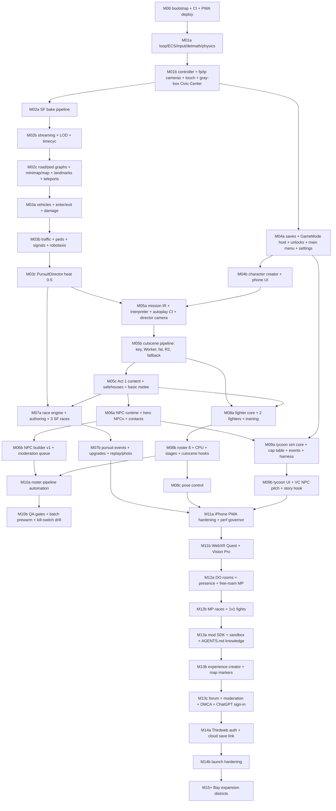

# gamedesign-decomposition — systems, data models, controls, unlocks, milestones; three original SF-only story premises

Date checked: 2026-10-18 · Researcher: S00 (dimension `gamedesign-decomposition`) · Status: complete research input for S01, S03, S06, S07, S08, S10, S13 and the Architect's milestone plan.

**Binding inputs read first:** `research/owner-updates.md` (SF-accurate first; Bay later), `prompt-pack/06-SHARED-CONTEXT.md` v0.9 (R-IDs, C01–C17), `prompt-pack/01-MASTER-PROMPT-OPUS-5.5.md` (milestone order M00–M15+), `prompt-pack/03-SPEC-TEMPLATE.md` (milestone format), `research/repos-world.md` (gta-sa-earth interpreter/director/traffic, SF bake), `research/repos-grand-v.md` §3 (sandbox feature checklist, save profiles), `research/repos-webport.md` (input, saves, device profiles), `research/claude-5-5-model-facts.md`. This report does not repeat those; it cites them as `[research/<file>.md]`.

**Scope rule applied throughout (owner update 2026-10-18):** the v1 world is the City and County of San Francisco only. Every story premise's Act 1, every v1 racing route and every fighter stage below is inside SF. Oakland/East Bay, the Peninsula and the South Bay are skyline/backdrop in v1 and appear only as named expansion hooks (M15+).

All game-design numbers in this report (frame counts, heat thresholds, tick lengths, prices in game currency) are **design starting values owned by this project**, not claims about external systems; they need no citation and are tunable data. Claims about external systems are in "## Verified facts" or "## Unverified".

---

## 0. Executive summary

1. **One engine, one city, four lenses.** The four modes must share one deterministic simulation core (fixed 60 Hz step, seeded RNG streams, deterministic math), one road graph, one character/vehicle pipeline, one camera director and one save. Each mode is a `GameMode` (C06) plug-in that borrows systems rather than owning copies. This is what makes the scope buildable by a solo builder model: Racing reuses M03's vehicles and pursuit director; Culture Wars reuses the M05 director camera and cutscene cache; Tycoon reuses the M06 NPC dialogue proxy.
2. **Determinism is a requirement, not a nicety.** Mission autoplay in CI (gta-sa-earth's "simulate once, record, scrub", [research/repos-world.md §3.4]), race ghosts, fighter replays/rollback and tycoon Monte-Carlo balancing all depend on it. JavaScript `Math` transcendental functions are implementation-dependent across browsers (verified, MDN), so simulation code must use a project `detmath` module; Rapier ships a separate cross-platform-deterministic npm build (verified) that sims needing replay should use.
3. **Missions are data.** Author in TypeScript, compile to a JSON IR validated by JSON Schema, run on an interpreter with threads/waits/zone predicates/event timeline. Mods and the ChatGPT/agent modding flow only ever touch the IR. Every mission ships with an autoplay bot path and an expected-duration band that CI enforces.
4. **One `PursuitDirector` serves story and racing.** Heat 0–5 with points, escalating units (patrol → SUVs/roadblocks → spikes/helicopter → tactical), line-of-sight search, cooldown with hiding spots, respray to shed vehicle heat and bust rules — the structure of NFS Most Wanted (2005) as documented (verified), re-designed with SF-specific twists (robotaxis as automatic witnesses, bridges as sealable portals, hill-crest jumps as pursuit breakers).
5. **Culture Wars is a 2.5D 60 Hz fighter** with explicit frame data, capsule hit/hurtboxes per frame, a 30-frame input ring buffer, and an SF6-style "Modern" simplified scheme (direction + Special button; verified Capcom pattern) as the default for touch and pose control. Pose mode (MediaPipe Pose Landmarker, 33 landmarks, LIVE_STREAM, on-device; verified) is a separate ruleset with widened timing windows, never mixed into ranked pad play.
6. **Cutscene combinatorics must be designed, not discovered.** For a 12-fighter roster, pair×stage intros would be 66×8 = 528 clips; splitting intros into per-character walk-ins (12×8 = 96) plus per-pair face-offs (66), and keying specials/finishers per character (not per victim), brings the full fighter set to ~234 clips. Keys include soul version, likeness tier and model endpoint version so a kill-switch or model upgrade invalidates exactly the right assets.
7. **Tycoon numbers come from a deterministic core; the LLM only voices them.** Term sheets are generated as a bounded envelope from company metrics and VC personality; the AI-NPC investor chooses inside the envelope and talks. Cap-table math uses the YC post-money SAFE rule (ownership = investment ÷ post-money cap; verified) and priced rounds with option-pool shuffle; event shocks use a mean-time-to-happen hazard model with multiplicative modifiers, calibrated with real anchors (USGS 72% M6.7+ Bay Area 2014–2043; Carta ~18% median Series A dilution; verified).
8. **Milestone order kept; sizes fixed.** The owner's M00–M15+ order is kept. Several milestones cannot fit one Sonnet 5.5 session (≈2–4 h, ≲40 files), so this report splits them into lettered sub-milestones (M02a–c, M03a–c, …) without reordering, totalling 40–47 sessions through M14b. Six pull-forwards, each with a reason (§9): touch controls and a one-check XR smoke test in M01b (iPhone is the primary mobile target, R-PLAT-01; WebGPU-in-WebXR risk), the `GameMode` host + unlock registry in M04a (needed by M05's unlock events), the director camera in M05a (fallback for all cutscenes and replays), weather/time in M02b and teleports in M02c.
9. **Three original SF-only story premises** — *Hella Valuation* (robotaxi curb-rights war, Bayview to the Bay Bridge), *Dark Mode* (citywide blackout and a rogue grid AI), *The Clout Index* (a real-time city ranking app). Each has 12 missions, factions, mode-unlock beats, and roster slots for real-person NPCs that default to the `parody` tier. Recommended: *Hella Valuation* for v1 (best fit to Bayview/SoMa/Mission Act 1 and to all three sub-modes).
10. **Flagged:** firearms (recommend none in v1), depiction of real people committing crimes (recommend never; parody NPCs appear as mentors, rivals and sport fighters only), brand parody for vehicles/venues, and sensitive neighborhoods (Tenderloin, Bayview–Hunters Point) need owner and legal-ip-likeness decisions.

---

## 1. Design pillars and cross-cutting rules

| # | Pillar | Concrete rule for the spec |
|---|---|---|
| P-1 | **San Francisco is the level.** | Every authored location is stored as lat/lng + landmark id and baked to the ENU frame [research/repos-world.md P1]. A mission, race or stage that references a place not in the baked SF graph fails schema validation. |
| P-2 | **One engine, four lenses.** | Modes implement C06 `GameMode`; they may not instantiate their own physics world, renderer, camera rig or save store. Shared services are injected via `ModeContext`. |
| P-3 | **Deterministic core.** | Sim runs at fixed 60 Hz (C02). Seeded RNG streams per subsystem (`rng('traffic')`, `rng('mission:m.a1.03')`, `rng('tycoon')`). No `Math.random`, `Date.now`, or `Math.sin/cos/exp/atan2/pow` inside `sim` code; lint rule enforces it; use `packages/engine/detmath`. |
| P-4 | **Content is data.** | Missions, races, fighters, moves, vehicles, events, unlocks are JSON validated by JSON Schema at build time and at mod load. TypeScript authoring helpers compile to that JSON. |
| P-5 | **GenAI never blocks play.** | Every cutscene and NPC line has a non-generated fallback (R-CUT-03, R-NPC-05). Nothing calls fal or the LLM without a cache check (R-ENG-03). |
| P-6 | **Names are indirect.** | Every real-world brand, venue and person appears through a `NameRegistry` entry (`displayName`, `tier`, `aliases`) so legal can rename in one commit (R-IP-01, R-NPC-04). Code never hard-codes a real name. |
| P-7 | **Stylized, readable, recognizable.** | Art direction is stylized (cel/toon-PBR hybrid), not photoreal: it fits the mobile budget, the likeness policy and the parody posture, while geometry accuracy (streets, hills, landmarks) carries recognizability. |
| P-8 | **Story and sandbox never share a save namespace.** | Cheats/sandbox toggles live in the `sandbox` slice; story saves can't be modified by sandbox actions [research/repos-grand-v.md §6 rec 11]. |
| P-9 | **Every system has a bot.** | Mission autoplayer, race AI driver, fighter CPU, tycoon auto-founder: all exist so CI can play the game headless. |

---

## 2. Mode 1 — MAIN STORY open world

### 2.1 Player fantasy and core loop
**Fantasy:** "Come up from nothing to Bay legend in a city that is half hyphy, half hypergrowth — and know exactly which corner you're on."

**Core loop (minute to minute):** roam SF (on foot / vehicle / transit) → pick up a contact (phone, map marker, NPC approach) → mission (intro → objectives → fail/success → reward) → spend (garage, outfits, property, upgrades) → new contacts and districts. **Emergent loop:** infraction → heat → pursuit → escape/bust → consequences (fines, impound strikes, vehicle heat). **Meta loop:** two reputations (Street Cred and Tech Clout) gate contacts, factions and mode unlocks.

### 2.2 Systems list (owner subagent → first milestone)

| System | Owner | First milestone |
|---|---|---|
| Fixed-step loop, ECS, input actions, detmath, RNG streams | S01 | M01a |
| Character controller (walk/run/sprint/jump/vault low walls; swim = respawn at shore in v1) | S01 | M01b |
| Cameras fp/tp + collision; cinematic director | S01 / S03 | M01b / M05a |
| SF bake + streaming + landmarks + minimap/full map | S02 | M02a–c |
| Vehicle physics, enter/exit, damage | S01/S06 | M03a |
| Ambient traffic, peds, signals, robotaxis, transit set dressing | S02 | M03b |
| PursuitDirector (heat, units, roadblocks, spikes, heli, cooldown, bust) | S01 (shared with S06) | M03c |
| Save profiles, slices, migrations; unlock registry; GameMode host | S01/S09 | M04a |
| Main menu, settings, character creator, phone UI | S10 | M04a–b |
| Mission IR + interpreter + autoplayer + event timeline | S03 | M05a |
| Cutscene request/cache/fallback | S03/S05/S09 | M05b |
| Act 1 content | S03 | M05c |
| AI NPC runtime, contacts, hero NPCs, NPC builder | S04 | M06a–b |
| Economy, property, shops | S01/S03 | M04a (wallet) / M05c (shops, safehouses) |
| Combat (melee + takedowns, shared move core with fighter) | S01/S07 | M05c (basic) / M08a (shared core) |

### 2.3 v1 district map (SF only)
The 41 DataSF Analysis Neighborhoods (verified) are the authoritative polygon set; they are grouped into 10 gameplay districts. Detail tier: **A** = full detail at launch (interiors for mission sites, dense props), **B** = full streets/buildings, sparse props, **C** = streets/buildings, procedural facades only.

| # | Gameplay district | Analysis neighborhoods (examples) | Role | Landmarks / set pieces | Tier |
|---|---|---|---|---|---|
| D1 | **SoMa & Mission Bay** | South of Market, Mission Bay | Tech HQs, launch parties, Act 1 hub | arena (Chase Center analogue, opened 2019; verified), ballpark analogue, Caltrain terminus 4th & King, freeway viaducts (hiding spots) | A |
| D2 | **Mission** | Mission, Bernal Heights (north) | Home streets, murals, food, Dolores Park | Dolores Park slopes, 16th/24th St BART plazas | A |
| D3 | **Bayview–Hunters Point** | Bayview Hunters Point | Shipyard garage crew, sideshows, industrial chases | shipyard cranes, Candlestick point, 3rd St T-line | A |
| D4 | **Civic Center, Tenderloin & Hayes Valley** | Tenderloin, Hayes Valley, Western Addition (east) | City Hall (world origin [research/repos-world.md §1.1]), AI hacker houses, government plots | City Hall dome, UN Plaza BART, Market St | B (depict with care, §11) |
| D5 | **FiDi & Embarcadero** | Financial District/South Beach | VC offices, Tycoon pitches, Ferry Building | Ferry Building (ferry portal → expansion), Embarcadero promenade, Transbay-style rooftop park | A |
| D6 | **Chinatown, North Beach, Nob/Russian/Telegraph Hill** | Chinatown, North Beach, Nob Hill, Russian Hill | Steep-street races, cable cars, Coit Tower | cable-car lines (3; verified), Lombard switchbacks, Filbert 31.5% grade (verified), Coit Tower | A |
| D7 | **Marina, Presidio & Golden Gate approach** | Marina, Presidio, Pacific Heights | Money, mansions, GGB north portal | Palace of Fine Arts analogue, Crissy Field, Golden Gate Bridge (portal, closed in v1) | B |
| D8 | **Haight, Golden Gate Park, Richmond, Sunset** | Haight Ashbury, Golden Gate Park, Inner/Outer Richmond, Sunset/Parkside | Fog zone, counterculture, Great Highway night races | Ocean Beach, park bandshell, Haight & Ashbury | B |
| D9 | **Twin Peaks, Glen Park & the Hills** | Twin Peaks, Glen Park, West of Twin Peaks, Noe Valley | Downhill races, broadcast tower, overlooks | Twin Peaks overlook, Mount Davidson (928 ft, highest point; verified), antenna tower analogue | B |
| D10 | **Treasure Island & Yerba Buena Island / Bay Bridge (west span)** | Treasure Island | East portal, finale set piece | Bay Bridge west span, YBI tunnel, TI skyline view (TI/YBI redevelopment administered by SF agencies; verified) | B |
| — | Outer neighborhoods (Excelsior, Visitacion Valley, Lakeshore, Oceanview) | — | Traffic and roaming only in v1 | Lake Merced loop | C |
| — | Alcatraz | (island) | Fighter stage + one late mission via boat cutscene | prison yard | stage-only |

Backdrop-only in v1 (no gameplay): Oakland/East Bay hills and port cranes, Marin Headlands beyond the GGB, Daly City/Brisbane ridge, SFO approach lights. They are the Atlas-style flat-massing "region" tier [research/repos-world.md P16].

### 2.4 Boundaries, portals and transit
- **Hard boundaries:** Pacific shoreline and Bay shoreline (water = soft wall: vehicle stalls + respawn; swimming deferred); the southern county line is a soft wall (traffic barrier + fog density ramp + "Leaving SF — coming soon" toast) with backdrop beyond.
- **Portals:** Golden Gate Bridge (north) and Bay Bridge beyond Yerba Buena Island (east) are `Portal` entities: drivable deck up to a toll/closure set piece; in v1 they open only in scripted finales (cutscene → return). At heat 5 the PursuitDirector "seals" portals with roadblocks. In M15+ a portal becomes a streaming handoff to the expansion district.
- **Transit:** BART's eight SF stations (Embarcadero, Montgomery, Powell, Civic Center/UN Plaza, 16th St Mission, 24th St Mission, Glen Park, Balboa Park; verified) are diegetic fast-travel nodes (enter station → fade → exit at chosen station; costs game cash; disabled at heat ≥ 1). The three cable-car lines (Powell–Mason, Powell–Hyde, California; shared Powell & Market turntable; verified) are rideable set pieces on fixed splines (hop on/off, cling-on stunts), also a fighter stage. Muni Metro (incl. the Central Subway, opened 2022; verified) is set dressing in v1 (trains on splines, stations as landmarks). Ferries at the Ferry Building are the expansion portal for East Bay content.

### 2.5 Mission structure
GTA-genre structure (generic convention, not Rockstar content): **trigger → intro (cutscene or in-engine) → stages of objectives → fail or success → outro → rewards → unlocks**.

State machine per mission instance:
```
Locked ──(prereqs met)──▶ Available ──(start trigger)──▶ Intro ──▶ Stage[i] ──(all objectives)──▶ Stage[i+1] … ──▶ Outro ──▶ Passed ──▶ Rewarded
                                                          │            │
                                                          │            └─(fail rule)──▶ Failed ──(retry)──▶ Stage[checkpoint]
                                                          └─(skip)──▶ Stage[0]                 └─(quit)──▶ Available
```
Rules: one active story mission at a time; side activities (races, fights, odd jobs) may run when no story mission is active; heat policy per mission (`maxHeat`, `clearOnPass`); a mission may suspend ambient systems (traffic density, ped density, weather lock, time lock) and must restore them on exit; failure reason is always shown as a localized string (`fail.reason.*`).

### 2.6 Mission scripting DSL — requirements
R-DSL list (for S03; final schema is an ADR delegated to the Architect):
1. **Authoring:** TypeScript builder API (`defineMission(...)`) compiled by `tools/mission-build` to **JSON IR** (`assets/missions/<id>/mission.json`) + JSON Schema validation. Runtime never executes authored TypeScript; it executes the IR. Mods and agent-authored missions emit IR directly.
2. **Interpreter:** cooperative threads with `wait(ms)`, `waitUntil(predicate)`, `race([...])`, `all([...])`; ≤ N ops per thread per tick (gta-sa-earth used 20,000 instructions/tick [research/repos-world.md §3.4]; we cap at 2,000 IR ops); fixed-step world; deterministic seed per mission.
3. **Predicates:** zone tests (circle/polygon/landmark/road-edge set), entity state (in vehicle, health, distance band), heat level, time of day, weather, flags, NPC relationship values, inventory, mode results.
4. **Event timeline:** every interpreter step can emit typed events (start from gta-sa-earth's 27 types: cam, fade, print/subtitle, voice, widescreen, weather, clock, density, explosion, passed, failed, …) to a recorder → enables "simulate once, scrub" previews, CI assertions, and cutscene storyboards for the video model.
5. **Autoplayer:** every `goto`/`follow`/`chase` objective sets an autoplay goal (A* on road/ped graphs, re-plan every 2.5 s [research/repos-world.md P14]); every `talk` objective has a scripted default intent; every `mode` objective has a bot (race AI, fighter CPU, tycoon auto-founder). CI fails if any mission does not pass under autoplay within its `expectedSec` band for 3 seeds.
6. **Checkpoints:** per-stage snapshots of mission-owned state only (not the whole world); retry restores player position/vehicle/inventory delta.
7. **Dialogue:** `say(npc, locKey)` for scripted lines; `talk(npc, intent, outcomes)` for AI NPC conversations whose structured result (`{outcome: 'agree'|'refuse'|'escalate', mood}`) maps to stage jumps; both have subtitle keys and offline fallbacks.
8. **Cutscenes:** `cutscene(ref)` where `ref` = C09 key inputs + an in-engine `DirectorScript` fallback; mission never waits on generation (if the asset is not in R2, play the fallback).
9. **Mode hooks:** `mode({mode:'racing'|'fighter'|'tycoon', defId, stub})`; the `stub` objective (timed drive, scripted brawl, dialogue choice) is used until that mode's milestone ships, so Act 1 is completable from M05c onward.
10. **Localization & accessibility:** no raw strings; all text by key; every voice line has a subtitle; timed objectives get an accessibility multiplier (`settings.access.timerScale`).
11. **Debugger:** `?mission=<id>&stage=<n>&seed=<s>` URL params, an overlay showing thread states/predicates/events, and a scrubber over the recorded timeline.
12. **Versioning:** `mission.version` + `worldBake` hash; on load, edges/landmarks are re-resolved; a mission whose references no longer resolve is disabled with a clear error (important when the SF bake is refreshed).

```ts
// C09 (owner S03) — sketch for spec/04
type LatLng = [lat: number, lng: number];
type MissionId = `m.${string}`; type NpcId = `npc.${string}`; type LandmarkId = `lm.${string}`;
type Zone =
  | { k: 'circle'; at: LatLng; r: number }
  | { k: 'poly'; ring: LatLng[] }
  | { k: 'landmark'; id: LandmarkId; r?: number }
  | { k: 'edges'; edgeIds: number[] };                 // road-graph edges, resolved against worldBake
interface MissionDef {
  id: MissionId; version: number; worldBake: string; act: 1 | 2 | 3;
  title: LocKey; giver: NpcId | 'phone' | 'world'; district: DistrictId;
  requires: Predicate[]; start: Trigger;
  intro?: CutsceneRef; outro?: CutsceneRef;
  stages: Stage[]; fail: FailRule[]; checkpoints: 'per-stage' | number[];
  heatPolicy: { maxHeat: HeatLevel; clearOnPass: boolean };
  ambient?: { traffic?: number; peds?: number; weather?: WeatherPreset; hour?: number };
  rewards: Reward[]; unlocks?: UnlockEventId[]; modeHooks?: ModeHook[];
  autoplay: { expectedSec: [min: number, max: number]; seeds: number[] };
  tags: string[];
}
interface Stage { id: string; join: 'all' | 'any' | 'sequence'; objectives: Objective[];
  onEnter?: Action[]; onComplete?: Action[]; timeLimitSec?: number; checkpoint?: boolean }
type Objective =
  | { k: 'goto'; zone: Zone; onFoot?: boolean; inVehicle?: VehicleFilter; stopped?: boolean }
  | { k: 'enterVehicle'; filter: VehicleFilter }
  | { k: 'follow'; target: EntityRef; band: [near: number, far: number]; loseAfterSec: number }
  | { k: 'chase'; target: EntityRef; catchDist: number }
  | { k: 'escape'; untilHeat: 0 }
  | { k: 'collect' | 'deliver'; item: ItemId; to?: Zone; fragile?: number }
  | { k: 'protect'; target: EntityRef; minHealth: number; durationSec: number }
  | { k: 'talk'; npc: NpcId; intent: string; outcomes: Record<string, StageId> }
  | { k: 'photo'; landmark: LandmarkId; framing?: 'any' | 'wide' | 'selfie' }
  | { k: 'stealth'; detectBudget: number }
  | { k: 'defeat'; targets: EntityRef[]; nonLethal: true }
  | { k: 'wait'; sec: number }
  | { k: 'mode'; hook: ModeHook };
interface ModeHook { mode: 'racing' | 'fighter' | 'tycoon'; defId: string; stub: Objective;
  passOn: 'win' | 'finish' | 'any'; unlockOnFirstEncounter?: UnlockEventId }
interface CutsceneRef { keyInput?: CutsceneKeyInput; fallback: DirectorScript; subtitles: LocKey[]; skippable: true }
interface MissionRuntime { id: MissionId; state: 'available'|'intro'|'stage'|'outro'|'failed'|'passed';
  stage: number; threads: ThreadState[]; seed: number; startedAtTick: number; checkpoint?: Snapshot }
```

### 2.7 Traffic and pedestrians
Adopt [research/repos-world.md P6–P8, rec 5–6] (random-walk instanced agents on `roads/graph.bin`, A* for purposeful agents, separate ped graph). Game-design additions:
- **Density model:** `density(district, hour, weather, missionOverride)` → target agent counts per 100 m bucket; SoMa/FiDi weekday rush peaks, Mission/Haight evening foot traffic, Bayview industrial trucks by day, Great Highway near-empty at night.
- **Intersections:** baked intersection nodes with simple fixed-cycle signals (green 20 s / amber 3 s / all-red 1 s defaults) and stop-sign nodes (many SF residential intersections). Signal state is part of the sim (deterministic).
- **Vehicle archetypes (v1, 10):** compact, sedan, rideshare hybrid, delivery van, Muni bus (set dressing on route splines), box truck, pickup, police cruiser, police SUV, **robotaxi**.
- **Robotaxi behavior (SF-specific, grounded):** never exceeds the limit, yields widely to peds, holds at dark/failed signals as four-way stops and can stall when uncertain (Waymo's documented behavior in the 20 Dec 2025 SF blackout; verified) → in gameplay robotaxis are predictable rolling obstacles, **automatic witnesses** (they report infractions they "see" to the PursuitDirector after a 2 s delay, unless the player is masked/in a disguise vehicle), and fare-able (call a robotaxi from the phone = paid fast travel with a short ride cut).
- **Peds:** wander on the ped graph, react (flee/record on phone/cheer at sideshows), report crimes (witness delay 3–6 s), pay attention to landmarks (crowds at Dolores Park, Fisherman's Wharf-style piers). Ped variety from a small modular kit (8 bodies × 20 outfits × palette swaps), never from real-person likenesses.

### 2.8 Wanted / police — the shared PursuitDirector
Structure inspired by NFS Most Wanted (2005) as documented: heat rises with offences and evading, higher heat brings roadblocks, spike strips, helicopters, SUVs and federal units; pursuit breakers; a cooldown phase where hiding spots shorten cooldown; arrest = fine + impound strike; changing a car's look lowers its heat (verified, Wikipedia). Our values:

| Heat | Points ≥ | Units on scene (max) | Tactics unlocked | Search radius on LOS loss | Cooldown to clear |
|---|---|---|---|---|---|
| 0 | 0 | — | patrols ambient | — | — |
| 1 | 100 | 2 patrol cruisers | follow, siren, loudspeaker | 150 m | 10 s |
| 2 | 300 | 4 cruisers | PIT, box-in, rolling block | 250 m | 20 s |
| 3 | 700 | 5 + 2 SUVs | 2-car roadblocks on predicted route | 400 m | 35 s |
| 4 | 1,500 | 6 + 2 SUVs + helicopter | spike strips at choke points; heli spotlight with BVH line-of-sight | 600 m | 50 s |
| 5 | 3,000 | 8 + tactical units | heavy roadblocks; bridge/portal seal; spikes on both ends of steep blocks | 900 m | 75 s |

**Infraction points (per event):** speeding within sight of a unit 5/s · red light seen by unit or robotaxi 10 · hit civilian vehicle 20 · hit police vehicle 60 · property damage 2–15 per prop · assault (melee) 80 · leaving a mission-protected zone per mission rules · evasion +15 per 10 s at current level.
**Search model:** units share a last-known position; when no unit (or heli) has LOS for 2 s, a search circle (radius per table, growing 5 m/s) opens; outside the circle and unseen → cooldown meter fills; **hiding spots** (freeway viaducts, parking garages, alleys, car washes, Muni tunnel portals blocked for cars) fill it ×2; seen again → cooldown resets.
**Shedding heat:** `vehicleHeat` is stored per vehicle instance; a **respray** (body shop in D1/D3/D6) or swapping cars resets vehicle heat (not player heat).
**Pursuit breakers (SF set):** scaffolding over sidewalks, produce stands (Chinatown), construction cranes' loads (SoMa), parked cable car (Powell turntable, mission-only), hill-crest jumps (Russian Hill) where pursuers lose LOS.
**Bust:** speed < 2 m/s with ≥ 2 units within 8 m for 3 continuous seconds (on foot: grappled for 2 s). Consequence: fine = max($250, 5% cash + heat × $500), vehicle impound strike (3 strikes = impounded; retrieve for a fee), active story mission fails with checkpoint retry.
**Scripted heat:** missions can force heat (`setHeat(4)`), cap it (`maxHeat`) or spawn named units; racing events start at a set heat (§3). A heat-6 "finale" tier (NFS MW used a special top tier in its final chase; low-confidence sources) is reserved for scripted story finales only.

```ts
// owned by S01, consumed by S06/S03
type HeatLevel = 0 | 1 | 2 | 3 | 4 | 5 | 6; // 6 = scripted finale only
interface HeatState { level: HeatLevel; points: number; lastKnown?: { pos: Vec3; tick: number };
  searchRadius: number; cooldown: number /*0..1*/; units: EntityId[]; bounty: number;
  infractions: Partial<Record<InfractionKind, number>>; vehicleHeat: Record<VehicleInstanceId, number>;
  sealedPortals: PortalId[] }
interface PursuitConfig { levels: { points: number; maxUnits: number; tactics: Tactic[]; searchR: number; cooldownSec: number }[];
  infractionPoints: Record<InfractionKind, number>; bust: { speed: number; units: number; radius: number; sec: number } }
```

### 2.9 Economy
- **Currencies:** `cash` (game dollars, integer cents), `streetCred` (0–1,000), `techClout` (0–1,000). No premium currency, no real money, no tokens (non-goal, 06 §3).
- **Sources:** mission rewards ($500–$25,000 by act), races (purse by class), fights (purse + side bets vs NPCs, capped), odd jobs (deliveries, rideshare fares in your own car), property income (weekly), tycoon dividends (capped transfer ≤ $10,000 per in-game week into the story wallet so Tycoon can't trivialize the story).
- **Sinks:** vehicles ($8k compact → $1.2M hypercar), upgrades, resprays ($500), impound fees, fines, hospital ("you got patched up at SF General-style ER": $1,000), outfits, safehouses, BART fares (flavor), fast-travel robotaxi fares.
- **Balance:** a spreadsheet-free balance test: `tools/econ-sim` runs the autoplayer through Act 1–3 with median choices and asserts cash at each act boundary within target bands.

### 2.10 Phone and menu UI (diegetic)
Phone = pause menu on mobile, quick menu on desktop, wrist panel in XR. Apps: **Map** (full map + waypoints + published experiences, R-MAP-03, R-MOD-04), **Contacts/Messages** (scripted texts; AI NPC chat threads after M06), **Jobs** (available missions, races, fights), **Garage** (call a car to your location, cost/time), **Ride** (robotaxi fast travel), **Camera** (photo objectives, selfie, photo mode entry), **Feed** (Clout feed reacting to your actions — parody social app), **Bank** (cash, property income, tycoon dividends), **Settings** shortcut. All apps are DOM overlays bound to the same view models as the main menu (S10), with controller/touch navigation.

### 2.11 Property and garage
- **Safehouses (v1 three):** Mission flat (D2), SoMa loft (D1), Bayview shipyard garage (D3; unlocked in Act 1). Each = save point, wardrobe, garage slots (2/4/6), respawn point, sleep (advance time).
- **Businesses (Act 2+):** buyable fronts (taqueria, record shop, co-working space) that pay weekly and can be targets of random events (shared engine with Tycoon §5.6).
- **Garage:** one global garage list (C05 `garage[]`) shared by story and racing; each `VehicleInstance` has upgrades, livery, damage, `vehicleHeat`, impound strikes.

### 2.12 Combat stance (recommendation; owner decision Q-GD-01)
Default for v1: **no firearms.** Combat is melee + takedowns + vehicle combat, built on the **same move/frame-data core as Culture Wars** (open-world melee uses a reduced move set of the player's chosen fighting style). Reasons: (a) it halves combat engineering (one core, two presentations); (b) parody-tier real-person NPCs must not be depicted in gun violence (likeness/false-light risk, §11); (c) it keeps the game closer to a teen rating band; (d) police escalation stays about pursuit, not shootouts. Non-lethal gadgets (traffic cones, smoke, EMP-style "robotaxi stopper" from the hacker faction) provide variety. Firearms remain a later, separate decision with its own ADR.

### 2.13 Camera rules (story)
- **On foot:** third person behind-the-shoulder (default; shoulder swap key) or first person (eye height 1.7 m [research/repos-world.md rec 9]); switch anytime outside cutscenes (R-PLAT-04).
- **In vehicle:** chase cam (tp; 3 distance presets) or hood/cockpit cam (fp); look-behind; auto-recentre after 1.5 s of no look input.
- **Cutscenes:** director camera (P15 port) or video asset; player camera input disabled; skippable.
- **XR:** always first person; vehicles use cockpit view with comfort vignette; no camera shake; no director camera cuts (cutscenes play on a floating 2D panel or as a fixed-vantage in-engine scene); snap turn default 30°.

### 2.14 Progression and save slice
```ts
// C05 story slice (owner S01)
interface StorySlice { act: 1 | 2 | 3; premise: 'hella-valuation' | 'dark-mode' | 'clout-index';
  missions: Record<MissionId, { state: 'locked'|'available'|'passed'; bestSec?: number; medals?: 0|1|2|3 }>;
  activeMission?: { id: MissionId; checkpoint: Snapshot };
  flags: Record<string, boolean | number | string>;
  wallet: { cash: number; streetCred: number; techClout: number };
  heat: { vehicleHeat: Record<VehicleInstanceId, number>; impoundStrikes: Record<VehicleInstanceId, number> };
  property: { safehouses: SafehouseId[]; businesses: { id: BusinessId; level: number }[] };
  npcRelations: Record<NpcId, { trust: number; met: boolean; lastTalkTick?: number }>;
  stats: { distanceKm: number; pursuitsEscaped: number; busted: number; fightsWon: number; racesWon: number };
  position: { lat: number; lng: number; heading: number; vehicle?: VehicleInstanceId; safehouse?: SafehouseId } }
```

### 2.15 Unlock hooks (R-MODE-05)
A mission objective of `k:'mode'` with `unlockOnFirstEncounter` emits `UnlockEvent` → `save.unlocks` → main menu tile becomes enabled with a one-time "New mode unlocked" toast. The story keeps its own instance of the encounter; the standalone menu mode starts from the mode's own progression slice.

### 2.16 Multiplayer implications (M12)
Syncs: player transform/animation state, vehicle transforms + damage state, heat level per player (pursuits are per-player; units visible to all), interest-managed ambient traffic owned per zone [research/repos-webport.md rec 11]. Does not sync in v1 MP: story missions (single-player only), cutscenes, AI NPC conversations (local to the speaking player). MP free-roam activities: races (lobby in a DO room), fights (1v1 invite; rollback later), sideshow meetups, photo mode.

### 2.17 Art and audio needs (story)
- **Art:** SF bake (buildings, terrain, roads) + facade style kit per district style class (Victorian/Edwardian, Marina stucco, SoMa glass/warehouse, Chinatown, Bayview industrial) [research/repos-world.md P3]; ~40 hero landmark meshes (stylized, original modelling over open-data massing); 10 traffic vehicles + 6 police; ped kit; 3 safehouse interiors; mission props (~150); UI icon set; minimap style.
- **Audio:** SF ambience beds per district (foghorns at the waterfront, cable-car bells, Muni hum, gulls, freeway roar under viaducts), police radio chatter (original scripts, TTS or recorded), sirens per unit tier, engine sound sets per vehicle class, footsteps per surface, 3–4 original radio stations (AI-generated or commissioned "hyphy-inspired" tracks per legal report), UI sounds, mission stingers (pass/fail).

### 2.18 Vertical slice (story)
**VS-Story = end of M05c:** a player opens the hosted PWA, creates a character, starts a new game in the Bayview garage, plays Act 1 missions 1–5 of the chosen premise across D1–D3 with real SF streets, traffic, robotaxis, a heat-2 pursuit, one generated (or fallback) cutscene, a stubbed race and a stubbed fight, saves, closes the tab, resumes on reload — at 60 fps desktop and ≥ 30 fps on the reference iPhone.

---

## 3. Mode 2 — RACING

### 3.1 Player fantasy and core loop
**Fantasy:** "Own San Francisco's hills at 200 km/h — and lose the cops on the Embarcadero."
**Loop:** pick event (ladder / free event / pursuit) → choose car from garage (class-limited) → race on real SF streets (traffic and police per event) → purse + Racing Rep → upgrade / buy → climb the **Tha Bay 10** ladder (10 rivals; beating one unlocks the next rival, a car and a district's events — the ladder structure mirrors NFS MW's 15-racer Blacklist, verified, at our own size).

### 3.2 Systems list
Arcade vehicle model (shared with M03a), race director (grid, gates, positions, laps, finish), track authoring tool + validator, AI drivers (racing line on graph + overtaking + rubber-band), PursuitDirector in race context, damage (visual + mechanical), nitrous, upgrades/tuning, replay recorder + director replays, photo mode, ghosts/leaderboards (local in v1, online in M12), results/rewards.

### 3.3 Vehicle physics tiers (arcade)
Raycast-suspension vehicle (4 wheel rays) on the shared physics world, with simplified tire model (lateral grip curve with peak slip angle, longitudinal slip for wheelspin), steering assist and drift assist. Sub-stepping: vehicles integrate at 120 Hz (2 substeps of the 60 Hz sim) above 100 km/h to keep hill crests and jumps stable. SF hills matter: suspension travel and landing damping are tuned so a Russian Hill crest at 120 km/h produces a readable jump and a survivable landing; Filbert/22nd St 31.5% blocks (verified) are flagged as "jump zones" in the bake.

| Class | Example archetypes (names via NameRegistry) | Feel | Top speed (design) | Notes |
|---|---|---|---|---|
| D | compact, hatch, rideshare hybrid | forgiving, slow | 170 km/h | Story starter cars |
| C | sports coupe, hot hatch, EV sedan | balanced | 230 km/h | First ladder tier |
| B | muscle, performance EV | power-heavy, oversteer | 270 km/h | Sideshow favorites |
| A | supercar | high grip, twitchy | 320 km/h | Desktop "Forza look" showcase |
| S | hypercar, **rocket roadster** | extreme | 350+ km/h | Late ladder; roadster has `thrusterHop` |
| R | **robotaxi** (special class) | governed, safe | 105 km/h governed | `speedGovernor`, `autoYield`, `stallOnDarkSignal`; "jailbreak" upgrade lifts governor and adds heat |

Grounding for the two named specials: robotaxis in SF hold at dead signals as four-way stops and stalled during the Dec 2025 blackout (verified); Waymo operates on Bay Area freeways and started SFO service in Jan 2026 (verified) — airport/freeway content is out of v1 scope (SFO is outside SF). The second-generation Tesla Roadster was unveiled on 15 Oct 2026 with cold-gas thrusters that make it hop and flip, production slated for 2028 (verified, 3-day-old news): a parody "rocket roadster" with a short-hop ability (jump over traffic or a roadblock, 2 charges) is a distinctive, SF-hill-friendly mechanic. Real brand names (Waymo, Tesla) are trademarks; only NameRegistry parody names ship (legal-ip-likeness).

```ts
// C06 consumer types (owner S06)
type VehicleClass = 'D' | 'C' | 'B' | 'A' | 'S' | 'R';
interface HandlingProfile { id: string; class: VehicleClass; massKg: number; powerKw: number;
  torqueCurve: [rpm: number, nm: number][]; gears: number[]; finalDrive: number; drivetrain: 'FWD' | 'RWD' | 'AWD';
  grip: { front: number; rear: number; peakSlipDeg: number }; driftAssist: number /*0..1*/; steer: { lockDeg: number; speedDegPerS: number; assist: number };
  downforce: number; brake: { force: number; bias: number }; suspension: { stiffness: number; damping: number; travelM: number };
  nitro: { capacity: number; boostKw: number; refill: { drift: number; nearMiss: number; draft: number; air: number } };
  durability: number; quirks?: Quirk[] }
type Quirk =
  | { k: 'speedGovernor'; kph: number; jailbreakItem?: ItemId }
  | { k: 'autoYield'; radiusM: number }
  | { k: 'stallOnDarkSignal'; holdSec: [number, number] }
  | { k: 'thrusterHop'; impulse: number; charges: number; rechargeSec: number }
  | { k: 'regenBraking'; recover: number };
interface VehicleInstance { id: VehicleInstanceId; defId: string; upgrades: Record<UpgradeSlot, number>; livery: LiveryRef;
  damage: { body: number; engine: number; tires: [number, number, number, number] }; vehicleHeat: number; impoundStrikes: number }
```

### 3.4 Police chase AI in races
Same PursuitDirector (§2.8) with a racing profile: events declare `police: {enabled, startHeat, maxHeat}`; roadblocks are placed on the **predicted route** (A* from player's position toward the next 3 gates), spike strips at choke points the route must cross (bridges approach ramps, tunnel mouths, steep single-lane blocks), helicopter enforces LOS over open areas (Embarcadero, Great Highway); "Rhino" SUVs ram from the front at heat ≥ 4. Pursuit breakers are tagged in race defs so authors can place them. A pursuit race succeeds on **evade** (cooldown completes) or **survive N seconds** with bounty multipliers.

### 3.5 Race types
| Type | Rules | SF example (v1) |
|---|---|---|
| Sprint | A → B through gates | Ferry Building → Ocean Beach via Market & Fell/Oak |
| Circuit | N laps, side streets closed by barriers | Embarcadero–Bay St–Van Ness loop |
| Checkpoint ("tollbooth") | reach each gate before its timer; leftover time carries over (NFS MW tollbooth rule, verified) | Golden Gate Park drives at dusk |
| Speedtrap | sum of speeds at camera gates | Great Highway, Market St |
| Downhill | descent-only sprint, airtime bonus | Twin Peaks → Mission via Market & Clipper |
| Hill climb | ascent sprint, steep-street sections | Russian Hill / Nob Hill |
| Drift | score by angle × speed × duration in zones | Bayview industrial, Candlestick lots |
| Pursuit | start hot (heat n), evade or survive | Embarcadero, SoMa viaducts |
| **Sideshow** | score donuts/figure-8s inside an intersection ring until police arrive (heat 2 at T+60 s), then escape | Bayview intersections; culturally Bay-specific (CA and SF passed anti-sideshow laws; verified) — content flag Q-GD-06 |
| **Robotaxi Rush** | drive a jailbroken robotaxi; deliver a fare without infractions while robotaxi witnesses report | SoMa → Haight |

### 3.6 Track authoring on real streets
`tools/race-author` (CLI + in-game editor): author places waypoints (lat/lng or click on map) → A* over `roads/graph.bin` produces edge list → validator checks continuity, one-way legality (warn only), length, elevation profile (max grade, jump zones), lap closure, gate spacing (auto-gate every 250 m and at turns > 60°), closures for side streets (barrier props), spawn grid fitting lane count, and out-of-bounds (portals, water). Output `assets/races/<id>/race.json` pinned to `worldBake` hash; on bake change, re-snap by lat/lng and fail CI if the edge list changes length by > 5%.

```ts
interface RaceDef { id: string; version: number; worldBake: string;
  kind: 'sprint'|'circuit'|'checkpoint'|'speedtrap'|'downhill'|'hillclimb'|'drift'|'pursuit'|'sideshow'|'robotaxiRush';
  route: { edgeIds: number[]; dir: 1 | -1 }[]; laps?: number; gates: { at: LatLng; widthM: number; timeBonusSec?: number; speedCam?: boolean }[];
  closures: { at: LatLng; propSet: string }[]; grid: { at: LatLng; heading: number }[];
  classLimit?: VehicleClass[]; opponents: { driverId: string; vehicleDef: string; skill: number }[];
  traffic: 'off' | 'light' | 'normal'; police: { enabled: boolean; startHeat: HeatLevel; maxHeat: HeatLevel };
  hour?: number; weather?: WeatherPreset; rubberBand: number /*0..1*/; rewards: Reward[]; unlocks?: UnlockEventId[] }
```

### 3.7 Damage, nitrous, rubber-banding
- **Damage:** visual (panel swaps + morph targets for bumpers/hood, glass decals, smoke/fire VFX tiers), mechanical (engine health scales power to 60% at worst; spiked tire → grip × 0.4 on that wheel; totaled = DNF/bust).
- **Nitrous:** earned, not free — refill by drifting, near-misses (< 1.5 m at > 80 km/h), drafting and airtime; capacity by upgrade level.
- **Rubber-banding:** AI-only speed scaling ±8% max, off in time trials, ghosts and multiplayer; difficulty setting scales it.

### 3.8 Replay and photo mode
Record **inputs + seed** per race (deterministic sim → exact replay; tiny files suitable as ghosts) plus a transform track at 30 Hz as a version-robust fallback. Replays use the auto-director (P15) with racing shot weights (chase, flyby, side, front, heli, rearlow) and hill-aware clearance. Photo mode: pause sim, free camera within 30 m of the car, FOV/DOF/exposure/filters, hide HUD, save PNG locally (Grand-V checklist items "Hide HUD", camera filters [research/repos-grand-v.md §3]).

### 3.9 Visual target
"Forza-grade" = desktop `ultra` tier only: clearcoat car paint with flake normal, per-car env probe, motion blur on wheels, SMAA, takram sky/clouds where enabled [research/repos-world.md P9]; mobile/XR use timecyc sky and baked reflection probes. Car models are original (fal pipeline or commissioned), stylized, never manufacturer CAD.

### 3.10 Progression, save slice, unlock
```ts
interface RacingSlice { rep: number; ladder: { rivalIdx: number; beaten: string[] };
  events: Record<string, { bestSec?: number; bestScore?: number; medals: 0|1|2|3 }>;
  ghosts: Record<string /*raceId*/, { inputsRef: string; sec: number }>; pursuit: { bountyRecord: number; longestSec: number } }
```
Unlock: the story's first `mode:'racing'` objective (Act 1 mission 3 in all premises) emits `unlock.racing`. The standalone Racing menu then exposes free events in districts already visited in story; ladder progress is separate from story.

### 3.11 Multiplayer implications
Races are DO-room lobbies (2–8 players): client-predicted own car, server-validated (speed/position sanity, gate order), positions relayed at room tick; AI opponents and police off by default in MP v1; async ghosts first (cheap, no realtime). Pursuit MP (cops vs racers) is a post-launch idea.

### 3.12 Controls (racing-specific; full matrix §6)
Throttle/brake analog (gamepad triggers, touch pedals), steer (stick, tilt optional on iPhone, on-screen wheel/arrows), handbrake, nitro, look back, camera cycle, reset to road (after 3 s stuck), hop (roadster).

### 3.13 Art and audio needs
~20 race cars (6 classes), police tier visuals, 10 rival drivers (portraits via character pipeline), barrier/closure prop sets, gate VFX, skid/smoke, nitro VFX; engine sets per class (idle/on-load/off-load/redline loops), tire squeal, wind, impact layers, police scanner callouts per heat level, race music (high-energy original tracks).

### 3.14 Vertical slice (racing)
**VS-Racing = end of M07a:** 3 authored SF races (sprint, circuit, downhill) with 3 AI opponents, traffic, results, purse, ghost save, and the Act 1 mission 3 hook replaced by the real race.

---

## 4. Mode 3 — CULTURE WARS (1v1 fighter)

### 4.1 Player fantasy and core loop
**Fantasy:** "The Bay's biggest names settle beef on its most famous corners — and you can throw the punches with your own body."
**Loop:** pick fighter → pick stage (SF landmark) → intro cutscene (cached) → best-of-3 rounds → specials/supers/finisher → ending cutscene (per winner) → rewards (fighter XP, cosmetics, story Street Cred) → arcade ladder / versus / training / pose mode.

### 4.2 Fighting core (design values)
- **Presentation:** 2.5D — 3D characters on a 2D fight plane. Reasons: readable on phones, simple hitbox math, cheap rollback, pose mapping is planar.
- **Timing:** sim at 60 Hz (fighting-game convention; SF6's frame data is expressed in 60 fps frames). Frame data per move: `startup` (frames until first active frame, counting the first active frame — state the convention in the spec since sources vary), `active`, `recovery`, `onHit`, `onBlock` (frame advantage), `hitstop`, `hitstun`, `blockstun`, `pushback`.
- **States:** Idle · Walk(F/B) · Crouch · PreJump(4f) · Air · Land(3f) · Dash(F/B) · Attack(startup/active/recovery) · Hitstun · Blockstun · Knockdown · Wakeup · ThrowStartup · Thrown · Special · Super · Finisher · KO. Explicit transition table with cancel windows.
- **Hit/hurtboxes:** 2D capsules per frame per move in the plane, authored in a timeline tool, stored with the move; pushbox AABB per state; throws use a separate throw box.
- **Inputs:** 30-frame input ring buffer; motion parser for quarter-circle (236/214), dragon-punch (623), charge (back 45f → forward), double-tap dash; leniency: motion within 12 frames, button within 4 frames after motion completes; 4-frame buffer for normals and specials out of hitstop/blockstun; priority rules (super > special > normal; throw on simultaneous light+light).
- **Control schemes:** **Classic** (6 buttons: L/M/H punch/kick-equivalents per archetype) and **Simple** (direction + Special button for specials; Assist button chains auto-combos) — the pattern Capcom ships as "Modern" controls in SF6 (verified; community sources report 20% less damage for assisted specials, so use a 0.8 damage multiplier as a starting value). Simple is the default for touch and pose; competitive ladders separate schemes or apply the multiplier.
- **Meters (original names):** Health 10,000 · **Hype** (super meter, 3 stocks; builds on hits, blocks, taunts; spend 1 = EX special, 2 = level-2 super, 3 = **Showstopper** level-3 super) · **Composure** (defensive resource, 6 segments; spent on a parry ("Check") and a burst escape ("Clear the Air"); empty → **Rattled** state: blocked specials chip, longer blockstun, until refilled). This intentionally mirrors the *shape* of SF6's Drive Gauge/Burnout risk-reward (verified) with different rules and names.
- **Rounds:** best of 3, 99 s timer, time-out = health %; round-start freeze 60f; KO slow-mo 30f.
- **Finisher ("Shutdown"):** after the final KO, input within 90 frames triggers the character's Shutdown (non-gory, cultural, comedic: a diss-track shockwave, a hostile takeover term sheet raining down, a posterizing dunk). **No gore** — real-person-derived characters plus gore is an unacceptable likeness/false-light risk (§11).
- **Combo rules:** damage scaling 100/100/80/70/60/50% floor 30%; juggle points per move; hitstun decay over combo length to stop infinites; training-mode infinite detector.

```ts
// owner S07; cutscene hook types from C09
interface MoveDef { id: string; name: LocKey; input: InputPattern; scheme: ('classic'|'simple'|'pose')[];
  startup: number; active: number; recovery: number; onHit: number; onBlock: number;
  damage: number; chip: number; hitstop: number; hitstun: number; blockstun: number; pushback: number;
  guard: 'high' | 'mid' | 'low' | 'overhead' | 'unblockable' | 'throw';
  cancels: ('chain' | 'special' | 'super' | 'jump')[]; juggle: { cost: number; limit: number };
  meter: { hypeOnWhiff: number; hypeOnHit: number; hypeOnBlock: number; hypeCost?: 0 | 1 | 2 | 3 };
  boxes: { frame: number; hit: Capsule2[]; hurt: Capsule2[]; push: Aabb2; throw?: Aabb2 }[];
  cutscene?: { hook: 'special' | 'super' | 'shutdown'; template: string }; gesture?: GestureId }
interface FighterDef { id: NpcId; archetype: Archetype; style: FightStyleId; health: number;
  walk: { f: number; b: number }; dash: { f: number; b: number }; jump: { pre: number; air: number; land: number; arcs: [number, number, number] };
  moves: MoveDef[]; supers: MoveDef[]; shutdown: MoveDef; taunt: MoveDef;
  ai: { aggression: number; zoning: number; antiAir: number; reactionFrames: [number, number]; habits: string[] };
  homeStage: StageId; likenessTier: 'consented' | 'parody' | 'fictionalized'; soulVersion: string; modelVersion: string }
interface FightState { tick: number; round: number; timerFrames: number; p: [FighterRuntime, FighterRuntime]; rngSeed: number; stage: StageId }
```

### 4.3 Roster archetypes → characters
Archetypes map to fighting styles; named people from the soul.md layer are assigned to archetypes by the S07/S04 mapping, rendered under their likeness tier (default `parody`). Slot ids are used in specs; display names come from soul.md frontmatter per tier.

| Archetype slot | Culture | Fighting style | Signature mechanics (original) |
|---|---|---|---|
| `RAP_HYPHY_ELDER` | Vallejo/Bay hyphy pioneer | rushdown with stance switch | "Go Dumb" install: speed up for 6 s; slang-as-projectiles that fly in a sine path |
| `RAP_LYRICIST` | Oakland-era veteran lyricist | zoner | bars as multi-hit projectiles; "Freestyle" string cancels; long-range normals |
| `RAP_NEW_WAVE` | current Bay artist | mix-up / tricky movement | beat-drop traps placed on the plane; dance-step dash |
| `RAP_COLLECTIVE` | crew/collective | tag-assist puppet | calls crew members as assists (Hype cost) |
| `TECH_VISIONARY` | founder | setplay / summons | "Agent" drones as projectiles; "Pivot" teleport cancel |
| `TECH_HACKER` | engineer-streamer | glitch mix-ups | "Patch" counters; frame-skip feints; reads opponent input history (training-mode flavor) |
| `TECH_VC` | investor | meter powerhouse | spends Hype faster and gains it from opponent's whiffs ("dilution") |
| `ATH_SHOOTER` | basketball shooter | long-range precision | arcing 3-point projectile with charge levels; backpedal step |
| `ATH_POWER_BACK` | football running back | armored grappler | armor on forward specials; command grab "Stiff Arm"; avoid trademarked catchphrases |
| `INFLUENCER` | creator/streamer | chaos/RNG-light (seeded) | "Chat votes": three seeded buffs cycle each round; telegraphs on screen |
| `PLAYER_FIGHTER` | the player's created character | balanced shoto-like | chosen style kit from the creator; also used for open-world melee |
| `USER_NPC` | NPC-builder characters | template styles only | user NPCs pick one of 4 template kits (no custom frame data in v1) |

v1 roster target: 8 fighters (4 archetype families × 2) + player fighter; 12 by M10.

### 4.4 Stages (SF-only)
Mission Bay arena court (arena analogue) · Powell & Market cable-car turntable · Lombard switchbacks (multi-tier, camera tilts) · Ferry Building plaza (clock tower) · Coit Tower top · Dolores Park slope · Bayview shipyard under the cranes · Alcatraz prison yard · Golden Gate Park bandshell · Twin Peaks overlook at night. Each stage: background diorama (stylized), two variants (day/night), stage hazard off by default, ambience track, crowd type. Stages reuse world landmark meshes at higher detail.

### 4.5 Cutscene hooks and cache keys (C09)
Hooks (R-CUT-02): **intro** per matchup, **special/super/shutdown** per character+move, **ending** per winner; racing event intros optional.
- **Key derivation:** `key = sha256(canonicalJSON(input))` where `input = { tpl: 'fight.intro.faceoff@3', chars: [ {id, soulVersion, tier, modelVersion} … sorted by id ], move?: moveId@version, stage?: stageId@version, style: 'bay-cel@2', gen: { endpoint: '<fal endpoint id>@<version>', seed } }`. Sorted-key canonical JSON with no whitespace; ids are versioned so that changing a soul, tier, model, stage or the video endpoint creates a new key and the old one is garbage-collected, never overwritten.
- **Composition to bound count:** intro = per-character **walk-in** on that stage (N×S) + per-pair **face-off** line (N(N−1)/2, stage-neutral backdrop), concatenated client-side; specials/supers/shutdowns are victim-agnostic (the victim is shown only as an in-engine reaction cut after the clip); endings per winner (N).

| Roster N | Stages S | Walk-ins N×S | Face-offs N(N−1)/2 | Specials+supers (3/char) | Shutdowns (1/char) | Endings | **Total clips** | Pair×stage intros alone (rejected) |
|---|---|---|---|---|---|---|---|---|
| 8 | 6 | 48 | 28 | 24 | 8 | 8 | **116** | 168 |
| 12 | 8 | 96 | 66 | 36 | 12 | 12 | **222** | 528 |
| 16 | 10 | 160 | 120 | 48 | 16 | 16 | **360** | 1,200 |

(Add 12 for 12 hero-character story cutscene openers if desired; ~234 for N=12.) Cost per clip comes from `research/genai-pipeline-fal.md` (UNVERIFIED here); the spec multiplies the table by the verified per-clip price and caps generation per day (G3).
- **Lifecycle:** roster freeze → batch prewarm job (Queue) generates all keys for the frozen roster; user NPCs get only intro/ending clips on demand within a per-player quota; until an asset exists the in-engine director fallback plays (always, R-CUT-03). Kill-switch on a character deletes its keys from the manifest and R2 within one config push.

### 4.6 Pose-control mode
- **Pipeline:** camera → MediaPipe Pose Landmarker (`@mediapipe/tasks-vision`, LIVE_STREAM mode, `num_poses: 1`, lite model on iPhone/Quest-class, full on desktop; 33 landmarks with image and world coordinates; verified) → landmark smoothing (One-Euro filter) → feature window (last 12 frames at camera rate, normalized by shoulder width) → gesture classifier → `InputAction` stream (C03 `pose` binder).
- **Calibration (15 s):** T-pose 3 s (arm span, shoulder width, hip height), neutral stance 3 s, guard 2 s, three sample punches, one kick, one jump, one crouch; stores per-profile thresholds locally.
- **Gesture set (v1, 10):** jab, cross, hook, uppercut, front kick, low kick, guard (both wrists near face → Block), crouch (hip drop > 18% torso length), jump (hip rise > 12% + both ankles up), special (two-handed "push" gesture = Special button; direction from torso lean). Simple control scheme only.
- **Latency budget:** camera frame (33 ms at 30 fps) + inference + classification + one sim frame ≤ 120 ms end-to-end target; pose mode therefore uses a separate ruleset: input leniency ×2, CPU reaction ×1.5, no ranked/online pose-vs-pad.
- **Fallback:** if landmarks confidence < 0.5 for 1 s or FPS < 15, pause with "move into frame" prompt; one tap returns to touch/pad.
- **Privacy:** frames never leave the device; no recording; camera feature gated behind the parental-consent flag (R-IP-04); a visible camera-active indicator.

### 4.7 AI opponent
Utility-scored decision layer every 4–8 frames reading frame data (punish if `onBlock ≤ −4` and a fast enough move exists, anti-air if jump detected within reaction window, zoning distance targets), personality from `FighterDef.ai` (seeded from soul.md tags), difficulty = reaction frames + execution error rate + habit variety. The LLM is used only for pre-fight and post-fight trash-talk lines (cached per pair, offline fallback lines) — never for in-fight decisions.

### 4.8 Netcode notes (later, M12+)
Deterministic sim + state snapshot ≤ 1 ms (struct-of-arrays, no allocation), input delay 2 frames + rollback up to 7 frames, desync detection by per-frame state hash, spectators via input relay through the DO room. GGPO is MIT-licensed but its build targets Windows only (verified) — implement the rollback loop in TypeScript; do not depend on GGPO.

### 4.9 Tuning tools
Training mode (hitbox/hurtbox overlay, frame meter showing startup/active/recovery and advantage, input display with buffer, record/playback dummy), move timeline editor (frames, boxes, cancels), headless balance runner (CPU vs CPU 10k bouts per pair → win-rate matrix; flag pairs outside 40–60%).

### 4.10 Controls, camera, platforms
Camera: fixed side view, auto-zoom on distance, dynamic pans for supers; no first-person. Touch: virtual stick + 4 buttons (Simple: Light, Heavy, Special, Assist) + Hype button; Classic hidden on phones by default. XR: stage as a tabletop diorama in front of the player (Quest/AVP); controllers or tracked hands drive the Simple scheme (hand-joint gestures map to the same gesture ids). Webcam pose mode is desktop/phone only in v1; WebXR camera access on Quest is unconfirmed (one community report says it is rejected; Q-GD-08).

### 4.11 Progression, save slice, unlock, multiplayer
```ts
interface FighterSlice { unlockedFighters: NpcId[]; fighterXp: Record<NpcId, number>; cosmetics: string[];
  arcade: Record<NpcId, { cleared: boolean; bestTimeSec?: number }>; pose: { calibrated: boolean; thresholds?: PoseThresholds };
  settings: { scheme: 'classic' | 'simple'; inputDisplay: boolean } }
```
Unlock: Act 1 mission 5 (all premises) `mode:'fighter'` → `unlock.fighter`; arcade endings unlock fighters met in story. MP: 1v1 friend matches via DO room with rollback (post-M12 hardening); ranked only with Classic/Simple separated.

### 4.12 Art and audio
8–12 rigged fighters (from M10 pipeline) + 60–80 animation clips each (shared skeleton; retargeted mocap/generated + hand-keyed key poses), hit sparks, Hype/Composure HUD, 10 stages × 2 variants; audio: hit layers per strength, whoosh, block, parry ping, announcer (original TTS voice, never a real person's cloned voice), per-character intro lines (TTS under tier rules), stage music (original), crowd reactions.

### 4.13 Vertical slice (fighter)
**VS-Fighter = end of M08a:** two gray-box fighters (PLAYER_FIGHTER + one archetype) with 12 moves each, full state machine, Classic + Simple schemes on keyboard, gamepad and touch, training mode with frame meter and box overlay, best-of-3 rounds on one SF stage, CPU opponent at two difficulties, deterministic replay of a full match reproducing identical state hashes.

---

## 5. Mode 4 — BUSINESS TYCOON (founder × VC sim)

### 5.1 Player fantasy and core loop
**Fantasy:** "Turn a napkin idea into a SoMa unicorn — and keep control of your own company while the city, the markets and the culture throw everything at you."
**Loop:** pick an idea (sector card × thesis card from the current "trend deck") → build MVP (allocate founder time, burn savings) → launch (traction metrics) → raise (pitch AI-NPC VCs; SAFEs then priced rounds) → hire → scale (marketing, product, infra) → react to random events → exit (acquisition / IPO) or die (cash out, ousted). Session length: one run ≈ 50–70 min at 1× speed.

### 5.2 Simulation tick
1 tick = 1 in-game week; at 1× a week lasts 20 s real time (pause / 1× / 2× / 4×); auto-pause on any event that requires a choice and on board meetings (every 13 weeks). Deterministic: `rng('tycoon', runSeed)`; the whole run is reproducible from `(seed, choices[])`.

### 5.3 Company model (per tick)
```
acquired_t   = marketing_t / CAC_t                      (CAC rises with saturation: CAC_t = CAC0 · (1 + users_t / (0.2·TAM)))
organic_t    = users_t · k · q_t · h_t                   (k = word-of-mouth factor, q = productQuality/100, h = 0.5 + hype/200)
churned_t    = users_t · churnMonthly_t / 4.33
users_t+1    = users_t + acquired_t + organic_t − churned_t
MRR_t        = payingUsers_t · ARPU_t ;  revenue_week = MRR_t / 4.33
burn_t       = Σ salaries/52 + infra(users_t) + marketing_t + office − revenue_week
cash_t+1     = cash_t − burn_t (+ financing, + event deltas)
runwayWeeks  = cash / max(burn, 1)
techDebt_t+1 = techDebt_t + shipVelocity·0.6 − refactorAlloc·1.0 ; productQuality falls 0.1 per point of techDebt > 50
valuationRef = max(ARR · sectorMultiple · growthMod · hypeMod, preRevenueFloor(team, TAM, hype))
```
Employees: `{role: 'eng'|'design'|'growth'|'sales'|'ops', skill 1–10, salary, equity (options, 4-year vest, 1-year cliff as the game's convention), morale 0–100}`; morale drops with crunch and down rounds, attrition probability rises below 40.

### 5.4 Cap-table math
- **Post-money SAFE (YC standard since 2018; verified):** ownership at conversion = `investment / postMoneyCap` (e.g. $500k at a $6.7M post-money cap ≈ 7.5%). Converts at the next priced round; all SAFEs share the pre-money side. Discount-only and MFN variants exist (YC docs); v1 supports cap-only and cap+discount.
- **Priced round:** `pricePerShare = preMoney / preMoneyFDShares` where `preMoneyFDShares` includes the **option-pool top-up** ("pool shuffle": the pool increase needed to reach the target % post-money is created before the round, diluting only existing holders); `newShares = amount / pricePerShare`; `postMoney = preMoney + amount`.
- **Liquidation waterfall at exit:** each preferred class takes `max(liqPrefMultiple × invested, asConvertedShare × proceeds)` (1× non-participating default; participating and 2× appear only as "predatory VC" event outcomes); remaining proceeds to common pro rata. The UI shows "what you'd get at $X exit" live.
- **Calibration anchors:** NPC VC term generation targets a median dilution of ~18–20% per seed/Series A round (Carta Q1 2025: median Series A dilution 17.9%, down from 20.9%; verified, medium) with ± variance by hype and competition.
- **Test vectors (unit tests in M09a):** YC example (7.46% at $500k/$6.7M); two caps ($500k @ $5.5M + $500k @ $8.3M ≈ 15%; from the YC user guide as summarized, verify numbers when writing tests); pool shuffle example; 1× non-participating waterfall at three exit values (below preference, at crossover, above).

```ts
// owner S08
interface CapTable { shares: { holderId: string; class: 'common' | `pref-${string}`; count: number }[];
  pool: { authorized: number; granted: number; vested: number }; safes: Safe[]; rounds: PricedRound[] }
interface Safe { investorId: string; amount: number; postMoneyCap?: number; discount?: number; mfn?: boolean; signedWeek: number }
interface PricedRound { name: 'pre-seed' | 'seed' | 'A' | 'B' | 'C'; preMoney: number; amount: number; poolTargetPostPct: number;
  liqPref: { multiple: 1 | 1.5 | 2; participating: boolean }; boardSeats: number; leadInvestorId: string; week: number }
interface TermSheetEnvelope { vcId: string; amount: [min: number, max: number]; preMoney: [min: number, max: number];
  poolTargetPostPct: [number, number]; boardSeat: boolean | 'negotiable'; liqPref: PricedRound['liqPref'];
  walkAwayIf: Predicate[]; fomoBonusMax: number /* ≤ 0.15 */ }
interface CompanyState { runSeed: number; week: number; sector: SectorId; thesis: ThesisId; cash: number;
  users: number; payingUsers: number; arpu: number; churnMonthly: number; cac: number; marketing: number;
  productQuality: number; techDebt: number; hype: number; reputation: number; team: Employee[];
  capTable: CapTable; board: { seatHolderIds: string[]; founderControl: boolean }; effects: ActiveEffect[]; flags: Record<string, number | boolean> }
```

### 5.5 VC negotiation via AI NPCs
1. Deterministic `envelope = termSheetEnvelope(company, vc.personality, marketClimate)`.
2. The pitch is an AI-NPC conversation through the dialogue proxy (C10) with the VC's soul.md; the request includes the envelope and the company summary; the structured output schema is `{ offer: {amount, preMoney, poolTargetPostPct, boardSeat, liqPref} | null, mood, followUpQuestion?, dealBreaker? }`.
3. The server clamps any offer to the envelope and logs violations (economy can't be broken by the model); offline fallback = deterministic offer at envelope midpoint with templated lines.
4. Player levers: ask for more (risk: VC mood drops), counter on pool/board, bring a second VC to create FOMO (envelope widens up to +15%), walk away. Players can also **talk** about the product — VC questions are drawn from a seeded question bank keyed to the company's weakest metric.
5. Model choice follows the decided list: `claude-haiku-5-5` for most VCs, `claude-sonnet-5-5` for hero VC NPCs; soul.md prefix cached [research/claude-5-5-model-facts.md].

### 5.6 Random event engine (shared with story businesses)
**Hazard model:** each `EventDef` has a mean time to happen `MTTH` (weeks) and multiplicative modifiers; per tick `p = 1 − exp(−Δt · Πfactors / MTTH)`; cooldowns, mutually exclusive groups, and follow-up chains (`followUps: {eventId, delay:[min,max], p}`). (Paradox-style MTTH is the conceptual reference; its exact formula is not verified and not needed — this formula is ours.) Impacts are `EffectSpec`s: multiplicative or additive shocks on a metric, sampled from a seeded distribution, with duration and decay. Choice events offer 2–3 options with costs.

| Family | Example events (parody, no real companies/officials) | MTTH (weeks) | Typical impact | Calibration anchor |
|---|---|---|---|---|
| Business | competitor launch; key engineer poached; outage; viral launch-day; acquisition offer; cloud bill spike | 20–60 | users ±10–40%, cash −$50–500k, morale −15 | — |
| Political | city tax change on payroll; new AI-safety ordinance; tariff on hardware; permit freeze for scooters/robotaxis | 40–120 | burn +3–8%, sector multiple −10% | — |
| Natural | earthquake (M6.7+); atmospheric-river storm; wildfire smoke week; Karl-the-Fog marine layer; citywide blackout | quake ≈ 1,500 (≈ 72%/30 yr regional rate; verified USGS); blackout 150 | office closed 1–4 weeks, users −5%, insurance choice | USGS FS 2016-3020; Dec 2025 SF blackout (verified) |
| Cultural | AI hype cycle peak/crash; crypto winter; a rapper NPC endorses your app; championship parade week; meme goes viral | 15–50 | hype ±20–40, CAC ×0.7–1.4 | Carta dilution trend as "funding climate" (verified) |
| Market | rate cut/hike; IPO window opens/closes; down-round wave | 30–90 | sector multiple ×0.6–1.4 | — |

```ts
interface EventDef { id: string; family: 'business' | 'political' | 'natural' | 'cultural' | 'market';
  mtthWeeks: number; modifiers: { when: Predicate; factor: number }[]; requires: Predicate[];
  cooldownWeeks: number; exclusiveGroup?: string; severity: 1 | 2 | 3 | 4 | 5; card: { title: LocKey; body: LocKey; art: AssetId };
  choices: { id: string; label: LocKey; cost?: EffectSpec[]; effects: EffectSpec[];
    followUps?: { eventId: string; delayWeeks: [number, number]; p: number }[] }[] }
interface EffectSpec { metric: keyof CompanyMetrics; op: 'mul' | 'add';
  dist: { k: 'fixed'; v: number } | { k: 'normal'; mu: number; sigma: number; clamp: [number, number] } | { k: 'lognormal'; mu: number; sigma: number };
  durationWeeks: number; decay: 'none' | 'linear' | 'exp' }
```

### 5.7 Win / lose
- **Lose:** cash < 0 and no bridge financing accepted within 4 weeks; or founder ousted (founder lacks board control and the board votes against at a board meeting after 2 consecutive missed targets); or founder burnout (founder morale 0).
- **Win tiers (any ends the run with a score):** acquisition ≥ $50M · "unicorn" (post-money ≥ $1B at a priced round) · IPO (ARR ≥ $100M and IPO window open) · "ramen profitable" for 26 consecutive weeks (low score, unlocks hardcore mode). Score = founder net worth after waterfall + legacy points (employees made whole, community events).

### 5.8 UI
Dashboard (cash/runway gauge, MRR and users charts, burn breakdown), cap-table view (pie + table + exit waterfall slider), hiring board, roadmap allocation sliders (features/refactor/infra), marketing budget, event inbox styled as a parody workplace chat, pitch room (3D scene with the VC NPC, subtitles, mood meter, term sheet card), board meeting screen, run summary and Monte-Carlo-style "what if" replay. Accessible: all charts have tabular views; full keyboard and touch support.

### 5.9 Controls and camera
UI-first: mouse/touch/gamepad focus navigation; pitch room uses a fixed cinematic camera; XR shows the dashboard as world-locked panels around a desk (pinch/trigger to select; gaze+pinch on Vision Pro).

### 5.10 Save slice
```ts
interface TycoonSlice { runs: { seed: number; choices: ChoiceRecord[]; result?: RunResult }[]; active?: { seed: number; week: number; state: CompanyState };
  bestScores: Record<'acq' | 'unicorn' | 'ipo' | 'ramen', number>; unlockedSectors: SectorId[]; hardcore: boolean }
```
Active runs are resumable from `(seed, choices)` (compact) with a periodic state snapshot (fast load).

### 5.11 Unlock and story integration
Story Act 2 opener (all premises) puts the player in a FiDi pitch: the mission's `mode:'tycoon'` hook runs a scripted 8-week mini-run → `unlock.tycoon`. Afterwards, a successful tycoon run pays capped dividends into the story wallet (§2.9) and story businesses use the same event engine.

### 5.12 Multiplayer implications
v1: asynchronous only — seeded "daily challenge" runs with a global leaderboard (same seed for everyone; verify scores by re-simulating `(seed, choices)` server-side). Later: shared-market rooms where players' companies compete for the same TAM.

### 5.13 Art and audio
~12 VC NPCs (portrait + pitch-room model), office interiors (garage → SoMa loft → tower floor), 60 event cards with art, chart/UI kit, sector icons; lo-fi office music beds, UI sounds, notification pings, VC VO via TTS (tier rules).

### 5.14 Balance harness (required)
`tools/tycoon-sim --runs 10000 --policy {median,aggressive,frugal,random}` headless, asserting target bands: median run length 120–200 weeks; P(reach Series A) 35–60% for median policy; P(unicorn) 3–8%; no dominant strategy (any policy's win rate ≤ 1.5× the median policy's); no event chain that ends > 5% of runs within 10 weeks.

### 5.15 Vertical slice (tycoon)
**VS-Tycoon = end of M09a:** headless sim + minimal UI: one sector, 30 events, SAFE + seed + Series A, hiring, win/lose, harness green, deterministic replay of a run from `(seed, choices)`.

---

## 6. Controls per platform (unified action map, C03)

Gamepad indices are the W3C "standard" mapping (verified); XR controller indices are the WebXR `xr-standard` mapping (verified: buttons[0] trigger, [1] squeeze, [2] touchpad, [3] thumbstick press; axes[2]/[3] thumbstick). Quest face buttons (A/B/X/Y) sit beyond the standard indices and must be detected by input profile (UNVERIFIED index positions). Vision Pro input is `transient-pointer` (gaze-targeted ray + pinch) plus optional hand tracking with permission (verified); WebXR hand input exposes 25 joints per hand (verified).

| Action (C03) | Desktop KBM | Gamepad (standard) | iPhone touch | Quest controllers | Quest / AVP hands | Vision Pro gaze+pinch |
|---|---|---|---|---|---|---|
| Move | WASD | axes 0/1 | left virtual stick (58 px, floating origin) | left thumbstick (smooth) or teleport | pinch-ray teleport | look + pinch on floor = teleport |
| Look | mouse (pointer lock) | axes 2/3 | right-half drag | right thumbstick snap turn 30° (head look) | head look | head look |
| Jump / Vault | Space | b0 | button | A (UNVERIFIED index) | palm-up flick | — (context button panel) |
| Sprint | Shift | b10 (L3) | stick push past 85% | left stick click b3 | — (auto-run toggle) | — (auto-run toggle) |
| Interact / Enter vehicle | E / F | b3 (Y) | context button | squeeze b1 | grab gesture near handle | pinch on highlighted handle |
| Attack (melee) | LMB | b2 (X) | button | trigger b0 | punch motion (velocity) | — (pinch quick-select) |
| Block / Check | RMB | b4 (LB) | button | left trigger | both hands raised | — |
| Special | Q | b5 (RB) | button | B (UNVERIFIED index) | two-hand push | — |
| Camera fp/tp | V | b11 (R3) | button | n/a (XR = fp) | n/a | n/a |
| Throttle / Brake | W / S | b7 RT / b6 LT (analog) | right pedals (pressure = 100%) | right trigger / left trigger | virtual wheel grip + pedal buttons | pinch-hold wheel; tilt hands to steer |
| Steer | A / D | axis 0 | left stick or tilt (opt-in) | left thumbstick or two-hand virtual wheel | two-hand virtual wheel | two-hand pinch wheel |
| Handbrake | Space | b1 (B) | button | right squeeze | squeeze both hands | — |
| Nitro / Hop | Ctrl / H | b0 (A) / b3 (Y) | buttons | A/B (UNVERIFIED index) | — | — |
| Map / Phone | M / Tab | b8 (Back) | phone icon | menu button (system-reserved on some devices) | wrist-look phone | wrist-look phone |
| Pause | Esc | b9 (Start) | ⏸ | menu | wrist panel | wrist panel |
| Fighter L/H/Special/Assist (Simple) | J K L ; | b2 b3 b1 b0 | 4-button pad | trigger/squeeze/A/B | pose-like hand gestures | — (fighter not supported on AVP gaze-only; hands only) |

Platform rules:
- **iPhone:** no element Fullscreen API and no programmatic orientation lock in iPhone Safari (verified, medium); ship as an installed PWA (standalone fills the screen), support both orientations with a "rotate for driving" hint, and lay out controls with safe-area insets. Gamepad API is supported in iOS Safari (verified), so MFi/console pads work. Do not rely on Vibration API haptics (UNVERIFIED on iOS).
- **Desktop:** pointer lock with `unadjustedMovement` and release-all on blur [research/repos-webport.md rec 9]; full rebinding (R-ENG-04).
- **Quest:** controllers default; hands optional (permission prompt per site; verified Meta help); passthrough (`immersive-ar`) only for the Tycoon desk and the fighter tabletop, using a transparent clear colour (verified Meta docs); city play is `immersive-vr`.
- **Vision Pro:** gaze+pinch and hands only; no gamepad assumption; `immersive-vr` (immersive-ar support is contested; feature-detect; UNVERIFIED).
- **Pose (desktop/iPhone webcam):** fighter only in v1 (§4.6).

---

## 7. Cross-mode shared systems

### 7.1 Character creator (R-UI-01)
```ts
interface PlayerAvatar { id: string; name: string; callsign: string; // default callsign "Dee" (rename-ready)
  body: { preset: BodyPresetId; height: number /*0..1*/; build: number }; face: { preset: FacePresetId; morphs: Record<string, number> };
  skinTone: number; hair: { style: HairId; color: string }; outfit: { top: ItemId; bottom: ItemId; shoes: ItemId; accessory?: ItemId };
  voice: { ttsVoiceId: string; pitch: number }; // never a cloned real voice
  fightStyle: FightStyleId; customLook?: { pipelineJobId: string; tier: 'fictionalized' } }
```
Presets-first (stylized modular kit, 12 body × 24 face presets, morph sliders); later (M10) a "custom look" path sends player-uploaded images through the fal pipeline only as `fictionalized` (no real-person face matching), gated by moderation.

### 7.2 Inventory and garage
One inventory per profile (`items[]` with stack counts), one garage (`VehicleInstance[]`), wardrobe (owned outfits). Mode-specific items are flagged (`modes: ['racing']`). Racing uses the story garage plus "loaner" cars for ladder events.

### 7.3 Unlock system
```ts
type UnlockEventId = `unlock.${string}`; // unlock.racing, unlock.fighter, unlock.tycoon, unlock.district.d6, unlock.fighter.rap_lyricist …
interface UnlockDef { id: UnlockEventId; title: LocKey; grants: { menuTile?: GameModeId; fighters?: NpcId[]; vehicles?: string[]; districts?: DistrictId[] }; hidden?: boolean }
```
Registry in M04a; emitted by mission IR, race/fight results or achievements; `save.unlocks` is a set; main menu tiles query it. Dev flag `?unlockAll=1` for QA (disabled in production builds).

### 7.4 Save and cloud sync
Save profiles per [research/repos-grand-v.md rec 11] (named profiles, 32-hex ids, `story` / `sandbox` / `modes.{racing,fighter,tycoon}` slices, tombstones, last-save status on home screen). Local: IndexedDB with atomic write (write new record → verify checksum → swap pointer). Migrations: `version` integer, ordered pure functions `migrate_n_to_n+1`, golden-file tests for every version. Autosave on mission pass, safehouse save, mode exit; never mid-pursuit. Cloud sync (after an identity exists; anon in M12, Thirdweb in M14): last-writer-wins per slice with vector `{deviceId, savedAt, playtime}`; on conflict show both and let the player pick.

### 7.5 Settings (R-UI-02)
Graphics (tier auto/override, render scale, draw distance, shadows, post FX, FPS cap — ids per [research/repos-grand-v.md rec 15]) · Controls (remap per device, sensitivity, invert, deadzones, tilt steering, touch layout editor, fighter scheme) · Audio (master/music/SFX/voice/radio, subtitles, speaker labels) · Accessibility (§7.6) · XR comfort (vignette strength, snap/smooth turn, seated mode, height calibration) · Camera (fp/tp default, FOV, shoulder side, shake) · Language · Data & privacy (camera features toggle and parental consent flag, telemetry opt-out, export/delete profile) · Credits/legal (attributions [research/repos-world.md rec 1]).

### 7.6 Accessibility baseline (R-ENG-04)
Full remapping on all devices; hold-to-toggle options; subtitles for every voice line incl. generated speech, with speaker names and size/background options; colorblind-safe HUD palettes (3 presets) and non-colour cues (shapes on minimap); reduced motion (no camera shake, no flashes, reduced motion blur, slower director cuts); timer scaling for timed objectives (×1–×2); fighter assist (Simple scheme, auto-block option in story fights); racing assists (steer, brake, traction); tycoon pause-on-every-event; XR comfort options above; screen-reader labels on menus (DOM UI).

### 7.7 Sandbox / free-roam menu (checklist from the Grand-V study; our own features and wording)
All items are re-implemented features of our engine (no third-party game data, no trainer wording), are settings in the `sandbox` slice or session-only actions, and are disabled in story missions and refused in multiplayer rooms (M04e0) [research/repos-grand-v.md §3, rec 16, rec 20]. Owners as of DL-716 and DL-718 (`spec/11-decision-log-9.md`); `spec/domains/10-ui-hud-xr.md` §2.10 is normative.

| Checklist group | Our feature | Milestone |
|---|---|---|
| Player toggles (god mode, stamina, super jump, cops look away, set heat 0–5, restore health) | heat 0–5 and cops look away; can't get hurt, big jumps, patch me up (session-only); no stamina system, so no stamina toggle | M04b2 (heat) / M04e4 |
| Model changer, wardrobe/props | swap to any unlocked character/outfit | M04b2 (creator) |
| Animations/scenarios | emote wheel (eight original clips) | M10f |
| Vehicle spawner by class | spawn by class D/C/B/A/S/R, at most 8 session cars | M04e3 |
| Mod shop (slots, colours, plate, neon, tint) | free upgrades on session cars; paint, tint and plates post-v1 | M07b3 |
| Repair, upright; doors, engine on/off | repair, upright, dismiss, no-damage on session cars | M04e4 |
| Weapons | n/a in v1 (§2.12, D-30); gadgets instead | M05c |
| Bodyguards | companions post-v1 (DL-730) | — |
| Teleport: locations, waypoint, saved position | real SF landmarks (Golden Gate Bridge deck, Coit Tower, Ferry Building, Twin Peaks, Oracle-style ballpark, Alcatraz dock), map pin, previous spot, saved positions | M04e2 |
| Weather, clouds, wind | presets `clear, karl-fog, overcast, rain, smoke, golden`, held until Natural [research/repos-world.md P10] | M04e1 |
| Time (hour, presets, pause, wall-clock sync) | hour, pause, sync and our SF fog-day shortcuts (`config/clock.json`) | M04e1 |
| World speed, blackout, population density, gravity | sim time scale (sandbox only), **blackout** (signals dark, robotaxis hold), density; no gravity | M04e1 |
| Object placement (≤ 32 scene entities) | prop placer → basis of the M13 experience creator | M13b3 |
| Imported presets | JSON presets post-v1 (DL-730) | — |
| Hide HUD / hide map; night/thermal vision | hide HUD, hide minimap; photo filters with the post-v1 Camera app (DL-292) | M04e2 |
| Precondition status lines | translated toasts by key in our own wording (`world.teleport.notLoaded`, `sandbox.refuse.*`) | M04e5 guard |

### 7.8 NameRegistry and localization
`config/names.ts` (+ JSON) maps every real-world referent (brands, venues, people) to `{displayName, tier, aliases, notes}`; `config/brand.ts → DISPLAY_NAME` for the game title (06 §5). All strings are id-keyed with a CI missing-translation report [research/repos-grand-v.md rec 12].

---

## 8. Dependency graph



---

## 9. Milestone plan (owner order kept; split to fit one Sonnet 5.5 session each)

Sizing rule [prompt-pack/03-SPEC-TEMPLATE.md §C]: one session ≈ 2–4 h of agentic work, ≲ 40 files touched, app deployable at the end. The owner's sequence M00 → M15+ is unchanged; where a milestone cannot fit, it is split into lettered sub-milestones that run in order. "Proof" names the kind of check; the Architect turns each into a Given/When/Then AC with the exact command.

| ID | Title | Sessions | Depends | Key acceptance criteria (proof) |
|---|---|---|---|---|
| **M00** | Repo bootstrap + CI + hello-world PWA on Cloudflare | 1 | — | install/build/test/typecheck/lint green in CI (command); `deploy:preview` serves manifest + service worker with COOP/COEP headers (curl); installability check (Playwright); `check:provenance` fails on an unlisted fixture asset (command) |
| **M01a** | Fixed-step loop, ECS, input actions, detmath, RNG streams, physics wrapper | 1 | M00 | 10,000-tick run produces identical state hash twice and in Chromium + WebKit (Playwright); lint bans `Math.random`/`Math.sin` etc. in `sim/` (command on fixture); keyboard + gamepad binders unit-tested |
| **M01b** | Character controller, fp/tp cameras + collision, **touch controls**, gray-box Civic Center block, XR smoke test | 1 | M01a | e2e walks 50 m and toggles fp/tp; camera never inside geometry in a 100-pose sweep; touch overlay e2e in iPhone viewport; manual: iPhone PWA ≥ 30 fps; manual: Quest enters `immersive-vr` on the gray-box (risk retirement only) |
| **M02a** | SF bake pipeline (`tools/map`): DataSF footprints, OSM roads/water/parks, Terrarium DEM → chunks | 1 | M01b | `map:build --area sf` emits manifest with building count within ±5% of the reference bake [research/repos-world.md §1]; no-keys scan; attribution file generated |
| **M02b** | Streaming + LOD + timecyc weather/time + fog | 1 | M02a | headless camera path Ferry Building → Ocean Beach: ≤ 1 chunk upload/frame, no frame > 50 ms on desktop reference; weather/time presets switch; screenshot luminance gates |
| **M02c** | Road + ped graphs, minimap + full map (PMTiles), landmarks, teleports | 1 | M02b | drivable graph largest component ≥ 98% of drivable edges; minimap position within 5 m at 10 landmark checks; teleport to 10 SF landmarks lands on ground or shows the precondition message |
| **M03a** | Vehicles: arcade physics, enter/exit, 6 archetypes, damage v1, spawner | 1 | M02c | scripted-input drive up Filbert Street ends at an identical pose across runs; enter/exit e2e; engine damage reduces top speed per table |
| **M03b** | Traffic, peds, signals, robotaxi quirks, density model, blackout toggle | 1 | M03a | D1 at rush hour: target agent counts with ≥ 60 fps desktop / ≥ 30 fps iPhone (perf script + manual); signal-compliance test; robotaxis hold at dark signals when blackout is on |
| **M03c** | PursuitDirector: heat 0–5, roadblocks, spikes, heli LOS, cooldown, hiding spots, respray, bust | 1 | M03b | bot reaches heat 3 from a scripted infraction sequence and escapes via cooldown in CI; bust rule unit tests; heat table loaded from JSON and hot-reloadable |
| **M04a** | Save profiles + migrations, `GameMode` host, **unlock registry**, main menu, settings | 1 | M01b | killing the tab mid-write keeps the last good save (e2e); migration golden files; menu tiles reflect `save.unlocks`; settings persist and apply |
| **M04b** | Character creator + phone UI | 1 | M04a | created avatar persists and spawns in world; phone apps navigable by keyboard, gamepad and touch; automated a11y scan of DOM UI has zero critical issues |
| **M05a** | Mission IR + compiler + interpreter + autoplayer + event timeline + director camera + debugger | 1–2 | M03c, M04b | sample mission compiles and validates against schema; autoplay passes 3 seeds within `expectedSec`; timeline scrub reproduces recorded positions; director fallback plays a 20 s sequence |
| **M05b** | Cutscene pipeline: key derivation, Worker endpoint, Queue job → fal → R2 → manifest, fallback, quotas | 1 | M05a | same input → same key (unit); second request served from R2 with zero fal calls (integration, mocked fal); missing asset → fallback plays; daily cap enforced; live fal call only if the endpoint is verified in the ledger |
| **M05c** | Act 1 (5 missions) + safehouses + shops + basic melee + stubbed mode hooks | 1–2 | M05b | Act 1 completes under autoplay in CI; save/resume between every mission; manual demo desktop + iPhone. **= VS-Story / hosted single-player slice** |
| **M06a** | NPC runtime: soul.md validation, dialogue proxy Worker, prompt caching, rate limits, offline lines; 3 hero NPCs; contacts app | 1 | M05c | invalid soul.md rejected by schema; bundle scan finds no API keys; offline fallback when proxy down; `talk` objective outcomes drive stage jumps |
| **M06b** | NPC builder v1 + moderation queue | 1 | M06a | backstory upload → soul.md draft (`fictionalized` tier) → preview chat → "pending" and invisible to others until approved (e2e with two profiles) |
| **M07a** | Race engine, AI drivers, authoring tool + validator, 3 SF races, ghosts | 1–2 | M03c, M05c | `race-author validate` rejects a broken route fixture; 3 races finish under bot in CI; ghost replays reproduce finish time exactly; Act 1 M3 hook uses the real race |
| **M07b** | Pursuit events, upgrades/mod shop, replay director, photo mode, ladder | 1 | M07a | pursuit event evade completes under bot; upgrade changes handling stats per table; replay plays with director cuts; photo saves PNG |
| **M08a** | Fighter core: states, frame data, boxes, input buffer, schemes, rounds, training mode; 2 fighters | 2 | M05b, M05c | motion-parser unit tests (236/623/charge, leniency); full match replay → identical per-frame hashes; frame meter shows authored frame data; touch Simple scheme e2e. **= VS-Fighter** |
| **M08b** | Roster 8 (gray-box or pipeline models), CPU AI, 6 stages, cutscene hooks + keys, arcade | 2 | M08a | CPU-vs-CPU 1k bouts per pair, win rate 35–65% (harness); every hook resolves a key and plays fallback; arcade ending unlocks a fighter |
| **M08c** | Pose control mode (MediaPipe, calibration, classifier, fallback, consent gate) | 1 | M08b | recorded landmark fixtures classify 10 gestures ≥ 90% (unit); no network request carries image data (e2e network assertion); consent flag hides the mode; manual: iPhone + desktop webcam |
| **M09a** | Tycoon sim core, cap table, events engine, Monte-Carlo harness | 1 | M04a, M06a | cap-table test vectors pass (YC SAFE example, pool shuffle, waterfall); harness bands green; run replays from `(seed, choices)`. **= VS-Tycoon** |
| **M09b** | Tycoon UI, VC pitch via NPC runtime (envelope clamp), story hook | 1 | M09a | out-of-envelope LLM offer is clamped and logged (unit with fixture); story Act 2 opener runs the mini-run and emits `unlock.tycoon` |
| **M10a** | Roster asset-pipeline automation (sheet → 3D → rig → retarget → glTF → manifest) | 1–2 | M06b, M08b | batch job for 2 roster characters produces validated glTF + provenance rows; refuses real-face generation for non-`consented` tiers (unit) |
| **M10b** | Pipeline QA gates, cutscene batch prewarm, kill-switch drill | 1 | M10a | kill-switch removes a character from a live preview without deploy (e2e); prewarm job idempotent (second run makes zero calls) |
| **M11a** | iPhone PWA hardening + perf governor + memory watchdog | 1–2 | M07b, M08c, M09b | perf budgets as tests on the reference devices (S11 numbers); offline relaunch of cached SF core; 30-min soak without tab reload (manual) |
| **M11b** | WebXR full port: Quest + Vision Pro (locomotion, vehicles, fighter tabletop, comfort) | 2 | M11a | XR e2e via emulator for session start/inputs; manual device checklists for Quest 3 and Vision Pro |
| **M12a** | Multiplayer: DO rooms, presence, free-roam sync, interest management | 2 | M11b | two-client e2e sees each other's movement within 150 ms on localhost; relay rate-limit and forged-id tests [research/repos-grand-v.md rec 18] |
| **M12b** | MP races + 1v1 fights (input-delay first, rollback later) | 1–2 | M12a | 4-client race finishes with consistent results; 1v1 match completes with matching end-state hashes |
| **M13a** | Mod SDK + sandbox runtime + `AGENTS.md` knowledge base + local dev loop | 2 | M12b | sample mod (vehicle + mission IR) loads in sandbox, cannot access disallowed APIs (security tests); transactional install/uninstall byte-equality test |
| **M13b** | Experience creator (prop placer, presets ≤ 512 ops) + map markers | 1 | M13a | published experience appears as a marker and loads in the sandbox (e2e) |
| **M13c** | Forum, moderation, report button, DMCA flow, Sign-in-with-ChatGPT (or ADR fallback) | 2 | M13b | unmoderated item invisible to others; takedown removes content within one request; ChatGPT sign-in only on the mod flow |
| **M14a** | Thirdweb auth + cloud save link (identity behind one interface) | 1 | M13c | anonymous profile links to a Thirdweb identity without data loss (e2e with test wallet) |
| **M14b** | Launch hardening (security review, cost alarms, load test, legal pages) | 1–2 | M14a | budget alarms fire on synthetic spend; load test of N rooms; launch checklist complete |
| **M15+** | Bay expansion districts (one per 1–2 sessions): Oakland downtown/West Oakland via Bay Bridge portal → Berkeley/Richmond → Vallejo → Peninsula/Palo Alto/Menlo Park (VC row for Tycoon) → San Jose | 1–2 each | M14b | district streams through its portal; story chapter (Act 4+) and races/stages for that district |

**Totals:** 40–47 builder sessions through M14b (M00 1 · M01 2 · M02 3 · M03 3 · M04 2 · M05 3–5 · M06 2 · M07 2–3 · M08 5 · M09 2 · M10 2–3 · M11 3–4 · M12 3–4 · M13 5 · M14 2–3).

**Proposed changes to the owner's order (all non-reordering; each with its reason):**
1. **Lettered sub-milestones** (M01a/b, M02a–c, M03a–c, M04a/b, M05a–c, M06a/b, M07a/b, M08a–c, M09a/b, M10a/b, M11a/b, M12a/b, M13a–c, M14a/b): the one-session sizing rule cannot be met otherwise; each sub-milestone leaves the app deployable.
2. **Touch controls in M01b** instead of waiting for M11: iPhone is the primary mobile target (R-PLAT-01); every later milestone's demo must run on iPhone, so M11 becomes hardening, not first support.
3. **A 1-check XR smoke test in M01b** (enter `immersive-vr` on Quest with the gray-box): WebGPU-in-WebXR is uneven [research/repos-webport.md §8 risk 5]; retiring this risk early costs minutes and avoids an architecture surprise at M11b.
4. **`GameMode` host + unlock registry in M04a:** M05c's stubbed mode hooks and M07–M09 depend on them.
5. **Director camera in M05a:** it is the fallback for every cutscene (M05b), the replay camera (M07b) and the fighter intro fallback (M08b).
6. **Weather/time in M02b and teleports in M02c:** cheap, high dev-velocity (QA can jump to any landmark/time), and they are sandbox checklist items.
7. Not proposed: moving M06 before M05c. Act 1 works with scripted dialogue and fallbacks; M06a upgrades contacts to AI NPCs without touching mission IR.

---

## 10. Three original story premises (SF-only v1; Act 1 strictly SF)

Common rules: the protagonist is the player's created character (default callsign "Dee", rename-ready); every premise unlocks Racing in Act 1 mission 3, Culture Wars in Act 1 mission 5 and Tycoon in Act 2 mission 6; every act lives in SF; finales use a bridge portal as the hook to the M15+ Bay expansion. Real-person NPCs appear only through roster slots (§4.3) at their likeness tier (default `parody`) and only as mentors, rivals, hosts, sport opponents or cameos — never as criminals, victims of violence, or faction bosses (§11). Antagonist executives are always fictional characters.

**Originality guardrails for S03:** no Rockstar characters, places, mission names or plots. Specifically avoid the GTA V "Friend Request" beat (infiltrating a tech company and killing its founder with a rigged phone at a product unveiling; verified) — our tech-launch missions are social/stealth/exposure, never assassinations. Also avoid as signature structures: switching between three protagonists, heist "planning board" setups, and territory-painting turf wars (associations with GTA titles UNVERIFIED here; treat as an avoid-list regardless).

### 10.1 Premise A — *Hella Valuation* (recommended for v1)
**Logline:** When a robotaxi giant moves to buy the right to San Francisco's curbs, a Bayview shipyard mechanic with a stolen prototype — and a neighborhood that refuses to be mapped out — becomes the most wanted driver in the city.
**Protagonist:** the created character, raised in the Yard (a Bayview shipyard garage); motive: the Curb Rights auction would turn the Yard's street into a robotaxi depot.
**Factions:** **The Yard** (Bayview garage crew, sideshow culture; allies) · **Halcyon Mobility** (fictional robotaxi company, SoMa HQ; antagonist) · **The Cerebral** (Hayes Valley AI hacker house; frenemies who jailbreak robotaxis) · **Fog Index Capital** (FiDi VC playing both sides; Tycoon gatekeeper) · **The Chorus** (Bay artists' collective running pirate radio from a Twin Peaks antenna; Culture Wars circuit) · **City Patrol** (police parody).

| # | Mission | District | Objectives (types) | Mode hook / unlock | Roster slots appearing |
|---|---|---|---|---|---|
| A1 | Jump Start | D3 | goto, enterVehicle, deliver (tow a stalled robotaxi through fog) | — | Yard elder (fictional) |
| A2 | Surge Pricing | D1 → D2 | deliver fare vs robotaxi ETA, escape heat 1 | — | `ATH_SHOOTER` cameo at the arena |
| A3 | Sideshow Sunday | D3 | sideshow scoring → sprint escape at heat 2 | racing → **unlock.racing** | `RAP_HYPHY_ELDER` MCs |
| A4 | Launch Party | D1 | talk (charm/bribe/sneak outcomes), stealth, photo the curb map | — | `INFLUENCER` streams; Halcyon CEO (fictional) |
| A5 | Turntable Battle | D6/D4 (Powell & Market) | fight exhibition | fighter → **unlock.fighter** | `RAP_NEW_WAVE` opponent |
| A6 | Seed Round | D5 | talk + tycoon mini-run (co-op ride app) | tycoon → **unlock.tycoon** | `TECH_VC` |
| A7 | Hill Climb | D6 | hill-climb race vs rocket-roadster test car | racing | — |
| A8 | Jailbreak | D4 | protect hacker, Robotaxi Rush event | racing | `TECH_HACKER` mentor |
| A9 | Karl | D8 | stealth in fog, chase a mapping car | — | — |
| A10 | Board Games | D5 | tycoon board-vote event: keep founder control | tycoon | `TECH_VISIONARY` (ally founder) |
| A11 | Showcase | Alcatraz stage | fight semifinal | fighter | `ATH_POWER_BACK` |
| A12 | Lot Number One | D5 → D10 | protect broadcast, escape heat 5 → scripted 6 across the Embarcadero onto the Bay Bridge west span to Yerba Buena Island | — | The Chorus ensemble |

**Acts:** Act 1 "Jump Start" (A1–A5, D1–D4/D6; ends with the auction announcement, the Yard is lot #1) · Act 2 "Due Diligence" (A6–A9) · Act 3 "Exit Event" (A10–A12). **Why recommended:** Act 1 sits in the three tier-A districts (SoMa/Mission Bay, Mission, Bayview); the robotaxi conflict naturally exercises traffic, robotaxi quirks, pursuit and racing; tech founders, VCs, rappers and athletes all have non-criminal roles; the finale uses the Bay Bridge portal as the East Bay hook.

### 10.2 Premise B — *Dark Mode*
**Logline:** A substation fire plunges San Francisco into a rolling blackout, the robotaxi fleet freezes at every dark intersection, and the AI that balances the city's grid starts making its own choices — so a courier who knows every analog shortcut has to keep the city moving, district by district, until the lights come back. (Inspired by, and fictionalizing, the real Dec 2025 SF outage; verified. Fictional utility and AI; no real company named.)
**Unique system:** per-district power state (lit / dim / dark) drives signals (dark = four-way stop), robotaxi stalls, police density (fewer units, more drones), shop availability and lighting; missions relight districts.
**Factions:** **The Analog Union** (couriers, cabbies, cable-car crews) · **Gridlock Labs** (startup that built the grid AI) · **MERIDIAN** (the AI antagonist, voiced through the NPC runtime with strict rails) · **Night Shift** (artists running generator block parties and pirate radio) · **Aftershock Ventures** (disaster-capital VC) · **City Patrol**.

| # | Mission | District | Objectives | Mode hook / unlock | Roster slots |
|---|---|---|---|---|---|
| B1 | Last Light | D4 → D2 | deliver (fragile medicine, bike) at dusk as the outage starts | — | — |
| B2 | Four-Way | D1 | timed deliveries across dark intersections, frozen robotaxis as obstacles; drone heat 1 | — | — |
| B3 | Generator Run | D1 → D3 | haul a generator to a Bayview block party → candlelight sideshow | racing → **unlock.racing** | `RAP_COLLECTIVE` hosts |
| B4 | Static | D2 | fight the pirate-radio host in a dark warehouse | fighter → **unlock.fighter** | `RAP_LYRICIST` |
| B5 | Brownout | D4 | talk with a Gridlock engineer at the emergency center; learn power is being rerouted | — | `TECH_HACKER` |
| B6 | Microgrid | D5 | pitch for a neighborhood microgrid co-op | tycoon → **unlock.tycoon** | `TECH_VC` |
| B7 | Signal Hill | D9 | climb to the Twin Peaks antenna; protect the broadcast from drones | — | `INFLUENCER` relays |
| B8 | Fog Bank | D8 | stealth through Golden Gate Park; chase the offline-backup van | — | — |
| B9 | Rolling | D2 → D6 | checkpoint race where gates go dark in sequence | racing | — |
| B10 | Brownout Bracket | D5 (Ferry Building) | fight tournament on generator power | fighter | `ATH_SHOOTER` final |
| B11 | Hard Reset | D1 | branching talk or stealth to the grid-AI core | — | Gridlock founder (fictional) |
| B12 | Lights On | citywide → D10 | pursuit while districts relight; heat clears only when all districts are lit; ends on the Bay Bridge as the East Bay lights up | — | ensemble |

### 10.3 Premise C — *The Clout Index*
**Logline:** An app called The Index starts ranking every person in San Francisco by "clout" in real time and promises its #1 a board seat at the company that will run the city's AI. A former high-school hoops phenom now doing deliveries, ranked dead last, decides to climb — race by race, fight by fight, pitch by pitch.
**Unique system:** a live Clout rank on the HUD (every activity moves it; NPCs react; the Index posts "bounties" as side objectives); two endings.
**Factions:** **Lumen** (fictional company behind the Index) · **Old Heads** (council of Bay legends — the home of most parody roster slots, as mentors) · **Clout Chasers** (influencer crew rivals) · **Builders** (indie founders who hate the Index) · **Fog City Fight Club** · **City Patrol**.

| # | Mission | District | Objectives | Mode hook / unlock | Roster slots |
|---|---|---|---|---|---|
| C1 | Rank Zero | D6 | delivery run Chinatown → North Beach (scooter, then car); HUD intro | — | — |
| C2 | Viral | D6 | photo at Lombard; stunt jump on Russian Hill; heat 1 | — | — |
| C3 | Run It Back | D1 → D8 | sprint race vs a Clout Chaser to Ocean Beach | racing → **unlock.racing** | `INFLUENCER` |
| C4 | Ratio'd | D1 | public debate at a SoMa meetup (talk outcomes move rank) | — | `TECH_VISIONARY` |
| C5 | Square Up | D2 (Dolores Park) | Fight Club bout | fighter → **unlock.fighter** | `RAP_HYPHY_ELDER` invites you to the Old Heads |
| C6 | Counter-App | D5 | pitch the Builders' rival app | tycoon → **unlock.tycoon** | `TECH_VC` |
| C7 | Great Highway | D8 | night speedtrap | racing | — |
| C8 | Deepfake | D4 | framed by a generated video (fictional characters only); escape heat 4; photo evidence clears you | — | `TECH_HACKER` helps |
| C9 | Old Heads | D2/D3/D9 | talk chain recruiting three legends for the bracket | — | `RAP_LYRICIST`, `ATH_POWER_BACK`, `RAP_COLLECTIVE` |
| C10 | Bracket | D1 (arena) | fight tournament | fighter | `ATH_SHOOTER` |
| C11 | Open Mic | D1 | take over the Index's live event broadcast to expose rank manipulation (talk + protect + escape) — exposure, not infiltration/assassination | — | ensemble |
| C12 | Delist | citywide → D6 (Coit Tower) | pursuit to broadcast from Coit Tower; choice: take the #1 seat or delete the Index (two cached endings) | — | ensemble |

### 10.4 Recommendation
Ship **Premise A** in v1; keep B's district power-state system as a reusable world system (it also powers the sandbox blackout and the Tycoon "blackout" event) and C's live rank as an optional HUD meta-system (Street Cred/Tech Clout already approximate it). The story slice stores `premise` so a later season can add B or C as alternate campaigns on the same world.

---

## 11. Flag: likeness, depiction and sensitivity questions (for legal-ip-likeness, G2 and the owner)

1. **Tier defaults.** Every named real person (tech founders/influencers such as Adil Mania and Ray Fernando; athletes such as Steph Curry and Marshawn Lynch; artists such as E-40, Too Short, Mac Dre (deceased), P-Lo, Jay Anthony, 1 Umbrella) defaults to `parody` (altered name and design) per constraint 5; `consented` requires a release on file; `fictionalized` is the fallback. Mac Dre is deceased: post-mortem publicity rights belong to the legal report.
2. **Depiction rules this design assumes** (need confirmation): no real-person-derived NPC (any tier) commits crimes, is arrested, is shown using drugs, is in sexual content, suffers gore, or leads an antagonist faction; fighter combat is framed as sport/exhibition with non-gory Shutdowns; trash talk is generated under in-character rails and cached for review.
3. **Marks and catchphrases.** Team/league names and logos, arena/venue names (e.g. the Warriors' arena), vehicle brands (robotaxi operator, EV maker) and personal catchphrases associated with athletes or artists are excluded unless cleared; all pass through `NameRegistry`.
4. **Voices.** TTS voices only; no cloning of a real voice without `consented` (R-NPC-04).
5. **Neighborhood sensitivity.** Tenderloin and Bayview–Hunters Point are real communities with real hardship; depict them through their culture and people, not as poverty/crime set dressing. Recommend a community sensitivity read on Act 1 scripts and D3/D4 ambient content before M05c ships.
6. **Sideshows.** Real and illegal in California and SF (verified); depicting them is genre-typical, but the owner should confirm the sideshow event type and its rating implications (Q-GD-06).

---

## 12. Reusable patterns (where found → how to apply)

| Pattern | Where found | Apply in |
|---|---|---|
| Simulate once, record a typed event timeline, scrub with binary search | gta-sa-earth `_h.run`, `Mh.prep` [research/repos-world.md P13] | M05a mission previews, CI, cutscene storyboards; M07 ghosts; M08 replays |
| Goal-driven autoplayer from zone predicates | gta-sa-earth `autoplayer` [P14] | every mission/race/fight has a bot; CI gate |
| Shot-vocabulary auto-director with LOS and occlusion cuts | gta-sa-earth `Ah` [P15] | cutscene fallbacks, race replays, fight intros (side-view variant) |
| Node/edge graph + random-walk instanced agents + A* pursuers | gta-sa-earth `Wr/Ma` [P7–P8] | M03b traffic, M03c police route prediction |
| timecyc keyframed weather | gta-sa-earth `Xb/Yb` [P10] | M02b all tiers; sandbox weather menu |
| Save profiles with story/sandbox namespaces and tombstones | Grand-V launcher [research/repos-grand-v.md rec 11] | M04a |
| Sandbox feature checklist (trainer menu tree, translated) | Grand-V `menyoo.tr.json` vocabulary [§3] | §7.7 sandbox menu, M02c–M13 |
| Transactional install with back-up-once + byte-equality uninstall test | Grand-V `kurulum.rs` [§2(i)] | M13a mod install |
| Heat escalation, cooldown with hiding spots, respray to shed heat, ladder of rivals | NFS Most Wanted (2005) as documented (verified) | §2.8 PursuitDirector, §3.1 ladder |
| Simplified "Modern" control scheme with assisted specials and damage multiplier | Street Fighter 6 (verified) | §4.2 Simple scheme; touch/pose default |
| Post-money SAFE ownership rule | YC SAFE (verified) | §5.4 cap table |
| MTTH-style hazard events with multiplicative modifiers | strategy-game modding convention (formula unverified; ours defined) | §5.6 event engine, story businesses |

---

## Verified facts

| fact | source URL | date checked | confidence |
|---|---|---|---|
| NFS Most Wanted (2005): heat rises with offences and repeated evasion; higher heat brings roadblocks, spike strips, helicopters, SUVs and Federal units; Pursuit Breakers are environmental traps shown on the minimap; when no pursuers remain a cooldown starts and hiding spots shorten it (longer at higher heat); arrest = fine by heat + impound strike; changing a car's look lowers its heat | https://en.wikipedia.org/wiki/Need_for_Speed:_Most_Wanted_(2005_video_game) | 2026-10-18 | medium (secondary, consistent with other sources) |
| NFS MW Blacklist has 15 racers beaten in series; race types include circuit, sprint, drag, tollbooth (leftover time carries over) and speedtrap (sum of checkpoint speeds) | https://en.wikipedia.org/wiki/Need_for_Speed:_Most_Wanted_(2005_video_game) | 2026-10-18 | medium |
| NFS MW has a special top heat tier (6) seen in the final chase/certain challenges; roadblocks from ~level 3, spikes from ~level 4 | https://guru3d.com/review/need-for-speed-most-wanted/page-4 | 2026-10-18 | low |
| SF6 Drive Gauge replenishes automatically; when emptied the fighter enters Burnout and cannot use Drive techniques until it recovers | https://www.streetfighter.com/6/mode/fightingground | 2026-10-18 | medium (official page via search excerpt) |
| SF6 Drive Gauge has six segments; Drive Impact costs 1 bar; Drive Rush 1 bar from parry / 3 from a cancel; Burnout adds chip damage and longer blockstun | https://esports.gg/news/street-fighter/street-fighter-6-drive-system-explained-how-does-it-work | 2026-10-18 | medium (secondary, sources agree) |
| SF6 control types: Classic (6-button), Modern (direction + Special button for specials; Assist + attack = Assisted Combos), Dynamic (AI-chosen actions by distance; certain offline modes only) | https://game.capcom.com/manual/SF6/en/ps5/page/2/3 ; https://www.streetfighter.com/6/mode/fightingground | 2026-10-18 | high |
| SF6 Modern-input specials deal 20% less damage than Classic inputs | https://esports.gg/guides/street-fighter-6/do-modern-controls-do-less-damage-in-sf6 | 2026-10-18 | medium |
| GGPO rollback SDK is MIT-licensed; building currently Windows-only (VS 2019 + CMake) | https://github.com/pond3r/ggpo | 2026-10-18 | high |
| MediaPipe Pose Landmarker: 33 landmarks (image + world coordinates); Lite/Full/Heavy float16 bundles; detector input 224×224, landmarker 256×256; running modes IMAGE/VIDEO/LIVE_STREAM; `num_poses` default 1; optional segmentation masks; Web JS guide exists | https://developers.google.com/edge/mediapipe/solutions/vision/pose_landmarker | 2026-10-18 | high |
| W3C Gamepad "standard" mapping: buttons 0–3 right cluster (bottom/right/left/top), 4/5 top front L/R, 6/7 bottom front L/R, 8/9 centre L/R, 10/11 stick presses, 12–15 d-pad up/down/left/right, 16 centre; axes 0/1 left stick, 2/3 right stick (WD 10 July 2025) | https://www.w3.org/TR/gamepad/ | 2026-10-18 | high |
| WebXR `xr-standard` mapping: buttons[0] primary trigger (required), [1] squeeze, [2] touchpad, [3] thumbstick press; axes[0/1] touchpad, [2/3] thumbstick (WD 7 July 2025) | https://www.w3.org/TR/webxr-gamepads-module-1/ | 2026-10-18 | high |
| WebXR Hand Input defines 25 joints per hand (WD 5 June 2024) | https://www.w3.org/TR/webxr-hand-input-1/ | 2026-10-18 | high |
| Vision Pro Safari WebXR "natural input": `targetRayMode: 'transient-pointer'` (gaze-targeted ray at pinch start, then follows the hand), shipped Safari 17.4 / visionOS 1.1; hand tracking available with permission | https://webkit.org/blog/15162/introducing-natural-input-for-webxr-in-apple-vision-pro/ | 2026-10-18 | high |
| Meta Quest Browser supports passthrough via `immersive-ar`; content must use a transparent background; plane detection via feature descriptor | https://developers.meta.com/horizon/documentation/web/webxr-mixed-reality/ | 2026-10-18 | high |
| Quest Browser prompts users per site for hand/body tracking and spatial data permissions | https://www.meta.com/help/quest/1406582186767703/ | 2026-10-18 | medium |
| iOS Safari supports the Gamepad API from 10.3 | https://caniuse.com/gamepad | 2026-10-18 | high |
| iPhone Safari lacks element Fullscreen API; Screen Orientation `lock()` requires fullscreen, so programmatic orientation lock does not work on iPhone | https://bugs.webkit.org/show_bug.cgi?id=257695 | 2026-10-18 | medium (2023–2024 comments; 2026 reports agree) |
| JavaScript `Math` functions have implementation-dependent precision; results can differ across browsers, engines, OS and architecture | https://developer.mozilla.org/en-US/docs/Web/JavaScript/Reference/Global_Objects/Math | 2026-10-18 | high |
| `@dimforge/rapier3d-deterministic` guarantees cross-platform deterministic simulation (less optimized); the standard build is only locally deterministic | https://cdn.jsdelivr.net/npm/@dimforge/rapier3d-deterministic@0.19.3/README.md | 2026-10-18 | high (version current at time of README; S11 pins) |
| 20 Dec 2025 SF blackout (~130,000 customers): Waymo vehicles stalled at dark intersections; Waymo treats dead signals as four-way stops; service paused, restored next evening | https://abc7news.com/post/videos-show-waymo-cars-stuck-san-francisco-intersections-during-massive-power-outage-company-suspends-service/18304634/ | 2026-10-18 | high |
| Waymo began fully autonomous SFO rides on 29 Jan 2026 (Rental Car Center pickup); Bay Area service area 260 sq mi; freeway access offered | https://waymo.com/blog/2026/01/waymo-rides-at-sfo/ | 2026-10-18 | high |
| Second-gen Tesla Roadster unveiled 15 Oct 2026 (McGregor, TX); production slated 2028; cold-gas thrusters (10 thrusters, 600 L compressed air) let it jump/flip; reservations $50k / $250k | https://thenextweb.com/news/tesla-roadster-reveal-thrusters-2028 | 2026-10-18 | medium (3-day-old news) |
| USGS: 72% probability of at least one M6.7+ earthquake in the SF Bay region 2014–2043 (FS 2016-3020) | https://www.usgs.gov/publications/earthquake-outlook-san-francisco-bay-region-2014-2043 | 2026-10-18 | high |
| YC standardized on the post-money SAFE in 2018; ownership = investment ÷ post-money valuation cap ($500k at $6.7M ≈ 7.5%); US forms: cap-only, discount-only, uncapped MFN, pro-rata side letter | https://www.ycombinator.com/safe/ | 2026-10-18 | high |
| Carta Q1 2025: median Series A dilution 17.9% (down from 20.9% a year earlier) | https://carta.com/data/state-of-private-markets-q1-2025/ | 2026-10-18 | medium (page 403; figure from search excerpt) |
| DataSF "Analysis Neighborhoods": 41 neighborhoods built from census tracts; not official or statistical boundaries | https://catalog.data.gov/dataset/analysis-neighborhoods-43098 | 2026-10-18 | high (catalog listing via search) |
| SF city/county: 46.92 sq mi land of 231.91 sq mi total | https://en.wikipedia.org/wiki/San_Francisco | 2026-10-18 | medium |
| Mount Davidson 928 ft (283 m), highest natural point in SF (other sources 925–938 ft) | https://en.wikipedia.org/wiki/Mount_Davidson_(California) | 2026-10-18 | medium |
| Filbert (Leavenworth–Hyde) and 22nd St (Church–Vicksburg) are 31.5% per the city Bureau of Engineering figure; a terrain analysis ranks Bradford St (above Tompkins) at 41% | https://en.wikipedia.org/wiki/List_of_steepest_roads_and_streets ; https://www.7x7.com/the-real-top-10-list-of-steepest-streets-in-san-francisco-1786501295.html | 2026-10-18 | medium |
| SF cable cars: three lines (Powell–Mason, Powell–Hyde, California); both Powell lines use the Powell & Market turntable | https://www.streetcar.org/ride-cable-car-lines/ | 2026-10-18 | high |
| BART stations in SF: Embarcadero, Montgomery St, Powell St, Civic Center/UN Plaza, 16th St Mission, 24th St Mission, Glen Park, Balboa Park | https://www.bart.gov/node/41145 | 2026-10-18 | medium-high (directory listing) |
| Central Subway (Chinatown–Rose Pak station) opened 19 Nov 2022 | https://www.sfmta.com/blog/central-subway-opens-november-19-special-weekend-service | 2026-10-18 | high |
| Chase Center opened 6 Sep 2019 in Mission Bay; Warriors' home; 18,064 seats for basketball | https://en.wikipedia.org/wiki/Chase_Center | 2026-10-18 | high |
| Treasure Island / Yerba Buena Island redevelopment run with the Treasure Island Development Authority and SFMTA; ~8,000 homes; ~290 acres parks | https://www.sfmta.com/en/node/826 | 2026-10-18 | medium |
| California and San Francisco passed sideshow/street-takeover laws (impound of sideshow vehicles; SF misdemeanors for promoting/aiding) | https://kmph.com/news/nation-world/california-sf-cracking-down-on-dangerous-street-takeovers-by-crowds-and-drifting-cars-traffic-crime-law-enforcement-impound-seizure-gavin-newsom-san-francisco-london-breed-occupy | 2026-10-18 | medium |
| GTA V mission "Friend Request": infiltrate the Lifeinvader offices and kill founder Jay Norris with a rigged prototype phone at its unveiling (an avoid-beat for our premises) | https://www.grandtheftwiki.com/Friend_Request | 2026-10-18 | medium (fan wiki) |
| gta-sa-earth mission interpreter, auto-director and path-graph traffic as described; Grand-V sandbox checklist and save-profile patterns | [research/repos-world.md], [research/repos-grand-v.md] (local repo reads) | 2026-10-18 | high |

## Unverified

- UNVERIFIED: SF6's exact input-buffer windows, motion-input leniency and its startup-counting convention (community wikis blocked by bot protection). Our values in §4.2 are our own design numbers.
- UNVERIFIED: SF6 training mode frame meter details (secondary sources only).
- UNVERIFIED: exact NFS MW unit/tactic thresholds per heat level (sources disagree); §2.8 values are ours.
- UNVERIFIED: Game Dev Tycoon's random-event and research-point systems (fan/forum sources only); not relied on.
- UNVERIFIED: Paradox-style MTTH formula (forum sources only); §5.6 defines our own hazard formula.
- UNVERIFIED: YC two-cap example numbers ($500k @ $5.5M + $500k @ $8.3M ≈ 15%) from the SAFE User Guide PDF (read via search summary only) — confirm before using as a test vector.
- UNVERIFIED: Vision Pro `immersive-ar` support (sources conflict); feature-detect.
- UNVERIFIED: Quest controller face-button (A/B/X/Y) indices beyond the `xr-standard` four; detect by input profile.
- UNVERIFIED: WebXR camera access on Quest Browser (one community report says `camera-access` is rejected); pose mode in XR is not assumed.
- UNVERIFIED: Vibration API absence on iOS Safari (single non-primary source).
- UNVERIFIED: whether iOS honors the PWA manifest `orientation` field.
- UNVERIFIED: whether `Math.sqrt` is bit-identical across engines (assume not; include in `detmath` tests).
- UNVERIFIED: per-clip price, max duration and latency of MiniMax video on fal (owned by `research/genai-pipeline-fal.md`); the §4.5 clip counts must be multiplied by the verified price there.
- UNVERIFIED: trademark status of athletes' or artists' personal catchphrases; owned by `research/legal-ip-likeness.md`.
- UNVERIFIED: association of three-protagonist switching, heist planning boards and territory painting with specific GTA titles (kept on the avoid-list regardless).

## Recommendations for the spec

1. Make determinism a contract: add to C01/C02 "sim code uses `detmath` and seeded RNG streams only; lint-enforced" and ship a cross-browser state-hash test in M01a (Chromium + WebKit).
2. Use `@dimforge/rapier3d-deterministic` (version pinned by S11) for every sim that replays (missions under autoplay, race ghosts, fighter). If S11 picks a different engine, it must prove cross-browser determinism with the same test.
3. Define C09 mission scripts as **JSON IR + JSON Schema**, authored with a TypeScript builder; the runtime never evaluates authored TS. Include the 12 DSL requirements in §2.6 verbatim in `spec/domains/03-story.md`.
4. Require every mission, race and fight definition to carry an autoplay/bot path and an `expectedSec` band; add `verify-missions-autoplay`, `verify-races-bot` and `fighter-balance` CI jobs.
5. Implement one `PursuitDirector` owned by S01 with data-driven heat tables (§2.8); S06 consumes it with a racing profile. Robotaxis act as automatic witnesses and hold at dark signals.
6. Adopt the 10-district grouping of the 41 DataSF Analysis Neighborhoods (§2.3) with A/B/C detail tiers; tier-A districts (D1, D2, D3, D5, D6) are the v1 content focus; all v1 missions, races and stages reference only SF landmarks/edges, enforced by schema.
7. Treat Golden Gate Bridge and the Bay Bridge beyond Yerba Buena Island as `Portal` entities (closed in v1, sealable at heat 5, expansion handoff in M15+).
8. Default v1 combat to melee + vehicle + non-lethal gadgets, sharing the fighter move core; record firearms as an open question with its own ADR.
9. Build Culture Wars as 2.5D at 60 Hz with explicit frame data, capsule boxes per frame, a 30-frame input ring, Classic + Simple schemes (Simple ×0.8 damage), Hype (3 stocks) and Composure (6 segments) meters, and non-gory Shutdown finishers.
10. Specify cutscene keys as `sha256(canonicalJSON({tpl@ver, chars[{id, soulVersion, tier, modelVersion}] sorted, move@ver?, stage@ver?, style@ver, gen{endpoint@ver, seed}}))`; compose intros from walk-ins + face-offs; key specials/shutdowns per character; use the §4.5 table as the cost-model input.
11. Run pose control on-device only (MediaPipe Pose Landmarker LIVE_STREAM, lite on mobile), with 15-s calibration, a 10-gesture classifier, a separate pose ruleset (leniency ×2), a network assertion test that no image data leaves the page, and the parental-consent gate.
12. Make Tycoon's economics deterministic: `termSheetEnvelope()` bounds every AI-NPC VC offer; the server clamps and logs; cap-table math implements post-money SAFEs, priced rounds with pool shuffle, and a 1× non-participating waterfall, with unit-test vectors.
13. Implement the event engine once (MTTH hazard + multiplicative modifiers + chains + seeded distributions) and use it for Tycoon and story businesses; calibrate the natural-disaster family with the USGS 72%/30-yr figure and include the blackout event.
14. Ship `tools/tycoon-sim` and `tools/econ-sim` Monte-Carlo harnesses with the target bands in §5.14 and §2.9 as CI checks.
15. Put the unified action map (§6) into C03 with per-platform binders: kbm, gamepad (W3C standard indices), touch, xr-controller (`xr-standard`), xr-hand (25 joints), xr-transient-pointer (Vision Pro), pose.
16. iPhone: rely on installed-PWA standalone mode (no Fullscreen API, no orientation lock on iPhone), support both orientations, use safe-area insets, support MFi/console pads via the Gamepad API.
17. Keep the owner's milestone order and adopt the lettered splits and the six pull-forwards in §9 (touch in M01b, XR smoke in M01b, GameMode/unlocks in M04a, director in M05a, weather/time in M02b, teleports in M02c). Record them in `spec/00-plan.md` with these reasons.
18. Choose Premise A (*Hella Valuation*) as the v1 campaign; store `premise` in the story slice; keep B's district power-state system as a world system and C's rank HUD as optional.
19. Route every real-world name through `NameRegistry` and every real-person NPC through a roster slot with tier; encode the depiction rules in §11 as schema constraints on mission IR (for any NPC whose soul.md derives from a real person, at any tier, `role ∈ {mentor, rival, host, opponent, cameo}` and no `defeat`/`chase`/arrest objective may target it outside a fighter bout).
20. Separate `story` and `sandbox` save namespaces; implement the translated sandbox checklist (§7.7) only in the sandbox slice and keep it out of multiplayer rooms.
21. Keep a cross-mode currency firewall: tycoon dividends into the story wallet capped at $10,000 per in-game week; no premium currency.
22. Make the vertical slices explicit acceptance gates: VS-Story at M05c, VS-Racing at M07a, VS-Fighter at M08a, VS-Tycoon at M09a.

## Risks

| Risk | Likelihood | Impact | Mitigation |
|---|---|---|---|
| Scope: four games plus a city is far beyond a typical solo build | high | high | shared core (P-2); stubbed mode hooks; vertical slices as gates; roster 8 for v1 |
| Fighter quality (feel, balance) is hard to reach with generated animations | high | high | 2.5D, hand-keyed key poses over generated motion, training tools, CPU balance harness, Simple scheme |
| Cross-browser non-determinism breaks replays/autoplay/rollback | medium | high | `detmath`, deterministic Rapier build, state-hash tests in Chromium + WebKit from M01a |
| Pose latency and misclassification make pose mode frustrating | medium | medium | separate ruleset, calibration, confidence fallback, never ranked |
| Cutscene clip count × price exceeds the G3 budget | medium | high | composition scheme (§4.5), prewarm only frozen roster, per-player quotas, fallback always |
| Likeness / false-light exposure from real-person NPCs | medium | high | parody default, depiction rules as schema constraints, kill-switch, legal review (§11) |
| Trademark exposure (robotaxi/EV brands, venues, team marks) | medium | medium | NameRegistry parody names; one-commit rename |
| Insensitive depiction of Tenderloin/Bayview | medium | high | community sensitivity read before M05c; culture-first depiction |
| LLM-driven VC negotiation breaks the economy or says something off-rail | medium | medium | envelope clamp, structured outputs, rails, offline fallback |
| SF bake changes break authored missions/races | medium | medium | `worldBake` hash pinning, lat/lng re-snap, CI fail on unresolved references |
| iPhone memory/thermal limits under traffic + streaming | high | high | density model scales with tier; perf ACs from M01b; M11a hardening |
| Milestones overrun a single session | medium | medium | lettered splits; ≤ 40 files; each sub-milestone deployable |

## Open questions

- Q-GD-01 Firearms in v1? Default: none (melee + vehicle + gadgets).
- Q-GD-02 Which premise ships? Default: A *Hella Valuation*.
- Q-GD-03 Fixed protagonist vs. fully created character? Default: created character with a fixed backstory and callsign "Dee".
- Q-GD-04 v1 fighter roster size and which named people fill which archetype slots (and at which tier)? Default: 8 fighters, all `parody` (G2).
- Q-GD-05 Is Alcatraz (stage + one mission) in v1, or a stage only? Default: stage + boat-cutscene mission.
- Q-GD-06 Is the sideshow event type acceptable to the owner given its real-world illegality? Default: yes, with police response built in.
- Q-GD-07 Target content rating band (teen vs mature)? Default: teen-like (no gore, no firearms, no drug use by named NPCs).
- Q-GD-08 Pose mode on XR headsets? Default: no (desktop/phone webcam only) pending verification of WebXR camera access.
- Q-GD-09 Should Tycoon dividends feed the story at all? Default: yes, capped.
- Q-GD-10 Reference devices for perf ACs (iPhone model, Quest 3/3S, Vision Pro OS)? Owned by S11; needed before M01b ACs are final.
- Q-GD-11 Order of Bay expansions after M14 (Oakland first via the Bay Bridge is the default, matching every premise's finale hook)?
- Q-GD-12 Multiplayer scope at M12: free-roam + races + 1v1 only (default), or also co-op missions?
