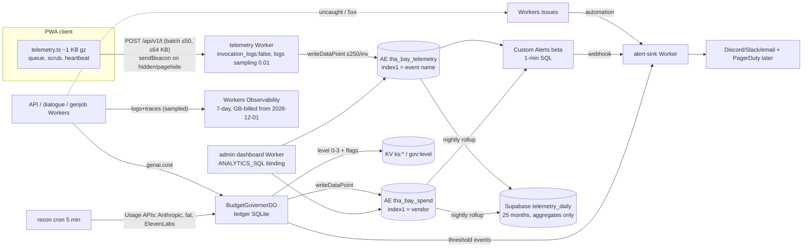

# Gap report: production observability, client crash detection and genAI spend guardrails

S00 research gap fill, key `gap-observability-cost-guardrails`. Checked 2026-10-18. Feeds S09 (C16 `TelemetryEvent`, API, alerting), S11 (iPhone platform risk), S04 and S05 (genAI quotas), S13 (M14b acceptance criteria, risk register). Requirements: R-ENG-03, R-PLAT-01, R-UI-02 (data/privacy settings), R-IP-04, R-NPC-05, R-CUT-01/03.

This report builds on existing reports and does not repeat them:
- `stack-cloudflare-backend.md` §1.10 (Workers Logs and Analytics Engine prices, AE as telemetry sink), §9 cost model.
- `ai-npc-runtime.md` §2.7 (`PlayerQuotaDO`, `BudgetGovernorDO`, degrade steps at 70/85/100% of the G3 ceiling, workspace layout).
- `genai-pipeline-fal.md` §4.2 (`GenJobWorkflow`: cache check, `budget-reserve`, fal webhook with ED25519 verification, poll fallback) and rec 8 (fal concurrency semaphore, 50/80/100% alerts).
- `stack-rendering-platform.md` (iPhone WebContent jetsam at about 2,048 MB, GPU-process leak, persistence on `visibilitychange`/`pagehide`).

Owner updates apply (SF first). They do not change this dimension, except that v1 telemetry dimensions are SF chunk keys only.

Facts already known and not repeated as new rows: Workers Logs 20M events/month included (+$0.60/M) until 2026-11-30; Analytics Engine 10M points/month included and currently unbilled; Anthropic tier monthly caps (Start $500, Build $1,000); Haiku 5.5 $0.10/$0.50 per MTok.

---

## 0. Key findings (read this first)

1. **Cloudflare logs and traces switch to GB-based billing on 2026-12-01.** Workers Logs, Workers Traces, Cloudflare Traces, AI Gateway logs, R2 Data Access Logs, Containers logs and Workers Issues will share one account allowance. On Paid that is 50 GB ingested plus 10 GB-month stored per billing cycle, then $0.25/GB ingested and $0.10/GB-month. Retention defaults to 7 days. Queries, dashboards and alerts cost nothing extra. Ingestion is counted before compression and after sampling. So `head_sampling_rate` and `invocation_logs:false` are the cost controls.
2. **The real log-cost trap is multiplayer.** Each incoming WebSocket message on a hibernated Durable Object is an invocation. If the room Worker logs every invocation, one busy 16-player room at 20 Hz produces about 830M invocations per month. The room Worker needs `invocation_logs:false` or a sampling rate ≤ 0.001 (§1.3). This is an estimate; measure it in M12.
3. **iOS Safari gives the page no crash signal.** Through iOS 27.2, Safari does not support the Reporting API crash report (`CrashReportContext`/`window.crashReport`) or deprecation reports. Sentry cannot see a jetsam kill either. The only workable detector is a self-built heartbeat: a synchronous `localStorage` "running" flag plus a breadcrumb ring buffer. On the next launch, the client reports `app.abnormal_exit` (§2). Add `GPUDevice.lost`, which iOS has supported since 26.0, to catch GPU-process kills.
4. **The self-hosted sink is about 30× smaller than Sentry and keeps PII out by construction.** Measured with esbuild minify and gzip -9: `@sentry/browser` 11.8.0 default init is 30.0 KB gz, a minimal `BrowserClient` is 21.2 KB gz, and adding tracing makes it 52.6 KB gz. Our telemetry sketch is 0.9 KB gz. Sentry v11 also turns on `dataCollection.userInfo` (including `ip_address`), cookies, headers and query parameters by default. Recommendation: build our own sink on Workers and Analytics Engine, and use Cloudflare Workers Issues (free in beta) for server errors. Sentry stays an optional add-on, off by default.
5. **Anthropic caps are real but monthly, set only in the Console, and alert by email only.** A workspace or organization limit you set returns HTTP 400 `invalid_request_error`. The tier cap returns HTTP 429 `rate_limit_error` with `error.details.error_code = "enforced_spend_limit_reached"` and **no `retry-after`**, so SDK auto-retries must be disabled for it. No API sets these limits (the Rate Limits API is read-only), and there are no webhooks. Usage data reaches the Usage API within about 5 minutes, in 1-minute buckets, and the API can be polled once a minute. The Cost API is daily only.
6. **fal documents no spend cap, budget or spend alert.** The de facto hard cap is the prepaid credit balance: the account locks below a "lock threshold". Whether auto-recharge exists is UNVERIFIED. Per-key controls are permission presets, an immutable allowed-models list, and expiry from 1 h to 1 y (2026-10-09). Read usage from `GET /v1/models/usage` (minute timeframe, `api_key_id` filter), per-request cost from `GET /v1/models/billing-events` (nano-USD, `request_id` filter), and the balance from `GET /v1/account/billing?expand=credits`.
7. **Cloudflare AI Gateway has had real spend limits since 2026-06-05.** Up to 20 rules per gateway, scoped by provider, model or metadata (per user via `cf-aig-metadata`), with fixed or sliding windows. Over budget, the gateway returns 429 or falls back to a cheaper model. Enforcement is eventually consistent, so bursts overshoot. Limits work only where cost is computable from tokens, which means **Anthropic yes, fal and ElevenLabs no** (inferred from the docs).
8. **AI Gateway does not buffer SSE by default.** Chunks "are forwarded to the client as they arrive". DLP response scanning or Guardrails on gateway endpoints buffer the whole response, which would destroy Haiku time-to-first-token. Do not enable them on the dialogue gateway.
9. **Do not use AI Gateway Unified Billing for dialogue.** It is limited to 200 requests per 60 s per gateway and adds a 5% fee on credits. Use BYOK with `byok_only: true`.
10. **ElevenLabs has the best per-key cap of any vendor here.** Service-account keys carry a monthly `character_limit`, and charged requests fail once it is reached. The workspace overage ceiling `max_credit_limit_extension = 0` turns the plan quota into a hard stop. Usage is readable per hashed key via `POST /v1/workspace/analytics/query/usage-by-product-over-time`.
11. **Cloudflare's own billing has no cap.** Budget alerts are email only, computed daily, fire the day after the threshold is crossed, and are informational. Use them as a backstop, not as the M14b alarm. For minute-level alarms, use Custom Alerts (beta): a scheduled SQL query over our Analytics Engine datasets with webhook delivery.

---

## 1. Cloudflare observability after 2026-12-01

### 1.1 What changes
- **Before 2026-12-01:** Workers Logs bill per event (known). Workers Traces have 7-day retention and are not separately priced.
- **From 2026-12-01:** the following share one account allowance:
  - Workers Logs
  - Workers Traces
  - Cloudflare Traces (proxy-layer spans, open beta since the 2026-10-02 blog)
  - AI Gateway logs, for accounts whose first gateway was created on or after 2026-09-24
  - R2 Data Access Logs
  - Containers logs
  - Workers Issues
- **Meters:** ingestion in GB (pre-compression; includes event body, default enriched attributes and custom attributes; excludes dropped events) and storage in GB-month (= Σ each day's max queryable GB ÷ 30).
- **Allowances:**
  - Paid: 50 GB ingestion and 10 GB-month storage per billing cycle. The two meters are separate and do not roll over.
  - Free: 0.5 GB/day. Ingestion stops at the limit until 00:00 UTC.
- **Retention:** 7 days by default. Configurable 30/90/365-day retention is "planned". Log Explorer datasets are a separate product at $1/GB with 30-day retention.
- **Migration:** existing Free/Pro/Business accounts move automatically on 2026-12-01. Data still retained on that date starts counting toward storage, and nothing is charged retroactively.

### 1.2 Tracing and export
- **Enable tracing:** `observability.traces.enabled` with `head_sampling_rate`, which defaults to 1. Custom spans use `tracing.enterSpan()` from `cloudflare:workers` (2026-06-16). Trace context propagates automatically across DO and service-binding calls (2026-05-07). W3C Trace Context propagation to outside services is "up next" and not available yet.
- **OTel export:** create an account-level destination (dashboard → Observability → Destinations), then list it in `observability.{traces,logs}.destinations`. Constraints:
  - Binary protobuf OTLP is not supported.
  - Workers infrastructure metrics and custom metrics cannot be exported.
  - `persist:false` exports without storing in Cloudflare, so the data does not count toward the new ingestion and storage meters.
  - The Logpush pricing page says OTel destination usage "retains its event-based Workers Observability pricing". What that means after 2026-12-01 is UNVERIFIED (see Open questions).
- **Tail Workers:** Workers Paid only, billed by CPU time and not by request. Cloudflare now points third-party export at OTel instead.
- **Workers Trace Events Logpush:** 10M requests/month included, then $0.05/M. Account Logpush since 2026-09-30: internal destinations (R2, Pipelines) 25 GB free then $0.03/GB; external 25 GB then $0.10/GB.

### 1.3 Cost model for logs and traces under the new pricing (assumptions labelled)
Assumptions (UNVERIFIED, to measure in M00 from Billable Usage):
- 1 KB average per log event.
- 300 Worker invocations per MAU per month on the HTTP API: telemetry batches, dialogue turns, manifests, saves.
- 2 log events per invocation (invocation log plus one structured log).
- Traces sampled at 5% at about 4 KB per trace.

| Scale | HTTP invocations/mo | Logs ingested | Traces ingested | Ingestion charge | Storage (≈ ingested × 7/30) | Monthly |
|---|---|---|---|---|---|---|
| 1k MAU | 0.3M | 0.6 GB | 0.06 GB | $0 | 0.15 GB-mo | $0 |
| 10k MAU | 3M | 6 GB | 0.6 GB | $0 | 1.5 GB-mo | $0 |
| 100k MAU | 30M | 60 GB | 6 GB | (66−50)×$0.25 = $4.00 | 15.4 GB-mo → $0.54 | ≈ $4.54 |
| **One busy RoomDO, unsampled** | 16 players × 20 Hz × 2.59M s ≈ 830M msg invocations | ≈ 830 GB | — | ≈ $195 | ≈ 194 GB-mo → $18 | **≈ $213 per room-month** |

The last row assumes every hibernated WebSocket message emits an invocation log. The DO metrics docs confirm hibernated messages count as invocations; that each one produces a Workers Logs invocation log is UNVERIFIED. **Consequence:** deploy `RoomDO` in its own Worker script with `observability.logs.invocation_logs = false` and `head_sampling_rate ≤ 0.001`. Emit tick statistics to Analytics Engine once per 10 s per room (backend report: `room_tick_ms`), not per message.

### 1.4 Analytics Engine: query, retention, sampling
- **Write limits:** per `writeDataPoint`, ≤ 20 blobs (16 KB total), ≤ 20 doubles and 1 index (≤ 96 bytes). At most 250 data points per Worker invocation. Data is kept for 3 months, and longer retention is available only on request.
- **Sampling** happens on write and on read, per index value. Always aggregate with `SUM(_sample_interval)` and `SUM(_sample_interval*doubleN)`, or use `quantileExactWeighted(..., _sample_interval)`. Use the **event name as `index1`**, so rare events (crashes, spend) stay unsampled while high-volume `perf.minute` gets sampled.
- **Two query surfaces:**
  - The AE SQL API: `POST https://api.cloudflare.com/client/v4/accounts/<id>/analytics_engine/sql` with an Account Analytics Read token.
  - The newer Analytics SQL API: datasets `events.analyticsEngine."<name>"` and `logs.workersLogs`; one statement, ≤ 10 KiB, lower timestamp bound required.

  The Analytics SQL API has a **Workers binding** (`"analytics": {"binding": "ANALYTICS_SQL"}`, Wrangler ≥ 4.145.0), which lets an admin dashboard Worker query AE without an API token. No numeric query rate limits are published.
- **GraphQL Analytics API**, for Workers and DO metrics: 300 queries per 5 min per user by default. Account-based limits are available via `X-Rate-Limit-Type: account-based`. DO datasets:
  - `durableObjectsInvocationsAdaptiveGroups`, which includes hibernated WS messages
  - `durableObjectsPeriodicGroups` (CPU, non-hibernated WS messages)
  - `durableObjectsStorageGroups`
  - `durableObjectsSubrequestsAdaptiveGroups`

  Metrics can be filtered by DO id or name (2026-06-12). Memory percentiles `memoryUsageBytesP50…P999` are in `workersInvocationsAdaptive` (2026-06-30).

### 1.5 Alerting surfaces on Workers Paid
| Surface | Trigger | Latency | Delivery | Enforces? |
|---|---|---|---|---|
| **Custom Alerts (beta)** | Scheduled SQL over a dataset (AE `events.analyticsEngine.*`, `logs.workersLogs`, …): threshold (`< > <= >= == !=`) or anomaly z-score (baseline ≥ 6× window, ≤ 24 h, 30 min history) | 1-minute interval for most datasets (10 min for Log Explorer); repeat 1 min to 168 h (default 1 h) | email (≤ 20), **webhook (all plans)**, PagerDuty (Business+ zone) | no |
| **Workers Issues automations** | Occurrence-count threshold, or recurrence after inactivity, on grouped failures (uncaught exceptions, failed invocations, 5xx, `console.error`) | near real time | webhook, chat, incident tool, coding agent (Claude Code, Cursor, Devin); 3 hand-off attempts | no |
| **Budget alerts** | Account-level usage spend in $ (projected or cumulative) | computed daily; fires the next day; once per cycle | email | no (informational) |
| **Usage Based Billing notification** | Per-product usage above a threshold | — | Notifications | no; "Professional plans or higher", Pay-as-you-go only (zone-plan requirement unclear for a Workers-only account; UNVERIFIED) |
| **Per-Worker CPU limit** | `limits.cpu_ms` | real time | — | **yes** (per invocation; denial-of-wallet control) |

Cloudflare has no hard account spend cap. M14b's alarm path must therefore be Custom Alerts plus our own governor, not Budget alerts.

---

## 2. Client errors and crashes on the iOS Safari Home Screen web app

### 2.1 What the platform gives us
| Signal | iOS Safari / Home Screen | Use |
|---|---|---|
| `window.onerror`, `unhandledrejection` | yes | JS errors |
| `ReportingObserver`, `Reporting-Endpoints` header | 16.4+ | CSP and test reports only. WebKit main has `DeprecationReportBody.idl` and `TestReportBody.idl` in `Modules/reporting`, but caniuse shows `DeprecationReportBody` unsupported through 27.2 and no crash body exists |
| Reporting API **crash** report / `window.crashReport` (`CrashReportContext`) | **no** (Chrome/Edge 145+ only) | Desktop Chrome only: set `Reporting-Endpoints: crash-reporting="https://…/api/v1/reports"` to get `reason: oom/unresponsive` for free |
| `performance.measureUserAgentSpecificMemory` / `performance.memory` | no | Keep our own memory accounting (texture, geometry and wasm arena bytes) |
| `GPUDevice.lost` | 26.0+ | GPU-process loss: report `err.gpu.lost{reason,message}`, then try one device re-create |
| `navigator.sendBeacon` / `fetch(…,{keepalive:true})` | 11.3+ / 13+ | Flush on `visibilitychange→hidden` and `pagehide` |
| Jetsam kill of WebContent | **no event**. The page is reloaded or shows an error after repeated crashes (secondary sources) | Next-launch heartbeat inference (below) |

### 2.2 Abnormal-termination detector (design; behaviour on a real iPhone UNVERIFIED until M01b)
1. **On boot:** read `localStorage['tb.hb']` synchronously, which is safer than IndexedDB because it is written synchronously.
   - If `state === 'running'`, the previous session ended while visible without a `pagehide`. Emit `app.abnormal_exit` with the persisted context:
     - `{prevSid, lastBeatAgoMs, scene, mode, chunkKey, tier, memEstMB, gpuEstMB, lastEvents[≤20], build}`
   - If `state === 'hidden'`, the OS may have killed a suspended app. That is normal on iOS: emit `app.cold_resume` and do not count it as a crash.
2. **While visible:** every 5 s (and on scene, mode or chunk change), rewrite `{sid, t, state:'running', scene, chunkKey, memEstMB, ring}`. The value stays ≤ 4 KB, so a write costs a few µs.
3. **On `visibilitychange→hidden`:** set `state:'hidden'` and flush the queue with `sendBeacon`. **On `pagehide`:** set `state:'closed'` and flush. **On `visible`:** set `state:'running'`.
4. **Extra hint:** `performance.getEntriesByType('navigation')[0].type === 'reload'` at boot, together with a `running` flag, suggests Safari's automatic crash reload. Whether Safari labels crash-recovery reloads `reload` is UNVERIFIED.
5. **Classification server-side:**
   - `abnormal_exit` with `memEstMB` above 80% of the tier budget is likely jetsam.
   - With `err.gpu.lost` in the ring, it is a GPU-process kill.
   - With `rafStallMs` > 5 s in the ring, it is a watchdog or hang.
   - Otherwise it is unknown.
6. **Report:** abnormal-exit rate = `abnormal_exit / app.start` by `build × deviceClass × osMajor × tier × scene`. This is the iPhone memory KPI (alert A03).

Measured size of a working sketch of this client (heartbeat, queue, beacon flush, error hooks, scrubbing): **1,629 B minified, 919 B gzip**. Measured in scratchpad `tele-src/` with esbuild 0.25.10.

### 2.3 Sentry versus a self-hosted sink
| | Sentry (`@sentry/browser` 11.8.0, 2026-10-15) | Self-hosted (Worker → AE) |
|---|---|---|
| Bundle, gzip (measured) | 30.0 KB default; 21.2 KB minimal client; 52.6 KB with tracing | ≈ 0.9 KB |
| Sees iOS jetsam kills | no | yes (heartbeat inference) |
| Default PII | v11 `dataCollection` defaults apply: `userInfo:true` (incl. `ip_address`), cookies, headers and query params collected with denylist scrubbing; `x-forwarded-for` not filtered by default | none collected; IP never stored |
| Session Replay | off unless `replayIntegration` imported | n/a |
| Grouping / symbolication | yes (source maps) | build our own fingerprint (message + top frame) |
| Price | Developer free 5k errors/30 days; Team $29/mo, 50k errors, 90-day lookback, max-spend threshold | Workers requests plus AE points (in allowance up to ~20k MAU) |
| Server-side Workers errors | `@sentry/cloudflare` 11.8.0, or OTel export to Sentry | Workers Issues (free in beta, grouped, source maps) |

Verdict: self-host by default. Sentry may be added for desktop/dev builds only, behind `TELEMETRY_SENTRY=false`, with this configuration:
- `dataCollection:{userInfo:false,cookies:false,httpHeaders:false,urlQueryParams:false,httpBodies:[],genAI:{inputs:false,outputs:false}}`
- no Replay import
- `beforeSend` scrubbing
- `sampleRate` 0.25

---

## 3. Anthropic spend and usage controls
- **Limits:**
  - **Tier cap:** HTTP 429 `rate_limit_error` with `error.details.error_code: "enforced_spend_limit_reached"`, **no `retry-after`**. Usage resumes at 00:00 UTC on the 1st of the next month.
  - **User-set org or workspace limit:** HTTP 400 `invalid_request_error`, message starting "You have reached your specified workspace API usage limits" (or "…specified API usage limits" for the org).
- **Setting limits:** workspace spend limits are monthly and set in the Console only (Workspaces → workspace → Spend limits, where email alerts at set amounts are also configured). Workspace rate limits (RPM/ITPM/OTPM per model group) are also Console-only. The Rate Limits API (`GET /v1/organizations/rate_limits`, `GET /v1/organizations/workspaces/{id}/rate_limits?include_inherited=true`) is explicitly read-only. The default workspace cannot hold limits. An organization can have up to 100 workspaces.
- **No per-API-key spend or rate limits** are documented, except per-user monthly limits in the auto-created Claude Code workspace. Isolation is per workspace, and responses carry `anthropic-workspace-id`.
- **Alerts:** email only, no webhooks. A field report (GitHub issue, 2026-09-24) shows a workspace limit cutting traffic with no prior warning because no workspace notification was configured; the organization limit had alerted at 80%.
- **Usage API:** `GET /v1/organizations/usage_report/messages`.
  - Buckets `1m` (default 60, max 1,440), `1h` (max 168), `1d` (max 31).
  - Group or filter by `api_key_ids[]`, `workspace_ids[]`, `models[]`, `service_tiers[]`, `context_window[]`, `inference_geos[]`, `speeds[]`.
  - Reports uncached, cached-read, cache-creation and output tokens.
- **Cost API:** `GET /v1/organizations/cost_report`, daily only, USD as decimal strings in cents, Priority Tier excluded.
- **Freshness and polling:** data is "typically within 5 minutes". Polling once per minute is supported. Both APIs need an Admin API key (`sk-ant-admin01-…`) or an `org:admin` credential, and are unavailable to individual (non-organization) accounts.

---

## 4. fal.ai spend and usage controls
- **Caps:** no documented account or key spend limit, budget or spend alert (fal docs, FAQ and changelog checked). When the credit balance drops below the account "lock threshold", the account locks and requests are rejected (FAQ). Purchased credits expire after 365 days. Invoice-billed enterprise accounts are exempt from locking. Auto-recharge is UNVERIFIED.
- **Keys:** since 2026-10-09 keys use presets (`API`, `SERVERLESS`, `DEPLOY`, `COMPUTE`, `BILLING`, `READONLY`, `FULL`) or custom permission lists. Other key controls:
  - An **allowed-models** list, set at creation and immutable.
  - **Expiry** from 1 h to 1 y.
  - Create and revoke via `POST /v1/keys` and `DELETE`, which needs `auth:keys:write` (FULL).
- **Usage:** `GET https://api.fal.ai/v1/models/usage` (permissions `billing:usage:read`, `auth:keys:read`, `account:users:read`, i.e. the BILLING preset).
  - `timeframe` minute/hour/day/week/month.
  - Filters: `endpoint_id` (≤ 50), `api_key_id`, `login_username`, and `tag=key=value` with `source=tagged-estimate`. Tagged reporting must be enabled for the account and lags behind.
  - Rows carry `quantity`, `unit_price`, `cost_subtotal`, `cost_discount`, `cost_total`.
- **Billing events:** `GET /v1/models/billing-events` gives per-request rows with `request_id` filter and `cost_estimate_nano_usd`. Use this to settle a `GenJobWorkflow` reservation with the real cost.
- **Analytics:** `GET /v1/models/analytics` (`models:metrics:read`, API preset): `request_count`, `success_count`, `user_error_count`, `error_count`, error-type counts, `p50…p99_prepare_duration` (queue time), `p25…p99_duration` (execution), cold-boot metrics, `total_billable_duration`.
- **Balance:** `GET /v1/account/billing?expand=credits` returns the current credit balance (BILLING or READONLY preset).
- **Request tags:** `X-Fal-Tags: k=v,k=v` (≤ 10 pairs, key ≤ 64 chars, value ≤ 256). Source: fal Python client PR #1158 (secondary, medium confidence).
- **Notifications:** concurrency-limit notifications (email and dashboard) and Slack alerts for serverless app failures. No spend notifications.
- **Webhook signing** is covered in `genai-pipeline-fal.md` and not repeated here.

---

## 5. Cloudflare AI Gateway
- **Providers:**
  - Anthropic at `/v1/{acct}/{gw}/anthropic` (per ai-npc-runtime).
  - fal at `https://gateway.ai.cloudflare.com/v1/{acct}/{gw}/fal`. Sync calls go to `fal.run`. Other fal URLs, including `queue.fal.run`, go through the `x-fal-target-url` header (queue support is shown only in an example; medium confidence). `@fal-ai/client` accepts the gateway as `proxyUrl`.
- **Spend limits:**
  - ≤ 20 rules per gateway; scope by provider, model or metadata key ("split by value" gives one bucket per value, "filter by value" applies to one value).
  - Fixed or sliding windows; 429 on exceed, or a Dynamic Route fallback to a cheaper model.
  - Eventually consistent: a request's cost is recorded after completion, so concurrent bursts overshoot.
  - Configured in the dashboard or the API. Works for BYOK and Unified Billing on "models with known pricing".
- **Cost tracking only works for token-returning responses.** Cost metrics exist only "for endpoints where the models return token data and the model name". Custom costs (`cf-aig-custom-cost`: `per_token_in/out/cache_read/cache_write`) "only apply to requests that pass tokens". **Inference: fal (per image, per second) and ElevenLabs (per character) calls get no gateway cost, so gateway spend limits cannot cap them.**
- **Other limits:** custom metadata is limited to 5 entries per request (`cf-aig-metadata`). Paid accounts get 20 gateways. Cache TTL max 1 month, cacheable request ≤ 25 MB. Unified Billing is limited to **200 requests per 60 s per gateway**, which does not apply to BYOK. `byok_only:true` or `cf-aig-no-wholesale` prevents Unified Billing fallback.
- **Streaming:** without DLP, streamed chunks pass through as they arrive.
  - DLP response scanning buffers the full response.
  - Guardrails on `gateway.ai.cloudflare.com` endpoints buffer `stream:true` responses and return a single payload. Guardrails also add about 500 ms per request.
  - Request-only DLP does not buffer.
- **Logs and pricing:** logs are on by default. `cf-aig-collect-log-payload:false` keeps metadata (tokens, cost, duration, status) without bodies. Gateways first created on or after 2026-09-24 log into Workers Logs, so 7-day retention and the new Observability pricing apply. Core features (analytics, caching, rate limiting) are free. Guardrails bill as Workers AI. The Unified Billing fee is 5%.

---

## 6. ElevenLabs
- **Key restrictions:** endpoint scope, credit quota, and an IP allowlist (1–100 CIDRs, private ranges rejected, others get 403). Workers egress IPs are not dedicated to us, so the IP allowlist adds little.
- **Service-account keys** (`POST /v1/service-accounts/{id}/api-keys`) take `character_limit`, a monthly per-key cap; "requests that incur charges will fail after reaching this monthly limit". The exact error code is UNVERIFIED. `tts_concurrency_limit` is enterprise-only.
- **Usage:** `GET /v1/usage/character-stats` is deprecated. Use `POST /v1/workspace/analytics/query/usage-by-product-over-time` with `interval_seconds` (default 60) and `group_by` including `hashed_xi_api_key`, `model`, `voice_id`, `product_type`. It returns tabular rows in credits or fiat.
- **Quota state:** `GET /v1/user/subscription` returns `character_count`, `character_limit`, `next_character_count_reset_unix`, `max_credit_limit_extension` (`0` disables usage-based overage) and `current_overage`.

---

## 7. Enforceability matrix (what actually stops spend)

| Vendor | Layer 1: vendor-side hard stop | Granularity / reset | Who can set it | Vendor alerts | Programmatic usage read | Layer 2: gateway | Verdict |
|---|---|---|---|---|---|---|---|
| **Anthropic** | tier cap (429 `enforced_spend_limit_reached`); org limit and **workspace monthly limit** (400) | monthly, resets 1st 00:00 UTC | Console only | email (org 80%; workspace configurable) | Usage API 1-min buckets, ~5 min lag; Cost API daily | **AI Gateway spend limits: enforceable** (token-priced; per-user via metadata; eventual) | **3 layers enforceable**; daily cap must be ours or the gateway's |
| **fal** | prepaid balance plus account lock (if no auto-recharge) | balance-based | top-up policy | none for spend | usage (minute), billing-events (per request), balance | gateway proxies but **cannot cost-limit** (no token data) | **only our Worker layer** (`GenJobWorkflow` reserve plus governor) and the prepaid balance |
| **ElevenLabs** | per-key `character_limit` (monthly); plan quota with `max_credit_limit_extension=0` | monthly per key / billing cycle | API (service-account keys) and dashboard | none found | analytics query (60 s buckets), subscription | gateway cost tracking n/a | **vendor key cap enforceable**, plus our voiced-lines quota |
| **Workers AI TTS / LLM fallback** | none | — | — | Budget alert (daily, email) | GraphQL/Billable Usage | AI Gateway spend limits if routed through gateway with token data (TTS is per character: n/a) | **our layer only** (neurons are cheap: low risk) |
| **Cloudflare platform** | none (per-invocation CPU limit only) | — | — | Budget alerts (daily), Usage notifications | Billable Usage dashboard, GraphQL | — | **alerts only**; control with sampling, AFK room GC, CPU limits |

---

## 8. Requirement trace
| Item | Satisfied by |
|---|---|
| R-ENG-03 quotas | `PlayerQuotaDO` (ai-npc-runtime), per-user AI Gateway rules, fal `GenJobWorkflow` reserve, ElevenLabs key caps |
| R-ENG-03 cache checks | `GenJobWorkflow` cache-first (genai-pipeline-fal), plus the rule below that kill-switches never block cache hits |
| R-ENG-03 budget alarms | §Rec 2.4 alert list S01–S10 (Custom Alerts on AE `tha_bay_spend` plus governor webhooks) |
| M14b AC "budget alarms fire on synthetic spend" | §Rec 3 test suite T1–T9 |
| C16 TelemetryEvent sink and privacy | §Rec 1 |
| iPhone memory kills | §2.2 detector, A03 alert, D1 dashboard |

---

## Verified facts

| fact | source URL | date checked | confidence |
|---|---|---|---|
| From 2026-12-01 all Cloudflare logs and traces use one pricing model; shared allowance covers Cloudflare Traces, Workers Logs, Workers Traces, Containers logs, R2 Data Access Logs, AI Gateway logs, Issues | https://developers.cloudflare.com/observability/pricing/ (updated 2026-10-15) | 2026-10-18 | high |
| Paid: 50 GB ingestion + 10 GB-month storage per billing cycle, +$0.25/GB ingested, +$0.10/GB-month; Free: 0.5 GB/day, 7-day retention, ingestion stops at limit until 00:00 UTC; meters separate, no rollover | https://developers.cloudflare.com/observability/pricing/ | 2026-10-18 | high |
| Ingestion counted pre-compression incl. body + enriched + custom attributes, excludes dropped events; GB-month = Σ daily max queryable GB ÷ 30; sampling reduces both meters | https://developers.cloudflare.com/observability/pricing/ | 2026-10-18 | high |
| Default 7-day retention; 30/90/365-day retention "planned"; Log Explorer $1/GB, 30-day; queries, dashboards, alerts, analytics no extra charge | https://developers.cloudflare.com/observability/pricing/ ; https://developers.cloudflare.com/observability/logs/datasets/ | 2026-10-18 | high |
| Existing Free/Pro/Business Workers Observability customers move automatically on 2026-12-01; no retroactive charge; data retained on Dec 1 starts counting toward storage | https://developers.cloudflare.com/observability/pricing/ | 2026-10-18 | high |
| Cloudflare Traces announced 2026-10-02 (open beta); same pricing applies to Workers Tracing from 2026-12-01 | https://blog.cloudflare.com/cloudflare-tracing/ | 2026-10-18 | high |
| Workers traces: 7-day retention; `head_sampling_rate` default 1; from 2026-12-01 stored traces count toward Observability ingestion/storage | https://developers.cloudflare.com/workers/observability/traces/ | 2026-10-18 | high |
| OTel export: dashboard destinations + `observability.{traces,logs}.destinations`; `persist` default true, `false` = export only (not stored/billed in CF after Dec 1); binary OTLP protobuf unsupported; infra/custom metrics not exportable | https://developers.cloudflare.com/workers/observability/opentelemetry-export/ ; https://developers.cloudflare.com/observability/export/opentelemetry/ | 2026-10-18 | high |
| OTel destination usage "retains its event-based Workers Observability pricing and allowances" (not Logpush GB pricing) | https://developers.cloudflare.com/logs/logpush/pricing/ | 2026-10-18 | medium (meaning after Dec 1 unclear) |
| Custom spans `tracing.enterSpan()` (2026-06-16); auto trace propagation across DO/service bindings (2026-05-07); W3C external propagation "up next" | https://developers.cloudflare.com/changelog/post/2026-06-16-custom-spans/ ; https://developers.cloudflare.com/changelog/post/2026-05-07-automatic-tracing-across-do-and-worker-subrequests/ | 2026-10-18 | high |
| Workers Logs limits: 5B logs/account/day then 1% head sample; 256 KB max log; `head_sampling_rate` 0–1 (default 1); `invocation_logs=false` disables the invocation log | https://developers.cloudflare.com/workers/observability/logs/workers-logs/ | 2026-10-18 | high |
| Tail Workers: Workers Paid/Enterprise only, billed by CPU time not requests; docs recommend OTel export for third-party tools | https://developers.cloudflare.com/workers/observability/logs/tail-workers/ | 2026-10-18 | high |
| Workers Trace Events Logpush: Paid only, 10M requests/mo included, +$0.05/M, unchanged by new Logpush pricing | https://developers.cloudflare.com/workers/platform/pricing/ ; https://developers.cloudflare.com/logs/logpush/pricing/ | 2026-10-18 | high |
| Logpush on all plans since 2026-09-30: internal (R2, Pipelines) 25 GB/mo then $0.03/GB; external 25 GB then $0.10/GB; Transformations 1 GB then $0.04/GB | https://developers.cloudflare.com/changelog/post/2026-09-30-logpush-usage-based-pricing/ | 2026-10-18 | high |
| AE per data point: ≤20 blobs (16 KB total), ≤20 doubles, 1 index ≤96 B; ≤250 data points per invocation; stored 3 months | https://developers.cloudflare.com/analytics/analytics-engine/limits/ (updated 2026-04-23) | 2026-10-18 | high |
| AE SQL API `POST /client/v4/accounts/<id>/analytics_engine/sql`, Account Analytics Read token; sampling per index; `_sample_interval` weighting; no query limits published | https://developers.cloudflare.com/analytics/analytics-engine/sql-api/ | 2026-10-18 | high |
| Analytics SQL API: AE as `events.analyticsEngine."<name>"`, Workers Logs as `logs.workersLogs`; 1 statement, ≤10 KiB, lower timestamp bound required | https://developers.cloudflare.com/analytics/sql-api/datasets/ ; https://developers.cloudflare.com/analytics/sql-api/limits/ | 2026-10-18 | high |
| Analytics SQL Workers binding `"analytics": {"binding": "ANALYTICS_SQL"}` (Wrangler ≥4.145.0), `query({query, params})`, no tenancy predicate, no auto-retry | https://developers.cloudflare.com/analytics/sql-api/workers-binding/ | 2026-10-18 | high |
| Custom Alerts (beta): scheduled SQL; threshold or z-score anomaly; 1-min interval for most datasets (Log Explorer 10 min); repeat 1 min–168 h (default 1 h); email ≤20, webhook (all plans), PagerDuty (Business+ zone); pricing not stated | https://developers.cloudflare.com/notifications/notification-available/ | 2026-10-18 | high |
| Budget alerts: Pay-as-you-go, $ threshold on account usage spend, computed daily, fire next day, once per cycle, informational only (no cap), exclude subscription fees; default $10 alert rolled out from 2026-07 | https://developers.cloudflare.com/changelog/post/2026-04-13-billable-usage-dashboard-and-budget-alerts/ ; https://developers.cloudflare.com/changelog/post/2026-06-15-budget-alerts-default-on/ | 2026-10-18 | high |
| Workers Issues: groups uncaught exceptions, failed invocations, 5xx, `console.error`; enable `observability.issues.enabled` (Wrangler ≥4.134.0); open beta, free during beta | https://developers.cloudflare.com/workers/observability/issues/ | 2026-10-18 | high |
| Issues automations: occurrence-threshold or recurrence-after-inactivity triggers → webhook, chat, incident, coding agent (Claude Code, Cursor, Devin); 3 hand-off attempts | https://developers.cloudflare.com/workers/observability/issues/automations/ | 2026-10-18 | high |
| DO GraphQL datasets `durableObjectsInvocationsAdaptiveGroups` (incl. hibernated WS messages), `…PeriodicGroups`, `…StorageGroups`, `…SubrequestsAdaptiveGroups`; filter by DO id/name; memory P50–P999 in `workersInvocationsAdaptive` | https://developers.cloudflare.com/durable-objects/observability/metrics-and-analytics/ ; https://developers.cloudflare.com/changelog/post/2026-06-30-memory-usage-metrics/ | 2026-10-18 | high |
| GraphQL Analytics API default 300 queries/5 min per user; account-based mode via `X-Rate-Limit-Type: account-based` | https://developers.cloudflare.com/analytics/graphql-api/limits/ ; https://developers.cloudflare.com/analytics/graphql-api/account-based-rate-limiting/ | 2026-10-18 | high |
| KV writes visible in other locations within 60 s (or `cacheTtl`); minimum `cacheTtl` 30 s since 2026-01-30 | https://developers.cloudflare.com/kv/api/write-key-value-pairs/ ; https://developers.cloudflare.com/changelog/post/2026-01-30-kv-reduced-minimum-cachettl/ | 2026-10-18 | high |
| Per-Worker CPU limits are the documented anti denial-of-wallet control | https://developers.cloudflare.com/workers/platform/pricing/ | 2026-10-18 | high |
| ReportingObserver and `Reporting-Endpoints` header: Safari/iOS 16.4+ | https://caniuse.com/mdn-api_reportingobserver ; https://caniuse.com/mdn-http_headers_reporting-endpoints | 2026-10-18 | high |
| `CrashReportContext` / `window.crashReport`: Chrome/Edge 145+, unsupported in Safari and iOS through 27.2 | https://caniuse.com/mdn-api_crashreportcontext | 2026-10-18 | high |
| Crash reports can't be read by ReportingObserver; sent to `crash-reporting` (or `default`) endpoint; `body.reason` `oom` / `unresponsive` | https://developer.mozilla.org/en-US/docs/Web/API/CrashReport (modified 2026-04-21) | 2026-10-18 | high |
| `DeprecationReportBody` unsupported in Safari and iOS through 27.2 | https://caniuse.com/mdn-api_deprecationreportbody | 2026-10-18 | high |
| WebKit main `Source/WebCore/Modules/reporting` has `DeprecationReportBody.idl`, `TestReportBody.idl`; no `CrashReportBody.idl`; no `page/CrashReportContext.idl` | https://raw.githubusercontent.com/WebKit/WebKit/main/Source/WebCore/Modules/reporting/ (probed per file) | 2026-10-18 | medium |
| `performance.measureUserAgentSpecificMemory` unsupported in Safari and iOS | https://caniuse.com/mdn-api_performance_measureuseragentspecificmemory | 2026-10-18 | high |
| `sendBeacon` iOS 11.3+; `fetch` `keepalive` iOS 13+ | https://caniuse.com/beacon ; https://caniuse.com/mdn-api_request_keepalive | 2026-10-18 | high |
| `GPUDevice.lost` supported in Safari and iOS 26.0+ | https://caniuse.com/mdn-api_gpudevice_lost ; https://developer.mozilla.org/en-US/docs/Web/API/GPUDevice/lost | 2026-10-18 | high |
| Jetsam kill fires no `onerror`; jetsam reports carry no backtraces; MetricKit memory-exit counters are native-only | https://codoid.com/mobile-application-testing/ios-jetsam-testing-stop-misdiagnosing-memory-kills-as-crashes/ | 2026-10-18 | medium |
| `@sentry/browser`, `@sentry/cloudflare`, `@sentry/core` latest 11.8.0 published 2026-10-15; `web-vitals` 6.2.3 (2026-10-05) | https://registry.npmjs.org/@sentry/browser | 2026-10-18 | high |
| Measured (esbuild 0.25.10, `--minify`, gzip -9): Sentry default `init` 86.4 KB raw / 30.0 KB gz; minimal `BrowserClient` + 3 integrations 21.2 KB gz; + `browserTracingIntegration` 52.6 KB gz; our telemetry sketch 1.6 KB raw / 0.9 KB gz | local build in scratchpad (`sentry-src/`, `tele-src/`) | 2026-10-18 | high (method) |
| Sentry v11: `dataCollection` defaults always apply: `userInfo:true` (fills `user.ip_address`), cookies, headers, query params collected with denylist; Replay unaffected; `x-forwarded-for` not filtered by default | https://docs.sentry.io/platforms/javascript/configuration/options/ | 2026-10-18 | medium-high |
| Sentry tree-shaking: unused Replay/Tracing removed; flags `__SENTRY_DEBUG__`, `__SENTRY_TRACING__`; custom `BrowserClient` to drop defaults | https://docs.sentry.io/platforms/javascript/configuration/tree-shaking/ | 2026-10-18 | high |
| Sentry plans: Developer free (5k errors, 30-day); Team $29/mo ($26 annual) 50k errors, 90-day; Business $89/mo; spend notifications + max spend threshold on Team/Business | https://sentry.io/pricing/ | 2026-10-18 | high |
| Anthropic tier cap reached → HTTP 429 `rate_limit_error`, `error.details.error_code: enforced_spend_limit_reached`, no `retry-after`; paused until 00:00 UTC on the 1st | https://platform.claude.com/docs/en/api/rate-limits | 2026-10-18 | high |
| Anthropic user-set org or workspace spend limit → HTTP 400 `invalid_request_error` ("You have reached your specified [workspace] API usage limits") | https://platform.claude.com/docs/en/api/rate-limits | 2026-10-18 | high |
| Workspace spend limits (monthly, with threshold alerts) and rate limits set in the Console only; not on the Default Workspace; ≤100 workspaces | https://platform.claude.com/docs/en/manage-claude/workspaces | 2026-10-18 | high |
| Rate Limits API `GET /v1/organizations/rate_limits`, `GET /v1/organizations/workspaces/{id}/rate_limits` is read-only ("Can I update rate limits with this API? No.") | https://platform.claude.com/docs/en/manage-claude/rate-limits-api | 2026-10-18 | high |
| Workspace spend notification = email when spend reaches a set amount; no webhook documented | https://support.claude.com/en/articles/9796807-creating-and-managing-workspaces-in-the-claude-console | 2026-10-18 | medium |
| Field report: workspace $250 limit paused API traffic 2026-09-24 with no prior alert (none configured); org limit alerted at 80% | https://github.com/hrosspet/write-or-perish/issues/360 | 2026-10-18 | medium |
| Usage API `GET /v1/organizations/usage_report/messages`: buckets 1m (≤1,440), 1h (≤168), 1d (≤31); filters api_key, workspace, model, service_tier, context_window, inference_geo, speed. Cost API `GET /v1/organizations/cost_report`: daily, USD cents strings, Priority Tier excluded. Data ~5 min after request; poll 1/min; Admin key `sk-ant-admin01-…`; unavailable to individual accounts | https://platform.claude.com/docs/en/manage-claude/usage-cost-api | 2026-10-18 | high |
| No per-API-key spend limits documented (per-user monthly limits exist only in the Claude Code workspace); `anthropic-workspace-id` response header | https://platform.claude.com/docs/en/manage-claude/workspaces | 2026-10-18 | medium (absence) |
| fal: account locks when credits drop below lock threshold; purchased credits expire after 365 days; invoice-billed enterprise exempt | https://fal.ai/docs/documentation/model-apis/faq | 2026-10-18 | high |
| fal: no spend-limit, budget or spend-alert feature in docs index, FAQ or changelog (through 2026-10-13) | https://fal.ai/docs/llms.txt ; https://fal.ai/docs/changelog | 2026-10-18 | medium (absence) |
| fal key presets `API/SERVERLESS/DEPLOY/COMPUTE/BILLING/READONLY/FULL` (2026-10-09); allowed-models list fixed at creation; expiry 1 h–1 y; BILLING preset read-only (2026-08-04) | https://fal.ai/docs/documentation/model-apis/authentication/key-based ; https://fal.ai/docs/changelog | 2026-10-18 | high |
| fal `GET /v1/models/usage`: timeframe minute–month; filters `endpoint_id` (≤50), `api_key_id`, `login_username`, `tag` (with `source=tagged-estimate`, delayed); `cost_total` after discounts | https://fal.ai/docs/platform-apis/v1/models/usage | 2026-10-18 | high |
| fal `GET /v1/models/billing-events`: per-request rows, `request_id` filter, `cost_estimate_nano_usd` | https://fal.ai/docs/platform-apis/v1/models/billing-events | 2026-10-18 | high |
| fal `GET /v1/models/analytics`: counts, `p50–p99_prepare_duration` (queue), `p25–p99_duration` (exec), cold boot, `total_billable_duration`; permission `models:metrics:read` (API preset) | https://fal.ai/docs/platform-apis/v1/models/analytics | 2026-10-18 | high |
| fal `GET /v1/account/billing?expand=credits` returns current credit balance | https://fal.ai/docs/platform-apis/v1/account/billing | 2026-10-18 | high |
| fal `X-Fal-Tags: k=v,…` (≤10 pairs, key ≤64, value ≤256) for usage attribution | https://github.com/fal-ai/fal/pull/1158 | 2026-10-18 | medium |
| AI Gateway spend limits (2026-06-05): ≤20 rules/gateway; scope provider/model/metadata (split/filter); fixed or sliding windows; 429 or Dynamic Route fallback; eventually consistent (bursts exceed); best-effort; BYOK + Unified Billing for known-price models; dashboard or API | https://developers.cloudflare.com/ai-gateway/features/spend-limits/ (updated 2026-09-30) | 2026-10-18 | high |
| AI Gateway cost metrics only for endpoints returning token data and model name; `cf-aig-custom-cost` applies only to token-returning requests; cache hit cost = 0 | https://developers.cloudflare.com/ai-gateway/observability/costs/ ; https://developers.cloudflare.com/ai-gateway/configuration/custom-costs/ | 2026-10-18 | high |
| AI Gateway fal endpoint `…/v1/{acct}/{gw}/fal`; `x-fal-target-url` for other fal URLs (queue example); `@fal-ai/client` `proxyUrl` | https://developers.cloudflare.com/ai-gateway/usage/providers/fal/ (updated 2026-04-20) | 2026-10-18 | high (queue: medium) |
| AI Gateway streams pass through as chunks arrive; DLP response scanning buffers full response; Guardrails on gateway endpoints buffers `stream:true` and returns non-streamed; Guardrails ≈ +500 ms | https://developers.cloudflare.com/ai-gateway/features/dlp/ ; https://developers.cloudflare.com/ai-gateway/features/guardrails/usage-considerations/ | 2026-10-18 | high |
| AI Gateway limits: 5 metadata entries/request; 20 gateways (paid); cache TTL ≤1 month; cacheable ≤25 MB; Unified Billing 200 req/60 s per gateway (not BYOK) | https://developers.cloudflare.com/ai-gateway/reference/limits/ (updated 2026-09-24) | 2026-10-18 | high |
| AI Gateway logs on by default; first gateway on/after 2026-09-24 → Workers Logs pricing/retention; `cf-aig-collect-log-payload:false` keeps metadata (tokens, cost, duration) without bodies | https://developers.cloudflare.com/ai-gateway/observability/logging/ | 2026-10-18 | high |
| AI Gateway core features free; Unified Billing 5% credit fee; Guardrails billed as Workers AI; `byok_only` / `cf-aig-no-wholesale` prevent wholesale fallback | https://developers.cloudflare.com/ai-gateway/reference/pricing/ (updated 2026-10-15) ; https://developers.cloudflare.com/changelog/product/ai-gateway/ | 2026-10-18 | high |
| ElevenLabs keys restrictable by endpoint scope, credit quota, IP allowlist (1–100 CIDRs, private ranges rejected, others 403) | https://elevenlabs.io/docs/overview/administration/workspaces/api-keys | 2026-10-18 | high |
| ElevenLabs service-account key `character_limit` = monthly per-key cap; charged requests fail after it; `tts_concurrency_limit` enterprise-only | https://elevenlabs.io/docs/api-reference/service-accounts/api-keys/create | 2026-10-18 | high |
| ElevenLabs `GET /v1/usage/character-stats` deprecated → `POST /v1/workspace/analytics/query/usage-by-product-over-time` (`interval_seconds` default 60; `group_by` incl. `hashed_xi_api_key`, `model`, `voice_id`, `product_type`) | https://elevenlabs.io/docs/api-reference/usage/get ; https://elevenlabs.io/docs/api-reference/analytics/workspace/usage | 2026-10-18 | high |
| ElevenLabs `GET /v1/user/subscription`: `character_count`, `character_limit`, `next_character_count_reset_unix`, `max_credit_limit_extension` (0 = overage disabled), `current_overage` | https://elevenlabs.io/docs/api-reference/user/subscription/get | 2026-10-18 | high |

---

## Unverified
- Whether every hibernated-WebSocket message invocation on a DO emits a Workers Logs invocation log, and how large the average log event is. The §1.3 cost model assumes 1 KB/event. Measure in M00 (HTTP API) and M12 (RoomDO).
- What "OTel destinations retain event-based Workers Observability pricing" means after 2026-12-01: per-event charges, or nothing when `persist:false`.
- Whether Custom Alerts are billed, how many rules an account may hold, and whether each evaluation counts as an Analytics Engine read query. A 1-minute rule is about 43,200 queries/month, so 10 rules ≈ 0.43M, inside the 1M included.
- Whether the "Usage Based Billing" notification is available to a Workers-Paid-only account without a Pro zone.
- iOS behaviour after a WebContent jetsam in a Home Screen web app: automatic reload, blank page, or relaunch. Whether `PerformanceNavigationTiming.type` reads `reload` after a crash. Whether `localStorage` survives a jetsam mid-write. Test on a physical iPhone in M01b with a memory-bomb page.
- Whether `GPUDevice.lost` fires before or instead of a page kill when `com.apple.WebKit.GPU` is jetsammed.
- Whether fal has auto-recharge, what the "lock threshold" is, and what HTTP status a locked account returns.
- Whether AI Gateway spend limits apply to fal or ElevenLabs traffic at all (inferred no). Whether `cf-aig-custom-cost` values feed spend-limit accounting. Whether `claude-haiku-5-5`/`claude-sonnet-5-5` are in the gateway's known-pricing catalog.
- Whether AI Gateway Guardrails in prompt-only mode buffers streams. The docs say gateway endpoints buffer `stream:true` when Guardrails is on.
- The exact ElevenLabs error code and status when a key's `character_limit` is reached.
- The minimum workspace spend limit the Anthropic Console accepts, and the latency between crossing the limit and enforcement.
- The `X-Fal-Tags` header name and limits are taken from a client PR, not the official API reference. "Tagged reporting must be enabled for the account" needs a support request.
- CCPA applicability (thresholds of $26.625M revenue, or buying/selling/sharing PI of ≥100k consumers) and whether IP addresses are "personal information" (believed yes under Civ. Code §1798.140). Sources fetched this session returned 403.

---

## Recommendations for the spec

### Rec 1. Telemetry and observability architecture (C16 owner S09)



1. **C16 shape** (finalize in `spec/04-data-models.md`):
   ```ts
   export interface TelemetryEvent {
     name: TelemetryName;          // registry enum, dot.case, e.g. 'app.abnormal_exit'
     ts: number;                   // client epoch ms
     sessionId: string;            // crypto.randomUUID() per app launch; never the profileId
     props: Record<string, string | number | boolean>; // ≤16 keys; strings ≤128 chars; per-name JSON Schema
   }
   export interface TelemetryBatch { v: 1; build: string; seq0: number; events: TelemetryEvent[] } // ≤50 events
   ```
   - Envelope props the client lib adds: `tier`, `deviceClass` (`iphone|ipad|android|desktop|quest|avp`), `osMajor`, `displayMode` (`standalone|tab|xr`), `backend` (`webgpu|webgl2`).
   - The server adds `country` from `request.cf.country`, and nothing finer.
   - **Never** add: IP, full user agent, profileId, playerId, wallet address, email, free text, coordinates finer than a chunk key.
2. **Event registry v1:**
   - Lifecycle: `app.start{nav}`, `app.ready{bootMs, phases…}`, `app.abnormal_exit{…§2.2}`, `app.cold_resume`, `app.hidden`
   - Performance: `perf.minute{fpsP50, fpsP5, frameP95Ms, drawCalls, tris, texMBEst, gpuMBEst, memEstMB}`
   - Errors: `err.js{fp, msg, top}`, `err.promise`, `err.gpu{kind:'lost'|'uncaptured', reason}`, `err.asset{kind, status}`
   - Network: `net.ws{evt, rttMs}`
   - Gameplay: `mode.enter/exit{mode}`, `mission.{start,fail,complete}{id}`, `cutscene.play{cached, fallback}`, `npc.turn.client{ttftMs, fallback}`
   - XR, settings, pose: `xr.session{evt, fps}`, `settings.tier_override`, `pose.calibrate{ok, ms}` (aggregate only; legal P2)
   - Server-side only: `genai.cost{vendor, model, usdMicros, cacheHit, playerTier}`, `quota.block{kind}`, `genjob.state{state}`, `room.tick{p99Ms}` (every 10 s), `budget.level{level}`.
3. **Sampling:**
   - 100% for `app.*`, `err.*`, `genai.cost`, `quota.block`, `budget.level`.
   - `perf.minute` at 100% on mobile and XR, 25% on desktop.
   - Client-side error dedupe: same fingerprint at most 5 times per session.
   - Server: Workers Logs `head_sampling_rate` 1.0 in staging. In prod: API 0.25, telemetry Worker 0.01 with `invocation_logs:false`, RoomDO Worker 0.001 with `invocation_logs:false`.
   - Traces: `head_sampling_rate` 0.05 for API, 1.0 for `GenJobWorkflow` (low volume). OTel export off by default; if used, `persist:false`.
4. **PII rules (testable):**
   - The ingest Worker never writes `CF-Connecting-IP`, `User-Agent` or `Cookie` to AE or logs.
   - A CI lint fails on `console.log(request.headers)`.
   - `scrub()` strips URL query strings, emails, bearer tokens and long hex/base64 runs, and truncates to 512 chars.
   - Stack traces keep only file:line:col.
   - No player-authored text (chat, NPC prompts, backstories) in telemetry. AI Gateway dialogue traffic sends `cf-aig-collect-log-payload:false`, and payloads are kept only in the moderation pipeline under its own retention.
   - R-UI-02 Settings → Data & privacy:
     - "Diagnostics" (errors, crashes, performance) on by default, can be switched off.
     - "Gameplay analytics" on by default, can be switched off. Honor GPC as an analytics opt-out (UNVERIFIED legal need; low cost).
     - When either is off, events are dropped client-side.
5. **Retention:**
   - AE raw data 3 months (platform).
   - Nightly rollup to Supabase `telemetry_daily` (no sessionId), 25 months.
   - Workers Logs and traces 7 days.
   - Spend ledger: DO SQLite plus nightly export to Postgres `genai_ledger`, kept 3 years (open question Q-OBS-05).
   - Admin and kill-switch audit trail: R2 JSONL, 400 days.
6. **Sinks:**
   - Client telemetry → `POST /api/v1/t`. Protect it with the Workers Rate Limiting binding (key = sessionId, 20 req / 60 s), body ≤ 64 KB, ≤ 50 events, then `writeDataPoint`.
   - Server errors → Workers Issues (`observability.issues.enabled = true`), with source maps uploaded.
   - On desktop Chrome, also send `Reporting-Endpoints: crash-reporting="/api/v1/reports"` to get free `oom`/`unresponsive` reports, and set `window.crashReport.set('scene', …)` where supported.
7. **Dashboards** (admin Worker using the `ANALYTICS_SQL` binding; Grafana optional):
   - D1 Client health: sessions, abnormal-exit rate by build × device × OS × tier × scene, JS error sessions %, fps P50/P5, boot P75.
   - D2 Edge: requests, 5xx %, P95 latency, CPU ms, DO memory P99, room tick P99, room-hours.
   - D3 GenAI spend: $/hour per vendor and model against ceilings, cache-hit %, quota blocks, fallbacks, governor level.
   - D4 Pipeline: `GenJobWorkflow` states, fal `p95_prepare_duration` / `p95_duration` from the fal analytics API, webhook lag.
   - D5 Vendor reconciliation: ledger versus Anthropic, fal and ElevenLabs usage APIs.
8. **wrangler snippet (per Worker):**
   ```jsonc
   "observability": {
     "enabled": true,
     "logs":   { "enabled": true, "head_sampling_rate": 0.25, "invocation_logs": true },
     "traces": { "enabled": true, "head_sampling_rate": 0.05 },
     "issues": { "enabled": true }
   },
   "analytics_engine_datasets": [
     { "binding": "AE", "dataset": "tha_bay_telemetry" },
     { "binding": "AE_SPEND", "dataset": "tha_bay_spend" }
   ],
   "analytics": { "binding": "ANALYTICS_SQL" }      // admin Worker only; Wrangler ≥ 4.145.0
   ```
   The RoomDO Worker and the telemetry Worker use `logs.head_sampling_rate` 0.001 / 0.01 and `invocation_logs: false`. Verify exact key names against the wrangler schema in M00.

### Rec 2. Spend guardrails: three layers plus kill switches (owners S04, S05, S09)

**2.1 Layer 1: vendor-side (configure in M14b, verify with a CI drift check)**
- **Anthropic:**
  - Workspaces `npc-runtime`, `npc-builder`, `ci-evals`, `synthetic`, each with a monthly spend limit.
    - `npc-runtime`: 1.2 × the monthly G3 ceiling.
    - `npc-builder`: 0.2 × G3.
    - `ci-evals`: $50.
    - `synthetic`: the minimum the Console allows.
  - Add Console spend notifications at 50% and 80% of every workspace limit and of the organization limit (the 2026-09-24 incident shows they are not on by default).
  - Set the org custom limit just below the tier cap.
  - Production keys: single-workspace service-account keys only.
  - Map 400 `invalid_request_error` with message prefix "You have reached your specified" → `vendor_cap:anthropic`.
  - Map 429 with `error.details.error_code==='enforced_spend_limit_reached'` → `vendor_cap:anthropic_tier`, and **do not retry**. Set SDK `maxRetries: 0` for that path, or detect it in a custom fetch.
- **fal:**
  - Keep a prepaid balance ≤ 30 days of budget. Disable auto-recharge if it exists.
  - One `API`-preset key per use (`fal-runtime`, `fal-prewarm`, `fal-ci`), each with an **allowed-models list** equal to `genai-core/registry.ts` and a 90-day expiry.
  - A separate `BILLING`-preset key used only by the recon cron.
  - Poll the balance every 15 min.
- **ElevenLabs:**
  - Service-account keys `tts-runtime` and `tts-prewarm`, each with `character_limit` = the monthly voiced-line budget × 120 characters.
  - Endpoint scope TTS only.
  - `max_credit_limit_extension = 0`, so there is no overage.
- **Cloudflare:**
  - Budget alerts at $25, $100 and $250 projected monthly. These are an email backstop only.
  - `limits.cpu_ms` set per Worker (API 50 ms, genjob 30,000 ms).

**2.2 Layer 2: AI Gateway (Anthropic only)**
- **Gateways:** `gw-dialogue` (BYOK, `byok_only:true`, cache off, Guardrails off, DLP off or request-only, `cf-aig-collect-log-payload:false`) and `gw-builder` (DLP and Guardrails allowed; latency is not critical there).
- **Metadata on every request:** `cf-aig-metadata: {"pid":"<profileHash>","tier":"anon|signed","env":"prod|staging|synthetic"}`. That uses 3 of the 5 entries.
- **Spend-limit rules on `gw-dialogue`:**
  1. Global $ = 1.0 × G3 daily ceiling, fixed daily window. This is the hard backstop behind our governor's 100% level.
  2. Per `pid` split, $0.20/day (above the PlayerQuotaDO cap of $0.15, so it triggers only if our quota is bypassed).
  3. `model = claude-sonnet-5-5`: 0.4 × G3 per day.
  4. `env = synthetic`: $0.05/day (for M14b T4).
- **Fallback:** create a Dynamic Route `sonnet → haiku`, so a Sonnet-only budget breach downgrades instead of returning 429.
- **fal through the gateway** is optional, for logs and analytics only. The gateway cannot enforce fal spend.

**2.3 Layer 3: our Worker quotas, governor and kill switches (authoritative)**
- **Per-player:** keep `PlayerQuotaDO` from ai-npc-runtime §2.7 unchanged (turns, voiced lines, `costMicros` cap). Add `npc_builder.jobs/day` (anon 0, signed 3) and `ugc.cutscene_gen/day` (0 in v1).
- **Global `BudgetGovernorDO`:** ledger in SQLite, rows `{ts, vendor, model, kind, usdMicros, estimated|settled, requestId, jobId}`. It is the only place that computes the level:
  - L0 < 70%
  - L1 ≥ 70%: Sonnet → Haiku
  - L2 ≥ 85%: voice → T1 / Workers AI TTS
  - L3 ≥ 100%: genAI off; ink, barks, cached cutscenes and in-engine fallbacks only
  - Daily ceilings come from G3 per vendor plus a total.
- **Hot path without bottleneck:**
  - Dialogue turns: `PlayerQuotaDO` settles cost to the governor asynchronously (Queue `spend-events`, batch 100 / 5 s). The governor publishes `gov:level` to KV on each transition and every 60 s.
  - Workers read `gov:level` with `cacheTtl: 30`.
  - fal and builder jobs, which are low-rate, call `governor.reserve(estimateUsd)` synchronously and `settle(requestId)` after fetching `billing-events` by `request_id`.
- **Kill-switch flags in KV** (`ks:*`, JSON `{on, reason, by, ts, expiresAt}`; written only by an admin CLI `tools/ops/ks.ts`, audit-logged to R2):
  - `ks:genai:all`, `ks:anthropic`, `ks:anthropic:sonnet`
  - `ks:fal`, `ks:fal:<endpointId>`, `ks:cutscene_gen`, `ks:npc_builder`
  - `ks:tts:elevenlabs`, `ks:tts:all`
  - `ks:likeness:<npcId>` (R-NPC-04 live kill switch)
  - `ks:telemetry:verbose`
- **Propagation:** ≤ 60 s via KV. For an immediate stop, the admin CLI also calls `governor.forceLevel(3)`, which `reserve()` checks synchronously.
- **Rule: kill switches and budget levels never block cache hits.** A cached R2 cutscene, cached TTS line or baked bark is always served (R-ENG-03 "nothing generates without a cache check"; R-CUT-03 fallback).
- **Reconciliation cron (every 5 min):**
  - Anthropic Usage API (`bucket_width=1m`, `group_by[]=workspace_id&group_by[]=model`) priced with the local `pricing.json`.
  - fal `/v1/models/usage?timeframe=minute&api_key_id=…`.
  - ElevenLabs analytics query (`group_by: hashed_xi_api_key`).
  - Write `recon.drift` to AE. If vendor spend exceeds the ledger by more than 10% for 2 consecutive runs, raise S02 and treat vendor spend as truth for the level.

**2.4 Alert list (thresholds are starting values; S13 owns the final ones)**
| ID | Signal (source) | Threshold | Severity / route |
|---|---|---|---|
| S01 | Governor spend % of daily ceiling (governor webhook + Custom Alert on `tha_bay_spend`) | 50 info, 70 warn (L1), 85 warn (L2), 100 page (L3) | chat; page at 100 |
| S02 | Ledger vs vendor drift (recon) | > 10% for 2 runs | warn |
| S03 | Hourly spend anomaly (Custom Alert, z-score) | z > 4 vs 24 h baseline, or > 3× same hour of trailing 7 days | page |
| S04 | Any player over `costMicros` cap (`quota.block` with `bypass=true`) | ≥ 1 | security |
| S05 | Vendor cap hit (400/429 mapped) | ≥ 1 in 5 min | page |
| S06 | fal credit balance (recon) | < 3 days of trailing spend warn; < 1 day page | warn/page |
| S07 | ElevenLabs key usage / `character_limit` | ≥ 80% warn; 100% → `ks:tts:elevenlabs` auto | warn |
| S08 | Anthropic cache-read share (Usage API) | < 80% of input tokens for 1 h | warn (ai-npc-runtime NPC-R2) |
| S09 | Uncached cutscene generations | > 20/day in v1 | warn |
| S10 | Cloudflare Budget alerts | $25 / $100 / $250 projected | email (next day) |
| A01 | Worker 5xx % (Custom Alert on `logs.workersLogs`, or Issues) | > 1% over 5 min | page |
| A02 | New Issue occurrence count (Issues automation) | ≥ 10 | chat |
| A03 | `app.abnormal_exit` / `app.start` per build × deviceClass (AE) | > 3% of sessions over 1 h warn; > 8% page; any build > 2× previous build → block rollout | warn/page |
| A04 | Sessions with `err.js` | > 2% | warn |
| A05 | Mobile `perf.minute.fpsP50` | < 45 for 15 min (per build) | warn |
| A06 | `app.ready.bootMs` P75 (mobile) | > 20 s | warn |
| A07 | `room.tick.p99Ms` | > 10 ms for 5 min warn; > 16 ms page | warn/page |
| A08 | Room-hours/day (GraphQL DO periodic) | > 2× 7-day mean | warn (zombie rooms) |
| A09 | Queue backlog / oldest message | > 10k or > 10 min | warn |
| A10 | `GenJobWorkflow` errored | > 5/h | warn |
| A11 | fal webhook signature failures | ≥ 1 in 15 min | security |
| A12 | Telemetry ingest 429/413 rate | > 5% | warn |

### Rec 3. M14b "budget alarms fire on synthetic spend": test design (owner S13)
Environment: the `staging` Cloudflare environment with its own KV, DO namespaces and AE datasets, plus Anthropic workspace `synthetic`, fal key `fal-ci` and ElevenLabs key `tts-ci` with tiny caps. Also an `alert-sink` Worker that stores every received alert (governor, Custom Alerts and Issues webhooks) in a DO for assertions. Synthetic admin endpoints exist only when `env.STAGE === 'staging'`, and a build check fails if they are reachable in prod.

| Test | Steps | Pass criteria |
|---|---|---|
| T1 Ledger → alarms → degrade | `POST /admin/test/spend {vendor:'anthropic', usdMicros}` in four steps to 50/70/85/100% of a $1 synthetic ceiling | alert-sink receives S01 at each step within 60 s; `gov:level` 1→2→3 visible to a Worker in another colo within ≤ 60 s; `/api/v1/npc/talk` returns `fallback{reason:'budget'}` at L3; Sonnet requested at L1 is served by Haiku |
| T2 Cache-first under L3 | At L3: request one cached and one uncached cutscene key; one cached and one uncached TTS line | cached → 200 from R2; uncached → in-engine fallback; mock fal / ElevenLabs call count = 0 |
| T3 Vendor error mapping | Contract tests replay recorded fixtures: Anthropic 400 workspace-limit message, 429 `enforced_spend_limit_reached` without `retry-after`, AI Gateway 429 spend limit, fal locked / 402 (fixture TBD), ElevenLabs quota error (fixture TBD) | correct `vendor_cap:*` reason; zero retries on the tier-cap 429; S05 fires; governor sets the vendor sub-switch |
| T4 Real gateway spend limit | Rule `env=synthetic` $0.05/day on `gw-dialogue`; loop real Haiku 5.5 requests (`max_tokens` 1024, long prompt) until 429 | 429 observed; overshoot recorded (eventual consistency), with AC overshoot ≤ 2× rule; requests after the window resets succeed (nightly job) |
| T5 Custom Alert e2e | Write AE `tha_bay_spend` points with `blob env='synthetic'` above the S01-synthetic threshold | Custom Alert webhook reaches alert-sink within ≤ 3 min (1-min interval + delivery) |
| T6 Reconciliation drift | Run 20 real Haiku calls on `synthetic`; record only 50% in the ledger | after ≤ 15 min the recon cron reports drift > 10% → S02; governor adopts vendor total |
| T7 Kill-switch propagation | `tools/ops/ks.ts set ks:genai:all` | `forceLevel(3)` is immediate on `reserve()`; KV read sees the flag in ≤ 60 s from 3 colos (P95 recorded); audit row in R2 |
| T8 Abuse | A scripted player sends 500 dialogue turns in 10 min | `PlayerQuotaDO` blocks at its `costMicros` cap; rate-limit 429s from the binding; governor level unchanged; S04 not fired (no bypass) |
| T9 Config drift (nightly) | List Cloudflare notification policies and AI Gateway spend rules (API); Anthropic workspaces (Admin API) and rate limits (Rate Limits API); fal keys (permissions, allowed models, expiry); ElevenLabs key `character_limit`; compare with `ops/guardrails.yaml` | any missing or loosened guardrail fails the job |

AC wording for `spec/09-milestones.md`, M14b: "T1–T3 and T7–T9 pass in CI on every release candidate. T4–T6 pass in the nightly staging run on 3 consecutive nights before launch. The alert-sink shows S01 (all four levels), S02, S05 and A03 (injected via a synthetic `app.abnormal_exit` burst)."

### Rec 4. Other spec rules
1. **Platform-risk KPI:** M01b must ship the heartbeat detector and a memory-bomb test page (`/dev/jetsam`, behind a dev flag) that allocates textures until the page is killed. The AC: the next launch reports `app.abnormal_exit` with `memEstMB` within ±15% of the allocation counter on a physical iPhone. This closes the UNVERIFIED reload behaviour early.
2. **Release gating:** the rollout to 100% of mobile traffic requires A03 abnormal-exit rate ≤ 1.5× the previous build over ≥ 500 mobile sessions. Use Workers gradual deployments with a version tag in `build`.
3. **Do not use Sentry by default.** If it is enabled later, use the configuration in §2.3 and keep it out of the iOS bundle.
4. **Budget the M00 measurement:** log one week of staging traffic and read Billable Usage to replace the 1 KB/event assumption before 2026-12-01.
5. **Put `ops/guardrails.yaml` in the repo** as the single source of every cap, threshold and key policy. T9 compares the live configuration against it.

---

## Risks
| ID | Risk | L | I | Mitigation |
|---|---|---|---|---|
| OBS-R1 | Unsampled RoomDO invocation logs cost ≈ $200+/room-month after 2026-12-01 | M | H | Separate Worker, `invocation_logs:false`, sampling ≤ 0.001, AE tick stats; measure in M12 |
| OBS-R2 | iPhone jetsam remains invisible or misclassified (no platform signal; reload behaviour unknown) | M | H | Heartbeat detector, `GPUDevice.lost`, memory accounting, M01b device test, A03 release gate |
| OBS-R3 | AI Gateway spend limits overshoot under bursts (eventual consistency) | H | L | Use them as backstop only; our governor + PlayerQuotaDO are primary; T4 measures overshoot |
| OBS-R4 | fal has no vendor spend cap; auto-recharge (if any) turns the balance into an unlimited cap | M | H | Small prepaid balance, recharge off, governor `reserve()` on every job, S06 balance alert, allowed-models keys |
| OBS-R5 | Anthropic tier-cap 429 has no `retry-after`; default SDK retries amplify load and delay the fallback | M | M | Detect `enforced_spend_limit_reached`, no retries, immediate offline mode (T3) |
| OBS-R6 | A workspace limit silently cuts dialogue mid-month (real 2026-09-24 case) | M | M | Console notifications at 50/80%, governor ceilings below vendor limits, S05 page |
| OBS-R7 | Guardrails or DLP response scanning on the dialogue gateway buffers SSE and destroys TTFT | M | H | Separate gateways; `gw-dialogue` Guardrails off, DLP request-only; input moderation via Workers AI Llama Guard outside the gateway |
| OBS-R8 | Unified Billing chosen for convenience → 200 req/min/gateway ceiling throttles dialogue | L | H | BYOK + `byok_only:true` |
| OBS-R9 | Telemetry endpoint abused (spam inflates AE and log costs, skews dashboards) | M | M | Rate Limiting binding, size caps, schema validation, drop unknown names; AE index sampling protects reads |
| OBS-R10 | Telemetry leaks PII (IP in logs, player text in error messages, AI Gateway payload logs) | M | H | §Rec 1.4 rules, CI lint, `cf-aig-collect-log-payload:false`, scrub tests with seeded PII fixtures |
| OBS-R11 | Pricing and feature drift: Custom Alerts and Issues are beta; Issues free only during beta; retention options "planned" | H | L | Re-verify in M12 and M14b; keep alert logic in AE SQL that can move to a cron Worker if Custom Alerts change |
| OBS-R12 | KV propagation (≤ 60 s) lets genAI continue briefly after a kill | H | L | Synchronous `forceLevel` on the governor for `reserve()` paths; dialogue cost per minute is small |

## Open questions
1. Q-OBS-01: What are the G3 daily and monthly genAI ceilings per vendor? Every cap, rule and alert in §Rec 2 scales from them (also genai-pipeline-fal Q8).
2. Q-OBS-02: Will the owner accept no Sentry in v1, with Workers Issues plus a self-hosted client sink instead? If Sentry is wanted, which builds get it?
3. Q-OBS-03: After 2026-12-01, are OTel exports with `persist:false` billed per event? Ask Cloudflare before choosing an external backend (Grafana, Honeycomb).
4. Q-OBS-04: Should the account stay "new" for AI Gateway logging (Workers Logs, 7-day), or does the owner already have a pre-2026-09-24 gateway (Legacy Logs, 10M/gateway, persistent)?
5. Q-OBS-05: How long must the spend ledger and kill-switch audit trail be retained (tax and finance)? The proposal is 3 years ledger and 400 days audit.
6. Q-OBS-06: Should the privacy toggles default to "on" (diagnostics, analytics) with GPC honored? This is a legal sign-off with the legal-ip-likeness owner. Is CCPA expected to apply at launch scale?
7. Q-OBS-07: Does fal enable tagged reporting (`X-Fal-Tags`, `source=tagged-estimate`) for the account, and does fal have auto-recharge? Both need a support ticket.
8. Q-OBS-08: Who receives pages before launch (on-call rota or owner only)? This decides whether PagerDuty (needs a Business zone for Custom Alerts) or chat-only routing is enough.
9. Q-OBS-09: Which minimum workspace spend limit does the Anthropic Console accept for the `synthetic` workspace, and how quickly does enforcement follow spend? Measure in M14b T4/T6 setup.
