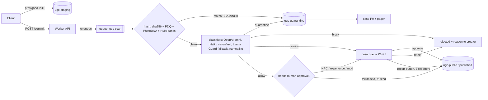

# gap-trust-safety-tooling: CSAM/NCII hash matching, classifiers, likeness detection without biometrics, mod scanning, moderator console, minors and age signals

S00 research gap fill, key `gap-trust-safety-tooling`. Checked 2026-10-18.

- **Feeds:**
  - S09: API, DB schema, evidence storage, NCMEC path.
  - S12: mod and experience publish pipeline, forum.
  - S04: NPC builder validation, chat moderation, teen rails.
  - S05: generator input gates.
  - S10: age screen, report UI, legal pages, settings.
  - S13: risk register, M06b and M13c acceptance criteria.
- **Requirements:** R-NPC-03, R-NPC-04, R-NPC-05, R-MOD-03, R-MOD-04, R-IP-02, R-IP-03, R-IP-04, R-ENG-03.

**What this report does not repeat.** It builds on these reports and does not restate them:
- `legal-ip-likeness.md`:
  - §5.2: TAKE IT DOWN 48 h, 2258A duties, $53,088 penalty.
  - §8: privacy and minors.
  - L1–L5: likeness tiers, consent, kill-switch.
- `ai-npc-runtime.md`:
  - §1.7: NPC upload validation and the Haiku classifier schema.
  - §6: builder flow, `moderation_case`, `npc_report`.
- `auth-ugc-input-maps.md` §3.4: map-anchor moderation.
- `repos-modding.md`: `dv mod check` rules.
- `stack-cloudflare-backend.md` §1.5–1.8: Queues, Workers AI, Containers.
- `gap-observability-cost-guardrails.md`: AI Gateway Guardrails buffer SSE, so Guardrails stay off the dialogue path.

Everything below is either verified on 2026-10-18, with the source in the facts table, or labelled UNVERIFIED or as a proposal.

---

## 0. Headline findings

1. **The Cloudflare CSAM Scanning Tool is a serve-time backstop, not the primary control.**
   - It is free for all customers.
   - It scans content "served for your website through the Cloudflare cache".
   - Since 2025-09-24 it no longer needs NCMEC credentials, but the operator still files its own NCMEC reports.
   - It sends a daily email and places a block "if possible". It has no webhook.
   - The docs (updated 2026-05-01) still do not mention R2.
   - R2's own docs say caching is available only through a custom domain. Worker-binding and S3-API reads "do not transit through the cache", and `r2.dev` gets no cache or WAF.
   - The only plausible coverage is therefore published UGC served from an R2 custom domain with caching on. Drafts and review media read through Worker bindings are not covered.
2. **The free primary image control is Microsoft PhotoDNA Cloud Service.**
   - It is free for vetted organizations and handles images only.
   - Microsoft says it "does not store customer images", and it offers an API for NCMEC reports.
   - **Google's Content Safety API** is the free complement for *unseen* CSAM: a prioritization classifier, approval required, and partners must review content before acting.
   - **Thorn Safer Match** is commercial. Its lowest public price is **$30,720 per 12 months for 1M queries/month** (AWS Marketplace). Scholarships exist "case-by-case" through referral partners.
3. **NCII hash lists are available, but only by joining programs:**
   - **StopNCII:** "Approved Participant" or "Programme Partner". It uses PDQ/PhotoDNA for images and MD5 for video.
   - **NCMEC Take It Down:** participants include **fal.ai**, Safer by Thorn and SafetyKit.
   - **NCMEC Hash Sharing API v2.0:** MD5, SHA1, PhotoDNA, PDQ, NetClean, plus video fingerprints.
   - **Meta's open-source Hasher-Matcher-Actioner (HMA)** works with NCMEC Hash Sharing, StopNCII, GIFCT and ThreatExchange. It runs as a Docker image with PostgreSQL.
4. **OpenAI `omni-moderation-latest` cannot detect minors in images.**
   - It is free, ZDR-eligible and has no abuse-monitoring retention.
   - Images are scored only for `sexual`, `violence`, `violence/graphic` and the three `self-harm` categories.
   - **`sexual/minors` is text-only.**
   - The old "OpenAI inputs/outputs only" wording is gone from the docs, but explicit permission for third-party content is UNVERIFIED.
5. **Workers AI has no image-safety classifier.**
   - `llama-guard-3-8b` is text-only.
   - `resnet-50` returns ImageNet classes ($2.51 per M images).
   - Vision LLMs can be prompted instead: `llama-4-scout-17b-16e-instruct` at $0.27/$0.85 per MTok, `moondream3.1` at $0.30/$1.00.
   - A Claude Haiku 5.5 non-identifying vision check costs about **$0.00025 per image** (computed).
6. **Do not use celebrity-recognition APIs.**
   - AWS's Biometric Notice and Consent Terms cover Rekognition. They require notice to, and consent (including "informed written consent … where required") from, data subjects, given on AWS's behalf. That is impossible for third parties who appear in uploads.
   - Google's celebrity recognition was limited to media companies and "will no longer be available … after September 16, 2025".
   - Azure's is limited-access.
7. **BIPA exposure is live for exactly our NPC-builder pattern.**
   - Suits filed in September–October 2026 allege that Grok's identity-preserving *photo editing* derives face geometry without a BIPA written release. These are allegations, not rulings.
   - Our flow sends reference images to `gpt-image-2.5/sunburst/edit` on fal, which is the same shape.
   - **Rule:** no photograph of a human face reaches any generator unless the tier is `consented` and a BIPA-grade written release is on file. Otherwise, references become text descriptions.
8. **Anthropic defines a minor as anyone "under the age of 18 years old, regardless of jurisdiction".**
   - A 17+ game therefore lets minors interact directly with Claude, so the **Guidelines for Organizations Serving Minors** (updated 2026-03-16) apply. They ask for:
     - age verification, content moderation and filtering, monitoring and reporting, and educational resources;
     - Anthropic's child-safety system prompt;
     - a public COPPA compliance statement;
     - AI disclosure.
   - Anthropic audits, and suspension is possible.
   - **A neutral age screen alone does not meet that list.**
   - fal's AUP §8 also says "You will not use the Services if … you are under 18".
9. **No web API delivers AB 1043 age signals as of 2026-10-18.**
   - Apple Declared Age Range and Google Play Age Signals are native-only.
   - A browser "Age Range API" (CDT, Nick Doty) was only *accepted as a talk* at the W3C TPAC 2026 Age Assurance mini-workshop on 2026-10-18.
   - AB 1856 (Ch. 184, signed 2026-09-10) reportedly dropped the draft browser and website duties (single source plus the chaptered digest's silence). It also bars requesting a signal "if not required to do so by the DAAA or any other applicable law".
   - AB 1043's developer duty attaches when an application is "downloaded and launched". Whether a PWA counts is a question for counsel.
10. **For a moderator console, build a minimal one on Supabase for M06b/M13c.**
    - Ozone is AT-Protocol-only.
    - ROOST **Coop 1.1.1** (Apache-2.0, 2026-10-01) is the best open-source console. It covers queues, rules, HMA, an NCMEC CyberTipline workflow, and Google CSAPI and OpenAI integrations. But it runs on Docker Compose with Postgres, Redis, ClickHouse and (optionally since 1.1.0) Scylla.
    - Hive and Checkstep are contact-sales.
    - Shape our tables so we can migrate to Coop later.
11. **People, not APIs, are the cost.**
    - Automated checks cost about $0.35, $3.40 and $70 per month at 1k, 10k and 100k MAU.
    - Human review at the assumptions in §8 is about 0.19 reviewer-minutes per MAU per month: ~3 h, ~32 h and ~318 h, or roughly $80, $800 and $8,000 at $25/h.

---

## 1. CSAM and NCII hash matching: what a small studio can actually get

### 1.1 Cloudflare CSAM Scanning Tool (verified facts and design consequences)

| Question | Answer | Status |
|---|---|---|
| What is scanned | "content served for your website through the Cloudflare cache", compared "to known lists of CSAM" from groups such as NCMEC; fuzzy hashing ("perceptual fingerprint") | verified (docs 2026-05-01; blog 2025-09-24) |
| R2 public bucket via custom domain | Custom domains "allow you to use Cloudflare Cache"; only certain extensions are cached by default (a Cache Rule is needed for everything else). So coverage is *plausible*, but no Cloudflare page says so | **UNVERIFIED** (community thread asks the same question; no staff answer) |
| `r2.dev` | no caching, WAF or access control, so not covered | verified (R2 docs 2026-09-25) |
| Worker-generated responses / R2 bindings | Binding and S3 reads "do not transit through the cache". Responses a Worker puts into the Cache API: unknown | **UNVERIFIED** |
| Enabling | Dashboard → Caching → Configuration → CSAM Scanning Tool → Configure; enter a notification email | verified |
| NCMEC credentials | no longer required (2025-09-24); "site operators are still expected to continue to file their own reports" | verified |
| On match | daily email for the past 24 h; block "if possible" (the email says if the block failed) | verified |
| Integration | no webhook or Worker event (a community feature request asks for one) | verified absence (medium) |
| Cost | "free child safety tooling for all customers" | verified |

**Spec consequences (S09):**
- Serve **published** UGC images from `ugc.<domain>`, an R2 custom domain on bucket `ugc-public`.
- Add a Cache Rule "eligible for cache" on `/img/*`, `/thumb/*` and `/tex/*`.
- Disable `r2.dev` on every UGC bucket.
- Route the notification email to an ops mailbox that pages on-call.
- Open a Cloudflare support ticket asking: (a) does the tool hash R2 custom-domain responses; (b) at cache fill or on every hit; (c) does it see objects a Worker writes with `cache.put`? Record the answer in this file.
- Never present the tool as our CSAM control in any legal document.

### 1.2 Vendor and program comparison

| Tool | Detects | NCII lists | Eligibility and how to join | Cost | Data flow | Use from our stack |
|---|---|---|---|---|---|---|
| **Cloudflare CSAM Scanning Tool** | known CSAM (fuzzy hash) on cached responses | no | any zone; dashboard toggle | free | Cloudflare-internal | backstop on `ugc.<domain>` |
| **PhotoDNA Cloud Service** (Microsoft) | known CSAM images (PhotoDNA vs "known illegal images"; NCMEC named as a source) | not stated | "trusted online service providers and businesses hosting user-generated content"; online form; "third-party vetting"; API keys after vetting | **free** for qualified customers | image sent to Microsoft, hashed, "does not store customer images"; API to submit NCMEC reports (recommended by Microsoft; direct reporting also allowed) | REST from a Queue consumer Worker. **Primary for M06b if approved.** |
| **Google Content Safety API** | *unseen* CSAM images/video: priority score for review queues | no | "industry and civil society third parties" apply via the toolkit interest form; approval | **free** to qualifying partners | image sent to Google; partners must review before acting | REST from a Queue consumer; Coop has a built-in integration |
| **Google CSAI Match** | known CSAM *video* segments | no | partners (industry, NGOs) | free | fingerprint | only if UGC video ships (not in v1) |
| **Thorn Safer Match** (direct or "Thorn-hosted" on AWS Marketplace) | known CSAM image and video (cryptographic + perceptual hashing) | Safer by Thorn is a **Take It Down participant** (relay of that list is UNVERIFIED) | "We will engage in dialogue with any company"; must meet national reporting mandates; vetting | AWS Marketplace 12-month contracts: **1M queries/mo $30,720**, 5M $37,260 … 100M $186,240; scholarships "case-by-case" | hash or file to Thorn | too expensive below ~1M images/month unless a scholarship is granted |
| **Hive CSAM Detection API** (Thorn models + Safer hashes) | known + novel CSAM in one call; CSAM review feed; "Report to NCMEC" action | not stated | sales; "Report to NCMEC" needs **your own NCMEC credentials** | contact sales (UNVERIFIED) | file to Hive | vendor option at 100k MAU+ |
| **NCMEC Hash Sharing API v2.0** | lists: Industry CSAM / Exploitative, NPO CSAM / Exploitative, **NPO Generative AI CSAM / Exploitative**, Law Enforcement CSAM | CSAM only | credentials "requested from and supplied by NCMEC"; 46 ESPs and 12 other organizations had opted in as of 2023-12-31 | free (UNVERIFIED; no price published) | hashes downloaded; matching on our side | HMA bank `ncmec_*` |
| **StopNCII.org** (SWGfL) | adult NCII hashes submitted by victims | **yes**: PDQ/PhotoDNA images, MD5 videos | two pathways: "Approved Participant" (integrate without becoming a partner; listed by name) or "Programme Partner"; contact form | not published (UNVERIFIED) | partners "only able to access hashes to match against images uploaded to their platforms" | HMA bank `stopncii` |
| **NCMEC Take It Down** | hashes of nude, partially nude or sexually explicit images taken when the person was under 18 | **yes** (minor NCII) | participants "agreed to use the Take It Down hash list"; joining process not published (TakeItDown@ncmec.org is the only contact) | not published | hashes | HMA bank `takeitdown` (algorithm not published; UNVERIFIED) |
| **Meta HMA** (open source) | matcher for any bank: PDQ, MD5, video MD5 (more via python-threatexchange extensions) | integrates NCMEC Hash Sharing, StopNCII, GIFCT, ThreatExchange | GitHub | free (infra only) | ours | Docker on Cloudflare Containers + Supabase Postgres (see §4.4) |

### 1.3 NCMEC reporting path (S09 owns; legal-ip-likeness §5.2 covers the duty)

1. **Register.** 18 U.S.C. 2258A(a)(1)(B) requires the provider to give the CyberTipline "the mailing address, telephone number, facsimile number, electronic mailing address of, and individual point of contact for, such provider".
   - The application route is not publicly documented. A third-party GitHub issue refers to an ESP team email (UNVERIFIED).
   - Start before M06b.
2. **Report.**
   - The CyberTipline Reporting API (docs updated 2026-10-07) uses production base `https://report.cybertip.org/ispws` and test base `https://exttest.cybertip.org/ispws`.
   - Mandatory elements: `incidentSummary`, `incidentType`, `incidentDateTime`, `reporter` (with `email`), `reportingPerson`.
   - Files go by `POST /upload` with `id` and `file`. **The actual file is uploaded**; the server returns an MD5 to verify it.
   - Until credentials arrive, use NCMEC's web form manually.
3. **Scope.**
   - The REPORT Act (Pub. L. 118-59) added **18 U.S.C. 1591 (if a minor is involved) and 2422(b) (enticement)** to the reporting duty.
   - Forum posts, player text in NPC chat, and multiplayer text are therefore in scope for *enticement*, not only images.
4. **Preserve.**
   - (h)(1): a report is a request to preserve for **1 year**.
   - (h)(2): also preserve "reasonably accessible" context files.
   - (h)(3): "secure location", with access limited.
   - (h)(5): may preserve longer voluntarily.
   - (h)(6): preserve "in a manner that is consistent with the most recent version of the Cybersecurity Framework" (NIST).
5. **No duty to scan:** 2258A(f). But:
   - fal's AUP §9 makes "Fail to report child sexual abuse material" a violation;
   - Anthropic's child-safety guidance tells developers to run CSAM detection on their own infrastructure (examples: Safer, IWF, Tech Coalition Pathways).
6. **Fines** for knowing failure to report, for providers under 100M MAU: **$600,000 first, $850,000 subsequent**.
7. **Free advice:** the **Tech Coalition Pathways** program is free for non-members that host UGC. It offers consultations and a resource library, with eligibility review via an interest form. Apply now.

### 1.4 Phased tool plan (proposal)

| Phase | Hash matching | Novel-content signal | Reporting | NCII copies |
|---|---|---|---|---|
| **M06b** (NPC builder; private by default; publish needs review) | PhotoDNA Cloud (apply now). If not approved by M06b, photographic uploads stay private-only and cannot be published | Haiku 5.5 vision schema (§2.3) + OpenAI omni (sexual/violence/self-harm) | manual CyberTipline web form; ESP registration filed | exact SHA-256 + PDQ of every upload stored (no face templates) |
| **M13c** (forum, mod/experience publish, report button, DMCA) | + HMA container with banks `ncmec_industry_csam`, `ncmec_npo_genai_csam`, `stopncii`, `takeitdown` (as granted) | + Google Content Safety API (if approved) as a review prioritizer | CyberTipline API from the console; `ncmec_report` table | HMA PDQ sweep for "known identical copies" (TAKE IT DOWN) |
| **≥100k MAU or ≥3 moderators** | re-evaluate Hive or Safer vs HMA | re-evaluate | evaluate Coop (§5) | — |

---

## 2. Image and text classifiers usable from a Worker

### 2.1 Comparison (prices verified 2026-10-18 unless marked)

| Service | Modalities | Useful categories | Price | Retention / terms | Verdict |
|---|---|---|---|---|---|
| **OpenAI `omni-moderation-latest`** | text + image (≤20 MB) | images: `sexual`, `violence`, `violence/graphic`, `self-harm`, `self-harm/intent`, `self-harm/instructions`. Text-only: `harassment(/threatening)`, `hate(/threatening)`, `illicit(/violent)`, **`sexual/minors`** | **free** | `/v1/moderations`: not used for training; abuse-monitoring retention **None**; ZDR-eligible. Use on non-OpenAI content: old restriction gone, explicit permission UNVERIFIED | default first-pass scorer for text and adult/violence imagery; **not** a minors detector |
| **Workers AI `@cf/meta/llama-guard-3-8b`** | text | Llama Guard hazard taxonomy; 131K context | $0.484/M in, $0.03/M out | Cloudflare-hosted | fallback text classifier; on-platform (no third-party data transfer) |
| **Workers AI vision LLMs** | image + text | prompt-defined | `llama-4-scout-17b-16e-instruct` $0.27/$0.85 per MTok; `moondream3.1-9B-A2B` $0.30/$1.00 | Cloudflare-hosted | possible on-platform image classifier; quality on safety tasks not benchmarked (UNVERIFIED) |
| **Workers AI `@cf/microsoft/resnet-50`** | image | ImageNet labels only | $2.51 per M images | — | not a safety model |
| **Claude Haiku 5.5 vision** | image + text | prompt-defined, non-identifying (Claude "refuses" to name people in images, per ai-npc-runtime) | ≈1,369 image tokens for 1024² (⌈w/28⌉×⌈h/28⌉) + ~500 prompt + ~120 out ≈ **$0.00025/image** (computed from $0.10/$0.50 per MTok) | Anthropic API terms; never send hash-matched or quarantined content | **primary image semantics classifier** (§2.3 schema) |
| **AWS Rekognition `DetectModerationLabels`** | image | moderation label taxonomy | **$0.001/image** first 1M (Group 2), then $0.0008; free tier 1,000/mo for 12 months | inputs "may [be] store[d] and use[d] … to improve" unless an AWS Organizations opt-out policy is set. Biometric Notice and Consent Terms apply to "Amazon Rekognition" (whether they reach moderation labels is not stated) | avoid: same price class as alternatives, extra biometric-terms ambiguity |
| **Google Cloud Vision SafeSearch** | image | adult, racy, violence, medical, spoof likelihoods (category list from docs, medium) | first 1,000 units/mo free; $1.50/1k to 5M; free with Label Detection | online requests "processed in memory and not persisted to disk"; not used for training (2026-10-13) | good second opinion; cheap |
| **Hive Visual Moderation** | image | many classes incl. minors (vendor claim) | **$3.00 per 1,000 images** (Hive model page via search snippet; page did not render) | contact sales for terms | vendor option at scale |
| **Sightengine** | image/text/video | nudity etc.; "running Nudity Detection on an image counts as 1 operation" | Free 2,000 ops/mo (max 500/day); Starter $29/mo for 10,000 ops; Pro $99/mo for 40,000; $0.002 per extra op | no retention statement on the pricing page | cheapest paid vendor fallback |
| **Azure AI Content Safety** | text + image | hate, sexual, violence, self-harm; prompt shields | F0: 5,000 text records and 5,000 images/month; S0 price did not render (UNVERIFIED) | — | not needed |

### 2.2 Ordering rule (load-bearing)

**Hash-match first, classify second, generate last.** An image goes to a third-party model only after it has:
- **passed exact and perceptual matching** against our own banks (SHA-256, PDQ);
- **passed PhotoDNA** (when approved);
- **cleared the minors × sexual short-circuit** (§2.4).

This holds for Anthropic, OpenAI, Google and fal. legal-ip-likeness §5.2 already says suspected CSAM is never sent to other vendors. This rule is how the pipeline enforces it.

### 2.3 Image semantics schema (Haiku 5.5 structured output; extends ai-npc-runtime §1.7 item 4)

```json
{"type":"object","additionalProperties":false,
 "required":["is_photograph","real_human_visible","face_prominent","apparent_minor","nudity","sexual_context","gore","hate_symbol","text_in_image","logos_or_jerseys","verdict","reasons"],
 "properties":{
  "is_photograph":{"enum":["photo","photoreal_render","illustration","3d_render","screenshot","other"]},
  "real_human_visible":{"type":"boolean"},
  "face_prominent":{"type":"boolean","description":"a human face occupies a large share of the frame; do NOT identify anyone"},
  "apparent_minor":{"enum":["none","possible","likely"]},
  "nudity":{"enum":["none","partial","explicit"]},
  "sexual_context":{"type":"boolean"},
  "gore":{"enum":["none","stylized","realistic"]},
  "hate_symbol":{"type":"boolean"},
  "text_in_image":{"type":"string","description":"verbatim visible text, ≤200 chars (names, handles, numbers)"},
  "logos_or_jerseys":{"type":"boolean"},
  "verdict":{"enum":["allow","review","block","quarantine"]},
  "reasons":{"type":"array","items":{"type":"string"},"maxItems":4}}}
```

- The prompt says: "Describe safety-relevant properties. Never name, identify, guess the identity of, or compare any person."
- `text_in_image` feeds `names:lint`. A jersey reading "CURRY 30" is caught by text, not by a face.

### 2.4 Starting thresholds (calibrate on a labelled set of ≥500 game-relevant images before M13c; log raw scores)

| Signal | Action |
|---|---|
| any hash bank match (CSAM banks, PhotoDNA) | **quarantine**; no further vendor calls; CSAM queue (P0) |
| `apparent_minor ≠ none` AND (`nudity ≠ none` OR `sexual_context`) | **quarantine**; CSAM queue (P0); reviewer sees blurred thumbnail only |
| `apparent_minor ≠ none` alone | review (P2); never publish a photo of a minor (likeness L1: minors never subjects) |
| hash match in `stopncii` / `takeitdown` banks | quarantine; NCII queue (P0, 48 h clock) |
| OpenAI `sexual` ≥ 0.50, or `nudity = explicit` | block (17+ game: no sexual UGC) |
| OpenAI `sexual` 0.20–0.50, or `nudity = partial` | review (P2) |
| OpenAI `violence/graphic` ≥ 0.85, or `gore = realistic` | review (P2) (stylized game violence is allowed) |
| OpenAI `self-harm/*` ≥ 0.30 (image) | review (P1) |
| `hate_symbol` | review (P1) |
| `is_photograph = photo` AND `real_human_visible` | likeness path (§3.3); the image is never a generator reference unless `consented` |
| text: Haiku classifier `verdict=block` or Llama Guard unsafe S4 (child sexual exploitation) | block; S4 also opens a CSAM-text case (2422(b) enticement review) |
| text: OpenAI `sexual/minors` ≥ 0.20 | CSAM-text case (P0) |
| text: `self-harm/intent` ≥ 0.50 (forum, chat) | show the crisis card at once (legal §5.2 SB 243 shape); review (P1) |

---

## 3. Real-person likeness detection without biometric identification

### 3.1 What the law says about face geometry from user uploads (engineering summary; counsel confirms)

- **Illinois BIPA (740 ILCS 14):**
  - "Biometric identifier" includes a "scan of hand or face geometry". Photographs are excluded (verified in legal-ip-likeness).
  - Courts have let face-geometry-from-photo theories proceed:
    - virtual try-on suits against MAC, L'Oréal and Estée Lauder; a June 2026 ruling let the MAC case proceed;
    - on 2026-07-10 the Seventh Circuit revived a virtual try-on case against an eyewear company.
  - **Three suits against xAI/SpaceXAI** (Cook County, September 2026; N.D. Ill., 2026-10-07 and 2026-10-12) allege that Grok "derives face-specific geometry when users ask it to analyze or transform photographs while preserving the depicted person's identity". These are allegations only.
  - Damages: $1,000 negligent, $5,000 intentional or reckless.
  - **SB 2979** (signed 2024-08-02): repeated collection from the same person by the same method counts as one violation, and an electronic signature satisfies the "written release".
- **CCPA:**
  - Biometric information becomes sensitive PI when processed to identify (legal-ip-likeness).
  - The CCPA applies only to a "business" over **$26,625,000** gross revenue (2025 adjustment, next in 2027), or one that buys, sells or shares PI of ≥100,000 consumers, or gets ≥50% of revenue from selling or sharing it. A pre-revenue studio may sit outside it at first, which counsel must confirm.
  - The 2026 regulations (effective 2026-01-01) require risk assessments for processing sensitive PI. Pre-2026 processing has until 2027-12-31 (law-firm summaries; medium).
- **Texas CUBI:** AG-enforced, up to $25,000 per violation. Meta settled for $1.4B (2024-07-30) over face geometry from uploaded photos.
- **Vendor terms:** AWS Biometric Notice and Consent Terms (2024-11-14) cover Rekognition. They name BIPA, CUBI, Washington and the CCPA. The customer must give notice and obtain consent "on your behalf and on AWS's behalf", provide proof on request, and indemnify AWS.

### 3.2 Celebrity-recognition APIs: verdict "do not use"

| API | Status | Why not |
|---|---|---|
| AWS `RecognizeCelebrities` | available, Group 2, $0.001/image | It is face recognition by definition, so the biometric terms apply. Consent is needed from the *depicted* person, who is not our user. Running it on every upload means collecting face geometry from strangers. |
| Google Vision celebrity recognition | restricted to "media & entertainment companies or approved partners" and "professionally-produced media"; **"will no longer be available on Google Cloud after September 16, 2025"** | ineligible and discontinued |
| Azure celebrity recognition | Limited Access since 2022 (registration required) | eligibility unlikely; same biometric problem |

### 3.3 Lawful layered design (proposal; replaces "face recognition" with non-biometric layers)

| Layer | What it catches | Biometric? | Cost | Failure mode |
|---|---|---|---|---|
| **L0 Attestation** (ai-npc-runtime §1.7): original / "this is me" / real person with written consent + document | honest users; creates contractual warranty and repeat-infringer basis | no | 0 | liars |
| **L1 Name and alias lint**: `names:lint` over the name, backstory, `text_in_image`, filenames and EXIF (before stripping), against `likeness_subject.aliases` + a top-N public-figure list (Wikidata-derived, provenance-tracked) + `marks` | named real people, jerseys, handles | no | ~0 | unnamed lookalikes |
| **L2 Text classifier** `named_real_people`, `impersonation_intent` (Haiku, existing) | descriptive references ("the Warriors' #30") | no | ≈$0.002/backstory | creative paraphrase |
| **L3 Image semantics** (§2.3): `is_photograph`, `real_human_visible`, `face_prominent`, `logos_or_jerseys`, never identity | "this is a photo of a real person" | No identification. Whether a VLM viewing a face counts as a "scan of face geometry" is UNVERIFIED; counsel to confirm (low risk: no template, no measurement output) | ≈$0.00025/image | — |
| **L4 Exact + perceptual hash denylist** (SHA-256 + PDQ via HMA): (a) images removed after takedowns or publicity complaints; (b) images rejected as real-person photos; (c) optional curated public photos of roster subjects (store hashes only) | re-uploads and near-duplicates of known photos | no (whole-image hash, not a face template; UNVERIFIED legally, but this is how StopNCII works) | ~0 | new photos of the same person |
| **L5 Reverse image search** for *publish requests only* where `is_photograph=photo ∧ real_human_visible`: Google Vision Web Detection ($3.50/1k after 1k free; returns web entities, best-guess labels and matching pages) or TinEye API (bundles $0.04→$0.01/search, date UNVERIFIED) | press photos of public figures; scraped images | It matches the image against the web and does not compute a face template from it. Whether Web Detection uses face recognition internally is not stated (UNVERIFIED); counsel to confirm | <$1/mo even at 100k MAU | private individuals' photos (no web footprint) |
| **L6 Generator gate** (S05): for any tier other than `consented`, photographs with `real_human_visible` are **never** sent to `gpt-image-2.5/*`, Meshy or any fal endpoint. Instead, Haiku writes a non-identifying text description of outfit, palette, era and archetype, and the generator gets text + first-party style refs | It removes the identity-preserving edit, which is both the likeness harm and the BIPA theory | no | ≈$0.0005 | user uploads a drawing traced from a photo (L3 + human review) |
| **L7 Human review** before any publish (M06b AC); reviewers see attestation, L1–L5 signals and the generated sheet side by side; decisions logged | everything above missed | no | §8 | reviewer fatigue |

**"This is me" (self-likeness NPCs).**
- An identity-preserving generation from a selfie *is* the alleged BIPA pattern.
- v1 options: (a) defer the feature; or (b) ship it only behind:
  - a BIPA-grade written release with electronic signature, shown to every US user (simpler than geofencing Illinois);
  - a published retention and destruction schedule (selfies deleted ≤30 days after the sheet is generated; never used for training);
  - processor terms with fal and OpenAI flowed down;
  - a signed-in account with auth phase ≥1;
  - counsel sign-off.
- **Default: (a), defer.**

**No client-side face detectors.** Do not add MediaPipe Face Detector or face-landmark models to "auto-blur faces": keypoints are face geometry. Blur on demand with a user-drawn rectangle in the crop UI. Fully pixelate photos that L3 marks `face_prominent` before storing any derivative.

### 3.4 What counsel must confirm
1. A VLM classifying "photo of a real human, face prominent" without identification is not a "scan of face geometry" (BIPA) or biometric processing (CCPA, CUBI).
2. Whole-image PDQ or PhotoDNA hashes of user uploads are not biometric identifiers.
3. Reverse image search on uploads (sending them to Google or TinEye) is acceptable with privacy-policy disclosure.
4. The "this is me" release text, retention schedule and processor chain (fal → OpenAI), if the feature ships.
5. Whether the studio is a CCPA "business" at launch, and when risk assessments become due.
6. Storing hashes of roster subjects' press photos: no copy of the photo is retained, and only hashes are stored.

---

## 4. Mod and experience archive scanning (Queue consumer + Container)

### 4.1 Platform limits that shape the design
- **Workers:** 128 MB memory per isolate; Paid CPU limit 5 min (default 30 s). Stream archives; never buffer whole objects twice.
- **Containers:**
  - Paid only. Instance types `basic` 1 GiB and `standard-1` 4 GiB (stack-cloudflare-backend §1.8).
  - Disk is **ephemeral**; a sleeping instance restarts on a fresh image disk.
  - Cold start "often … 1-3 second range".
  - `sleepAfter` defaults to 10 min; SIGTERM then up to 15 min before SIGKILL.
  - Out-of-memory restarts the instance (no swap).

### 4.2 Pipeline (S12; extends repos-modding `dv mod check`, which runs the same rules locally)

| Step | Where | Tool | Rule |
|---|---|---|---|
| 1 Envelope | Worker (Queue consumer) | `fflate` 0.8.3 (MIT) streaming unzip | archive ≤128 MiB (Grand-V cap); ≤2,000 entries; uncompressed total ≤512 MiB; per-entry compression ratio ≤100:1 (zip-bomb); reject absolute paths, `..`, symlinks, duplicate names after NFC + case fold, nested archives |
| 2 Type allowlist | Worker | magic bytes, not extensions | JSON, glTF/GLB, KTX2, PNG/WebP/JPEG (thumbnails), Ogg/Opus/MP3/WAV, `.js` for QuickJS entry, `.md`/`.txt`; everything else rejected. legal §2.5 banned formats (`.rpf .ydr …`) produce the fixed message |
| 3 Schema | Worker | Ajv against C14 `ModManifest`, C17 `ExperienceDescriptor`, mission IR | fail closed; unknown `permissions[]` rejected |
| 4 Secrets | Worker | `secretlint` 13.0.7 (MIT, JS) with recommend preset + repos-modding patterns (fal, `sk-ant-`, `sk-proj-`, `ghp_`, `AKIA`, PEM) | block, and show the creator which file and line |
| 4b Secrets (deep, optional) | Container | `gitleaks` (MIT; "feature complete", security patches only) or its successor **Betterleaks** (MIT; v2 not yet stable). **Do not ship `trufflehog`** inside the service: AGPL-3.0, and its live verification calls third-party APIs with found keys | weekly rule sync |
| 5 Malware | Container `standard-1` (4 GiB) | ClamAV `clamd` (official Docker docs: min 3 GiB, preferred 4 GiB; reload briefly doubles RAM) | Bake signatures into the image in a daily CI build. Do not run `freshclam` at every cold start: the ClamAV CDN rate-limits (429/403), asks for ≤ hourly checks, and recommends a `cvdupdate` private mirror above 10 hosts. Low value for JSON/glTF/JS: a hygiene check, not the security boundary |
| 6 3D and texture validity | Worker or Container | Khronos `gltf-validator` 2.0.0-dev.3.10 (Apache-2.0, npm); `ktx validate` from KTX-Software (version UNVERIFIED) | no errors; caps from C13 budgets (tris, texture MB) |
| 7 Script lint (QuickJS) | Worker | parse to AST (any ES2023 parser); deny dynamic `Function`, `eval`, `import()`, `with`; size ≤256 KB; flag minified or high-entropy code for review | **The C14 sandbox + permission broker is the control.** This step only routes risky scripts to review |
| 8 Text | Worker | OpenAI omni (text) + Haiku classifier + `names:lint` over all strings (names, dialogue JSON, descriptions, signage) | thresholds §2.4 |
| 9 Images inside archive | Queue fan-out | the §2 image pipeline per image | any quarantine quarantines the whole archive |
| 10 Map anchor | Worker | auth-ugc-input-maps §3.4 rules (SF land polygon, right-of-way, residential parcel buffer, EAS address strings) | block |
| 11 IP and provenance | Worker | legal §2.5 `ip:signatures`, `ip:extensions`, `ip:strings`, `license:scan`, provenance record | block |
| 12 Human review | console | §6 | publish only after `approved` |

---

## 5. Moderator tooling: adopt, buy or build

| Option | What it is | Fit | Cost |
|---|---|---|---|
| **Ozone** (Bluesky) | moderation and labeler service for AT Protocol | built around atproto labels and accounts; no evidence of use outside atproto | free, but wrong data model |
| **ROOST Coop** | "open source review and moderation platform": queues, routing, rules, role-based access, "complete audit logging", HMA hash matching, **"first free, end-to-end CSAM detection, review, and NCMEC reporting workflow"**, Google CSAPI + OpenAI Moderation integrations. Releases: v0 (Feb 10) → 1.0 (Jun 8) → 1.1.0 (Sep 29, Scylla optional) → **1.1.1 (Oct 1, 2026)**. Hosted by Musubi | strongest feature fit. Stack: Docker Compose with Postgres 15, Redis 8, ClickHouse 24.3, Scylla 5.2 (from a mirror of the compose file). Cloudflare Containers have ephemeral disk, so the datastores must live elsewhere. That is too much infrastructure for M06b | free (self-host infra) or Musubi (price UNVERIFIED) |
| **Hive** dashboard | moderation dashboard + CSAM review feed + NCMEC action | vendor lock-in; contact sales | visual moderation $3/1k images; dashboard UNVERIFIED |
| **Checkstep** | moderation platform | contact sales; aggregator prices ($99/$499) UNVERIFIED | UNVERIFIED |
| **Build on Supabase** | tables in §6.8 + a `/admin` route in the PWA shell (role `reviewer`/`trust_lead`/`admin`) | matches stack (Postgres + RLS, Workers API); small scope | engineering time only |

**Recommendation:**
- Build the minimal console (M06b: NPC queue; M13c: all queues). Mirror Coop's concepts (item, signal, queue, decision, action, report), so a later switch is a data migration, not a redesign.
- Run HMA standalone in a Container from M13c.
- Revisit Coop when moderators ≥3 or MAU ≥100k.

**Minimal console scope (S10 + S09):**
- Queue list with SLA countdown.
- Item view: blurred media by default; click-to-reveal is logged; grayscale toggle; **suspected-CSAM media is never rendered**, only metadata.
- Signals panel, decision buttons, reason codes, macro notices to the user, takedown and NCII request view with clocks, NCMEC report form (API-backed), user history and strikes, and the audit log viewer.

---

## 6. Recommended moderation architecture (proposal for spec/04 + spec/domains/12)

### 6.1 Principles
1. **Private by default.** Nothing user-made is visible to another player until its auto checks pass. NPCs, experiences and mods also need human approval (M06b/M13c ACs).
2. **Hash first, never forward suspected CSAM** (§2.2).
3. **Classifiers suggest; humans decide** anything that changes another player's experience or a legal state.
4. **Every automated or human act writes a row:** `moderation_signal`, `moderation_decision` or `audit_log`. Clocks live in the DB, not in memory.
5. **Separate buckets by trust:** staging, public, quarantine, evidence. Only `ugc-public` has a public route.
6. **No biometric processing anywhere** (§3).
7. **Same code locally and on the server.** `dv mod check` and the Queue validator share rules (repos-modding).

### 6.2 Storage layout (S09)

| Bucket | Access | Lifecycle | Notes |
|---|---|---|---|
| `ugc-staging` | presigned PUT (≤15 min, fixed Content-Type) + Worker binding reads | delete 7 days after a terminal decision | drafts and review media; served to owner and reviewers through an authenticated Worker route (not CSAM-tool covered) |
| `ugc-public` | R2 custom domain `ugc.<domain>`, Cache Rule on; `r2.dev` off | until unpublished | content-addressed `img/<sha256>.<ext>`; purge cache on removal (R2 consistency: cached deletes persist until purge) |
| `ugc-quarantine` | Worker binding only; role `trust_lead` | **R2 bucket lock**: 400-day retention rule on prefix `csam/`; 90 days on `other/` | never served; no public domain |
| `legal-evidence` | Worker binding only; every read goes through `/admin/evidence/:id` which writes `audit_log` first | bucket lock per prefix; `legal_hold/` indefinite | NCMEC preservation ((h)(1) 1 year), takedown records, consent PDFs (legal L5). R2 Data Access Logs are "best effort", so our audit row is the record of truth |

### 6.3 Upload pipeline (all content types share it)



### 6.4 Stages per content type

| Content | Pre-publish automated stages | Human review | Visible when | Post-publish |
|---|---|---|---|---|
| **NPC builder uploads** (backstory ≤20,000 chars, ≤6 images; ai-npc-runtime §1.7) | images: hash → §2.3 → OpenAI omni. Text: Haiku classifier + Llama Guard (existing) + OpenAI omni + `names:lint`. Likeness L0–L6. Preview chat probe (existing) | **every publish** (M06b); P2; reviewers see the attestation and signals | private: after auto pass. Public: after approval + signed-in account (auth ≥1) | report button on every surface; 3 distinct reporters (or 1 `trust_lead`) → `unpublished_pending_review`; roster kill-switch covers user NPCs |
| **NPC generated assets** (sheet, glTF) | §2.3 on rendered sheet views (front/side), checking `apparent_minor`, `nudity`, `logos_or_jerseys`; `photoreal` presets blocked for non-consented (legal L3) | part of the same publish case | with the NPC | regenerate only through the pipeline |
| **Mod archives** (C14) | §4.2 steps 1–11 | every publish (P3) | personal use: immediately (local only). Shared: after approval | reports; repeat-infringer strikes (legal §5.1); mods never run in MP rooms (01-MASTER non-goal) |
| **Experiences** (C17) | as mods + map anchor rules + descriptor text | every publish (P2), map preview with a 25 m radius ring | after approval; marker appears on the map | reports; auto-unlist at 3; experiences referencing a killed NPC are unlisted (legal L4) |
| **Forum posts** | text: OpenAI omni + Llama Guard fallback + `names:lint` + EAS address regex; images: full §2 pipeline; links: allowlist or `rel=nofollow ugc` + Safe Browsing check (UNVERIFIED vendor choice) | only `review` verdicts (P2) and new accounts' first 3 posts with images (P3) | text: on allow (post-moderation). Images: on allow | reports; strikes; rate limits (1 post/30 s, 20/day new accounts) |
| **NPC chat** (player text in, Claude out) | input: local prefilter (regex: emails, phones, addresses, slurs) → OpenAI omni text **asynchronously**, not blocking the SSE; S4/`sexual/minors`/enticement → end encounter + CSAM-text case; `self-harm/intent` → crisis card. Output: schema-validated (existing); `line` passes `names:lint` for real names | sampled QA (0.1% of turns, PII-scrubbed) + all flagged turns | n/a | "Report this conversation" captures the last 20 turns into `evidence_object` (consented by the reporter, disclosed in the privacy policy) |
| **Multiplayer voice** (later) | not recorded in v1 (legal P5) | reports only | — | — |

### 6.5 Queues and SLA timers

| Queue | Trigger | Statutory clock | Internal targets | Paging |
|---|---|---|---|---|
| **P0-CSAM** | hash match, minors×sexual, `sexual/minors` text, report category `child_safety` | report "as soon as reasonably possible" after actual knowledge; preserve 1 year | auto-quarantine ≤60 s; trust-lead confirmation ≤4 h; CyberTipline report ≤24 h after confirmation; account suspended at confirmation | page immediately, 24/7 |
| **P0-NCII** | TAKE IT DOWN request (`/legal/ncii`), StopNCII or Take It Down bank match, report category `intimate_image` | **48 h** to remove the content + known identical copies | **disable access on intake** for any facially valid request (remove first, review after); copy sweep (SHA-256 + PDQ over `ugc-public`) ≤24 h; requester notice ≤48 h | page at intake; re-page at 24 h and 36 h; auto-escalate to admin at 40 h |
| **P1-Safety** | self-harm intent, credible threats, doxxing, enticement indicators | none (but 2258A covers enticement) | ≤1 h first look | page during waking hours (08:00–24:00 PT); otherwise auto-hide |
| **P1-Legal** | DMCA notice, publicity or likeness complaint, trademark | DMCA "expeditiously"; counter-notice restore 10–14 business days | ≤24 h; likeness kill-switch ≤60 s live (legal L4) | business hours |
| **P2-Review** | NPC and experience publish, classifier `review` | none | ≤72 h | none |
| **P3-Review** | mod publish, first posts, low-severity reports | none | ≤5 days | none |
| **Appeals** | creator appeal | none | ≤7 days; a different reviewer decides | none |

`moderation_case.sla_due_at` is computed at insert time. A Cron Trigger every 5 min pages through the alerting path in gap-observability-cost-guardrails. Every queue shows its count, the oldest case age and breaches on the console home.

### 6.6 Evidence preservation (S09)
- On CSAM confirmation:
  - copy the original + context files ((h)(2): upload record, account record, IPs, related posts) to `legal-evidence/ncmec/<report_id>/`;
  - set `preserve_until = submitted_at + 1 year`;
  - the bucket lock rule (retention-days 400) prevents deletion.
- Access is limited to role `trust_lead`. Every read is an `audit_log` row written before streaming.
- Map controls to NIST CSF ((h)(6)) in a one-page control sheet (S13): access control, logging, encryption at rest (R2 default), incident response.
- NCII and DMCA records keep metadata + hashes, not the intimate image itself, once removal is complete. Exception: a legal hold. A counsel decision is needed for NCII retention (Open question 8).
- Retention for non-legal moderation data: decisions and audit 2 years; signals of allowed items 90 days; staging media 7 days after a terminal state (proposal).

### 6.7 Report button contract (R-IP-03)
- One component, `<ReportButton target={{kind, id}} />`, appears on every UGC surface: NPC card, NPC in-world, experience marker and panel, mod page, forum post, profile, and the chat transcript.
- Categories: `child_safety`, `intimate_image`, `real_person_likeness`, `copyright`, `harassment_hate`, `violence_threat`, `self_harm`, `spam_scam`, `other`.
- `child_safety` and `intimate_image` skip the reporter-count threshold and open P0.
- `copyright` routes to the DMCA form, because a §512 notice needs its elements.

### 6.8 Data model (Postgres; server-only, RLS deny-all to clients; extends ai-npc-runtime §6.2 and legal-ip-likeness `takedown_request`)

```sql
create type mod_subject as enum ('npc_draft','npc_asset','mod_version','experience','forum_post','forum_attachment','chat_turn','profile');
create type mod_state   as enum ('received','scanning','auto_allowed','needs_review','quarantined','published','rejected','removed','restored');

create table moderation_item (
  id uuid primary key,                         -- uuid v7 minted in the Worker
  subject_kind mod_subject not null, subject_id text not null,
  owner_profile_id uuid not null,
  r2_bucket text, r2_key text,                 -- null for text-only items
  sha256 bytea, pdq bytea, pdq_quality smallint, md5 bytea,   -- whole-file/whole-image hashes only; no face templates
  mime text, bytes int,
  state mod_state not null default 'received',
  visibility text not null default 'private' check (visibility in ('private','unlisted','public')),
  created_at timestamptz not null default now(), updated_at timestamptz not null default now()
);
create index on moderation_item (sha256); create index on moderation_item (owner_profile_id, created_at desc);

create table moderation_signal (               -- one row per automated check (append-only)
  id bigserial primary key, item_id uuid not null references moderation_item(id),
  source text not null,                        -- photodna|cf_csam|hma:<bank>|openai_omni|haiku_vision|haiku_text|llama_guard|names_lint|secretlint|clamav|gltf_validator|reverse_image|google_csapi
  source_version text not null,                -- model id / rules version
  verdict text not null check (verdict in ('allow','review','block','quarantine','error')),
  scores jsonb not null default '{}', latency_ms int, created_at timestamptz not null default now()
);

create table moderation_case (                 -- supersedes ai-npc-runtime moderation_case
  id uuid primary key, item_id uuid references moderation_item(id),
  queue text not null check (queue in ('P0_CSAM','P0_NCII','P1_SAFETY','P1_LEGAL','P2_REVIEW','P3_REVIEW','APPEAL')),
  reason text not null, opened_by text not null,     -- 'auto:<source>' | 'report' | 'legal' | profile id
  sla_due_at timestamptz not null, statutory_due_at timestamptz,
  status text not null default 'open' check (status in ('open','in_progress','decided','escalated','closed')),
  assignee uuid, created_at timestamptz not null default now(), closed_at timestamptz
);
create index on moderation_case (queue, status, sla_due_at);

create table moderation_decision (             -- append-only; a reversal is a new row
  id bigserial primary key, case_id uuid not null references moderation_case(id),
  decided_by uuid not null, role text not null,
  action text not null check (action in ('approve','reject','request_changes','remove','restore','quarantine','report_ncmec','suspend_user','strike','dismiss')),
  policy_code text not null, note text, user_notice_template text,
  decided_at timestamptz not null default now()
);

create table user_report (
  id uuid primary key, target_kind mod_subject not null, target_id text not null,
  reporter_profile_id uuid, category text not null, note text check (length(note) <= 1000),
  case_id uuid references moderation_case(id), created_at timestamptz not null default now()
);

alter table takedown_request                    -- defined in legal-ip-likeness §Recommendations
  add column statutory_due_at timestamptz,      -- received_at + 48h for kind='ncii'
  add column copies_found int, add column copy_sweep_job uuid, add column requester_notified_at timestamptz;

create table ncmec_report (
  id uuid primary key, case_id uuid not null references moderation_case(id),
  cybertip_report_id text, environment text not null check (environment in ('test','production')),
  submitted_by uuid not null, submitted_at timestamptz, files_uploaded int not null default 0,
  preserve_until date generated always as ((submitted_at + interval '1 year')::date) stored,
  status text not null check (status in ('draft','submitted','finished','error'))
);

create table evidence_object (
  id uuid primary key, case_id uuid references moderation_case(id), ncmec_report_id uuid references ncmec_report(id),
  r2_key text not null, sha256 bytea not null, kind text not null,   -- original|context|transcript|consent|notice
  preserve_until date, legal_hold boolean not null default false, created_at timestamptz not null default now()
);

create table hash_bank_entry (                  -- our own banks (HMA holds external ones)
  bank text not null,                           -- removed_takedown|rejected_real_person|roster_press|ncii_request
  hash_type text not null check (hash_type in ('sha256','pdq','md5')), hash bytea not null,
  source_case uuid, added_at timestamptz not null default now(), expires_at timestamptz,
  primary key (bank, hash_type, hash)
);

create table enforcement_action (
  id bigserial primary key, profile_id uuid not null, kind text not null check (kind in ('strike','publish_ban','suspend','terminate','restore')),
  policy_code text not null, case_id uuid, expires_at timestamptz, created_at timestamptz not null default now()
);

create table audit_log (                        -- append-only, hash-chained; INSERT-only grant
  id bigserial primary key, at timestamptz not null default now(),
  actor text not null, role text not null, action text not null,
  target_kind text, target_id text, details jsonb not null default '{}',
  prev_hash bytea, row_hash bytea not null      -- sha256(prev_hash || canonical(row))
);

create table age_assurance (
  profile_id uuid primary key,
  declared_bracket text check (declared_bracket in ('u13','13_15','16_17','18p')),   -- from the neutral screen; birth date not stored
  declared_at timestamptz,
  signal_source text check (signal_source in ('none','apple_dar','play_age_signals','browser_age_range','dc_api')),
  signal_bracket text, signal_at timestamptz,
  effective_bracket text not null,             -- rule in §7.5
  updated_at timestamptz not null default now()
);
```

### 6.9 API (Workers, `/api/v1`, C12; adds to ai-npc-runtime §6.3)

| Method & path | Purpose |
|---|---|
| `POST /ugc/uploads` → presigned PUT; `POST /ugc/uploads/:id/commit` | starts `ugc-scan` |
| `POST /reports` | report button (rate-limited per profile) |
| `POST /legal/ncii` | TAKE IT DOWN intake: request id, statutory clock, immediate disable |
| `POST /legal/dmca`, `POST /legal/counter-notice` | §512 |
| `GET /admin/cases?queue=&status=` | console queue (role `reviewer`+) |
| `POST /admin/cases/:id/decision` | writes `moderation_decision` + side effects |
| `POST /admin/cases/:id/ncmec` | builds and submits the CyberTipline report (role `trust_lead`) |
| `GET /admin/evidence/:id` | audited stream from `legal-evidence` |
| `POST /admin/hash-banks/:bank` | add hashes (copy sweep for NCII) |
| `GET /me/age` / `POST /me/age` | neutral screen result; signal ingestion (§7.5) |

---

## 7. Minors and age policy

### 7.1 Anthropic requirements (verified 2026-10-18)
- **Usage Policy** (effective 2026-11-12):
  - "We define a minor or child to be any individual under the age of 18 years old, regardless of jurisdiction."
  - "Products serving minors", "including organizations providing minors with the ability to directly interact with products", "must comply with the additional guidelines outlined in our Support article."
  - Consumer chatbots must disclose AI "at a minimum at the beginning of each chat session or in the product interface."
  - "Fetishize or sexualize minors, including in fictional settings or via roleplay with the model" is prohibited.
- **Guidelines for Organizations Serving Minors** (updated 2026-03-16):
  1. Additional technical measures "such as" age verification, content moderation and filtering, monitoring and reporting, and educational resources for minors.
  2. Implement Anthropic's child-safety system prompt (provided by Anthropic) as part of a broader suite.
  3. Comply with COPPA and similar law, and state that compliance clearly on the public website.
  4. Disclose AI interaction.
  - Anthropic audits periodically. A high violation rate without these measures can lead to suspension or termination.
- **Child safety guidance for developers** (updated 2026-06-26):
  - Usage Policy obligations apply "regardless of platform size".
  - Developers are responsible for safeguards against end users uploading CSAM.
  - It recommends detection on your own infrastructure (Safer, IWF, Tech Coalition Pathways), NCMEC reporting for US platforms, and logging for transparency reporting.
  - No specific vendor is required.
- **Commercial Terms** (effective 2025-06-17): no clause on end-user age.

### 7.2 Does "17+ with a neutral age screen" satisfy Anthropic?
**No, not by itself.**
- A 17-year-old is a minor under the AUP, so a 17+ product "serves minors" and the guidelines apply.
- A self-declared neutral screen is the weakest form of age assurance. The guideline list also asks for moderation, monitoring and reporting, educational resources, the child-safety system prompt, and a published COPPA statement.
- Other vendor constraints point the same way:
  - fal AUP §8: "You will not use the Services if … you are under 18". Whether this binds end users of a server-side integration is UNVERIFIED.
  - ElevenLabs: apps "directed at" under-18s need written approval (ai-npc-runtime).

**Options (owner + counsel decide; Open question 1):**

| Option | Description | Pros | Cons |
|---|---|---|---|
| **A (recommended for v1)** | Content rated for 17+ (ESRB-M-like), but **ToS eligibility 18+**. The neutral screen blocks under-18 declarations. Honour any age signal | aligns with Anthropic's definition, fal §8, ElevenLabs and Claude.ai's own 18+ rule; one code path; teen safeguards not on the critical path | loses 17-year-olds; departs from the brief's "17+" eligibility wording |
| **B** | 17+ eligibility with a **17-year-old mode** implementing the guidelines (table §7.4) | keeps 17-year-olds | the 16–17 signal bracket cannot tell 16 from 17; more code and policy surface; fal-backed builder and t2/t3 voices must be off for the cohort |
| C | 13+ | — | contradicts COPPA posture and every vendor constraint above; not considered |

### 7.3 Neutral age screen (S10; legal §5.3 item 1 already defines it)
- Month/day/year with free entry. No default year, no hint about the age needed, no retry after an under-age answer.
- Store only the derived bracket (`age_assurance.declared_bracket`) plus a device flag that blocks re-entry for 24 h. Do not store the birth date.

### 7.4 What changes for under-18 accounts (Option B "17 mode"; under Option A every <18 row is "blocked")

| Feature | 18+ | 17 mode (Option B only) | 13–16 (incl. signal 16–17 without a consistent declared 17) | <13 |
|---|---|---|---|---|
| Account / play | yes | yes | **blocked** (17+ product) | **blocked**; COPPA: keep only a block flag, delete profile data |
| Story NPC dialogue | free text + choices | **choice-based lines by default**; free text off by default (toggle off, Epic-order spirit); child-safety system prompt prepended to block A; stricter rails (no romance, no alcohol/drug humor, no gambling talk) | — | — |
| Player text moderation | async OpenAI omni + prefilter | **synchronous** moderation before the turn is sent; any `sexual*`, self-harm or contact-seeking ends the encounter with a safety card | — | — |
| NPC voice output | t1/t2 (t3 only `consented`) | t1 only (Workers AI Aura/Melo); no ElevenLabs (under-18 rule) | — | — |
| NPC long-term memory | yes (≤180 days; legal P6) | **session-only**; no `npc_memory` rows | — | — |
| NPC builder (fal-backed) | yes | **off** (fal AUP §8) | — | — |
| Publish NPCs, experiences, mods | yes (signed-in, review) | **off** | — | — |
| Forum | read + post | read-only | — | — |
| Multiplayer voice/text chat | opt-in | **off** (Epic order) | — | — |
| Pose camera | on-device opt-in | off unless the `parental_consent` flag (legal P3) | — | — |
| Telemetry | C16 privacy-safe | same, no free text | — | — |
| Marketing email / push | opt-in | none | — | — |
| Retention | standard | shortest (chat logs 7 days, no memory) | — | — |

### 7.5 AB 1043 age signals and the web app

**Law (enacted text, Ch. 675, read from the chaptered PDF):**
- "Application" means software run on a general-purpose device "that can access a covered application store or download an application".
- The developer "shall request a signal … when the application is downloaded and launched".
- A received signal gives "actual knowledge … across all platforms of the application".
- It is the "primary indicator" unless the developer has "internal clear and convincing information" otherwise.
- Brackets: <13, 13–<16, 16–<18, 18+.
- Penalties: AG-only, up to $2,500 per affected child (negligent) or $7,500 (intentional).
- Operative 2027-01-01. Pre-2027 devices and apps have until 2027-07-01.

**AB 1856** (Ch. 184, chaptered 2026-09-10):
- Excludes open-source OS distributors from "operating system provider".
- Deletes the definition of "user".
- Bars requesting a signal "if not required to do so by the DAAA or any other applicable law".
- The April–May drafts extended duties to browsers and websites. Reclaim The Net (2026-09-02) reports the final version "no longer requires web browsers and websites to directly participate". The chaptered digest summaries mention no browser duties. Treat this as medium confidence until the chaptered text is read.

**How a signal could reach us (status 2026-10-18):**

| Channel | Surface | Status | Usable by our PWA? |
|---|---|---|---|
| Apple Declared Age Range | native iOS/iPadOS/macOS API; extended in 2026 for Utah (2026-05-06) and Louisiana (2026-07-01) | shipping (beta updates in Feb 2026) | **no** (no Safari or JS surface found) |
| Google Play Age Signals API | native Android | beta; rollout expanding | **no** |
| Browser "Age Range API" | proposal by CDT (npdoty/age-range explainer) | accepted 2026-10-18 for a W3C TPAC 2026 mini-workshop talk; no implementation | **no** |
| Digital Credentials API | `navigator.credentials.get` with mdoc/OpenID4VP; Chrome 141+ (Android + cross-device QR), Safari 26 (mdoc only, per secondary sources) | shipping | **yes, as optional verified age** (e.g. `age_equal_or_over: 18`); not an AB 1043 signal |
| Windows age APIs | reported by a secondary source | UNVERIFIED | no |

**Spec (S10 + S09):**
1. Define `interface AgeSignalProvider { id; available(): Promise<boolean>; request(): Promise<{bracket: 'u13'|'13_15'|'16_17'|'18p', source, at} | null> }`.
2. Ship only the `none` provider in v1, with stubs for `apple_dar` and `play_age_signals` (native wrappers are a non-goal), and for `browser_age_range` (feature-detected; inert until a spec exists).
3. **Do not request a signal unless counsel says the law requires it** (AB 1856 request bar).
4. Effective bracket = the lowest of the signal bracket and the declared bracket. A conflict where the signal is lower always wins ("primary indicator"). Internal clear-and-convincing evidence also lowers the bracket: a verified DC API credential, or the user's own statement in support or chat that triggers review.
5. A `16_17` signal under Option B maps to "17 mode" only if the declared age is 17. Otherwise block.
6. If a signal is received, write `age_assurance` and re-evaluate on every launch ("across all platforms").
7. App Store Accountability Acts (Texas SB 2420: district court injunction 2025-12-23, then a Fifth Circuit stay pending appeal by June 2026; Utah, Louisiana) bind app stores and native apps. They are irrelevant to the v1 PWA and must be revisited before any store wrapper.

---

## 8. Costs at 1k / 10k / 100k MAU (proposal; assumptions explicit)

**Volume assumptions per MAU per month:**
- **NPC builder:** 4% start a draft (avg 4 images, 5k-token backstory): 0.16 images, 0.04 backstories.
- **NPC publish requests:** 1%.
- **Mod/experience publishes:** 0.5%, avg 15 images and 1 script each: 0.075 images.
- **Forum:** 8% post 4 times = 0.32 posts; 10% of posts carry an image = 0.032 images.
- **Player chat:** 90 turns, from ai-npc-runtime §7.2.
- **Reports:** 0.02.
- **Total images:** 0.267 per MAU.

**Human review assumptions:**
- NPC publish 4 min; mod/experience 15 min; flagged forum post 1 min (5% of posts); report 3 min.
- That totals **0.191 reviewer-minutes per MAU**, at $25/h for contractors (assumption).

| Line item (monthly) | Unit cost | 1k MAU | 10k MAU | 100k MAU |
|---|---|---|---|---|
| Images (count) | — | 267 | 2,670 | 26,700 |
| PhotoDNA, Cloudflare CSAM tool, OpenAI omni, Google CSAPI | free | $0 | $0 | $0 |
| Haiku 5.5 image semantics | ≈$0.00025/img | $0.07 | $0.67 | $6.68 |
| Backstory moderation (Llama Guard + Haiku; ai-npc-runtime) | ≈$0.0044/backstory | $0.18 | $1.76 | $17.60 |
| Forum text (Llama Guard fallback on 100%) | ≈$0.00029/post | $0.09 | $0.93 | $9.30 |
| Chat input: OpenAI omni (default) | free | $0 | $0 | $0 |
| *Chat input: Llama Guard instead* | ≈$0.0001/turn | *$9* | *$87* | *$871* |
| Reverse image search (flagged publishes only) | $0.0035 | <$0.01 | $0.11 | $1.05 |
| Containers (HMA basic + ClamAV standard-1) | on demand ≤ included 25 GiB-h; always-on ≈$27 (ClamAV 4 GiB) + ≈$6.5 (HMA 1 GiB) | $0 | ~$0–5 | ~$35 |
| Queues, R2 evidence, logs | negligible at these volumes | <$1 | <$1 | ~$2 |
| **Automated subtotal (default)** | | **≈$0.35** | **≈$3.5–8.5** | **≈$72** |
| Human review (0.191 min/MAU × $25/h) | | **≈$80** (3.2 h) | **≈$796** (32 h) | **≈$7,960** (318 h ≈ 2 FTE) |
| *Vendor alternative: Hive visual $3/1k images* | | *$0.80* | *$8* | *$80* |
| *Vendor alternative: Sightengine* | | *Free tier* | *$29 Starter* | *$99 Pro* |
| *Vendor alternative: Thorn Safer Match (AWS, 1M q/mo floor)* | | *$2,560* | *$2,560* | *$2,560* |

**Fixed and non-usage costs:**
- DMCA agent $6 per 3 years (legal).
- NCMEC registration, PhotoDNA, Google CSAPI and Tech Coalition Pathways: free.
- StopNCII and Take It Down participation: cost not published (UNVERIFIED).
- A 24/7 pager rota for P0 queues: people cost, not modelled.
- Counsel time: not modelled.

**Cost levers:** trust levels (auto-approve text from accounts with ≥30 days and 0 strikes), batching mod reviews, and creator-side `dv mod check` so rejects happen before upload.

---

## Verified facts

| fact | source URL | date checked | confidence |
|---|---|---|---|
| Cloudflare CSAM Scanning Tool compares "content served for your website through the Cloudflare cache" to known CSAM lists; email notification; daily email of last 24 h detections; block "if possible"; operator "likely" has a reporting obligation and can file via CyberTip form; enable under Caching → Configuration; page last updated 2026-05-01; no mention of R2/Workers | https://developers.cloudflare.com/cache/reference/csam-scanning/ | 2026-10-18 | high |
| CSAM tool update (2025-09-24): no longer requires operators' NCMEC credentials; operators still file their own reports; scans cached content; fuzzy hashing; "free child safety tooling for all customers" | https://blog.cloudflare.com/a-simpler-path-to-a-safer-internet-an-update-to-our-csam-scanning-tool/ | 2026-10-18 | high |
| R2: caching, WAF, access controls need a custom domain; not available on `r2.dev`; only certain file types cached by default (updated 2026-09-25) | https://developers.cloudflare.com/r2/buckets/public-buckets/ | 2026-10-18 | high |
| R2: Worker API bindings and S3 API "do not transit through the cache"; deleted-but-cached objects stay served until purge | https://developers.cloudflare.com/r2/reference/consistency/ | 2026-10-18 | high |
| Community question whether the CSAM tool covers R2 custom-domain objects has no Cloudflare answer; separate request asks for a webhook/Worker trigger | https://community.cloudflare.com/t/does-csam-scanning-tool-cover-r2-objects-served-via-a-proxied-custom-domain/942172 ; https://community.cloudflare.com/t/feature-request-csam-scanning-tool-webhook-worker-integration-test-email-butt/960888 | 2026-10-18 | medium (403 on fetch; search snippet) |
| PhotoDNA Cloud Service free for qualified customers; "Must be a qualified organization subject to approval by third-party vetting service"; images "never retained" | https://www.microsoft.com/en-us/photodna/cloudservice | 2026-10-18 | high |
| PhotoDNA FAQ: intended for "trusted online service providers and businesses hosting user-generated content"; third-party evaluation; "limited to images"; "does not store customer images"; API recommended for NCMEC reports; direct reporting allowed | https://www.microsoft.com/en-us/photodna/faq | 2026-10-18 | high (page undated) |
| Thorn Safer Match on AWS Marketplace: 12-month contracts, 1M queries/mo $30,720 … 100M $186,240; "cryptographic and proprietary perceptual image and video hashing" | https://aws.amazon.com/marketplace/pp/prodview-dfwekn4bx4ake | 2026-10-18 | high |
| Safer partnership criteria: dialogue with any company; must meet national reporting mandates; scholarships/discounts "case-by-case" via referral partners (2021-09-14) | https://safer.io/safer-partnership-criteria/ | 2026-10-18 | medium (dated) |
| Google Child Safety Toolkit: Content Safety API (classifies unseen images/video, review priority) and CSAI Match (video) free to qualifying partners; application via interest form; partners must review before acting | https://protectingchildren.google/tools-for-partners/ | 2026-10-18 | high |
| Take It Down participants include Fal.ai, Safer by Thorn, SafetyKit, character.ai, Meta apps, TikTok, YouTube, Snap, among others; list is for under-18 imagery | https://takeitdown.ncmec.org/participants/ ; https://takeitdown.ncmec.org/faq/ | 2026-10-18 | high |
| StopNCII: PDQ/PhotoDNA for photos, MD5 for videos; partners only access hashes to match uploads; two pathways "Approved Participant" and "Programme Partner" | https://stopncii.org/faq/?lang=en-gb ; https://stopncii.org/partners/join/ | 2026-10-18 | high |
| NCMEC Hash Sharing API v2.0: MD5, SHA1, PDNA, PDQ, NetClean; video large fingerprints (Videntifier, TMK+PDQF, SSVH+PDNA, SSVH+SaferHash); environments incl. NPO Generative AI CSAM; credentials supplied by NCMEC; updated 2026-09-22 | https://report.cybertip.org/hashsharing | 2026-10-18 | high |
| NCMEC hash list access is voluntary for ESPs; 46 ESPs + 12 organizations as of 2023-12-31 | https://report.cybertip.org/hashsharing (context) ; https://safety.google/stories/hash-matching-to-help-ncmec/ | 2026-10-18 | medium |
| CyberTipline Reporting API: prod `https://report.cybertip.org/ispws`, test `https://exttest.cybertip.org/ispws`; credentials from NCMEC; required elements; `/upload` takes the actual file; updated 2026-10-07 | https://report.cybertip.org/ispws/documentation | 2026-10-18 | high |
| 18 U.S.C. 2258A: registration info (mailing address, phone, fax, email, POC); report "as soon as reasonably possible"; (f) no duty to monitor/scan; (h)(1) 1-year preservation; (h)(2) context; (h)(3) secure location; (h)(5) voluntary longer; (h)(6) NIST Cybersecurity Framework | https://www.law.cornell.edu/uscode/text/18/2258A | 2026-10-18 | high |
| REPORT Act (Pub. L. 118-59): 90 days → 1 year; adds 1591 (minor) and 2422(b) to reporting; fines $600k/$850k (<100M MAU), $850k/$1M (≥100M) | https://www.congress.gov/118/plaws/publ59/PLAW-118publ59.htm | 2026-10-18 | high |
| Meta HMA: reference implementation for copy detection; Docker image + PostgreSQL; REST on 5100; works with NCMEC Hash Sharing, GIFCT, StopNCII, ThreatExchange | https://github.com/facebook/ThreatExchange/tree/main/hasher-matcher-actioner | 2026-10-18 | high |
| ROOST Coop: Apache-2.0; review console, queues, routing, rules, audit logging; HMA; NCMEC CyberTipline reporting; Google CSAPI + OpenAI Moderation integrations; Musubi hosts it; Docker Compose | https://roost.tools/coop/ ; https://github.com/roostorg/coop | 2026-10-18 | high |
| Coop releases: v0 (Feb 10), v0.1 (Mar 20), 1.0 (Jun 8), 1.0.2 (Jun 30), 1.1.0 (Sep 29, optional Scylla), 1.1.1 (Oct 1) | https://github.com/roostorg/coop/releases ; https://community.roost.tools/roadmap.html | 2026-10-18 | medium (years inferred) |
| Coop compose services: Postgres 15.18, Redis 8.6.1, Scylla 5.2, ClickHouse 24.3 (mirror) | https://next.tangled.org/roost.tools/coop/blob/main/docker-compose.images.yaml | 2026-10-18 | medium |
| Ozone is a moderation/labeling service for Bluesky and other AT Protocol apps | https://docs.bsky.app/blog/blueskys-moderation-architecture | 2026-10-18 | medium |
| OpenAI moderation: `omni-moderation-latest`; text+image; image-capable categories = self-harm ×3, sexual, violence, violence/graphic; `sexual/minors` and others text-only; images ≤20 MB; "free to use" | https://developers.openai.com/api/docs/guides/moderation | 2026-10-18 | high |
| OpenAI `/v1/moderations`: not used for training; abuse-monitoring retention None; ZDR eligible | https://developers.openai.com/api/docs/guides/your-data | 2026-10-18 | high |
| Workers AI prices (updated 2026-10-15): llama-4-scout $0.270/$0.850 per M; moondream3.1 $0.300/$1.000; llama-guard-3-8b $0.484/$0.030; resnet-50 $2.51 per M images | https://developers.cloudflare.com/workers-ai/platform/pricing/ | 2026-10-18 | high |
| Workers AI catalog: resnet-50 = ImageNet classification; Llama Guard 3 8B text safety classifier; Llama 4 Scout natively multimodal (vision) | https://developers.cloudflare.com/workers-ai/models/ | 2026-10-18 | high |
| AI Gateway Guardrails uses Llama Guard 3 8B, ≈500 ms added, no streaming support | https://developers.cloudflare.com/ai-gateway/features/guardrails/usage-considerations/ | 2026-10-18 | high |
| Workers: 128 MB memory per isolate; Paid CPU 5 min per request (default 30 s) | https://developers.cloudflare.com/workers/platform/limits/ | 2026-10-18 | high |
| Containers: disk ephemeral; cold starts often 1–3 s; `sleepAfter` default 10 min; SIGTERM then ≤15 min; OOM restarts; no swap | https://developers.cloudflare.com/containers/faq/ ; https://developers.cloudflare.com/containers/concepts/architecture/ | 2026-10-18 | high |
| R2 bucket locks: retention by prefix for N days, until a date, or indefinitely; up to 1,000 rules | https://developers.cloudflare.com/changelog/post/2025-03-06-r2-bucket-locks/ | 2026-10-18 | high |
| R2 Data Access Logs GA (2026-09-04); best effort, may be delayed/omitted; excludes ≥400 responses | https://developers.cloudflare.com/r2/buckets/data-access-logs/ | 2026-10-18 | high |
| AWS Rekognition: DetectModerationLabels and RecognizeCelebrities in Group 2; $0.0010/image first 1M; free 1,000/mo for 12 months | https://aws.amazon.com/rekognition/pricing/ | 2026-10-18 | medium (table did not render; worked examples) |
| Rekognition may store and use inputs to improve the service unless opted out via AWS Organizations policy; notice/consent on behalf of AWS | https://aws.amazon.com/rekognition/faqs/ | 2026-10-18 | high |
| AWS Biometric Notice and Consent Terms (2024-11-14): cover Rekognition; name BIPA, CUBI, Washington, CCPA, GDPR; notice + consent incl. "informed written consent" on customer's and AWS's behalf; proof on request; indemnity | https://aws.amazon.com/legal/biometric-notice-and-consent-terms | 2026-10-18 | high |
| Google Vision pricing: SafeSearch first 1,000/mo free, $1.50/1k (free with Label Detection); Web Detection $3.50/1k; Face Detection and Celebrity Recognition $1.50/1k | https://cloud.google.com/vision/pricing | 2026-10-18 | high |
| Google Vision online requests processed in memory and not persisted; not used for training (2026-10-13) | https://docs.cloud.google.com/vision/docs/data-usage | 2026-10-18 | high |
| Google Vision celebrity recognition: for media/entertainment or approved partners; professionally produced media; "no longer be available on Google Cloud after September 16, 2025" | https://docs.cloud.google.com/vision/docs/celebrity-recognition | 2026-10-18 | high |
| Google Vision Web Detection returns web entities, best-guess labels, full matching images, pages with matching images | https://docs.cloud.google.com/vision/docs/detecting-web | 2026-10-18 | high |
| Azure Computer Vision celebrity recognition placed under Limited Access (2022) | https://azure.microsoft.com/en-in/updates/facelimitedaccess/ | 2026-10-18 | medium |
| Sightengine: Free 2,000 ops/mo (max 500/day); Starter $29/mo 10,000 ops; Pro $99/mo 40,000; $0.002 per additional op; nudity check = 1 op | https://sightengine.com/pricing | 2026-10-18 | high |
| Hive visual moderation $3.00 per 1,000 images | https://thehive.ai/models/hive/visual-moderation | 2026-10-18 | medium (search snippet; page did not render) |
| Hive CSAM: "Report to NCMEC" requires the customer's own NCMEC credentials; only for CSAM Detection API customers | https://docs.thehive.ai/docs/report-to-ncmec | 2026-10-18 | high |
| Azure AI Content Safety F0: 5,000 text records + 5,000 images per month | https://azure.microsoft.com/en-us/pricing/details/cognitive-services/content-safety/ | 2026-10-18 | medium |
| TinEye API bundles: 5,000 $200; 10,000 $300; 50,000 $1,000; 1M $10,000 | https://blog.tineye.com/new-image-search-pricing/ | 2026-10-18 | medium (undated) |
| Bing Search APIs retired 2025-08-11 | https://learn.microsoft.com/en-us/lifecycle/announcements/bing-search-api-retirement | 2026-10-18 | high |
| gitleaks MIT; "feature complete", security patches only; maintainers moving to Betterleaks (MIT) | https://github.com/gitleaks/gitleaks ; https://github.com/betterleaks/betterleaks | 2026-10-18 | high |
| TruffleHog AGPL-3.0 since v3; verifies secrets by logging in; 800+ types | https://github.com/trufflesecurity/trufflehog | 2026-10-18 | high |
| npm: secretlint 13.0.7 (MIT, 2026-10-03); gltf-validator 2.0.0-dev.3.10 (Apache-2.0); fflate 0.8.3 (MIT, 2026-07-20) | `npm view` registry metadata | 2026-10-18 | high |
| ClamAV in Docker: minimum 3 GiB, preferred 4 GiB; signatures ~1.2 GiB; reload briefly doubles RAM | https://docs.clamav.net/manual/Installing/Docker.html | 2026-10-18 | medium (dated doc) |
| FreshClam CDN 429/403 guidance: ≤ hourly checks; private mirror via cvdupdate above 10 hosts; no exemptions | https://www.linode.com/community/questions/21157/clamav-update-receives-429-error-to-many-requests | 2026-10-18 | medium (quoted warning) |
| BIPA amendment SB 2979 signed 2024-08-02: same person + same method = one violation; electronic signature counts as written release | https://dwt.com/blogs/privacy--security-law-blog/2024/08/illinois-bipa-biometrics-law-amended-for-damages | 2026-10-18 | medium-high |
| BIPA suits against xAI/SpaceXAI (Cook County Sept 2026; federal 2026-10-07 and 2026-10-12) allege face geometry derived from photo analysis/editing that preserves identity | https://idtechwire.com/grok-faces-second-illinois-biometric-privacy-lawsuit-over-photo-processing/ ; https://www.law360.com/articles/2522682/xai-hit-with-ill-biometric-privacy-suit-over-grok-photos | 2026-10-18 | medium (allegations; trade press) |
| Virtual try-on BIPA suits proceeding (MAC, June 2026; 7th Cir. revival 2026-07-10) | https://idtechwire.com/m-a-c-cosmetics-faces-bipa-class-action-over-virtual-try-on-tool/ ; https://www.law360.com/articles/2499706/7th-circ-revives-bipa-suit-over-virtual-try-on-tool | 2026-10-18 | medium |
| CCPA "business" revenue threshold $26,625,000 (adjusted 2025; adjusted every odd year) | https://www.cppa.ca.gov/regulations/cpi_adjustment.html | 2026-10-18 | high |
| CCPA regulations on ADMT, risk assessments, cybersecurity audits effective 2026-01-01; sensitive PI processing triggers risk assessment | https://www.skadden.com/insights/publications/2025/10/california-finalizes-cppa-regulations | 2026-10-18 | medium |
| Texas AG $1.4B settlement with Meta under CUBI (2024-07-30) over facial geometry from uploaded photos | https://www.texasattorneygeneral.gov/news/releases/attorney-general-ken-paxton-secures-14-billion-settlement-meta-over-its-unauthorized-capture | 2026-10-18 | high |
| Anthropic AUP (effective 2026-11-12): minor = under 18 regardless of jurisdiction; products serving minors must follow support-article guidelines; chatbots disclose AI each session or in UI; no sexualizing minors incl. fiction/roleplay | https://www.anthropic.com/legal/aup | 2026-10-18 | high |
| Anthropic Guidelines for Organizations Serving Minors (updated 2026-03-16): age verification, moderation/filtering, monitoring/reporting, educational resources; child-safety system prompt; COPPA compliance stated publicly; AI disclosure; audits; suspension possible | https://support.claude.com/en/articles/9307344-responsible-use-of-anthropic-s-models-guidelines-for-organizations-serving-minors | 2026-10-18 | high |
| Anthropic Child safety guidance for developers (updated 2026-06-26): developers responsible for CSAM-upload safeguards; detect on own infra (Safer, IWF, Tech Coalition Pathways); NCMEC reporting; obligations apply regardless of size | https://support.claude.com/en/articles/15591275-child-safety-guidance-for-developers | 2026-10-18 | high |
| Anthropic Commercial Terms (effective 2025-06-17) contain no end-user age clause | https://www.anthropic.com/legal/commercial-terms | 2026-10-18 | high |
| fal AUP §8: "You will not use the Services if: you are under 18 years of age"; §9: account managers must report CSAM and employ legally required age-gating | https://fal.ai/legal/acceptable-use-policy | 2026-10-18 | high |
| Tech Coalition Pathways: free for non-member companies hosting UGC; consultations + resource library; interest form | https://technologycoalition.org/programs/pathways/ | 2026-10-18 | high |
| AB 1043 (Ch. 675) definitions, developer duty on download and launch, actual knowledge, clear-and-convincing rule, brackets, $2,500/$7,500 per affected child (AG only), operative 2027-01-01, transition to 2027-07-01 | https://media.reclaimthenet.org/docs/california-ab-1043-digital-age-assurance-act-2025.pdf (chaptered text) | 2026-10-18 | high |
| AB 1856 chaptered 2026-09-10 as Ch. 184; signal request bar; "user" definition deleted | https://calmatters.digitaldemocracy.org/bills/ca_202520260ab1856 ; https://capitolaxis.com/bills/ab-1856/ | 2026-10-18 | high |
| AB 1856 final version "no longer requires web browsers and websites to directly participate" | https://reclaimthenet.org/california-ab-1856-operating-system-age-signals | 2026-10-18 | medium (single source) |
| Apple Declared Age Range: native API on iOS/iPadOS/macOS; Utah (2026-05-06) and Louisiana (2026-07-01) rollouts | https://developer.apple.com/news/?id=f5zj08ey ; https://www.biometricupdate.com/202602/apple-updates-declared-age-range-api-for-national-state-level-age-assurance-laws | 2026-10-18 | medium-high |
| Google Play Age Signals API: Android, beta, returns age range | https://www.biometricupdate.com/202511/google-publishes-guidance-on-play-age-signals-api-as-part-of-online-safety-package | 2026-10-18 | medium |
| W3C TPAC 2026 mini-workshop proposal "Age Range Signaling for the Web" (CDT; opened 2026-10-09; accepted 2026-10-18); no implementation | https://github.com/w3c/tpac2026-miniworkshops/issues/37 | 2026-10-18 | high |
| Digital Credentials API enabled by default from Chrome 141; OpenID4VP + ISO 18013-7 Annex C; age-over-18 without birth date | https://developer.chrome.com/blog/digital-credentials-api-shipped | 2026-10-18 | high |
| Texas SB 2420 enjoined 2025-12-23; Fifth Circuit stayed the injunction pending appeal (reported June 2026) | https://www.pearlcohen.com/fifth-circuit-stays-injunctions-against-texas-app-store-accountability-act/ | 2026-10-18 | medium |

---

## Unverified

- Whether the Cloudflare CSAM Scanning Tool hashes R2 objects served through a cached custom domain, whether it hashes at cache fill or per request, and whether it sees Worker `cache.put` responses. No Cloudflare documentation or staff statement was found. Open a support ticket.
- Whether OpenAI explicitly permits `/v1/moderations` on content not generated by OpenAI models. The old restriction is gone from current docs, and help center article 4936833 returned 403.
- How to register as an ESP with NCMEC (contact and steps), and whether there is any cost. The statute lists the registration data; the procedure page was not found.
- Joining process and cost for StopNCII "Approved Participant" and NCMEC Take It Down; the Take It Down hash algorithm.
- Whether Safer by Thorn or Hive relays Take It Down or StopNCII hashes to their customers.
- Hive and Checkstep dashboard pricing; Musubi hosted Coop pricing; Azure Content Safety S0 price; current TinEye API prices.
- Safety-classification quality of Workers AI vision LLMs (Llama 4 Scout, Moondream) versus Haiku 5.5 on game art.
- Whether a VLM's non-identifying "real human face present" judgement, whole-image PDQ hashes, or Google Web Detection count as biometric processing under BIPA, CUBI or CCPA. Counsel.
- Whether Google Vision Web Detection uses facial recognition internally.
- Whether AWS biometric terms cover `DetectModerationLabels` (they cover "Amazon Rekognition" generally).
- Whether fal AUP §8 (under-18 ban) binds end users of a server-side integration.
- Whether a PWA or website is an "application" under AB 1043, and the exact chaptered text of AB 1856's final browser provisions.
- Whether the Apple Declared Age Range API or the Play Age Signals API has any web or WebView surface; Windows age APIs.
- KTX-Software `ktx validate` current version; ClamAV memory figures for 2026 builds (the official doc is from 2020).
- Coop 1.1.x datastore requirements after "optional Scylla" (from a mirrored compose file).
- The content of Anthropic's child-safety system prompt (available from Anthropic; not public).

---

## Recommendations for the spec

1. **(S09, R-IP-03, M06b)** Create buckets `ugc-staging`, `ugc-public`, `ugc-quarantine` and `legal-evidence` as in §6.2:
   - Disable `r2.dev` on all four.
   - Serve only `ugc-public` through `ugc.<domain>` with a Cache Rule.
   - Add R2 bucket-lock rules: `csam/` 400 days, `legal_hold/` indefinite.
   - A CI check (`infra:lint`) asserts these settings.
2. **(S09)** Enable the Cloudflare CSAM Scanning Tool on the UGC zone. Route the notification email to the P0 pager. Label the tool a backstop in `docs/trust-safety.md`, and record the support-ticket answer about R2 coverage.
3. **(S09/S13, now)** Before M06b, submit four applications under the studio's legal entity, and track their status in `docs/trust-safety.md`:
   - NCMEC ESP registration;
   - PhotoDNA Cloud Service;
   - the Google Child Safety Toolkit;
   - Tech Coalition Pathways.
4. **(S09)** Implement the §2.2 order (hash → classify → generate). Unit-test that a fixture flagged by a hash bank or by the minors×sexual rule never produces an outbound call to `api.anthropic.com`, `api.openai.com`, `fal.run`/`queue.fal.run` or Google.
5. **(S04/S12)** Use OpenAI `omni-moderation-latest` as the default first-pass text and image scorer. Use `@cf/meta/llama-guard-3-8b` as the text fallback. Never rely on OpenAI for minors in images (`sexual/minors` is text-only).
6. **(S04/S05)** Add the §2.3 Haiku 5.5 image-semantics schema as `packages/moderation/schema/image-semantics.json`. The prompt forbids identification. The thresholds in §2.4 live in `config/moderation.ts` with a version string written to `moderation_signal.source_version`.
7. **(S05, R-NPC-04, R-IP-02)** Generator gate L6: for tiers other than `consented`, any upload with `is_photograph=photo ∧ real_human_visible` is never passed in `image_urls`. Replace it with a Haiku text description. Add a unit test on the job builder.
8. **(S10/S04)** Defer "this is me" photo-to-NPC. If the owner insists, gate it behind a BIPA-grade e-signed release, a 30-day selfie deletion, processor flow-down and a counsel sign-off milestone.
9. **(S10/S05)** Ship no face detector or face-landmark model anywhere in the client or pipeline. Blurring is a user-drawn rectangle. CI greps for `face_detector`, `FaceLandmarker` and `face_landmark` model URLs.
10. **(S12)** Implement §4.2 steps 1–11 in `services/edge/queues/ugc-scan.ts` with shared rules in `packages/mod-sdk/check`, so `dv mod check` and the server run identical code. ClamAV and HMA run in Cloudflare Containers with signatures baked into a daily-built image. Do not ship TruffleHog.
11. **(S12/S09, M13c)** Deploy HMA (Docker) as a Container backed by a dedicated `hma` schema on Supabase Postgres. Configure banks as access is granted: `ncmec_*`, `stopncii`, `takeitdown`, plus our own `hash_bank_entry` banks. Run an NCII copy sweep on every `takedown_request(kind='ncii')`.
12. **(S09)** Add the §6.8 tables in migration `00xx_trust_safety.sql`. `audit_log` is INSERT-only for the service role and hash-chained. A nightly job verifies the chain and alerts on a break.
13. **(S09/S10)** Implement the §6.5 queues with `sla_due_at` and `statutory_due_at`. A Cron Trigger checks every 5 minutes. P0-NCII disables access on intake and pages at 0 h, 24 h and 36 h. Acceptance test: a synthetic NCII request is removed, with copies swept, in under 1 h in staging.
14. **(S09)** Implement CyberTipline API submission (test environment first) behind role `trust_lead`. Every submission writes `ncmec_report` and `evidence_object` with `preserve_until = +1 year`. Keep a one-page NIST CSF control mapping for (h)(6).
15. **(S10, R-IP-03)** Ship one `<ReportButton>` component with the §6.7 categories on every UGC surface. `child_safety` and `intimate_image` open P0 directly.
16. **(S10/S09)** Build the minimal moderator console (§5) in `apps/web/admin` with roles `reviewer`, `trust_lead` and `admin`:
    - suspected-CSAM media is never rendered;
    - other media is blurred by default, and every reveal is logged;
    - the console shows SLA clocks.
    - Name tables and fields so a later Coop migration maps 1:1 (item, signal, queue, decision, action).
17. **(S04, R-NPC-05)** NPC chat: run a local prefilter plus asynchronous OpenAI omni on player free text. Never block the SSE stream for 18+ accounts. Enticement or `sexual/minors` signals end the encounter and open P0. Add "Report this conversation", which captures the last 20 turns.
18. **(Owner + counsel; S10)** Adopt **Option A**: ToS eligibility 18+, content rated 17+.
    - Implement the neutral screen (§7.3) and `age_assurance`.
    - Keep the §7.4 "17 mode" table in the spec as a disabled feature flag, `TEEN_MODE=false`.
    - If Option B is chosen instead, the flag ships with Anthropic's child-safety system prompt, synchronous moderation, session-only memory, the builder off, publishing off and forum read-only.
19. **(S10)** Publish a children's-privacy and COPPA statement and an AI-interaction disclosure on the website, in addition to the in-game badge (ai-npc-runtime). This is required if any minor can play (Anthropic guidelines) and harmless otherwise.
20. **(S10/S09)** Implement the `AgeSignalProvider` interface (§7.5) with only `none` active. Do not request OS or store signals unless counsel says the law requires it (AB 1856 request bar). Signals and internal clear-and-convincing evidence can only lower the effective bracket.
21. **(S13)** Add the risks below to the register. Add M06b acceptance criteria:
    - a photographic real-human upload cannot be published without review;
    - no generator receives it;
    - a hash-bank fixture is quarantined with zero outbound vendor calls.
    Add M13c acceptance criteria:
    - P0 SLA timers page;
    - the NCII copy sweep works;
    - the CyberTipline test-environment submission succeeds;
    - the report button exists on every surface (e2e).
22. **(S13)** Budget human review at about 0.19 reviewer-minutes per MAU per month. Plan the first contractor reviewer at ~5k MAU and a 24/7 P0 rota before public UGC goes live.

---

## Risks

| ID | Risk | L | I | Mitigation | Owner |
|---|---|---|---|---|---|
| TS-R1 | PhotoDNA / Google CSAPI / NCMEC hash access not granted to a pre-launch small studio, leaving no known-CSAM matching at M06b | M | H | apply now; photographic uploads private-only until granted; Cloudflare backstop; Pathways consult; Hive/Sightengine fallback | S09/S13 |
| TS-R2 | Cloudflare CSAM tool does not actually cover R2, giving false assurance | M | M | treat as backstop; support ticket; primary controls upstream | S09 |
| TS-R3 | BIPA/CUBI claim from sending uploaded faces to an identity-preserving image editor (Grok-pattern suits) | M | H | L6 generator gate; defer "this is me"; no face detectors; counsel | S05/S10 |
| TS-R4 | Suspected CSAM forwarded to Anthropic, OpenAI, fal or Google, causing vendor bans and legal exposure | L | **H** | §2.2 order; minors×sexual short-circuit; tests asserting no outbound calls | S09 |
| TS-R5 | OpenAI objects to moderating non-OpenAI content, or the endpoint changes | L | M | Llama Guard fallback switch; ask OpenAI in writing | S04 |
| TS-R6 | 48 h NCII deadline missed on a weekend with a 1–2 person team ($53,088 per violation) | M | H | disable-on-intake; pager at 0/24/36 h; runbook; backup on-call | S09/S13 |
| TS-R7 | Reviewer exposure to CSAM or graphic content (wellness, legal) | M | M | never render suspected CSAM; blur and grayscale; small trained group; rotation | S10 |
| TS-R8 | 17+ eligibility conflicts with Anthropic minors guidelines, fal §8 and ElevenLabs, leading to account suspension | M | H | Option A (18+ eligibility) or full teen mode | Owner/S10 |
| TS-R9 | AB 1043/1856 signals later become reachable from browsers and we ignore them ("willful disregard") | L | M | `AgeSignalProvider`; quarterly check of W3C and the statute; counsel | S10 |
| TS-R10 | Review backlog makes publish latency kill UGC adoption | M | M | trust levels; batching; contractor at 5k MAU; SLA dashboards | S12/S13 |
| TS-R11 | Malicious QuickJS logic passes static scans | M | M | sandbox + permission broker is the control; mods disabled in MP; reports | S12 |
| TS-R12 | Over-blocking of stylized game violence and parody | M | L | calibrated thresholds; violence allowed below `realistic`; appeals | S04/S12 |
| TS-R13 | Quarantine or evidence bucket accidentally publicly routable, re-serving illegal content | L | **H** | no custom domain on those buckets; `infra:lint`; bucket-lock rules; audit | S09 |
| TS-R14 | Privacy complaints over sending chat text to OpenAI and images to Google/TinEye | M | M | privacy-policy disclosure; ZDR; reverse search only on flagged publish requests | S10 |
| TS-R15 | Coop/HMA operational burden (Postgres, ClickHouse, Redis, Scylla) exceeds team capacity | M | L | HMA only until ≥3 moderators; Coop later or Musubi-hosted | S09 |

## Open questions

1. **Eligibility:** Option A (18+ ToS, 17+ content) or Option B (17+ with teen mode)? Owner and counsel decide. This sets chat, voice, memory and builder defaults for 17-year-olds.
2. Ship "this is me" photo-to-NPC in v1? If yes, approve the BIPA release text, retention schedule and processor chain.
3. Who is the trust lead and the NCMEC point of contact, who covers the 24/7 P0 rota, and what is the contractor budget?
4. Under which legal entity, and when, do we apply to NCMEC, PhotoDNA, Google CSAPI, StopNCII, Take It Down and Pathways?
5. Is a PWA an "application" under AB 1043? Will any native wrapper ship that brings Apple Declared Age Range or Play Age Signals into scope?
6. Request written confirmation from OpenAI that `/v1/moderations` may score non-OpenAI content (player chat, forum, uploads)?
7. Does counsel accept reverse image search on flagged publish requests, and a hash denylist of roster subjects' press photos?
8. Retention for NCII request records after removal, and for non-legal moderation data (proposal: decisions and audit 2 years, signals 90 days)?
9. At what threshold do we adopt Coop or a vendor console (proposal: ≥3 moderators or ≥100k MAU)?
10. Should forum text be pre-moderated for new accounts beyond the first 3 image posts, and should text-only posts from new accounts publish immediately after an automated allow?
