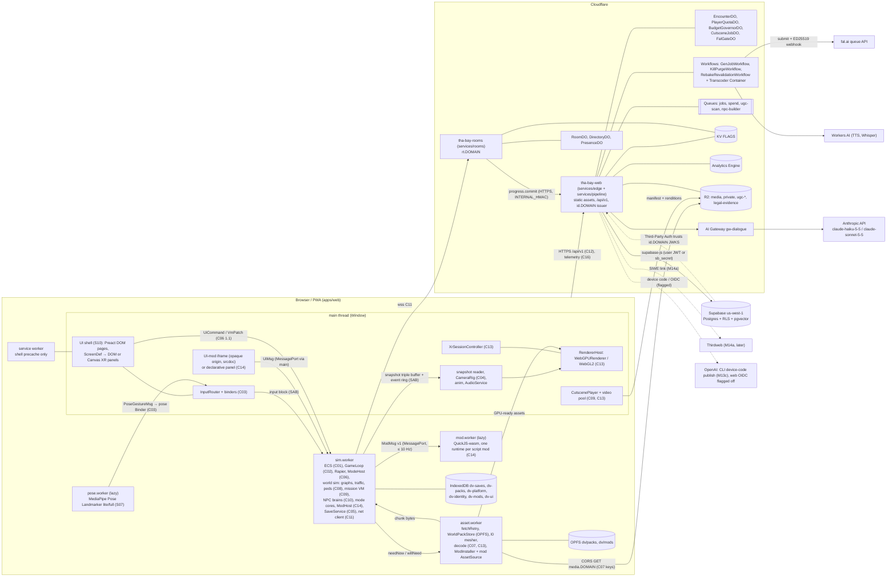
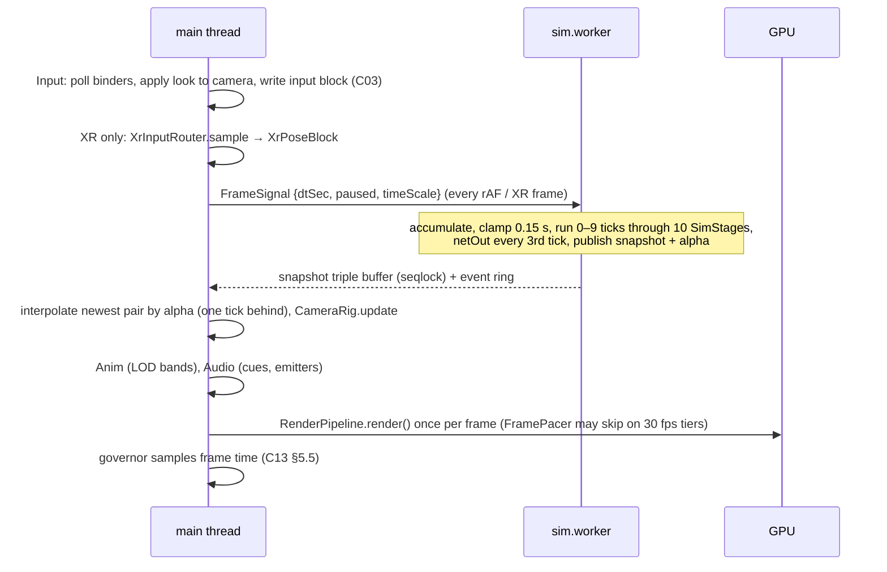
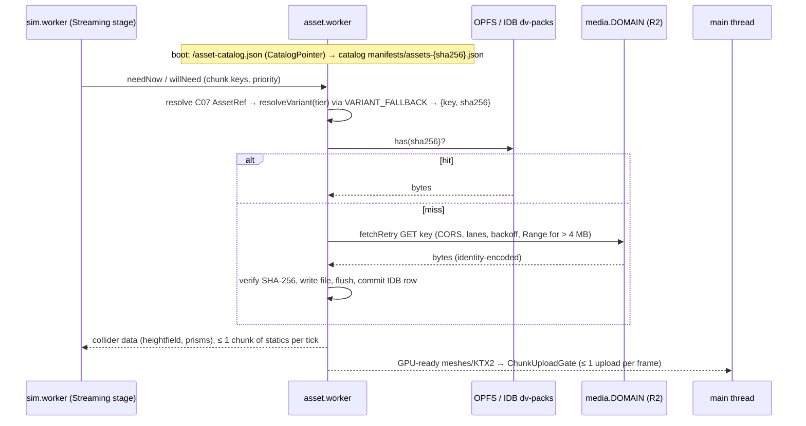
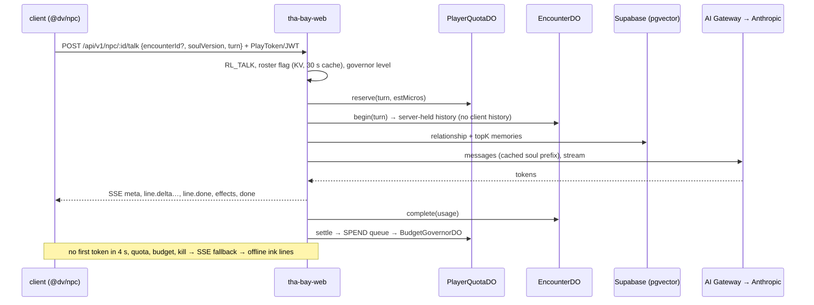
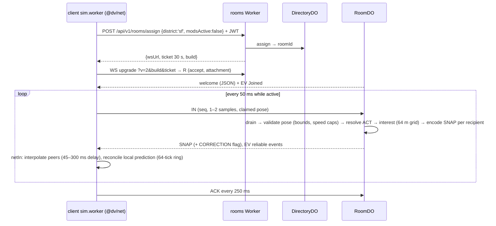
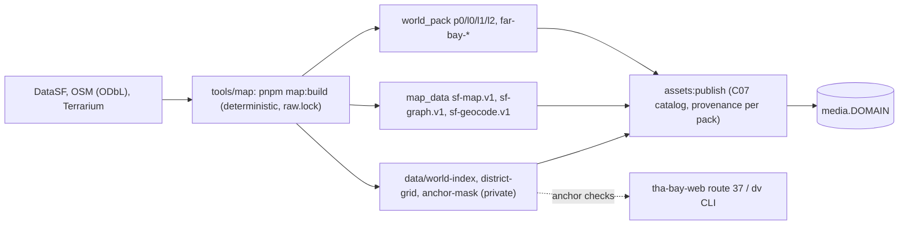

# 02 — Architecture (v0.5)

> v0.5, Architect, 2026-10-18, updated after the Waves 2–4 contract reconciliation (v0 followed Wave 1). Binding inputs: `prompt-pack/06-SHARED-CONTEXT.md` **v1.1 (frozen, all 17 contracts final)**, `spec/03-decisions-and-facts.md` v1, `spec/11-decision-log.md` DL-001…DL-156, and every domain spec (`spec/domains/01`–`12`). This file shows how the parts fit together and cites the domain section that owns each detail; it restates nothing normative. Wave 5 (S13 + integration) promotes it to v1 and writes the ADRs. Requirements: R-PLAT-01…05, R-ROLL-01/02, R-ENG-01…04 and the R-IDs of each flow below.

## 1. System diagram



Topology sources: browser threads [`01-engine.md` §2.1; `11-platform.md` §2, §5.9]; world runtime [`02-world.md` §2.2]; UI technology [`10-ui.md` §2.1–2.3]; pose [`07-fighter-pose.md` FP2; spec/03 D-24]; mods [`12-modding.md` §2.2–2.5]; edge [`09-backend.md` §2.1; `09-backend-ops.md` §1]; generation [`05-assets.md` §2]. XR is Window-only, so v1 renders on the main thread with no render worker (D-08, F-006). D-08 is amended by two lazy, non-rendering workers: `pose.worker` (only while pose control is on) and `mod.worker` (only while a script mod is loaded) (DL-152).

## 2. Package layout (spec/03 A-01, amended 2026-10-18; `tools/soul`, `tools/fighter` and the `content-private/` mount added at the Waves 2–4 reconciliation)

```
apps/
  web/                PWA shell: entry, vite + vite-plugin-pwa (injectManifest), sw.ts, _headers, boot, route pages (S10, S11)
packages/
  shared/             @dv/shared — pure, deterministic: contract types C01–C17, detmath, rng, hash, canonical JSON, API/DB types, genai helpers, rig map, and the shared pure cores: world/ (C08 types, pack codec), npc/ (soul compiler, validators), tycoon/ + events/ (S08 sim, event engine), fight/ (S07 frame data), vehicle/ + racing/ (S06 handling, race defs), assets/gates/ (S05 validators)
  engine/             @dv/engine — sim (ECS, loop, physics, control, pursuit, modes host, saves, script hooks), workers, client (input, camera, anim, audio), platform (renderer host, tiers, governor, XR, lifecycle, pack store, telemetry client, perf)
  world/              @dv/world — sim half (ChunkStore, RoadGraphService, traffic, peds, transit, WorldApi) and client half (ChunkRenderer, LandmarkLayer, sky/timecyc, MinimapView, FullMapView) (S02)
  net/                @dv/net — C11 codec, clock and interpolation, RoomClient, CloudSync port (S09)
  identity/           @dv/identity — IdentityService: LocalIdentity (P0), DeviceIdentity (P1), OpenAI and Thirdweb adapters (S09)
  npc/                @dv/npc — NpcRuntime (dialogue client, ink runner, TTS player, lip-sync), brain systems (schedule, utility, BT, barks), executor, evals (S04)
  ui/                 @dv/ui — shell state machine, Preact kit, ScreenDef with DomScreen/CanvasScreen, pages, HUD, phone, creator, i18n, a11y, UiSurface for XR panels (S10)
  mod-sdk/            @dv/mod-sdk — defineMod, ModAPI types, schemas, builders re-exported from story authoring, workspace template, `examples/mods/*`, agent docs (S12; published per Q-22)
  modes/story/        @dv/mode-story — authoring builder, compiler, mission VM, director, autoplayer, debug; CutscenePlayer lives in engine/client/cutscene (S03)
  modes/racing/       @dv/mode-racing — race director, AI drivers, pursuit profile, replay/ghosts, photo mode (S06)
  modes/fighter/      @dv/mode-fighter — fight mode adapter, CPU, frame-locked clip player, pose client, pose.worker (S07)
  modes/tycoon/       @dv/mode-tycoon — thin C06 adapter, pitch controller, views; the sim lives in shared/tycoon (S08)
services/
  edge/               @dv/edge — tha-bay-web Worker: router, issuer, DataPort (Supabase), quotas, governor, EncounterDO, CutsceneJobDO, moderation, legal, telemetry ingest, crons (S09)
  rooms/              @dv/rooms — tha-bay-rooms Worker: RoomDO, DirectoryDO, PresenceDO, tickets, upgrade gate (S09)
  pipeline/           @dv/pipeline — genAI steps, GenJobWorkflow, KillPurgeWorkflow, FalPort, FalGateDO, transcoder image; library compiled into tha-bay-web (S05)
tools/
  map/                SF bake: DataSF/OSM/Terrarium → terrain, buildings, graphs, sf-map.v1.bin, world packs (S02)
  assets/             assets:* and genai:* CLIs: generate, optimize, retarget, verify, publish, lock, catalog, prewarm, cutscene-index (S05)
  ci/                 check scripts and IP gates, perf-verify, checklists, schemas, fixtures (S05, S11, S13)
  cli/                `dv` binary (@dv/cli) and `thabay-mcp` for modders and agents: mod check, dev loop, publish via device code (S12)
  ops/                operator scripts: kill switches (`ks.ts`), drain, bootstrap helpers (S09)
  soul/               npc:* CLIs: normalize, lint, compile, build, consent-index, bake-barks, eval (S04)
  fighter/            QA-only move-timeline editor (S07; never in production builds)
config/               brand.ts, tier-budgets.json, platform-flags.json, engine-tiers.json, genai-endpoints.json, guardrails.yaml, net.speedcaps.json, input/, pursuit.json, clock.json, …
content/              authored data: prompt templates, missions, cutscene places/seeds, souls and ink (original only), world landmarks/POIs, races, fighter kits, tycoon content, UI strings
content-private/      private mount (Q-25): real-derived souls, research layer, production NPC rails; never published
assets/               assets.lock.json, provenance/<sha2>/<sha256>.json, prefabs/<id>.json
supabase/             migrations/0001…0009, tests/*.sql (pgTAP)
tests/                cross-package e2e, staging, load and ops suites; `tests/reports/` CI artifacts (gitignored)
docs/                 decisions/ (ADRs), legal/ (vendor terms and licence snapshots)
```

Dependency direction: `apps → services/packages`; every package may import `@dv/shared`; `@dv/shared` imports nothing. Pure cores that the client, the Worker validators and CI must run identically (tycoon `verifyRun`, racing replay checks, soul compiler, C08 codec, asset gates) live in `@dv/shared` so `services/edge` can import them (DL-132). `@dv/engine` sim code imports neither `three` nor DOM types (`01-engine.md` §2.12). Modes depend on `@dv/engine` through C06 only. `services/*` never import client packages except `@dv/shared` and `@dv/net` (shared validation, `09-backend.md` §3.1). Identity token, tier and scope types (`AccessClaims`, `PlayTokenClaims`, `Tier`, `ProviderId`, `StaffScope`, `IdentityService`) live in `packages/shared/src/identity.ts`; `@dv/identity` re-exports them and is client-only, so `services/edge` and `DataPort` never import it (DL-055).

## 3. Runtime topology

### 3.1 In the browser

| Context | Owns | Never does | Spec |
|---|---|---|---|
| Main thread | DOM UI (Preact), input capture, XR session and Canvas panels, rendering (incl. menu scene), camera, animation, audio, `CutscenePlayer`, map views, `PoseClient`, telemetry client | sim state mutation | `01-engine.md` §2.1; `11-platform.md` §2; `10-ui.md` §2.3 |
| `sim.worker` | ECS, physics, world sim (graphs, traffic, peds), AI and NPC brains, pursuit, modes, mission VM and director, `ModHost`, saves, net socket (M12) | DOM, `three`, GPU | C01, C02, C08; `01-engine.md` §2.1, §2.12 |
| `asset.worker` | fetch lanes, OPFS pack store, SHA-256 verify, decode, `l0` chunk meshing, minimap tile raster, mod installer and `AssetSource` | game logic | `11-platform-pwa.md` §5; C07; `02-world.md` §2.2 |
| `pose.worker` (lazy, classic worker) | MediaPipe Pose Landmarker 1.1.1 (lite on mobile, full on desktop when within budget, DL-164), filters, gesture FSM; emits gestures only; files under `/pose/`, runtime-cached by the service worker (`11-platform-pwa.md` §4) | uploading or storing frames | spec/03 D-24; R-IP-04; `07-fighter-pose.md` FP2 |
| `mod.worker` (lazy) | QuickJS-wasm runtimes, one per script mod, deadlines and memory limits | DOM, network, clocks, rendering | C14; `12-modding.md` §2.2–2.3 |
| UI-mod iframe | `sandbox="allow-scripts"` `srcdoc` document, opaque origin, MessagePort only; declarative panel in XR | network, storage, SharedArrayBuffer | C14; `12-modding.md` §2.5 (R-S11-05) |
| Service worker | shell precache, `/asset-catalog.json`, cutscene "keep offline" cache | world packs, glTF, KTX2, audio banks | `11-platform-pwa.md` §4 |

Transport is SharedArrayBuffer rings under cross-origin isolation, with a `postMessage` fallback when isolation is missing (C02; `11-platform.md` §5.9; DN-S11-02).

### 3.2 At the edge

| Deployable | Host | Contents | Deploy rule | Spec |
|---|---|---|---|---|
| `tha-bay-web` | `<domain>`, `id.<domain>` | static assets + `_headers`, `/api/v1/*` (routes 1–53), issuer, web DOs (incl. `EncounterDO` keyed `enc:<pid>:<npcId>:<encounterId>`), Workflows (incl. `RebakeRevalidationWorkflow`), Queue consumers (`ugc-scan` mod scan pipeline, `npc-builder`), crons, Transcoder Container | `versions upload` → smoke → rollout; DO lifecycle via `wrangler deploy` | `09-backend-ops.md` §1–2 |
| `tha-bay-rooms` | `rt.<domain>` | room REST, WebSocket upgrade gate, room DOs | drain notice, then plain deploy in the window | `09-backend-ops.md` §1.1, §2 |
| R2 custom domains | `media.<domain>`, `ugc.<domain>` | C07 assets, catalogs, cutscenes, barks; published UGC images | immutable keys, prefix purge on kill | `09-backend-db.md` §4; `05-assets.md` §4.4 |

### 3.3 Data stores

| Store | Holds | Owner |
|---|---|---|
| IndexedDB `dv-saves` | C05 records, pointers, tombstones, conflicts | S01 |
| IndexedDB `dv-identity` | identity profile id, non-extractable device key (`LocalIdentity`) | S09 |
| IndexedDB `dv-platform`, `dv-packs` + OPFS `dv/packs` | tier decision, device settings (incl. telemetry consent, `dev`), `pose-calibration`, pipeline seeds; pack index and bytes | S11 (S07 store) |
| IndexedDB `dv-mods` + OPFS `dv/mods` | installed mods, journal, write-once blobs | S12 |
| IndexedDB `dv-ui` | `UiPrefs` (device UI conveniences) | S10 |
| Supabase Postgres | identity, saves (M12a), NPC memory (pgvector), moderation, forum, mods, ledger | S09 (`09-backend-db.md`) |
| DO SQLite | room checkpoints, encounters, quotas, governor ledger, cutscene job state | S09 (`09-backend-db.md` §6) |
| KV `FLAGS` | roster flags, `ks:*`, `gov:level`, feature flags, leaderboard cache | S09 (`09-backend-db.md` §5) |
| R2 | media, private work files, UGC staging/public/quarantine, legal evidence | S09 layout; S05 prefixes |
| Analytics Engine | telemetry, spend, room ticks | S09 (C16) |

### 3.4 External services

| Service | Use | Gate | Source |
|---|---|---|---|
| Anthropic via AI Gateway | NPC dialogue, vision QA, builder text | server-side only, quotas, governor | spec/03 D-21; `09-backend-ops.md` §5 |
| fal.ai | sheets, meshes, rigs, TTS, cutscene video | internal-only in v1; licence-gated video (A-08) | spec/03 D-18, D-19; `05-assets.md` §2 |
| Workers AI | Whisper captions, Aura/MeloTTS barks | governor | `05-assets-pipeline.md` §5–6 |
| Supabase | Postgres, RLS, pgvector; trusts our issuer | DataPort rule | spec/03 D-02, D-03 |
| Turnstile | P1 registration | verification API UNVERIFIED (Q-BE-05) | `09-backend.md` §10 |
| OpenAI | device-code publish login via the player's own Codex CLI; website sign-in flagged off; moderation endpoint for NPC-builder text (`OPENAI_MODERATION_API_KEY`; use on non-OpenAI content UNVERIFIED, U-NPC-07) | P2 | spec/03 D-05; `04-npc-builder.md` §C5 |
| Supabase Auth GitHub provider | `supabase-oauth` path to tier `linked` before M14a (DL-145) | P2, flag-gated | `12-modding-publish.md` C§2 |
| MediaPipe tasks-vision (self-hosted) | pose inference in `pose.worker`; model and WASM files served from `/pose/` | on-device only | spec/03 D-24; `07-fighter-pose.md` FP2 |
| Thirdweb | SIWE wallet link | P3, M14a, Growth plan | spec/03 D-04 |

## 4. Data flows

### 4.1 Frame loop (R-PLAT-03, R-PLAT-05)


Owners: C02 rules 1–8 and the snapshot layout (`01-engine-contracts.md` §C02); frame pacing and governor (`11-platform.md` §5.4–5.5); XR loop (`11-platform-xr.md` §5.2). The main thread never waits for the sim.

### 4.2 Asset streaming (R-MAP-01, R-PLAT-01, R-ENG-02)


Owners: catalog and variants (C07, `05-assets.md` §4.1–4.4); pack store, fetch layer, eviction, `persist()` (`11-platform-pwa.md` §5); collider working set (`01-engine.md` §2.4); chunk content (C08, `02-world-contracts.md`). `p0` bytes (tier-independent) go to `sim.worker`, which runs the pure `decodeP0` and `toStaticShapeSet`; `l0/l1/l2` are meshed in `asset.worker`; landmark glTFs stream separately into `LandmarkLayer` (`02-world.md` §5.2–5.3). A missing pack is a normal miss; the kill-switch path calls `WorldPackStore.evictByTag('char:<id>')`.

### 4.3 Cutscene request (R-CUT-01…03)

```mermaid
sequenceDiagram
  participant H as story/fighter hook (sim)
  participant P as CutscenePlayer (main)
  participant W as tha-bay-web
  participant J as CutsceneJobDO(cut:key)
  participant R as R2
  H->>H: key = A-03 sha256(canonical inputs) (C09)
  H->>P: cut.request (refs, playId) — sim arms the DirectorScript fallback
  P->>W: GET /api/v1/cutscenes/:key (C12 route 27)
  W->>J: ensure(job, {allowGenerate: key in cutscene_catalog or staff/CI})
  alt manifest exists
    J-->>W: ready
    W-->>P: {state: ready, manifestUrl}
    P->>R: manifest.json, then v768 (or v540 / v1080), a.m4a, subs
    P->>P: muted video from the unlocked pool + AudioContext audio, XR via XrMediaHost
    P->>H: UiCommand cutscene.state {playId, item?, state: video} (sim pauses)
  else absent, pending, failed or blocked
    W-->>P: state ≠ ready
    P->>H: UiCommand cutscene.state {state: fallback}; sim runs the DirectorScript with subtitles (R-CUT-03)
  end
```
Mixed sequences (fight intros with the player fighter) use `CutscenePlayer.playSequence`, which decides per item (C09, DL-081); both paths leave identical mission state because beats are excluded from mission clocks (`03-story-cutscenes.md` §D7). Generation never runs on the player's path: `pnpm assets:gen prewarm` or the catalog triggers `GenJobWorkflow` (gate → cache-check → budget-reserve → acquire → submit → wait/poll → copy → transcode → captions → qa → re-gate → record), which writes `manifest.json` last [`05-assets.md` §5.1; `05-assets-pipeline.md` §6; `09-backend.md` §3.3]. Single-flight is `CutsceneJobDO`; budget refusals and kill switches never block cache hits (D-28). Playback platform rules: `11-platform-pwa.md` §7, `11-platform-xr.md` §5.6.

### 4.4 NPC dialogue (R-NPC-05)


Owners: transport, quotas, `EncounterDO` and memory storage (`09-backend.md` §3.2, §5.1; `09-backend-db.md` §3.3); prompt, schema, memory semantics and voice (C10, `04-npc.md` §5); cost layers (`09-backend-ops.md` §5). Filler pedestrians never call the model (D-21). Callers: story talk objectives send `missionId`/`missionStep` and decide outcomes from player choices gated by `effects` (DL-085); tycoon meetings send sim-computed `deals` and the model may only pick one (DL-087); fighter trash talk is optional (`fight_pre`/`fight_post`). Every caller has an ink or deterministic offline path.

### 4.5 Multiplayer tick (R-ROLL-02)


Owners: C11 (`09-backend-contracts.md` §1.3–1.8); prediction ring and corrections (`01-engine.md` §2.13); room state machine, AFK stop, checkpoints, drain (`09-backend.md` §5.1; `09-backend-ops.md` §2). Progression is committed server-side through `progress.commit`, never from client saves.

### 4.6 Mod load (R-MOD-01, R-MOD-04) — final (C14, C17 1.0.0)

```mermaid
sequenceDiagram
  participant U as player (menu or map marker)
  participant M as mod runtime (@dv/mod-sdk host)
  participant W as tha-bay-web
  participant G as ugc.DOMAIN
  participant H as ModeHost (sim.worker)
  U->>W: GET /api/v1/mods/:id/versions/:ver (C12 route 35)
  W-->>M: C14 manifest + archive sha256
  M->>G: GET ugc/published/{sha256}.zip (asset.worker installer)
  M->>M: verify sha256, manifest schema, closed permissions, C07 provenance
  M->>M: transactional install into dv-mods + OPFS dv/mods (journal, byte-equal uninstall)
  U->>H: enter exp:{id} from a map marker (Story autosaves story:auto first)
  H->>M: start tier: data (scene ops, C09 IR mod profile) | script (mod.worker, ModMsg v1) | ui (srcdoc iframe or L2 panel)
  M->>H: commands through ModContext<P> (anchor-relative, permission-narrowed); saves only in mod:{modId}
  Note over M,H: rooms refuse any client with mods active (C11 close 4007); revocations polled via route 53
```
Owners: `12-modding.md` §2, §5; `12-modding-contracts.md`; publish pipeline and moderation `12-modding-publish.md` C§3 (routes 36–37, `ugc-scan` queue, `ugc.publish` off in production until M13d1). The UI-mod COEP risk (R-S11-05) is handled by the L0/L1/L2 ladder behind `mods.ui` (DL-146).

### 4.7 World bake and map pipeline (R-MAP-01…03)


One bake has one `bakeId` (= C05 `worldBake` = C17 `worldVersion`). A rebake re-resolves mission references (C09 compile), races (`map:races validate`) and experience anchors (`RebakeRevalidationWorkflow`); saves from another bake snap to the nearest safehouse. Owners: `02-world-bake.md`, `02-world-maps.md`.

### 4.8 Pose input (R-MODE-03, R-IP-04)
`PoseClient` (main) pumps one camera frame at a time (`requestVideoFrameCallback` → `createImageBitmap`, transferred) to `pose.worker`, which returns gestures only; the C03 pose binder turns them into `InputFrame` bits. Frames are never stored or uploaded, models are served same-origin under `/pose/`, and calibration stays in `dv-platform` (`07-fighter-pose.md` FP2, FP4, FP7).

## 5. Cross-cutting concerns

### 5.1 Errors and degradation
- **Principle:** single-player never depends on the network (R-ROLL-01). `/boot` failing means offline mode [`09-backend.md` §2.2, §5.3].
- **Client API rule:** `quota_exhausted`, `budget_offline`, `kill_switched`, `upstream_unavailable` and network failure are not errors to the player. They select the offline path: in-engine cutscene, ink lines, cached barks [C12 §2.2].
- **Failure tables by owner:**
  - sim: `01-engine.md` §5
  - renderer and device loss: `11-platform.md` §5.8
  - packs: `11-platform-pwa.md` §5
  - backend: `09-backend.md` §5.3
  - pipeline: `05-assets.md` §5.2
- **Server errors** use the `ApiError` envelope with `X-Request-Id`. Workers Issues receives source-mapped exceptions [`09-backend-ops.md` §4].

### 5.2 Telemetry
- **Wire:** C16 `TelemetryBatch` → `POST /api/v1/t` → Analytics Engine.
- **Client:** `packages/engine/src/platform/telemetry/`. It runs the heartbeat in `localStorage['dv.hb']`, does abnormal-exit inference, and flushes with `sendBeacon` [`11-platform-pwa.md` §9].
- **Server metrics:** `room.tick`, `genai.cost`, `quota.block`, `budget.level` [`09-backend-ops.md` §4].
- **Privacy and consent:** no IP, UA, profile id, free text or sub-chunk position. Consent is device-scoped (`PlatformSettings.telemetryConsent`) because events fire before a profile loads.

### 5.3 Feature flags and kill switches

| Layer | Mechanism | Scope | Owner |
|---|---|---|---|
| Build | `VITE_DV_QA` (QA URL flags, `__dvBridge`); `GEN_PUBLIC=false` (compile-time) | per build | S11, S05 |
| Boot | `BootConfig.flags` from KV `flags:features` (`mp.enabled`, `npc.dialogue`, `cutscene.generated`, …), `gov` level | per release, 60 s cache | S09 |
| Emergency | KV `ks:*` (genAI, vendor, endpoint, likeness), `gov:level`; DO paths for immediate stops | ≤ 30–60 s | S09 |
| Roster | `roster:flags` + `EncounterDO.kill` + `KillPurgeWorkflow` | live ≤ 60 s, purge ≤ 24 h | S09, S05 |
| Platform | `config/platform-flags.json` (`webgpu.mobile`), `?gl=1`, Compatibility mode | per release / per device | S11 |
| Rooms | `rooms.capMax`, `rooms:new` | per release | S09 |
| UGC and mods | `mods.enabled`, `mods.script`, `mods.ui`, `ugc.publish` (off in production until M13d1), `npc.builder` | per release | S12, S09, S04 |

### 5.4 Configuration

All configuration lives in `config/`, is validated by JSON Schema in CI, and is never fetched from a third party at runtime.
- Platform budgets: `tier-budgets.json` (C13).
- Engine: `engine-tiers.json`, `pursuit.json`, `clock.json`, `physics.json`, `audio.json`, `input/`, `unlocks.json`, `modes.json`.
- Assets: `genai-endpoints.json`, `asset-budgets.json`, `ip-denylist.json`, `license-allowlist.json`.
- Network: `net.speedcaps.json`, `geo.json`, `rate-limits.json`.
- Spend: `guardrails.yaml` (every cap, ceiling and alert threshold).
- Identity: `brand.ts` (display name).
- Runtime values reach the client only through `BootConfig`, and hosts are never hard-coded [`09-backend.md` §6].

### 5.5 Secrets
- **Storage:** Wrangler secrets only, uploaded with the code by `versions upload --secrets-file`. Local development uses `.dev.vars` (git-ignored) [`09-backend-ops.md` §6].
- **Client:** no key ever reaches a client bundle. `check:secrets` scans `apps/web/dist`.
- **genAI keys** are split by holder: a staff fal key for CLI batches, and separately scoped keys for CI and the Worker (DN-S05-4 settled, holder Q-17). Anthropic workspaces split runtime, builder, CI and synthetic use.
- **CI auth:** expiring account API tokens, split by duty, because Cloudflare has no CI OIDC [research/gap-ci-cd-release-assets.md §1.3].

### 5.6 Security boundaries (summary)
- **Isolation:** COOP/COEP/CORP on every document and Worker response; `/account/*` is the only non-isolated path [D-01; `11-platform-pwa.md` §2].
- **Identity:** the device-key-bound play token in P0, then our ES256 issuer [C12 §2.3].
- **Rooms:** server-assigned slots, pose validation, mods refused [C11].
- **Generation:** internal-only, likeness gates at every stage, no face detector anywhere [`05-assets.md` §2, §5.4].

## 6. Contract crossings

| Boundary | Contracts |
|---|---|
| main ↔ `sim.worker` | C01, C02, C03, C04 |
| `sim.worker` ↔ `asset.worker` | C07, C08, C13 (pack store) |
| modes ↔ engine | C06 (`ModeContext`), C05 slices, C09 hooks |
| client ↔ `tha-bay-web` | C12, C16, C10 (talk), C09 (status) |
| client ↔ `tha-bay-rooms` | C11, C12 (assign, tickets) |
| pipeline ↔ storage | C07, C09 manifest, C12 tables |
| mods ↔ game | C14 (`ModContext`, `ModMsg v1` to `mod.worker`, `UiMsg` to the iframe), C06 subset, C17, C05 `mod:<id>` |
| `pose.worker` ↔ input | C03 `PoseActionEvent` via the pose binder |
| modes ↔ world | C08 `WorldApi` through C06 1.1 `ModeContext.world` |
| UI ↔ sim | C06 1.1 `UiBridge`/`VmPatch` (sim → UI) and `UiCommand` (UI → sim, incl. `cutscene.state`) |
| missions ↔ NPCs | C10 via `@dv/npc` (main) and C06 1.1 `ModeContext.npc` (sim) |

## 7. Open items for Wave 5
1. **Integration (S13):** write milestone files (C15) for the register in `spec/00-plan.md`, splitting the milestones still above one session (M01a, M01b, M04a, M10a, M11a, M11b2, M12b, M12c, M14b); consolidate scripts into `spec/08-test-and-ci.md`; merge the Wave 2–4 UNVERIFIED index into `spec/99-open-questions.md` §2. Known content gaps: S06 has no `RaceDef.intro` flag or `cut.race.intro.<raceId>` refs although S03 plans 12 racing intros (R-CUT-02 SHOULD; add in M07b2); the economy harness `tools/ci/econ-sim` (S01) has no milestone yet.
2. **ADRs:** ADR-0001 package layout (A-01 with both 2026-10-18 amendments, incl. `tools/soul`, `tools/fighter`, `content-private/`); `AnimStateId` blocks (DL-091); worker topology (`pose.worker`, `mod.worker`, DL-152); publish identity before M14a (DL-145); ADR-GENAI-01 stays owner-gated.
3. **Deferred contract work:** C06 1.2 vehicle wheel readout at M03a2; sloped deck strips after the M02a2 drive tests; C11 fight input after M12b; UI-mod L1 host only by ADR (DL-104).
4. **Size discipline:** `01-engine.md`, `11-platform.md`, `09-backend-contracts.md` and `spec/11-decision-log.md` are at the 6,000-word cap; amendments go to part files.
5. Promote this file to v1.
