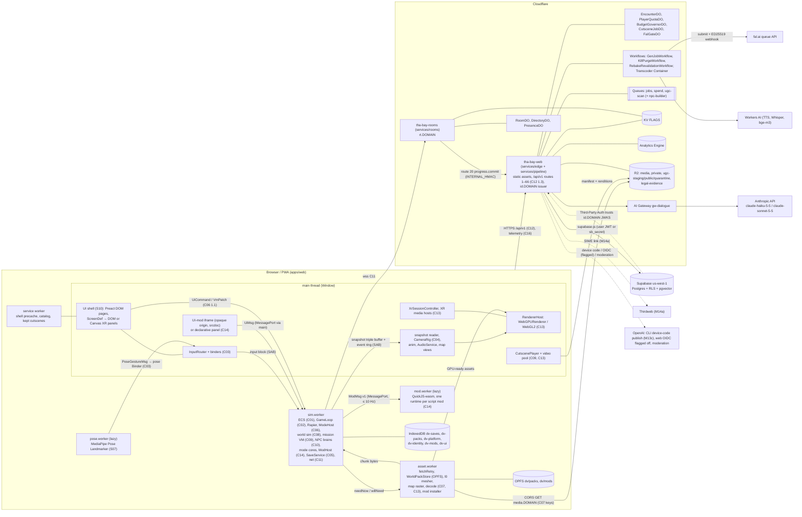
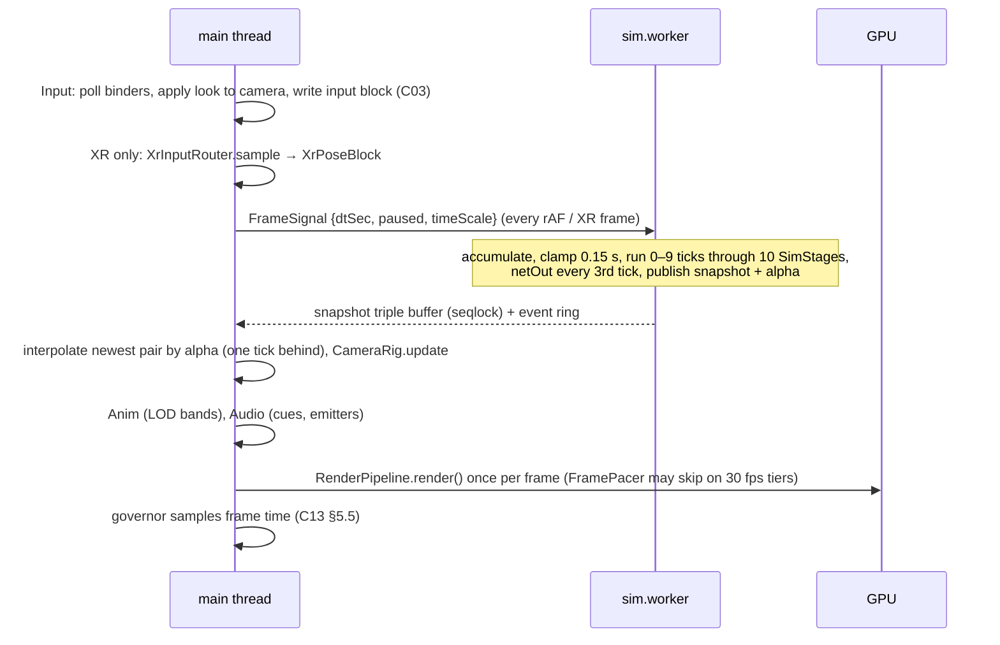
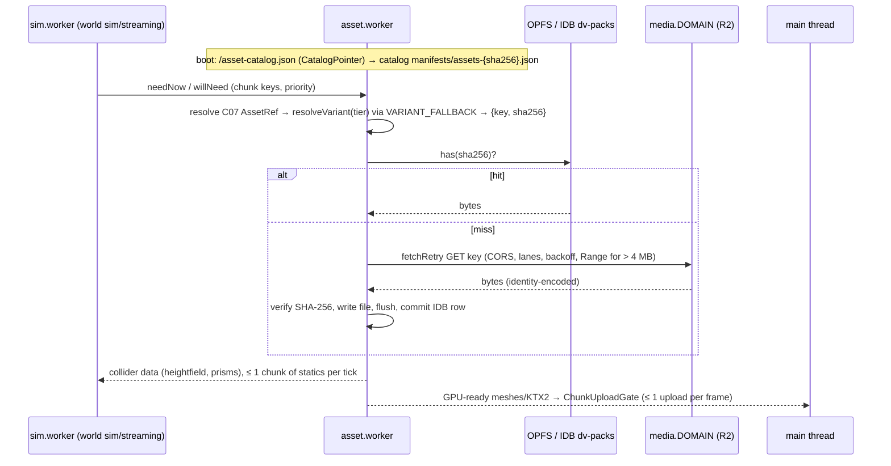
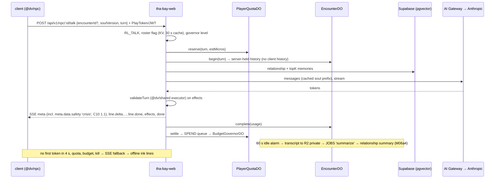
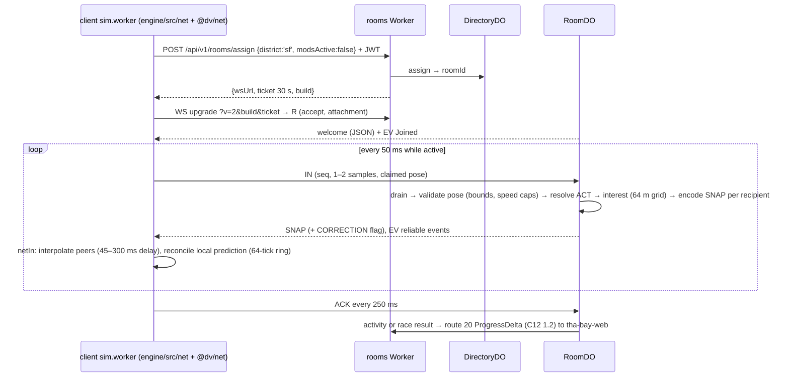
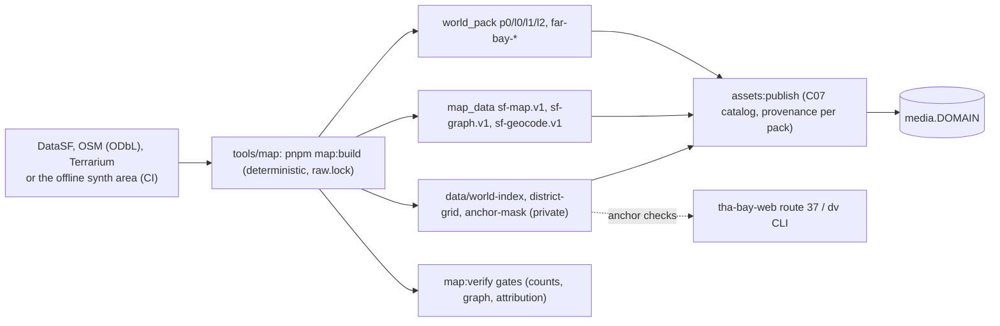

# 02 — Architecture (v1)

> v1, Architect, 2026-10-18, at the Builder handoff (v0.5 followed the Waves 2–4 reconciliation, v0 Wave 1). Reconciled with every domain spec (`spec/domains/01`–`13`) and with the Deliverables paths of all 121 milestone files (M00e, M00f added by DL-605) (DL-247; M10d1–M10d3 and M10e mapped in §2 and §7, DL-532). Binding inputs: `prompt-pack/06-SHARED-CONTEXT.md` **v1.3 (C12 1.3, DL-604; frozen, all 17 contracts final)**, `spec/03-decisions-and-facts.md` v2, decisions DL-001…DL-247 (`spec/11-decision-log.md`, `-1b.md`, `-2.md`, `-3.md`, `-4.md`; later rows in the logs `spec/00-plan.md` lists), ADR-0001…ADR-0030 (`docs/decisions/`). This file shows how the parts fit and cites the owning section; it restates nothing normative. Where a milestone file and this file disagree on a path, the milestone file's Deliverables win and this file is corrected. Requirements: R-PLAT-01…05, R-ROLL-01/02, R-ENG-01…04 and the R-IDs of each flow below.

## 1. System diagram



Topology sources: browser threads [`01-engine.md` §2.1; `11-platform.md` §2, §5.9]; world runtime [`02-world.md` §2.2, §3]; UI [`10-ui.md` §2.1–2.3]; pose [`07-fighter-pose.md` FP2; spec/03 D-24]; mods [`12-modding.md` §2.2–2.5]; edge [`09-backend.md` §2.1; `09-backend-ops.md` §1]; generation [`05-assets.md` §2]. XR is Window-only, so v1 renders on the main thread with no render worker (D-08, F-006); two lazy, non-rendering workers amend D-08: `pose.worker` (only while pose control is on) and `mod.worker` (only while a script mod is loaded) (DL-152, ADR-0017).

## 2. Package layout (spec/03 A-01 as amended; ADR-0001; paths as the milestone Deliverables use them)

```
apps/web/            PWA shell (S10, S11)
  src/               main.ts (boot), routes.ts, sw.ts + pwa-update.ts, identity.ts, workers/ (sim and asset worker entries
                     composing @dv/engine cores with @dv/world jobs, from M02b1), account/ (M13c3)
  public/            _headers, manifest, icons, /pose/ model + WASM files (M08c1)
  qa/                QA-only pages (determinism, save-kill, world-hash, mission-preview, cutscene-spike, memory-bomb); never in production (verify:dist)
  account/           non-isolated /account/* pages (index.html M00e; register.html M12a2)
  vite/, scripts/    QA media-local plugin (M01e), verify-dist
packages/
  shared/            @dv/shared — pure, deterministic, no IO
    src/contracts/   C01–C17 contract files, c15-milestone.ts (M00d), dom-media.d.ts type shim (DL-232)
    src/             detmath, rng, hash, json, identity.ts, telemetry.ts, data-port.ts (DataPort interface, M05d), db.gen.ts,
                     api/ (C12 incl. ops.ts from 1.2), platform/, world/ (C08 types, pack codec), npc/ (soul compiler, validateTurn executor),
                     genai/, assets/ (gates), vehicle/, racing/, fight/, tycoon/, events/, rig/, mod/
    schemas/         JSON Schemas for runtime-validated data (telemetry/, ui/ avatar and wardrobe, mods, saves …)
  engine/            @dv/engine — sim never imports three or DOM (`01-engine.md` §2.12)
    src/sim/         ecs, loop, transport, input, physics, control, camera, prefabs, vehicle, pursuit, combat (open-world melee),
                     world (WorldApi registration), modes (ModeHost), script, save, mods, ui, worker
    src/workers/     sim.worker core (M01a2), asset.worker + asset-core (M01e, M02b1), mod.worker + quickjs-host (M13a4)
    src/assets/      store/ (WorldPackStore, fetchRetry, lanes, persist; M01e), AssetClient
    src/client/      boot, snapshot, input (+ touch, XR), camera, anim, audio, vehicle, graybox, cutscene (CutscenePlayer, + xr/),
                     mods (+ creator/), ui, xr, debug
    src/platform/    renderer-host, tiers, governor, memory, lifecycle, media, storage, telemetry, perf, xr/ (+ media/ hosts, cinema)
    src/net/         netIn/netOut, prediction ring, corrections, proxies, socket host, mods guard (M12b2–M12d)
    src/qa/, debug/, headless/   bot drivers (M04d), debug overlays, headless host (M01a1)
  world/             @dv/world (S02): src/sim/{streaming,graph,api,map,traffic,peds,transit}, src/client/{chunks,sky,map,traffic,peds,backdrop},
                     src/areas/ (M15a); imports @dv/engine hooks, never the reverse
  net/               @dv/net (S09): protocol/ (C11 codec), client/ (RoomClient), clock, cloud-sync port, invites, validate
  identity/          @dv/identity (client-only): local (M04b3), device/ (M12a1), openai.ts (M13c3), thirdweb/ (M14a)
  npc/               @dv/npc (S04): client (dialogue SSE), ink, tts, lipsync, brains, barks, debug; evals/
  ui/                @dv/ui (S10): shell, screen, kit, host, pages, hud, phone, creator, onboarding, dialogue, cutscene, settings, mods, xr, i18n
  mod-sdk/           @dv/mod-sdk (S12): defineMod, ModAPI types, schemas, examples/, docs/, kit AGENTS.md (M13a1, M13a6)
  modes/story/       @dv/mode-story: compiler, vm, director, autoplay, missions, cutscene glue, business, economy, finale, debug
  modes/racing/      @dv/mode-racing: sim (director, AI, replay), garage, leaderboard, xr
  modes/fighter/     @dv/mode-fighter: sim adapter, ui, pose/ (PoseClient, pose.worker), qa, xr; scripts/ (fighter:*)
  modes/tycoon/      @dv/mode-tycoon: descriptor, sim adapter (core in shared/tycoon), pitch, daily, ui, xr
services/
  edge/              @dv/edge — tha-bay-web: router, routes/, id/ (play tokens, issuer, SIWE), data/ (Supabase DataPort), flags, budget,
                     cutscenes, npc, npc-builder, moderation, reports, ugc, mods, publish, forum, legal, admin, saves, progress,
                     leaderboards, alerts, ops, generated/, _test/ (compiled out of production); wrangler.jsonc
  rooms/             @dv/rooms — tha-bay-rooms: gate, ticket, jwks, room/, directory/, presence/, chat/, activities/, progress/, ops/, metrics
  pipeline/          @dv/pipeline — library compiled into tha-bay-web: src/ (GenJobWorkflow, FalPort, gates, ports, FalGateDO, mocks),
                     steps/, kill/ (KillPurgeWorkflow, M10b), rebake/ (RebakeRevalidationWorkflow, M13c2), transcoder/ (`ladder.sh`, `Dockerfile.ladder` for the off-edge finish, M05c4; Container parked, DL-745)
tools/
  map/               SF bake and map:* (src/, schemas/) (S02)
  assets/            assets:* and genai:* CLIs: catalog, verify, lock, publish, seed, gen/, cutscene-index/, plates/, spike/, pose-vendor (S05);
                     recipes/ + import/ (final art and audio, M10d0, M10d1, M10d4, M10d3, M10e), final.ts (`assets:final`, M10d2, M10e), audio-qa (M10e)
  ci/                run.ts, deploy.ts, check-*.ts, milestone-lint, trace, spec-files, perf-*, release-gate, launch-gate, checklists/,
                     econ-sim/, tycoon-sim/, missions/, mutants/, fixtures/, schemas/, verifiers.lock.json (S05, S11, S13)
  cli/               @dv/cli — `dv` binary and `thabay-mcp` for modders and agents (M13a1, M13a6, M13c3)
  ops/               run.ts, suites/ (ops suites), kill switches, id-keys, auth-tpa, rooms-drain, flag-flip, guardrails plan, drift (S09)
  soul/              npc:* CLIs (M06a2, M06a4, M10c)
  fighter/           QA-only move-timeline editor; reserved by A-01, built by no v1 milestone (kits are JSON checked by fighter:lint)
config/              brand.ts, terms.ts (TERMS_VERSION, M00e), tier-budgets.json, platform-flags.json, perf/paths/, world/, ui/, input/, schemas/, genai-endpoints.json,
                     guardrails.yaml, cloudflare.resources.json, art-placeholders.json (M10d1–M10d5, M10e), per-domain tuning (physics, pursuit, racing, fighter, tycoon, npc, voice, legal, mod limits)
content/             authored originals: missions/<id>/, story/ (acts, cast), npcs/ (souls, ink), cutscenes/, prompts/, races/, racing/,
                     vehicles/, fighter/, tycoon/, world/, audio/, legal/, ui/ (i18n/en.json from M04b1, creator, help)
content-private/     private mount (Q-25): real-derived souls, research layer; never published
assets/              assets.lock.json, provenance/, prefabs/, src/<kind>/<id>/asset.json, creator-kit/, landmarks/, ledger/fal-spend.jsonl
data/                world-areas/ (M15a, post-v1)
supabase/            config.toml, migrations/0001…0009, tests/ (pgTAP)
third_party/         vendored files of `REUSE-WITH-ATTRIBUTION` entries only and `NOTICE`; each path annotated in the root `REUSE.toml` (D-31, ADR-REUSE-01; absent until vendored)
tests/               e2e/, perf/scenarios/, golden/, fixtures/, staging/, load/, tycoon/; reports/ (CI artifacts, git-ignored)
docs/                decisions/ (ADRs), legal/, device-spike/, device-runs/<M##>/<device>/, runbooks/, ops/, releases/, spikes/
.github/workflows/   ci, preview, deploy, assets, nightly, weekly, release
```

Dependency direction: `apps → services/packages`; every package may import `@dv/shared`, which imports nothing. Pure cores that the client, Worker validators and CI must run identically (tycoon `verifyRun`, racing replay checks, soul compiler and `validateTurn`, C08 codec, asset gates) live in `@dv/shared` (DL-132, DL-234). Modes reach the engine only through C06. `@dv/world` imports `@dv/engine` registration hooks and the worker entries are composed in `apps/web/src/workers/` (M02b1), so the engine never imports the world. `services/*` import only `@dv/shared` and `@dv/net`, except the data files `config/brand.ts`, `config/ip-denylist.json` and `config/terms.ts` in `services/edge` (DL-514, DL-602). Identity token, tier and scope types live in `packages/shared/src/identity.ts`; `@dv/identity` re-exports them and is client-only (DL-055).

## 3. Runtime topology

### 3.1 In the browser

| Context | Owns | Never does | Spec |
|---|---|---|---|
| Main thread | DOM UI (Preact), input capture, XR session and Canvas panels, rendering (incl. menu scene), camera, animation, audio, `CutscenePlayer` and XR media hosts, map views, `PoseClient`, telemetry client | sim state mutation | `01-engine.md` §2.1; `11-platform.md` §2; `10-ui.md` §2.3 |
| `sim.worker` | ECS, physics, world sim (streaming plan, graphs, traffic, peds, transit), AI and NPC brains, pursuit, modes, mission VM and director, `ModHost`, saves, net socket and prediction (M12) | DOM, `three`, GPU | C01, C02, C08; `01-engine.md` §2.1, §2.12 |
| `asset.worker` | fetch lanes, OPFS pack store, SHA-256 verify, decode, `l0` chunk meshing, minimap raster, mod installer and `AssetSource` | game logic | `11-platform-pwa.md` §5; C07; `02-world.md` §2.2 |
| `pose.worker` (lazy, classic) | MediaPipe Pose Landmarker 1.1.1 (lite on mobile, full on desktop within budget, DL-164), filters, gesture FSM; gestures only; files under `/pose/`, vendored by the operator (`assets:pose-vendor`, DL-236) | uploading or storing frames | spec/03 D-24; R-IP-04; `07-fighter-pose.md` FP2 |
| `mod.worker` (lazy) | QuickJS-wasm runtimes, one per script mod, deadlines and memory limits | DOM, network, clocks, rendering | C14; `12-modding.md` §2.2–2.3 |
| UI-mod iframe | `sandbox="allow-scripts"` `srcdoc` document, opaque origin, MessagePort only; declarative panel in XR | network, storage, SharedArrayBuffer | C14; `12-modding.md` §2.5 (R-S11-05) |
| Service worker | shell precache, `/asset-catalog.json`, cutscene "keep offline" cache | world packs, glTF, KTX2, audio banks | `11-platform-pwa.md` §4 |

Transport is SharedArrayBuffer rings under cross-origin isolation, with a `postMessage` fallback when isolation is missing (C02; `11-platform.md` §5.9; DN-S11-02).

### 3.2 At the edge

| Deployable | Host | Contents | Deploy rule | Spec |
|---|---|---|---|---|
| `tha-bay-web` (`-staging`) | `<domain>`, `id.<domain>` | static assets + `_headers`, `/api/v1/*` routes 1–66 (C12 1.3), issuer, `EncounterDO` (`enc:<pid>:<npcId>:<encounterId>`), `PlayerQuotaDO`, `BudgetGovernorDO`, `CutsceneJobDO`, `FalGateDO`, Workflows, Queue consumers (`tha-bay-jobs` incl. encounter summaries, `tha-bay-spend`, `tha-bay-ugc-scan`; `npc-builder` per S04's binding proposal), crons, Transcoder Container | `versions upload --secrets-file` → 0 % smoke → 100 %, rollback on failure; DO class changes ship alone via `wrangler deploy` (label `do-lifecycle`; first: `web-v1` in M05b1) | `09-backend-ops.md` §1–2 |
| `tha-bay-rooms` (`-staging`) | `rt.<domain>` | room REST, WebSocket upgrade gate, `RoomDO`, `DirectoryDO`, `PresenceDO`; own `deploy:bootstrap` (M12b1) | `rooms:drain` notice, then deploy in the window (M12c1) | `09-backend-ops.md` §1.1, §2 |
| R2 custom domains | `media.<domain>`, `ugc.<domain>` | C07 assets, catalogs, cutscenes, barks; published UGC | immutable keys, prefix purge on kill (`CF_API_TOKEN_CACHE`, M10b) | `09-backend-db.md` §4; `05-assets.md` §4.4 |

Until a domain exists (Q-15), previews and staging run on `workers.dev`. Workers Previews run no queue consumers, crons or own Workflows, so each such feature has a `/api/v1/_test/*` route that `check:prod-routes` keeps out of production [`09-backend-ops.md` §1.3; research/gap-ci-cd-release-assets.md].

### 3.3 Data stores

| Store | Holds | Owner (first milestone) |
|---|---|---|
| IndexedDB `dv-saves` | C05 records, pointers, tombstones, conflicts | S01 (M04a1) |
| IndexedDB `dv-identity` | profile id, non-extractable device key | S09 (M04b3) |
| IndexedDB `dv-platform`, `dv-packs` + OPFS `dv/packs` | tier decision, device settings (telemetry consent, `dev`), `pose-calibration`; pack index and bytes | S11 (M01c, M01e), S07 store (M08c2) |
| IndexedDB `dv-mods` + OPFS `dv/mods` | installed mods, journal, write-once blobs | S12 (M13a2) |
| IndexedDB `dv-ui` | `UiPrefs` | S10 (M04b1) |
| Supabase Postgres | migrations 0001–0002 core and genAI ledger (M05d), 0003 NPC memory (M06a1), 0004 moderation (M06b1), 0005 saves (M12a1), 0006 online (M12c2), 0007 UGC, forum, device codes (M13a2, DL-228), 0008 legal (M13d1), 0009 wallet link (M14a) | S09 (`09-backend-db.md`) |
| DO SQLite | room checkpoints, encounters, quotas, governor ledger, cutscene job state | S09 (`09-backend-db.md` §6) |
| KV `FLAGS` | roster flags, `ks:*`, `gov:level`, feature flags, leaderboard cache | S09 (`09-backend-db.md` §5) |
| R2 | `tha-bay-media-<env>`, `tha-bay-private-<env>` (created, DL-OWN-02); `ugc-{staging,public,quarantine}-<env>` (M06b2 bootstrap); legal evidence (M13d1); private `config/names-real.json` (operator, DL-240) | S09 layout; S05 prefixes |
| Repo-audited files | `assets/assets.lock.json`, provenance records, fal ledger `assets/ledger/fal-spend.jsonl` (M10a1, DL-234) | S05 |
| Analytics Engine | telemetry, spend, room ticks | S09 (C16) |

### 3.4 External services

| Service | Use | Gate | Source |
|---|---|---|---|
| Anthropic via AI Gateway | NPC dialogue (`npc-runtime`), builder text (`npc-builder`), evals (`ci-evals`), synthetic checks | server-side only, quotas, governor | spec/03 D-21; `09-backend-ops.md` §5 |
| fal.ai | sheets, meshes, rigs, cutscene video; operator CLI batches and operator-run prewarm, never player-triggered in v1 | DL-OWN-01 cap $100 total; licence-gated video (ADR-GENAI-01); CI `FAL_MODE=mock` | spec/03 D-18, D-19; `05-assets.md` §2 |
| Workers AI | Whisper captions, Aura/MeloTTS barks and voices, bge-m3 embeddings | governor | `05-assets-pipeline.md` §5–6; `04-npc.md` §5 |
| Supabase | Postgres, RLS, pgvector; trusts our issuer | DataPort rule | spec/03 D-02, D-03 |
| Supabase Auth (password) | username and password credential behind routes 58–62, 64 and 65, proxied by the Worker with the publishable key; never a phase, tier or game identity; age and terms record written through the Worker's admin path; M12a1 exchanges it for our token (C12 1.3) | `auth` rate class, `18p` and `TERMS_VERSION`, `AUTH_PASSWORD_SIGNUP` (M00e) | spec/03 D-32; ADR-ACCT-01 |
| Turnstile | P1 registration | verification API UNVERIFIED (Q-BE-05) | `09-backend.md` §10 |
| OpenAI | device-code publish login via the player's own Codex CLI; website sign-in flagged off (`AUTH_OPENAI_WEB`); moderation endpoint for NPC-builder text (use on non-OpenAI content UNVERIFIED, U-NPC-07) | P2 | spec/03 D-05; `04-npc-builder.md` §C5 |
| Supabase Auth GitHub provider | spike only in v1 (M13c1 AC-10; UNVERIFIED U-ADR-01); no link route or flag until a post-v1 C12 bump (DL-240, DL-342) | not built in v1 | `12-modding-publish.md` C§2 |
| MediaPipe tasks-vision (self-hosted) | pose inference in `pose.worker` | on-device only | spec/03 D-24; `07-fighter-pose.md` FP2 |
| Thirdweb | SIWE wallet link | P3, M14a, Growth plan | spec/03 D-04 |

## 4. Data flows

### 4.1 Frame loop (R-PLAT-03, R-PLAT-05)


Owners: C02 rules and snapshot layout (`01-engine-contracts.md` §C02); frame pacing and governor (`11-platform.md` §5.4–5.5; governor and memory budget M11a1); XR loop (`11-platform-xr.md` §5.2). The main thread never waits for the sim.

### 4.2 Asset streaming (R-MAP-01, R-PLAT-01, R-ENG-02)


Owners: catalog and variants (C07, `05-assets.md` §4.1–4.4; `assets:catalog`, M01d); pack store, fetch layer, eviction, `persist()` (`11-platform-pwa.md` §5; `engine/src/assets/store`, M01e); streaming plan and `ChunkStore` (`world/src/sim/streaming`, M02b1); collider working set (`01-engine.md` §2.4); chunk content (C08). `p0` bytes go to `sim.worker`, which runs the pure `decodeP0` and `toStaticShapeSet`; `l0/l1/l2` are meshed in `asset.worker`; landmark glTFs stream into `LandmarkLayer` (`02-world.md` §5.2–5.3; M02d1–M02d2). A missing pack is a normal miss; the kill-switch path calls `WorldPackStore.evictByTag('char:<id>')`. Under memory pressure the M11a1 budget evicts through the same store.

### 4.3 Cutscene request (R-CUT-01…03)

```mermaid
sequenceDiagram
  participant H as story/fighter hook (sim)
  participant P as CutscenePlayer (main)
  participant W as tha-bay-web
  participant J as CutsceneJobDO(cut:key)
  participant R as R2
  H->>H: key = A-03 sha256(canonical inputs) (C09)
  H->>P: cut.request (refs, playId) — sim arms the DirectorScript fallback
  P->>W: GET /api/v1/cutscenes/:key (C12 route 27)
  W->>J: ensure(job, {allowGenerate: key in cutscene_catalog or staff/CI})
  alt manifest exists
    J-->>W: ready
    W-->>P: {state: ready, manifestUrl}
    P->>R: manifest.json, then v768 (or v540 / v1080), a.m4a, subs
    P->>P: muted video from the unlocked pool + AudioContext audio, XR via XrMediaHost
    P->>H: UiCommand cutscene.state {playId, item?, state: video} (sim pauses)
  else absent, pending, failed or blocked
    W-->>P: state ≠ ready
    P->>H: UiCommand cutscene.state {state: fallback}; sim runs the DirectorScript with subtitles (R-CUT-03)
  end
```
Mixed sequences use `CutscenePlayer.playSequence`, which decides per item (C09, DL-081); both paths leave identical mission state (`03-story-cutscenes.md` §D7). The AI-disclosure chip shows for the whole clip (DL-232). Generation never runs on the player's path: `pnpm assets:gen prewarm` (M05c3) or the catalog triggers `GenJobWorkflow` (gate → cache-check → budget-reserve → acquire → submit → wait/poll → copy → transcode → captions → qa → re-gate → record), which writes `manifest.json` last [`05-assets.md` §5.1; `05-assets-pipeline.md` §6]. Pieces land in order: player spike and `c09-cutscene.ts` (M04c), `CutsceneJobDO`, governor, workflow on `MockFalPort` and C2PA check (M05b1), index and story glue (M05b2), Transcoder Container and first live prewarm ≤ $16 (M05c3), fighter clips within the rest of the $38 cutscene line after Act 1 and `KillPurgeWorkflow` (M10b, DL-741), XR hosts (M11b4). Budget refusals and kill switches never block cache hits (D-28).

### 4.4 NPC dialogue (R-NPC-05)


Owners: transport, quotas, `EncounterDO`, memory (`09-backend.md` §3.2, §5.1; `09-backend-db.md` §3.3); prompt, schema, memory semantics, voice (C10, `04-npc.md` §5); cost layers (`09-backend-ops.md` §5). Play tokens are minted from M04b3 (route 5); the backend spine is M06a1, the proxy M06a3, memory and voice M06a4, the panel M06a5. Filler pedestrians never call the model (D-21). Story talk objectives send `missionId`/`missionStep` (DL-085); tycoon meetings send sim-computed `deals` (DL-087); fighter trash talk is optional. Every caller has an ink or deterministic offline path; until `InkRunner` (M06a3) and the Act 1 ink (M10c), M05c1 uses a scripted choice card (DL-232).

### 4.5 Multiplayer tick (R-ROLL-02)


Owners: C11 (`09-backend-contracts.md` §1.3–1.8); prediction and corrections (`01-engine.md` §2.13); room state machine, AFK stop, checkpoints, drain (`09-backend.md` §5.1; `09-backend-ops.md` §2). Progression is committed server-side, never from client saves. Rooms keep the last 200 accepted chat lines for 15 min so a report can snapshot the line (DL-239). `rooms.capMax` stays off in v1. Order: P1 identity and cloud saves (M12a1), rooms core (M12b1–b2, after R-ROLL-01), hardening, presence and 16-bot load test (M12c1–c2), online page (M12d), leaderboards (M12e).

### 4.6 Mod load (R-MOD-01, R-MOD-04)

```mermaid
sequenceDiagram
  participant U as player (menu or map marker)
  participant M as mod runtime (engine sim/client mods)
  participant W as tha-bay-web
  participant G as ugc.DOMAIN
  participant H as ModeHost (sim.worker)
  U->>W: GET /api/v1/mods/:id/versions/:ver (C12 route 35)
  W-->>M: C14 manifest + archive sha256
  M->>G: GET ugc/published/{sha256}.zip (asset.worker installer)
  M->>M: verify sha256, manifest schema, closed permissions, C07 provenance
  M->>M: transactional install into dv-mods + OPFS dv/mods (journal, byte-equal uninstall)
  U->>H: enter exp:{id} from a map marker (Story autosaves story:auto first)
  H->>M: start tier: data (scene ops, C09 IR mod profile) | script (mod.worker, ModMsg v1) | ui (srcdoc iframe or L2 panel)
  M->>H: commands through ModContext<P> (anchor-relative, permission-narrowed); saves only in mod:{modId}
  Note over M,H: rooms refuse any client with mods active (C11 close 4007); revocations polled via route 53
```
Owners: `12-modding.md` §2, §5; `12-modding-contracts.md`. The runtime lives in `packages/engine/src/{sim,client}/mods` and `workers/mod.worker.ts`; the creator in `engine/src/client/mods/creator` + `ui/src/mods/creator` (DL-220); `@dv/mod-sdk` is the author-side API, examples and kit. Order: SDK and validators (M13a1), installer (M13a2), data runtime (M13a3), script sandbox (M13a4), UI tier (M13a5), agent kit (M13a6), store pages (M13a7). The UI-mod COEP risk (R-S11-05) is handled by the L0/L1/L2 ladder behind `mods.ui` (DL-146).

### 4.7 World bake and map pipeline (R-MAP-01…03)


One bake has one `bakeId` (= C05 `worldBake` = C17 `worldVersion`), hashed over `sourceHashes` (DL-235). CI uses the seeded `synth` area (`DV_WORLD`); the real `sf` bake runs on an operator workstation and in nightly, and the CI `content` job restores the cached nightly bake (DL-218). A rebake re-resolves missions (C09 compile), races (`map:races validate`) and experience anchors (`RebakeRevalidationWorkflow`, M13c2); saves from another bake snap to the nearest safehouse. Order: fixture codec (M01f), bake core (M02a1), roads and graph (M02a2), streaming (M02b1), weather and time (M02b2), graph services (M02c1), maps and geocoder (M02c2), landmarks (M02d1–d2), web tiles (M13b2); per-area bakes after v1 (ADR-0032, M15a). Owners: `02-world-bake.md`, `02-world-maps.md`.

### 4.8 Pose input (R-MODE-03, R-IP-04)
`PoseClient` (`modes/fighter/src/pose`, main thread) pumps one camera frame at a time (`requestVideoFrameCallback` → `createImageBitmap`, transferred) to `pose.worker`, which returns gestures only; the C03 pose binder turns them into `InputFrame` bits. Frames are never stored or uploaded, models are served same-origin under `/pose/`, and calibration stays in `dv-platform` (`07-fighter-pose.md` FP2, FP4, FP7; M08c1, M08c2; hybrid mode via `setPoseHybrid`, C03 1.1).

### 4.9 Publish (R-MOD-02, R-MOD-03, R-MOD-04)
`dv mod check` runs the local stages; `dv publish` signs in by device code (M13c1; CLI token `aud 'tha-bay-cli'`, scope `mods:publish`, C12 1.2) or a P2 browser JWT, uploads to `ugc-staging`, and calls route 36, which records the attestation and enqueues `UGC_SCAN`. `ModScanPipeline` (M13c2) runs the scan stages, opens a moderation item and, when approved, copies the archive to `ugc-public` (`ugc.DOMAIN`); route 37 places experiences on the map against the private anchor mask. Forum and reports (M13b1–b4), legal and trust-and-safety backends (M13d1) complete it; `ugc.publish` stays false in production until M13d1's ACs pass (DL-151). Owners: `12-modding-publish.md` C§1–C§5; `09-backend.md` §9.

### 4.10 Build and release
PR → `ci.yml` (jobs `static`, `unit`, `build`, `e2e (chromium-webgl2)`, `ip`; branch protection after M00b) → `preview.yml` deploys a Workers Preview per PR → merge to the default branch → `deploy.yml` deploys staging → tag `v*` or dispatch by an actor in `DEPLOY_ALLOWED_ACTORS` → production (`versions upload`, 0 % smoke, 100 %, rollback). `assets.yml` publishes C07 assets to R2 (M01d); `nightly.yml`, `weekly.yml` run the long suites; `release.yml` runs the M14b3 release gate. The two Workers are created once by `pnpm deploy:bootstrap` with an Admin-capable token (operator) [`spec/08-test-and-ci.md` §5, §7; research/gap-ci-cd-release-assets.md].

## 5. Cross-cutting concerns

### 5.1 Errors and degradation
- **Principle:** single-player never depends on the network (R-ROLL-01). `/boot` failing means offline mode [`09-backend.md` §2.2, §5.3].
- **Client API rule:** `quota_exhausted`, `budget_offline`, `kill_switched`, `upstream_unavailable` and network failure are not errors to the player; they select the offline path (in-engine cutscene, ink lines, cached barks) [C12 §2.2]. Budget exhaustion before a stream is `ApiError budget_offline` (DL-241).
- **Failure tables:** sim `01-engine.md` §5; renderer and device loss `11-platform.md` §5.8; packs `11-platform-pwa.md` §5; backend `09-backend.md` §5.3; pipeline `05-assets.md` §5.2.
- **Server errors** use the `ApiError` envelope with `X-Request-Id`; Workers Issues receives source-mapped exceptions [`09-backend-ops.md` §4].

### 5.2 Telemetry
- **Wire:** C16 `TelemetryBatch` → `POST /api/v1/t` → Analytics Engine; browser crash reports on route 4 become server-only `app.crash` (C16 1.2, M11a1, DL-224).
- **Client:** `packages/engine/src/platform/telemetry/`: heartbeat in `localStorage['dv.hb']`, abnormal-exit inference, `sendBeacon` flush [`11-platform-pwa.md` §9].
- **Server metrics:** `room.tick`, `genai.cost`, `quota.block`, `budget.level` [`09-backend-ops.md` §4]. `check:telemetry` (M00d) enforces the registry and privacy rules statically.
- **Privacy and consent:** no IP, UA, profile id, free text or sub-chunk position; consent is device-scoped (`PlatformSettings.telemetryConsent`), default on (DL-140).

### 5.3 Feature flags and kill switches

| Layer | Mechanism | Scope | Owner |
|---|---|---|---|
| Build | `VITE_DV_QA` (QA URL flags, `__dvBridge`, `apps/web/qa`); `GEN_PUBLIC=false`; `DV_WORLD` (`synth` or `sf`); `FAL_MODE=mock` in CI | per build | S11, S05, S02 |
| Boot | `BootConfig.flags` from KV `flags:features` (`mp.enabled`, `npc.dialogue`, `cutscene.generated`, …), `gov` level | per release, 60 s cache | S09 |
| Emergency | KV `ks:*` (genAI, vendor, endpoint, likeness), `gov:level`; DO paths for immediate stops | ≤ 30–60 s | S09 |
| Roster | `roster_flag` (Postgres, 10 s cache; KV `roster:flags` fallback) + 30 s client poll + `EncounterDO.kill` + `KillPurgeWorkflow` (DL-557) | live ≤ 60 s, purge ≤ 24 h | S09, S05 |
| Platform | `config/platform-flags.json` (`webgpu.mobile`), `?gl=1`, Compatibility mode | per release / device | S11 |
| Rooms | `rooms.capMax` (off in v1), `rooms:new` | per release | S09 |
| Auth | `AUTH_OPENAI_WEB`, `supabase-oauth` path | per release | S09 |
| UGC and mods | `mods.enabled`, `mods.script`, `mods.ui` (off until the M13a3/a4/a5 recordings pass), `ugc.publish` (off in production until M13d1), `npc.builder` | per release | S12, S09, S04 |

### 5.4 Configuration
All configuration lives in `config/`, is validated by JSON Schema (`config/schemas/`, `packages/shared/schemas/`) in CI, and is never fetched from a third party at runtime.
- Platform: `tier-budgets.json` (C13), `platform-flags.json`, `perf/paths/` (perf path JSON, DL-221), `xr-input-profiles.json`, `xr-gestures.json`.
- Engine and modes: `engine-tiers.json`, `physics.json`, `audio.json`, `input/`, `pursuit.json`, `pursuit.race.json`, `clock.json`, `unlocks.json`, `racing.json`, `fighter.tuning.json`, `tycoon.balance.json`, `tycoon.bands.json`, `econ-bands.json`.
- World: `world/` (sources, licences, synth, streaming, mesher, roadclass, bridges, density, sky-keys, transit, areas), `world.bounds.json`, `attribution.world.json`.
- Assets and IP: `genai-endpoints.json`, `asset-budgets.json`, `ip-denylist.json`, `license-allowlist.json`, `names.json`, `consent-index.json`, `pose-assets.json`.
- NPC, UI, legal, mods: `npc.json`, `npc-goals.json`, `voice-catalog.json`, `ui/`, `legal.json`, `mod-limits.json`.
- Network and spend: `net.speedcaps.json`, `geo.json`, `rate-limits.json`, `guardrails.yaml` (every cap, ceiling and alert threshold); `cloudflare.resources.json` and `supabase.projects.json` (resource names, no secrets).
- Identity: `brand.ts` (display name). Runtime values reach the client only through `BootConfig`; hosts are never hard-coded [`09-backend.md` §6].

### 5.5 Secrets
- **Storage:** Wrangler secrets uploaded with the code by `versions upload --secrets-file`; local development uses `services/edge/.dev.vars` (git-ignored) [`09-backend-ops.md` §6].
- **Names** follow `CLAUDE.md` and `spec/08-test-and-ci.md` §8 (DL-210, DL-231): deploy `CLOUDFLARE_API_TOKEN` + `CLOUDFLARE_ACCOUNT_ID`; cache purge `CF_API_TOKEN_CACHE` (M10b); moderation `OPENAI_MODERATION_API_KEY`; Anthropic `ANTHROPIC_API_KEY` (runtime), `ANTHROPIC_BUILDER_KEY`, `ANTHROPIC_EVALS_KEY`, `ANTHROPIC_ADMIN_KEY`; `PLAY_TOKEN_HMAC` from M04b3.
- **Client:** no key ever reaches a client bundle; `check:secrets` scans `apps/web/dist`.
- **genAI keys:** `FAL_KEY` held per Q-17 for operator CLI batches and the Worker's production pipeline (M05c4), never CI (`FAL_MODE=mock`); `FAL_KEY_BILLING` for reconciliation (M14b1).
- **CI auth:** expiring account API tokens, because Cloudflare has no CI OIDC [research/gap-ci-cd-release-assets.md §1.3].

### 5.6 Security boundaries (summary)
- **Isolation:** COOP/COEP/CORP on every document and Worker response; `/account/*` is the only non-isolated path [D-01; `11-platform-pwa.md` §2]; Report-Only CSP from M05b1, enforcing from M14b2 (DL-241).
- **Identity:** device-key-bound play token in P0, then our ES256 issuer (P1, M12a1); P2 linked accounts; P3 Thirdweb last (R-AUTH-02) [C12 §2.3]. The owner's password credential (Supabase Auth `SB` token, D-32) opens only routes 61, 62, 64 and 65 and no table [ADR-ACCT-01].
- **Rooms:** server-assigned slots, pose validation, mods refused [C11].
- **Generation:** internal-only, likeness gates at every stage, no face detector anywhere [`05-assets.md` §2, §5.4].

## 6. Contract crossings (versions per 06 §4.2, v1.2)

| Boundary | Contracts |
|---|---|
| main ↔ `sim.worker` | C01, C02, C03, C04 |
| `sim.worker` ↔ `asset.worker` | C07, C08, C13 (pack store) |
| modes ↔ engine | C06 (`ModeContext`), C05 slices (1.2 adds story business state), C09 hooks |
| client ↔ `tha-bay-web` | C12 1.2, C16 1.2, C10 1.1 (talk), C09 (status) |
| client ↔ `tha-bay-rooms` | C11 (`PROTOCOL_VERSION` 2), C12 (assign, tickets) |
| rooms ↔ web | C12 1.2 route 20 `ProgressDelta` |
| pipeline ↔ storage | C07, C09 manifest, C12 tables |
| mods ↔ game | C14 (`ModContext`, `ModMsg v1`, `UiMsg`), C06 subset, C17, C05 `mod:<id>` |
| `pose.worker` ↔ input | C03 `PoseActionEvent` via the pose binder |
| modes ↔ world | C08 `WorldApi` through C06 1.1 `ModeContext.world` |
| UI ↔ sim | C06 1.1 `UiBridge`/`VmPatch` and `UiCommand` (incl. `cutscene.state`) |
| missions ↔ NPCs | C10 via `@dv/npc` (main) and `ModeContext.npc` (sim) |
| milestone files ↔ CI | C15 1.1 (`milestone-lint`, M00d) |

## 7. Where each part lands
Run order and dependencies: `spec/07-milestones/_PLAN.md` §1–§3; file status: `spec/07-milestones/README.md`.

| Part | Milestones |
|---|---|
| Repo, CI, PWA shell, edge skeleton, IP gates, genAI spike | M00, M00a, M00b, M00c, M00d (spec gates) |
| Deterministic core, controller, platform core, assets, pack store | M01a1–M01f |
| World bake, streaming, weather, graph services, maps, landmarks | M02a1–M02d2 (M02c2 after the HUD kit) |
| Vehicles, traffic, peds and transit, pursuit | M03a1–M03c |
| Saves and modes, UI shell and kit, local identity, cutscene spike, QA harness | M04a1–M04d |
| Missions, cutscene infrastructure, Act 1 slice, data spine, prewarm | M05a1–M05d, M05c3, M05c4; Acts 2–3 M05e1–M05f2 |
| NPC runtime, agency, builder | M06a1–M06c, M06b1–M06b4 |
| Racing, fighter, pose, tycoon | M07a1–M07b2, M08a1–M08c2, M09a1–M09b2 |
| Roster pipeline, QA gates and kill drill, roster souls | M10a1–M10c |
| Street realism (look tune and fixes, markings, curbs, ground cover, vegetation, furniture and parked cars, façade detail, XR look and TRAA) | M02g1, M02g2, M02h1–M02h7, M02h8 (DL-OWN-07, DL-739) |
| Final v1 art (licence admission and PBR sets; ambient vehicles and props; peds and creator parts; the on-foot body; player cars and fight stages; city surfaces, `assets:final`) and final audio | M10d0, M10d1, M10d4, M10d5, M10d2 (Track B, beside the street rows, DL-OWN-09, DL-755), then M10d3 (DL-390, DL-460, DL-739); M10e (DL-500) |
| iPhone hardening, WebXR | M11a1–M11a2, M11b1–M11b4 |
| P1 identity, rooms, online, leaderboards | M12a1–M12e |
| Mods, forum, publish, legal | M13a1–M13d2 |
| Accessibility, launch hardening, Thirdweb | M14c, M14b1–M14b3, M14a (last v1) |
| Bay expansion (post-v1) | M15a–M15g |

## 8. Changes from v0.5
Inputs 06 v1.2; package tree at the sub-directory level of the milestone Deliverables; flows gain the crisis signal, summaries, `ProgressDelta`, chat retention, the `synth` CI world, publish and release; secrets per DL-210/DL-231; the Wave 5 open items are closed (ADRs written, milestone files READY). Details: DL-247.
