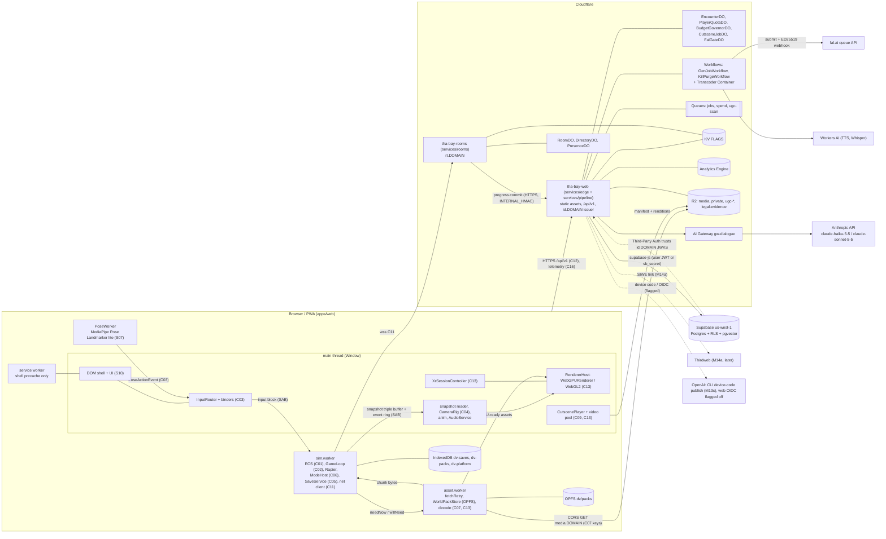
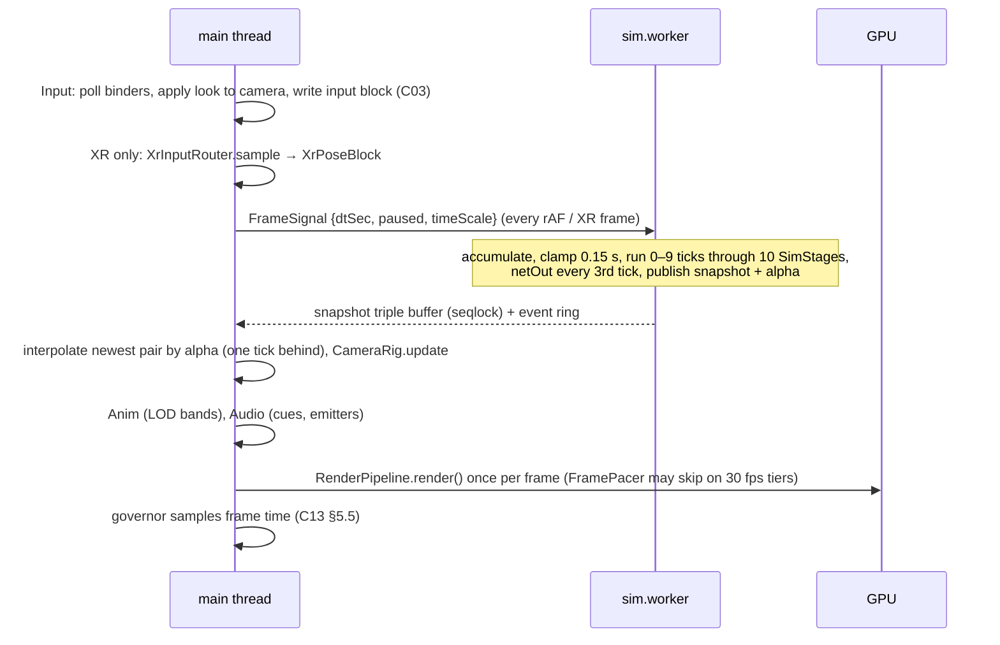
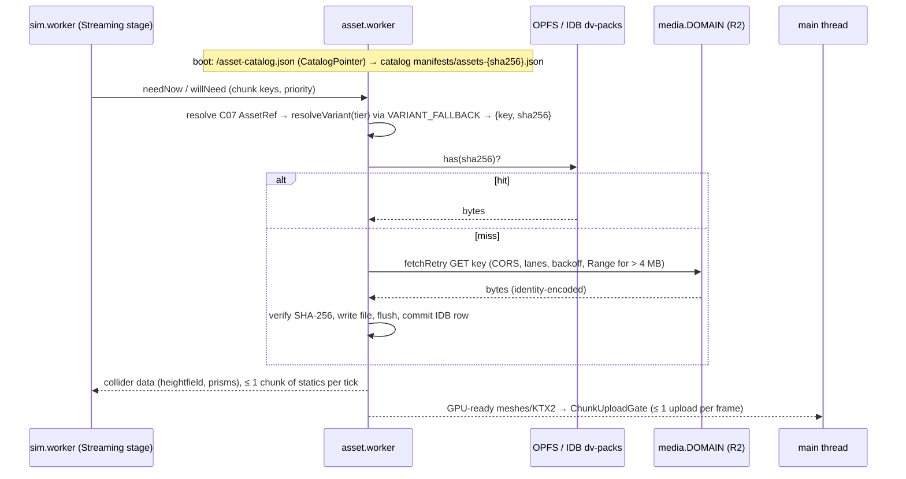
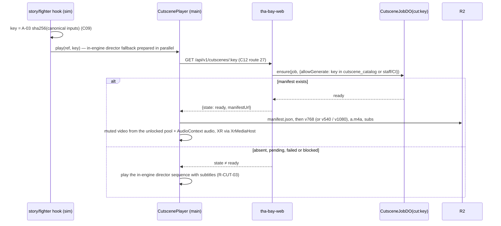
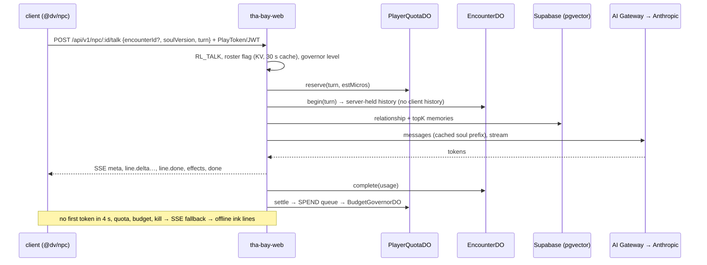
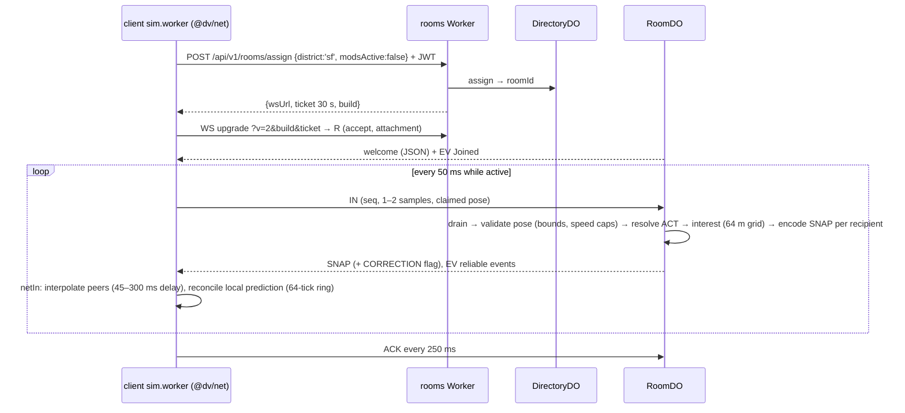
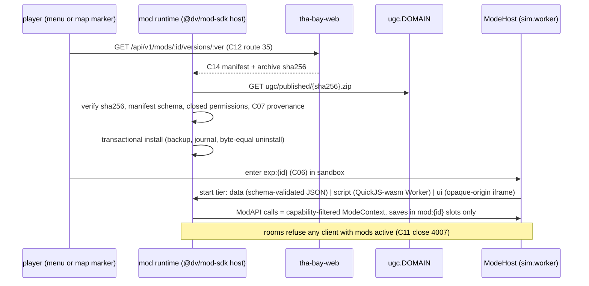

# 02 — Architecture (v0)

> v0, Architect, 2026-10-18, written after Wave 1 contract reconciliation. Binding inputs: `prompt-pack/06-SHARED-CONTEXT.md` **v1.0 (frozen)**, `spec/03-decisions-and-facts.md` v0, the Wave 1 domain specs (`spec/domains/01-engine*.md`, `05-assets*.md`, `09-backend*.md`, `11-platform*.md`). This file shows how the parts fit together and cites the domain section that owns each detail; it restates nothing normative. Wave 5 (S13 + integration) adds the Wave 2–4 parts (world, story, NPC, modes, UI, modding) and promotes this file to v1. Requirements: R-PLAT-01…05, R-ROLL-01/02, R-ENG-01…04 and the R-IDs of each flow below.

## 1. System diagram



Topology sources: browser threads [`01-engine.md` §2.1; `11-platform.md` §2, §5.9]; edge [`09-backend.md` §2.1; `09-backend-ops.md` §1]; generation [`05-assets.md` §2]; pose on device [spec/03 D-24]. XR is Window-only, so v1 renders on the main thread with no render worker (D-08, F-006).

## 2. Package layout (spec/03 A-01, amended 2026-10-18)

```
apps/
  web/                PWA shell: entry, vite + vite-plugin-pwa (injectManifest), sw.ts, _headers, boot, route pages (S10, S11)
packages/
  shared/             @dv/shared — pure, deterministic: contract types C01–C17, detmath, rng, hash, canonical JSON, C07/C13 types, API/DB types, genai pure helpers, rig map
  engine/             @dv/engine — sim (ECS, loop, physics, control, pursuit, modes host, saves, script hooks), workers, client (input, camera, anim, audio), platform (renderer host, tiers, governor, XR, lifecycle, pack store, telemetry client, perf)
  world/              @dv/world — chunk loader, road/ped graphs, traffic and ped brains, sky/timecyc visuals, map rendering (S02, Wave 2)
  net/                @dv/net — C11 codec, clock and interpolation, RoomClient, CloudSync port (S09)
  identity/           @dv/identity — IdentityService: LocalIdentity (P0), DeviceIdentity (P1), OpenAI and Thirdweb adapters (S09)
  npc/                @dv/npc — soul compiler and validator, dialogue client, offline ink lines, lip-sync runtime (S04, Wave 2)
  ui/                 @dv/ui — menus, HUD, settings, creator, forum client, XR UiSurface panels (S10, Wave 4)
  mod-sdk/            @dv/mod-sdk — ModAPI types, manifest schema, local dev loop, AGENTS-facing docs (S12, Wave 4)
  modes/story/        @dv/mode-story — mission interpreter, director, Act 1 content bindings (S03, Wave 2)
  modes/racing/       @dv/mode-racing — race rules, handling profiles, ghosts (S06, Wave 3)
  modes/fighter/      @dv/mode-fighter — frame data, combat sim, pose classifier binder (S07, Wave 3)
  modes/tycoon/       @dv/mode-tycoon — cap table, event engine, investor NPC hooks (S08, Wave 3)
services/
  edge/               @dv/edge — tha-bay-web Worker: router, issuer, DataPort (Supabase), quotas, governor, EncounterDO, CutsceneJobDO, moderation, legal, telemetry ingest, crons (S09)
  rooms/              @dv/rooms — tha-bay-rooms Worker: RoomDO, DirectoryDO, PresenceDO, tickets, upgrade gate (S09)
  pipeline/           @dv/pipeline — genAI steps, GenJobWorkflow, KillPurgeWorkflow, FalPort, FalGateDO, transcoder image; library compiled into tha-bay-web (S05)
tools/
  map/                SF bake: DataSF/OSM/Terrarium → terrain, buildings, graphs, sf-map.v1.bin, world packs (S02)
  assets/             assets:* and genai:* CLIs: generate, optimize, retarget, verify, publish, lock, catalog, prewarm, cutscene-index (S05)
  ci/                 check scripts and IP gates, perf-verify, checklists, schemas, fixtures (S05, S11, S13)
  cli/                `dv` binary for modders and agents: mod check, dev loop, publish via device code (S12)
  ops/                operator scripts: kill switches (`ks.ts`), drain, bootstrap helpers (S09)
config/               brand.ts, tier-budgets.json, platform-flags.json, engine-tiers.json, genai-endpoints.json, guardrails.yaml, net.speedcaps.json, input/, pursuit.json, clock.json, …
content/              authored data: prompt templates (content/prompts/genai), audio needs, missions and dialogue (Wave 2)
assets/               assets.lock.json, provenance/<sha2>/<sha256>.json, prefabs/<id>.json
supabase/             migrations/0001…0009, tests/*.sql (pgTAP)
tests/                cross-package e2e, staging, load and ops suites
docs/                 decisions/ (ADRs), legal/ (vendor terms and licence snapshots)
```

Dependency direction: `apps → services/packages`; every package may import `@dv/shared`; `@dv/shared` imports nothing. `@dv/engine` sim code imports neither `three` nor DOM types (`01-engine.md` §2.12). Modes depend on `@dv/engine` through C06 only. `services/*` never import client packages except `@dv/shared` and `@dv/net` (shared validation, `09-backend.md` §3.1). Identity token, tier and scope types (`AccessClaims`, `PlayTokenClaims`, `Tier`, `ProviderId`, `StaffScope`, `IdentityService`) live in `packages/shared/src/identity.ts`; `@dv/identity` re-exports them and is client-only, so `services/edge` and `DataPort` never import it (DL-055).

## 3. Runtime topology

### 3.1 In the browser

| Context | Owns | Never does | Spec |
|---|---|---|---|
| Main thread | DOM, input capture, XR session, rendering, camera, animation, audio, cutscene video, telemetry client | sim state mutation | `01-engine.md` §2.1; `11-platform.md` §2 |
| `sim.worker` | ECS, physics, AI, pursuit, modes, missions, saves, net socket (M12) | DOM, `three`, GPU | C01, C02; `01-engine.md` §2.1, §2.12 |
| `asset.worker` | fetch lanes, OPFS pack store, SHA-256 verify, decode | game logic | `11-platform-pwa.md` §5; C07 |
| `PoseWorker` | MediaPipe Pose Landmarker lite 1.1.1, on-device; emits actions only | uploading or storing frames | spec/03 D-24; R-IP-04; S07 (Wave 3) |
| Service worker | shell precache, `/asset-catalog.json`, cutscene "keep offline" cache | world packs, glTF, KTX2, audio banks | `11-platform-pwa.md` §4 |

Transport is SharedArrayBuffer rings under cross-origin isolation, with a `postMessage` fallback when isolation is missing (C02; `11-platform.md` §5.9; DN-S11-02).

### 3.2 At the edge

| Deployable | Host | Contents | Deploy rule | Spec |
|---|---|---|---|---|
| `tha-bay-web` | `<domain>`, `id.<domain>` | static assets + `_headers`, `/api/v1/*`, issuer, web DOs, Workflows, Queue consumers, crons, Transcoder Container | `versions upload` → smoke → rollout; DO lifecycle via `wrangler deploy` | `09-backend-ops.md` §1–2 |
| `tha-bay-rooms` | `rt.<domain>` | room REST, WebSocket upgrade gate, room DOs | drain notice, then plain deploy in the window | `09-backend-ops.md` §1.1, §2 |
| R2 custom domains | `media.<domain>`, `ugc.<domain>` | C07 assets, catalogs, cutscenes, barks; published UGC images | immutable keys, prefix purge on kill | `09-backend-db.md` §4; `05-assets.md` §4.4 |

### 3.3 Data stores

| Store | Holds | Owner |
|---|---|---|
| IndexedDB `dv-saves` | C05 records, pointers, tombstones, conflicts | S01 |
| IndexedDB `dv-identity` | identity profile id, non-extractable device key (`LocalIdentity`) | S09 |
| IndexedDB `dv-platform`, `dv-packs` + OPFS `dv/packs` | tier decision, device settings, pipeline seeds; pack index and bytes | S11 |
| Supabase Postgres | identity, saves (M12a), NPC memory (pgvector), moderation, forum, mods, ledger | S09 (`09-backend-db.md`) |
| DO SQLite | room checkpoints, encounters, quotas, governor ledger, cutscene job state | S09 (`09-backend-db.md` §6) |
| KV `FLAGS` | roster flags, `ks:*`, `gov:level`, feature flags, leaderboard cache | S09 (`09-backend-db.md` §5) |
| R2 | media, private work files, UGC staging/public/quarantine, legal evidence | S09 layout; S05 prefixes |
| Analytics Engine | telemetry, spend, room ticks | S09 (C16) |

### 3.4 External services

| Service | Use | Gate | Source |
|---|---|---|---|
| Anthropic via AI Gateway | NPC dialogue, vision QA, builder text | server-side only, quotas, governor | spec/03 D-21; `09-backend-ops.md` §5 |
| fal.ai | sheets, meshes, rigs, TTS, cutscene video | internal-only in v1; licence-gated video (A-08) | spec/03 D-18, D-19; `05-assets.md` §2 |
| Workers AI | Whisper captions, Aura/MeloTTS barks | governor | `05-assets-pipeline.md` §5–6 |
| Supabase | Postgres, RLS, pgvector; trusts our issuer | DataPort rule | spec/03 D-02, D-03 |
| Turnstile | P1 registration | verification API UNVERIFIED (Q-BE-05) | `09-backend.md` §10 |
| OpenAI | device-code publish login via the player's own Codex CLI; website sign-in flagged off | P2 | spec/03 D-05 |
| Thirdweb | SIWE wallet link | P3, M14a, Growth plan | spec/03 D-04 |

## 4. Data flows

### 4.1 Frame loop (R-PLAT-03, R-PLAT-05)


Owners: C02 rules 1–8 and the snapshot layout (`01-engine-contracts.md` §C02); frame pacing and governor (`11-platform.md` §5.4–5.5); XR loop (`11-platform-xr.md` §5.2). The main thread never waits for the sim.

### 4.2 Asset streaming (R-MAP-01, R-PLAT-01, R-ENG-02)


Owners: catalog and variants (C07, `05-assets.md` §4.1–4.4); pack store, fetch layer, eviction, `persist()` (`11-platform-pwa.md` §5); collider working set (`01-engine.md` §2.4); chunk content (C08, S02 Wave 2). A missing pack is a normal miss; the kill-switch path calls `WorldPackStore.evictByTag('char:<id>')`.

### 4.3 Cutscene request (R-CUT-01…03)


Generation never runs on the player's path: `pnpm assets:gen prewarm` or the catalog triggers `GenJobWorkflow` (gate → cache-check → budget-reserve → acquire → submit → wait/poll → copy → transcode → captions → qa → re-gate → record), which writes `manifest.json` last [`05-assets.md` §5.1; `05-assets-pipeline.md` §6; `09-backend.md` §3.3]. Single-flight is `CutsceneJobDO`; budget refusals and kill switches never block cache hits (D-28). Playback platform rules: `11-platform-pwa.md` §7, `11-platform-xr.md` §5.6.

### 4.4 NPC dialogue (R-NPC-05)


Owners: transport, quotas, `EncounterDO` and memory storage (`09-backend.md` §3.2, §5.1; `09-backend-db.md` §3.3); prompt, schema, memory semantics and voice (C10, S04 Wave 2); cost layers (`09-backend-ops.md` §5). Filler pedestrians never call the model (D-21).

### 4.5 Multiplayer tick (R-ROLL-02)


Owners: C11 (`09-backend-contracts.md` §1.3–1.8); prediction ring and corrections (`01-engine.md` §2.13); room state machine, AFK stop, checkpoints, drain (`09-backend.md` §5.1; `09-backend-ops.md` §2). Progression is committed server-side through `progress.commit`, never from client saves.

### 4.6 Mod load (R-MOD-01, R-MOD-04) — sketch, S12 finalizes in Wave 4


Inputs: spec/03 D-26; C14 and C17 sketches in 06 §4.4; `09-backend-db.md` §3.7. Open risk: the UI-mod iframe under COEP `require-corp` (R-S11-05).

## 5. Cross-cutting concerns

### 5.1 Errors and degradation
- **Principle:** single-player never depends on the network (R-ROLL-01). `/boot` failing means offline mode [`09-backend.md` §2.2, §5.3].
- **Client API rule:** `quota_exhausted`, `budget_offline`, `kill_switched`, `upstream_unavailable` and network failure are not errors to the player. They select the offline path: in-engine cutscene, ink lines, cached barks [C12 §2.2].
- **Failure tables by owner:**
  - sim: `01-engine.md` §5
  - renderer and device loss: `11-platform.md` §5.8
  - packs: `11-platform-pwa.md` §5
  - backend: `09-backend.md` §5.3
  - pipeline: `05-assets.md` §5.2
- **Server errors** use the `ApiError` envelope with `X-Request-Id`. Workers Issues receives source-mapped exceptions [`09-backend-ops.md` §4].

### 5.2 Telemetry
- **Wire:** C16 `TelemetryBatch` → `POST /api/v1/t` → Analytics Engine.
- **Client:** `packages/engine/src/platform/telemetry/`. It runs the heartbeat in `localStorage['dv.hb']`, does abnormal-exit inference, and flushes with `sendBeacon` [`11-platform-pwa.md` §9].
- **Server metrics:** `room.tick`, `genai.cost`, `quota.block`, `budget.level` [`09-backend-ops.md` §4].
- **Privacy and consent:** no IP, UA, profile id, free text or sub-chunk position. Consent is device-scoped (`PlatformSettings.telemetryConsent`) because events fire before a profile loads.

### 5.3 Feature flags and kill switches

| Layer | Mechanism | Scope | Owner |
|---|---|---|---|
| Build | `VITE_DV_QA` (QA URL flags, `__dvBridge`); `GEN_PUBLIC=false` (compile-time) | per build | S11, S05 |
| Boot | `BootConfig.flags` from KV `flags:features` (`mp.enabled`, `npc.dialogue`, `cutscene.generated`, …), `gov` level | per release, 60 s cache | S09 |
| Emergency | KV `ks:*` (genAI, vendor, endpoint, likeness), `gov:level`; DO paths for immediate stops | ≤ 30–60 s | S09 |
| Roster | `roster:flags` + `EncounterDO.kill` + `KillPurgeWorkflow` | live ≤ 60 s, purge ≤ 24 h | S09, S05 |
| Platform | `config/platform-flags.json` (`webgpu.mobile`), `?gl=1`, Compatibility mode | per release / per device | S11 |
| Rooms | `rooms.capMax`, `rooms:new` | per release | S09 |

### 5.4 Configuration

All configuration lives in `config/`, is validated by JSON Schema in CI, and is never fetched from a third party at runtime.
- Platform budgets: `tier-budgets.json` (C13).
- Engine: `engine-tiers.json`, `pursuit.json`, `clock.json`, `physics.json`, `audio.json`, `input/`, `unlocks.json`, `modes.json`.
- Assets: `genai-endpoints.json`, `asset-budgets.json`, `ip-denylist.json`, `license-allowlist.json`.
- Network: `net.speedcaps.json`, `geo.json`, `rate-limits.json`.
- Spend: `guardrails.yaml` (every cap, ceiling and alert threshold).
- Identity: `brand.ts` (display name).
- Runtime values reach the client only through `BootConfig`, and hosts are never hard-coded [`09-backend.md` §6].

### 5.5 Secrets
- **Storage:** Wrangler secrets only, uploaded with the code by `versions upload --secrets-file`. Local development uses `.dev.vars` (git-ignored) [`09-backend-ops.md` §6].
- **Client:** no key ever reaches a client bundle. `check:secrets` scans `apps/web/dist`.
- **genAI keys** are split by holder: a staff fal key for CLI batches, and separately scoped keys for CI and the Worker (DN-S05-4 settled, holder Q-17). Anthropic workspaces split runtime, builder, CI and synthetic use.
- **CI auth:** expiring account API tokens, split by duty, because Cloudflare has no CI OIDC [research/gap-ci-cd-release-assets.md §1.3].

### 5.6 Security boundaries (summary)
- **Isolation:** COOP/COEP/CORP on every document and Worker response; `/account/*` is the only non-isolated path [D-01; `11-platform-pwa.md` §2].
- **Identity:** the device-key-bound play token in P0, then our ES256 issuer [C12 §2.3].
- **Rooms:** server-assigned slots, pose validation, mods refused [C11].
- **Generation:** internal-only, likeness gates at every stage, no face detector anywhere [`05-assets.md` §2, §5.4].

## 6. Contract crossings

| Boundary | Contracts |
|---|---|
| main ↔ `sim.worker` | C01, C02, C03, C04 |
| `sim.worker` ↔ `asset.worker` | C07, C08, C13 (pack store) |
| modes ↔ engine | C06 (`ModeContext`), C05 slices, C09 hooks |
| client ↔ `tha-bay-web` | C12, C16, C10 (talk), C09 (status) |
| client ↔ `tha-bay-rooms` | C11, C12 (assign, tickets) |
| pipeline ↔ storage | C07, C09 manifest, C12 tables |
| mods ↔ game | C14, C06 subset, C17 |
| PoseWorker ↔ input | C03 `PoseActionEvent` |

## 7. Open items for Waves 2–5
1. **S02** finalizes C08: chunk grid, `z/x/y` semantics, pack AssetIds, `world.bounds.json`, spawn-table prefix rule (06 §4.4). This unblocks M01b's gray-box fixture, M02a and M02b.
2. **S03/S04** finalize C09 and C10 inside the sketches. The `cutscene-index` build step is shared with S05 (`tools/assets`).
3. **S06/S07/S08** claim `AnimStateId` blocks 128–255 and component ranges, and implement the XR per-mode rules (`11-platform-xr.md` §5.3).
4. **S10** provides `UiSurface` for XR panels (DN-S11-03), the settings pages for device-scoped `PlatformSettings` and the C05 profile settings, the neutral age screen, and the conflict-choice UI (C05 rule 10).
5. **S12** finalizes C14 and C17 and resolves the COEP risk of UI-mod iframes.
6. **Wave 5** promotes this file to v1, adds world/story/NPC/mode/UI/mod components to §1 and §2, and writes ADR-0001 (package layout, including the 2026-10-18 amendment).
