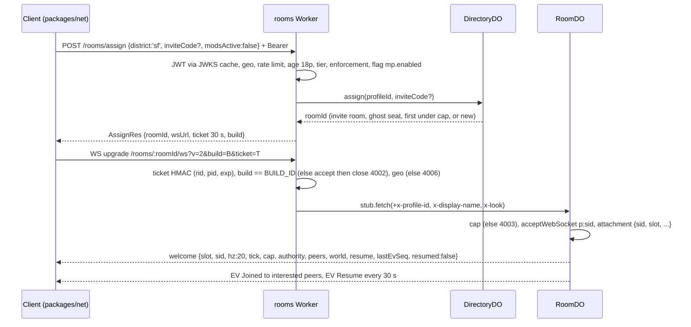
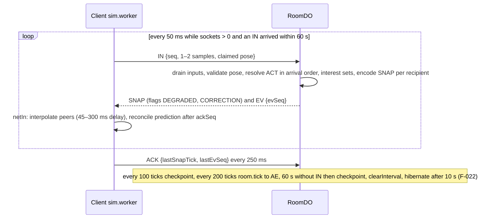
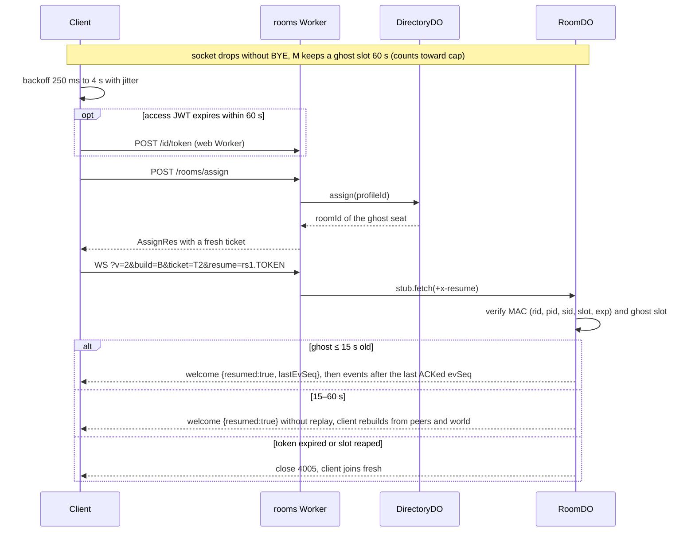
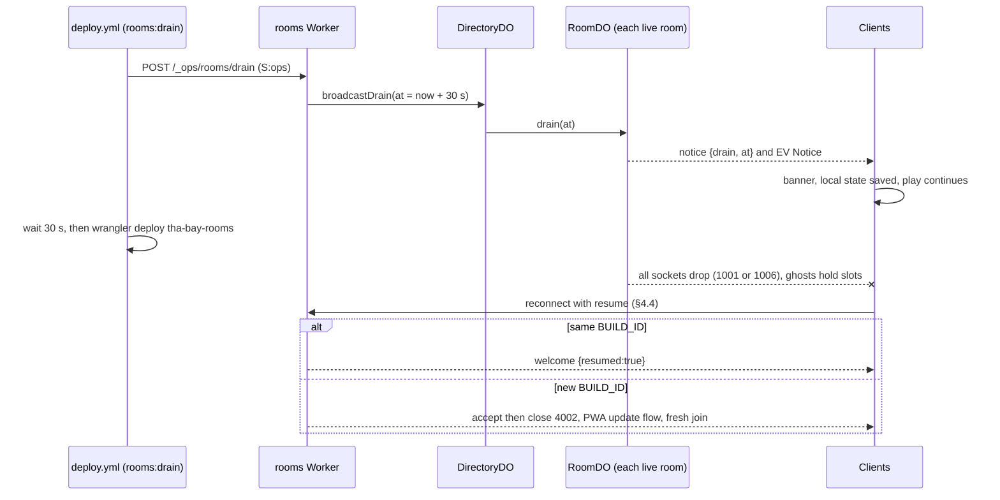
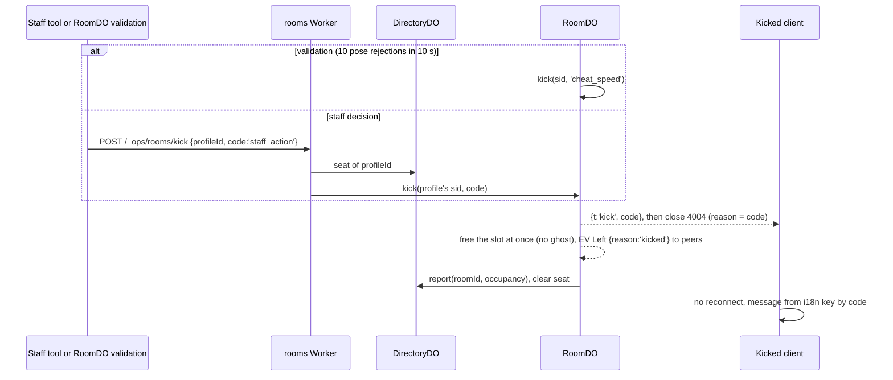

# 05 — API and realtime (the network surface)

> Wave 5 integration, 2026-10-18. Consolidates C11 1.0.0 (wire `PROTOCOL_VERSION` 2), C12 1.1.0 and the C16 1.1.0 ingest route from `domains/09-backend-contracts.md` §1–§3, `09-backend-contracts-1.1.md`, `09-backend-ops.md` §3 and the route semantics of S03–S06, S08, S10, S12. No shape is redefined; type names point at the contract files. Routes #1–53 are unchanged; #54–57 are added (DL-185…DL-187). Decisions: `spec/11-decision-log-2.md` DL-182…DL-192. Requirements: R-PLAT-01, R-ROLL-01/02, R-AUTH-01…03, R-CUT-01/03, R-NPC-05, R-MOD-03/04, R-IP-03/04, R-ENG-03.

## 1. Hosts, headers, geo-gate

### 1.1 Hosts
| Host | Worker | Isolation headers | CORS | Serves |
|---|---|---|---|---|
| `<domain>` | `tha-bay-web` | COOP `same-origin`, COEP `require-corp`, CORP `same-origin` on assets (`_headers`) and on every Worker response | none (same origin) | SPA, `/api/v1/*` |
| `<domain>/account/*` | same | no COOP/COEP (`!` removal rules in `_headers`; the Worker omits them) | none | provider redirects, Turnstile (M12a1), Thirdweb (M14a) |
| `id.<domain>` | `tha-bay-web`, host-routed | not needed | `*` on discovery and JWKS; `max-age=600` | OIDC issuer |
| `rt.<domain>` | `tha-bay-rooms` | n/a | app origin only; `GET, POST, OPTIONS`; headers `Authorization, Content-Type, Idempotency-Key, X-Client-Build`; no credentials; `Vary: Origin` | rooms, presence, WebSockets |
| `media.<domain>` | R2 custom domain | n/a | bucket CORS `GET, HEAD` from the app origin; expose `Content-Length, Content-Range, Accept-Ranges, ETag` [research/gap-cutscene-delivery-playback.md §7.5] | world packs, cutscenes, audio |
| `ugc.<domain>` | R2 custom domain, `ugc-public` | n/a | as `media.`; cache rule on (F-065) | UGC images, mod archives |

### 1.2 Isolation and uploads (D-01)
`_headers` does not apply to Worker responses (F-019), so `withIsolationHeaders(res)` runs on every Worker response except under `/account/`; `/link` stays isolated (DL-189). Cross-origin media is fetched in CORS mode, which needs no CORP header under `require-corp` [research/stack-cloudflare-backend.md §1.2]; binaries are served identity-encoded so `Range` works (F-019). A cross-origin WebSocket from the isolated page to `rt.<domain>` is UNVERIFIED (U-BE-1, M12b AC-1; fallback zone route `<domain>/rt/*`, Q-BE-02).
Presigned PUT works only on `<ACCOUNT_ID>.r2.cloudflarestorage.com` (F-023); the `ugc-staging` and `private` buckets carry a CORS policy allowing `PUT` with `Content-Type` from the app origin [research/stack-cloudflare-backend.md §1.4]. `UploadRes.headers` is the exact header set to send (a mismatch is a 403).

### 1.3 CSP, permissions, misc headers
App documents (served by `_headers`; the build substitutes `<domain>` and the account id):
```
Content-Security-Policy-Report-Only: default-src 'self'; script-src 'self' 'wasm-unsafe-eval'; style-src 'self' 'unsafe-inline'; img-src 'self' data: blob: https://media.<domain> https://ugc.<domain>; media-src 'self' blob: https://media.<domain>; font-src 'self'; worker-src 'self' blob:; connect-src 'self' https://media.<domain> https://ugc.<domain> https://rt.<domain> wss://rt.<domain> https://id.<domain> https://<ACCOUNT_ID>.r2.cloudflarestorage.com; object-src 'none'; base-uri 'none'; form-action 'self'; frame-ancestors 'none'; report-to csp
Reporting-Endpoints: csp="/api/v1/reports/browser"
Permissions-Policy: camera=(self)
X-Content-Type-Options: nosniff
Referrer-Policy: strict-origin-when-cross-origin
```
Only our origins appear, so nothing can carry a camera frame off-device (R-IP-04; `check:headers` asserts the list). `/account/*` has its own allowlist (Turnstile and Thirdweb origins UNVERIFIED, U-BE-2, M12a1/M14a). The mod UI `srcdoc` frame carries its own `<meta>` CSP (`12-modding.md` §2.5). The directive set is composed here from `BootConfig.hosts`, `11-platform-pwa.md` §2, §8 and `07-fighter-pose.md` FP7.1; its browser behaviour, including the `srcdoc` frame, is UNVERIFIED (U-API-1), so it ships Report-Only at M05b1, `Permissions-Policy` at M08c1 and enforcing at M14b2 (DL-191, DL-241). Route 4 also receives the Report-Only violations and desktop Chrome crash reports. API JSON is `no-store` except `GET /roster` (ETag) and catalogue reads; every response carries `X-Request-Id` (UUIDv7).

### 1.4 Geo-gate (A-10)
`request.cf.country ∉ GEO_ALLOW` (`config/geo.json`, `US`) → `451 region_blocked` on every `/api/v1/*` route except `/boot` (answers `region: 'blocked'`), `/legal/*` and `/.well-known/*`; routes authenticated by vendor signature, HMAC or staff scope are also exempt (20, 28, 29, 43–49, 55–57; DL-184). A missing country (local dev) counts as allowed. Rooms close 4006. Blocked clients run offline single-player from the PWA cache (R-ROLL-01).

### 1.5 Conventions
JSON bodies; `X-Client-Build: <BUILD_ID>` on every request (older than `minClientBuild` → `409 build_mismatch` → PWA update flow); `Idempotency-Key` (UUIDv7) on ⓘ writes, kept 24 h; UUIDv7 ids minted in the Worker; epoch-ms times; pagination `?cursor&limit≤50` → `{items, next?}`. Bodies pass Ajv schemas generated from `packages/shared/src/api/v1.ts` (`check:api`), default cap 64 KiB. Errors are `ApiError` with `HTTP_FOR` statuses. `quota_exhausted`, `budget_offline`, `kill_switched`, `upstream_unavailable` and network failure select the offline path, never a dialog (R-CUT-03, R-NPC-05); `rate_limited` carries `retryAfterMs`.

## 2. Identity and auth phases (D-03, D-04)

| Phase | Register id | Credential and header | Lifetime | Unlocks |
|---|---|---|---|---|
| P0 local | M04b3 (mint), M06a1 (TOFU bind, quotas) | `Authorization: PlayToken pt1.<claims>.<mac>`; HMAC-SHA256 with `PLAY_TOKEN_HMAC[kid]`; claims `PlayTokenClaims` | 24 h | dialogue, cutscene status, telemetry, export/forget, reports |
| P1 device | M12a1 | `Authorization: Bearer <ES256 JWT>` (`AccessClaims`, `tier: 'device'`, `aud: 'tha-bay'`, `role: 'authenticated'`) plus opaque refresh | JWT 1 h; refresh 30 d, rotating | cloud saves, rooms, leaderboards, forum (account ≥ 72 h, Q-BE-04), uploads |
| P2 linked | M13c1 (CLI device code, `/link`), M13c2 | same JWT with `tier: 'linked'`; CLI token `aud: 'tha-bay-cli'`, `scp: ['mods:publish']` | JWT 1 h; refresh 30 d | publishing mods and experiences, NPC submit, premium voice |
| P3 linked | M14a | Thirdweb SIWE link (EOA only); same JWT | same | cross-device sign-in and recovery |
| staff | `OPS_TOKEN` from M05b1; staff JWT from M12a1 | `scp` ∈ `mod:review`, `mod:trust_lead`, `admin`, `ops`, re-checked against `staff_roles` on every call; CI is a staff profile that mints its JWT with `CI_STAFF_DEVICE_JWK` through route 8 (DL-192) | JWT 1 h | admin routes |

- **Issuer** `https://id.<domain>` (route 6), served by the web Worker; M12a1 adds `/.well-known/*` to `run_worker_first` (DL-185). `ID_SIGNING_JWK_CURRENT` and `_NEXT` are always published; rotation every 90 days with ≥ 30 min overlap; verifiers cache the JWKS 10 min and refetch on an unknown `kid`. Supabase trusts the issuer as a Custom OIDC third-party provider, registered by `pnpm auth:tpa` (F-031), and picks up rotations within 30 min [research/auth-ugc-input-maps.md §1.2].
- **P0 proof**: the client signs `"pt-req|" + pid + "|" + ts` with its non-extractable ECDSA P-256 device key; the Worker accepts `|now − ts| ≤ 120 s`; the first server write for a `pid` binds the key thumbprint (trust on first use), and another key for that `pid` is `forbidden`.
- **Refresh**: 32 random bytes stored as SHA-256 with a family id, rotated on every use; reuse revokes the family. `device_assertion` re-authenticates a P1 device over `"tok-req|pid|ts"`.
- **No PII in tokens** (email, wallet address, provider subject). Only `18p` obtains a token (D-30, DL-139); `attestAge` posts route 15.
- **Device code (route 10, RFC 8628)**: `user_code` `XXXX-XXXX`, `expires_in` 600, `interval` 5, `slow_down` +5 s; 3 codes per profile per hour; `/link` approves only for tier `linked`. Before M14a, P2 comes from `openai` (flag `auth.openaiWeb`) or `supabase-oauth` (GitHub), UNVERIFIED beside Third-Party Auth (M13c1, DL-145).
- **Provider redirects** (routes 11, 12) cannot carry `Authorization`: a static `/account/callback` page forwards `code` and `state` with `fetch` and the Bearer token (DL-189). Rooms never see the JWT in a URL; a 30 s ticket authorises the WebSocket (§4.2).

## 3. Route catalogue

Auth: `pub` none · `PT` PlayToken or any JWT (P0+) · `J1` JWT tier ≥ `device` (P1) · `J2` tier `linked` (P2/P3) · `CLI` JWT `aud: 'tha-bay-cli'`, `scp: ['mods:publish']` · `S:<scp>` staff scope · `tkt` room or presence ticket · `HMAC` shared secret · `sig` vendor signature. ⓘ = `Idempotency-Key`. Rate-limit classes are in §5.1. Any route may return `bad_request` (Ajv), `rate_limited`, `region_blocked` (player routes), `build_mismatch`, `internal`; `unauthorized`, `age_blocked`, `tier_required` follow the phase. `/api/v1` is omitted from paths; `rt:` = `rt.<domain>`. Types are in `packages/shared/src/api/v1.ts` (`mods.ts` for 35–37 and 53). Milestones are register ids (DL-182). Sources: table `09-backend-contracts.md` §2.4 and `09-backend-contracts-1.1.md` §1; dialogue `04-npc-contracts.md` B§2.4; builder `04-npc-builder.md` §C3; cutscenes `03-story-cutscenes.md` §D5; mods `12-modding-contracts.md` B§7, `12-modding-publish.md` C§2–C§4; leaderboards `06-racing-data.md` §4.3, `08-tycoon.md` M12e; forum `10-ui-pages.md` §2.11.

| # | Method and path | Auth | Request → response | Errors and limits | MS |
|---|---|---|---|---|---|
| 1 | `GET /health` | pub | → `{ok, build, env}` | never geo-gated | M00a |
| 2 | `GET /boot` | pub | → `BootConfig` | geo-evaluated, never blocked; `no-store`; `api` | M00a |
| 3 | `POST /t` | pub | `TelemetryBatch` → 204 | `payload_too_large` (> 64 KiB or > 50 events), `unsupported_media_type`; unknown names dropped; `tele` | M00a |
| 4 | `POST /reports/browser` | pub | Reporting API bodies (crash, CSP violation) → 204 | `tele` | M05b1 (CSP), M11a1 (crash; C16 1.2 `app.crash`, DL-224) |
| 5 | `POST /id/play-token` | pub + device proof | `PlayTokenReq` → `PlayTokenRes` | `bad_request` (stale `ts`, bad signature), `age_blocked`; `auth`; 50 tokens/day/net | M04b3 |
| 6 | `GET id.<domain>/.well-known/openid-configuration`, `…/jwks.json` | pub | → discovery · JWKS | CORS `*` | M12a1 |
| 7 | `POST /id/register` | PT | `RegisterReq` → `TokenRes` | `bad_request` (Turnstile), `age_blocked`; 3 per net per day | M12a1 |
| 8 | `POST /id/token` | pub | `TokenReq` → `TokenRes` | `unauthorized` (reuse revokes the family); `auth` | M12a1 |
| 9 | `POST /id/logout` | J1 | → 204 | revokes the refresh family | M12a1 |
| 10 | `POST /id/device-code`, `POST /id/device-token`, `POST /id/device-code/approve` | pub · pub · J1 | `DeviceCodeRes`; `DeviceTokenReq` → `TokenRes`; `{user_code}` → 204 | RFC 8628 errors; approve: `tier_required` unless tier `linked`; 3 codes/profile/h | M13c1 |
| 11 | `GET /id/openai/start`, `GET /id/openai/callback` | J1 | → `{authorizeUrl}`; `code`, `state` → `IdentityStateDTO` | `feature_disabled` while `auth.openaiWeb` is off | M13c1 |
| 12 | `POST /id/siwe/nonce`, `POST /id/siwe/verify` | J1 | → nonce; SIWE message + signature → `IdentityStateDTO` | `feature_disabled` (`auth.thirdweb`) | M14a |
| 13 | `POST /id/merge` ⓘ, `GET /id/merge/:id` | J1 | → merge request | `conflict` | M14a |
| 14 | `GET /me`, `GET /me/export`, `DELETE /me` | PT | → `IdentityStateDTO`; ZIP link (7 d) within 24 h; 204, cascade ≤ 24 h | `api` | M06a1 |
| 15 | `POST /me/age` | PT | `{bracket: AgeBracket}` → `IdentityStateDTO` | only `18p` unlocks online; `auth` | M12a1 |
| 16 | `GET /saves/sync?since=` | J1 | → `SaveSyncRes` | `api` | M12a1 |
| 17 | `PUT /saves/:saveProfileId/:slot` ⓘ | J1 | `CloudSaveRecord` + `If-Match: <version>` → `CloudSaveRecord` | `conflict` (`details.server`), `payload_too_large` (> 256 KiB inline → route 19) | M12a1 |
| 18 | `DELETE /saves/:saveProfileId/:slot` | J1 | → 204 (tombstone) | `conflict` | M12a1 |
| 19 | `POST /saves/blob-url` | J1 | `UploadReq` (`save_blob`) → `UploadRes` (≤ 2 MiB) | `ugc` | M12a1 |
| 50 | `PUT /saves/:saveProfileId` ⓘ | J1 | `SaveProfileUpsert` → 204; precedes 17 | ≤ 64 per identity | M12a1 |
| 51 | `DELETE /saves/:saveProfileId` | J1 | → 204 | — | M12a1 |
| 20 | `POST /progress/commit` ⓘ | HMAC `INTERNAL_HMAC` | `ProgressDelta` (C12 1.2, DL-223) → `applied` \| `duplicate` | rooms → web only | M12c2 |
| 21 | `GET /leaderboards/:board`, `POST /leaderboards/:board/submit` ⓘ | pub · J1 | → `ScoreRow[]` (KV `lb:<board>` 30 s); `ScoreSubmit` → `accepted` \| `rejected` | board `^(racing\|fighter\|tycoon)\.[a-z0-9.-]{1,96}$`; body ≤ 16 KiB; validator by prefix, else `feature_disabled` (DL-183) | M12c2, M12e (body `LeaderboardSubmit`, C12 1.2) |
| 22 | `GET rt:/rooms/:roomId` | J1 | → `{players, capacity, build}` | reserves nothing; `rooms` | M12b |
| 23 | `POST rt:/rooms/assign` | J1 | `AssignReq` → `AssignRes` | `feature_disabled` (`mp.enabled`, `ks:rooms:new`), `forbidden` (enforcement), `age_blocked`, `tier_required`; `modsActive: true` refused (C11 rule 8, 4007); `rooms` | M12b |
| 24 | `GET rt:/rooms/:roomId/ws?v=2&build&ticket[&resume]` | tkt | WebSocket (C11) | close codes §4.1 | M12b |
| 25 | `POST rt:/rooms/invites` | J1 | → `{code, exp}` (6-char base32, 10 min) | `rooms` | M12c |
| 26 | `GET rt:/presence/ws?ticket=` | tkt | `PresenceFrame` socket | — | M12c |
| 54 | `POST rt:/presence/ticket` | J1 | → `{ticket, exp, wsUrl}` | `rooms` (DL-186) | M12c1 |
| 48 | `POST rt:/_ops/rooms/drain` | S:ops | → `{notified}` | step `rooms:drain` | M12c |
| 55 | `POST rt:/_ops/rooms/kick` | S:mod:review \| S:ops | `{profileId, code}` → `{kicked}` | writes `audit_log` (DL-187) | M12c1 |
| 27 | `GET /cutscenes/:key` | pub | → `CutsceneStatus` | never starts generation outside `cutscene_catalog`; kill scope → `blocked`; `api` | M05b1 |
| 28 | `POST /admin/cutscenes/prewarm` | S:ops (`OPS_TOKEN` until M12a1) | `{keys[]}` → 202 | single-flight per key | M05b1 |
| 29 | `POST /hooks/fal?wf=<instance>` | sig | fal webhook → 2xx ≤ 15 s | ED25519 against the fal JWKS (cache ≤ 24 h, ±300 s); failure raises A11 [research/genai-pipeline-fal.md §2] | M05b1 |
| 49 | `/_test/*` | non-prod | run-scheduled, drain-queue, spend, `fal-jwks`, `echo-country` | `check:prod-routes` proves absence in prod | M05b1 (`echo-country` M00a) |
| 30 | `GET /roster` | pub | → `RosterFlags` (ETag, 304) | KV cache 30 s | M06a1 |
| 31 | `POST /npc/:npcId/talk` | PT | `NPCDialogueRequest` → SSE `DialogueEvent` | pre-stream JSON: `not_found`, `conflict` (`busy`, `turn_cap`, `soul_version`), `quota_exhausted`, `budget_offline`, `feature_disabled`, `kill_switched`, `moderation_blocked`, `upstream_unavailable`; `talk` | M06a3 |
| 32 | `POST /npc/:npcId/intent` | PT | `NPCIntentRequest` → `NPCIntentResponse` | `talk` | M06c |
| 33 | `/npc-builder/…` (below) | P0–P2 | `CreateDraftReq`, `UpdateDraftReq` → `DraftView` | `tier_required`, `feature_disabled` (`npc.builder`, `ks:npc_builder`), `quota_exhausted`, `moderation_blocked`, `conflict`, `not_found` (not owner); `ugc` | M06b1, b2, b4 |
| 46 | `POST /admin/roster/:npcId/kill` | S:admin | `{scope: KillScope[], reason, ticketId}` → 202 | starts `KillPurgeWorkflow` and `EncounterDO.kill`; live ≤ 60 s | M06a1 |
| 47 | `PUT /admin/flags/:flag` | S:admin | `{on, reason, expiresAt?}` → 204 | `ks:*`, `rooms.*`, features; audited | M06a1 |
| 52 | `DELETE /me/npc-memory?npcId=` | PT | → 204 (no `npcId` = all NPCs) | `api` | M06a4 |
| 34 | `POST /ugc/uploads`, `POST /ugc/uploads/:id/commit` | J1 | `UploadReq` → `UploadRes`; commit → 202 (HEAD size check, `UGC_SCAN`) | image ≤ 10 MiB, archive ≤ 128 MiB, backstory ≤ 20,000 chars; `payload_too_large`, `unsupported_media_type`; `ugc`; 20 uploads/day (device), 100 (linked) | M06b2 |
| 35 | `GET /mods?q&kind&sort&tier&limit&cursor`, `/mods/:id`, `/mods/:id/versions/:ver` | pub | → `ModListItem[]` page, `ModDetail`, `ModVersionDetail` | `sort` ∈ `new\|top\|installed`; `api` | M13a2 |
| 36 | `POST /mods/:id/versions` ⓘ | CLI \| J2 | `ModVersionsReq` → 202 `ModVersionsRes` | `conflict` (changed archive under a published version), `tier_required`; 5 versions/day, 20 mods per profile; enqueues `UGC_SCAN` | M13c2 |
| 37 | `GET /experiences?chunk=<≤9 keys>\|bbox=`, `GET /experiences/:id`, `POST /experiences` ⓘ | pub · pub · J2 | → `ExperienceCard[]` (ETag, 5 min); POST `{modId, modVersion, anchor, radius, entryRules, visibility}` | ≤ 10 public placements per profile, ≥ 100 m apart; `ugc` | M13a3 (GET), M13c2 (POST) |
| 38 | `GET /forum/threads?board&sort&q&cursor&limit`, `POST /forum/threads` ⓘ | pub · J1 (+age rule) | cursor page of thread DTOs (`v1.ts`, M13b1) | `sort` ∈ `new\|top`; `q` 3–80 chars (DL-190); `forum` | M13b1 |
| 39 | `GET /forum/threads/:id/posts?since&cursor`, `POST …/posts` ⓘ | pub · J1 | cursor page of post DTOs | polled every 15 s while open; `forum`; 1 post/30 s; 20/day under 7 days | M13b1 |
| 40 | `PUT /forum/votes` | J1 | `{targetKind: 'thread'\|'post'\|'experience', targetId, value: -1\|0\|1}` → 204 | `forum` | M13b1 |
| 41 | `POST /reports` | PT | `ReportReq` → 202 | `copyright` → `conflict` with `details.redirect: '/legal/dmca'`; `report`; the dialogue-panel report button (M06a5) stays hidden until this lands | M06b2 |
| 53 | `GET /mods/revoked?since=&cursor` | pub | → `RevokedRes` | polled at launch and every 6 h; takedown reaches installed copies ≤ 24 h | M13a2 |
| 42 | `POST /legal/dmca`, `/legal/counter-notice`, `/legal/ncii` | pub, worldwide | counsel-defined forms → 202 | `legal`; `feature_disabled` placeholder since M00a | M13d1 |
| 43 | `GET /admin/cases?queue&status`, `POST /admin/cases/:id/decision` ⓘ | S:mod:review | cases; decision → 204 | NPC queue `P2_REVIEW` from M06b2, all queues M13d1 | M06b2, M13d1 |
| 44 | `POST /admin/cases/:id/ncmec`, `GET /admin/evidence/:id` | S:mod:trust_lead | — | — | M13d1 |
| 45 | `POST /admin/hash-banks/:bank`, `GET /admin/takedowns` | S:mod:trust_lead | — | — | M13d1 |
| 56 | `POST /_ops/alerts` | HMAC `ALERT_HMAC` | alert → 204 | writes `audit_log`, forwards to `ALERT_WEBHOOK_URL` | M14b1 |
| 57 | `GET /admin/dash/:name` | S:ops | AE dashboard `client\|edge\|spend\|pipeline\|recon` | reads `ANALYTICS_SQL` | M14b1 |

**Route 33 sub-paths** (`04-npc-builder.md` §C3): `POST /drafts` ⓘ, `GET /drafts[/:id]`, `PUT /drafts/:id` (`If-Match: <rev>`), `DELETE /drafts/:id`, `POST /drafts/:id/validate|soul` (202 `JobAccepted`), `POST /drafts/:id/preview` (SSE, workspace `npc-builder`) at P0 — M06b1; `POST /drafts/:id/images` (P1), `POST /drafts/:id/submit` ⓘ (P2, `SubmitRes`), `GET /community[/:npcId]` (pub, `CommunityNpc`) — M06b2; `POST /drafts/:id/assets` (P2) — M06b4: it files a request for the owner-approved queue and starts no fal job (DL-175, DL-OWN-01).

## 4. Realtime

### 4.1 Objects and protocol (C11 1.0.0, `PROTOCOL_VERSION` 2)
| Object (Worker) | Instance key | Role |
|---|---|---|
| `RoomDO` (rooms) | `room:<worldVer>:sf:<n>` | hibernatable sockets; 50 ms `setInterval` only while active; SQLite checkpoint every 100 ticks (5 s): tick, slot table, activities, vehicles, world |
| `DirectoryDO` (rooms) | `dir:<worldVer>:sf` | room assignment (first room under cap, else mint; `locationHint: "wnam"`, F-022), invites, `seats(profile_id, room_id, exp)`, drain fan-out |
| `PresenceDO` (rooms) | `pres:<hash(pid) % 64>` | menu sockets, no storage beyond attachments |

Constants (`NET`, `packages/net/src/protocol/v2.ts`): 20 Hz server, cap 16 (32 behind `rooms.capMax` only after a 32-bot load run, post-v1; DL-239), `IN` ≤ 2,048 B, server frame ≤ 16,384 B, socket bucket 40 burst + 30/s, 5 strikes per 10 s → 1008, ack lag > 10 ticks → every other tick, > 40 → 1013, event replay 256 events or 15 s, resume TTL 60 s, ticket 30 s, interest 64 m grid (150 m foot, 300 m vehicle, +70 m hysteresis). Client frames are binary `IN`, `ACK`, `BYE`, `ACT`, `CHAT` plus the literal text `ping`, answered by auto-response without waking the DO [research/stack-cloudflare-backend.md §1.3]. Server frames are binary `SNAP`, `EV` and JSON `welcome`, `notice`, `kick` (`handoff` reserved). Authority is `validated` (A-04); mods are refused (4007); profile ids never reach the wire. Client reaction to close codes: 1000, 4004, 4006, 4007 stop; 4001 refresh and retry once; 4002 PWA update; 4003 re-assign; 4005 fresh join; 1001, 1006, 1013, 4008 reconnect with resume (jitter 250 ms → 4 s).

### 4.2 Join and welcome

Ticket `rt1.<b64url{rid,pid,exp}>.<HMAC-SHA256, ROOM_TICKET_HMAC>`. The rooms Worker checks ticket, build, geo and rate limit before `stub.fetch`, so junk upgrades never bill a DO.

### 4.3 Input and snapshot loop

A claimed pose must be finite, inside `config/world.bounds.json` and within `config/net.speedcaps.json` speed + 25 %; a rejection keeps the last pose, sets `CORRECTION` and sends `EV Correction`; 10 in 10 s kick `cheat_speed`. Teleports only by `EV TeleportGrant`. Budget ≤ 10 ms p99 per tick at 16 players, ≈ 9.2 KB/s downstream per player.

### 4.4 Reconnect with resume token

Resume token `rs1.<b64url{rid,pid,sid,slot,exp}>.<mac, ROOM_RESUME_HMAC>`, issued in `welcome`, refreshed by `EV Resume` every 30 s. It works across a DO restart because the checkpoint holds the slot table (DL-188).

### 4.5 Deploy drain

A deploy restarts every DO of the deployed script (F-020), so rooms are a separate Worker, deployed only when `services/rooms/**` or `packages/net/**` change, 10:00–12:00 UTC on weekdays. The restart must fit inside the 60 s resume TTL.

### 4.6 Kick

A kick removes a session; a ban is an `enforcement_action` row that makes later `assign` return `forbidden`.

### 4.7 PresenceDO
Menu socket for online status and server notices; `ticket` from route 54 (same `rt1.` format with `rid: 'presence'`), hibernatable, `ping` auto-response. In v1: own status and `notice` (drain, maintenance); invites travel as codes (route 25); friend presence is deferred (Q-29).
```ts
// packages/net/src/protocol/presence.ts (outside C11; DL-186)
export type PresenceFrame =
  | { t: 'status'; roomId: string | null }                       // c→s
  | { t: 'invite'; code: string; exp: number; from: string }     // s→c, display name only
  | { t: 'notice'; kind: 'drain' | 'maintenance'; at: number };  // s→c
```

### 4.8 EncounterDO and dialogue SSE (route 31; C10 B§2.4)
Instance `enc:<pid>:<npcId>:<encounterId>`; the Worker mints `encounterId` (UUIDv7) and takes `pid` from the token, so a client cannot address another player's encounter. One turn at a time; history is server-held and the client sends only the new turn. `begin` outcomes become errors before the stream: `busy`, `turn_cap` → `409 conflict`; `cadence` (< 1.5 s) → `rate_limited`; `killed` → `kill_switched`. Turn cap 12 (hard 20). Alarm 60 s after the last turn: transcript to R2, enqueue `summarize`.

Response is `text/event-stream`, read with `fetch` (not `EventSource`). Order: `meta`, `line.delta`*, `line.done`, `effects`, `done`, or `meta`, `fallback`, `done`.
| Event | Data |
|---|---|
| `meta` | `encounterId, turnIndex, npcId, soulVersion, model, voice, turnsLeft, disclosure, gov` |
| `line.delta` | `seq`, `text?`, `audio?` (`AudioChunk`) |
| `line.done` | `text, words` |
| `effects` | `action?, mood?, memoryWrite?, gesture?, affinityDelta?, endConversation?` |
| `fallback` | `reason` ∈ `timeout, refusal, upstream, invalid_output, killed, moderation`; `knot` |
| `done` | `costMicros, turnsLeft, closed` |
No `line.delta` text within 4 s of upstream start → `fallback{timeout}` and close. AI Gateway Guardrails and DLP stay off because they buffer SSE (F-028); unbuffered pass-through is UNVERIFIED (U-NPC-02, M06a3). `EncounterDO.kill(npcId)` refuses new turns at once and ends in-flight streams with `fallback{killed}`; the KV path needs ≥ 60 s, the DO does not.

### 4.9 CutsceneJobDO single-flight (routes 27–29)
Instance `cut:<cacheKey>`; state `absent → pending → ready | failed`. `ensure(job, {allowGenerate})` starts one `GenJobWorkflow` per key; `allowGenerate` holds only for keys in `cutscene_catalog` or staff/CI prewarm, with `ks:cutscene_gen` off and governor level < 3. Any other public request answers `absent` and the client plays the in-engine cutscene (R-CUT-03). `FalGateDO` limits fal concurrency (start 2). The webhook (route 29) sends `fal-done` to the Workflow, which also polls because retries end ≈ 6 min after completion for results ≥ 10 KB (F-047). `ready` is terminal (manifest written last). After 3 failed attempts the DO re-arms hourly, at most 3 times. Spend is bound by `budget_program` = 100,000,000 USD micros (DL-OWN-01, DL-171); `FAL_MODE=mock` outside production.

## 5. Abuse controls

### 5.1 Rate limits and quotas
The Rate Limiting binding is per location and eventually consistent, so it is spam control only [research/stack-cloudflare-backend.md §1.10]; exact caps live in `PlayerQuotaDO`. Classes (`config/rate-limits.json`): `api` 120/60 s (pid, else net) · `auth` 10/60 s (net) · `talk` 4/10 s · `tele` 20/60 s (session) · `ugc` 10/60 s · `forum` 2/60 s · `report` 5/60 s · `legal` 5/60 s (net) · `rooms` 10/60 s (rooms Worker). Net hash = SHA-256 of the /24 or /48 prefix plus a daily salt; raw IPs are never stored.

Daily quotas (UTC), P0/P1 → linked: dialogue turns 150 → 400 (40 per NPC); voiced lines 60 → 200; LLM cost cap $0.05 → $0.15; builder text 2 → 10 (1 per draft per hour); uploads 20 → 100; forum posts 20 (account < 7 days) → 100; reports 30; play tokens 50 per net; registrations 3 per net. Fal-backed `builder_job` and user cutscene generation are 0 for every tier in v1 (DL-175, DL-OWN-01). Per-net caps are 4× the P0 row.

### 5.2 Controls by threat
- **Wallet**: reserve-before-call in `PlayerQuotaDO`; `BudgetGovernorDO` levels 70/85/100 % (Sonnet→Haiku, voice→t1, genAI off); AI Gateway spend rules; vendor caps; `ks:*` switches. Kill switches and budget levels never block cache hits (cached cutscenes, TTS, barks).
- **Payloads**: Ajv on every body; 64 KiB JSON default; per-purpose upload caps (§3, route 34); magic-byte checks at scan; presigned PUT 15 min with a fixed `Content-Type`.
- **Replay**: `Idempotency-Key` on ⓘ writes (24 h); monotonic `seq` and `evSeq`; tickets 30 s; resume tokens 60 s.
- **WebSocket**: ticket, build and geo before the DO; server-assigned ids; per-socket bucket; 5 strikes → 1008; pose validation; chat is opt-in, off by default, moderated before fan-out.
- **Forged history**: dialogue history is server-held in `EncounterDO`; async moderation never blocks the stream.
- **Webhooks and staff**: fal ED25519 verification; staff `scp` re-checked on every call; every admin write lands in `audit_log`.
- **Accounts**: Turnstile at register (verification API UNVERIFIED, U-BE-2; fallback: per-net caps); forum posting needs `device` tier, account age ≥ 72 h and `18p` (Q-BE-04); publishing needs `linked`.
- **Age and region**: no `18p` attestation → no token; geo-gate §1.4.

## 6. Facts, unknowns, tests

**Facts used**: F-019, F-020, F-022, F-023, F-028, F-031, F-042, F-047, F-048, F-061, F-065 (ledger rows in `research/INDEX.md` §2).

**UNVERIFIED** (listed in `spec/99-open-questions.md`: U-BE-* §2, U-NPC-02 via §3, U-API-1 §4; none appears in an acceptance criterion): U-BE-1 cross-origin WebSocket under COEP; U-BE-2 Turnstile under COEP; U-BE-4 DO send backpressure and the ~1,000 req/s figure (M12c load test); U-BE-16 redirect sign-in in an iOS Home Screen app; U-NPC-02 unbuffered SSE through AI Gateway; U-API-1 the full CSP directive set and the `srcdoc` mod frame under it.

**Proofs** (each owner milestone adds its suite; before it lands the script prints `pending`):
```bash
pnpm check:headers -- http://localhost:8788
pnpm check:workers -- geo-gate
pnpm check:workers -- rooms-protocol
pnpm check:workers -- rooms-resume
pnpm check:workers -- rooms-drain
pnpm check:workers -- dialogue-sse
pnpm check:workers -- cutscene-single-flight
pnpm check:unit -- packages/net
pnpm check:api && pnpm check:telemetry && pnpm check:prod-routes
pnpm check:e2e -- --project=chromium-webgl2 --grep @mp
pnpm load:rooms
pnpm auth:tpa --env staging
```
`check:headers` asserts isolation headers on `/` and on a Worker route, CSP and `Permissions-Policy`, and no COOP/COEP under `/account/`.

**Delivery notes**: stubs first (`InMemoryDataPort`, `MockFalPort`, `OPS_TOKEN` until M12a1). M11a, M12b, M12c and M14b are family ids; their digit-suffixed milestone files assign sessions. Open questions: Q-15 (domains), Q-16 (owner filings), Q-BE-02, Q-BE-04, Q-29 (friend graph).
