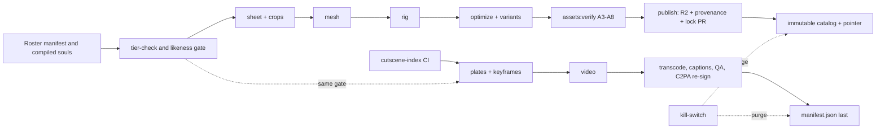

# 06 — Asset pipeline

> Wave 5, 2026-10-18. Integrates `spec/domains/05-assets.md` (Part A: C07, gates, runtime), `05-assets-pipeline.md` (Part B: stages, kits, CI, kill-switch), `03-story-cutscenes.md`, `04-npc*.md` and `07-fighter*.md`. C07 1.1 is unchanged; this file adds no shape. Binding: DL-OWN-01 (fal.ai hard cap USD 100 total), A-03, A-08, ADR-GENAI-01, `config/cloudflare.resources.json`. Endpoint ids live in `config/genai-endpoints.json`, which M00b creates from the registry specified in `05-assets.md` §4.5; §2 lists them as specified. Prices are list prices checked 2026-10-18 [research/genai-pipeline-fal.md]. UNVERIFIED items: `spec/99-open-questions.md` §2.3 and §2.5.

## 1. System



1. **Internal-only.** Generation is a staff pipeline (CLI or admin Workflow) with the staff `FAL_KEY`. No public route reaches fal (D-19; fal ToS bars exposing its APIs to End Users, F-042). No player triggers fal in v1 (DL-OWN-01).
2. **One step module, three executors:** `LocalExecutor` (Node CLI, roster), `WorkflowExecutor` (Workers, cutscenes), `MockExecutor` (recorded fixtures; `FAL_MODE=mock` is the dev and CI default). Steps sit in `services/pipeline/src/steps/*`.
3. **Copy first.** Every output is copied to R2 `PRIVATE` before anything else; vendor URLs are never canonical. Requests send `X-Fal-Object-Lifecycle-Preference` of 86,400 s (CDN copies expire) [F-047].
4. **Tier comes from the compiled soul**, never the request. `RosterPort.get(npcId)` supplies tier, `soulVersion` and kill state at every stage.
5. **Nothing generates without a cache check and a budget reserve** (R-ENG-03); cache hits are served even at governor level L3 (D-28).

## 2. Endpoint registry (as specified)

`config/genai-endpoints.json` (`genai-endpoints/1`) holds `endpoints`, `videoProviders`, `banned` and `defaults`. Entry fields: `id`, `role`, `status`, `price`, `pinnedUpdatedAt` (changed only by the reviewed `pnpm genai:repin`), `licenseType: 'commercial'`, allowed `tiers`, `acceptsFaceRefs`, `termsSnapshot`.

| Role | Endpoint id | List price | Status |
|---|---|---|---|
| `style_bible` | `openai/gpt-image-2.5/sunburst/text-to-image` | token-priced like the edit endpoint; checked in M00c | pending |
| `sheet`, `keyframe`, `portrait`, `mouth_atlas` | `openai/gpt-image-2.5/sunburst/edit` | $0.05529 (2560×1440 high), $0.0396 (1920×1080), $0.05268 (1024²) [F-044] | active |
| `sheet_lean` | `google/nano-banana-2.1/edit` | $0.063 (2K) | active |
| `mesh` | `meshy/v7.1/multi-image-to-3d` | $1.20 textured [F-045] | active |
| `mesh_alt`, Lean mesh | `fal-ai/hunyuan-3d/v3.1/pro/image-to-3d`, `tripo3d/h3.1/multiview-to-3d` | $0.375 + options, $0.30 | active |
| `rig`, Lean rig | `fal-ai/meshy/rigging/multi-animation`, `fal-ai/meshy/rigging` | $0.20 + $0.12 per clip [F-045], $0.20 | active |
| `tts_draft`, `tts_final` | `fal-ai/minimax/speech-2.8-turbo`, `…-hd` | $0.06, $0.10 per 1k chars [F-046] | buffer-only |
| `voice_design`, `voice_clone` | `fal-ai/minimax/voice-design`, `fal-ai/minimax/voice-clone` | $3, $1.50 (`consented` only) | buffer-only; clone unused in v1 |
| `tts_hero`, `sfx` | `elevenlabs/tts/eleven-v4`, `fal-ai/elevenlabs/sound-effects/v2` | $0.08 per 1k chars; SFX terms UNVERIFIED (U-AST-11) | pending |
| `vision_qa` | `claude-haiku-5-5` | $0.10 / $0.50 per MTok [F-034] | active |
| video | §8 | $0.04–$0.10 per second | per provider |

**Banned:** `minimax/h3-max/recast`, any `*face-swap*`, `bytedance/seedance-2.5/image-to-video`, `fal-ai/veo3*`, any `*/voice-clone` outside the `voice_clone` role. `pnpm genai:liveness` (nightly, no key) fails on a missing id, `status ≠ active`, `license_type ≠ commercial` or `updated_at ≠ pinnedUpdatedAt`; `pnpm genai:price` (monthly, keyed) flags drift above 5 %.

## 3. Character pipeline (R-NPC-02)

**v1 allocation (DL-OWN-01, DL-171, DL-180).** Custom 3D exists only for 8 Standard fighters ($3.67 each) and 12 Lean characters ($1.05 each; list in Q-27). Every other roster NPC and every user NPC uses a creator-kit body (`NpcRosterEntry.pipeline: 'none'`; roster rule R7). Stand-ins are authored creator-kit or crowd base bodies of tier `original`, not fal output.

| # | Stage | Endpoint (Standard) | In → out | Gate |
|---|---|---|---|---|
| 0 | `tier-check` | — | compiled soul → `LikenessContext` | `assertStageAllowed` |
| 1 | `style_bible` (`bay-cel@N`, once) | Sunburst text-to-image, 2560×1440 high | brief → style image | H0 |
| 2 | `sheet` | Sunburst edit; style crop + ≤ 3 first-party refs; 3 candidates; 2×2 T-pose grid | brief → sheets | A1, A2 → H1 |
| 3 | `crops`, `portrait`, `mouth_atlas` | local crops; Sunburst edit 1024² | sheet → four 1280×720 crops, portrait, 3×3 atlas | A1, A2 → H2 |
| 4 | `mesh` | Meshy: `pose_mode: t-pose`, 30,000 triangles (fighter) or 12,000, `enable_rigging: false`, 2 candidates | crops → 2 GLBs | A3 → H3 |
| 5 | `rig` | Meshy multi-animation, `height_meters` from the soul, 5 base clips (0, 30, 16, 466, 178) | GLB → rigged GLB + clips | A4 → H4 |
| 6 | `retarget` (fighters) | local `SkeletonUtils.retargetClip` onto `bay_rig_v1` | authored GLB → `anim/<slug>.moves` | A5 |
| 7 | `optimize` | `@gltf-transform/cli@4.5.1`, KTX-Software 4.4.2, meshopt, no Draco | GLB → hi, mid, lo | A6, A7 |
| 8 | `publish` | rclone to `MEDIA`, HEAD verify | → records, lock PR, catalog | A8 → H5 |

**Lean:** stage 2 uses `google/nano-banana-2.1/edit` (2K × 4), stage 4 `tripo3d/h3.1/multiview-to-3d` × 2, stage 5 `fal-ai/meshy/rigging`; no portrait or atlas. Soul `moves` ids beyond the 5 base clips cost $0.12 each and come from the buffer. Fighter signature moves are authored in Blender and retargeted offline [`07-fighter-content.md` FX7].

**Automated gates** (a failure stops the job and writes a JSON report): A1 layout (four cells, full-body figures, uniform background; vision schema on `claude-haiku-5-5`), A2 safety (minors, nudity, gore, logos, readable names through `names:lint`), A3 mesh (glTF-Validator clean, triangles ≤ 1.1 × target, height 1.5–2.1 m, textures ≤ 2048²), A4 rig (bones map to `bay_rig_v1`, weights sum to 1 ± 0.01, ≤ 4 influences), A5 retarget drift ≤ 3 % of `heightM`, A6 budgets (`config/asset-budgets.json`), A7 turntable SSIM (mid vs hi ≥ 0.93, lo vs hi ≥ 0.88), A8 record chain and `likeness:gate`. **Human gates** (logged in `review[]`): H0 style bible; H1 best of three sheets plus the likeness checklist (name distance ≥ 0.4, no real tattoos, jerseys, logos or catchphrases, outside the fame domain, no firearms, gore, drugs or crime, visibly transformed, disclaimer set, stand-in present); H2 portrait and atlas; H3 mesh; H4 rig spot-check and `mouthAnchor`; H5 lock-diff review; H6 vehicles; H7 cutscene speech and every hero cutscene. No face detector or face-similarity step exists anywhere (R-IP-04).

**Likeness gate** (`assertStageAllowed` at every stage entry and again before `record`): unknown tier, minor flag or killed scope stops the job; a non-`consented` job accepts only `first_party_*` inputs, so photographs never reach a generator (`FACE_REF_FORBIDDEN`); `voice_clone` needs an unexpired `consented` scope; every prompt passes `lintPrompt` (NameRegistry, `config/ip-denylist.json`, "in the style of"); non-consented presets are `toon-pbr` only; KV `ks:genai:all`, `ks:fal`, `ks:fal:<endpointId>`, `ks:cutscene_gen` and `gov:level` stop new submits.

## 4. Voice, vehicles, props, music

- **Voice (D-23).** v1 voices are Workers AI Aura-1 (t1) or MeloTTS, billed by Cloudflare, not fal. Baked lines are keyed `audio/barks/<sha256(voiceId|model|text)>.opus`, −16 LUFS, −1.5 dBTP, 48 kHz; Opus versus AAC is fixed by an iOS decode test (U-AST-14). Designed voices (`voice_design` $3 + `tts_final`) are buffer-only. Rhubarb runs offline for cue JSON (licence believed MIT, U-AST-9); the mouth atlas is a nine-cell decal plus `mouthAnchor`.
- **Vehicles.** Authored in Blender or built on a verified CC0 base with original livery (DL-OWN-01). Node contract in `05-assets-pipeline.md` §7; fictional makes only, checked by `ip:strings`.
- **Props and kits.** Verified CC0 or authored; a third-party pack needs a licence snapshot in `docs/legal/licenses/<pack>.md`, per-file records and a vision plus `ip:strings` pass (terms UNVERIFIED, U-AST-10).
- **Music and SFX (Q-11).** Commissioned originals. AI music is a `placeholder` (`generator.env: previs`) and CI fails a release that references one. SFX: authored, then CC0 or CC-BY per file, then the fal SFX endpoint once its terms are reviewed.

## 5. Cutscene pipeline (R-CUT-01…03)

**5.1 Templates** (`content/prompts/genai/<name>@<n>.md`; S03 owns them). Recipe K = Sunburst keyframe, then image-to-video with a fixed seed. Recipe R = reference-to-video with ≤ 4 square sheet crops.

| Template | Hook | Recipe | Shots × s |
|---|---|---|---|
| `story.establish@1`, `story.beat@1` | Act beats | K | 1 × 8, 2 × 7 |
| `fight.walkin@1`, `fight.faceoff@1` | fight intro | R (K) | 1 × 6, 1 × 8 |
| `fight.special@1`, `fight.super@1`, `fight.shutdown@1`, `fight.ending@1` | specials, supers, finisher, ending | K | 1 × 6, 8, 8, 10 |
| `race.intro@1` | racing intro (SHOULD) | K | 1 × 8 |

All use 16:9, 768P and `prompt_expansion_mode: disabled` where the provider has it. Slots come only from closed sources (style bible, soul `visual_brief`, `content/cutscenes/places.json`, enum tables, authored `slots`). `prompt-lint` fails over-long prompts (1,200 characters), a missing "no text, no logos" clause, realism tokens with a non-`consented` cast, or any protagonist or user-NPC reference.

**5.2 Job stages** (`kind: cutscene_shot`; `CutsceneJobDO.idFromName(key)` is the single-flight lock and `HEAD cutscenes/<key>/manifest.json` the ready test): 1 `gate` (provider by §8, `assertCallable`, prompt lint). 2 `keyframes`: Sunburst edit 1920×1080 ($0.0396) from style bible, sheet crops and the stage plate (`assets:plates` renders the first DirectorScript shot from our bake). 3 `plan`: split or merge to 6–10 s. 4 `submit`, `await`, `poll` with a fixed seed; webhooks are ED25519-verified, polling is the fallback (§10). 5 `copy-orig` to `PRIVATE cutscenes-orig/<key>/orig.mp4`, never public (DL-179). 6 `probe+transcode` in the Transcoder Container, recipe `cut@1`: `v768` CMAF High L4.0 CRF 21 ≤ 5 Mbps, `v540` ≤ 1.8 Mbps, `v1080` only if generated at 1080P, `a.m4a`, `poster.webp`, `last.webp`, 1 s GOP (≈ $0.001 per clip). 7 `captions`: Workers AI `@cf/openai/whisper-large-v3-turbo`; detected speech withholds audio until H7. 8 `qa-gate`: frame count within ±17 of duration × 24, no black or frozen frames, loudness, C2PA state recorded (fal signs outputs, F-043); vision QA on poster, last and a middle frame fails on minors, logos, text, `weapon_present`, `photoreal` or gore. 9 `resign` (`C2PA_RESIGN`, required before live calls): each rendition re-signed, `orig.mp4` as ingredient (tool pinned in M05b, U-AST-15). 10 `subs`: VTT from the ref's cues. 11 `publish`: `manifest.json` last. 12 `record`: provenance, `gen_job`, ledger settle. Three container failures produce `p720` with `degraded: true`.

**5.3 Cache key (A-03, DL-051).**

```ts
interface CutsceneKeyInput {                       // exactly these eight properties; extras are rejected
  template: `${string}@${number}`;                 // 'fight.shutdown@1'
  characters: { id: string; soulVersion: number; likenessTier: 'consented' | 'parody' | 'fictionalized' | 'original' }[]; // sorted by id, unique
  move: string | null;                             // 'moveId@ver'
  stage: string | null;                            // 'stageId@ver' | 'beat.<refId>@<rev>' | 'race.<raceId>@<ver>'
  style: `${string}@${number}`;                    // 'bay-cel@1'
  endpoint: `${string}@${string}`;                 // endpointId@pinnedUpdatedAt from config/genai-endpoints.json
  seed: number;                                    // u32
  inputHashes: string[];                           // lowercase SHA-256 of keyframe, crop, plate files; never URLs
}
// key = sha256Hex(canonicalize(normalizeKeyInput(input)))   packages/shared/src/genai/cutscene-key.ts (RFC 8785, pure)
```

`normalizeKeyInput` sorts and de-duplicates `characters`, sorts and lowercases `inputHashes`, and requires `seed` in 0…2³²−1. Licence status is never in the key. `seed` is `content/cutscenes/seeds.json[refId]` for a reviewed retake, else the first 8 hex digits of `sha256Hex(refId)`. Duration, shots, aspect, resolution and `prompt_expansion_mode` live in template frontmatter, so changing one bumps the template version and the key; `keyframePin` must equal the registry (CI). `beats.lock.json` pins `sha256(canonicalize({slots, cues}))` per story ref and `missions:build` fails on a change without a `rev` bump. A key is generated once; a retake is a new seed. Vectors (`packages/shared/test/cutscene-key.vectors.json`): reordered `characters` or `inputHashes` give the same key; `soulVersion` +1, a tier change, an endpoint re-pin and a new seed each give a new key; an added property is rejected.

| Change | Effect |
|---|---|
| soul edit, tier downgrade, new approved sheet | new keys for that character's clips |
| `genai:repin` or provider switch | new keys; the index keeps the previous ready key as `stale: true` until the new one is ready |
| template or style bump | new keys for that template |
| kill (scope `cutscene` or `all`) | no key change; index entry suppressed within one roster refresh; route 27 answers `blocked` |
| licence revoked for a provider | the index drops that provider's keys; refs fall back |

**5.4 Index.** `tools/assets cutscene-index` builds `data/cutscene-index` (public) and `cutscene-requests.json` (private). Per ref it keeps the desired key if ready, else the previous release's key while characters, `soulVersion`, tier and provider are unchanged and nothing is killed, else the desired key (the clip plays its DirectorScript until prewarm completes).

**5.5 Generated in v1.** The cutscene line is $40 of the USD 100 cap. `pnpm assets:gen prewarm` walks `03-story-cutscenes.md` §D9.1 in order and stops at a $38 running estimate: G1 the 9 Act 1 refs, G2 the 8 Shutdown and 8 Showstopper clips, G3 face-offs. On `h3.partner` that is 46 clips (398 s, $37.60); the other 109 of 155 refs play their DirectorScript. Per clip: shots × seconds × $/s × 1.5, plus shots × 1.5 × $0.0396 for recipe K.

## 6. C07 manifest and R2 layout

Buckets (`config/cloudflare.resources.json`, DL-OWN-02): `tha-bay-media-staging`, `tha-bay-private-staging`, `tha-bay-media-prod`, `tha-bay-private-prod`. `ugc-*` and `legal-evidence-*` buckets are created by the milestones that need them. R2 egress is free (F-023).

```
tha-bay-media-<env>      public read via media.<domain> (CORS GET/HEAD for the app origin, r2.dev off)
  characters/<slug>/{model,anim,portrait,mouth_atlas}/<variant>.<sha256[0:12]>.<ext>
  assets/<kind>/<id>/<variant>.<sha256[0:12]>.<ext>        (incl. assets/rig/bay_rig_v1/)
  audio/barks/<sha256>.opus                                 (or .m4a, U-AST-14)
  cutscenes/<key>/manifest.json (last)  v540 v768 v1080 | p720  a.m4a  poster.webp  last.webp  subs.<lang>.vtt
  manifests/assets-<sha256>.json                            (immutable catalog)
tha-bay-private-<env>    Worker binding and S3 presign only
  work/<kind>/<id>/<stage>/<jobKey>/{in.json,out.*,result.json}   (result.json last)
  cutscenes-orig/<key>/{orig.mp4,probe.json,whisper.en.vtt}
  sheets/<slug>/  plates/  quarantine/<ticket>/  previs/  provenance/<sha>.json  souls/<id>/<ver>/
```

- **Keys.** `Cache-Control: public, max-age=31536000, immutable`, identity encoding (Cloudflare ignores Range when it decompresses, F-019), each file ≤ 25 MiB, world packs ≤ 4 MiB. Content types: `model/gltf-binary`, `image/ktx2`, `audio/ogg; codecs=opus`, `audio/mp4`, `video/mp4`, `application/json`. Variants are C13 tier ids plus `default`; the build makes `hi`, `mid`, `lo` and stores them as `desktop`, `mobile`, `mobile-low`; resolution never steps upward (`desktop-ultra→desktop`, `xr-visionpro→desktop`, `xr-quest→mobile`, `mobile→mobile-low`).
- **Manifest.** `AssetManifest {schema 'asset/1', id, kind, rev, variants, deps, provenance, likeness, status, visibility, tags, extras}`. `likeness` is required for `character`, `character_sheet`, `rig`, `anim`, `portrait`, `mouth_atlas`, `voice`, `audio_bark`, `cutscene`; character-derived assets carry tag `char:<npcId>`. The catalog is immutable; its pointer `/asset-catalog.json` ships in the Worker's static assets (KV is eventually consistent). `assets/assets.lock.json` (`asset-lock/1`) lists every R2 asset and is the release gate. Upload order: blobs (`rclone --immutable --ignore-existing`) → HEAD verify → catalog → pointer PR [research/gap-ci-cd-release-assets.md §2.1–2.2].

## 7. Provenance rules and CI checks

1. One `provenance/1.0` record per stored file at `assets/provenance/<sha256[0:2]>/<sha256>.json`; private files keep theirs in the PRIVATE mirror, committed when a shipped file derives from them. Records are public-safe: opaque subject ids, no real names, ISO-8601 `Z` times.
2. `origin: generated` requires `generator` (vendor, endpoint, registry key, `endpoint_updated_at`, `request_id`, seed, `job_key`, params and prompt hashes, `input_refs` as `sha256:`, terms snapshot hash, executor, env) and `ai_generated: true`. Derived chains reach a generated, authored, licensed or open-data root, without cycles.
3. The kinds in §6 need a `likeness` block. A non-`consented` tier forces `face_reference_used: false`, `photoreal: false` and `voice_mode` in none, synthetic or designed; `consented` needs a `consent_record_id`; a stand-in resolves to an `original` asset.
4. Only `env: production` ships. `previs/`, `mock` and `placeholder` never do. Licences come from `config/license-allowlist.json`; attributions land in `credits.json`.

| Check | Fails when | Lands |
|---|---|---|
| `provenance:check` | a ship-set file lacks a valid record, licence off the allowlist, attribution missing, `env ≠ production`, a `previs/`, `mock` or placeholder reference, an unrooted chain | M00b |
| `check:assets` | C07 invariant error, budget breach, missing variant, `rev` regression, file > 25 MiB, pack > 4 MiB | M00b, M01d |
| `ip:signatures`, `ip:extensions`, `ip:strings` | RPF7, RSC7, DXBC, GXT2 magic bytes, denylisted extensions or strings in source, content, prompts, caches | M00b |
| `license:scan`, `names:lint`, `likeness:gate` | GPL/AGPL/LGPL in the client without an ADR; real-side names; schema conditionals, missing `standIn`, expired consent, face-detector model URLs | M00b |
| `check:c2pa`, `check:pipeline` | cutscene without anchor, re-signed rendition or `aiGenerated`; a Miniflare `MockFalPort` run fails or a second run calls `FalPort` | M05b |
| `ip:history` | any hit over git history before the repo is public | M14b |
| `genai:liveness`, `genai:price`, `genai:terms-watch` | registry drift (nightly), price drift > 5 % (monthly), changed vendor-terms snapshot in `docs/legal/vendor-terms/` (weekly; provider flips `cleared→pending`) | M00b, M00c, M14b |

## 8. H3 licence gate (A-08, ADR-GENAI-01)

The owner's MiniMax H3 Max Turbo stays the target but is not cleared for US use: the H3 licence excludes the USA, EU, UK and Korea, covers derivatives and hosted services and requires the "MiniMax H3" credit (F-041), and fal publishes no H3-specific terms [research/gap-video-model-licence-clearance.md §0]. Providers are registry entries with `licence.status` of `cleared`, `pending` or `blocked`.

| Provider | Endpoint ids | $/s | Status |
|---|---|---|---|
| `h3.partner` (default) | `minimax/h3/image-to-video`, `minimax/h3/reference-to-video` | 0.06 [F-040] | pending (pass-through terms UNVERIFIED) |
| `h3.maxTurbo` | `minimax/h3-max-turbo/image-to-video` (+ `extend-video`) | 0.04 [F-039] | blocked |
| `h3.max` | `minimax/h3-max/reference-to-video` | 0.08 [F-040] | blocked |
| `ltx25.fast` (fallback 1) | `lightricks/ltx-2.5/image-to-video/fast` | 0.09, 6 s minimum | pending (paid licence at ≥ $10 M revenue, F-050) |
| `gemini.omniFlash11` (fallback 2) | `google/gemini-omni-flash/v1.1/reference-to-video` | 0.10 | pending (18+ only, F-049) |

**Selection.** The first of `[default, ...videoFallbackOrder]` that is `cleared` and whose `under18Audience` fits the product. If none, production refuses with `ENDPOINT_NOT_CLEARED` and the game plays the DirectorScript (R-CUT-03); only `previs` jobs may call `pending` providers (outputs in `previs/`, and CI fails a release that references it); `blocked` providers are never callable, in any env (ADR-GENAI-01, DL-286). The manifest records `licence.{gate, provider, status, termsSnapshotSha256[], clearedBy, clearedAt, uiCredit}`; status is never in a key, so revoking a provider delists its clips without touching others.

**Gates for `cleared`:** G1 written confirmation of US commercial use of outputs from fal and, for H3, MiniMax, stored in `docs/legal/confirmations/`; G2 counsel sign-off in the ADR log (End-User reading, Google under-18 clause, H3 attribution, MiniMax content rules); G3 hashed terms snapshots and a green `genai:terms-watch`; G4 attribution UI and C2PA re-signing tested; G5 budget caps and the admin-only prewarm path. M05b merges on the mock provider before any gate passes. If H3 is uncleared at the M05c3 content lock, `ltx25.fast` is the default and R-CUT-01 is amended to "a licence-cleared video model via fal (MiniMax preferred)" (Q-03). Under the cap, a switch changes how many clips the $38 line buys (§5.5), not the plan.

## 9. Kill-switch purge (R-NPC-04, D-29)

**Runtime, ≤ 60 s.** A `roster_flag` write (route 46) updates KV `roster:flags` (30 s Worker cache); `EncounterDO` broadcasts; the client calls `WorldPackStore.evictByTag('char:<id>')`; suppressed clips fall back to the DirectorScript and the stand-in replaces the character. The catalog is not rebuilt on this path.

**`KillPurgeWorkflow`** (`{npcId, scope[], reason, ticketId}`, ≤ 24 h): confirm the flag; resolve targets from `asset_index` tag `char:<npcId>`, `cutscenes.char_ids` and `bark_index`; set `status: killed`; copy objects to `PRIVATE quarantine/<ticketId>/`, delete them from `MEDIA`; prefix-purge `media.<domain>/characters/<slug>/` and each affected `cutscenes/<key>/` (≤ 100 prefixes per request; R2 tag purge is UNVERIFIED, U-AST-12); publish the next catalog without them; probe for 404 and `CF-Cache-Status ≠ HIT`; write `audit_log`. Scope effects: `voice` drops baked lines and TTS, `cutscene` swaps in the DirectorScript, `marketing` unpublishes store art, `ugc` unlists experiences. Restore needs a reviewed PR. Drill: quarterly in staging, first in M10b.

## 10. Retries and failures

| Failure | Action |
|---|---|
| 429 `concurrent_requests_limit` | `FalGateDO` backoff, 5 retries from 15 s |
| Webhook lost (fal retries stop ≈ 6 min for results ≥ 10 KB, F-047) | `waitForEvent` times out at 20 min; poll 12 times from 30 s |
| Vendor `ERROR` after fal's own ≤ 10 runner retries | one resubmit with the same seed, then `failed` with a note |
| Content-policy refusal | `refused`; prompts are never auto-rewritten; a human edits the template |
| Meshy rig 422 | non-retryable; second mesh candidate, else H4 (Blender repair or `fictionalized` redesign) |
| Bad webhook signature or skew > 300 s | 401, no event, alert A11 |
| Budget, cap or kill switch | `refused: BUDGET` or `KILL_SWITCH`; cache hits still served |
| Terms hash drift | provider `cleared→pending`; production calls stop |

A Standard character already pays for two mesh candidates; a third attempt, a rejected sheet round or a cutscene reroll beyond the 1.5× allowance comes from the buffer and is logged.

## 11. Cost per asset and the budget (USD)

| Asset | Recipe | Cost |
|---|---|---|
| Lean character | nano-banana 2K × 4 $0.252 + Tripo standard × 2 $0.60 + rig $0.20 | $1.05 |
| Standard character | sheets $0.256 + portraits $0.105 + atlas $0.105 + mesh 2 × $1.20 + rig and 5 clips $0.80 | $3.67 |
| Extra Meshy move clip · keyframe | | $0.12 · $0.0396 |
| Cutscene clip on `h3.partner`, 1.5× retakes included | establish 8 s $0.78 · Act beat 2 × 7 s $1.38 · finisher 8 s $0.78 · face-off 8 s (R) $0.72 · special 6 s $0.60 · ending 10 s $0.96 · walk-in 6 s (R) $0.54 | |
| Buffer-only | designed voice with 15k chars $4.50 · generated car body $2.48 | |
| Transcode · Whisper | | $0.001 per clip · $0.000513 per audio minute |

The Standard figure is S05's ($3.67, programmatic crops), not research's $3.73 (DL-172): 8 × 3.67 + 12 × 1.05 = $41.96 ≤ $42.

**Program (DL-OWN-01).** Spike ≤ $10 (11 steps, $3.76 planned, DL-286) · characters ≤ $42 · cutscenes ≤ $40 ($37.60 planned) · buffer $8 → about $83 planned. `BudgetPort` reserves and settles through `BudgetGovernorDO` (vendor `fal`) into `genai_ledger` (`job_id` = `jobKey`). `config/guardrails.yaml` `genai.programCapUsdMicros` = 100,000,000, alarms 0.5 / 0.8 / 1.0, hard stop at 100 %; the `budget_program` row mirrors it and a nightly check compares them. Every run has a `budgetUsdMicros`. The fal prepaid balance is topped up per phase, cumulative top-ups ≤ $100, auto-recharge off; fal has no spend cap and locks below a balance threshold (F-048; threshold UNVERIFIED, U-COST-1). CI never runs live fal; `run` and `prewarm` print a dry-run estimate and refuse to spend without `--live`. The repo-audited spend record is `assets/ledger/fal-spend.jsonl` (M10a1: seeded from the M00c spike ledger, imports `genai_ledger` rows of Worker-run jobs; DL-234).

## 12. Roster and prewarm runbook (M10a1 canary, M10a2 batch, M05c3 Act 1)

```
pnpm genai:liveness                                          # registry vs public fal registry; must be green
pnpm assets:gen plan --roster content/npcs/roster.json       # jobs, USD estimate, gate verdicts; zero vendor calls
pnpm assets:gen run --slug <slug> --until sheet --live       # stops at H1
pnpm assets:gen gate --run <runId> --gate H1 --choose 2 --by <profile>
pnpm assets:gen run --slug <slug> --until rig --live         # stops at H3 and H4; decide each with `gate`
pnpm assets:optimize --slug <slug>
pnpm assets:retarget --rig bay_rig_v1 --clips <glb> --to <slug>   # fighters only
pnpm assets:verify --slug <slug>
pnpm assets:publish --slug <slug>
pnpm assets:gen prewarm --release <tag> --live               # stops at the $38 cutscene estimate
pnpm assets:kill --npc <id> --scope all --ticket <id> --stage    # staging drill only
```

1. **Preconditions.** `genai:liveness` green; vendor snapshots dated within 30 days; registry prices checked within 30 days; fal balance ≥ the `plan` estimate with cumulative top-ups ≤ $100; concurrency stays at 2 (F-047), so run two jobs at a time (20 characters fit one overnight session; U-COST-2); `plan` shows no refused verdict; the ADR-GENAI-01 state is noted in the plan header.
2. **Canary (M10a1).** `canary-mc` on one of the eight Standard fighter slots plus the first Lean Act 1 cast entry, end to end (≈ $4.72 while Q-19 is open; DL-234), all A and H gates, then `assets:verify` and `assets:publish`; the provenance PR passes `provenance:check` and `likeness:gate`. The canary is part of the $42 line, not extra.
3. **Characters.** The other six Standard slots ($22.02), then the twelve Lean slots ($12.60). Runs stop at H1, H3 and H4; humans decide in batches; unattended runs never cross a human gate.
4. **Optimize, verify, publish** per slug; merge lock PRs after H5; `pnpm assets:catalog` (M01d) writes the catalog and pointer (DL-230).
5. **Idempotence (M10b).** A second `plan` lists zero outstanding jobs and `run` makes zero `FalPort` calls.
6. **Prewarm.** M05c3 generates G1 (Act 1; needs Lean crops of the five Act 1 cast and a `cleared` provider); M10b generates G2 and G3 (needs the Standard crops). A second run makes zero vendor calls. With no `cleared` provider nothing is spent and every ref plays its DirectorScript.
7. **Close-out.** Reconcile the ledger with the fal dashboard, record cost per slug, snapshot the registry, report the unspent buffer to the owner (Q-26).
8. **Rollback.** A rejected character is killed through §9 in staging and rerun from stage 2 with a new seed (buffer); old candidates stay in `work/`.

## 13. Milestones and tests

M00b registry, schemas, gates · M00c spike (≤ $10) · M01d catalog, publish, lock · M05b `GenJobWorkflow`, mock, webhook, `FalGateDO`, `check:c2pa` · M05c3 Act 1 prewarm, `assets:gen`, Transcoder Container · M08b2 fighter refs · M10a1 roster automation, retarget tool, canary, repo ledger `assets/ledger/fal-spend.jsonl` · M10a2 batch · M10b idempotent prewarm, Act 1 re-run, kill drill · M14b `ip:history`, terms-watch, counsel.

```
pnpm check:unit -- packages/shared services/pipeline tools/assets
pnpm check:pipeline
pnpm provenance:check && pnpm check:assets
pnpm check:e2e -- --grep @kill-drill
```
