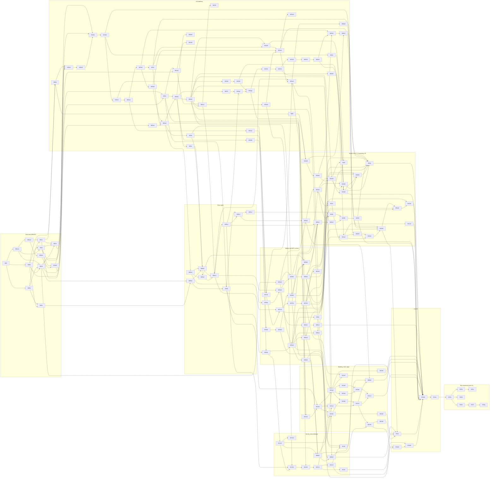

# 07 — Final milestone plan (S13)

> v1.1 · 2026-10-18 · S13 (`claude-opus-5-5`), Wave 5; dependencies, paths and M15 sessions reconciled by the Architect (DL-219, DL-220, DL-242). The ordered plan that milestone authors turn into `spec/07-milestones/<ID>-<slug>.md` files in the C15 format (`prompt-pack/03-SPEC-TEMPLATE.md` §C, tightened as C15 1.1 in `spec/domains/13-qa.md` §4). Rows (goal, R-IDs, dependencies, sections to read, deliverables, contracts, gates, proofs, risk) are in `_PLAN-1.md` (blocks A–C), `_PLAN-2.md` (D–E) and `_PLAN-3.md` (F–I). Status per file stays in `README.md`.

## 0. Rules
1. **Ids.** Every id of the register in `spec/00-plan.md` is kept. Splits use DL-037 (letter = scope, digit = session split; split rows keep the scope's slug): M04a → M04a1/M04a2, M10a → M10a1/M10a2, M11a → M11a1/M11a2, M11b2 keeps its id and gains **M11b4** (M11b3 exists), M12b → M12b1/M12b2, M12c → M12c1/M12c2, M14b → M14b1/M14b2/M14b3. M01a and M01b were already split (M01a1/M01a2, M01b1/M01b2). New QA scopes: **M00d** `qa-spec-gates`, **M04d** `qa-harness-bots-goldens`.
2. **Size.** One Sonnet 5.5 session per file: ≈ 2–4 h of agentic work, ≲ 40 hand-written files, one PR, app deployable at the end. Rows below 1 session stay separate files.
3. **Order.** The table in §1 is the run order. Block A is the READY fast-track list, kept exactly; its forward dependencies are resolved by `README.md`: **M01f runs before M01b2 and M01e** (DL-290). Every other row appears after all of its dependencies.
4. **R-ROLL-01.** No rooms milestone (M12b1 onward) starts before M05c2 is deployed to staging and its ACs pass there. **R-AUTH-02.** M14a (Thirdweb) is the last v1 milestone; Bay expansion (M15) follows it.
5. **Spend (DL-OWN-01, split amended by DL-OWN-07 and DL-740).** fal total ≤ $100: M00c ≤ $4; M10a1+M10a2 ≤ $42 (Coast included); cutscenes ≤ $38 (M05c3 ≤ $16, spent through M05c4; M10b the rest after Act 1, at least $22, DN-S13-02, DL-741); vehicles and props ≤ $14 (M10d1 ≤ $1.704, M10d3 the rest); $2 buffer. CI never runs live fal (`FAL_MODE=mock`); every paid run prints its estimate first and needs `--live`. No player-triggered fal in v1 (M06b4 queue is owner-approved and counts against the cap).
6. **Gaps closed (wave5 note 11).** `RaceDef.intro` + `cut.race.intro.<raceId>` refs → M07b2. `tools/ci/econ-sim` (owner S01) → M04d, with sections in M05c1, M07b2, M05e2, M05f2. Avatar and wardrobe schemas in `packages/shared/schemas/ui/` → M04b2.
7. **M00e gate (2026-10-19, DL-514, DL-605, DL-622, Q-43).** M00e `owner-account-hardening` (formerly the owner PR #1 follow-up list) runs next: its dependencies M00a, M00b and M01c are merged into `claude/build` (M01c at `dae8f08`). No milestone that touches `services/edge/src`, `services/edge/test` or `services/edge/wrangler.jsonc` starts until M00e has merged; M05d and M13a1 name it in Depends on, every other one reaches it through M04b1 or M05d. M00d is not gated (a docs-only `services/edge/README.md`). Milestones already executing then (M00…M01f, M05b1) merged as before (DL-648). Its file lists the operator actions (create `main`, the production `AUTH_PASSWORD_SIGNUP` switch, dashboard settings), which are never Builder work. **Integration branch:** `claude/build` until the operator creates `main` (Q-42, DL-606), then `main`; "merged" in this register and in every start-after rule means merged to that branch, and each PR targets it (DL-641).
8. **M00f before vendoring (2026-10-19, DL-508, DL-523, DL-605, DL-607).** M00f `third-party-reuse-gates` (formerly the reuse-gates follow-up list) is a gate for no milestone; nothing is vendored into `third_party/` before it merges, and its `license:scan` rules are the mechanical stop, enforced by branch protection that makes the CI `static` and `ip` jobs required checks on the integration branch before the first vendoring PR (M00f Operator actions, DL-633). Vendoring is done by the operator or the Architect only (DL-502).
9. **Study set (2026-10-23, owner request, DL-716; order amended by DL-732).** Only three study rows precede M05c2: M04e5, M04e0 and M02f1 (rows 43–45; M04e0 gates M12b1, M04e5 is the string guard every later sandbox file depends on, M02f1 records U-W8). The other eight (M04e1, M04e2, M04e3, M04e4, M04b5, M04b4, M02f2, M01d3, rows 50–57) are Block B work placed after M05c2, M05d, M05c3 and M05c4, so the A-06 vertical slice and the R-ROLL-01 gate slip by 1.0 session (the three early rows), not by 5.9. M07b3 (row 87) follows M07b2 and M10f (row 100) follows M10d4 (DL-739). M04e3 names M07a1 (row 83), and M10a1, M10a2 and M11a1 (rows 61, 64, 69) name M06a2, M08b1 and M07a2 (DL-755); all four are merged, and rule 3 allows a forward reference only to a merged dependency. M04e0 must merge before M12b1 starts (it is in M12b1's Depends on, DL-719); M04e1 and M04e4 before M11b3, and M04b5 before M11a1. M04e5 is in the Depends on of M04e1, M04e2, M04e3, M04e4, M07b3 and M10f, so every new sandbox string is written under its `trainer-*` patterns (DL-717). **Shared files, no dependency path:** M02f1, M04b5, M04b4 and M02f2 edit the same files (`packages/engine/src/assets/{rpc.ts, service.ts, client.ts, bridge.ts}`, `assets/store/{store.ts, fetch-retry.ts}`, `packages/world/src/client/{boot-world.ts, world-view.ts}`, `packages/ui/src/shell/types.ts`, `apps/web/src/{main.ts, shell-ports.ts}`). Parallel Builders (DL-246) do not run two of them at once: each starts after the previous one in this order has merged (M02f1 → M04b5 → M04b4 → M02f2), and rebases over it; the same holds for M04e1 → M04e2 → M04e3 → M04e4, which already chain through Depends on. M01d4 `media-edge-cache` is conditional: the Architect creates it only if M02f1 AC-8 records U-W8 as failed (DL-723); it is not in this table.

10. **Look program (DL-OWN-07, DL-739; two tracks since DL-OWN-09, DL-755).** The look program is the top build priority: every other block waits behind it except M10a1 and M10a2 (Coast's model). Rows 59–75: **Track A** (street code) M02g2 → M02h1 → … → M02h7 → M02h8; **Track B** (art) M10d0 → M10d1 → M10d4 → M10d5 → M10d2. Rows of one track run one at a time in order; the two tracks run at the same time; M10a1 → M10a2, then M11a1 (M02h8's prerequisite), run beside them; M10d3 waits for M07b2 and M08b2. Shared files, holds, merge order and the ledger, golden and surface-binding rules: `_PLAN-3.md` Look program. **Preconditions (DL-741):** the look study is committed under `research/look/` (text) and `docs/look/study/` (frames); a Builder who cannot find a cited item stops and reports it. M02g1 does not wait for M05c3 or M05c4 (DL-747, DL-750, DL-742). M11b1 names M02h8 in Depends on (shared XR render path); M14b3 reaches M02h8 through M11b4.

## 1. Ordered index (v1: 143 milestones, ≈ 127.0 sessions; post-v1: 7 milestones, 7 sessions)
Blocks: A fast-track (READY) · B foundations · C story spine · D modes and NPC runtime · E roster, Acts 2–3, hardening, XR · F identity and multiplayer · G modding, UGC, legal · H launch · I Bay expansion.

| # | ID | Slug | Sessions | Block | Depends on |
|---|---|---|---|---|---|
| 1 | M00 | bootstrap-ci-pwa-on-workers | 1 | A | — |
| 2 | M00a | edge-api-skeleton | 0.8 | A | M00 |
| 3 | M00b | ip-provenance-gates | 1 | A | M00 |
| 4 | M00c | genai-spike | 1 | A | M00b, M00a |
| 5 | M01a1 | loop-ecs-detmath-physics | 1 | A | M00 |
| 6 | M01a2 | loop-ecs-detmath-physics | 1 | A | M01a1, M00 |
| 7 | M01b1 | controller-cameras-touch | 1 | A | M01a2 |
| 8 | M01b2 | controller-cameras-touch | 1 | A | M01b1, M01f, M00 |
| 9 | M01c | device-spike-renderer-host | 1 | A | M00, M00a, M01a2 |
| 10 | M01d | assets-publish | 1 | A | M00b, M00a, M01a1 |
| 11 | M01e | asset-worker-opfs-store | 1 | A | M01d, M01c, M00a, M00, M01a2, M01f |
| 12 | M01f | world-graybox-fixture-codec | 0.5 | A | M01a1, M00b |
| 13 | M00d | qa-spec-gates | 1 | B | M00, M01c, M00b |
| 14 | M00e | owner-account-hardening | 1 | B | M00a, M00b, M01c |
| 15 | M00f | third-party-reuse-gates | 0.7 | B | M00b, M00d |
| 16 | M02a1 | bake-core | 1 | B | M01f, M01d, M00d, M01e |
| 17 | M02a2 | bake-roads-graph | 1 | B | M02a1 |
| 18 | M02b1 | streaming-lod | 1 | B | M02a2, M01c, M01e, M01b2 |
| 19 | M02b2 | weather-time | 1 | B | M02b1 |
| 20 | M02e | look-pass | 1 | B | M02b1, M02b2, M01c |
| 21 | M02c1 | graph-services-teleports | 1 | B | M02a2, M02b1, M02b2 |
| 22 | M02d1 | landmarks-kit-and-heroes | 1 | B | M02b1, M02c1 |
| 23 | M02d2 | landmarks-rest-and-swap | 1 | B | M02d1 |
| 24 | M03a1 | vehicles-interaction-prefabs | 1 | B | M01b2, M02c1 |
| 25 | M03a2 | handling-model-wheel-spike | 0.5 | B | M03a1 |
| 26 | M03b1 | traffic-robotaxis | 1 | B | M02c1, M03a1, M02b2 |
| 27 | M03b2 | peds-transit | 1 | B | M03b1 |
| 28 | M03c | pursuit-director | 1 | B | M03a1, M03b1 |
| 29 | M01d2 | media-route | 0.4 | B | M01d, M00e |
| 30 | M04a1 | saves-gamemode-unlocks | 1 | B | M01b2 |
| 31 | M04a2 | saves-gamemode-unlocks | 1 | B | M04a1, M03c, M03b2, M02b2 |
| 32 | M04b1 | shell-ui-kit-menus-settings | 1 | B | M04a2, M00e |
| 33 | M04b2 | creator-phone-hud-kit | 1 | B | M04b1 |
| 34 | M02c2 | maps | 1 | B | M02c1, M04b2, M01d2 |
| 35 | M04b3 | local-identity-play-token | 0.5 | B | M00a, M04b1 |
| 36 | M04c | cutscene-playback-spike | 1 | B | M01c, M04b1 |
| 37 | M04d | qa-harness-bots-goldens | 1 | B | M04a2, M03a1, M00d |
| 38 | M05a1 | mission-ir-vm | 1 | C | M04a2, M02c1 |
| 39 | M05a2 | autoplayer-director-preview | 1 | C | M05a1, M04d |
| 40 | M05b1 | cutscene-infra-mock | 1 | C | M00a, M00c, M01d |
| 41 | M05b2 | cutscene-player-index | 1 | C | M05b1, M04c, M05a1 |
| 42 | M05c1 | act1-missions-1-6 | 1 | C | M05a2, M05b2, M03c, M04b2, M02c2 |
| 43 | M04e5 | ip-wall-strings | 0.2 | B | M00b, M02c1, M03c, M04b2 |
| 44 | M04e0 | sandbox-rooms-guard | 0.2 | B | M04b2, M02c2 |
| 45 | M02f1 | stream-measure | 0.6 | B | M02b1, M01d2, M02c2 |
| 46 | M05c2 | act1-vertical-slice | 1 | C | M05c1, M03b2 |
| 47 | M05d | data-spine-supabase | 1 | C | M05b1, M00e |
| 48 | M05c3 | act1-prewarm | 0.5 | C | M05c2, M05d |
| 49 | M05c4 | offedge-finish | 0.8 | C | M05c3 |
| 50 | M04e1 | sandbox-world-controls | 0.8 | B | M04e5, M04e0, M04b2, M02b2, M03b1, M03b2 |
| 51 | M04e2 | sandbox-teleport-display | 0.7 | B | M04e1, M04e5, M04e0, M02c1, M02c2, M04b2, M04a2 |
| 52 | M04e3 | sandbox-vehicle-spawner | 0.8 | B | M04e1, M04e5, M04e0, M03a1, M07a1, M05c1 |
| 53 | M04e4 | sandbox-vehicle-player-actions | 0.6 | B | M04e3, M04e5 |
| 54 | M04b5 | settings-live-overlay-hooks | 0.8 | B | M01c, M04b1, M04b2 |
| 55 | M04b4 | offline-download-ui | 0.3 | B | M01e, M04b1 |
| 56 | M02f2 | boot-prefetch | 0.5 | B | M01e, M02b1, M04b1, M04a2 |
| 57 | M01d3 | media-route-tuning | 0.4 | B | M01d2, M00e |
| 58 | M02g1 | look-tune | 1 | B | M02e, M02f2, M01c, M05c2 |
| 59 | M02g2 | look-fixes | 0.7 | B | M02g1, M02d2 |
| 60 | M10d0 | art-admission | 1 | E | M00f, M01d, M02g2 |
| 61 | M10a1 | roster-pipeline | 1 | E | M05b1, M06a2, M01d, M05c3 |
| 62 | M02h1 | street-markings | 1 | B | M02g2, M02a2 |
| 63 | M10d1 | art-integration | 1 | E | M10d0, M05c2, M03b2, M04b2 |
| 64 | M10a2 | roster-pipeline | 1 | E | M10a1, M08b1 |
| 65 | M02h2 | curbs-sidewalks | 1 | B | M02h1 |
| 66 | M10d4 | art-integration | 1 | E | M10d1, M10d0, M10a1, M10a2, M03b2, M04b2, M02h2 |
| 67 | M02h3 | ground-cover | 1 | B | M02h2, M02g2, M02a2 |
| 68 | M10d5 | art-integration | 0.4 | E | M10d4, M10a2 |
| 69 | M11a1 | iphone-hardening-governor | 1 | E | M02b1, M03b1, M07a2, M04b5 |
| 70 | M02h4 | vegetation-forms | 0.75 | B | M02h3, M02g2 |
| 71 | M02h5 | vegetation-scatter | 0.75 | B | M02h4, M02h3 |
| 72 | M10d2 | art-integration | 1 | E | M10d4, M02h5, M02d2, M02e |
| 73 | M02h6 | street-furniture-parking | 1 | B | M02h5, M02h2, M03b1, M10d1 |
| 74 | M02h7 | facade-detail | 1 | B | M02h6, M02g2, M10d0 |
| 75 | M02h8 | xr-look-traa | 0.8 | E | M11a1, M02h7 |
| 76 | M06a1 | npc-backend-spine | 1 | D | M05d, M04b3 |
| 77 | M06a2 | soul-contract-compiler | 1 | D | M00b, M01d |
| 78 | M06a3 | dialogue-proxy | 1 | D | M06a1, M06a2 |
| 79 | M06a4 | memory-voice-lipsync | 1 | D | M06a3, M04b2 |
| 80 | M06a5 | dialogue-panel-ui | 0.3 | D | M06a3, M04b2 |
| 81 | M06c | npc-agency-barks | 1 | D | M06a3, M03b2 |
| 82 | M06b1 | builder-text-private | 1 | D | M06a3 |
| 83 | M07a1 | racing-core-director-car | 1 | D | M03a2, M04a2, M04d, M02c1 |
| 84 | M07a2 | racing-ai-replay-ghosts | 1 | D | M07a1, M03c, M05c1 |
| 85 | M07b1 | racing-content-events-ladder | 1 | D | M07a2, M03b2 |
| 86 | M07b2 | racing-garage-replay-photo-visuals | 1 | D | M07b1, M05b2 |
| 87 | M07b3 | sandbox-tune | 0.5 | D | M07b2, M04e3, M04e5 |
| 88 | M08a1 | fight-core-sim-data | 1 | D | M01a1, M05a1 |
| 89 | M08a2 | fight-mode-training-vs | 1 | D | M08a1, M04a2, M04b2, M04d, M05c1 |
| 90 | M08b1 | fight-roster-kits-ai | 1 | D | M08a2, M06a2 |
| 91 | M08b2 | fight-stages-cutscenes-arcade | 1 | D | M08b1, M05b2 |
| 92 | M08c1 | pose-pipeline-classifier | 1 | D | M08a2 |
| 93 | M08c2 | pose-calibration-gate | 1 | D | M08c1 |
| 94 | M09a1 | tycoon-core-finance | 1 | D | M01a1, M04a2, M04d |
| 95 | M09a2 | tycoon-events-balance | 1 | D | M09a1, M04d |
| 96 | M09b1 | tycoon-ui | 1 | D | M09a2, M04b2 |
| 97 | M09b2 | tycoon-vc-story | 1 | D | M09b1, M06a3, M05a1, M05a2 |
| 98 | M10b | qa-gates-kill-drill | 1 | E | M10a2, M08b2, M06a3, M05c4 |
| 99 | M10c | roster-souls-ink-barks | 1 | E | M10a2, M06a4, M06c, M05c2 |
| 100 | M10f | emote-wheel | 0.6 | E | M10d4, M04b2, M04e5 |
| 101 | M10d3 | art-integration | 1 | E | M10d5, M10d2, M07b2, M08b2, M10a2 |
| 102 | M05e1 | story-act2-part1 | 1 | E | M05c2, M07a2, M08b2, M09b2, M07b1 |
| 103 | M05e2 | story-act2-part2 | 1 | E | M05e1 |
| 104 | M05f1 | story-act3-part1 | 1 | E | M05e2, M10b |
| 105 | M05f2 | story-act3-finale | 1 | E | M05f1 |
| 106 | M10e | audio-integration | 1 | E | M10d2, M10d3, M10c, M05f2, M07b2, M08b2, M03c, M02b2 |
| 107 | M11a2 | iphone-hardening-governor | 1 | E | M11a1 |
| 108 | M11b1 | webxr-port | 1 | E | M01c, M04b2, M11a1, M02h8 |
| 109 | M11b3 | xr-ui-panels-comfort | 0.8 | E | M11b1, M06a5, M04e1, M04e4 |
| 110 | M11b2 | per-mode-xr-and-xr-cutscenes | 0.7 | E | M11b1, M07b2, M08b2, M11b3 |
| 111 | M11b4 | per-mode-xr-and-xr-cutscenes | 0.7 | E | M11b2, M09b1, M05b2 |
| 112 | M12a1 | p1-identity-cloud-saves | 1 | F | M05d, M04b3, M06a1 |
| 113 | M12a2 | age-register-cloud-save-ui | 0.5 | F | M12a1, M04b1 |
| 114 | M06b2 | builder-images-review | 1 | F | M06b1, M12a1, M06a5 |
| 115 | M06b3 | npc-builder-ui | 1 | F | M06b2, M04b2, M06a5, M06c |
| 116 | M12b1 | rooms-core-protocol-v2 | 1 | F | M12a1, M05c2, M04a2, M04e0 |
| 117 | M12b2 | rooms-core-protocol-v2 | 1 | F | M12b1, M04e3 |
| 118 | M12c1 | rooms-hardening-presence-loadtest | 1 | F | M12b2 |
| 119 | M12c2 | rooms-hardening-presence-loadtest | 1 | F | M12c1 |
| 120 | M12d | online-page-invites | 0.3 | F | M12c1, M04b1 |
| 121 | M12e | mode-leaderboards | 1 | F | M12c2, M07b1, M09a2 |
| 122 | M13a1 | mod-sdk-manifest-validators | 1 | G | M04a2, M01d, M00e |
| 123 | M13a2 | mod-installer-store-client | 1 | G | M13a1, M01e, M05d |
| 124 | M13a3 | mod-runtime-data-experience | 1 | G | M13a2, M02c2, M12b1, M12c1, M04b2, M06a3 |
| 125 | M13a4 | mod-script-sandbox | 1 | G | M13a3 |
| 126 | M13a5 | mod-ui-tier | 1 | G | M13a3 |
| 127 | M13a6 | mod-agent-kit | 1 | G | M13a4, M13a5 |
| 128 | M13a7 | store-experience-pages | 0.7 | G | M13a3, M07b2, M04b1 |
| 129 | M13b1 | forum-reports-backend | 1 | G | M05d, M06b1, M06b2, M13a2 |
| 130 | M13b2 | forum-ugc-links | 0.8 | G | M13b1, M13a3, M02c2 |
| 131 | M13b3 | creator-place-mode | 1 | G | M13a3, M04b2 |
| 132 | M13b4 | forum-ui | 1 | G | M13b1, M04b1 |
| 133 | M13c1 | device-code-publish-login | 0.8 | G | M12a1, M04b1, M13a2 |
| 134 | M13c2 | publish-pipeline-server | 1 | G | M13c1, M13a1, M13b1, M13b2 |
| 135 | M13c3 | publish-cli-link | 1 | G | M13c2, M13a6 |
| 136 | M06b4 | builder-publish-assets | 0.5 | G | M13c2, M06b3, M10a1 |
| 137 | M13d1 | legal-trust-safety-backend | 1 | G | M13b1, M06b2, M13c2 |
| 138 | M13d2 | legal-forms-ui | 0.3 | G | M13d1, M04b1 |
| 139 | M14c | a11y-audit-i18n-gate | 0.5 | H | M13d2, M13b4, M12d, M06b3, M11b3 |
| 140 | M14b1 | launch-hardening-guardrails | 1 | H | M13d1, M06a4, M05b1 |
| 141 | M14b2 | launch-hardening-guardrails | 1 | H | M14b1, M12c2 |
| 142 | M14b3 | launch-hardening-guardrails | 1 | H | M14b2, M14c, M05f2, M10c, M10d2, M10d3, M10e, M11a2, M11b4, M12e, M13c3, M06b4, M13a7, M13b2, M13b3, M08c2, M06c, M06a5, M05c3, M02d2, M02b2 |
| 143 | M14a | thirdweb-siwe-link | 1 | H | M14b3, M12a1 |
| 144 | M15a | bay-expansion-framework | 1 | I | M14a |
| 145 | M15b | oakland-core | 1 | I | M15a |
| 146 | M15c | berkeley-richmond | 1 | I | M15b |
| 147 | M15d | marin-gateway | 1 | I | M15a |
| 148 | M15e | peninsula-north | 1 | I | M15a |
| 149 | M15f | peninsula-vc-row | 1 | I | M15e |
| 150 | M15g | south-bay-san-jose | 1 | I | M15f |

## 2. Dependency graph (acyclic; most transitive edges removed; full edges in §1)

## 3. Critical path and checkpoints

**Critical path since DL-755** (two look tracks, DL-OWN-09): M00 → … → M05c2 (19.0, unchanged) → M02g1 → M02g2 → M02h1 → … → M02h7 (27.2) → M02h8 (28.0) → M11b1 → M11b3 → M11b2 → M11b4 (31.2) → M14b3 → M14a = **33.2 sessions** to the last v1 milestone (−2.0 from DL-739's 35.2), and + M15a → M15e → M15f → M15g = **37.2** to the end of expansion. Track B no longer waits for M02h7: M10d0 ends at 21.7, M10d1 22.7, M10d4 23.7, M10d5 24.1, M10d2 26.2 (after M02h5, 25.2), M10d3 27.2 and M10e 28.2 (it now names M10d3), so the art chain has 3.0 sessions of slack before M14b3 (31.2) and the rooms → publish → legal chain (M14b2 ends 27.8) 3.4. The edges into Track A add no length: M10d0 → M02h7 has 4.5 sessions of slack, M10d1 → M02h6 2.5.

**Critical path before DL-739:** M00 → M01a1 → M01a2 → M01c → M00d → M02a1 → M02a2 → M02b1 → M02b2 → M02c1 → M03a1 → M03b1 → M03c → M04a2 → M04b1 → M04c → M05b2 → M05c1 → M05c2 → M12b1 → M12b2 → M12c1 → M13a3 → M13b2 → M13c2 → M13d1 → M14b1 → M14b2 → M14b3 → M14a = 29.8 sessions, + M15a → M15e → M15f → M15g = 33.8 (DL-219, DL-348, DL-552). The world bake (M02a1–M02c1), the city systems that `ModeHost` wires (M03b1–M03c) and the R-ROLL-01 gate (M05c2 before M12b1) sit on both paths, so they are not deferred.

| Checkpoint | After | What must be true (proof) |
|---|---|---|
| **VS-Story** (A-06) | M05c2 | Act 1 (12 missions) passes `pnpm check:missions -- --act 1` on 3 seeds; resume e2e green on `webkit-webgl2`; racing and fighter tiles reachable through stub hooks (unlocked, `comingSoon`); tycoon tile registered and locked, because its hook is `m.a2.01` in Act 2 (M09b2; DL-391); staging deploy smoke green; iPhone 15 and Mac checklists uploaded. R-ROLL-01 gate opens here. |
| **VS-Racing** | M07a2 | 3 VS races and the pursuit event: `pnpm map:races par -- --check`, exact replay, `@racing-det` equal in Chromium and WebKit, `@racing-vs` |
| **VS-Fighter** | M08a2 | golden replay hashes equal in Node, Chromium, WebKit; Training frame meter; touch Simple scheme; story hook unlock once |
| **VS-Tycoon** | M09a2 | finance vectors exact; `pnpm check:balance` bands B1–B12 with failing self-tests; 200 replays equal |
| **Single-player launchable** | M11b4 (with M05f2, M10c, M10d2, M10e, M11a2, M06c, M02d2, M02h8) | every single-player R-ID green in the trace report; device passes for iPhone, Quest, Vision Pro, Mac; public release still waits for M14b3's sign-offs (Q-18, Q-21, Q-23) |
| **Multiplayer** | M12e | two clients on staging within 150 ms; 16-bot 30-minute load gate; leaderboards validated |
| **UGC open** | M13d1 (+M13c2) | NCII clock, evidence audit and report threshold pass; only then may `ugc.publish` flip in production (DL-151) |
| **Launch gate** | M14b3 | DoD H1–H10, guardrails T1–T9, release device pass, `ip:history`, sign-offs recorded |
| **Thirdweb (P3)** | M14a | SIWE link without data loss; release gate subset re-run |
| **Bay expansion** | M15a–g | each district streams through its portal; R-MAP-02 |

At every checkpoint the Architect runs the three critic lenses on the next block's milestone files (`spec/domains/13-qa-critics.md` §1) and records the result in the `spec/00-plan.md` critic log.

## 4. Parallel starts (DL-700)

**Rules.** Depends on (§1 and each milestone file) is unchanged and still decides merge order. Each dependency of a classified milestone is HARD (the milestone needs the merged code to build or to prove an AC) or SOFT (a stand-in is enough to build; the real dependency is needed only to re-prove). A milestone's **start-after set** is its HARD dependencies, including HARD dependencies that its Depends on omits. A milestone may START when every milestone in its start-after set is merged to `claude/build`; it builds against the stand-ins named below (a fixture, or a stub of at most 2 files, per SOFT dependency); before merge it rebases on `claude/build` with the real dependencies merged and re-runs every AC listed in the last column; every stand-in file is deleted or replaced at that rebase. A milestone that is not classified, or has no row below, starts when its whole Depends on is merged (DL-246). R-ROLL-01 and the owner gates (§5) still apply.

**Classified set (2026-10-19, adversarially checked):** M02a1, M02a2, M02b1, M02b2, M02c1, M02d1, M02d2, M03a1, M03a2, M03b1, M03b2, M03c, M04a1, M04a2, M04b1, M04b2, M04c, M04d, M05a1, M05a2, M05d, M13a1. Every edge in this set is HARD, so no start-after set is smaller than its Depends on. M00e and M00f (DL-605) are not classified; §0 rule 7 still holds every milestone that touches `services/edge` until M00e has merged. **Classified by DL-755 (2026-10-28, look fast-track):** M10d0, M10d4, M10d5:

| ID | Start after (merged) | Stand-ins until merge (fixture or ≤ 2-file stub, per soft dep) | Re-prove at merge (ACs) |
|---|---|---|---|
| M10d0 | M00f, M01d | M02g2 (merge order only): none; its held paths (`_PLAN-3.md` Look program) wait for M02g2's merge | AC-1, AC-5, AC-6, AC-7, AC-8 |
| M10d4 | M10d1, M10d0, M10a1, M03b2, M04b2 | M10a2: the merged Coast catalog rows without `model` (AC-7's fallback branch). M02h2: none; `peds/*` waits for its merge | AC-7, AC-8, AC-9, AC-10 |
| M10d5 | M10d4 | M10a2: the same Coast stand-in | AC-3, AC-4 |

**Start-after sets larger than Depends on** (HARD edges the Depends on omits; they bind the start, not the merge order, which the §1 run order already satisfies; the milestone files are corrected at the next Architect pass, DL-701):

| ID | Depends on (§1) | Start after (merged) |
|---|---|---|
| M02a1 | M01f, M01d, M00d, M01e (M01e added to Depends on by DL-671; row kept for the record) | M01f, M01d, M00d, **M01e** |
| M05d | M05b1, M00e (M00e added by DL-622) | M05b1, M00e, **M04b3** |
| M04b2 | M04b1 | M04b1, **M03b2** (already transitive through M04a2; no wave change) |

**Earliest waves** (unlimited parallelism, one wave per milestone whatever its sessions; merged on `claude/build`: M00, M00a, M00b, M00c, M01a1, M01a2, M01b1, M01c, M01d, M01f; wave 0 = being built: M01b2, M01e, M00d, M05b1, M06a2). Before = Depends on only; after = start-after sets above.

| Wave | Milestones (after) |
|---|---|
| 1 | M00e, M00f, M02a1, M04a1 |
| 2 | M02a2, M01d2 |
| 3 | M02b1 |
| 4 | M02b2 |
| 5 | M02c1, M02e |
| 6 | M02d1, M03a1 |
| 7 | M02d2, M03a2, M03b1 |
| 8 | M03b2, M03c |
| 9 | M04a2 |
| 10 | M04b1, M04d, M05a1, M13a1 |
| 11 | M04b2, M04b3, M04c, M05a2, M07a1, M08a1, M09a1 |
| 12 | M02c2, M05b2, M05d, M09a2 |
| 13 | M05c1, M06a1, M09b1, M13a2 |
| 14 | M05c2, M06a3, M07a2, M08a2, M12a1 |
| 15 | M05c3, M06a4, M06a5, M06c, M06b1, M07b1, M08b1, M08c1, M09b2, M11a1, M12a2, M12b1, M13c1 |

**Study set (DL-716; same method, merged rows count as done):** M01d3 wave 3; M04b4, M02f2 wave 11; M04e5, M04b5 wave 12; M04e0, M02f1 wave 13; M04e1 wave 14; M04e2, M04e3 wave 15; M04e4, M10f wave 16; M07b3 wave 17. The DL-732 edges move no wave, and no existing wave moves (M12b1 15, M11a1 15, M11b3 17, M12b2 16).

**Look program (DL-739, amended by DL-741, DL-742 and DL-755; same method):** Track A unchanged: M02g1 wave 15 (after M05c2, wave 14), M02g2 16, M02h1–M02h7 waves 17–23, M02h8 24, M11b1 25. Track B now: M10d0 wave 2 (its start-after set is M00f and M01d), M10d1 15, M10d4 17, M10d5 18, M10d2 22 (after M02h5), M10d3 23. Behind them M10f moves 27 → 18, M10e 29 → 24, M14b3 30 → 29, M14a 31 → 30 and M15g 35 → 34; no row before M02g1 moves.

**M05c4 (DL-750):** wave 16; no other wave moves.

Before → after: M05d 1 → 12, M06a1 12 → 13, M06a3 13 → 14, M12a1 13 → 14, M13a2 11 → 13, M13c1 14 → 15, M06a4/M06a5/M06c/M06b1/M09b2/M12a2 14 → 15, M06b2 15 → 16, M06b3 16 → 17, M13b1 16 → 17, M13b4 17 → 18; every other wave is unchanged. M05c2 sits in wave 14, M14a in wave 25 and M15g in wave 29, before and after. The chain to M05c2 (19.0 sessions) is one milestone wide from M02a1 to M02c1 and again at M04a2, so parallel Builders shorten the calendar only beside it.

## 5. Tails and gates at a glance
- **Multiplayer and auth tail (block F):** M12a1 → M12a2; M06b2 → M06b3 (need P1/P2 identity); M12b1 → M12b2 → M12c1 → M12c2 → M12d, M12e.
- **Modding tail (block G):** M13a1 → M13a2 → M13a3 → {M13a4, M13a5} → M13a6; M13b1 → {M13b2, M13b4, M13d1}; M13c1 → M13c2 → {M13c3, M06b4}; `mods.script`, `mods.ui` stay off until the M13a4/M13a5 device recordings pass; `ugc.publish` stays false in production until M13d1.
- **Owner gates:** Q-13 devices (M01b2, M01c, M04c, M05c2, M08c2, M11a2, M11b1/b4, M13a4/a5, M14b3) · Q-15 domains and GitHub plan (M12a1, M14b3) · Q-16 filings (M06b2 photo visibility, M13d1) · Q-17 fal key holder (M00c, M10a1, M10d1) · Q-18, Q-23 counsel (M14b3 release) · Q-19, Q-25 real roster (M06a2 originals only, M10a, M10c) · Q-20 voices (M06a4, M10c) · Q-21 sensitivity (release of M05c2, M05e, M05f) · Q-22 npm (M13a6, M13c3 publish step) · Q-24 animation staffing (M08b1, M10a2) · ADR-GENAI-01 provider clearance (paid prewarm in M05c4, M10b) · Thirdweb Growth plan (M14a) · Supabase Pro (M05d production) · Workers Paid (DL-OWN-08: M12c2 AC-10, M14b3 public release; DL-746).
