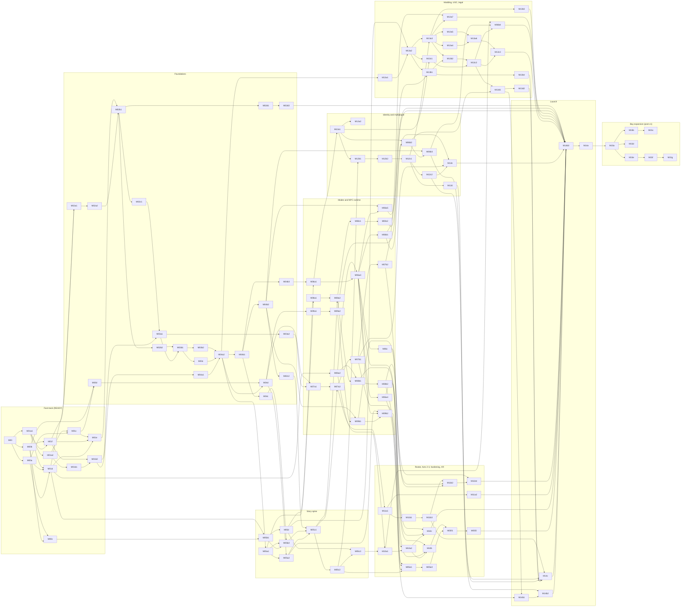

# 07 — Final milestone plan (S13)

> v1.1 · 2026-10-18 · S13 (`claude-opus-5-5`), Wave 5; dependencies, paths and M15 sessions reconciled by the Architect (DL-219, DL-220, DL-242). The ordered plan that milestone authors turn into `spec/07-milestones/<ID>-<slug>.md` files in the C15 format (`prompt-pack/03-SPEC-TEMPLATE.md` §C, tightened as C15 1.1 in `spec/domains/13-qa.md` §4). Rows (goal, R-IDs, dependencies, sections to read, deliverables, contracts, gates, proofs, risk) are in `_PLAN-1.md` (blocks A–C), `_PLAN-2.md` (D–E) and `_PLAN-3.md` (F–I). Status per file stays in `README.md`.

## 0. Rules
1. **Ids.** Every id of the register in `spec/00-plan.md` is kept. Splits use DL-037 (letter = scope, digit = session split; split rows keep the scope's slug): M04a → M04a1/M04a2, M10a → M10a1/M10a2, M11a → M11a1/M11a2, M11b2 keeps its id and gains **M11b4** (M11b3 exists), M12b → M12b1/M12b2, M12c → M12c1/M12c2, M14b → M14b1/M14b2/M14b3. M01a and M01b were already split (M01a1/M01a2, M01b1/M01b2). New QA scopes: **M00d** `qa-spec-gates`, **M04d** `qa-harness-bots-goldens`.
2. **Size.** One Sonnet 5.5 session per file: ≈ 2–4 h of agentic work, ≲ 40 hand-written files, one PR, app deployable at the end. Rows below 1 session stay separate files.
3. **Order.** The table in §1 is the run order. Block A is the READY fast-track list, kept exactly; its forward dependencies are resolved by `README.md`: **M01f runs before M01b2 and M01e** (DL-256). Every other row appears after all of its dependencies.
4. **R-ROLL-01.** No rooms milestone (M12b1 onward) starts before M05c2 is deployed to staging and its ACs pass there. **R-AUTH-02.** M14a (Thirdweb) is the last v1 milestone; Bay expansion (M15) follows it.
5. **Spend (DL-OWN-01).** fal total ≤ $100: M00c ≤ $10; M10a1+M10a2 ≤ $42; cutscenes ≤ $40 (M05c3 ≤ $16 and M10b ≤ $24, DN-S13-02); $8 buffer. CI never runs live fal (`FAL_MODE=mock`); every paid run prints its estimate first and needs `--live`. No player-triggered fal in v1 (M06b4 queue is owner-approved and counts against the cap).
6. **Gaps closed (wave5 note 11).** `RaceDef.intro` + `cut.race.intro.<raceId>` refs → M07b2. `tools/ci/econ-sim` (owner S01) → M04d, with sections in M05c1, M07b2, M05e2, M05f2. Avatar and wardrobe schemas in `packages/shared/schemas/ui/` → M04b2.

## 1. Ordered index (v1: 108 milestones, ≈ 100.4 sessions; post-v1: 7 milestones, 7 sessions)
Blocks: A fast-track (READY) · B foundations · C story spine · D modes and NPC runtime · E roster, Acts 2–3, hardening, XR · F identity and multiplayer · G modding, UGC, legal · H launch · I Bay expansion.

| # | ID | Slug | Sessions | Block | Depends on |
|---|---|---|---|---|---|
| 1 | M00 | bootstrap-ci-pwa-on-workers | 1 | A | — |
| 2 | M00a | edge-api-skeleton | 0.8 | A | M00 |
| 3 | M00b | ip-provenance-gates | 1 | A | M00 |
| 4 | M00c | genai-spike | 1 | A | M00b, M00a |
| 5 | M01a1 | loop-ecs-detmath-physics | 1 | A | M00 |
| 6 | M01a2 | loop-ecs-detmath-physics | 1 | A | M01a1, M00 |
| 7 | M01b1 | controller-cameras-touch | 1 | A | M01a2 |
| 8 | M01b2 | controller-cameras-touch | 1 | A | M01b1, M01f, M00 |
| 9 | M01c | device-spike-renderer-host | 1 | A | M00, M00a, M01a2 |
| 10 | M01d | assets-publish | 1 | A | M00b, M00a, M01a1 |
| 11 | M01e | asset-worker-opfs-store | 1 | A | M01d, M01c, M00a, M00, M01a2, M01f |
| 12 | M01f | world-graybox-fixture-codec | 0.5 | A | M01a1, M00b |
| 13 | M00d | qa-spec-gates | 0.5 | B | M00, M01c, M00b |
| 14 | M02a1 | bake-core | 1 | B | M01f, M01d |
| 15 | M02a2 | bake-roads-graph | 1 | B | M02a1 |
| 16 | M02b1 | streaming-lod | 1 | B | M02a2, M01c, M01e |
| 17 | M02b2 | weather-time | 1 | B | M02b1 |
| 18 | M02c1 | graph-services-teleports | 1 | B | M02a2, M02b1 |
| 19 | M02d1 | landmarks-kit-and-heroes | 1 | B | M02b1 |
| 20 | M02d2 | landmarks-rest-and-swap | 1 | B | M02d1 |
| 21 | M03a1 | vehicles-interaction-prefabs | 1 | B | M01b2, M02c1 |
| 22 | M03a2 | handling-model-wheel-spike | 0.5 | B | M03a1 |
| 23 | M03b1 | traffic-robotaxis | 1 | B | M02c1, M03a1, M02b2 |
| 24 | M03b2 | peds-transit | 1 | B | M03b1 |
| 25 | M03c | pursuit-director | 1 | B | M03a1, M03b1 |
| 26 | M04a1 | saves-gamemode-unlocks | 1 | B | M01b2 |
| 27 | M04a2 | saves-gamemode-unlocks | 1 | B | M04a1, M03c, M03b2, M02b2 |
| 28 | M04b1 | shell-ui-kit-menus-settings | 1 | B | M04a2 |
| 29 | M04b2 | creator-phone-hud-kit | 1 | B | M04b1 |
| 30 | M02c2 | maps | 1 | B | M02c1, M04b2 |
| 31 | M04b3 | local-identity-play-token | 0.5 | B | M00a, M04b1 |
| 32 | M04c | cutscene-playback-spike | 1 | B | M01c, M04b1 |
| 33 | M04d | qa-harness-bots-goldens | 1 | B | M04a2, M03a1, M00d |
| 34 | M05a1 | mission-ir-vm | 1 | C | M04a2, M02c1 |
| 35 | M05a2 | autoplayer-director-preview | 1 | C | M05a1, M04d |
| 36 | M05b1 | cutscene-infra-mock | 1 | C | M00a, M00c, M01d |
| 37 | M05b2 | cutscene-player-index | 1 | C | M05b1, M04c, M05a1 |
| 38 | M05c1 | act1-missions-1-6 | 1 | C | M05a2, M05b2, M03c, M04b2, M02c2 |
| 39 | M05c2 | act1-vertical-slice | 1 | C | M05c1, M03b2 |
| 40 | M05d | data-spine-supabase | 1 | C | M05b1 |
| 41 | M05c3 | act1-prewarm | 0.7 | C | M05c2, M05d |
| 42 | M06a1 | npc-backend-spine | 1 | D | M05d, M04b3 |
| 43 | M06a2 | soul-contract-compiler | 1 | D | M00b, M01d |
| 44 | M06a3 | dialogue-proxy | 1 | D | M06a1, M06a2 |
| 45 | M06a4 | memory-voice-lipsync | 1 | D | M06a3 |
| 46 | M06a5 | dialogue-panel-ui | 0.3 | D | M06a3, M04b2 |
| 47 | M06c | npc-agency-barks | 1 | D | M06a3, M03b2 |
| 48 | M06b1 | builder-text-private | 1 | D | M06a3 |
| 49 | M07a1 | racing-core-director-car | 1 | D | M03a2, M04a2, M04d, M02c1 |
| 50 | M07a2 | racing-ai-replay-ghosts | 1 | D | M07a1, M03c, M05c1 |
| 51 | M07b1 | racing-content-events-ladder | 1 | D | M07a2, M03b2 |
| 52 | M07b2 | racing-garage-replay-photo-visuals | 1 | D | M07b1, M05b2 |
| 53 | M08a1 | fight-core-sim-data | 1 | D | M01a1, M05a1 |
| 54 | M08a2 | fight-mode-training-vs | 1 | D | M08a1, M04a2, M04b2, M04d, M05c1 |
| 55 | M08b1 | fight-roster-kits-ai | 1 | D | M08a2, M06a2 |
| 56 | M08b2 | fight-stages-cutscenes-arcade | 1 | D | M08b1, M05b2 |
| 57 | M08c1 | pose-pipeline-classifier | 1 | D | M08a2 |
| 58 | M08c2 | pose-calibration-gate | 1 | D | M08c1 |
| 59 | M09a1 | tycoon-core-finance | 1 | D | M01a1, M04a2, M04d |
| 60 | M09a2 | tycoon-events-balance | 1 | D | M09a1, M04d |
| 61 | M09b1 | tycoon-ui | 1 | D | M09a2, M04b2 |
| 62 | M09b2 | tycoon-vc-story | 1 | D | M09b1, M06a3, M05a1, M05a2 |
| 63 | M10a1 | roster-pipeline | 1 | E | M05b1, M06a2, M01d, M05c3 |
| 64 | M10a2 | roster-pipeline | 1 | E | M10a1, M08b1 |
| 65 | M10b | qa-gates-kill-drill | 1 | E | M10a2, M08b2, M06a3 |
| 66 | M10c | roster-souls-ink-barks | 1 | E | M10a2, M06a4, M06c, M05c2 |
| 67 | M05e1 | story-act2-part1 | 1 | E | M05c2, M07a2, M08b2, M09b2, M07b1 |
| 68 | M05e2 | story-act2-part2 | 1 | E | M05e1 |
| 69 | M05f1 | story-act3-part1 | 1 | E | M05e2, M10b |
| 70 | M05f2 | story-act3-finale | 1 | E | M05f1 |
| 71 | M11a1 | iphone-hardening-governor | 1 | E | M02b1, M03b1, M07a2 |
| 72 | M11a2 | iphone-hardening-governor | 1 | E | M11a1 |
| 73 | M11b1 | webxr-port | 1 | E | M01c, M04b2, M11a1 |
| 74 | M11b3 | xr-ui-panels-comfort | 0.8 | E | M11b1 |
| 75 | M11b2 | per-mode-xr-and-xr-cutscenes | 0.7 | E | M11b1, M07b2, M08b2, M11b3 |
| 76 | M11b4 | per-mode-xr-and-xr-cutscenes | 0.7 | E | M11b2, M09b1, M05b2 |
| 77 | M12a1 | p1-identity-cloud-saves | 1 | F | M05d, M04b3, M06a1 |
| 78 | M12a2 | age-register-cloud-save-ui | 0.5 | F | M12a1, M04b1 |
| 79 | M06b2 | builder-images-review | 1 | F | M06b1, M12a1 |
| 80 | M06b3 | npc-builder-ui | 1 | F | M06b2, M04b2 |
| 81 | M12b1 | rooms-core-protocol-v2 | 1 | F | M12a1, M05c2, M04a2 |
| 82 | M12b2 | rooms-core-protocol-v2 | 1 | F | M12b1 |
| 83 | M12c1 | rooms-hardening-presence-loadtest | 1 | F | M12b2 |
| 84 | M12c2 | rooms-hardening-presence-loadtest | 1 | F | M12c1 |
| 85 | M12d | online-page-invites | 0.3 | F | M12c1, M04b1 |
| 86 | M12e | mode-leaderboards | 1 | F | M12c2, M07b1, M09a2 |
| 87 | M13a1 | mod-sdk-manifest-validators | 1 | G | M04a2, M01d |
| 88 | M13a2 | mod-installer-store-client | 1 | G | M13a1, M01e, M05d |
| 89 | M13a3 | mod-runtime-data-experience | 1 | G | M13a2, M02c2, M12b1, M12c1 |
| 90 | M13a4 | mod-script-sandbox | 1 | G | M13a3 |
| 91 | M13a5 | mod-ui-tier | 1 | G | M13a3 |
| 92 | M13a6 | mod-agent-kit | 1 | G | M13a4, M13a5 |
| 93 | M13a7 | store-experience-pages | 0.7 | G | M13a3, M07b2, M04b1 |
| 94 | M13b1 | forum-reports-backend | 1 | G | M05d, M06b1, M13a2 |
| 95 | M13b2 | forum-ugc-links | 0.8 | G | M13b1, M13a3, M02c2 |
| 96 | M13b3 | creator-place-mode | 1 | G | M13a3, M04b2 |
| 97 | M13b4 | forum-ui | 1 | G | M13b1, M04b1 |
| 98 | M13c1 | device-code-publish-login | 0.8 | G | M12a1, M04b1, M13a2 |
| 99 | M13c2 | publish-pipeline-server | 1 | G | M13c1, M13a1, M13b1, M13b2 |
| 100 | M13c3 | publish-cli-link | 1 | G | M13c2, M13a6 |
| 101 | M06b4 | builder-publish-assets | 0.5 | G | M13c2, M06b3, M10a1 |
| 102 | M13d1 | legal-trust-safety-backend | 1 | G | M13b1, M06b2, M13c2 |
| 103 | M13d2 | legal-forms-ui | 0.3 | G | M13d1, M04b1 |
| 104 | M14c | a11y-audit-i18n-gate | 0.5 | H | M13d2, M13b4, M12d, M06b3, M11b3 |
| 105 | M14b1 | launch-hardening-guardrails | 1 | H | M13d1, M06a4, M05b1 |
| 106 | M14b2 | launch-hardening-guardrails | 1 | H | M14b1, M12c2 |
| 107 | M14b3 | launch-hardening-guardrails | 1 | H | M14b2, M14c, M05f2, M10c, M11a2, M11b4, M12e, M13c3, M06b4, M13a7, M13b2, M13b3, M08c2, M06c, M06a5, M05c3, M02d2, M02b2 |
| 108 | M14a | thirdweb-siwe-link | 1 | H | M14b3, M12a1 |
| 109 | M15a | bay-expansion-framework | 1 | I | M14a |
| 110 | M15b | oakland-core | 1 | I | M15a |
| 111 | M15c | berkeley-richmond | 1 | I | M15b |
| 112 | M15d | marin-gateway | 1 | I | M15a |
| 113 | M15e | peninsula-north | 1 | I | M15a |
| 114 | M15f | peninsula-vc-row | 1 | I | M15e |
| 115 | M15g | south-bay-san-jose | 1 | I | M15f |

## 2. Dependency graph (acyclic; transitive edges removed; full edges in §1)

## 3. Critical path and checkpoints

**Critical path** (longest dependency chain, in sessions; it matters when sessions run in parallel, a single Builder runs the §1 order): M00 → M01a1 → M01d → M02a1 → M02a2 → M02b1 → M02c1 → M03a1 → M03b1 → M03c → M04a2 → M04b1 → M04c → M05b2 → M05c1 → M05c2 → M12b1 → M12b2 → M12c1 → M13a3 → M13b2 → M13c2 → M13d1 → M14b1 → M14b2 → M14b3 → M14a = **26.8 sessions** to the last v1 milestone (DL-219 made the hidden dependencies explicit; the rooms → mod runtime → publish → legal chain is now the longest); + M15a → M15e → M15f → M15g = 30.8 to the end of expansion. The world bake (M02a1–M02c1), the city systems that `ModeHost` wires (M03b1–M03c) and the R-ROLL-01 gate (M05c2 before M12b1) sit on it, so they are not deferred.

| Checkpoint | After | What must be true (proof) |
|---|---|---|
| **VS-Story** (A-06) | M05c2 | Act 1 (12 missions) passes `pnpm check:missions -- --act 1` on 3 seeds; resume e2e green on `webkit-webgl2`; racing, fighter and tycoon tiles reachable through stub hooks; staging deploy smoke green; iPhone 15 and Mac checklists uploaded. R-ROLL-01 gate opens here. |
| **VS-Racing** | M07a2 | 3 VS races and the pursuit event: `pnpm map:races par -- --check`, exact replay, `@racing-det` equal in Chromium and WebKit, `@racing-vs` |
| **VS-Fighter** | M08a2 | golden replay hashes equal in Node, Chromium, WebKit; Training frame meter; touch Simple scheme; story hook unlock once |
| **VS-Tycoon** | M09a2 | finance vectors exact; `pnpm check:balance` bands B1–B12 with failing self-tests; 200 replays equal |
| **Single-player launchable** | M11b4 (with M05f2, M10c, M11a2, M06c, M02d2) | every single-player R-ID green in the trace report; device passes for iPhone, Quest, Vision Pro, Mac; public release still waits for M14b3's sign-offs (Q-18, Q-21, Q-23) |
| **Multiplayer** | M12e | two clients on staging within 150 ms; 16-bot 30-minute load gate; leaderboards validated |
| **UGC open** | M13d1 (+M13c2) | NCII clock, evidence audit and report threshold pass; only then may `ugc.publish` flip in production (DL-151) |
| **Launch gate** | M14b3 | DoD H1–H10, guardrails T1–T9, release device pass, `ip:history`, sign-offs recorded |
| **Thirdweb (P3)** | M14a | SIWE link without data loss; release gate subset re-run |
| **Bay expansion** | M15a–g | each district streams through its portal; R-MAP-02 |

At every checkpoint the Architect runs the three critic lenses on the next block's milestone files (`spec/domains/13-qa-critics.md` §1) and records the result in the `spec/00-plan.md` critic log.

## 4. Tails and gates at a glance
- **Multiplayer and auth tail (block F):** M12a1 → M12a2; M06b2 → M06b3 (need P1/P2 identity); M12b1 → M12b2 → M12c1 → M12c2 → M12d, M12e.
- **Modding tail (block G):** M13a1 → M13a2 → M13a3 → {M13a4, M13a5} → M13a6; M13b1 → {M13b2, M13b4, M13d1}; M13c1 → M13c2 → {M13c3, M06b4}; `mods.script`, `mods.ui` stay off until the M13a4/M13a5 device recordings pass; `ugc.publish` stays false in production until M13d1.
- **Owner gates:** Q-13 devices (M01b2, M01c, M04c, M05c2, M08c2, M11a2, M11b1/b4, M13a4/a5, M14b3) · Q-15 domains and GitHub plan (M12a1, M14b3) · Q-16 filings (M06b2 photo visibility, M13d1) · Q-17 fal key holder (M00c, M10a1) · Q-18, Q-23 counsel (M14b3 release) · Q-19, Q-25 real roster (M06a2 originals only, M10a, M10c) · Q-20 voices (M06a4, M10c) · Q-21 sensitivity (release of M05c2, M05e, M05f) · Q-22 npm (M13a6, M13c3 publish step) · Q-24 animation staffing (M08b1, M10a2) · ADR-GENAI-01 provider clearance (paid cutscene prewarm in M05c3, M10b) · Thirdweb Growth plan (M14a) · Supabase Pro (M05d production).
