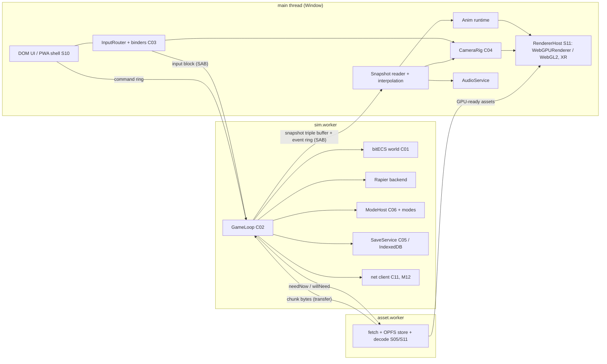
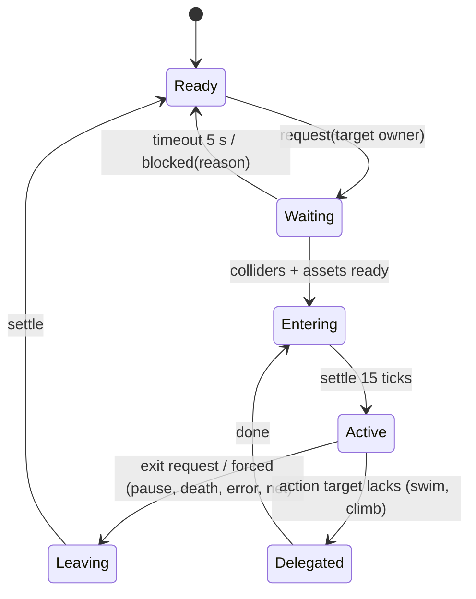

# 01 — Core Engine & Game Logic (S01)

> Wave 1 domain spec, 2026-10-18, author S01 (`claude-opus-5-5`). Reads `prompt-pack/06-SHARED-CONTEXT.md` v0.95 and `spec/03-decisions-and-facts.md` v0. This spec has three parts:
> - **this file**: scope, design, runtime, platforms, facts, milestones, tests and open questions;
> - `spec/domains/01-engine-contracts.md`: C01 ECS, C02 GameLoop (with the determinism rules), C03 Input, C04 CameraRig, and the physics/animation/audio service interfaces;
> - `spec/domains/01-engine-save-modes.md`: C05 SaveGame, C06 GameMode + unlock registry, PursuitDirector, clock/weather, interaction, prefabs, A-02 mission hooks, economy and melee cores.

## 1. Scope and R-IDs

**Owns.** `packages/shared` (ids, detmath, RNG, hashing, canonical JSON, contract types) and `packages/engine` (sim core, worker topology, physics wrapper, controllers, cameras, input, animation and audio runtimes, saves, mode host, unlocks, pursuit core, clock, interaction, prefabs, debug tooling, headless host).

**R-IDs covered:** R-PLAT-03 (WASM physics, tier hooks), R-PLAT-04 (fp/tp cameras), R-MAP-04 (time-of-day and weather core), R-MODE-01 (wanted/police core, interaction, economy core), R-ENG-04 (input remapping core). **Supports:** R-PLAT-02 (XR rig, M11b), R-PLAT-05/R-ENG-02 (sim budgets), R-MODE-05 (unlocks), R-ROLL-02 (prediction hooks, M12).

**Contracts owned:** C01, C02, C03, C04, C05, C06 (all v1.0.0). **Honored:** C13 (S11; read-only use of tier and budgets from `research/INDEX.md` and `research/stack-rendering-platform.md`). **Consumed as sketches (assumptions in the return block):** C07 asset ids, C08 chunk collision and tags, C09 zones and mode hooks, C11 `IN` frame, C14 ModAPI subset, C16 telemetry.

### 1.1 Checklist (35 items)

| # | Item | Status | Where | Milestone |
|---|---|---|---|---|
| 1 | bitECS 0.4.0 behind an `EcsApi` facade; SoA stores SAB-backed when isolated [research/stack-rendering-platform.md §5.2] | designed | C01 | M01a |
| 2 | `EntityHandle` generations; `StableKey` for saves, net, missions | designed | C01 | M01a |
| 3 | Component id ranges per owner; structural changes only via command buffer on `sim.worker` | designed | C01 | M01a |
| 4 | Fixed 60 Hz, accumulator clamp 0.15 s, render one tick behind with interpolation and teleport bypass [research/repos-modding.md §3.4] | designed | C02 | M01a |
| 5 | Ten sim stages and seven frame phases with a fixed system order | designed | C02 | M01a |
| 6 | Worker topology: main renders, `sim.worker`, `asset.worker`; no render worker (D-08, F-006) | designed | §2.1 | M01a |
| 7 | SAB transport with `postMessage` fallback; versioned messages [research/repos-webport.md P2; research/repos-modding.md P-SK-02] | designed | §2.1 | M01a |
| 8 | Determinism: detmath, xoshiro128** streams, lint bans, `canonical` profile, cross-browser state hash (D-13) | designed | C02 | M01a |
| 9 | Rapier 0.21.0, one build per session; floating origin; collider working set [research/stack-rendering-platform.md §5.1; research/repos-modding.md §7.5] | designed | §2.4 | M01a, M01b |
| 10 | Character controller on SF hills (KCC, slope speed factors, vault ≤ 1.2 m, swim = respawn at shore) | designed | §2.4 | M01b |
| 11 | Control ownership state machine with `Waiting/Entering/Leaving/Delegated` [research/repos-modding.md P-SK-05] | designed | §2.5 | M01b, M03a |
| 12 | Vehicle controller wrapper (ray-cast vehicle, 2 substeps above 100 km/h, handling from S06) | designed | §2.4 | M03a |
| 13 | Ragdoll-lite plus two-body impact impulse [research/repos-modding.md P-SK-08] | designed | §2.4 | M03a |
| 14 | Camera rig fp/tp/vehicle views with sim-side sphere-cast collision | designed | C04 | M01b |
| 15 | Cinematic directive channel for S03's director; XR rig rules | designed | C04 | M05a, M11b |
| 16 | Action map, input contexts, quantized `InputFrame` that packs into C11 `IN` [research/stack-cloudflare-backend.md §4.5] | designed | C03 | M01a |
| 17 | Binders: kbm and gamepad (M01a), touch (M01b), XR controller/hand/transient (M11b), pose interface (M08c) | designed | C03 | as listed |
| 18 | Remapping, hold-to-toggle, chords, persistence in the profile (R-ENG-04) | designed | C03, C05 | M04a |
| 19 | Animation: canonical skeleton, anim graph with 1D/2D blends, LOD update bands, feet IK; XR hand IK | designed | §2.8 | M01b, M03b, M11b |
| 20 | Audio bus: gesture unlock, `audioSession`, buses, ducking, voice caps, visibility resume | designed | §2.9 | M01b, M03a |
| 21 | Saves: profiles, slices, atomic writes, size caps, tombstones, migrations, export/import, status line [research/repos-grand-v.md] | designed | C05 | M04a |
| 22 | GameMode host, `ModeContext`, embedding stack, profile restarts | designed | C06 | M04a |
| 23 | Unlock registry with `comingSoon` stubs (A-06, R-MODE-05) | designed | C06 | M04a |
| 24 | Entity prefabs (player, vehicle, ped, prop, pickup, police, robotaxi, portal, marker, trigger) | designed | part 2 | M01b, M03a |
| 25 | Interaction system (scoring, prompts, hold, XR grab) | designed | part 2 | M03a |
| 26 | PursuitDirector core: heat 0–5 plus scripted 6, witnesses, search, cooldown, arrest, racing profile | designed | part 2 | M03c |
| 27 | Time-of-day and weather clock (state in sim, visuals S02) | designed | part 2 | M02b |
| 28 | Economy core (integer cents, idempotent ledger) | designed | part 2 | M04a, M05c |
| 29 | Open-world melee sharing the fighter move set (D-30); no firearms | designed | part 2 | M05c, M08a |
| 30 | A-02 hooks: scheduler threads, waits, zone predicates, timeline recorder | designed | part 2 | M05a |
| 31 | Scripted input lines and an input recorder for regression drives [research/repos-modding.md P-SK-09] | designed | §2.11 | M03a |
| 32 | Debug tooling: perf HUD, free cam, entity inspector, physics draw, hash display, `__dvBridge` | designed | §2.11 | M01b, M03a |
| 33 | Headless engine (Node and Worker) for tests, bots and server checks | designed | §2.12 | M01a |
| 34 | Netcode hooks: prediction ring, net slots, hash cadence (A-04) | deferred | §2.13 | M12a |
| 35 | Tier hooks for C13 budgets: density caps, physics radius, animation bands, audio voices | designed | §6 | M01b, M11a |

**Out of scope, with reasons.** Firearms (D-30). A render worker (D-08). Articulated ragdolls (Jolt has them, Rapier does not; ragdoll-lite covers v1 [research/stack-rendering-platform.md §5.1]). Skateboard controller (Q-ENG-04). Full-body XR IK (Q-ENG-05). Traffic/ped brains, road graph, sky renderer (S02); mission IR and director shots (S03); handling and race rules (S06); fighter frame data (S07).

## 2. Design

### 2.1 Thread topology

- **Main thread** owns the DOM, input capture, the XR session, rendering, camera, animation evaluation and audio. XR forces this: `navigator.xr` is not exposed in workers (F-006), so v1 renders on the main thread (D-08).
- **`sim.worker`** owns the world: ECS, physics, AI, pursuit, modes, missions, saves and, from M12, the room socket. It never touches the DOM.
- **`asset.worker`** owns fetch, the OPFS block store and decoding. The engine defines its bootstrap and the request messages (`needNow`, `willNeed` with priority); S05 owns manifest resolution (C07) and S11 owns storage quotas. This is the playgta5 split: blocking work and IO are kept off the page thread [research/repos-webport.md P1, P3, P6].
- **Transport.** When `crossOriginIsolated` is true (D-01 sets COOP/COEP), one `SharedArrayBuffer` per channel carries:
  - the input block (main writes, worker samples);
  - a command ring (main → worker: UI commands, debug edits);
  - the snapshot triple buffer (worker → main, seqlock header);
  - an event ring (worker → main: audio cues, UI view-model patches, toasts, telemetry).

  Wake-ups use `Atomics.notify` and `Atomics.waitAsync`, which Safari has had since 16.4 [research/repos-webport.md §6]. Without isolation, a `postMessage` transport with transferable `ArrayBuffer`s keeps the same message types. Every message is `{ v: 1, t, seq, p }` and is schema-tested on both sides (P-SK-02).
- **Rejected:** a render worker (D-08); one worker per subsystem (more boundaries, no clear win); sim on the main thread (rAF jank becomes sim hitches); R3F (D-11, F-015).

### 2.2 Frame and tick

Per render frame the main thread runs `Input → NetIn → Sim(hand-off) → Anim → Audio → Render → NetOut`.
- Input polls the binders, applies look to the camera and writes the input block.
- The hand-off posts a `FrameSignal`.
- The worker wakes, accumulates time, runs 0–9 ticks through the ten `SimStage`s and publishes a snapshot plus `alpha`.
- The main thread interpolates the newest pair and draws.

The main thread never waits; the cost is one tick of latency, which SK8V traded for stalls that cost up to ~30 fps [research/repos-modding.md §3.4]. In XR the session rAF runs at 72 or 90 Hz over a 60 Hz sim, matching the budget "72/90 Hz render, 60 Hz sim + interpolation" [research/stack-rendering-platform.md, Performance budgets].

### 2.3 Determinism and the two sim profiles

The netcode (A-04), mission autoplay (A-02), race ghosts, fighter replays and the tycoon harness all need reproducible simulation [research/gamedesign-decomposition.md §0]. D-12 makes free-roam physics only locally deterministic (`simd-compat`). The engine therefore defines two profiles (C02):

- **`local`** is used for normal play. It loads `rapier3d-simd-compat`, takes ambient density from the device tier, and is reproducible only on the same build and browser. Story missions, open-world races and free roam run here.
- **`canonical`** is used for CI, autoplay, race ghosts and time trials, server checks (M12b) and the M01a cross-browser test. It loads `rapier3d-deterministic-compat` and uses fixed `mobile-low` density, so it produces identical hashes in Node, Chromium and WebKit.

Exactly one Rapier build is loaded per session. A top-level mode that needs `canonical` restarts `sim.worker` behind the loading screen (C06 rule 3).

Ambient agents are keyed by `(cell, slot)` with per-agent RNG streams. A low tier simply runs the first N slots, so the agents of two different tiers agree wherever they overlap (C01 rule 5). This also lets the room DO "own shared ambient traffic … clients simulate it locally from seed" [research/stack-cloudflare-backend.md §4].

Lint bans and detmath are in C02. AI "think" runs at 30 Hz on every tier (`AI_DIVISOR = 2`); tier changes only density and perception radius, never update rates, so the sim does not branch on tier inside a profile.

### 2.4 Physics

**Backend.** `PhysicsBackend` wraps Rapier 0.21.0 (Apache-2.0, F-014). Jolt 1.1.0 is the documented swap if racing feel fails acceptance [research/stack-rendering-platform.md §5.1]. The fighter uses no rigid bodies (D-12).

**Floating origin.**
- Positions in ECS are f64 ENU metres. Rapier works in f32 around `origin`.
- When the local player is more than 1,000 m from the origin, the backend rebases: it shifts dynamic bodies and rebuilds chunk statics in the new frame. This prevents the f32 jitter a 20 km world causes [research/stack-rendering-platform.md §5.1, risk 10].
- The rebase test is deterministic because it reads sim state only.

**Collider working set.**
- Static colliders (heightfield and building prisms from C08) are built in `sim.worker` for chunks inside a square around the player. The square starts at 256 m, is centred ahead of the player by velocity × 4 s, and its radius equals the tier physics radius (desktop 400 m, mobile 200 m, mobile-low 150 m) [research/repos-modding.md §7.5; research/stack-rendering-platform.md, Performance budgets].
- Physics and visuals share one heightfield (repos-world P5).
- Chunk statics are added at most one chunk per tick.

**Character.**
- Rapier `KinematicCharacterController` with a capsule of radius 0.35 m and height 1.8 m; eye height 1.7 m.
- Autostep 0.4 m, snap-to-ground 0.5 m, max climb 45°, sliding on.
- Speeds: walk 1.6, run 4.2, sprint 6.8 m/s (design values).
- Hill factor: uphill speed × max(0.35, 1 − slope × 1.7), downhill × min(1.25, 1 − slope × 0.35). These factors come from the SF repo's walk mode [research/repos-world.md §1.7].
- Vault: obstacles ≤ 1.2 m found by a forward shape cast.
- Water above chest height is the `Swim` state, which fades and respawns at the nearest shore node in v1.
- The kinematic controller moves the capsule by collision queries, not by the world step, so M12 reconciliation can re-run the local player's last N ticks without stepping the world (§2.13; exact Rapier call confirmed in M01b).

**Vehicles.**
- Rapier `DynamicRayCastVehicleController` (four wheel rays) plus a custom lateral-grip curve, driven by S06's `HandlingProfile`.
- The world steps with 2 substeps whenever a player vehicle exceeds 100 km/h, for stability on hill crests [research/gamedesign-decomposition.md §3.3].
- Each handling preset is authored with the port-contract table: name, value, units, meaning, source, mechanism, conversion, oracle, tolerance. An empty "meaning" cell blocks implementation [research/repos-modding.md §7.3].

**Ragdoll-lite.**
- On an impact above a threshold (default ΔV 6 m/s), a ped's kinematic capsule becomes a dynamic capsule with the impulse and angular velocity for up to 3 s. The animation layer blends a tumble pose, then the ped gets up.
- The car-versus-ped impulse uses the two-body formula against the whole assembly and returns the opposite impulse to the car (P-SK-08).
- Caps on simultaneous dynamic ragdolls: desktop 8, mobile 4, mobile-low and XR 2. Beyond the cap a canned fall animation plays and no body is created.

### 2.5 Control ownership

One `Control` component per controllable entity. State ids are grouped by family, and predicates read whole families [research/repos-modding.md §3.5]:

| Family | States |
|---|---|
| 1xx on foot | 100 idle, 101 walk, 102 run, 103 sprint, 110 jump, 111 fall, 112 land, 120 vault |
| 2xx vehicle | 200 entering, 201 driving, 202 passenger, 203 exiting, 204 ejected |
| 3xx ragdoll | 300 ragdoll, 301 getting up, 302 knocked out |
| 4xx melee | 400 ready, 401 attacking, 402 hitstun, 403 blockstun, 410 grappled |
| 5xx scripted | 500 cutscene, 501 animation lock |
| 6xx consequence | 600 arrested, 601 hospital respawn |
| 7xx teleport | 700 teleport pending, 701 waiting for colliders |
| 8xx swim | 800 swim, which respawns at shore in v1 |

- `request()` returns a localized reason when entry is blocked, for example "Enter a vehicle first" or "Ground not loaded; player was not moved" [research/gamedesign-decomposition.md §7.7].
- A read-only monitor logs every transition with its reason.
- Owners: `OnFoot | Vehicle | Swim | Cutscene | Fighter | Ragdoll | Arrested`.

### 2.6 Camera

Third person is the default on foot. The behind-the-shoulder offset is [0.6, 0.35, 2.8] m with a shoulder swap. First person puts the eye at 1.7 m. In vehicles there are three chase distances plus hood and cockpit views, with auto-recentre after 1.5 s [research/gamedesign-decomposition.md §2.13].

Collision is a sim-side sphere cast published as `allowedDistance`. The rig pulls in instantly and eases out over 0.3 s, and fades the player mesh when the camera is within 0.6 m of it.

Cinematic shots are S03's director output, run as a sim system so scrubbing is deterministic. The gta-sa-earth vocabulary, LOS checks and the cut after 0.8 s of occlusion are reused as patterns only [research/repos-world.md P15]. XR rules are in C04 rule 5.

### 2.7 Input

`InputRouter` resolves device bindings per context into `SimButton` bits and quantized axes, plus `ClientAction`s handled on the main thread. Default maps are the gamedesign §6 matrix: KBM, standard gamepad, touch, Quest controllers, hands, and Vision Pro gaze plus pinch. Remaps are stored per profile (C03 `ControlsSettings` inside C05).

Desktop details follow the playgta5 pattern [research/repos-webport.md §2.7, rec 9]:
- Pointer Lock with `unadjustedMovement`;
- release-all on blur;
- wheel notches normalized by `deltaMode`.

Touch uses a floating left stick and right-half drag look (muguet numbers in C03 rule 10). The layout comes from a per-context button set: on foot, vehicle, fighter, phone. The pose binder (S07 classifier) emits timestamped actions into the fighter buffer.

### 2.8 Animation (presentation only)

- **Skeleton.** Characters are glTF skinned meshes retargeted at build time (S05 pipeline) to the canonical `dv-humanoid-v1` skeleton (22 bones, part 1). Meshy rig bone names are UNVERIFIED [research/INDEX.md §2], so the retarget map lives in S05's tool, never at runtime.
- **Graphs.** `AnimGraphDef` holds states with single clips, 1D blends (locomotion by speed) and 2D blends (strafe). Transitions crossfade, and the graph is driven by `Anim{state, p0, p1}` from the snapshot. Root motion is not used; the sim owns positions.
- **LOD bands.** Mixers update at full rate near the camera, then at ½ and ¼ rate, then freeze (§6). Meta recommends updating animations at 30 Hz while rendering at 90 Hz [research/stack-rendering-platform.md §4.5].
- **IK.** Two-bone foot IK on slopes (desktop and XR; off on `mobile-low`). In XR (M11b) the player shows hands only, with two-bone forearm IK to the grip pose.
- **Lip-sync.** The mouth-atlas lip-sync parameter is supplied by S04 (D-23).

### 2.9 Audio

- **Context.** One `AudioContext`, unlocked in the first `pointerdown`/`keydown`; `navigator.audioSession.type = 'playback'` when present (iOS 16.4+); suspend on hidden, resume on visible [research/stack-rendering-platform.md §3.5].
- **Buses.** `master → {music, sfx, ambience, voice, radio, ui, cutscene}`. Voice ducks music and radio by 9 dB (attack 80 ms, release 400 ms).
- **Spatial voices.** Nearest voices HRTF, others equal-power; caps in §6. Cutscene audio uses this context (D-20).
- **From the sim.** Cues come as `AudioCue` events; continuous emitters (engine rpm, sirens) come from `AudioEmitter` records in the snapshot.

### 2.10 Saves, modes, gameplay cores

Saves follow C05: one IndexedDB row per slot generation; write, verify, then pointer compare-and-swap; per-session write capabilities so sandbox never touches story; tombstones for sync.

`ModeHost` (C06) runs a stack of at most two modes. Story embeds racing, fighter or tycoon encounters through C09 mode hooks; a mode's first encounter emits its unlock. PursuitDirector, the clock, interaction, prefabs, economy and melee are specified in part 2.

### 2.11 Debug tooling

Debug tooling is in dev and preview builds, and in production only when the build flag `DV_DEBUG` is set (off by default).

**URL flags** (S11 owns the renderer flags `?tier`, `?level` and `?gl=1`):
- `?perf=1` shows the HUD;
- `?debug=1` enables the tools;
- `?seed=`, `?profile=canonical`, `?mission=&stage=` (S03);
- `?unlockAll=1`.

**Tools:**
- **Perf HUD:** frame ms (EMA, p90), ticks/frame, tick p50/p99, dropped s, render objects/draws/tris (`renderer.info`), memory budget, tier/backend, entities, heat.
- **Free cam:** detached camera; the sim keeps running or pauses.
- **Entity inspector:** a DOM panel that reads SAB stores and edits through the command ring, in debug or sandbox only.
- **Physics wireframe:** collider debug draw. The Rapier debug-render API is UNVERIFIED; the fallback draws our own shapes from `BodyDesc`.
- **State hash and timeline:** state-hash readout plus timeline record and scrub.
- **`window.__dvBridge`** (observe, act, step as JSON) for Playwright and agents, never shipped in production [research/repos-modding.md P-UM-10].

**Input lines (P-SK-09).** A line file `*.line.json` holds:
- `{ seed, profile, start: {pos, yaw}, frames: RLE<InputFrame> }`;
- reactive commands `aim`, `follow` and `waitNear x y r timeout`.

Lines replay in CI. Any real input stops playback.

### 2.12 Headless engine

`createHeadlessSim(cfg, world)` runs the same `sim/` code in Node 24 or a Worker with no DOM and no GPU. It provides `step(n, inputs)`, `hash()`, `snapshot()`, `restore()` and `exportTimeline()`.
- Rapier's `-compat` builds embed the wasm, so they load without fetch [research/stack-rendering-platform.md §Verified facts].
- Users: unit and integration tests, the determinism test, S03 mission autoplay, S06 race bots, S08 harness hosting, and M12b server checks.
- Whether Rapier wasm runs inside a Durable Object is UNVERIFIED (Q-ENG-08). Server checks fall back to kinematic bounds validation without physics, which S09's M12a plan already uses [research/stack-cloudflare-backend.md §4].
- Lint enforces headlessness: `packages/engine/src/sim/**` may not import `three`, `packages/engine/src/client/**`, or DOM globals.

### 2.13 Netcode hooks (A-04; implemented in M12a)

- **Prediction ring.** The local player keeps a 64-tick ring of `(InputFrame, predicted Transform, Control)`. On a server snapshot with `ackSeq`, the engine re-runs the character movement queries for the unacknowledged ticks against static colliders.
- **Corrections.** Errors above 0.3/0.8/2.0 m blend with gain 0.05/0.12/0.4 (muguet's thresholds, re-implemented) or snap on vehicle transitions [research/repos-webport.md §3.7].
- **Identity.** Net slot ↔ `StableKey player:<slot>`.
- **Desync detection.** `stateHash` every 60 ticks in multiplayer; every tick in fighter matches (S07).
- **Wire.** `InputFrame` packs into the `IN` frame: `moveX`/`moveY` i8, yaw u16, pitch i16, buttons, throttle/steer/brake i8.

## 3. Components

| Module (path) | Responsibility | Public interface | Depends on |
|---|---|---|---|
| `packages/shared/src/detmath.ts` | exact-op math, angles, vectors | `dsqrt, dsin, dcos, datan2, dexp, dlog, dpow, lerpAngle` | — |
| `packages/shared/src/rng.ts` | xoshiro128** streams | `Rng`, `streams(seed)` | hash |
| `packages/shared/src/hash.ts`, `json.ts` | FNV-1a 32/64; canonical JSON | `fnv32, fnv64Hex, canonicalize` | — |
| `packages/shared/src/contracts/*` | C01–C06 + engine types | part 1, part 2 | — |
| `packages/engine/src/sim/ecs/` | facade over bitECS, allocator, generations, string table, registry | `EcsApi`, `defineComponent` | bitecs@0.4.0 |
| `packages/engine/src/sim/loop/` | accumulator, stages, system scheduler, hash | `SimHost`, `SystemDef` | ecs |
| `packages/engine/src/sim/transport/` | SAB rings, snapshot writer, `postMessage` fallback | `SimTransport` | — |
| `packages/engine/src/sim/physics/` | Rapier wrapper, floating origin, working set | `PhysicsBackend` | rapier builds |
| `packages/engine/src/sim/control/` | ownership machine, on-foot, vehicle, ragdoll-lite | systems | physics |
| `packages/engine/src/sim/pursuit/` | director, dispatcher, police behaviours, arrest | `PursuitApi` | C08 graph |
| `packages/engine/src/sim/world/` | clock, weather, zones, streaming interest | `WorldClockApi`, `ZoneService` | C08 |
| `packages/engine/src/sim/interaction/`, `prefabs/`, `economy/`, `combat/` | part 2 services | part 2 | ecs |
| `packages/engine/src/sim/modes/` | ModeHost, ModeContext, unlock registry | C06 | all sim |
| `packages/engine/src/sim/save/` | SaveService, migrations, schema, golden files | C05 | json, hash |
| `packages/engine/src/sim/script/` | scheduler, timeline recorder (A-02) | part 2 | ecs |
| `packages/engine/src/sim/debug/` | lines, recorder, bridge server side | `LinePlayer` | input |
| `packages/engine/src/headless/` | Node/Worker host | `createHeadlessSim` | sim |
| `packages/engine/src/workers/` | `sim.worker.ts`, `asset.worker.ts` bootstraps | `WorkerMsg` | sim, S05 |
| `packages/engine/src/client/boot/` | worker spawn, isolation check, boot order | `bootEngine()` | S11 RendererHost |
| `packages/engine/src/client/input/` | binders, router, latch, rebind capture | C03 | — |
| `packages/engine/src/client/camera/` | CameraRig | C04 | three |
| `packages/engine/src/client/{anim,audio,snapshot}/` | presentation runtimes; snapshot reader, interpolation, three object pool by handle | part 1, `SnapshotView` | three, C07 |
| `packages/engine/src/client/debug/` | HUD, free cam, inspector, `__dvBridge` | — | — |

Pinned versions: `bitecs@0.4.0`, `@dimforge/rapier3d-simd-compat@0.21.0`, `@dimforge/rapier3d-deterministic-compat@0.21.0`, `three@0.186.1`, `three-mesh-bvh@0.9.16` (main-thread picking only) [research/stack-rendering-platform.md, Recommendations 1].

## 4. Data

- **Types:** full TypeScript in parts 1 and 2. JSON Schema for runtime-validated data: the save envelope (part 2), and slice, prefab, pursuit and input-default schemas under `packages/engine/src/**/schema/`.
- **Persisted data:** IndexedDB `dv-saves` (C05). Graphics tier and benchmark results are S11's; the engine stores only `deviceId`.
- **Config files** (all JSON Schema validated in CI):
  - `config/pursuit.json`, `config/clock.json` (rate, weather weights), `config/input/defaults.<device>.json`, `config/physics.json` (character and ragdoll constants), `config/audio.json` (buses, ducking, voice caps);
  - `config/unlocks.json` (base `UnlockDef`s), `config/modes.json` (descriptor list; code entry points are referenced by id).
- **Feature flags:** `DV_DEBUG` (build), `engine.simProfileOverride` (QA), `engine.sabTransport` (on when isolated), `engine.ragdollCap` (per tier), `engine.unlockAll` (non-production).

## 5. Runtime behavior

**State machines:** loop (`Booting → Running ⇄ Paused → Restarting → Disposed`), control ownership (§2.5), ModeHost (C06 rules 1–4), save write protocol (C05 rule 1), heat phases (`clear → pursuit → search → cooldown → clear | arrested`, part 2).

**Boot order:** isolation check → spawn `asset.worker`, then `sim.worker`, before heavy work (playgta5 ordering lesson [research/repos-webport.md §2.2]) → load the profile's Rapier build → open saves → main menu (`ModeHost` Idle) → enter story or sandbox: stream the boot set, warm pipelines (S11), fade in.

**Failure modes and fallbacks:**

| Failure | Detection | Fallback |
|---|---|---|
| Not cross-origin isolated | `crossOriginIsolated === false` | `postMessage` transport (+1 copy per frame); telemetry `engine.no_isolation` |
| Sim overrun (tick > budget) | accumulator hits clamp | drop time (slow motion), count `droppedSec`; perf HUD warns; governor (S11) lowers density |
| `sim.worker` crash | `error` event / missed snapshots 2 s | show "Recovering…", restart the worker from the last save; telemetry `engine.sim_crash` |
| Rapier wasm load fails | `init()` rejects | retry with jittered backoff 3× [research/repos-webport.md P7], then error screen with diagnostics |
| IndexedDB unavailable / quota | open or put throws | in-memory session with banner "Progress cannot be saved"; `lastSave.error` set |
| Save checksum mismatch | load verify | previous generation; status line shows the error |
| Colliders not ready at spawn | working set incomplete | `Control` stays `Waiting`; teleport shows the precondition message |
| Snapshot reader sees odd `seq` | seqlock | reuse previous snapshot this frame |
| Page hidden (iOS suspend) | `visibilitychange` | pause sim, autosave if eligible, suspend audio; on return resume and re-sync clocks |

**Performance notes against tier budgets** (sim targets are design values; render budgets are S11's):
- Sim tick p99 ≤ 4 ms on the desktop reference and ≤ 8 ms on `mobile`.
- The snapshot carries ≤ 8,192 records of 64 B each, so one buffer is 512 KiB and the triple buffer 1.5 MiB.
- ECS stores for 65,536 entities stay under 25 MiB in total, inside the JS-heap budget of 450–600 MB on iPhone [research/stack-rendering-platform.md, Performance budgets].

## 6. Platform notes

| Aspect | Desktop | iPhone `mobile` / `mobile-low` | Quest 3/3S (`xr-standalone`) | Vision Pro (`xr-pro`) |
|---|---|---|---|---|
| Input | KBM with Pointer Lock, gamepad | touch overlay, gamepad; no Pointer Lock, no vibration [F-011] | `xr-standard` controllers, hands optional | gaze + pinch (`transient-pointer`), hands; no gamepad assumption |
| Render vs sim | 60 fps / 60 Hz | 60 / 60 Hz (`mobile-low`: 30 fps render, sim still 60 Hz) | 72–90 Hz render, 60 Hz sim | 90 Hz render, 60 Hz sim |
| Physics radius | 400 m | 200 m / 150 m | 150 m (design; S11 confirms) | 200 m (design; S11 confirms) |
| Ambient caps (cars/peds) | 540 / 400 | 200 / 150; 120 / 80 | 120 / 80 | 300 / 200 |
| Anim bands (full / ½ / ¼ within) | 40 / 80 / 150 m | 20 / 40 / 80 m; 12 / 25 / 50 m | 15 / 30 / 60 m | 25 / 50 / 100 m |
| Audio voices | 48 | 24 / 16 | 24 | 32 |
| Ragdoll cap | 8 | 4 / 2 | 2 | 2 |
| Camera | fp/tp, all vehicle views | fp/tp; rotate-to-landscape overlay (S10) | always fp; seat rest frame; snap turn | always fp; seated option |
| Saves | IndexedDB | IndexedDB; `persist()` after story start (S11) [research/stack-rendering-platform.md §6.5] | IndexedDB | IndexedDB |
| Haptics | gamepad rumble where supported | none on iPhone | controller haptics | none assumed |

Ambient caps come from the budgets table [research/stack-rendering-platform.md, Performance budgets]; the other values are design values for S11 to reconcile in C13. XR sessions use `immersive-vr` for city play; `immersive-ar` is limited to the tycoon desk and fighter tabletop [research/gamedesign-decomposition.md §6].

## 7. Verified facts used

| Fact | Source |
|---|---|
| `navigator.xr` is absent on `WorkerNavigator`; `navigator.gpu` is present (F-006) | [research/stack-rendering-platform.md] BCD 8.1.6 |
| bitECS 0.4.0 (MPL-2.0) uses SoA typed arrays that may be SAB-backed and supports `asBuffer` queries; structural changes stay on the owning thread | [research/stack-rendering-platform.md] registry.npmjs.org/bitecs; github.com/NateTheGreatt/bitECS/blob/main/docs/Multithreading.md |
| Rapier 0.21.0 is Apache-2.0; the base build is locally deterministic and `-deterministic` is cross-platform; `KinematicCharacterController`, `DynamicRayCastVehicleController` and `takeSnapshot` exist; `-compat` embeds the wasm (F-014) | [research/stack-rendering-platform.md] registry.npmjs.org/@dimforge/rapier3d-simd-compat |
| JS `Math` transcendentals are implementation-dependent across browsers | [research/gamedesign-decomposition.md §0] (MDN) |
| `Atomics.waitAsync` is in Safari/iOS 16.4; SAB needs COOP/COEP; `createSyncAccessHandle` works in dedicated workers only | [research/repos-webport.md §6] caniuse; MDN |
| iPhone lacks Pointer Lock, `navigator.vibrate`, gamepad rumble and element fullscreen (F-011) | [research/stack-rendering-platform.md §2] BCD |
| `renderer.xr.enabled` must be set before `init()`; `setupWebGLXRFallback` swaps renderers at XR entry | [research/stack-rendering-platform.md §1.2, §4.2] unpkg three@0.186.1 |
| Vision Pro transient input is empty until a pinch; route by `inputSource` | [research/stack-rendering-platform.md §4.3] webkit.org/blog/15162 |
| Quest guidance: 72 Hz minimum, under 200 draw calls, animations at 30 Hz while rendering at 90 Hz (F-013) | [research/stack-rendering-platform.md §4.5] developers.meta.com |
| Meta locomotion: teleport plus snap turn by default, vignette while moving | [research/stack-rendering-platform.md §4.4] developers.meta.com/horizon/design/locomotion-best-practices |
| W3C standard gamepad mapping and WebXR `xr-standard` mapping; 25 joints per hand | [research/gamedesign-decomposition.md §6] |
| SK8V: 60 Hz period, accumulator clamp 0.15 s, present one tick behind, skip interpolation on tick gap > 3 or move > 2 m; ownership state machine; reactive input lines | [research/repos-modding.md §3.4–3.7] github.com/becaring/SK8V |
| Grand-V save profiles: 32-hex ids, names 1–80, ≤ 64 profiles, Story/Sandbox namespaces, atomic temp+rename, tombstones with ms timestamps | [research/repos-grand-v.md §(d)] |
| playgta5: saves in IndexedDB rather than OPFS (single-tab handles); input release on blur; Pointer Lock `unadjustedMovement` | [research/repos-webport.md §2.7, P14] github.com/shadany7824/playgta5 |
| muguet touch numbers: stick 58 pt, knob 26 pt, sprint beyond 1.35×, look gain 3.0; correction gains 0.05/0.12/0.4 | [research/repos-webport.md §3.6–3.7] github.com/c22dev/muguet |
| Room `IN` frame layout (i8 move, u16 yaw, i16 pitch, u16 buttons, i8 throttle/steer/brake) | [research/stack-cloudflare-backend.md §4.5] |
| SF repo walk mode: eye height 1.7 m, slope speed factors | [research/repos-world.md §1.7] |
| gta-sa-earth: fixed-step simulate-once, 33 ms snapshots, director with LOS and an occlusion cut after 0.8 s | [research/repos-world.md §3.4] |
| three 0.186.1 is current (F-001); R3F capped below React 19.4 (F-015) | [research/INDEX.md §2] |

**UNVERIFIED (none appear in acceptance criteria):**
1. `Math.sqrt` bit-identity across engines.
2. Relative cost of `deterministic-compat` versus `simd-compat` (research says only "less optimized").
3. Rapier wasm inside a Durable Object.
4. WebSocket availability inside a dedicated worker on iOS Safari.
5. Quest face-button indices in `xr-standard`.
6. The Rapier debug-render API.
7. Meshy rig bone names.
8. iOS PWA background-suspension timing.
9. Whether IndexedDB commits survive a WebContent jetsam on iOS. The protocol is designed so either outcome is safe.

## 8. Milestone mapping

| Milestone | Engine parts | Stubbed first / later | Sessions (engine share) |
|---|---|---|---|
| **M01a** loop, ECS, detmath, physics wrapper (R-PLAT-03) | `packages/shared` (detmath, rng, hash, json, contracts); ECS facade and registry; loop and stages; SAB + fallback transport; `sim.worker` bootstrap; Rapier wrapper with both builds and floating origin; `InputFrame` and kbm/gamepad binders; headless host; lint bans; determinism test on a fixture world (flat ground + boxes) | no rendering beyond a debug cube view; no controllers | 1 (2 if the WebKit deterministic build fights back) |
| **M01b** controller, cameras, touch (R-PLAT-04, R-PLAT-03) | KCC on-foot states; ownership machine (on foot, ragdoll stub); CameraRig fp/tp with collision; touch binder; prefab registry and `player.default`; anim graph v1 (idle/walk/run blend on a placeholder rig); audio bus skeleton; perf HUD and free cam; gray-box Civic Center block (fixture from S02) | XR smoke only (S11); no vehicles | 1–2 |
| **M02b** weather/time (R-MAP-04) | clock, weather state and env block; working set wired to C08 chunks | visuals by S02 | ≤ 0.3 |
| **M03a** vehicles, interaction (R-MODE-01) | vehicle controller and enter/exit; vehicle/ped/prop/pickup prefabs; interaction v1; ragdoll-lite; lines and recorder; entity inspector; physics draw | handling presets from S06's first table | 1 |
| **M03b** traffic, peds | ambient slot rules, witness hooks, per-agent RNG streams (S02 brains) | — | ≤ 0.3 |
| **M03c** PursuitDirector (R-MODE-01) | director, dispatcher, police behaviours (follow, PIT, box-in, roadblocks, spikes, heli LOS), arrest, `config/pursuit.json`, sandbox heat toggles | racing profile values from S06 later | 1 |
| **M04a** saves, GameMode, unlocks, remap storage (R-ENG-04, R-MODE-05, R-MODE-01 economy) | SaveService (profiles, slices, atomic, caps, tombstones, migrations, export/import); ModeHost and ModeContext; unlock registry with `comingSoon` stubs; settings persistence (controls remap); economy wallet | menus by S10 in the same milestone; split menus to M04b if > 40 files | 1–2 |
| M05a | scheduler, zones, timeline recorder; cinematic directive | director shots by S03 | ≤ 0.5 |
| M05c | open-world melee basic (3 moves via `CombatApi` stub), shops via economy | shared core in M08a | ≤ 0.3 |
| M08a | combat core reading S07 frame data | — | ≤ 0.3 |
| M11a / M11b (R-PLAT-02, R-PLAT-05) | tier tuning; XR rig, XR binders, hand IK | — | ≤ 0.5 each |
| M12a / M12b (R-ROLL-02) | prediction ring, net slots, hash cadence | — | ≤ 0.5 each |

## 9. Tests

Each item is test name — proof command.

1. `shared/detmath.vectors` (golden vectors for every detmath function) — `pnpm --filter @dv/shared test`
2. `shared/rng.streams` (stream independence, state round-trip) and `shared/hash.fnv` (frozen golden values) — same command.
3. `engine/determinism.node` (10,000 ticks with the `canonical` profile, gray-box fixture, line `walk-drive.line.json`; two runs give identical hashes) — `pnpm --filter @dv/engine test:determinism`
4. `e2e/determinism` (the same run in a worker page; hash equals the Node golden) — `pnpm e2e --project=chromium-webgl2 --grep @determinism` and `pnpm e2e --project=webkit-webgl2 --grep @determinism`
5. `engine/lint.bans` (ESLint over `test/fixtures/banned/*.ts` must report every banned API) — `pnpm --filter @dv/engine test:lint-bans`
6. `engine/headless.noDom` (sim boots with `window`, `document` and `navigator.xr` undefined) — `pnpm --filter @dv/engine test:headless`
7. `engine/loop.*` accumulator clamp: 0.5 s yields 9 ticks and 0.35 s dropped; interpolation skip rules; command-buffer ordering; stale-handle resolve — `pnpm --filter @dv/engine test`
8. `engine/input.*` (quantization, latch of a sub-tick tap, hold/double-tap/chord, hold-to-toggle, context stack, `Pause` always bound) — same command.
9. `engine/camera.sweep100` (100 random poses in the gray-box: camera never inside a collider) — `pnpm --filter @dv/engine test -- camera.sweep`
10. `e2e/fp-tp` (walk 50 m, toggle fp/tp, toggle refused during a cutscene) — `pnpm e2e --project=chromium-webgl2 --grep @fp-tp`
11. `e2e/touch` (iPhone viewport: stick moves the player, buttons fire actions) — `pnpm e2e --project=webkit-webgl2 --grep @touch`
12. `engine/lines.filbert` (M03a: scripted drive ends at an identical pose across 3 runs) — `pnpm --filter @dv/engine test:lines`
13. `engine/pursuit.*` table loads from JSON; arrest rule; bot reaches heat 3 from scripted infractions and escapes through cooldown (M03c) — `pnpm --filter @dv/engine test:pursuit`
14. `engine/save.*` canonical JSON and checksum; caps (`TOO_LARGE`, `PROFILE_LIMIT`, `NAME_TAKEN`); pointer CAS conflict; namespace capability (`NOT_ALLOWED`); tombstone non-resurrection; import/undo; migrations over the golden files — `pnpm --filter @dv/engine test:save`
15. `e2e/save-kill` (close the page during a write loop; reopen; the last good generation loads and the status line is correct) — `pnpm e2e --project=chromium-webgl2 --grep @save-kill`
16. `engine/modes.*` ModeHost transitions; embedding depth ≤ 2; canonical-under-local refusal; first-encounter unlock is idempotent and persisted; `comingSoon` tile is locked — `pnpm --filter @dv/engine test:modes`
17. `engine/clock`, `engine/interaction.scoring`, `engine/economy.idempotent` — `pnpm --filter @dv/engine test`
18. `perf/graybox-walk` (tick p99 ≤ 4 ms on the desktop CI runner, reported via `__dvBridge`) — `pnpm perf --scenario graybox-walk`

## 10. Open questions

- **Q-ENG-01** Cost of a profile switch (`SimHost.restart` with the other Rapier build). Measure in M01a. Default: allowed only at top-level mode entry.
- **Q-ENG-02** Can `detmath.sqrt` delegate to `Math.sqrt`? Default: no, until the M01a vectors pass on all three engines.
- **Q-ENG-03** Net socket in `sim.worker` or on the main thread? Default: worker, with a main-thread relay over a `MessagePort` if iOS lacks worker WebSockets. Blocks M12a only.
- **Q-ENG-04** Skateboard or scooter controller (Q-MOD-06). Default: out of v1; the ownership machine reserves no family for it.
- **Q-ENG-05** XR body presentation. Default: hands only with forearm IK. Full-body IK is a post-M11b ADR.
- **Q-ENG-06** Game clock rate. Default: 48 real minutes per in-game day; owner may tune in `config/clock.json`.
- **Q-ENG-07** Quest face-button indices. Default: detect by input profile at runtime; required actions never sit only on face buttons.
- **Q-ENG-08** Rapier in Durable Objects for M12b server physics. Default: kinematic validation only.
