# 02 — World & Map, part 3: bake pipeline (`tools/map`), landmarks, districts

> S02, Wave 2, 2026-10-18. Part of `spec/domains/02-world.md`. Types and binary layouts: `02-world-contracts.md`. Requirements: R-MAP-01 (accurate SF), R-MAP-04 (living-city data), R-MAP-02 (backdrop data). Facts carry `[research/<file>.md]`; rows marked **new** were checked against the live portals on 2026-10-18 for this spec (§7 of the main file).

## 1. Pipeline overview

```mermaid
flowchart LR
  subgraph SRC["Sources (open data only)"]
    DS["DataSF Socrata<br/>ynuv-fyni · 3psu-pn9h · j2bu-swwd<br/>ramy-di5m · gtr9-ntp6 · i28k-bkz6 · 9exe-acju · tkzw-k3nq"]
    OSM["OSM: Geofabrik NorCal PBF<br/>osmium extract (bbox, tags)"]
    TER["AWS Terrarium z15 core, z12 far"]
  end
  subgraph BAKE["tools/map  (pnpm map:build -- --area sf)"]
    S0["S0 fetch + raw.lock"] --> S2["S2 terrain"] --> S5["S5 roads/graph"] --> S6["S6 junctions + signals"] --> S7["S7 grading + slabs + hoods"] --> S4["S4 buildings"] --> S8["S8 ped graph"] --> S9["S9 tags + spawn"] --> S10["S10 landmarks, POIs, transit"] --> S11["S11 LOD + far"] --> S12["S12 map packs"] --> S13["S13 pack + index"] --> S14["S14 verify gates"]
    S3["S3 water, landuse"] --> S5
  end
  SRC --> S0
  S13 --> OUT["p0 / l0 / l1 / l2 world_pack<br/>sf-map.v1 · sf-graph.v1 · world-index<br/>anchor-mask · attribution.world.json"]
  OUT -->|"assets:publish (C07)"| R2[("media.DOMAIN R2")]
  R2 -->|"asset.worker + OPFS"| RT["runtime: streaming, sim, maps"]
```



## 2. Sources, licences, attribution

| Source | Exact id / endpoint | Fields used | Licence and credit | Status |
|---|---|---|---|---|
| Building Footprints | DataSF `ynuv-fyni`, `https://data.sf.gov/resource/ynuv-fyni.json` (old host `data.sfgov.org` redirects) | `sf16_bldgid`, `shape` (multipolygon), `hgt_mediancm`, `hgt_maxcm`, `gnd_mediancm`, `p2010_zmaxn88ft`; all height columns are typed **text** in the metadata, so parse and validate | PDDL; "City and County of San Francisco" [research/repos-world.md §4]; 177,023 rows on 2026-10-18 (SoQL `count(*)`) | **new** |
| Streets | `3psu-pn9h` | `cnn`, `streetname`, `st_type`, `classcode`, `oneway` (F, T, B), `layer`, `f_node_cnn`, `t_node_cnn`, `nhood`, `analysis_neighborhood`, `active`, `line` | PDDL. Active classcode counts: 0 → 1,145; 1 → 110; 2 → 202; 3 → 1,530; 4 → 2,376; 5 → 10,906; 6 → 109. Active oneway: B 12,434; T 1,839; F 2,105. Layers incl. `STREETS`, `FREEWAYS`, `STREETS_TI`, `STREETS_YBI`, `STREETS_HUNTERSP`, `PARKS`, `PARKS_NPS_PRESIDIO`, `PRIVATE`, `PAPER*` | **new** |
| Analysis Neighborhoods | `j2bu-swwd` | `nhood`, `the_geom` | PDDL; 41 polygons (names listed in §8) | **new** |
| Addresses (EAS) | `ramy-di5m` | `address`, `address_number`, `street_name`, `street_type`, `cnn`, `latitude`, `longitude`, `eas_baseid`, `nhood` | PDDL; 388,647 rows, 224,290 base addresses [research/auth-ugc-input-maps.md §5.2] | **new** fields |
| Parks | `gtr9-ntp6` | `property_id`, `property_name`, `propertytype`, `acres`, `shape` | PDDL; 255 properties | **new** fields |
| Muni stops / routes | `i28k-bkz6` (`stopname`, `stopid`, `latitude`, `longitude`, `shelter`) / `9exe-acju` (`route_name`, `lineabbr`, `direction`, `shape`) | stops 3,260; patterns 135 | PDDL, credit SFMTA | **new** fields |
| Street trees | `tkzw-k3nq` | `treeid`, `species`, `latitude`, `longitude` | PDDL, SF Public Works | **new** fields |
| OSM | Geofabrik NorCal PBF → `osmium extract`; bbox lat 37.30–38.00, lng −122.60…−121.80 for the backdrop and lat 37.68–37.89, lng −122.55…−122.30 for SF | `highway`, `railway`, `route=ferry`, `natural=coastline\|water\|tree`, `leisure`, `landuse`, `man_made=pier`, `building`, `bridge`, `tunnel`, `layer`, `lanes`, `maxspeed`, `oneway`, traffic-signal and stop nodes, `type=restriction` | ODbL 1.0; "© OpenStreetMap contributors"; share-alike on the derived DB [research/repos-world.md §4] | Geofabrik URL and `osmium` flags **UNVERIFIED** (egress blocked on 2026-10-18) |
| Terrain | `https://s3.amazonaws.com/elevation-tiles-prod/terrarium/{z}/{x}/{y}.png`, z15 for the play and stream boxes, z12 far; height = R·256 + G + B/256 − 32768 | — | public domain (3DEP, SRTM); credit "3DEP data courtesy of the U.S. Geological Survey", Mapzen [research/repos-world.md §4] | **new** check: z15 tile 5241/12665 decodes City Hall to 17.6 m; z15 edge at 37.78° is 966.6 m (3.78 m/px) |
| USGS imagery | `basemap.nationalmap.gov … USGSImageryOnly` z14 | roof and ground colour sampling | public domain for USGS-authored data; NAIP status UNVERIFIED [research/repos-world.md §4] | **off by default** (`--imagery`), Q-MAP-04 |
| Overture | — | — | ODbL | not used in v1; evaluated in M15a |

Not used, with reason: Google Photorealistic 3D Tiles (no caching, offline use or derivation; Google logo required) and Mapbox tiles/GL (no deriving, caching or storing) [research/repos-world.md §4; F-055, F-056]. The Mapbox CLI may help authors sanity-check ETAs; nothing it returns is committed [research/auth-ugc-input-maps.md §5.5]. Nominatim and Overpass are build-time only, under their policies (1 req/s, custom User-Agent, cache; Overpass < 10,000 queries/day, no parallel scripts) [research/repos-world.md §4].

**Attribution output.** `map:build` writes `config/attribution.world.json`: one entry per source stamp `{id, text, licence, licenceUrl, source, surfaces}`, rendered on the boot splash, the full-map corner, the pause credits and `docs/legal` (`02-world-maps.md` §6). ODbL §4.6 is met by publishing the bake scripts in the repo and the packs on `media.<domain>`, which are the derived database in a custom format [research/repos-world.md §4].

## 3. Commands, layout, determinism

```
pnpm map:fetch   [-- --area sf] [--archive]        # S0 → .cache/map/raw + raw.lock.json (+ private R2 snapshot)
pnpm map:build   [-- --area sf|civic-excerpt] [--stage <id>] [--force] [--imagery]   # civic-excerpt: offline 1 km² real excerpt
pnpm map:verify  [-- --bake <id>]                   # S14 gates against a finished bake, nightly + before publish
pnpm map:pack    [-- --publish]                     # hands packs to tools/assets (C07 manifests, provenance, lock)
pnpm map:fixture graybox [--check]                  # M01f fixture, no network
pnpm map:geocode "<text>" | --export                # EAS geocoder, also used by S12 world.find_place
pnpm map:resolve --lat <y> --lng <x>                # edge ids and chunk key for authors
pnpm map:diff <bakeA> <bakeB>                       # counts, graph edits, landmark moves
pnpm map:landmarks                                  # landmark validator (also inside map:verify)
pnpm map:pois                                       # POI validator (also inside map:verify)
pnpm map:webtiles                                   # sf.pmtiles for web surfaces (M13b, maps §7)
```

1. **Layout.** `tools/map/src/{cli.ts, sources/, stages/, pack/, verify/, landmarks/, fixtures/}`; schemas in `tools/map/schemas/`; configs in `config/world/`; content in `content/world/`; raw cache `.cache/map/` and outputs `dist/world/<bakeId>/` (both git-ignored).
2. **Reproducibility.** `raw.lock.json` stores each source's URL, retrieval date, SHA-256 and row count. DataSF refreshes daily, so a bake pins its raw snapshot; `map:fetch --archive` uploads it to the PRIVATE bucket. `bakeId` = SHA-256 of canonical JSON `{sourceHashes, toolVersion, configHashes}` (C08 rule 16).
3. **Determinism.** Same inputs give byte-identical packs: sorted ids, no timestamps in packs, stage seeds from `sha256(bakeId + stageId)`, no `Math.random`. CI runs `--area civic-excerpt` twice and compares pack hashes.
4. **Cache.** Each stage caches under `.cache/map/stages/<id>/<sha256(code version + inputs + config)>`; `--force` ignores it.
5. **Budgets (targets).** `--area sf` ≤ 25 min on the CI runner; `--area civic-excerpt` ≤ 20 s. UNVERIFIED until M02a2 measures them.
6. **Keys.** No API key anywhere (G1 of the SF repo's gates, `verify-no-keys` pattern): `check:secrets` scans `dist/world`. An optional Socrata app token may come from `.dev.vars` and is never written to outputs.
7. **Fixtures.** `tests/fixtures/map/` holds a 1 km² real excerpt (footprints, two Terrarium tiles, an OSM extract) with its attribution file; stage unit tests run on it under `check:unit -- tools/map`.

## 4. Stages

S1 (frame and grid) is code in `packages/shared/src/world`, not a stage.

| Stage | Process (numbered rules follow) | Gate (fails the bake) |
|---|---|---|
| S0 fetch | Socrata paging `$order=:id&$limit=45000&$offset=…` [research/repos-world.md §1.2]; Terrarium tiles for the boxes; OSM extract | row counts: footprints ≥ 150,000, streets ≥ 16,000, neighbourhoods = 41; no Terrarium 404 |
| S2 terrain | decode, mosaic, resample to 4 m posts (bilinear), clamp bathymetry, raise piers | City Hall height 10–25 m; min ≥ −130 m; shared edge posts equal |
| S3 water, landuse | coastline ring assembly, water and park polygons, landuse classes | land area within ±3 % of the 41-polygon union area |
| S5 roads | drivable ways → segments, directed edges, nodes, classes (`02-world-living.md` §1) | strongly connected component ≥ 98 % of edges |
| S6 junctions | cluster, control, movements, conflicts, signal programs | every OSM signal node within 25 m of a junction (≥ 98 %); signal junctions have ≥ 2 phases |
| S7 grading | road surface into the heightfield, bridge slabs, tunnel hoods | max road grade ≤ 40 % |
| S4 buildings | footprints → records, prisms, landmark proxies | count 168,000–186,000 (±5 % of 176,777) before proxies; dropped ≤ 2 % |
| S8 ped | sidewalks, crossings, paths, plaza lattices | per tile, largest component ≥ 85 % of nodes (warn) |
| S9 tags, spawn | derive and merge authored tags; slot capacities | each chunk within the limits in contract rule 20 |
| S10 landmarks, POIs, transit | place, snap, proxy, validate | each landmark within 120 m of its OSM feature; arrival point on ground |
| S11 LOD, far | l1/l2 simplification, DEM ring, massing, cards | pack sizes |
| S12 map | `sf-map.v1`, graph topology, geocoder, district grid, anchor mask | street-count equality ±0.5 % [research/auth-ugc-input-maps.md §5.8] |
| S13 pack, S14 verify | pack writer, index, attribution, provenance | pack ≤ 4 MiB; two identical runs |

**S2 terrain.** (1) Mosaic z15 tiles covering `stream` ∪ `play` (about 21 × 21 = 441 tiles for the 20 km stream box; the SF bbox alone is 289 [research/auth-ugc-input-maps.md §5.3]); the far field uses z12 (about 11 × 11). (2) Decode with the Terrarium formula, bilinear-resample to a 4 m ENU grid. (3) Water: posts below 0 m inside the water mask are set to `min(h, −2.5)` near shore and clamped to −60 m offshore (the SF repo clamps coast noise to −2.5 m; the strait reaches −114 m [research/repos-world.md §1.2]). (4) Piers (`man_made=pier` polygons or ways with width) are raised to 3.0 m with a 1 m skirt and carry `GroundClass.Pier`. (5) The same `sampleHeight` function (pure, in `packages/shared/src/world/terrain.ts`) runs in the bake and in the browser so buildings, roads and props sit on the exact mesh [research/repos-world.md P5].

**S3 water and landuse.** `natural=coastline` ways (land on the left) are chained by endpoint (0.1 m), clipped to the box and closed along its perimeter [research/repos-world.md §2.2]; rings > 0.25 km² are kept, Douglas–Peucker 4 m. Landuse classes: park (`gtr9-ntp6` ∪ `leisure=park|garden|pitch`), grass, sand (`natural=beach`), plaza (`highway=pedestrian` areas, `place=square`), rock/cliff, industrial/commercial/residential (kind classification only).

**S5 roads** (detail in the living part). Drivable `highway` classes only; DataSF `3psu-pn9h` supplies names, class cross-check, `cnn`, `nhood` and `oneway`. Excluded layers: `PAPER*`, `PSEUDO`, `PRIVATE`, `STREETS_PEDESTRI`, `UPROW`. Rail: `railway=tram|light_rail|subway|rail` for set dressing and the map; cable-car routes come from `content/world/cablecars.json`.

**S7 grading.** (1) Process edges in class order (freeway first). (2) Road surface height = terrain profile smoothed with a 24 m moving average, slope between 4 m samples clamped to 40 %. (3) Posts within `widthM/2 + 2 m` of the centreline blend to the road height (smoothstep over the last 2 m); junction nodes average their edges. (4) Bridge decks: abutment heights at both ends; main-span heights from `config/world/bridges.json` (Golden Gate deck 67 m, Bay Bridge 58 m [research/repos-world.md §2.2]; generic overpass = terrain + 5.5 m × layer [research/repos-world.md §1.2]); approach ramps ≤ 6 % grade. (5) Slabs: 4 m long, 1.0 m thick, width = carriageway, steps ≤ 0.16 m. (6) Tunnels (Yerba Buena Island, Broadway, Presidio Parkway and others tagged `tunnel=yes` with `highway`): the corridor (`widthM + 3 m`) is lowered to `roadY − 0.5 m` and covered by hoods: prisms from `roadY + 5.5 m` to the original terrain top, in 20 m steps, with a rock-tinted render cap. Risk R-S02-01 (§10 of the main file).

**S4 buildings.** (1) Height = `hgt_mediancm/100`, blended `0.65·median + 0.35·max` above 35 m, clamped 3.5–340 m [research/repos-world.md §1.2]; the heightfield, not `gnd_mediancm`, gives the base (`min` of ring posts − 0.2 m; the mesher adds a 1.5 m foundation skirt on slopes). (2) Ring cleaning: DP 0.3 m for render, 1.0 m for prisms, force CCW, min edge 0.8 m (1.5 m low-rise), max 28 vertices (8 for low-rise) [research/repos-world.md §1.2]; drop area < 4 m². (3) OSM supplement: towers with `height ≥ 120` absent from the 2010 model (the SF repo does the same) plus gap fill: OSM buildings ≥ 150 m² whose overlap with any DataSF footprint is < 20 % and whose centroid lies > 15 m from one; capped at 5 % of the total; heights from `height`, `building:levels × 3.3 + 1.2`, then heuristics [research/repos-world.md §2.2]. (4) Kind: Tower ≥ 35 m; Civic by OSM tags (`townhall`, `school`, `hospital`, `place_of_worship`, `building=civic|public|government|church|cathedral`); Industrial by landuse or (area > 1,500 m² and h < 14 m in industrial landuse); ResLow h < 12 m and area < 350 m²; ResMid 12–35 m residential or unknown; else Commercial. (5) Roof: ResLow gable 55 %, hip 15 %, flat 30 % by `hash(sf16_bldgid)`; all others flat. Palette index = district palette × hash. (6) Landmark proxies: footprints inside a landmark's `replaces` list get `proxyOf = index + 1`. (7) No height exaggeration (the Atlas ×1.55 is not carried over [research/repos-world.md P16]). (8) Murals, signage text and public art are never extracted or generated from the data [research/legal-ip-likeness.md §6].

**S9 tags and spawn.**

| Tag | Derivation |
|---|---|
| `hidingSpots` | under `highway=motorway` viaducts (layer ≥ 1, clearance ≥ 4 m) every 60 m; `parking=multi-storey\|underground` entrances; `service=alley`; `amenity=car_wash`; Muni tunnel portals blocked to cars [research/gamedesign-decomposition.md §2.8] |
| `pursuitBreakers` | `content/world/pursuit-breakers.json`: scaffold over sidewalk, Chinatown produce stand, SoMa crane load, Powell turntable cable car (mission only), Russian Hill crest jumps; each snapped to an edge ≤ 12 m |
| `chokePoints` | bridge and tunnel mouths, ramps with ≤ 2 lanes, authored narrow streets |
| `jumpZones` | crest candidates: vertical curvature > 0.02 /m and speed limit ≥ 11 m/s, curated to ≤ 3 per chunk |
| `portals` | GGB north (37.8263, −122.4793), Bay Bridge east at the Yerba Buena Island east mouth, ferry portal at the Ferry Building, and one `county-line` portal per drivable edge that leaves the neighbourhood union on land [research/gamedesign-decomposition.md §2.4] |
| `shoreNodes` | land-side coastline samples every 40 m with outward normal; piers included |
| `teleportNodes` | landmark `arrival` poses, transit entrances, safehouse slots, XR nodes at stairs and ≥ 15 % slopes |

Spawn capacities (peak, per chunk): `trafficSlots = min(255, round(Σ lengthKm × lanes × perLaneKm[cls]))` with `perLaneKm` freeway 25, arterial 30, collector 22, local 8, service 3 (design values); `pedSlots = min(255, round(sidewalkKm × perKm[profile] + plazaM2/400))`; parked slots from edges with `parkingSides > 0` at 7 m pitch, 15 % empty by hash, capped at 256, ordered by hash so a prefix is a thinning.

## 5. Outputs

| Output | AssetRef (C07) | Notes | Size estimate |
|---|---|---|---|
| `p0-<x>-<y>` | `world_pack/p0-…` | ~140–200 land tiles | 0.3–1.0 MB each |
| `l0-<x>-<y>` | `world_pack/l0-…` | same tiles | 0.3–1.0 MB |
| `l1-<x>-<y>`, `l2-<x>-<y>` | `world_pack/l1-…`, `l2-…` | 25 blocks, 4 regions | ≤ 0.5 MB |
| `far-bay-dem`, `far-bay-massing` | `world_pack/far-bay-*` | z12 DEM ring, flat massing (about 3 MB [research/repos-world.md P16]) | ≤ 4 MiB each |
| `far-bay-cards` | `texture/far-bay-cards` | ≤ 24 cards, 2048 × 1024 KTX2 | ≤ 1 MB |
| `sf-map.v1`, `sf-map-bldg.v1`, `sf-geocode.v1` | `map_data/…` | `02-world-maps.md` §1 | ≤ 4 MiB, ≤ 4 MiB, ≈ 1–2 MB |
| `sf-graph.v1` | `map_data/sf-graph.v1` | topology, always resident | ≈ 1 MB |
| `world-index` | `data/world-index` | JSON | ≤ 300 KB |
| `district-grid.v1` | `data/district-grid.v1` | 64 m cells, `u8` neighbourhood index | ≈ 55 KB |
| `anchor-mask.v1` | `data/anchor-mask.v1` (private; file `anchor-mask.v1.bin`) | 8 m cells, 2-bit classes, RLE | ≤ 400 KB |
| `attribution.world.json`, `bake-report.json` | repo / CI artifact | counts, gates, sizes | small |

`p0`/`l0` packs exist only for tiles that intersect SF land, piers or bridge decks inside `play`; water-only tiles have none and show the water plane; `l1`/`l2` cover the `stream` box. Every pack gets one C07 `ProvenanceRecord` (`origin: derived`, licence `ODbL-1.0`, `derived_from` = the source stamps' `sha256`s, each stamp with its own `open_data` record per C07 1.1 §14, attribution strings from §2); the SPDX strings go to S05's licence allowlist (UNVERIFIED spelling, proposal P5). Storage and reads are cheap: roughly 150–250 MB of packs at R2 $0.015/GB-month, and even 24 M uncached reads a month cost about $8.64 at $0.36 per million Class B operations, with egress free [F-023; counts are estimates].

## 6. Stylized generation versus 3D Tiles, per tier

No tier streams photogrammetry: Google Photorealistic 3D Tiles are excluded from gameplay and from every tier [F-055]. Buildings are baked footprints meshed in `asset.worker` by `MesherProfile` (`config/world/mesher.json`):

| Tier | Facade | Roof and details | Tris per building (max) | Filters |
|---|---|---|---|---|
| desktop-ultra, desktop | TSL window-grid shader plus 1 KTX2 facade atlas, per-building tint | gable/hip, parapets, balconies on ResMid street edges, rooftop equipment on Commercial/Tower | 80 | none |
| xr-visionpro | as desktop | parapets, no balconies | 60 | none |
| mobile, xr-quest | shader windows, no atlas fetch | gable/flat, parapets | 40 | skip area < 25 m² beyond 300 m |
| mobile-low | vertex colour only, emissive window mask at night | flat roofs | 18 | skip area < 40 m² and h < 5 m beyond 250 m |

Baked vertex AO (`aAO`, from height and footprint corners) replaces SSAO on mobile and XR (n8ao is excluded, D-10). Wall tints come from district palettes, never from photographs unless `--imagery` is enabled.

## 7. Landmarks (A-05: ≥ 25 hand-authored glTFs replace extrusions)

Coordinates: the Source column is an OSM object id found by Nominatim on 2026-10-18 (w way, r relation, n node), `R` for a value derived from the tower positions in [research/repos-world.md §2.2], or `S` for an authored seed that the bake snaps to its OSM feature. ENU is metres, chunk is the `z=9` key. `pnpm map:landmarks` (S10 gate) fails a landmark more than 120 m from its feature, so a wrong seed cannot ship silently.

| # | Id | lat, lng | x, z (m) | Chunk | District | Class | Source | Role |
|---|---|---|---|---|---|---|---|---|
| 1 | lm.city-hall | 37.77929, −122.41926 | 4, 1 | 9/256/256 | d4 | hero | r7261820 | origin, boot chunk, civic missions |
| 2 | lm.golden-gate-bridge | 37.81976, −122.47854 | −5218, −4491 | 9/236/238 | d7 | hero | R | north portal at 37.8263, −122.4793; race gate |
| 3 | lm.bay-bridge-ybi | 37.80956, −122.36569 | 4722, −3359 | 9/274/243 | d10 | hero | w1011831667 | east portal, YBI tunnel |
| 4 | lm.coit-tower | 37.80238, −122.40583 | 1186, −2562 | 9/261/246 | d6 | hero | w28824850 | viewpoint, fighter stage |
| 5 | lm.ferry-building | 37.79555, −122.39347 | 2275, −1804 | 9/265/249 | d5 | hero | w558731934 | ferry portal, hub |
| 6 | lm.pyramid-tower | 37.79519, −122.40279 | 1454, −1764 | 9/262/249 | d5 | hero | w24222973 | VC offices |
| 7 | lm.crown-tower | 37.78977, −122.39693 | 1970, −1162 | 9/264/251 | d5 | hero | w431972186 | tallest tower, Tycoon pitches |
| 8 | lm.sutro-tower | 37.75524, −122.45306 | −2974, 2670 | 9/244/266 | d9 | hero | r3829019 | skyline anchor |
| 9 | lm.palace-fine-arts | 37.80292, −122.44840 | −2563, −2622 | 9/246/246 | d7 | major | w288371295 | lagoon, photo spot |
| 10 | lm.alcatraz | 37.82672, −122.42276 | −305, −5263 | 9/255/235 | stage | major | r20197830 | island, fighter stage |
| 11 | lm.twin-peaks | 37.75241, −122.44759 | −2492, 2985 | 9/246/268 | d9 | major | n11778655699 | overlook, downhill races |
| 12 | lm.lombard-crooked | 37.80210, −122.41880 | 44, −2531 | 9/256/246 | d6 | major | w402111597 | switchback block |
| 13 | lm.painted-ladies | 37.77622, −122.43279 | −1188, 342 | 9/251/257 | d4 | major | n822484002 | row-house set piece |
| 14 | lm.china-basin-ballpark | 37.77861, −122.38947 | 2628, 77 | 9/266/256 | d1 | major | r7325085 | ballpark, events |
| 15 | lm.mission-bay-arena | 37.76790, −122.38742 | 2808, 1265 | 9/267/261 | d1 | major | w579646390 | arena, events |
| 16 | lm.pier-39 | 37.80985, −122.41035 | 788, −3391 | 9/259/243 | d6 | major | w128240121 | pier crowds |
| 17 | lm.fort-point | 37.80846, −122.47339 | −4764, −3237 | 9/237/243 | d7 | major | r21597568 | under the bridge approach |
| 18 | lm.grace-cathedral | 37.79182, −122.41350 | 511, −1390 | 9/258/251 | d6 | major | w32946942 | Nob Hill |
| 19 | lm.dragon-gate | 37.79069, −122.40559 | 1208, −1264 | 9/261/251 | d6 | major | n65328703 | Chinatown gateway |
| 20 | lm.transit-center-park | 37.78912, −122.39686 | 1977, −1090 | 9/264/252 | d5 | major | w542375290 | rooftop park |
| 21 | lm.hunters-point-yard | 37.72894, −122.36006 | 5218, 5590 | 9/276/278 | d3 | major | w1219279180 | shipyard cranes |
| 22 | lm.mount-davidson-cross | 37.73826, −122.45330 | −2995, 4555 | 9/244/274 | d9 | minor | n358806322 | highest point |
| 23 | lm.dolores-park | 37.75972, −122.42713 | −690, 2173 | 9/253/264 | d2 | minor | w23871270 | park slopes |
| 24 | lm.haight-ashbury | 37.77003, −122.44698 | −2438, 1029 | 9/246/260 | d8 | minor | n140982670 | corner storefronts |
| 25 | lm.flower-conservatory | 37.77261, −122.46023 | −3605, 743 | 9/242/259 | d8 | minor | w30675038 | glasshouse |
| 26 | lm.park-bandshell | 37.76988, −122.46859 | −4342, 1046 | 9/239/260 | d8 | minor | w30896932 | music shell |
| 27 | lm.cliff-house | 37.77855, −122.51408 | −8349, 83 | 9/223/256 | d8 | minor | w168942988 | Ocean Beach |
| 28 | lm.crissy-field | 37.80460, −122.46661 | −4167, −2808 | 9/240/245 | d7 | minor | w32649967 | waterfront field |
| 29 | lm.powell-turntable | 37.78471, −122.40770 | 1022, −600 | 9/260/254 | d4 | minor | n8641952045 | cable-car turntable |
| 30 | lm.lands-end-lookout | 37.77976, −122.51160 | −8130, −51 | 9/224/256 | d8 | minor | w250216260 | cliff trail |
| 31 | lm.candlestick-point | 37.71719, −122.38042 | 3425, 6894 | 9/269/283 | d3 | minor | w40060675 | sideshow lot |
| 32 | lm.treasure-island | 37.82381, −122.37041 | 4306, −4940 | 9/273/237 | d10 | minor | w26767313 | skyline view, ferry |
| 33 | lm.un-plaza | 37.78014, −122.41369 | 494, −93 | 9/258/256 | d4 | minor | r1735771 | transit entrance |
| 34 | lm.caltrain-terminus | 37.77650, −122.39460 | 2176, 311 | 9/264/257 | d1 | minor | S | rail terminus |
| 35 | lm.peace-pagoda | 37.78507, −122.42986 | −930, −640 | 9/252/253 | d4 | minor | w1458363734 | Japantown |
| 36 | lm.opera-house | 37.77854, −122.42093 | −144, 84 | 9/255/256 | d4 | minor | w32865161 | civic center |
| 37 | lm.saint-mary-cathedral | 37.78402, −122.42534 | −532, −524 | 9/254/254 | d4 | minor | r7814696 | roof silhouette |

Rules. (1) **Authoring.** Each landmark is a deterministic recipe in `tools/map/src/landmarks/<slug>.ts` (parameters in `content/world/landmarks.json`) that emits glTF through `@gltf-transform` (`@gltf-transform/cli@4.5.1`, meshopt by default, KTX2 needs KTX-Software ≥ 4.4.0 [F-017]) and passes `tools/assets` optimization, so M02d produces 37 assets in one session; `assets/world/landmarks/<slug>.glb` replaces a recipe output with a Blender-authored file at the same AssetId when art arrives (DN-S02-01). (2) **Budgets** (triangles hi / mid / lo; fidelity classes map to tiers by `TIER_FIDELITY`): hero 30,000 / 12,000 / 4,000; major 12,000 / 5,000 / 1,800; minor 5,000 / 2,200 / 800; one atlas texture at 1,024² / 512² / 256², ≤ 3 render objects (hi, mid) and ≤ 2 (lo). (3) **Swap distance** `swapM` per tier: desktop-ultra and desktop 1,200, xr-visionpro 900, mobile 500, xr-quest 400, mobile-low 350; beyond it the extrusion proxy is meshed back in. (4) **Skyline set** (always resident at the `lo` fidelity within the tier's building draw distance): `lm.golden-gate-bridge`, `lm.bay-bridge-ybi`, `lm.sutro-tower`, `lm.crown-tower`, `lm.pyramid-tower`, `lm.coit-tower`, `lm.ferry-building`. (5) **Resident caps** in the `LandmarkLayer`: desktop 8, xr-visionpro 6, mobile 4, xr-quest 3, mobile-low 3. (6) **IP.** In-world names go through `NameRegistry` (`nameKey = place.<slug>`): public civic names may appear as place names; brand-bearing venues are fictional (`lm.pyramid-tower` ≠ the real company mark, `lm.crown-tower`, `lm.china-basin-ballpark`, `lm.mission-bay-arena`, `lm.transit-center-park`); no landmark silhouette is used as logo or key art [research/legal-ip-likeness.md §6]; no mural, sculpture or public art is reproduced, and the glTFs model architecture only. (7) **Provenance.** `origin: authored`, licence repo-original; recipes may not read photographs.

## 8. Districts and detail tiers

41 Analysis Neighborhoods (`j2bu-swwd`, verified: Bayview Hunters Point, Bernal Heights, Castro/Upper Market, Chinatown, Excelsior, Financial District/South Beach, Glen Park, Golden Gate Park, Haight Ashbury, Hayes Valley, Inner Richmond, Inner Sunset, Japantown, Lakeshore, Lincoln Park, Lone Mountain/USF, Marina, McLaren Park, Mission, Mission Bay, Nob Hill, Noe Valley, North Beach, Oceanview/Merced/Ingleside, Outer Mission, Outer Richmond, Pacific Heights, Portola, Potrero Hill, Presidio, Presidio Heights, Russian Hill, Seacliff, South of Market, Sunset/Parkside, Tenderloin, Treasure Island, Twin Peaks, Visitacion Valley, Western Addition, West of Twin Peaks) group into 10 gameplay districts [research/gamedesign-decomposition.md §2.3]:

| Id | District | Neighbourhoods | Tier | Density profile |
|---|---|---|---|---|
| d1 | SoMa & Mission Bay | South of Market, Mission Bay | A | cbd-tech |
| d2 | Mission | Mission, Bernal Heights | A | nightlife |
| d3 | Bayview–Hunters Point | Bayview Hunters Point | A | industrial |
| d4 | Civic Center, Tenderloin & Hayes Valley | Tenderloin, Hayes Valley, Western Addition, Japantown | B | civic-dense |
| d5 | FiDi & Embarcadero | Financial District/South Beach | A | cbd |
| d6 | Chinatown, North Beach & the Hills | Chinatown, North Beach, Nob Hill, Russian Hill | A | tourist-dense |
| d7 | Marina, Presidio & Golden Gate approach | Marina, Presidio, Presidio Heights, Pacific Heights, Seacliff | B | residential |
| d8 | Haight, Golden Gate Park, Richmond, Sunset | Haight Ashbury, Golden Gate Park, Inner and Outer Richmond, Inner Sunset, Sunset/Parkside, Lone Mountain/USF, Lincoln Park | B | residential-park |
| d9 | Twin Peaks, Glen Park & the Hills | Twin Peaks, Glen Park, West of Twin Peaks, Noe Valley, Castro/Upper Market | B | residential |
| d10 | Treasure Island | Treasure Island | B | sparse |
| outer | Outer neighbourhoods | Potrero Hill, Portola, Visitacion Valley, Excelsior, Outer Mission, Oceanview/Merced/Ingleside, Lakeshore, McLaren Park | C | residential |
| stage | Alcatraz | island | stage | none |

Tier meaning in the bake: **A** full detail (mission-site interiors by S03, furniture ×1.0, hand-placed set dressing, ambient density ×1.0); **B** full streets and buildings, furniture ×0.6, density ×0.8; **C** streets and buildings, procedural facades, furniture ×0.3, density ×0.6. District d4 is depicted with care [research/gamedesign-decomposition.md §2.3]. The 41 neighbourhood slugs are also valid `DistrictId`s (S04 `locations.districts`); `content/world/districts.json` carries both levels.

## 9. POIs

`content/world/pois.json` holds ≥ 150 seed `PoiRecord`s, which replaces S04's `poi.stub.json` at M02c1: 37 landmark POIs (`poi.<nhood>.<landmark-slug>`), 8 transit stations, 41 neighbourhood hubs (`poi.<nhood>.center`, on a plaza or street), about 20 parks and plazas, and about 45 fictional shops, cafes, bars, offices and apartments for S04 schedules. Rules: (1) the id prefix equals the neighbourhood slug of its point (`pnpm map:pois`); (2) `home` POIs are anonymous residential footprints chosen by hash near a street segment, never an EAS address and never a real person's home; (3) business names are fictional and pass `names:lint`; (4) each POI binds to a ped-graph node ≤ 25 m away or fails; (5) POIs near the Nominatim/EAS geocoder discipline: build-time lookups only, ≤ 1 request/s, cached, bound to a footprint only if ≤ 75 m [research/repos-world.md §2.3].
