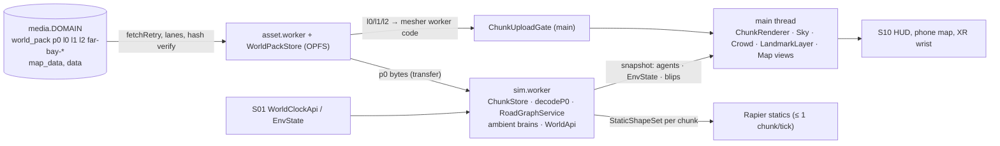

# 02 — World & Map (S02)

> S02, Wave 2, 2026-10-18. Format: `prompt-pack/03-SPEC-TEMPLATE.md` §B. Binding: `prompt-pack/06-SHARED-CONTEXT.md` v1.1 (frozen), `spec/.waves234-notes.md`, `spec/03-decisions-and-facts.md` (D-14…D-17, D-25, A-05), `spec/11-decision-log.md` (DL-049, DL-057), `spec/02-architecture.md` §4.2, and the Wave 1 domain specs. **This spec is split into five files**; read this one first.
> - `02-world.md` (this file): scope and checklist, design, components, runtime, platforms, facts, milestones, tests, open questions.
> - `02-world-contracts.md`: **C08 v1.0.0** TypeScript, service interfaces, binary pack format, bounds and index schemas.
> - `02-world-bake.md`: `tools/map` pipeline with dataset ids and outputs, sources and licences, stylization per tier, 37 landmarks with coordinates, districts, POIs.
> - `02-world-living.md`: road-graph semantics, traffic, robotaxis, pedestrians, transit, weather and time per tier, spawn tables.
> - `02-world-maps.md`: map packs, minimap, full map, boundaries and backdrop, teleports, attribution, web surfaces, expansion plan.

## 1. Scope and R-IDs

**Owns.** R-MAP-01 (accurate San Francisco), R-MAP-02 (rest of the Bay: backdrop now, districts later), R-MAP-03 (full map, minimap, markers, fast travel), R-MAP-04 (living city: traffic including robotaxis, pedestrians, transit set dressing, day/night and weather). **Contract owned:** C08 `WorldChunk` + `RoadGraph` + spawn tables, finalized at 1.0.0 in the contracts part. **Honored:** C01 (`StableKey` `amb:<cellKey>:<slot>`, component range 256–511, spawn prefix rule), C07 (kinds `world_pack`, `map_data`, `data`, `building`, `texture`; `ProvenanceRecord`), C13 (tiers, `TierBudget`, `WorldPackStore`, `RenderBudgetMeter`). **Consumed from other owners:** C06 `ModeContext`, `WorldClockApi`/`EnvState`, `ZoneService`, `PursuitApi`, `StaticShapeSet` (S01); C11 pose validation (S09); C12 route 37 (S12); C09 `WorldResolver` shape (S03, A-C08-1); `DistrictId`/`PoiId` shapes (S04). **Not owned:** clock and weather state, pursuit logic (S01); HUD layout and attribution UI (S10); mission IR (S03); NPC brains (S04); handling (S06).

### 1.1 Checklist

Status: **D** designed (milestone), **F** deferred (milestone), **X** out of scope.

| # | Item | St | Where | Milestone |
|---|---|---|---|---|
| 1 | SF-only playable area, bounds file for C11 | D | contracts §5 | M02a1 |
| 2 | ENU frame and `z/x/y` grid, City Hall chunk-centred | D | contracts §1–2 | M01f |
| 3 | Open-data sources, licences, attribution; no Google or Mapbox geometry [research/repos-world.md §4] | D | bake §2; maps §6 | M02a1 |
| 4 | `tools/map` bake end to end: exact dataset ids, outputs, gates, determinism | D | bake §3–5 | M02a1–a2 |
| 5 | Terrain and hills: Terrarium z15 to a 4 m heightfield shared by physics and render, roads graded in | D | bake S2, S7 | M02a1, a2 |
| 6 | Water, shoreline, piers, bathymetry clamp, `shoreNodes` | D | bake S2–S3, S9 | M02a1 |
| 7 | Buildings: DataSF extrusions plus OSM gap fill; mesher profile per tier; no 3D tiles | D | bake S4, §6 | M02a1, M02b1 |
| 8 | At least 25 hand-listed landmarks with coordinates (37 listed), glTFs replacing extrusions (A-05) | D | bake §7 | M02d1–d2 |
| 9 | Chunk and pack format, AssetIds, ≤ 4 MiB, graybox fixture and pure codec for M01b | D | contracts §1, §4 | M01f |
| 10 | LOD ladder (256 m, 1,024 m, 4,096 m), rings per tier, draw distances, cover masks | D | §5.3 | M02b1 |
| 11 | Streaming: priority, hysteresis, ≤ 1 upload per frame, OPFS packs, offline behaviour | D | §5.1–5.2 | M02b1 |
| 12 | Budgets per tier: render objects, memory, boot download | D | §5.4 | M02b1 |
| 13 | Road graph: lanes, one-way, layers, bridges, tunnels, classes | D | living §1 | M02a2 |
| 14 | Intersections, signals, stop signs, turn restrictions, blackout | D | living §1.4–1.6 | M02a2, M03b1 |
| 15 | Pedestrian graph (sidewalks, crossings, stairs, plazas) | D | living §4.1 | M02a2 |
| 16 | Chunk tags: hiding spots, pursuit breakers, choke points, jump zones, portals, shore and teleport nodes | D | bake S9 | M02a2 |
| 17 | Spawn tables by `(cellKey, slot)` with tier prefix rule, density model | D | living §7 | M02a2, M03b1 |
| 18 | Traffic system: kinematic agents, IDM following, junction protocol, promotion on contact | D | living §2 | M03b1 |
| 19 | Robotaxi behaviours: yield, dark-signal stall, witness, fare | D | living §3 | M03b1 |
| 20 | Pedestrian system: FSM, crossings, crowds, XR comfort | D | living §4 | M03b2 |
| 21 | Parked cars | D | living §7 | M03b1 |
| 22 | Transit set dressing: stations, Metro, buses, cable cars, ferries, aircraft | D | living §5 | M03b2 |
| 23 | Bridges and county line as boundaries and portals | D | maps §4.1–4.2 | M02a2, M02c1 |
| 24 | East Bay, Marin, Peninsula backdrop (ring, massing, cards) | D | maps §4.3 | M02b1 |
| 25 | Day, night, weather per tier: timecyc, fog bank, rain, night lights, budgets | D | living §6 | M02b2 |
| 26 | Minimap (Canvas 2D, tile cache, blips, banner) | D | maps §2 | M02c2 |
| 27 | Full map, markers, GPS, search, "Coming later" silhouettes | D | maps §3 | M02c2 |
| 28 | Teleports and fast travel with pre-streaming and precondition messages | D | maps §5 | M02c1 |
| 29 | Authoring support: `WorldResolver`, `resolve`, POI table, geocoder, district grid | D | contracts §3; bake §9 | M02c1 |
| 30 | Perf scenarios (paths) and telemetry | D | §4, §5.7 | M02b1, M03b1 |
| 31 | IP rules: no murals or public art, fictional brands and operators, landmark names via `NameRegistry` | D | bake §7; living §5 | all |
| 32 | Expansion districts R-MAP-02 | F | maps §8 | M15a–g |
| 33 | Anchor mask and web tiles for S12 and the forum | F | maps §1, §7 | M13b |
| 34 | Shared ambient traffic in rooms (seeded per room) | F | living §8 note | M12b |
| 35 | Photorealistic photo mode, 3D Tiles, contours, interiors (S03), fog of war | X | bake §2; maps §1 | licence, scope, Q-MAP-03 |

### 1.2 R-ID coverage

| R-ID | Statement (short) | Sections | Milestones |
|---|---|---|---|
| R-MAP-01 | accurate SF first | checklist 1–16, 23, 31; bake; contracts | M01f, M02a1–a2, M02b1, M02d1–d2 |
| R-MAP-02 | rest of the Bay as backdrop, later districts | 24, 32; maps §4.3, §8 | M02b1, M15a–g |
| R-MAP-03 | map, minimap, markers, fast travel | 26–29; maps | M02c1–c2, M13b |
| R-MAP-04 | traffic, robotaxis, peds, transit, day/night, weather | 17–22, 25; living | M02b2, M03b1–b2 |

## 2. Design

### 2.1 Decisions

Each statement is testable and cites its source.

1. **W-1 SF is the only playable area.** Everything else is backdrop until M15+ (R-MAP-01/02; owner update 2026-10-18).
2. **W-2 Open data only.** DataSF, OSM, Terrarium, USGS; no Google 3D Tiles and no Mapbox tiles as geometry [research/repos-world.md §4; F-053…F-056; D-14].
3. **W-3 One ENU frame and one quadtree.** City Hall origin, `z/x/y` keys over a ±65 km square (contracts §1).
4. **W-4 Two pack families per tile.** `p0` (sim, tier-independent bytes) and `l0` (render), 16 chunks each, ≤ 4 MiB (D-16; contracts §1 rules 4–5). Tier-independent sim data keeps the `canonical` profile identical on every device.
5. **W-5 Footprints are meshed in `asset.worker`.** Baked Int16 footprints, merged per chunk, ≤ 6 render objects, one static `BundleGroup`, ≤ 1 upload per frame (D-15, D-09).
6. **W-6 One heightfield.** Physics and render share 4 m posts; roads are graded in at bake [research/repos-world.md P5].
7. **W-7 Landmarks are glTFs outside the chunk budget.** They replace their extrusion by a remesh swap inside `swapM` (A-05).
8. **W-8 A lane-aware directed graph.** OSM geometry and tags, DataSF class, `oneway` and `cnn`; A* with ties by edge id [research/repos-world.md P7, rec 5].
9. **W-9 Ambient life is cheap by construction.** Kinematic path followers keyed `(cell, slot)`; a lower tier runs a prefix; physics only on contact [research/repos-world.md P7, P8; C01 rule 5].
10. **W-10 Signals are a pure function of the tick.** `blackout` is the only hashed switch.
11. **W-11 Weather is S01's state, S02's look.** `timecyc` rows plus a per-tier feature matrix; takram only on `desktop-ultra` behind an adapter [research/repos-world.md P9, P10].
12. **W-12 Maps are in-engine Canvas 2D.** `sf-map.v1.bin`; MapLibre only on web surfaces (D-25).
13. **W-13 Teleports never move a player onto unloaded ground.**
14. **W-14 The bake is deterministic and gated.** Same inputs, same bytes; CI fixture runs, nightly full verify.
15. **W-15 Names are fictional where a brand or mark is involved.** No murals or public art [research/legal-ip-likeness.md §6].
16. **W-16 Expansion adds areas, not architecture.** Same grid, same packs, same tags (maps §8).

### 2.2 Runtime data flow



### 2.3 Alternatives rejected

| Alternative | Why not |
|---|---|
| Google Photorealistic 3D Tiles or Mapbox tiles as world geometry | no caching, offline use or derivation; logos required [F-055, F-056] |
| SF repo's 2.5 km cells | one cell breaks the upload budgets on low tiers |
| Loose chunk files plus a batch-range endpoint (Grand-V) | a pack already coalesces 16 chunks; a batch route is a C12 change, kept as option P6 [research/repos-grand-v.md rec 2] |
| Runtime Overpass | rate limits (< 10,000 queries/day, no parallel scripts) [research/repos-world.md §4] |
| Overture for SF | ODbL anyway, drivability untested; DataSF lidar heights are better for SF [research/repos-world.md §4] |
| MapLibre or Mapbox in the game document | second WebGL context on iPhone; Mapbox terms [research/auth-ugc-input-maps.md §5.4] |
| Raster map tiles | 10–20 MB, blurry when rotated [research/auth-ugc-input-maps.md §5.4] |
| Navmesh crowds (Recast) | extra bake and wasm, determinism unproven; revisit if M03b2 fails (living §4.3) |
| Physics vehicles for ambient traffic | cost; kinematic with promotion on contact instead |
| Tier-specific sim packs | break `canonical` determinism |
| A render worker | XR is Window-only (D-08) |

## 3. Components

Package `packages/world` (`@dv/world`): `src/sim/**` runs under the C02 lint; `src/client/**` may use `three` and the DOM. Shared pure code is in `packages/shared/src/world/**`.

| Path | Responsibility | Public interface | Depends on |
|---|---|---|---|
| `packages/shared/src/world/{c08,c08-api,terrain,pack-codec}.ts` | C08 types, grid functions, `sampleHeight`, `decodeP0`, `signalAspect`, `activeSlots` | contracts part | `detmath` |
| `packages/world/src/sim/streaming/` | `ChunkStore` (interest, priority, lifecycle), statics feed to `PhysicsBackend.addChunkStatics` | `ChunkStore`, `StreamingPlan` | C13, `asset.worker` |
| `packages/world/src/sim/graph/` | adjacency, A*, junction runtime, `RoadGraphQuery` | `RoadGraphQuery` | `decodeP0` |
| `packages/world/src/sim/{traffic,peds,transit}/` | traffic, parked, robotaxi, pedestrian, transit, boat brains; witness | systems in `AI`/`Rules` | C01, C02, graph |
| `packages/world/src/sim/{api,map}/` (`TrafficControl` in `sim/traffic/`) | `WorldQuery`, `TeleportApi`, `PlaceIndex`, `WorldResolver`, `TrafficControl`, `MapApi` | `WorldApi` | all of the above |
| `packages/world/src/client/chunks/` | worker mesher, `ChunkRenderer`, `ChunkUploadGate`, cover masks, `LandmarkLayer` | — | three, C13 |
| `packages/world/src/client/sky/` | `TimecycFile`, `SkyUniforms`, dome, fog, rain, night lights, `AtmosphereAdapter` | — | three, `EnvState` |
| `packages/world/src/client/{traffic,peds}/` | instanced vehicle and pedestrian renderers, near-LOD skinned peds | — | three, C04 |
| `packages/world/src/client/map/` | `MinimapView`, `FullMapView`, tile cache, raster jobs | maps §2 | canvas |
| `packages/world/src/client/backdrop/` | far ring, massing, cards | — | three |
| `tools/map/` | bake, fixtures, geocoder, `resolve`, verify | CLI (bake §3) | Node 24 |

```ts
// packages/world/src/sim/streaming/plan.ts  (imports: QualityTierId from C13; ChunkKey, SimChunk from C08)
export interface StreamingPlan {
  tier: QualityTierId; r0M: number; r1M: number; r2M: number; altitudeBoostM: number;   // L0 / L1 / L2 outer radii (C13 WorldLimits for r0, r2)
  ambientM: number; physicsM: number; resident: { l0: number; l1: number; l2: number }; uploadBytes: number | null;
}
export interface ChunkStore {
  want(focus: { x: number; z: number; vx: number; vz: number }, plan: StreamingPlan): void;   // SimStage.Streaming, look-ahead v × 4 s
  sim(k: ChunkKey): SimChunk | null; ready(k: ChunkKey): boolean; residentKeys(): readonly ChunkKey[];
  onChunk(fn: (e: { k: ChunkKey; ev: 'ready' | 'evicted' | 'failed' }) => void): () => void;
}
```

## 4. Data

- **Types owned:** the C08 contract and its service interfaces (contracts part), `TimecycFile`, `SkyUniforms`, `MinimapView`, `FullMapView` (living §6, maps §2).
- **Persisted data:** none of its own. Saves carry `worldBake` (C05) and ENU positions; sandbox saved positions and teleport history live in the C05 sandbox slice (S01/S10).
- **Config** (`config/world/`): `streaming.json`, `density.json`, `mesher.json`, `roadclass.json`, `bridges.json`, `timecyc.json`, `transit.json`, `sources.json`, validated by JSON Schema in CI; `config/world.bounds.json` is shared with S09.
- **Content** (`content/world/`): `landmarks.json`, `pois.json`, `districts.json`, `pursuit-breakers.json`, `cablecars.json`, `teleports.json`; camera paths for S11's `PerfScenario` ids live in `config/perf/paths/` (`walk-civic-center`, `route-ferry-ocean-beach` Ferry Building to Ocean Beach for the M02b1 AC, `downtown-rush`; DL-221).
- **Flags:** `BootConfig.flags` keys `world.cards`, `world.rain`, `world.atmosphere` (all default on) allow a remote downgrade without a deploy; QA bridge `window.__dvBridge.world` (QA builds only) exposes `teleport(id)`, `setHour`, `setWeather`, `density(kind, mult)`, `blackout(on)`, `chunks()`.
- **Streaming table** (`config/world/streaming.json`, starting values †; radii in metres):

| Tier | r0 (L0) | r1 (L1) | r2 (L2 = draw distance, + boost) | ambient | physics | resident L0 / L1 / L2 | upload |
|---|---|---|---|---|---|---|---|
| desktop-ultra | 2,400 | 5,000 | 8,200 (+2,800) | 600 | 400 | 510 / 140 / 25 | — |
| desktop | 1,800 | 4,000 | 8,200 (+2,800) | 500 | 400 | 290 / 90 / 25 | — |
| xr-visionpro | 800 | 1,800 | 3,000 | 400 | 300 | 60 / 18 / 9 | — |
| mobile | 600 | 1,400 | 2,500 | 350 | 200 | 32 / 12 / 4 | — |
| mobile-low | 400 | 900 | 1,500 | 250 | 150 | 16 / 6 / 2 | 2 MB |
| xr-quest | 400 | 900 | 1,500 + fog | 250 | 150 | 16 / 6 / 2 | 2 MB |

r0, r2, physics and upload come from the C13 budget table (11-platform.md §4.5); r1, ambient and resident caps are S02 values. Resident caps equal the number of units inside 1.35 × the ring radius.

## 5. Runtime behavior

### 5.1 Boot

1. `BootConfig.assetCatalog` → catalog → `data/world-index`, `data/district-grid.v1`, `map_data/sf-graph.v1` (idle lane), `map_data/sf-map.v1` header.
2. Compute the boot set for the spawn point: `p0` tiles inside the physics radius plus one chunk, `l0` tiles inside `min(r0, 1 tile ring)`, `l1`/`l2` around, `far-bay-*`, facade atlas and sky assets, the landmarks inside `swapM`. The set is emitted by the headless run as `bootset.<mode>.json` (S11) and prefetched from the main menu [11-platform-pwa.md §5].
3. The sim waits (`Control` = `Waiting`) until the `p0` statics of the spawn area are built; the render fades in when the first `l0` chunk is uploaded.
4. Cold download for the first district must stay within the tier budget: 60 MB (ultra, desktop, Vision Pro), 40 (mobile, Quest), 30 (mobile-low) [11-platform.md §4.5]. Design estimate at desktop ≈ 33 MB: about 16 tiles of `p0` + `l0` at ≈ 1.2 MB, `sf-map` 3 MB, atlas and sky 6 MB, landmarks 5 MB; mobile ≈ 20 MB, mobile-low ≈ 13 MB.

### 5.2 Streaming rules

1. Focus = player position + velocity × 4 s (the same look-ahead as the S01 collider square); in XR the headset position.
2. Wanted set per level = units whose AABB meets the disc of the ring radius, ordered by `distance × dirWeight` (0.55 ahead, 0.85 side, 1.25 behind); the focus chunk and its eight neighbours are always first [research/repos-world.md P4].
3. Requests: `p0` for physics, graph and ambient radius (`needNow`); `l0` `soon`; `l1`/`l2`/`far` `idle`. Unload at 1.35 × the ring radius, LRU among unpinned; memory pressure `soft` evicts L0 beyond 1.0 × the ring first.
4. Meshing (`earcut@3.2.4` [research/repos-world.md §5], walls, roofs, vertex AO) runs in `asset.worker` per chunk (budget 12 ms desktop, 25 ms mobile †), producing transferable buffers; `ChunkUploadGate` uploads ≤ 1 chunk per frame (≤ 2 MB on `mobile-low` and `xr-quest`), highest priority first, and sets `needsUpdate` on the chunk's `BundleGroup` once.
5. Culling: chunk visibility every 8 frames or on a camera jump > 60 m, behind-camera cull `dot < −0.35`, shadows only inside the tier shadow distance [research/repos-world.md §1.5].
6. Sim: `SimStage.Streaming` requests; statics added ≤ 1 chunk per tick; floating-origin rebase when the player is > 1,000 m from the physics origin (S01).

### 5.3 LOD ladder

| Level | Cell | Content | Used for |
|---|---|---|---|
| L0 | `z=9` chunk 256 m | full footprints, roofs, ground classes, roads, trees, lamps, furniture, collision | inside r0 |
| L1 | `z=7` tile 1,024 m | footprints DP 3 m (drop h < 6 m outside d1/d5), terrain 16 m posts, road lines class ≤ 4, landuse | r0 to r1 |
| L2 | `z=5` block 4,096 m | massing boxes ≥ 20 m, terrain 64 m posts, road lines class ≤ 2 | r1 to r2 |
| Far | `far-bay-*` | DEM ring, massing, cards | beyond SF (maps §4.3) |

A coarser object hides the part a finer one covers through a **cover mask** uniform (4 × 4 bits per L1 object, 4 × 4 per L2 object) that discards fragments over resident children; seams get 8 m skirts. Fades are dithered over 0.5 s on desktop tiers and hard swaps on `mobile-low` and Quest. Governor knobs: `lodBias` scales the ring radii by `1 + 0.15 × bias`; `buildingDistanceScale` scales r1 and r2 (C13 `DynamicQuality`).

### 5.4 Budgets

| Item | Plan (visible, 40 % frustum) | Budget (C13) |
|---|---|---|
| Render objects, desktop | L0 62 chunks × 5 = 310, L1 16 × 3, L2 6 × 2, backdrop 3, sky and water 3, landmarks 8 × 3, crowd ≈ 20 → ≈ 420 | ≤ 600 |
| Render objects, mobile | L0 7 × 5 = 35, L1 2 × 3, L2 2, backdrop 2, sky and water 2, landmarks 4 × 3, crowd ≈ 20 → ≈ 80 | ≤ 150 |
| Render objects, mobile-low and Quest | ≈ 55 | ≤ 100 / 150 |
| Triangles, mobile | buildings ≈ 18–40 per building, ≈ 4 k per chunk → ≈ 0.3 M with L1/L2 | ≤ 1.0 M |
| World GPU share (†) | ≤ 25 % of the tier GPU cap: 750 / 500 / 375 / 150 / 100 / 175 MB (ultra, desktop, Vision Pro, mobile, mobile-low, Quest) | caps in C13 |
| Per-chunk GPU | ≈ 0.6–0.8 MB (buildings ≈ 0.3, terrain ≈ 0.07, roads ≈ 0.1, rest) | — |

Vegetation and lamps are one instanced draw each; furniture is a `BatchedMesh` capped at 64 instances (desktop), 24 (mobile), 12 (mobile-low), and its per-instance draws count against GPU draw commands [research/stack-rendering-platform.md §1.5]. On the WebGL2 backend `BundleGroup` gives no gain, so the draw-command budget (500 on mobile) binds.

### 5.5 Tick participation

`Streaming` (chunk interest, colliders); `AI` at 30 Hz (traffic, pedestrians, robotaxis, transit, witness); `Rules` (signal states derived from the tick, density factors, clock consumption); `Publish` (agent snapshot, `EnvState`, map view-model patch with player and blips). Main thread: `Anim` (near pedestrians), `Render` (chunks, crowd, sky, landmarks), HUD map views at their own cadence.

### 5.6 Failure modes

| Failure | Detection | Response |
|---|---|---|
| Pack miss or OS eviction | `PackUnavailable` | "re-downloading district" overlay; sim waits for `p0`; other tiles continue |
| Hash mismatch or corrupt decode | `hash-mismatch`, decoder throws | purge, refetch once, then mark the tile `failed` (void with an invisible wall); `err.asset` |
| Offline and `p0` missing at the spawn | `offline` | block the session with the offline message; otherwise keep playing inside the resident set |
| Memory pressure | `onMemoryPressure` | evict LRU L0, lower density, then the streaming radius one step [11-platform.md §5.6] |
| GPU context lost | S11 `RendererHost` | rebuild chunk GPU objects from resident meshes without refetch |
| Save from another bake | `worldBake` mismatch | snap to the nearest safehouse (DL-057) |
| Landmark pack missing | asset not ready | the extrusion proxy stays; no hole |

### 5.7 Telemetry

C16 1.1 name `world.stream` (client; `tier` comes from the envelope): `residentL0`, `missCount`, `uploadP95Ms`, `bytesMB`, sampled 10 %, one per minute with `perf.minute`; pack failures use the existing `err.asset`. No coordinate finer than a `z=9` chunk key is sent.

## 6. Platform notes

| | Desktop (ultra, desktop) | iPhone (mobile, mobile-low) | Quest 3 (xr-quest) | Vision Pro (xr-visionpro) |
|---|---|---|---|---|
| Backend | WebGPU, WebGL2 fallback | WebGL2 until the M01c spike passes, then WebGPU [11-platform.md §4.3] | WebGL2 with multiview | WebGPU XR |
| Streaming (r0 / r2) | 2,400 or 1,800 / 8,200 + 2,800 | 600 or 400 / 2,500 or 1,500 | 400 / 1,500 + fog | 800 / 3,000 |
| Mesher profile | desktop (80 tris per building) | mobile (40) or low (18) | mobile profile | desktop profile, no balconies |
| Shadows | csm3 | csm1 or blob | blob | csm1 |
| Crowd (traffic / peds) | 800 or 540 / 600 or 400 | 200 or 120 / 150 or 80 | 120 / 80 | 300 / 200 |
| Sky | dome + atmosphere (ultra) | dome, linear fog | dome, no screen-space rain | dome |
| Backdrop | ring 80 km + massing | cards 20 / 10 km | cards 10 km | cards 20 km |
| Map | HUD canvas | HUD canvas, rotate hint | wrist panel, north-up | wrist panel |
| Teleport | sandbox, map | sandbox, map | comfort arc + nodes | comfort arc + nodes |
| Boot download | ≤ 60 MB | ≤ 40 / 30 MB | ≤ 40 MB | ≤ 60 MB |

Packs are re-downloadable at any time [11-platform-pwa.md §5]. XR has no screen-space overlays.

## 7. Verified facts used

Rows copied from the ledger or the research reports. New rows (**N**) were checked live on 2026-10-18 for this spec.

| Fact | Source | Date | Used by |
|---|---|---|---|
| ENU frame and constants; SF repo bake (DataSF `ynuv-fyni`, OSM, Terrarium, USGS; 176,777 buildings in 36 cells, 513² DEM, 33,187 road ways; Int16 footprints; worker meshing; ≤ 1 upload per frame) | research/repos-world.md §1.1, §1.2, §1.5 | 2026-10-18 | contracts §1; bake S4 |
| OSM ODbL attribution and share-alike; DataSF PDDL; Terrarium public domain with USGS credit; Overture ODbL | https://www.openstreetmap.org/copyright ; https://data.sf.gov/api/views/ynuv-fyni.json ; https://registry.opendata.aws/terrain-tiles/ ; https://docs.overturemaps.org/attribution/ (F-053, F-054) | 2026-10-18 | bake §2; maps §6 |
| Google 3D Tiles and Mapbox forbid caching, offline use and derivation (F-055, F-056); Overpass < 10,000 queries/day; Nominatim 1 req/s, cache | https://developers.google.com/maps/documentation/tile/policies ; https://wiki.openstreetmap.org/wiki/Overpass_API ; https://operations.osmfoundation.org/policies/nominatim/ | 2026-10-18 | W-2; bake §2 |
| DataSF inventory (streets, 41 neighbourhoods, 224,290 base addresses, parks 255, Muni stops 3,260 and routes 135, trees); Protomaps SF z0–14 ≈ 3.9 MB gzip; roads layer 1.67 MB raw; minimap cache and budgets; OSMF game attribution | research/auth-ugc-input-maps.md §5.2, §5.3, §5.5, §5.7 | 2026-10-18 | bake; maps |
| `BundleGroup` per chunk, ≤ 6 objects (F-007); budgets per tier; packs ≤ 4 MB via `asset.worker` and OPFS (F-010, F-019) | research/stack-rendering-platform.md §1.5, §3.2, §6.2, §6.5, Performance budgets | 2026-10-18 | §4, §5 |
| `timecyc` keyframes, 12 uniforms, height fog, takram WIP | research/repos-world.md §3.3, P10, P11, §5 | 2026-10-18 | living §6 |
| Batch-range pattern; murals, landmark marks, fictional venues and operators; blackout robotaxi behaviour, districts, BART stations, cable cars; R2 prices (F-023) | research/repos-grand-v.md rec 2; research/legal-ip-likeness.md §6; research/gamedesign-decomposition.md §2.3, §2.4, §2.7; https://developers.cloudflare.com/r2/pricing/ | 2026-10-18 | §2.3; W-15; living |
| **N1** `ynuv-fyni` 177,023 rows; fields `sf16_bldgid`, `shape`, `hgt_mediancm`, `hgt_maxcm`, `gnd_mediancm`, `p2010_zmaxn88ft`, all typed text | https://data.sf.gov/api/views/ynuv-fyni.json ; …/resource/ynuv-fyni.json?$select=count(*) | 2026-10-18 | bake S4 |
| **N2** `3psu-pn9h` active classcode counts 0:1,145 1:110 2:202 3:1,530 4:2,376 5:10,906 6:109; oneway B 12,434, T 1,839, F 2,105; layer values | https://data.sf.gov/resource/3psu-pn9h.json (SoQL group-by) | 2026-10-18 | living §1 |
| **N3** `j2bu-swwd` has exactly 41 neighbourhood names (list in bake §8) | https://data.sf.gov/resource/j2bu-swwd.json | 2026-10-18 | bake §8 |
| **N4** Muni Metro stops (Market Street) give station positions: Embarcadero 37.7927, −122.3971; Montgomery 37.7888, −122.4021; Powell 37.7843, −122.4078; Civic Center 37.7792, −122.4142; Glen Park 37.7324, −122.4339 | https://data.sf.gov/resource/i28k-bkz6.json | 2026-10-18 | living §5 |
| **N5** `rnbg-2qxw` (contours) exposes no tabular columns in the views API | https://data.sf.gov/api/views/rnbg-2qxw.json | 2026-10-18 | maps §1 |
| **N6** Terrarium z15 tile 5241/12665 is 256 × 256 PNG and decodes City Hall to 17.6 m; z15 tile edge at 37.78° = 966.6 m | https://s3.amazonaws.com/elevation-tiles-prod/terrarium/15/5241/12665.png | 2026-10-18 | bake S2 |
| **N7** OSM ids and geocoder centroids for 35 of the 37 landmarks (medium confidence: centroids, not entrances) (Coit Tower w28824850, Ferry Building w558731934, …) | https://nominatim.openstreetmap.org/search (≥ 1.3 s apart, custom User-Agent) | 2026-10-18 | bake §7 |

**UNVERIFIED** (listed for `spec/99`; none appears inside an acceptance criterion):

| ID | Item | Default | Verified by |
|---|---|---|---|
| U-W1 | Geofabrik NorCal PBF URL, `osmium` subcommands, PBF-to-GeoJSON route (egress to `download.geofabrik.de` was reset on 2026-10-18) | pinned in `config/world/sources.json`, checked as the first step of M02a1 | M02a1 |
| U-W2 | Overpass public endpoints as a fallback (`overpass-api.de` returned no data on 2026-10-18) | Geofabrik only | M02a1 |
| U-W3 | NAIP/USGS imagery licence for colour sampling | `--imagery` off | Q-MAP-04 |
| U-W4 | Sizes of map layers other than roads; geocoder size | gates fail > 4 MiB | M02c2 |
| U-W5 | Seeds: BART 16th St, 24th St, Balboa Park; Caltrain terminus; Golden Gate portal point | snapped by `pnpm map:landmarks` | M02a2 |
| U-W6 | Cable-car street chains | bake checks within 6 m | M02a2 |
| U-W7 | SPDX strings `ODbL-1.0`, `PDDL-1.0` in the licence allowlist | proposal P5 | M00b |
| U-W8 | Per-pack GETs from the R2 custom domain are fast enough without a batch route | measure | M02b1 |
| U-W9 | OSM sidewalk, crossing and ferry-route coverage in SF | derived sidewalks, authored ferry lines | M02a2 |
| U-W10 | Bake time ≤ 25 min, meshing 12 / 25 ms, sky GPU ms, all † budgets | calibrate | M02b1–b2, M11a |
| U-W11 | DataSF footprints omit post-2010 buildings | OSM gap fill and towers | M02a1 |

## 8. Milestone mapping

Ids follow `spec/00-plan.md`; a digit is a session split, a new letter is a proposed scope. Each piece is sized for one Sonnet 5.5 session (2–4 h, under about 40 files). "Stub first" lists what is faked before the real piece lands.

| Milestone | Scope and deliverables | Stub first | Sessions |
|---|---|---|---|
| **M01f** graybox-fixture-codec (before M01b) | `packages/shared/src/world/{c08,c08-api,terrain,pack-codec}.ts`; `tools/map/src/fixtures/graybox.ts`; `tests/fixtures/world/civic-graybox/` (`p0-64-64`, `l0-64-64`: flat 17.6 m terrain with a 2 % slope, 12 boxes, a 4-way road with 2 signals, sidewalks) | hand-authored data, no network | 0.5 |
| **M02a1** bake-core | `tools/map` skeleton, S0 fetch, S2 terrain, S3 water and landuse, S4 buildings, pack writer, `world-index`, attribution, gates | no roads in packs, no landmarks | 1 |
| **M02a2** bake-roads-graph | S5–S10: graph, junctions, signals, grading, slabs, hoods, ped graph, tags, spawn tables, `sf-graph.v1`, POIs seed, transit nodes | `content/world/*` lists minimal | 1 |
| **M02b1** streaming-lod | `ChunkStore`, mesher in `asset.worker`, `ChunkRenderer`, `ChunkUploadGate`, cover masks, L1/L2, backdrop ring/massing/cards, statics feed, perf paths, `world.stream` | flat-colour facade, no landmarks, cards from a placeholder atlas | 1 |
| **M02b2** weather-time | `timecyc`, dome, fog bank, rain, night lights, tier matrix, presets, blackout look | no atmosphere adapter (ultra falls back to desktop sky) | 1 |
| **M02c1** graph-services-teleports | `RoadGraphService` and A*, junction runtime, `WorldQuery`, `TeleportApi`, `WorldResolver`, `PlaceIndex`, district grid, POI table, `WorldApi` wiring | landmarks as marker boxes | 1 |
| **M02c2** maps | S12 map bake, `MinimapView`, `FullMapView`, blips, GPS, search, attribution data to S10 | geocoder without fuzzy search | 1 |
| **M02d1 / M02d2** landmarks | recipe kit and 12 hero/major glTFs; remaining 25; `LandmarkLayer`, proxy swap, skyline set | boxes with correct footprints | 2 |
| **M03b1** traffic | agents, IDM, junction protocol, signals, parked cars, robotaxis, blackout, density model, promotion | box cars | 1 |
| **M03b2** peds-transit | pedestrian FSM, crossings, crowds, near/far LOD, stations, buses, cable cars, ferries, aircraft | capsules for peds | 1 |
| **M13b** (S12 share) | `map:webtiles`, `anchor-mask.v1`, `world.describe` export | — | 0.3 |
| **M15a–g** | expansion framework and areas (maps §8) | backdrop stays until an area ships | 2 + 1–2 each |

Dependencies: M01f ← M01a; M02a1 and M02a2 ← M01f, M01d (publish); M02b1 ← M02a2, M01c, M01e; M02b2 ← M02b1 and the S01 clock (M01a); M02c1 ← M02a2, M02b1; M02c2 ← M02c1 and S10's HUD host (M04b); M02d ← M02b1; M03b1 ← M02c1, M03a; M03b2 ← M03b1; M15a ← M14b. R-ID map: R-MAP-01 → M01f, M02a1–a2, M02b1, M02d; R-MAP-02 → M02b1, M15a–g; R-MAP-03 → M02c1–c2, M13b; R-MAP-04 → M02b2, M03b1–b2.

Acceptance-criterion seeds (final text is written in the milestone files; none depends on an UNVERIFIED item):
- **M01f.** `decodeP0` on the fixture returns 4 chunks with equal shared edge posts and re-encodes byte-identically (`pnpm --filter @dv/shared test -- world`); `pnpm map:fixture graybox --check` reproduces the committed hashes.
- **M02a1.** From a cached raw snapshot, `pnpm map:build -- --area sf --stage terrain,water,buildings,pack` yields baked DataSF buildings ≥ 98 % of the `ynuv-fyni` row count in `raw.lock.json` (OSM additions ≤ 5 %, listed by id; DL-288), every pack ≤ 4 MiB, identical hashes on a second run, no key in `dist/world` (`check:secrets`) and an attribution file listing every source.
- **M02a2.** `pnpm map:verify` shows a strongly connected component ≥ 98 % of drivable edges, a route from City Hall to every portal, ≥ 2 phases at every signal junction and a passing `pnpm map:landmarks` (a failing seed is corrected from OSM, never waived).
- **M02b1.** `pnpm check:perf -- --scenario route-ferry-ocean-beach` on the desktop reference: no frame over 50 ms, ≤ 1 upload per frame; render objects within the tier budget on `chromium-webgl2` and `webkit-webgl2`; cold download within the tier budget.
- **M02b2.** Presets and hours switch without uniform jumps; luminance gates pass (living §6); `mobile-low` sky ≤ 0.3 ms on the reference device (manual, recorded).
- **M02c1.** Teleport to each of 10 landmarks lands within 0.2 m of ground or returns the precondition message without moving the player; A* is identical in Node and Chromium; `WorldResolver.snap` rejects targets > 25 m away.
- **M02c2.** Minimap position within 5 m at 10 landmark checks; banner matches the street `nhood` at 20 points ≥ 30 m from borders; 50 EAS addresses geocode within 10 m on the same CNN; attribution on splash, full map and credits.
- **M02d.** 37 `building/lm.*` assets in the catalog with provenance within the per-fidelity triangle budgets; the proxy swap remeshes without a frame over 50 ms.
- **M03b1.** 10,000 canonical ticks give identical hashes in Node, Chromium and WebKit; 600 s with 50 agents shows no red-light entry; 20 seeded dark-signal runs hold a robotaxi 4–9 s; `downtown-rush` meets the tier agent count at ≥ 60 fps desktop, ≥ 30 fps iPhone (script plus manual).
- **M03b2.** Pedestrians wait at red crossings and stay 0.6 m from an XR head fixture; `mobile-low` agents are a subset of desktop agents at the same `(cell, slot)`.

## 9. Tests

| Test | Proof |
|---|---|
| `shared/c08.grid`: key round trips, City Hall is `9/256/256`, `packRefOf` examples | `pnpm check:unit -- packages/shared` |
| `shared/c08.signal`, `shared/world.activeSlots` (prefix monotonic across tiers) | same |
| `shared/pack-codec.roundtrip` | same |
| `tools/map/fixture.deterministic` | `pnpm map:fixture graybox --check` |
| `tools/map/stage.terrain`, `stage.buildings`, `stage.graph` on the committed 1 km² excerpt | `pnpm check:unit -- tools/map` |
| `tools/map/gates.fullbake` (nightly) | `pnpm map:verify` |
| `world/streaming.uploadgate`, `streaming.priority` (mock store, scripted path) | `pnpm check:unit -- packages/world` |
| `e2e/@world-route` Ferry Building to Ocean Beach | `pnpm check:e2e -- --project=chromium-webgpu --grep @world-route`; `pnpm check:perf -- --scenario route-ferry-ocean-beach` |
| `e2e/@world-boot-size` cold boot bytes per tier | `pnpm check:e2e -- --project=chromium-webgl2 --grep @world-boot-size` |
| `world/graph.route`, `graph.closures`, `resolver.snap` | `pnpm check:unit -- packages/world` |
| `world/traffic.hash` cross-browser | `pnpm check:e2e -- --project=webkit-webgl2 --grep @world-hash` |
| `world/traffic.signals`, `robotaxi.blackout`, `ped.crossing`, `density.prefix` | `pnpm check:unit -- packages/world` |
| `world/teleport.landmarks10` | `pnpm check:e2e -- --project=chromium-webgpu --grep @world-teleport` |
| `world/map.accuracy` (5 m, banner, EAS, one-way arrows, street count ±0.5 %) | `pnpm check:e2e -- --project=chromium-webgl2 --grep @world-map` |
| `world/map.attribution` | same grep `@world-attribution` |
| `world/sky.gates` (luminance, uniform continuity) | `pnpm check:e2e -- --project=chromium-webgl2 --grep @world-sky` |
| `world/landmarks.verify`, `landmarks.budget`, `landmarks.proxy` | `pnpm check:assets`; `pnpm check:unit -- tools/map` |
| `ci/ip.world`: `names:lint`, `ip:strings` over `content/world`; decals need `origin=generated` provenance | `pnpm names:lint && pnpm provenance:check` |
| `perf/downtown-rush` | `pnpm check:perf -- --scenario downtown-rush`; device checklist `pnpm perf:checklist` |

Proposed new alias for S13: `check:world` = `check:unit -- tools/map packages/world` plus the fixture determinism check.

## 10. Open questions, decisions, risks

| Q | Question | Default applied | Blocks |
|---|---|---|---|
| Q-MAP-01 | Minimap heading-up or north-up by default; fog-of-war "discover SF" | heading-up with a north-up toggle; no fog-of-war | M02c2 |
| Q-MAP-02 | Real transit brand names on the map | fictional operator brands, factual station names (living §5) | M03b2 |
| Q-MAP-03 | Hillshade and contours on the full map | hillshade on (≈ 0.25 MB), contours off | M02c2 |
| Q-MAP-04 | NAIP/USGS imagery for colour sampling | off (U-W3) | none |
| Q-MAP-05 | Landmark authoring: code recipes now, Blender pass later (DN-S02-01) | recipes in M02d, art pass after M05c | M02d |
| Q-MAP-06 | Overture buildings for expansion areas | spike in M15a, OSM otherwise | M15a |
| Q-MAP-07 | Parcel land-use attribute for anchor rules (S12 U12) | polygon-only rule plus human check | M13b |
| Q-MAP-08 | DistrictId casing: S02 uses lowercase `d1…d10`; S06's data part declares `D1…` | S06 aligns to lowercase | M07a |

Risks (early signal → mitigation).
- **R-S02-01** tunnel hoods look or collide wrong → the YBI, Broadway and Presidio tunnel drive tests; fallback: short tunnels become open cuts, long ones teleport pairs.
- **R-S02-02** iPhone memory from resident chunks plus textures → caps in §4, eviction order, `mobile-low` mesher.
- **R-S02-03** DataSF refreshes daily → pinned `raw.lock.json`, snapshot archived to PRIVATE R2.
- **R-S02-04** ODbL share-alike scope → packs and scripts public; no proprietary data in the same database; counsel review.
- **R-S02-05** graph SCC below 98 % → island report and a manual fix list in `content/world`.
- **R-S02-06** cross-tier ambient divergence → per-agent streams, no tier branching inside a profile (`world/density.prefix`).
- **R-S02-07** meshing CPU on weak phones (chunk mesh > 25 ms) → smaller profile, or pre-baked meshes for `mobile-low` (packs about 4× larger, still ≤ 4 MiB).
- **R-S02-08** `BundleGroup` gives no gain on the WebGL fallback → budget on draw commands, merge furniture.
- **R-S02-09** landmark names or silhouettes drift into branding → `names:lint`, `NameRegistry`.
- **R-S02-10** 37 landmark assets slip → recipes first, hero art pass later.

Decisions needed (also in the return block): DN-S02-01 landmark authoring route; DN-S02-02 transit brand names; DN-S02-03 imagery default; DN-S02-04 tunnel strategy (recommend carved hoods); DN-S02-05 batch route stays out of v1; DN-S02-06 add `ModeContext.world` (P1).

Contract change proposals (return block): P1 `ModeContext.world: WorldApi` (C06 1.1); P2 sloped `strips` in `StaticShapeSet` (S01); P3 landmark layer sits outside the six-object chunk rule (06 §4.4 clarification); P4 C16 name `world.stream`; P5 licence allowlist `ODbL-1.0` and `PDDL-1.0`, one `ProvenanceRecord` per pack (`derived_from` = source-stamp sha256s, DL-161); P6 optional C12 batch route (conditional); P7 S11 QA flags `?hour=`, `?weather=`; P8 S10 `UiBridge` map view-model patch and `AreaBanner` key `nhood.<slug>`.
