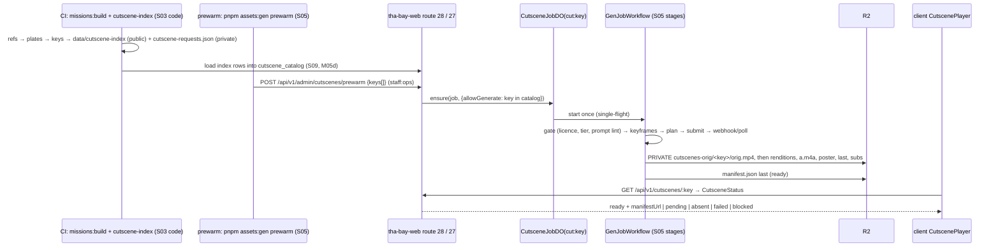

# Domain 03 — Story, Missions & Cutscenes (S03), Part D: C09 Cutscenes, director, keys, prewarm

> Wave 2 · v1.0 · 2026-10-18 · author S03. Continues `03-story.md` (Part A). Carries template §4–§5 for cutscenes: the C09 cutscene types, cache-key spec, hooks and prompt templates, the request → Worker → fal → R2 → manifest path, the in-engine director (fallback), the player protocol, QA and moderation, prewarm lists, counts and cost. Requirements: R-CUT-01, R-CUT-02, R-CUT-03, R-ENG-03, R-ENG-04, R-IP-01/02. Binding: A-03 (v1, DL-051), A-08, D-19, D-20, the C09 fixed lines in 06 §4.4, ADR-GENAI-01 [research/gap-video-model-licence-clearance.md §8]. Generation infrastructure (`CutsceneJobDO`, `GenJobWorkflow`, transcoder, budget) belongs to S09/S05; S03 owns templates, hooks, keys, the request contract, the index and playback.

## D1. Model

- A **clip** is one generated video asset with one cache key and one directory `cutscenes/<key>/` (manifest written last). A clip holds 1–2 shots of 6–10 s each, the provider-portable range [research/gap-video-model-licence-clearance.md §7].
- A **CutsceneRef** is an authored request for one clip: hook, template, cast, stage, move, beat slots, subtitles and a mandatory in-engine **DirectorScript** fallback (R-CUT-03).
- A **sequence** is an ordered list of refs played back to back. Fight intros are `[walkIn(P1, stage), walkIn(P2, stage), faceOff(P1, P2)]`, composed on the client (gamedesign §4.5; [research/gap-cutscene-delivery-playback.md §7.4]).
- **Generated clips are cinematic interstitials** (establishing, action, reveal, signature move). Dialogue scenes are always in-engine DirectorScripts with voice lines and subtitles, because generated clips have no lip-sync in the default recipe and the in-engine path is free. A generated clip may carry voice-over lines from the same `cues`, played through the engine audio bus.
- **The protagonist and user NPCs never appear in a generated clip.** Their look is per player, generation for players is out of v1 (G3), and a pre-generated clip cannot show them. Clips that need them stay in-engine: player-fighter walk-ins and endings, and every protagonist close-up.

## D2. C09 cutscene types (normative)

```ts
// packages/shared/src/contracts/c09-cutscene.ts  (C09_VERSION re-exported from c09-mission.ts)
import type { LineId, CastName, LatLngTuple } from './c09-mission';
import type { LandmarkId } from '../world/c08';
type LikenessTier = import('../assets/c07').LikenessTier;      // consented | parody | fictionalized | original (C07)
type AssetRef = import('../assets/c07').AssetRef;

export type CutsceneHook = 'story.establish' | 'story.beat' | 'fight.walkin' | 'fight.faceoff' | 'fight.special'
  | 'fight.super' | 'fight.shutdown' | 'fight.ending' | 'race.intro';
export type CutsceneRefId = `cut.${string}`;   // cut.story.<missionId>.<beat> · cut.fight.walkin.<char>.<stage> · cut.fight.faceoff.<a>.<b>
                                               // cut.fight.<special|super|shutdown>.<char>.<move> · cut.fight.ending.<char> · cut.race.intro.<raceId>
export interface CueSpec { line: LineId; speaker?: string /* soul id */; startMs: number; endMs: number; kind: 'dialogue' | 'sdh' }
export interface CutsceneRef {
  id: CutsceneRefId; hook: CutsceneHook;
  template: `${string}@${number}`;             // content/prompts/genai/<name>@<n>.md
  cast: string[];                              // soul ids, sorted; never the player avatar or a user NPC
  stage: string | null;                        // `<stageId|beat.<refId>|race.<raceId>>@<ver>`
  move: string | null;                         // `<moveId>@<ver>` (fighter hooks)
  slots: Record<string, string>;               // authored slot text (§D4), versioned by the beat revision
  fallback: string;                            // DirectorScript id; required
  cues: CueSpec[];                             // shared by video and fallback
  audio: 'engine' | 'generated-ambient';       // §D7
  prefetch: 'onTrigger' | 'onObjective' | 'onSelect' | 'none';
  priority: 1 | 2 | 3 | 4;                     // prewarm order (§D9)
  skippable: true;
}
export interface CutsceneKeyInput {             // A-03, exactly these eight properties
  template: `${string}@${number}`;
  characters: { id: string; soulVersion: number; likenessTier: LikenessTier }[];  // sorted by id, unique
  move: string | null; stage: string | null;
  style: `${string}@${number}`;                // style bible, e.g. 'bay-cel@1'
  endpoint: `${string}@${string}`;             // endpointId@pinnedUpdatedAt from config/genai-endpoints.json
  seed: number;                                // u32
  inputHashes: string[];                       // sorted lowercase SHA-256 of input files, never URLs
}
/** sha256Hex(canonicalize(normalizeKeyInput(i))) — packages/shared/src/genai/cutscene-key.ts; pure and synchronous. */
export declare function cutsceneKey(i: CutsceneKeyInput): string;
export declare function normalizeKeyInput(i: CutsceneKeyInput): CutsceneKeyInput;   // sorts, dedupes, lowercases; throws on bad input

export interface CutsceneIndexEntry {
  ref: CutsceneRefId; key: string; keyInput: CutsceneKeyInput; provider: string /* registry provider key */;
  characters: { id: string; soulVersion: number; tier: LikenessTier }[];
  durationMs: number; fallback: string; cues: CueSpec[]; audio: CutsceneRef['audio']; stale?: true;
}
export interface CutsceneIndex {                // shipped as C07 asset data/cutscene-index; rows also feed S09's cutscene_catalog
  schema: 'cutscene-index/1'; release: string; builtAt: number; entries: CutsceneIndexEntry[];
}
export interface ShotPlan {                     // private; S05's keyframe + video steps consume it
  shotId: string; durationS: 6 | 7 | 8 | 9 | 10; prompt: string; keyframePrompt: string;
  inputs: { role: 'style' | 'sheet' | 'plate' | 'keyframe'; sha256: string; subject?: string }[];
  camera: 'static' | 'push-in' | 'pull-out' | 'pan' | 'orbit' | 'tracking'; subjects: string[];
}
export interface CutsceneRequest {               // private build artifact cutscene-requests.json → prewarm → GenJob(kind 'cutscene_shot')
  schema: 'cutscene-request/1'; key: string; keyInput: CutsceneKeyInput; ref: CutsceneRefId; hook: CutsceneHook;
  templateSha256: string; shots: ShotPlan[]; cues: CueSpec[]; audio: CutsceneRef['audio'];
  characters: CutsceneIndexEntry['characters']; priority: CutsceneRef['priority']; budgetUsdMicros: number;
}
export interface Rendition { file: string /* relative to cutscenes/<key>/ */; bytes: number; sha256: string; codecs: string; kbps: number }
export interface CutsceneManifest {              // R2 cutscenes/<key>/manifest.json, written last (06 §4.4 fixed)
  schema: 'cutscene-asset/1'; key: string; recipe: 'cut@1';
  fps: 24; frames: number; width: number; height: number;
  renditions: Partial<Record<'v540' | 'v768' | 'v1080' | 'p720', Rendition>>;  // p720 only with degraded: true
  audio?: { file: 'a.m4a'; lufs: number; speechDetected: boolean; approvedBy?: string };   // optional: absent when the ref's audio is 'engine' (06 v1.1 C09 line, DL-082)
  poster: 'poster.webp'; last: 'last.webp'; subs: Record<string /* BCP 47 */, string /* subs.<lang>.vtt */>;
  shots: { shotId: string; startFrame: number; frames: number }[];
  characters: { id: string; soulVersion: number; tier: LikenessTier }[];
  licence: { gate: 'ADR-GENAI-01'; provider: string; status: 'cleared' | 'pending'; termsSnapshotSha256: string[];
    clearedBy?: string; clearedAt?: number; uiCredit?: string };
  provenance: { endpoint: string; pinnedUpdatedAt: string; requestIds: string[]; origSha256: string;
    c2pa: 'valid' | 'valid-untrusted' | 'absent' | 'invalid'; resigned: boolean; aiGenerated: true };
  degraded?: true;
}
// HTMLVideoElement below resolves through the type-only shim packages/shared/src/contracts/dom-media.d.ts (no DOM lib in @dv/shared; DL-232)
export interface PreparedClip {                 // 06 §4.4 fixed minimum (DL-061) + S03 fields
  key: string;
  source: { kind: 'element'; video: HTMLVideoElement } | { kind: 'decoder'; url: string; codec: string };
  width: number; height: number; durationMs: number;
  cues: { startMs: number; endMs: number; text: string }[];
  degraded: boolean;
  aiGenerated: true; uiCredit?: string; posterUrl: string; lastUrl: string;
}
export type CutsceneHostKind = 'dom-overlay' | 'xr-media-layer' | 'xr-texture' | 'webcodecs-texture';
export type FallbackTrigger = 'not_ready' | 'not_permitted' | 'media_error' | 'start_stall' | 'mid_stall'
  | 'codec' | 'budget' | 'policy' | 'offline' | 'degraded_sequence' | 'setting_off';
export type CutsceneOutcome = { path: 'video' | 'fallback' | 'instant'; skipped: boolean; trigger?: FallbackTrigger };
export interface CutscenePlayer {               // packages/engine/src/client/cutscene/ (S03, main thread)
  /** Resolve refs via the index, roster flags and route 27; fetch manifests; pick host and rendition; never throws. */
  prepare(playId: string, refs: CutsceneRefId[]): Promise<{ clips: PreparedClip[] } | { fallback: FallbackTrigger }>;
  play(playId: string, clips: PreparedClip[]): Promise<CutsceneOutcome>;
  /** Mixed sequences (fight intros, DL-081): items play back to back; an item whose ref is null, suppressed or not ready plays its
   *  DirectorScript in-engine; the sim is told per item through UiCommand {t:'cutscene.state', playId, item, state}. Never throws. */
  playSequence(playId: string, items: { ref: CutsceneRefId | null; fallback: string /* DirectorScript id */ }[]): Promise<CutsceneOutcome[]>;
  skip(playId: string): void;
  prefetch(refs: CutsceneRefId[]): void;        // manifest, poster, audio; ≤ 2 ahead on mobile tiers
}

export interface DirectorScript {               // content/missions/<id>/director/<beat>.ts → data/director.<id>; also S06/S07 sequences
  schema: 'director/1'; id: string; durationSec: number; seed: number;
  marks: Record<string, { at: LatLngTuple | { landmark: LandmarkId } | { local: [number, number, number] }; yawDeg: number }>;
  actors: { who: CastName | 'player' | `soul:${string}`; start: string; end: string; prefab?: string }[];
  shots: DirectorShot[];                        // sorted by atSec; first shot at 0
  actions: { atSec: number; who: string; do: 'moveTo' | 'runTo' | 'driveTo' | 'anim' | 'look' | 'enter' | 'exit'; arg: string }[];
  cues: CueSpec[];
  xrVantage: { mark: string; yawDeg: number };  // XR: fixed vantage, no cuts (C04 rule 5)
  letterbox: boolean; music?: AssetRef; frame?: 'world' | 'stage2d';  // stage2d = fighter side view
}
export interface DirectorShot {
  atSec: number; preset: 'establish' | 'two-shot' | 'over-shoulder' | 'single' | 'insert' | 'reaction' | 'tracking' | 'orbit' | 'auto';
  subject: string; secondary?: string; from?: string /* mark */; lens: 'wide' | 'normal' | 'tele';
  move?: 'static' | 'push-in' | 'pull-out' | 'pan' | 'orbit';
}
```

## D3. Cache-key specification (A-03)

1. **Inputs**, built by `tools/assets cutscene-index` (S03 code, run in CI with S05's registry):
   - `template` comes from the ref.
   - `characters[]` comes from the compiled souls of `cast`: `id`, `soulVersion` (C10 integer) and `likenessTier` (C07 tier, `original` for invented characters).
   - `move` and `stage`: story refs use `stage = beat.<refId>@<rev>`; fighter refs use S07 stage and move ids with versions; race refs use `race.<raceId>@<ver>`.
   - `style` comes from the template frontmatter.
   - `endpoint` is the registry's `endpointId@pinnedUpdatedAt` for the provider chosen by S05's selection rule [`05-assets.md` §4.5]: the image-to-video endpoint for recipe K, the reference-to-video endpoint for recipe R.
   - `seed` = `content/cutscenes/seeds.json[refId]` when a reviewed retake is pinned, else `parseInt(sha256Hex(refId).slice(0, 8), 16)`.
   - `inputHashes`: style-bible image, each character's approved sheet crop (`asset_index`), the stage plate (§D5) and any authored keyframe.
2. **Computation:** `normalizeKeyInput` sorts `characters` by `id`, rejects duplicates, sorts and lowercases `inputHashes`, and requires `seed` to be an integer in 0…2³²−1. Then `sha256Hex(canonicalize(x))` with `packages/shared/src/json.ts` and `packages/shared/src/hash.ts` (RFC 8785, pure, sync; DL-073). Licence status is never part of the key.
3. **Params are versioned through the template.** Duration, shot count, aspect, resolution (768P) and `prompt_expansion_mode: disabled` are template frontmatter, so changing any of them requires a template version bump, and the bump changes the key. The frontmatter also records `keyframePin: <endpointId>@<pinnedUpdatedAt>` of the keyframe model; CI fails when it differs from the registry, so a keyframe re-pin forces a template bump.
4. **Beat revisions:** `content/cutscenes/beats.lock.json` stores `sha256(canonicalize({slots, cues}))` per story ref and its `rev`. `missions:build` fails when slots or cues change without a `rev` bump, so an edit to the beat text can never ship under an old key.
5. **Never twice:** a key is generated at most once. `CutsceneJobDO` is the single-flight lock, and its ready test is `HEAD manifest.json` (D-19). A retake is a new seed and therefore a new key. Rejected retakes are garbage-collected after the release that pins the chosen seed.
6. **Test vectors** in `packages/shared/test/cutscene-key.vectors.json`, at least these 7:
   - a reordered `characters` list gives the same key;
   - a reordered `inputHashes` list gives the same key;
   - `soulVersion` +1 gives a new key;
   - a tier change gives a new key;
   - an endpoint re-pin gives a new key;
   - a new seed gives a new key;
   - adding a property is rejected.

| Change | Effect |
|---|---|
| soul edit (`soulVersion` +1), tier downgrade, new approved sheet | new keys for that character's clips only |
| `genai:repin` of the video endpoint, provider switch | new keys for that provider's clips; the index carries over the previous ready key (`stale: true`) until the new one is ready |
| template or style version bump | new keys for that template's clips |
| kill-switch (`RosterFlags`, scope `cutscene` or `all`) | no key change; the index entry is suppressed on the client within one roster refresh and route 27 answers `blocked`; KillPurgeWorkflow quarantines (S05) |
| licence revoked for a provider | the index builder drops that provider's keys; refs fall back until regenerated on a cleared provider |

**Index carry-over rule.** For each ref the builder computes the desired key. If it is ready, the builder uses it. Otherwise, if the previous release's key for the same ref is still valid, it keeps that key with `stale: true`. A key is still valid when it has the same characters at the same `soulVersion` and tier, no kill, and a provider that is not delisted. In every other case the builder emits the desired key, and the clip plays the fallback until prewarm completes. This is S05's "re-pin does not orphan shipped clips" requirement [`05-assets-pipeline.md` §13].

## D4. Hooks, templates and prompt hygiene

| Template | Hook (R-CUT-02) | Recipe | Shots × s | Cast in frame | `stage` | `move` | Audio |
|---|---|---|---|---|---|---|---|
| `story.establish@1` | story beat (place) | K | 1 × 8 | 0–2, background only | beat | — | generated-ambient |
| `story.beat@1` | story beat (action, reveal) | K | 2 × 7 | 1–3 | beat | — | engine |
| `fight.walkin@1` | fight intro, per character × stage | K (R when the provider has refs) | 1 × 6 | 1 | stage | — | engine |
| `fight.faceoff@1` | fight intro, per pair | R preferred, K otherwise | 1 × 8 | 2 | null | — | engine |
| `fight.special@1` | special move, per character × move | K | 1 × 6 | 1 | null | move | engine |
| `fight.super@1` | Showstopper super, per character | K | 1 × 8 | 1 | null | move | engine |
| `fight.shutdown@1` | finisher, per character | K | 1 × 8 | 1 | null | move | engine |
| `fight.ending@1` | ending, per winner | K | 1 × 10 | 1 | home stage | — | engine |
| `race.intro@1` | racing event intro (SHOULD) | K | 1 × 8 | 0–2 rival drivers, in cars | race | — | generated-ambient |

Recipes K (keyframe-first: Sunburst keyframe, then image-to-video with a fixed seed) and R (reference-to-video with ≤ 4 square refs) are from [research/genai-pipeline-fal.md §2.1]. K is the portable default, and R is a per-provider enhancement [research/gap-video-model-licence-clearance.md §7]. All templates use 16:9, 768P and `prompt_expansion_mode: disabled` where the provider has it. That parameter is verified for H3 Max Turbo [research/genai-pipeline-fal.md §A]; for other providers the adapter omits it. Specials, supers and shutdowns are victim-agnostic, and the victim's reaction is an in-engine cut after the clip (gamedesign §4.5).

**Template file** (`content/prompts/genai/<name>@<n>.md`):

```md
---
id: fight.walkin
version: 1
hook: fight.walkin
recipe: K
style: bay-cel@1
keyframePin: openai/gpt-image-2.5/sunburst/edit@<pinnedUpdatedAt>
shots: [{ durationS: 6, camera: push-in }]
aspect: '16:9'
resolution: 768P
audio: engine
slots: [style_tokens, subject_brief_1, place_desc, time_of_day, mood]
---
{style_tokens}. {place_desc}, {time_of_day}. A crowd waits at the edges, softly out of focus.
Image 1 is the fighter: {subject_brief_1}. The fighter walks toward the camera, stops and settles into a
confident ready stance, {mood}. The camera pushes in slowly at chest height, then holds.
No text, no letters, no logos, no numbers on clothing.
```

`story.beat@1` adds `{action_1}`, `{action_2}`, `{camera_1}` and `{camera_2}` slots, filled from the ref's `slots`. Example, A1.04 keynote: "a stage under a giant screen; a map of the city's curbs splits into glowing numbered lots; a silhouetted executive raises one hand".

**Closed slot sources** (nothing else may fill a slot):

| Slot | Source |
|---|---|
| `style_tokens` | style bible `bay-cel@1` (S05 `style_bible`, toon-pbr) |
| `subject_brief_n` | the compiled soul's text-only `visual_brief` (C10; S04 lints it) |
| `place_desc` | `content/cutscenes/places.json`: authored descriptive text per stage or landmark, such as "a cable-car turntable at a busy downtown intersection" |
| `time_of_day`, `weather` | enum → text table |
| `move_desc` | S07 `MoveDef.cutsceneBrief`, non-gory text |
| `action_n`, `camera_n`, `mood` | the ref's `slots` |

**Prompt hygiene lint** (pure `lintPrompt(prompt, ctx)` in `packages/shared/src/genai/prompt-lint.ts`, names passed in by the caller; DL-550). The CLI `tools/ci/prompt-lint.ts` runs it in `missions:build`, `check:assets` and `cutscene-index` (real names from `DV_NAMES_REAL_JSON` in CI), and S05's `gate` (`services/pipeline/src/gate.ts`) re-runs it on the filled prompt before any fal call, with real names from the PRIVATE R2 object `config/names-real.json` (DL-240). It fails on any of:
1. any NameRegistry name or alias, any `config/ip-denylist.json` term (franchises, brands, teams, leagues, labels, songs, artists), "in the style of" or "by <name>" [research/legal-ip-likeness.md constraint 14];
2. firearm, gore, killing, drug or sexual vocabulary from `config/prompt-banned.json` (D-30; MiniMax content rules [research/gap-video-model-licence-clearance.md §0]);
3. realism tokens ("photoreal", "photorealistic", "realistic skin", camera-brand or film-stock words) in any template whose cast includes a non-`consented` character (`PHOTOREAL_FORBIDDEN`, `05-assets.md` §5.4);
4. a slot filled from outside the closed sources, a protagonist or user-NPC reference, or a filled prompt over 1,200 characters;
5. a missing "no text, no logos" clause.

## D5. Request → Worker → fal → R2 → manifest



- **Stage plates.** `pnpm assets:plates` renders the first shot of each ref's DirectorScript (headless `chromium-webgpu`, `?beats=plate`, actors hidden) from our own SF bake at 1920×1080. The tool lives in `tools/assets` (S03 spec, S05 tooling), stores plates in PRIVATE `plates/<sha256>.png` and writes a provenance record with origin `derived` (tool `assets:plates`, `derived_from` = the rendered `world_pack` sha256s; C07 1.1, DL-161). Plates anchor keyframes to the accurate SF geometry (the intent of Recipe P [research/genai-pipeline-fal.md §2.1]). Because the plate is the fallback's first frame, the poster-to-video handoff matches the in-engine scene.
- **Generation is internal-only** (D-19; [research/gap-video-model-licence-clearance.md §8] decision 3). The public game has no path to fal, and route 27 never starts generation for a key that is outside `cutscene_catalog` [`09-backend.md` §2.2]. A miss plays the fallback.
- **Budget per request:** `budgetUsdMicros = shots × durationS × providerUsdPerS × 1.5 + keyframes × 39,600` (Sunburst 1920×1080 high, $0.0396 [`05-assets.md` §4.5]). The program cap and daily alarms are S05/S09's (`config/guardrails.yaml`; SP-09 alarm on more than 20 uncached generations a day).
- **Gates before live calls:** ADR-GENAI-01 G1–G5. Until a provider is `cleared`, `previs` jobs only, and CI fails any release index that references `previs/` [research/gap-video-model-licence-clearance.md §8].

## D6. In-engine cinematic director (fallback and gameplay)

`packages/modes/story/src/director/` runs as a sim system in `SimStage.Script` and publishes C04 `CameraDirective {mode: 'cinematic', shot, letterbox, fade, lockPlayerToggle: true, reason: 'cutscene' | 'mission'}`. Scrubbing and autoplay are therefore deterministic (C04 rule 4).

1. **DirectorScript runner.**
   - Actors are placed at start marks, timed `actions` drive C06 tasks, and `cues` patch `hud.subtitle`.
   - Shot presets compile to C04 `ShotKind`:

     | Preset | Compiles to |
     |---|---|
     | `establish` | `fixed` or `spline` from the `from` mark, push-in 3 % per second |
     | `two-shot` | `fixed`, midpoint of both subjects, 3.5 m perpendicular, lens normal |
     | `over-shoulder` | `shoulder` |
     | `single`, `insert`, `reaction` | `fixed` at 2.2 m / 0.8 m / 1.6 m |
     | `tracking` | `chase` |
     | `orbit` | `heli` |
     | `auto` | auto-director |

   - At the end, actors are placed at end marks.
   - The RNG stream is `cutscene:<scriptId>`, so the mission stream is untouched.
2. **Auto-director.** Used for `auto` shots, mission chase cams (`camera` op) and S06 replays. Port of the gta-sa-earth pattern as data, not code [research/repos-world.md §3.4, P15]:
   - Vocabulary on foot: shoulder, shoulder, wide, shoulder, heli. In a vehicle: chase, chase, flyby, flyby, side, front, heli, rearlow, enemy (only when a pursuer exists), chase.
   - Durations: flyby 3.8 s, front 3.2 s, otherwise 4.2 s + rand × 2.6 s.
   - Deterministic hash per (seed, shot index).
3. **Validation.**
   - Every shot casts a ray from the camera to the subject's head (`PhysicsQueries.castRay`), at most 8 rays per tick, sharing the static-collider budget with pursuit LOS.
   - When a shot is blocked, the director tries 6 alternates (mirror, pull-in high, top-down, front-left, front-right, overhead) and cuts after 0.8 s of occlusion.
   - Clearance: flyby, heli and side need ≥ 12 m free above the subject, heli needs ≥ 29 m, otherwise the shot is demoted to chase or rearlow.
   - **SF hills.** The clearance ray follows the subject's up vector, and a second ray runs 10 m forward and downslope. On grades above 15 %, `rearlow` and `front` are replaced by `side`, so the camera never clips into the hill.
4. **Comfort.**
   - Reduced motion: cuts at least 2 s apart, no shake, fades instead of whip pans (C04 rule 6).
   - XR: no cuts and no camera motion. The director fades for 300 ms, places the viewer at `xrVantage` (seated, world-locked) and lets the actors perform, with subtitles on the XR subtitle plane [`11-platform-xr.md` §5.6].
5. **Fighter and racing sequences.** S07 and S06 author their fallbacks with the same `defineDirector` builder: `frame: 'stage2d'` is the side-view variant for fighter intros and finishers, and race intros use `tracking` and `orbit` shots on the grid.

## D7. Player and the sim protocol

**Protocol (story and every other mode):**
1. The sim's `beat` op (or a mode's equivalent) emits the sim event `{t: 'cut.request', s: refIds, n: playNo}` and **arms** the DirectorScript: actors go to their start marks, the first shot is published, the mission clock is paused, the input context switches to `cutscene`, and `lockPlayerToggle` is set. Encoding (DL-160): `n` is a u32 play counter the sim allocates per session; the string `playId` used by `CutscenePlayer.prepare/play/playSequence` and by `UiCommand 'cutscene.state'` is `String(n)` (decimal, no padding); `s` holds the `CutsceneRefId`s comma-joined in play order (ref ids never contain `,`), and a `playSequence` item with `ref: null` is an empty field.
2. On the main thread, `CutscenePlayer.prepare` resolves each ref:
   - the index entry, discarding it when it is suppressed by `RosterFlags` or when the setting is off;
   - route 27 status;
   - `manifest.json`;
   - host and rendition.
   Meanwhile `poster.webp` (or, if none, the armed in-engine frame) covers the screen.
3. Within 2.5 s of the request (1.5 s if the clip was prefetched), the player answers C06 1.1 `UiCommand` `{t: 'cutscene.state', playId, item?, state: 'video' | 'fallback', trigger?}` (DL-081; `item` is the index inside a `playSequence`).
   - On `video`, the host pauses the sim while the overlay covers the screen [`11-platform-pwa.md` §7].
   - On `fallback`, the sim runs the DirectorScript.
4. On the end, a skip or a mid-play failure, the player sends `state: 'done'` with the `CutsceneOutcome`. The sim places actors at end marks, restores camera and input, and resumes the mission clock. Mid-play failure: hold `last.webp`, then finish with the remainder of the DirectorScript from the matching cue.
5. CI and `?beats=instant` complete in one tick with end marks applied.

Both paths leave identical mission state.

**Hosts and renditions per tier** (rules from [research/gap-cutscene-delivery-playback.md §7.3]; platform services from S11):

| | desktop | mobile (iPhone PWA) | xr-quest | xr-visionpro |
|---|---|---|---|---|
| Host | `dom-overlay` | `dom-overlay`, pooled element from `FirstGestureUnlock` | `xr-media-layer`; `xr-texture` if layers are not granted | `webcodecs-texture`; `xr-texture` fallback |
| Rendition | `v768`; `v1080` if present and the screen is ≥ 1440 px tall | `v768`; `v540` when `PlatformSettings.dataSaver` or measured throughput < 4 Mbps | `v768` | `v768` |
| Sequence | `MediaSource`, `sequence` mode | `ManagedMediaSource` + `disableRemotePlayback` | `MediaSource` bound to the layer element | WebCodecs, back to back |
| Fallback chain | ping-pong elements | ping-pong, then `webcodecs-texture` | `xr-texture` | `xr-texture` |

**Audio.** Video is always muted. Audio runs through the game `AudioContext` on the `cutscene` bus (music −12 dB, SFX muted), synchronized with `requestVideoFrameCallback` against `getOutputTimestamp()` (nudge beyond ±45 ms) [research/gap-cutscene-delivery-playback.md §7.3].
- `engine` audio plays the beat's VO lines (`cues`) and its music cue.
- `generated-ambient` plays `a.m4a` only when `speechDetected` is false or a reviewer approved it.

Generated audio cannot be disabled at the provider [research/gap-cutscene-delivery-playback.md §1.1], so `engine` is the default.

**Fallback triggers.** Every trigger emits telemetry `cutscene.play {key8, cached, fallback: true, path: 'fallback', trigger}` (C16 1.1: the `FallbackTrigger` goes in `trigger`, never in `reason`; DL-193).

| Trigger | Detection | Action |
|---|---|---|
| `not_ready` | status `pending`, `absent` or `failed`, or the manifest 404s | fallback |
| `policy` | `blocked`, roster kill, region | fallback |
| `setting_off` | "Generated cutscenes: Off" | fallback |
| `offline` | offline and not kept | fallback |
| `not_permitted` | `play()` rejected (Low Power Mode, thermal; F-063) | mobile retries once on `webcodecs-texture`; else a "Tap to play" prompt for 3 s, then fallback |
| `media_error`, `codec` | — | next host, then fallback |
| `start_stall` | no first frame in 2.5 s (1.5 s if prefetched) | fallback |
| `mid_stall` | `waiting` > 1.5 s, or a frozen frame for 1 s in XR | hold `last.webp`, finish in-engine |
| `budget` | `MemoryBudget` > 85 % on mobile, or XR p90 > budget × 1.15 for 2 s | drop to `v540`, then fallback |
| `degraded_sequence` | a `degraded` (`p720`) clip in a composed sequence | ping-pong, or fallback for the face-off |

Sources: [research/gap-cutscene-delivery-playback.md §7.6].

**Prefetch.**
- Story refs prefetch on their trigger, or when the player is one objective or 30 s away.
- Fighter refs prefetch fully into `ArrayBuffer`s once both fighters and the stage are confirmed.
- Mobile tiers prefetch at most 2 cutscenes ahead.
- "Keep offline" is S11's service-worker cache (300 MB mobile, 1 GB elsewhere) [`11-platform-pwa.md` §4].

**Subtitles and labels.**
- Cues come from the ref (VTT `subs.<lang>.vtt` is produced from the same cues by S05's `subs` step) and render through S10's subtitle layer. They are on by default for cutscenes (R-ENG-04).
- Generated clips show the "AI-generated" chip for the whole clip (`10-ui-hud-xr.md` §2 item 3; DL-232) and in the pause menu, plus `licence.uiCredit` in credits (S10; [research/gap-video-model-licence-clearance.md §6]).
- Every cutscene is skippable by key, button, tap or pinch.

## D8. QA and moderation of generated clips

Clips are internal assets. Nothing generated is visible to players until it passes these gates:
1. **S05 automated QA** (frames, black or frozen, loudness, C2PA state) and the Whisper speech check. Speech holds the clip for review [`05-assets-pipeline.md` §6].
2. **Vision QA** (Haiku image semantics) on `poster.webp`, `last.webp` and one middle frame: `apparent_minor`, `logos_or_jerseys`, `text_in_image`, and the S03 additions `weapon_present`, `gore`, `photoreal` (C07 1.1, DL-099). Any hit fails the clip.
3. **Human review**, recorded with reviewer and time in the provenance record. The reviewer checks:
   - identity matches the approved sheet;
   - no protagonist look-alike;
   - the beat intent is met and framing matches the plate;
   - the fame-domain and depiction rules of Part C §C11 hold;
   - nothing embarrassing in the background.
   A reject pins a new seed in `seeds.json`; that seed is a new key.
4. **Re-gate at publish** (kill state, consent, licence; S05 step 11).

## D9. Prewarm lists, counts and cost

Prewarm lists are generated from the index by priority. `pnpm assets:gen prewarm --release <tag> --priority <p>` (S05) HEADs each key and submits only misses; a second run makes zero vendor calls. **DL-OWN-01:** the lists below are index refs, each with an in-engine fallback. The owner's USD 100 fal cap leaves $40 for video, so generation covers only the subset in §D9.1 and every other ref plays its DirectorScript.

| P | List | Refs (clips) | Seconds | Milestone |
|---|---|---|---|---|
| 1 | Act 1 story (Part B §B5) | 9 | 102 | M05c2 |
| 2 | fighter set, frozen v1 roster N = 8, stages S = 6 | 116 | 832 | M08b2 (keys), M10b (prewarm) |
| 2′ | fighter set at N = 12, S = 8 (after M10) | 222 | 1,584 | M10b |
| 3 | racing intros (12 events with `intro: true`, S06) | 12 | 96 | M07b |
| 4 | Acts 2–3 story (Part B §B6) | 18 | 216 | M05e, M05f |

**Fighter breakdown** (clip counts per character are S07's content, `07-fighter-content.md` FX6.1; ref ids, keys and durations follow this contract; DL-092 owner rule).

| Clip type | N = 8, S = 6 | N = 12, S = 8 |
|---|---|---|
| walk-ins (N×S × 6 s) | 48 | 96 |
| face-offs (N(N−1)/2 × 8 s) | 28 | 66 |
| specials (1 per character × 6 s) | 8 | 12 |
| supers (2 per character, L2 and Showstopper, × 8 s) | 16 | 24 |
| shutdowns (1 per character × 8 s) | 8 | 12 |
| endings (1 per character × 10 s) | 8 | 12 |
| **Total** | **116 clips, 832 s** | **222 clips, 1,584 s** |

The player fighter and user NPCs are in-engine only (§D1).

**Totals.** v1 at N = 8: 155 clips, 1,246 s. At N = 12: 261 clips, 1,998 s. With 1.5× retakes that is 1,869 s and 2,997 s generated. Keyframes: one per shot, with story beats at 2 shots: 172 and 278 shots, × 1.5 = 258 and 417 keyframes at $0.0396.

| Provider (list price) | N = 8 video | N = 12 video | Keyframes N = 8 / N = 12 | Source |
|---|---|---|---|---|
| `h3.partner` $0.06/s (768p) | $112.14 | $179.82 | $10.22 / $16.51 | F-040 |
| `h3.maxTurbo` $0.04/s (768p) | $74.76 | $119.88 | same | F-039 |
| `ltx25.fast` $0.09/s (720p) | $168.21 | $269.73 | same | [research/genai-pipeline-fal.md §A] |
| `gemini.omniFlash11` $0.10/s (720p) | $186.90 | $299.70 | same | [research/genai-pipeline-fal.md §A] |

These are list-price totals for generating every ref. They do not fit the $38 cutscene line (DL-OWN-07), so v1 generates the §D9.1 subset. Transcode runs about $0.001 per clip and Whisper $0.000513 per audio minute [research/gap-cutscene-delivery-playback.md §0, §6]. Recurring generation spend in public play is $0 (G3). N = 12 is not generated in v1.

### D9.1 v1 generation line (DL-OWN-01, DL-173)

The cutscene line is $38 of the owner's USD 100 fal cap (DL-OWN-07: spike $4, characters $42, vehicles and props $14, buffer $2). `pnpm assets:gen prewarm` walks the groups below in order and stops before the running estimate would pass **$38**; rerolls beyond the 1.5× allowance (§D8 retakes) come from the $2 buffer with owner sign-off (DL-740). Estimate per clip = shots × seconds × provider $/s × 1.5, plus shots × 1.5 × $0.0396 for recipe K keyframes; recipe R clips carry no keyframe. Prices are the §D9 list prices.

| Group | Content | Recipe | `h3.partner` | `ltx25.fast` | `gemini.omniFlash11` |
|---|---|---|---|---|---|
| G1 | the 9 Act 1 refs (§B5; 102 s) | K | $10.01 | $14.60 | $16.13 |
| G2 | fighter finishers: 8 `fight.shutdown` + 8 `fight.super` (Showstopper only; 8 s each) | K | $12.47 | $18.23 | $20.15 |
| G3 | fighter face-offs, in the order of `content/fighter/cutscenes.json` | R (K on LTX) | 21 clips, $15.12 | 4 clips, $4.56 | 1 clip, $1.20 |
| | **Generated** | | **46 clips, 398 s, $37.60** | 29 clips, 262 s, $37.39 | 26 clips, 238 s, $37.48 |

If `h3.maxTurbo` clears (ADR-GENAI-01), G1–G3 complete (all 28 face-offs) and G4 adds the 8 specials and 8 endings: 69 clips, 582 s, about $37.7.

**Stays in-engine in v1** (DirectorScript with subtitles, R-CUT-03): Acts 2–3 story refs (18), racing intros (12), fight walk-ins (48), L2 supers (8), signature specials (8) and endings (8) unless G4 applies, and the face-offs beyond the funded ones. At the `h3.partner` baseline that is 46 generated refs of 155 (30 %) and 109 in-engine. A composed fight intro `[walkin A, walkin B, faceoff]` therefore mixes in-engine walk-ins with a generated face-off through `playSequence` per-item fallback (DL-081). The protagonist, user NPCs and every `PLAYER_FIGHTER` segment stay in-engine (§D1).

Sheets: the finishers and face-offs need approved Standard sheet crops of the eight fighters; the Act 1 cast (Corwin, Dana, Tavi, Imani, Whitney) needs Lean sheet crops. If the provider is not `cleared` when M05c3 runs, no money is spent and Act 1 ships fallback-only (fully playable).
