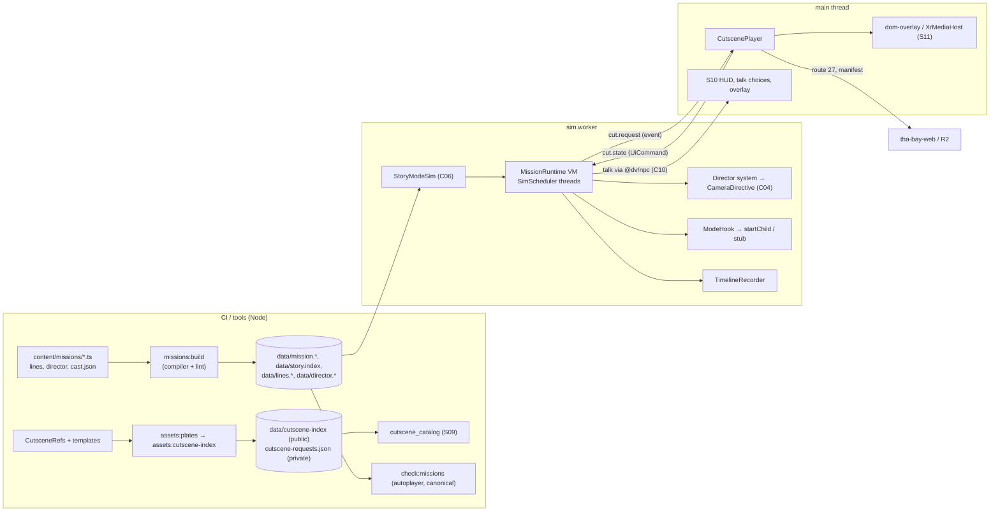
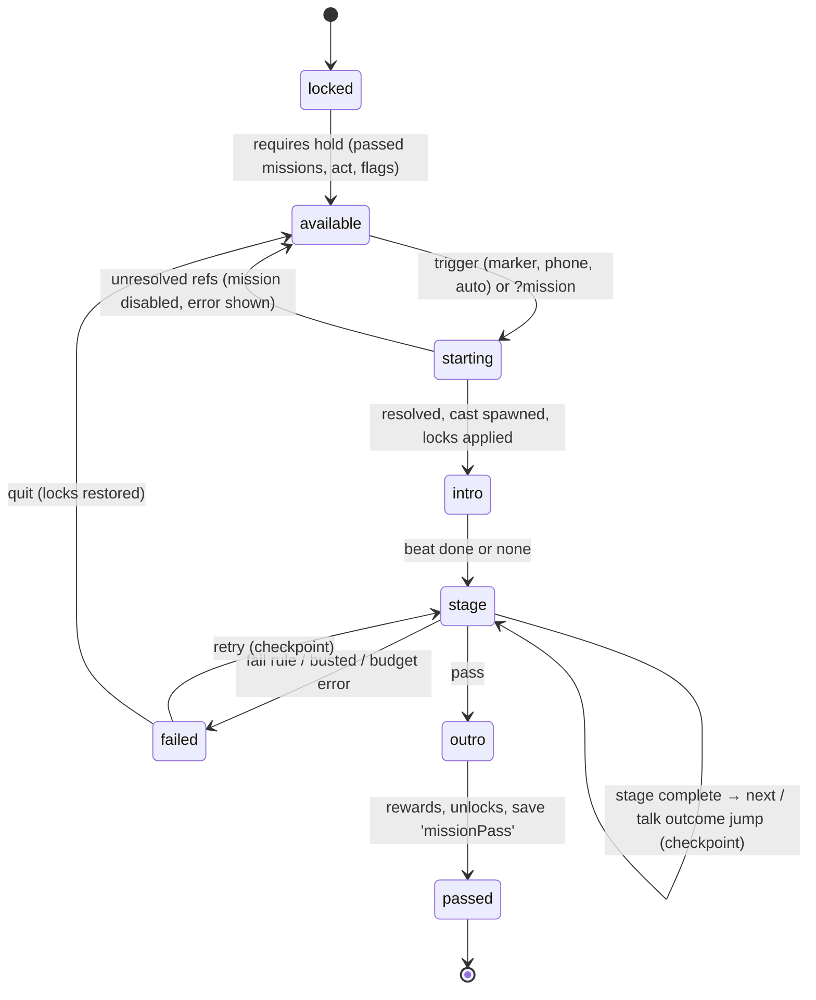

# Domain 03 — Story, Missions & Cutscenes (S03)

> Wave 2 · v1.0 · 2026-10-18 · author S03 (`claude-opus-5-5`). Binding inputs: `prompt-pack/06-SHARED-CONTEXT.md` **v1.1 (frozen)**, `spec/.waves234-notes.md`, `spec/03-decisions-and-facts.md` v1.1, `spec/02-architecture.md` v0.5, `spec/11-decision-log.md` (DL-001…DL-076), `spec/99-open-questions.md`, and the Wave 1 specs (`01-engine*`, `05-assets*`, `09-backend*`, `11-platform*`).
>
> **Parts:**
> - **A** (this file): template §1–§3 and §5–§10, the overview of §4, platform notes, milestones, tests and open items.
> - **B** `03-story-narrative.md`: premise, factions, beat sheets, unlock events.
> - **C** `03-story-missions.md`: C09 MissionScript (IR, schema, interpreter, dialogue and mode hooks, autoplayer, debugger, lint, modder editor needs).
> - **D** `03-story-cutscenes.md`: C09 cutscene types, cache key, templates, request path, director, player, QA, prewarm and cost.

## 1. Scope and R-IDs

**Owns:** the campaign (premise, factions, missions) and the mission system, from authoring through the JSON IR to the interpreter, autoplayer and debugger. Also the in-engine cinematic director, the cutscene request contract, cache keys, prompt templates, the release cutscene index and `CutscenePlayer`. **Does not own:** generation infrastructure (`CutsceneJobDO`, `GenJobWorkflow`, transcoder, budgets: S09/S05, D-19), video hosting primitives (`FirstGestureUnlock`, `XrMediaHost`: S11), HUD and menus (S10), NPC dialogue runtime and souls (S04), mode internals (S06/S07/S08).

| R-ID | How S03 serves it | Where |
|---|---|---|
| R-MODE-01 (narrative, missions) | *Hella Valuation*, 26 missions; intro → objectives → fail/success → rewards; heat policy; economy hooks | B §B1–B6; C §C3–C8 |
| R-MODE-05 | mode hooks emit `unlock.*` on first encounter, including the stub path; unlock table | C §C8; B §B7 |
| R-CUT-01 | cache key (A-03), request contract, index, internal-only generation, AI label, playback | D §D2–D5, §D7 |
| R-CUT-02 | hooks: story beats, fight intro (walk-in + face-off), special, super, shutdown, ending, racing intro | D §D4; B §B5–B6 |
| R-CUT-03 | every ref has a DirectorScript fallback; the player falls back on 11 triggers; the mission never waits on generation | D §D6–D7; C §C5 `E_NO_FALLBACK` |
| Supporting | R-ENG-03 (prewarm, cache-first), R-ENG-04 (subtitles, `timerScale`, skippable), R-IP-01/02 (prompt hygiene, depiction lint), R-NPC-05 (missions complete on ink alone), R-MAP-03 (mission markers via `data/story.index`), R-PLAT-04 (camera toggle locked in cutscenes) | C §C7, §C11; D §D4, §D7 |

**Contracts.** Owns **C09** (finalized as v1.0.0: Part C §C3 and Part D §D2). Honors C01 (`StableKey mis:`, component range 512–767), C05 (`StorySlice`, opaque checkpoint), C06 (`ModeContext`, `SimScheduler`, `ZoneService`, `TimelineRecorder`, `UnlockApi`, `startChild`), C07 (`AssetRef`, `LikenessTier`, provenance, GenJob), C10 (1.0.0; assumptions resolved in §10). Reads C04 (`CinematicShot`, `CameraDirective`), C08 (1.0.0), C12 (route 27/28, `CutsceneStatus`, `RosterFlags`), C13 (`PreparedClip` consumer `XrMediaHost`, tiers), C16 (telemetry names).

**C09 consumers:**
- S05: request, manifest and the index build.
- S06: race intro refs, DirectorScripts, hook params.
- S07: fight refs and templates, `stage2d` DirectorScripts, hook params.
- S08: tycoon hook params.
- S09: status, catalog rows, manifest readiness.
- S10: `hud.mission`, `hud.subtitle`, talk choices, cutscene overlay.
- S11: `PreparedClip`.
- S12: mission IR for mods.
- S13: tests.

### 1.1 Checklist (33 items)

| # | Item | Status | Where | Milestone |
|---|---|---|---|---|
| 1 | Premise *Hella Valuation* refined (pod, auction, exposure plot), Act 1 SF-only (Q-07) | designed | B §B1 | M05c1 |
| 2 | Factions and fictional cast; roster-slot usage with mandatory stand-ins [research/legal-ip-likeness.md L4] | designed | B §B2 | M05c1 |
| 3 | Depiction rules as compiler lint: real-person roles, lawful stages, fame domain, no firearms or gore (D-30) | designed | C §C11, B §B3 | M05a1 |
| 4 | Act 1 beat sheet, 12 missions in D1–D4/D6 | designed | B §B4 | M05c1, M05c2 |
| 5 | Acts 2–3 outline (14 missions; finale on the Bay Bridge west span as the M15+ portal hook) | designed (outline) | B §B6 | M05e, M05f |
| 6 | Mission IR types and JSON Schema with bounds | designed | C §C3–C4 | M05a1 |
| 7 | TS builder compiled to IR; runtime never executes TS (R-DSL-1) | designed | C §C2, §C5 | M05a1 |
| 8 | Load-time resolution (lat/lng, landmark, route snapping), world-bake drift handling (R-DSL-12) | designed | C §C5 | M05a1 |
| 9 | Interpreter on `SimScheduler`: threads, `wait`/`waitUntil`/`race`/`all`, 2,000 ops/tick, seeded determinism (R-DSL-2) | designed | C §C6 | M05a1 |
| 10 | Predicates: zones, entity state, heat, time, weather, flags, trust, inventory, mode results (R-DSL-3) | designed | C §C3 | M05a1 |
| 11 | Typed event timeline; simulate-once scrub preview (R-DSL-4) [research/repos-world.md §3.4] | designed | C §C6, §C10 | M05a2 |
| 12 | Autoplayer; `check:missions` 3 seeds under `canonical` within `expectedSec` (R-DSL-5) | designed | C §C9 | M05a2 |
| 13 | Per-stage checkpoints stored opaque in `StorySlice.activeMission` (R-DSL-6) | designed | C §C3, §C6 | M05a1 |
| 14 | Fail rules, retry, unconditional restore of ambient, heat and clock | designed | C §C6 | M05a1 |
| 15 | Dialogue hooks: `say` lines with VO and subtitles; `talk` via C10, choice-gated, ink offline (R-DSL-7) | designed | C §C7 | M05c1 (scripted choice card), M06a3 (`InkRunner`), M10c (Act 1 ink), M06a (LLM) |
| 16 | Mode hooks with stub fallback (R-DSL-9) | designed | C §C8 | M05c1; real hooks M07a, M08b, M09b |
| 17 | Unlock events for modes, fighters, districts, vehicles (R-MODE-05) | designed | B §B7, C §C8 | M05c1 |
| 18 | Keys-only strings, subtitles everywhere, `timerScale`, skippable beats (R-DSL-10, R-ENG-04) | designed | C §C3, D §D7 | M05a1 |
| 19 | Debugger: URL flags, overlay, agent bridge (R-DSL-11) | designed | C §C10 | M05a1, M05a2 |
| 20 | Director: auto vocabulary, DirectorScript fallback, LOS alternates, SF-hill rule, XR fixed vantage | designed | D §D6 | M05a2 |
| 21 | C09 cutscene types (ref, key input, index, request, manifest, `PreparedClip`, player) | designed | D §D2 | M05b2 |
| 22 | Cache-key spec, vectors, beat revisions, carry-over and invalidation (A-03) | designed | D §D3 | M05b2 |
| 23 | Nine prompt templates, closed slot sources, prompt-hygiene lint [research/legal-ip-likeness.md constraint 14] | designed | D §D4 | M05b2 (story), M07b, M08b |
| 24 | Request → Worker → fal → R2 → manifest path, internal-only (D-19, ADR-GENAI-01) | designed (S09/S05 infra) | D §D5 | M05b1, M05b2 |
| 25 | Stage plates from our SF bake as keyframe inputs and poster handoff | designed | D §D5 | M05c2 |
| 26 | `CutscenePlayer`: protocol, hosts per tier, renditions, sequences, fallback triggers, subtitles, AI label [research/gap-cutscene-delivery-playback.md §7] | designed | D §D7 | M05b2 (flat), M11b4 (XR) |
| 27 | QA and moderation of generated clips (vision QA additions, Whisper, human review) | designed | D §D8 | M05c2, M10b |
| 28 | Prewarm lists, counts and cost per provider | designed | D §D9 | M05c2, M07b, M08b, M10b |
| 29 | Kill-switch and licence effects on cast and clips | designed | C §C5, D §D3 | M05b2; drill M10b |
| 30 | Mission-editor needs for modders | designed (S12 builds) | C §C12 | M13a, M13b |
| 31 | Community sensitivity read gate for D3/D4 missions | designed (owner runs) | B §B3 | M05c2 |
| 32 | Firearms, gore, real-person crimes | out of scope (D-30) | B §B1 | — |
| 33 | Player-triggered cutscene generation and generated lip-sync dialogue | out of scope for v1: no public generation (G3, ADR-GENAI-01); in-engine dialogue costs nothing | D §D1 | post-v1 ADR |

## 2. Design



**Key decisions** (each binding on the Builder; numbered for reference as DS-03-n):
1. **Structured JSON IR, no `goto`.** Ops are `seq`, `all`, `race`, `if`, `loop(max)` and waits. A mission is therefore a tree the debugger can show, a mod cannot jump into arbitrary state, and every loop is bounded (A-02).
2. **One active story mission; checkpoints per stage only.** A checkpoint stores mission-owned state (player pose, cast, flags, wallet delta, RNG), not thread stacks. On retry the stage's threads restart from their first op. This keeps checkpoints small under C05's 2 MiB record cap and avoids serializing VM frames.
3. **The mission clock excludes beats.** Video and in-engine paths therefore leave identical mission state. A beat ends by placing actors at authored end marks, whichever path ran.
4. **Talk outcomes are player choices that NPC effects can unlock**; the LLM never decides flow. Ink knots cover offline play, kills and quotas, and CI uses scripted defaults. Missions stay completable and deterministic without the network (R-NPC-05).
5. **The stub path emits its unlock.** Act 1 (A-06) records `unlock.racing` and `unlock.fighter` even before those modes ship.
6. **Generated clips are interstitials without the protagonist, user NPCs or real-person story cast.** Dialogue is in-engine. This removes on-demand generation, lip-sync and most likeness exposure from the story.
7. **A clip is the unit of cache.** Fight intros are composed client-side from walk-ins and face-offs (222 clips at N = 12 instead of 528 intros alone) [research/gamedesign-decomposition.md §4.5].
8. **Keys are computed at release, in CI.** The runtime looks refs up in the shipped index, because input hashes (sheets, plates) are build artifacts. Carry-over keeps a ready clip valid across a deliberate re-pin.
9. **Stage plates come from our own SF bake.** Keyframes inherit accurate geography, and the poster frame equals the fallback's first frame.
10. **The director is a sim system.** The DirectorScript is armed before the video/fallback decision, so the fallback starts without a gap and scrubbing is deterministic (C04 rule 4).

**Alternatives rejected.**
- Ink or Yarn as the mission language: no world predicates, and a second runtime besides the sim.
- Running first-party missions as script (QuickJS): the IR suffices; script-tier mods are S12's.
- Per-pair × stage fight intros: count explodes [research/gamedesign-decomposition.md §4.5].
- Client-side key computation from raw inputs: needs build artifacts.
- Cloudflare Stream: no offline caching, missing CORP [research/gap-cutscene-delivery-playback.md §0].
- LLM-decided outcomes: nondeterministic and jailbreakable.
- Whole-world checkpoints: size and determinism cost.
- Generated lip-sync dialogue scenes: $0.08/s and likeness risk [research/genai-pipeline-fal.md §2.1].

## 3. Components

| Module | Path | Responsibility | Depends on |
|---|---|---|---|
| C09 types | `packages/shared/src/contracts/c09-mission.ts`, `c09-cutscene.ts` | contract (Parts C, D) | C05, C06, C07 types |
| Cutscene key | `packages/shared/src/genai/cutscene-key.ts` | `cutsceneKey`, `normalizeKeyInput` | `json.ts`, `hash.ts` |
| Schemas | `packages/shared/schemas/{mission-ir-1,director-1,cutscene-index-1,cutscene-manifest-1}.schema.json` | runtime validation (Ajv) | S13 generator |
| Authoring | `packages/modes/story/src/authoring/` | `defineMission`, `defineDirector`, helpers (re-exported by `@dv/mod-sdk`) | C09 |
| Compiler | `packages/modes/story/src/compiler/` | validate, lint, resolve, emit assets and audio needs | C08 resolver, NameRegistry lint |
| VM | `packages/modes/story/src/vm/` | `MissionRuntime`, ops, predicates, objectives, fail rules, checkpoints | C06 `ModeContext` |
| Story mode | `packages/modes/story/src/mode.ts` | C06 descriptor `story` + `GameModeSim` + `GameModeUI` | ModeHost |
| Director | `packages/modes/story/src/director/` | DirectorScript runner, auto-director, LOS validation | C04, `PhysicsQueries` |
| Dialogue bridge | `packages/modes/story/src/dialogue/` | `say`, `talk`, ink path, outcome commands | `@dv/npc` (C10) |
| Autoplayer | `packages/modes/story/src/autoplay/` | goal derivation, bot input | C08 graphs, `BotInput` (assumption) |
| Debug | `packages/modes/story/src/debug/` | overlay, preview scrubber, `__dvBridge.mission` | QA builds only |
| CutscenePlayer | `packages/engine/src/client/cutscene/` | resolve, prepare, host, sync, triggers, subtitles | C12 route 27, S11 services |
| Index builder | `tools/assets/src/cutscene-index/` | keys, index, private requests, catalog rows, carry-over | registry, `asset_index` |
| Plates | `tools/assets/src/plates/` | stage plate capture | headless `chromium-webgpu` |
| CI | `tools/ci/missions/`, `tools/ci/prompt-lint.ts` | `check:missions`, prompt lint | — |

```ts
// packages/modes/story/src — public surfaces (signatures only)
export interface CompileError { code: 'E_SCHEMA' | 'E_REF_CAST' | 'E_REF_ZONE' | 'E_REF_LINE' | 'E_REF_LANDMARK' | 'E_OUT_OF_BOUNDS'
  | 'E_ROUTE_UNSNAPPABLE' | 'E_DEPICTION' | 'E_NAME' | 'E_NO_FALLBACK' | 'E_HOOK_STUB' | 'E_UNREACHABLE_STAGE' | 'E_BUDGET'; pointer: string; message: string }
export declare function compileMission(ir: MissionIR, env: CompileEnv): { ir: MissionIR; errors: CompileError[]; audioNeeds: LineId[] };
import type { WorldResolver, LatLng, SnapRequest } from '@dv/shared/world/c08-api';   // C08 owns it (DL-078); the compiler maps LatLngTuple → LatLng and Placement → SnapRequest
export declare function resolveMission(ir: MissionIR, w: WorldResolver): ResolvedMission | { errors: CompileError[] };
export type StoryCommand =
  | { name: 'mission.start'; id: MissionId } | { name: 'mission.retry' } | { name: 'mission.quit' }
  | { name: 'talk.result'; talkId: string; outcome: string; turns: number; path: 'llm' | 'ink' | 'scripted' }
  | { name: 'cut.state'; playId: string; state: 'video' | 'fallback' | 'done'; outcome?: CutsceneOutcome };
export interface MissionRuntime {
  readonly phase: MissionPhase; readonly missionId: MissionId | null;
  start(m: ResolvedMission, o: { attempt: number; seed: number; from?: MissionCheckpointV1 }): void;
  tick(ctx: ModeContext): void;                       // SimStage.Script
  command(c: StoryCommand): void;                     // applied at the start of the next Script stage, recorded
  checkpoint(): MissionCheckpointV1; abort(reason: 'quit' | 'error' | 'kill' | 'modeExit'): void;
}
export interface DirectorSystem { arm(s: DirectorScript): void; run(): void; finish(applyEndMarks: true): void;
  auto(subject: Who, context: 'onFoot' | 'vehicle', seed: number): void; release(): void }
export interface BotDriver { attach(rt: MissionRuntime): void; frame(tick: number): InputFrame }
```

## 4. Data

- **Owned types:** Part C §C3 (`MissionIR`, `Op`, `Pred`, `ObjectiveDef`, `TalkDef`, `ModeHook`, `MissionCheckpointV1`, `MissionIndexRow`) and Part D §D2 (`CutsceneRef`, `CutsceneKeyInput`, `CutsceneIndex`, `CutsceneRequest`, `CutsceneManifest`, `PreparedClip`, `CutscenePlayer`, `DirectorScript`).
- **Persisted (C05 `story:*` slots, `StorySlice` schema 1):** `premise: 'hella-valuation'`; `act`; `missions[id]` (`locked | available | passed`, `bestSec`, `medals`); `activeMission {id, checkpoint: {schema: 1, data: MissionCheckpointV1}}`; `flags`; `wallet.streetCred` / `techClout` (cash through `EconomyApi`); `property.safehouses`; `npcRelations`; `rng['mission:*']`. Unlocks persist in `CoreSlice.unlocks` through `UnlockApi`.
- **Content and config:**
  - `content/missions/<id>/{mission.ts, lines.<lang>.json, director/*.ts}`;
  - `content/story/{cast.json, sensitivity.json}`;
  - `content/cutscenes/{places.json, seeds.json, beats.lock.json}`;
  - `content/prompts/genai/<name>@<n>.md`;
  - `config/prompt-banned.json`, `config/autoplay/score.json`, `config/cutscene.json` (fallback-trigger thresholds, prefetch counts), story rows in `config/unlocks.json`.
- **Flags:**
  - QA URL flags (S11 `QaFlags`): `?mission`, `?stage`, `?seed`, `?hooks=stub|bot`, `?talk=scripted`, `?beats=video|fallback|instant|plate`.
  - Boot flag `cutscene.generated` (C12 `FeatureFlag`): off means fallback always.
  - Proposed player setting "Generated cutscenes" (§10).
- **View-model keys** (S10's `UiBridge`): `hud.mission {titleKey, objectiveKey, timerSec?, assistKey?}`, `hud.subtitle {speaker, text, startMs, endMs}`, `phone.jobs` (available missions from `data/story.index`), `mode.story.talk {talkId, npc, choices[{id, label, enabled}]}`.

## 5. Runtime behavior



**Tick-order participation (`SimStage.Script`, every tick while story is the top mode):**
1. apply queued `StoryCommand`s (talk results, cut states);
2. director system;
3. VM threads in `threadId` order (objective threads, then mission threads);
4. fail rules;
5. stage transition and checkpoint;
6. VM patches (`hud.mission`, markers).

`CameraDirective` is published in the Publish stage (C02). While a child mode runs, `suspendedTick` runs only the fail rules that do not depend on the child.

| Failure | Behavior |
|---|---|
| Unresolved reference after a world rebake | mission disabled with `E_REF_*` in Jobs; saved `activeMission` dropped; telemetry `mission.fail {reason: 'unresolved'}` |
| Start far from the player (auto or Jobs trigger, more than 300 m; DL-734) | the mission stays `available` while `TeleportApi.request('respawn', start)` moves the player (02-world-maps.md §5); it enters `starting` only after an `ok`, and no other trigger fires meanwhile. Transient answers (`notLoaded`, `busy`, no answer in 30 s) are retried with a doubling gap (60 to 600 ticks) for up to 3 min of sim time, with the non-blocking hint `mission.startLoading`. A hard refusal, the budget running out, or a gray-box world leaves it `available`, never started elsewhere: warning toast `mission.startUnreachable`, telemetry `mission.fail {reason: 'unresolved'}`, and Jobs keeps a Start action that runs the move again with a fresh budget |
| Resume from a saved checkpoint (load, mode re-entry; DL-736) | a checkpoint from another bake or mission version is dropped and the mission goes back to `available` (the far-start rule above then applies); a matching checkpoint is restored only after the saved player pose's `p0` tile and its one-tile ring are resident (the same pre-stream as 02-world-maps.md §5 step 2, with the far-start retry budget and the `mission.startLoading` hint). The saved poses of the player and the cast (a seated player stays seated) are then written as saved, with no placement search, because they were valid when saved. If the budget runs out, the checkpoint is kept, the mission stays `available` with `mission.startUnreachable`, and the next load or a Jobs Start tries again |
| Op budget exceeded 60 ticks in a row | abort to `failed`, `fail.reason.script_error`, `err.sim` |
| Talk network failure, quota, kill, timeout | ink path with the same choices (C §C7) |
| Mode cannot start or is killed | stub objective (C §C8) |
| Cutscene not ready, blocked, stalled, offline | in-engine DirectorScript (D §D7) |
| Real-derived cast killed (`spawn`/`all`) | stand-in soul; the key is unchanged for fictional-only story clips |
| Save write fails at checkpoint | play continues; S01's `LastSaveStatus` shows the error; next checkpoint retries |
| Tab hidden mid-mission | S11 lifecycle pauses; C05 rule 4 saves the last checkpoint, never mid-stage state |

**Performance** (starting values against C13 budgets; asserted by `check:perf` scenario `story-chase` in M05c2):
- VM + objectives + fail rules ≤ 0.25 ms per tick p95 on `mobile-low`, with ≤ 16 live threads and typically 3–5.
- Director ≤ 0.1 ms and ≤ 8 LOS rays per tick.
- Size caps: mission IR asset ≤ 64 KiB, lines ≤ 32 KiB per act per language, DirectorScript ≤ 16 KiB.
- Cutscene media within S11's 64 MB `media` line on mobile. Prefetch ≤ 2 refs ahead.

## 6. Platform notes

| Concern | Desktop | Mobile (iPhone PWA) | Quest 3/3S | Vision Pro |
|---|---|---|---|---|
| Generated clip host | DOM overlay; `v1080` when present on ≥ 1440 px screens | DOM overlay from the unlocked pool; `v540` on data saver or < 4 Mbps; Wake Lock | media quad layer at 72 Hz; texture fallback | `VideoFrameTexture` via WebCodecs |
| In-engine fallback | director cuts | director cuts; reduced motion respected | fixed vantage, no cuts, 300 ms fades | same as Quest; hands-only skip (pinch) |
| Talk choices | buttons and keys | large touch buttons, safe areas | world-locked panel, ray select | panel, pinch select |
| Photo objective | `sim.Interact` in the `photo` input context (C03 1.1, DL-159) with crosshair | camera button on the touch overlay | controller ray as viewfinder | pinch frame gesture (S11 binding) |
| Timers | `timerScale` | same | same; no time-pressure stealth in XR (+50 % stealth budget) | same as Quest |
| Debugger | full overlay | overlay collapsible; bridge for automation | off (DOM unavailable in XR); bridge only | off |
| Prefetch | 3 refs | ≤ 2 refs | 2 refs | 2 refs |

Sources: [research/gap-cutscene-delivery-playback.md §3, §5, §7.3]; S11 `11-platform-xr.md` §5.3 and §5.6, `11-platform-pwa.md` §7. XR runs story missions in first person only (C04 rule 5).

## 7. Verified facts used

| Fact | Source |
|---|---|
| H3 Max Turbo I2V/T2V 0.92–15 s; 768P $0.04/s list (promo ends 2026-10-31) | F-039 [research/genai-pipeline-fal.md §A] |
| H3 Max ref2v ≤ 9 images, $0.08/s; `minimax/h3/*` partner $0.06/s at 768p | F-040 |
| H3 Community License excludes the USA/EU/UK/KR; covers derivatives and hosted use | F-041 [research/gap-video-model-licence-clearance.md §0] |
| fal ToS: End Users 18+; no direct API exposure | F-042 |
| H3 output: MP4 H.264 1344×768 at 24 fps + AAC; fal C2PA; a transcode strips it; audio cannot be disabled | F-043 [research/gap-cutscene-delivery-playback.md §1] |
| Gemini terms bar services likely used by under-18s | F-049 |
| LTX-2.x licence has no territory exclusion | F-050 |
| iOS Low Power Mode needs a gesture for any video | F-063 |
| Provider durations: H3 partner 5–15 s, H3 Max 0.92–15 s, LTX 6–20 s, Gemini 3–10 s; portable shot 6–10 s | [research/gap-video-model-licence-clearance.md §7] |
| LTX fast $0.09/s at 720p; Gemini Omni Flash $0.10/s at 720p; Sunburst keyframe 1920×1080 high ≈ $0.04 | [research/genai-pipeline-fal.md §A, §B, Cost model] |
| `ManagedMediaSource` on iOS 17.1+; Quest media layers (Browser 16.1+); Vision Pro has no media layers; Wake Lock in Home Screen apps since iOS 18.4; Whisper turbo $0.000513 per audio minute | [research/gap-cutscene-delivery-playback.md §0, §6] |
| gta-sa-earth: threads with `WAIT`, ≤ 20,000 instructions per tick, simulate-once timeline with 27 event types, goal-driven autoplayer, shot-vocabulary director with LOS cuts | [research/repos-world.md §3.4, P13–P15] |
| Parody rules: no photo references, fame-domain exclusion, never criminal, no catchphrases; prompt hygiene; no murals | [research/legal-ip-likeness.md constraints 6–16, L1] |
| Sideshows are illegal in CA/SF (verified); allowed in game with police response (Q-06) | [research/gamedesign-decomposition.md Verified facts] |

**UNVERIFIED** (none sits in an acceptance criterion; defaults apply):

| ID | Item | Default | Verified in |
|---|---|---|---|
| U-S03-1 | Keyframe-first keeps character identity across separate clips (walk-in vs face-off) | human review (D §D8); a reject pins a new seed | M00c spike, M08b |
| U-S03-2 | Providers honour "no text, no logos" | vision QA `text_in_image` gate; screen text drawn in-engine | M05c2 |
| U-S03-3 | `seed` and `prompt_expansion_mode` on `minimax/h3/*` partner and LTX endpoints | the adapter omits unsupported params; the seed stays in the key as identity; output reproducibility is never assumed | M00c |
| U-S03-4 | MSE `sequence` gaps on Safari 26.x | ping-pong fallback | M04c |
| U-PLT-17 | A pooled unlocked element plays new sources under Low Power Mode | "Tap to play", then fallback | M04c |
| U-S03-6 | Quest video textures freezing after XR entry (community reports) | create elements before `requestSession`; poll `currentTime` | M11b4 |
| U-S03-7 | Time to first frame of `v768` from R2 on mobile ≤ 2.5 s | trigger thresholds are config (`config/cutscene.json`) | M04c |
| U-S03-8 | Whether a C08 route snap can be done in the sim worker within the load budget | resolve during the mission's `starting` phase behind a fade | M05a1 |

## 8. Milestone mapping

R-ID → milestones:
- **R-MODE-01:** M05a1, M05a2 (mission system); M05c1, M05c2 (Act 1); M05e1/2, M05f1/2 (Acts 2–3).
- **R-MODE-05:** M05c1 (stub-path unlocks); M07a, M08b, M09b (real hooks).
- **R-CUT-01:** M05b1 (infra, S09/S05); M05b2 (key, index, player); M05c3 (Act 1 prewarm).
- **R-CUT-02:** M05b2 and M05c2 (story beats); M08b and M10b (fighter hooks); M07b (racing intros, SHOULD).
- **R-CUT-03:** M05a2 (director fallback); M05b2 (triggers); M11b4 (XR fallback).

| Milestone | S03 scope | Stubbed first / later | Sessions |
|---|---|---|---|
| **M04c** cutscene-playback spike (S11 lead) | `c09-cutscene.ts` (`CutsceneManifest`/`PreparedClip`, `dom-media.d.ts` shim) and a partial `c09-mission.ts` that M05a1 completes (DL-232), two fixture clips with manifests, record U-S03-4/5/7 | player logic lands in M05b2 | 0.25 |
| **M05a1** mission-ir-vm | types, schema, builder, compiler, `WorldResolver` over C08 (fixture resolver until M02c ships), VM, predicates, objectives (the `mode` real path as a no-op), checkpoints, fail/retry, debugger overlay and URL flags, sample `m.dev.sample` (all objective kinds), telemetry `mission.*` | the director uses a single fixed shot | 1 |
| **M05a2** autoplayer-director-preview | autoplayer, `check:missions`, timeline export and scrub preview, director (auto, DirectorScript, LOS, hill rule, XR vantage as data), `defineDirector` | XR presentation in M11b4 | 1 |
| **M05b1** cutscene infra (S09/S05) | `CutsceneJobDO`, `GenJobWorkflow`, mock provider, routes 27/28 | — | (S09/S05) |
| **M05b2** cutscene-player-index | `cutsceneKey` and vectors, index builder (carry-over), private requests, catalog rows, story templates and prompt lint, `CutscenePlayer` flat hosts (single, MSE/MMS sequence, ping-pong), the triggers, subtitles, AI chip hook, `beat` op wiring | fixture manifests from the mock provider | 1 |
| **M05c1** act1-missions-1-6 | cast and stand-ins (fictional souls per S04's schema), m.a1.01–06, lines (en), DirectorScripts, unlock defs, stub hooks, Yard safehouse, minimal shops | racing and fighter hooks are stubs; talk uses a scripted choice card until `InkRunner` (M06a3) and the Act 1 ink (M10c) | 1 |
| **M05c2** act1-slice | m.a1.07–12, Act 1 refs, plates and index, sensitivity gate, save/resume e2e, VS-Story demo; the P1 prewarm through a `cleared` provider is M05c3 (fallback-only release if none is cleared) | — | 1 (+0.7 S05 in M05c3) |
| M06a (S04) | `talk` LLM path behind `npc.dialogue` | ink/scripted until then | — |
| M07a / M07b (S06) | real hook for m.a1.03; `race.intro@1` refs (P3) | — | — |
| M08b (S07) | fight refs and keys, fighter templates, `stage2d` DirectorScripts | — | — |
| M09b (S08) | m.a2.01 authored with the tycoon hook (S03 content inside) | — | +0.5 |
| M10b (S05) | P2 fighter prewarm; kill drill covers the index | — | — |
| M11b4 (S11) | XR hosts, fixed vantage, subtitle plane (DL-229) | — | — |
| **M05e1 / M05e2** story-act2 (new) | m.a2.02–08, refs, unlock defs | after M07a, M08b, M09b | 2 |
| **M05f1 / M05f2** story-act3 (new) | m.a3.01–06, finale, endings, portal close | after M05e2, M10b | 2 |
| M13a / M13b (S12) | mission editor and SDK wrappers (C §C12) | — | — |

**Acceptance criteria seeds for Wave 5** (each proof is a real command):
- **M05a1 AC-1** Given the compiler fixtures When `missions:build` runs Then `m.dev.sample` validates and each bad fixture yields its declared error code. Proof: `pnpm check:unit -- packages/modes/story/test/compiler.test.ts`.
- **M05a2 AC-1** Given `m.dev.sample` When autoplay runs 3 seeds twice Then every run passes inside `expectedSec` and both runs per seed end with the same `stateHash`. Proof: `pnpm check:missions -- --mission m.dev.sample`.
- **M05b2 AC-1** Given the key vectors When tests run Then reordered inputs give equal keys and each changed input gives a new key. Proof: `pnpm check:unit -- packages/shared/test/cutscene-key.test.ts`.
- **M05b2 AC-2** Given route 27 mocked `absent` When a beat plays Then the fallback starts within 2.5 s and the mission resumes with end marks applied. Proof: `pnpm check:e2e -- --project=chromium-webgl2 --grep @cutscene`.
- **M05c2 AC-1** Given the Act 1 index When `check:missions` runs Then all 12 missions pass on 3 seeds. Proof: `pnpm check:missions -- --act 1`.
- **M05c2 AC-2** Given m.a1.03 passed When the tab reloads Then `story:auto` resumes with `unlock.racing` set and the Racing tile shows its state. Proof: `pnpm check:e2e -- --project=webkit-webgl2 --grep @story`.

## 9. Tests

| Level | Tests | Command |
|---|---|---|
| Unit | `compiler`, `resolve` (snap, drift disables), `vm-ops` (each op, race tie order, budget), `predicates`, `checkpoint` (round trip; retry restores the wallet delta), `talk` (gating, ink, scripted), `hooks` (the stub emits its unlock; `passOn`), `depiction-lint` (one fixture per rule), `cutscene-key` (vectors), `index-builder` (carry-over, delist, kill), `prompt-lint` (vocabulary, slots, realism, pins), `director-los` (alternates, hill rule), `player-triggers` (fake media for each trigger) | `pnpm check:unit -- packages/modes/story packages/shared tools/assets tools/ci` |
| Integration | every mission × 3 seeds under `canonical`, `beats: instant`, `talk: scripted` | `pnpm check:missions` |
| E2E | `@story`: m.a1.01 completes in-browser under the bot; save/resume across reload; unlock toast; `@cutscene`: ready → video, absent → fallback, stall → fallback, skip, subtitles present, AI chip | `pnpm check:e2e -- --project=chromium-webgl2 --grep @story`, same with `webkit-webgl2` and `@cutscene` |
| Workers / pipeline | S09 `cutscene-singleflight`, `genjob-poll-fallback`, `budget-cache-first`; S05 mock cutscene job | `pnpm check:workers -- edge`, `pnpm check:pipeline` |
| Assets / IP | templates pinned and linted; index references no `previs/`; shipped clips re-signed | `pnpm check:assets`, `pnpm check:c2pa` |
| Perf | scenario `story-chase` (m.a1.12 under bot) inside C13 budgets | `pnpm check:perf -- --scenario story-chase` |
| Device | M04c checklist; M05c2 iPhone 15 and desktop demo of Act 1 missions 1–3 | `pnpm perf:checklist -- tools/ci/checklists/M05c2-iphone15.json` |

## 10. Open questions, decisions and assumptions

**Decisions needed** (recommendations applied as defaults):
- **DN-S03-01.** The tycoon unlock sits in the Act 2 opener (m.a2.01), not in Act 1. This matches S08's input [research/gamedesign-decomposition.md §5.11]. Act 1 still exercises the racing and fighter hooks.
- **DN-S03-02.** Generated clips never show the protagonist, user NPCs or real-person story cast.
- **DN-S03-03.** New milestone ids M05e1/M05e2 (Act 2) and M05f1/M05f2 (Act 3) inside the M05 story family, scheduled per DL-115: M05e1/e2 after M07a2, M08b2 and M09b2; M05f1/f2 after M05e2 and M10b.
- **DN-S03-04.** Story dialogue is always in-engine. Generated clips use `engine` audio by default.
- **DN-S03-05.** Owner arranges a community sensitivity read of the D3/D4 missions before the M05c2 release (gate in `content/story/sensitivity.json`).
- **DN-S03-06.** Script names: `missions:*` family and `check:missions` (06 §5 addition).

**Assumptions on concurrent or frozen contracts** (also in `contract_change_proposals`):

| ID | Assumption |
|---|---|
| A-C10-1 | **Resolved (DL-085):** C10 unchanged for mission talk; `context.missionId`/`missionStep = talkId`, player intents from C10 `PlayerIntent`, `effects` gate outcomes; `effects.outcome` rejected |
| A-C08-1 | **Resolved:** C08 `WorldResolver`, `LandmarkRecord`, `DistrictRecord` and tags provide all of it (`02-world-contracts.md` §2–3) |
| A-C03-1 | **Accepted** as C03 1.1 (`DeviceKind 'bot'`, QA-only `BotInput`, DL-095) |
| A-C06-1 | **Accepted** as C06 1.1 `UiCommand {t:'cutscene.state', playId, item?, state, trigger?, outcome?}`; `talk.result` stays a `mode.cmd` (DL-098) |
| A-C13-1 | **Accepted** as C13 1.1 (DL-102) |
| A-C14-1 | **Confirmed** by C14 1.0.0 (`mission.register`, kind `experience`); mod profile per DL-084 |
| A-C05-1 | **Accepted** as C05 1.1 (`SaveReason 'checkpoint'`, `ProfileSettings.cutscenes?`, DL-097) |
| A-C04-1 | **Accepted** as C04 1.1 (DL-096) |
| A-S05-1 | **Accepted** as C07 1.1 (DL-099) |
| A-C16-1 | **Accepted** as C16 1.1 (DL-103) |
| A-HOOK-1 | **Resolved (DL-092): the mode owner owns `ModeHook.defId` and its params.** Racing `defId` = S06 `RaceId` (e.g. `sf.pursuit.bayview-escape`); fighter `defId` = S07 `bout.<id>` (`bout.a5`, `bout.a11`, `bout.a3-final`) with `params` = S07 `FighterEnterParams {kind:'story'}`; tycoon `defId` = S08 preset `mini8w`, no params; map of hook ids to defIds in Part B §B4/§B6 (DL-157); `MoveDef.cutsceneBrief` stays S07's |

**Open questions:** Q-03 (provider clearance; the programme cap is fixed at USD 100, DL-OWN-01) decides whether M05c2 ships generated Act 1 clips or a fallback-only Act 1; both paths are fully specified. Q-19 (character research layer) affects only the roster-slot souls, which stand-ins cover.
