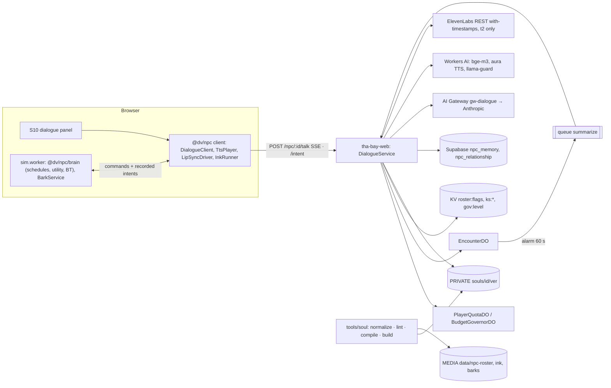

# Domain 04 — AI NPCs & NPC Builder (S04), Part A: scope, design, runtime

> S04, Wave 2, 2026-10-18. Three parts: **Part A** this file; **Part B** `spec/domains/04-npc-contracts.md` (C10 TypeScript, soul JSON Schema, roster, prompt blocks, lints); **Part C** `spec/domains/04-npc-builder.md` (agency and barks, NPC builder, moderation queue, evaluation harness, cost). Binding: `prompt-pack/06-SHARED-CONTEXT.md` v1.1 (frozen), `spec/.waves234-notes.md`, `spec/03-decisions-and-facts.md` v1.1 (D-21, D-22, D-23, D-28, D-29, D-30), `spec/11-decision-log.md`, `spec/02-architecture.md` §4.4, Wave 1 specs `01-engine*`, `05-assets*`, `09-backend*`, `11-platform*`. Facts cite `[research/<file>.md]` or `F-NNN` (`research/INDEX.md` §2).

## 1. Scope and R-IDs

**Owns.** The soul format and its compiler, validator and lints; the roster manifest; the dialogue prompt, model routing, output schema and SSE semantics on C12 routes 31–33; the agency layer of named NPCs (schedules, utility, behavior trees, hero intents); memory semantics; voice routing and lip-sync at runtime; filler-NPC barks; safety rails and the disclosure requirement; the NPC builder (text path, moderation semantics, review queue rules); the in-character evaluation harness.
**Does not own:** transport, `EncounterDO`, quotas, storage (S09); asset generation, pipeline gates, kill purge (S05); screens (S10); ped movement and spawns (S02); mission IR (S03).

| R-ID | How this domain serves it | Where |
|---|---|---|
| R-NPC-01 | `soul/1.0` schema, compiler, roster manifest and bundle; the roster is data and loads when the research layer arrives (Q-19) | B2–B5, §3, §8 |
| R-NPC-03 | builder: backstory → soul via Sonnet structured output; images → text descriptions → creator-kit body in v1 (custom 3D only through an owner-approved queue, DL-OWN-01); preview chat; publish through moderation | Part C |
| R-NPC-04 | tiers in frontmatter with schema conditionals; voice tier gating; live kill-switch handling; stand-ins | B4, §5.7, §5.10 |
| R-NPC-05 | Worker proxy, cache-ordered prompt, quotas and governor levels, ink fallback lines, rails | §5.1–5.5 |
| R-IP-02 | consent scopes in the soul, `config/consent-index.json` export, kill-switch effects by scope | B2.2, B9, §5.10 |
| Supporting | R-ENG-03 (cost controls; Part C §C7), R-ENG-04 (subtitles for every spoken line), R-MAP-04 (pedestrian barks), R-IP-03 (report button on dialogue and user NPCs), R-MODE-03/04 (fighter and tycoon personas) | Part C §C9, §C7 |

**Contracts.** Owns **C10** (finalized, Part B). Honors C05 (`StorySlice.npcRelations`, `ProfileSettings.audio.voice` volume; NPC settings proposed as `ProfileSettings.npc`), C07 (`AssetRef`, `LikenessTier`, `voice`/`audio_bark`/`mouth_atlas` kinds, `char:<id>` tags), C12 (routes 30–34, 41, 43, 46, `ApiError`, `RosterFlags`, `PlayerQuota`, `BudgetGovernor`, `DataPort.npcMemory`). Uses C01 (`npc:<id>` keys, component ids 768–1023), C02 (AI at 30 Hz, RNG streams), C06 (`InteractKind.Talk`, `WorldClockApi`, `TimelineRecorder`), C13 (tiers), C16 (`npc.turn.client`).

### 1.1 Checklist (each item designed, deferred or out of scope)
| # | Item | Status |
|---|---|---|
| 1 | `soul/1.0` frontmatter as TypeScript + JSON Schema with likeness conditionals; 12 negative fixtures | designed B2.2, B4 |
| 2 | LLM-facing derivative schema for structured outputs (no min/max/length keywords; ≤ 24 optional and ≤ 16 union params per request) [research/ai-npc-runtime.md §1.5] | designed C4 |
| 3 | Lints L1–L14 including name distance ≥ 0.4, prompt lint, byte stability [research/legal-ip-likeness.md L1] | designed B8 |
| 4 | Pure compiler → `soul.prompt.txt` (PRIVATE), `soul.compiled.json`, public bundle `data/npc-roster` (DL-039) | designed B3, §3 |
| 5 | Roster manifest feeding S05 `assets:gen plan`; stand-ins mandatory | designed B5 |
| 6 | Research layer absent (Q-19): normalizer runs when supplied; test and canary souls meanwhile | designed §3, deferred content to M10c |
| 7 | Defaults: living people `parody`, deceased and real-company founders `fictionalized` (D-29) | designed B4, L11 |
| 8 | Worker proxy, SDK only in the Worker; no key in any bundle [research/ai-npc-runtime.md §2.1] | designed §5.1 |
| 9 | Routing: `claude-haiku-5-5` thinking disabled, effort low; heroes `claude-sonnet-5-5` with `between_tools`; no sampling params or prefill [F-036] | designed §5.3 |
| 10 | Cache-ordered prompt: block A (1 h) → block B (1 h) → append-only history (automatic 5 m) → volatile turn; ≥ 512-token prefix; ≤ 4 breakpoints; one workspace [F-035] | designed §5.2 |
| 11 | SSE streaming with first-token 4 s timeout; server-held history replayed byte-identically | designed §5.1 |
| 12 | Rate limits and quotas: `RL_TALK` 4/10 s, `PlayerQuotaDO` kinds, governor L1–L3 behavior | designed §5.3 |
| 13 | Structured output turn schema; actions are proposals checked by the executor | designed B7, §5.4 |
| 14 | Safety rails: block A, per-soul rails, input prefilter, async moderation, output name lint, refusal path, crisis card | designed §5.4 |
| 15 | Disclosure: persistent AI-character badge, first-launch notice, parody/fiction card [F-038] | designed §5.10 |
| 16 | Offline ink per named NPC; missions completable with ink only | designed §5.5 |
| 17 | Filler NPCs without an LLM: archetype bark pools, pre-rendered audio | designed C9 |
| 18 | Agency: schedule executor + utility interrupts + behavior trees; AI LOD A/B/C; analytic `whereIs` | designed C8 |
| 19 | Hero intents: event-triggered, ≥ 60 s apart, recorded for replay | designed C8 |
| 20 | Memory: pgvector per pair, ≤ 2 writes per turn, PII scrub, top-6 retrieval, summarizer, reflections, retention 30 d / 180 d, export and forget (D-22) | designed §5.6 |
| 21 | Voice tiers text/t1/t2/t3 gated by likeness, age and identity phase (P2 for t2), governor and kill scopes (D-23, D-30) | designed §5.7 |
| 22 | TTS streamed per sentence inside SSE; mouth-atlas lip-sync from alignment, Rhubarb cues or RMS envelope | designed §5.7 |
| 23 | Kill-switch: route checks, `EncounterDO.kill`, client refresh cadence, effects by scope | designed §5.10 |
| 24 | NPC builder UX flow and state machine | designed C1 |
| 25 | Builder API (route 33 sub-paths), limits and quotas | designed C3 |
| 26 | Builder moderation: attestation, layered real-person detection, images become text only, review queue `P2_REVIEW`, reports | designed C5 |
| 27 | Builder asset generation (S05 Lean, 18+ and P2, fal ToS) [F-042] | not in v1 (DL-OWN-01): creator-kit body; owner-approved staff queue only |
| 28 | In-character evaluation harness (golden + red-team suites, judge rubric, gates) | designed C6 |
| 29 | Cost per conversation and per MAU within G3 | designed C7 |
| 30 | Multiplayer: shared agency in the room DO, `EV NpcBusy` | not in v1 (DL-350): rooms keep local named-NPC brains and per-player dialogue; `EvKind.NpcBusy` reserved |
| 31 | Workers AI LLM as a resilience fallback | out of scope: ink covers outages and its rail quality is untested [research/ai-npc-runtime.md §2.9] |
| 32 | Teen mode (child-safety prompt, choice-only dialogue) | out of scope: ToS is 18+ (Q-02, D-30) |
| 33 | "This is me" self-likeness and consented real people in the builder | out of scope for v1: BIPA risk [research/gap-trust-safety-tooling.md §3.3] |
| 34 | Speech-to-text player input | out of scope for v1: no verified browser path; text and intent chips only |

## 2. Design



**Decisions** (numbered, testable):
1. **The compiled soul is the runtime artifact.** Runtime code never parses soul.md. The Worker reads `soul.prompt.txt` bytes from PRIVATE by `(id, soulVersion)`; clients read `data/npc-roster`.
2. **One output schema for every NPC and model** (`npc-turn-1.0`), so a schema never splits the cache; per-NPC limits live in block B text and in the executor.
3. **The Worker builds every prompt.** The client sends enums and ids only (`NPCDialogueContext`) plus ≤ 280 characters of player text. Scene text is rendered from fixed templates, so nothing the client controls can become an instruction.
4. **History is server-held and byte-identical.** `EncounterDO` stores the exact rendered user message and the exact assistant JSON text. Replaying them unchanged keeps the cache warm and makes forged history impossible (DL-046).
5. **Actions are proposals.** `validateTurn` (`packages/shared/src/npc/executor.ts`, pure so `services/*` can import it; DL-234) accepts an `action` only if the soul's roles allow it, `action_arg` is one of `context.offers`, and the cooldown has passed. Everything else becomes `none`.
6. **Pre-stream errors are JSON, in-stream failures are `fallback`.** The client treats both as "play ink" per the C12 client rule.
7. **No LLM in the sim.** Brains run deterministically in `sim.worker` at the C02 AI rate. Hero intents arrive as recorded external inputs, never re-queried in replays.
8. **Filler peds never call a model** (D-21). Named NPCs speak through the LLM only inside an encounter. Ambient lines are baked barks.
9. **Voice text is server-chosen.** TTS runs in the Worker on validated `line` text only. The browser never holds a vendor token, so it can never voice arbitrary text in a project voice. The research option of single-use ElevenLabs WebSocket tokens is rejected for this reason.
10. **Likeness tier decides everything downstream:** prompt rails, voice catalog eligibility, S05 gates (via the compiled soul), marketing exclusion, and disclaimer text.
11. **User NPCs are always `original`/`fictionalized`, Haiku, `text|t1`** (schema conditional). Images never reach a generator (S05 rule 2); they become text.
12. **Memory flavors dialogue; it never decides game state.** Mission state, offers and trust come from `context`. A memory that contradicts the scene loses.

**Alternatives rejected.** Client-supplied history (forgeable; DL-046). A Workers AI LLM for dialogue or filler (no cache discount, so no cost case; quality unverified) [research/ai-npc-runtime.md §2.9]. Pre-warming the cache with `max_tokens: 0` (rejected together with streaming and structured outputs) [research/ai-npc-runtime.md §2.3]. GOAP for named NPCs (BT + utility is debuggable and data-driven; GOAP stays with police squads, S01). Yuka (last push Feb 2025) [research/ai-npc-runtime.md §3.1]. TalkingHead as a dependency (needs ARKit blend shapes; port its viseme logic instead, D-23). Face-similarity checks in the builder (biometric risk) [research/gap-trust-safety-tooling.md §3.2].

## 3. Components

| Module (path) | Responsibility | Public surface |
|---|---|---|
| `packages/shared/src/contracts/c10-npc*.ts` | C10 types (Part B §B2, Part C §C3) | types, `C10_VERSION` |
| `packages/shared/src/npc/` | pure: `parseSoul`, `compileSoul`, `renderScene`, `scrubPii`, `splitSentences`, `whereIs`, `scheduleAt`, generated validators | below |
| `tools/soul/` (Node; scripts `npc:*`) | `normalize` (research → soul.md draft, Sonnet structured output, human review), `summarize`, `lint`, `compile`, `build` (bundle, R2 upload, `souls/index.json`), `consent-index`, `llm-schema`, `bake-barks` (Batch API), `eval` | CLI |
| `packages/npc/src/client/` | `DialogueClient` (SSE, partial-JSON `line` scanner, fallback), `InkRunner` (inkjs), `TtsPlayer`, `LipSyncDriver`, `Interaction` handler for `InteractKind.Talk` | `NpcRuntime` |
| `packages/npc/src/brain/` | ECS systems in `sim.worker`: `ScheduleSystem`, `UtilitySystem`, `BtSystem`, `NpcLodSystem`, `BarkSystem`; BT node library (~400 lines, in-house) | components 768–775 |
| `packages/shared/src/npc/executor.ts` (re-exported by `packages/npc`) | validates `effects` (actions, affinity clamp, memory limits) | `validateTurn` |
| `packages/npc/evals/` | golden and red-team suites, judge rubric, replay fixtures | Part C §C6 |
| `services/edge/src/npc/` (S04 code inside S09's Worker) | `DialogueService` (route 31), `IntentService` (32), `BuilderService` (33), `PromptAssembler`, `ModelRouter`, `TtsRouter`, `MemoryService`, `SummarizeConsumer`, `SafetyFilter` | below |
| `content/npcs/`, `content-private/npcs/` | souls, ink, bark pools, roster | data |

```ts
// packages/shared/src/npc/index.ts (pure)
export declare function parseSoul(md: string): { front: SoulFrontmatter; sections: Record<string, string> };
export declare function compileSoul(md: string, rules: { version: number; text: string }): {
  promptTxt: string; compiled: Omit<CompiledSoul, 'prompt' | 'compiledAt'>; publicSoul: CompiledSoulPublic };
export declare function scheduleAt(s: CompiledSoulPublic, clockT: number): { index: number; block: ScheduleBlock };
export declare function whereIs(s: CompiledSoulPublic, clockT: number, poi: (id: PoiId) => [number, number, number],
  route?: (a: PoiId, b: PoiId) => [number, number, number][]): { pos: [number, number, number]; activity: Activity };
export declare function renderScene(ctx: NPCDialogueContext, mem: { summary: string; hits: MemoryHit[] }, turn: NPCDialogueRequest['turn']): string;
export declare function scrubPii(text: string): { text: string; removed: number };

// packages/npc/src/client/runtime.ts
export interface NpcRuntime {
  roster(): ReadonlyMap<NpcId, CompiledSoulPublic>;          // data/npc-roster filtered by RosterFlags
  refreshFlags(): Promise<RosterFlags>;                      // C12 route 30, ETag
  talk(npcId: NpcId, turn: NPCDialogueRequest['turn'], ctx: NPCDialogueContext, on: (e: DialogueEvent) => void,
       signal?: AbortSignal): Promise<{ encounterId: string | null; source: 'llm' | 'ink' }>;
  playKnot(npcId: NpcId, knot: InkKnot): AsyncIterable<{ text: string; audio: AssetRef | null }>;   // S03 missions, offline
  endEncounter(npcId: NpcId): void;
  voiceSetting(): 'all' | 'heroes' | 'off';
}

// services/edge/src/npc/dialogue.ts
export interface DialogueService { talk(req: Request, ctx: Ctx, npcId: NpcId): Promise<Response /* JSON ApiError or text/event-stream */> }
export interface ModelRouter { route(s: CompiledSoul, gov: GovLevel, ks: ReadonlySet<string>): { model: 'claude-haiku-5-5' | 'claude-sonnet-5-5'; tier: ModelTier } }
export interface TtsRouter { effectiveTier(s: CompiledSoul, ctx: { identity: Tier; age: AgeBracket; setting: 'auto' | 'off'; gov: GovLevel; ks: ReadonlySet<string> /* active ks:* names */; killedScopes: KillScope[]; quotaOk: boolean }): VoiceTier;
  speak(tier: VoiceTier, voice: VoiceCatalogEntry, sentence: string, idx: number): AsyncIterable<AudioChunk> }
```
Dependencies: `@anthropic-ai/sdk` (Worker only; it supports Workers and refuses browser use unless `dangerouslyAllowBrowser`) [research/ai-npc-runtime.md Verified facts], inkjs (MIT, with compiler) and `recast-navigation` crowd only via S02 [research/ai-npc-runtime.md §3.1]. ECS components (C01 npc range): 768 `NpcIdentity` (StringTable id), 769 `ScheduleCursor`, 770 `NpcBrain` (BT state), 771 `UtilityScores`, 772 `Talkable`, 773 `BarkEmitter`, 774 `IntentGoal`, 775 `NpcLod`.

## 4. Data
All owned types and schemas are in Part B (§B2–B7). Persisted data, R2 keys, config files, flags and kill switches are in Part B §B9. Builder tables (`npc_draft`, `npc_soul`) are in Part C §C2. `config/npc.json` holds every tunable below (JSON Schema validated); numbers in this file are its defaults.

## 5. Runtime behavior

### 5.1 Dialogue turn (route 31)
```mermaid
sequenceDiagram
  participant C as DialogueClient
  participant W as DialogueService
  participant E as EncounterDO
  participant A as AI Gateway→Anthropic
  C->>W: POST /api/v1/npc/:id/talk (NPCDialogueRequest)
  W->>W: Ajv, flag npc.dialogue, age 18p, RL_TALK, roster/ks/gov, soulVersion, prefilter
  W->>W: PlayerQuota.reserve(turn, est); load prompt bytes (isolate LRU)
  W->>E: begin(turn) → history | busy | turn_cap | cadence | killed
  W->>W: embed query (bge-m3) + DataPort.npcMemory.topK(6) + relationship
  W->>A: messages.stream(model, system[A,B], history+turn, format npc-turn-1.0)
  W-->>C: meta
  A-->>W: JSON deltas
  W-->>C: line.delta (text, then audio per sentence)
  W-->>C: line.done, effects, done
  W->>E: complete(assistantJson, usage)
  W->>W: settle(actual micros); waitUntil(memory writes, async moderation)
```
1. **Validate** (pre-stream, JSON errors): body schema; `npcId` equals the path; `soulVersion` is the current or previous active version (else `409 conflict {reason:'soul_version'}`); `npc.dialogue` flag on (else `feature_disabled`); identity age `18p` (play token implies it); `RL_TALK`; roster kill scope `all` or `ks:likeness:<id>` → `kill_switched`; `gov:level` 3 or `ks:anthropic` or `ks:genai:all` → `budget_offline`; prefilter (§5.4) `block` → `moderation_blocked`.
2. **Reserve** `PlayerQuota.reserve({kind:'turn', npcId, estMicros})` with estimates from `config/guardrails.yaml` (`npc.estMicros.haiku` 400, `sonnet` 6,000). A refusal maps to `quota_exhausted`.
3. **Begin** on `EncounterDO` instance `enc:<pid>:<npcId>:<encounterId>`. The Worker mints `encounterId` (UUIDv7) when absent and derives the instance from the token's profile id, so a client can never address another player's encounter. `busy` and `turn_cap` → `409 conflict`; `cadence` (turn starts < 1.5 s apart) → `rate_limited`.
4. **Retrieve memory** (skipped when Supabase is down; the turn proceeds without it).
5. **Call** `messages.stream` through `AIG_BASE` with the request of §5.2–5.3, then emit `meta` immediately.
6. **Stream.** The JSON scanner emits `line.delta` text as `line` grows. Required properties are emitted first, so `line` arrives first [research/ai-npc-runtime.md §2.4]. Each completed sentence (`splitSentences`, ≥ 12 characters) goes to `TtsRouter` when the effective voice tier is not `text`, and its audio chunks follow as `line.delta {audio}`.
7. **Timeout.** No `line.delta` text within 4 s of upstream start → abort upstream, `EncounterDO.abort('timeout')`, emit `fallback {reason:'timeout', knot}` and `done`. 429/529 get one retry after `retry-after` if it fits inside the 4 s, otherwise fallback; a spend-limit 400 or `enforced_spend_limit_reached` is never retried [research/ai-npc-runtime.md §2.7; 09-backend-ops §5.3].
8. **Finish.** Branch on `stop_reason` before reading content. `refusal` → discard the partial line, `fallback {reason:'refusal', knot:'deflect'}`. `max_tokens` or schema failure → `fallback {reason:'invalid_output'}`. Otherwise run the executor (§5.4), emit `line.done` (validated text), `effects`, `done {costMicros, turnsLeft, closed}`.
9. **Commit.** `EncounterDO.complete` stores the pair. Aborted turns are dropped from history, so history always alternates user/assistant. `PlayerQuota.settle` uses the actual micros computed from `usage` (input, cache read, cache write, output at the model's prices). Memory writes and async moderation run in `ctx.waitUntil` (≤ 30 s) [research/ai-npc-runtime.md Verified facts].
10. **Close.** At `maxTurnsPerEncounter` the turn message adds the system note "wrap up now", the NPC answers with `end_conversation: true`, and the DO closes. The DO alarm (60 s idle) writes the transcript to `transcripts/<encounterId>.jsonl` and enqueues `summarize` (S09).

**Client.** `DialogueClient` uses `fetch` with a streamed body reader (not `EventSource`, which cannot POST). It shows text as it arrives, plays audio through `AudioService` on bus `voice` with the NPC entity as emitter, and shows subtitles for every spoken line (R-ENG-04). On `fallback`, network failure, or any of the four offline `ApiError` codes, it continues seamlessly with `InkRunner` from the returned knot (or `greeting`/`smalltalk` by intent). It records C16 `npc.turn.client {ttftMs, fallback, reason?}`.

### 5.2 Prompt assembly and caching
| Position | Content | Cache control | Size |
|---|---|---|---|
| `tools` | none | — | 0 |
| `system[0]` | block A (Part B §B7) | `{type:'ephemeral', ttl:'1h'}` | ≤ 1,500 tok |
| `system[1]` | block B = `soul.prompt.txt` bytes for `(id, soulVersion)` | `ttl:'1h'` | 600–4,000 tok |
| `messages[0..n-1]` | prior turns verbatim from `EncounterDO`, plus mid-encounter `role:'system'` notes (mission step changed, player drew attention) appended in order | top-level automatic caching (5 m); one explicit 5 m breakpoint on the last assistant message once the encounter passes 8 turns (20-block lookback) | ≤ 12 turns default, hard 20 |
| `messages[n]` | volatile user message (Part B §B7) | none | ≤ 700 tok |

Rules: at most 4 breakpoints, 1 h entries before 5 m entries; caching is per workspace, so all runtime dialogue uses the single `npc-runtime` key; the builder and evals use their own workspaces [F-035; 09-backend-ops §5.3]. Block A and B never change inside a release, and nothing earlier in the prompt is ever edited. Total prompt ≤ 10,000 tokens, far below Haiku 5.5's 100K price step [research/ai-npc-runtime.md §2.6]. The Worker keeps the last 64 prompt files in an isolate LRU keyed by `souls/<id>/<ver>/soul.prompt.txt` sha256. CI and production check cache health: from turn 2, `usage.cache_read_input_tokens > 0`, and a hit rate below 80 % over 1 h raises alert `NPC-CACHE` (S13 wires it).

### 5.3 Model routing, quotas and governor
| Case | Model | Request fields |
|---|---|---|
| default named NPC, user NPC, intents | `claude-haiku-5-5` | `thinking:{type:'disabled'}`, `output_config:{effort:'low', format}`, `max_tokens` ≤ 512; no `temperature`/`top_p`/`top_k`, no prefill, no `fallbacks` [F-036] |
| hero (`roles.hero && modelTier = sonnet`) | `claude-sonnet-5-5` | `thinking:{type:'between_tools'}`, `output_config:{effort:'low', format}`, `max_tokens` ≤ 512, `betas:['server-side-fallback-2026-07-01']`, `fallbacks:'default'` [research/ai-npc-runtime.md §2.2] |
| encounter summary (queue) | `claude-haiku-5-5` | adaptive thinking, effort `low`, `max_tokens` 1,024, format `npc-summary-1.0` |

- **Tycoon negotiations** use the same routes. S08's deterministic engine decides terms, and `context.tycoon` carries them; the model voices them or picks one sim-computed `deals` id (DL-087).
- **Governor (D-28):**
  - L1 (≥ 70 %) or `ks:anthropic:sonnet` → heroes route to Haiku with the same blocks (separate cache entry).
  - L2 (≥ 85 %) or `ks:tts:elevenlabs` → voice capped at `t1`; `ks:tts:all` → `text`.
  - L3 or `ks:genai:all` → `budget_offline`; ink lines and baked audio are still served.
- **Quotas** (S09 `09-backend-ops.md` §5.2, day = UTC): turns 150 (P0/P1) / 400 (linked), 40 per NPC, voiced lines 60 / 200, daily LLM cost cap $0.05 / $0.15.
  - Semantics fixed here: the cost cap counts Anthropic and embedding spend (`kind:'turn'`, including intents and the encounter's summary). Voice is bounded by the voiced-line count, matching the research heavy-user bound [research/ai-npc-runtime.md §7.2].
  - One `voice_line` reservation per voiced sentence group (one per `line.done`).
- **Rate limits:** `RL_TALK` 4 per 10 s per pid on routes 31–32 (burst only; per-location counters [research/ai-npc-runtime.md Verified facts]); cadence 1.5 s in `EncounterDO`.

### 5.4 Safety rails
1. **Input prefilter** (synchronous, `SafetyFilter.pre`, regex and lists):
   - NFC, strip control and tag characters and the strings `<system`, `</character`.
   - Detect e-mail, phone and street-address patterns: remove them and add `pii_removed="true"` to `<player>`.
   - Slur list hit → `moderation_blocked`.
   - Self-harm phrase list hit → the turn proceeds, and `effects.endConversation` is forced. The client shows S10's crisis card.
2. **Async moderation** of player text (OpenAI `omni-moderation-latest`, Llama Guard 3 fallback) never blocks the stream [research/gap-trust-safety-tooling.md §6.4]:
   - `sexual/minors` ≥ 0.20 or Llama Guard S4 → end the encounter, open a P0 CSAM-text case through S09's moderation store, and the encounter refuses further turns.
   - `self-harm/intent` ≥ 0.50 → crisis card at the next turn.
3. **Rails in the prompt:** block A (global, cannot be relaxed) then block B `rails` (per soul, only stricter).
4. **Output checks** before `line.done`:
   - schema-valid JSON;
   - `line` ≤ `maxWordsPerLine` + 5 words (longer is truncated at a sentence boundary);
   - `line` passes the server-side NameRegistry check (real names and aliases fail unless `consented` with scope `name`); a failure sends `fallback {reason:'moderation', knot:'deflect'}` and the client replaces any streamed text.
5. **Executor limits:**
   - `affinity_delta` clamped to ±10;
   - `memory_writes` ≤ 2, ≤ 240 chars, importance 1–10, `scrubPii`;
   - `action_arg` must be in `context.offers`;
   - `attack` and `call_police` require `temperament: volatile` or `archetype: police`, plus `context.mode = 'story'`;
   - `end_conversation` honored.
6. **Refusals** follow §5.1 step 8. A Haiku refusal is never retried with `fallbacks` (not supported on Haiku).
7. **Reporting:** the dialogue panel's report button sends C12 route 41 `{target:{kind:'chat_turn', id:'<encounterId>:<turnIndex>'}}`. S09 captures the last 20 turns as evidence.
8. **Sampling QA:** 0.1 % of turns, PII-scrubbed, go to a P3 sample queue [research/gap-trust-safety-tooling.md §6.4].

### 5.5 Offline and fallback lines (ink)
- Every named NPC ships `content/npcs/<id>/<id>.ink`, compiled to the C07 asset `data/ink.<id>` with knots `greeting`, `smalltalk`, `busy`, `deflect`, `farewell` and `mission_<missionId>_<step>` for each mission line S03 needs.
- Ink lines are pre-rendered to `audio/barks/<sha256(voiceId|model|text)>.opus` with Rhubarb cues (S05 §5), so offline voice and lip-sync work.
- **Missions never depend on the LLM.** S03 mission ops call `NpcRuntime.playKnot`. The LLM may *propose* `offer_mission` only for ids the mission system put in `context.offers`. S03's autoplayer runs every mission with the `npc.dialogue` flag off (CI).
- Fallback triggers: network or `/boot` failure, the four offline `ApiError` codes, the `fallback` event, kill-switch, and the setting "AI dialogue: off" (S10 settings, default on).

### 5.6 Memory (D-22)
- **Write per turn:**
  - Up to 2 `memory_writes` → `scrubPii` → drop any write that quotes more than 8 consecutive words of the player's text (paraphrase only).
  - Embed with `@cf/baai/bge-m3` (1,024-d) [research/ai-npc-runtime.md §4.2].
  - Skip near-duplicates: cosine ≥ 0.92 against the pair's rows only refreshes `last_accessed_at`.
  - `DataPort.npcMemory.write` with `game_time = clockT`.
  - `promise` is stored with importance ≥ 6.
- **Retrieve per turn:**
  - Embed the query: player text, or the intent label plus the `<scene>` mission id.
  - `match_npc_memories` top 6 (exact scan per pair, no ANN index) plus the relationship summary (≤ 150 tokens) go into `<memory>`.
  - Scoring 0.5 relevance + 0.3 importance + 0.2 recency, with the recency scale 72 game hours = 518,400 half-seconds (fix requested from S09: the research function assumed seconds, see proposals).
- **Summarize on close** (queue consumer):
  - Haiku with `npc-summary-1.0` returns `SummaryPatch`.
  - `applySummary` merges it: summary capped at 1,200 characters by re-summarizing; `encounters += 1`; affinity and trust deltas clamped ±10 per encounter.
  - Every 10th encounter per pair adds one `reflection` (importance 8).
- **Scope v1:** pair memories and reflections; `npc`/`world` scopes and rumors deferred to M12c.
- **Retention and rights:** transcripts 30 d; memories 180 d after last access; relationships deleted with the profile or after 180 d inactive. Export and forget via C12 route 14 from M06a. No memory for any profile whose age bracket is not `18p` (none can obtain a play token under D-30, so this is a guard, tested).
- **Two trust values, one truth:**
  - C05 `StorySlice.npcRelations[id].trust` (per save profile) is authoritative for gameplay and is sent in `context.relation`.
  - The client applies `effects.affinityDelta` to it; `npc_relationship.affinity` only flavors the summary.

### 5.7 Voice and lip-sync (D-23)
**Effective tier** = min of: the soul's `voice.tier`; the player setting (`all` → as soul, `heroes` → `text` unless `roles.hero`, `off` → `text`; defaults desktop and XR `all`, mobile `heroes`; stored in C05 1.1 `ProfileSettings.npc`, defaults when absent); governor and switches (§5.3); kill scope `voice` → `text`; quota → `text` when `voice_line` is exhausted; `t2` additionally requires identity tier `linked` (P2+, 18+, D-30), otherwise `t1`; `t3` requires `consented` with `voice_clone` (schema) and an unexpired consent in `config/consent-index.json`.

| Tier | Engine (from `config/voice-catalog.json`) | Path | Price per 110-char line |
|---|---|---|---|
| `text` | none | subtitles only | 0 |
| `t1` | Workers AI `@cf/deepgram/aura-1` (default) or `@cf/deepgram/aura-2-en` (`mp3`); MeloTTS only for baked lines | Worker calls per sentence; `line.delta {audio: {codec:'mp3'}}` | $0.00165 / $0.0033 [F-025; research/ai-npc-runtime.md §7.1] |
| `t2` | ElevenLabs `eleven_flash_v2_5`, designed voices, ≤ 3 heroes (Q-12) | Worker calls `POST /v1/text-to-speech/{voice_id}/stream/with-timestamps` per sentence with output format `pcm_16000`; forwards `audio_base64` and `alignment` | $0.0044 [F-051] |
| `t3` | runtime: the talent's own shared ElevenLabs PVC or a licensed voice (PVC cannot clone another person) [research/ai-npc-runtime.md §5.1]; baked consented clones only via S05's `voice_clone` role | as t2 | as t2 plus licence |
| baked | any, pre-rendered to R2 (barks, ink, cutscene VO) | C07 `audio_bark` + Rhubarb `cues` | one-off |

- Runtime TTS never calls fal: player-triggered fal use is barred before 18+ and P2, and its APIs may not be exposed to end users [F-042].
- Aura-1's output encoding is UNVERIFIED (Aura-2's `mp3`/`opus` encodings are verified). M06a4 records it, and `config/voice-catalog.json` falls back to Aura-2 if needed.
- ElevenLabs keys are service-account keys with `character_limit` (S09).
- **Lip-sync** (`LipSyncDriver`, main thread):
  - **Cue source:**
    - t2 alignment characters → a port of TalkingHead's English grapheme-to-viseme rules (MIT; logic ported, no dependency) mapped to Rhubarb shapes A–H, X;
    - baked lines → Rhubarb JSON cue assets;
    - t1 has no timestamps → an `AnalyserNode` RMS envelope selects X/A/B/C/D by thresholds, alternated with E/F by text vowel density [research/ai-npc-runtime.md §5.3].
  - **Render:** offset the face-decal UV to the cell of the S05 `mouth_atlas` (3×3 grid, `mouthAnchor` from the character manifest), keyed to the `AudioContext` clock with a 60 ms hold.
  - **Jaw:** rotate the jaw bone when C07 `extras.bones.jaw` is true. No blend shapes in v1 (NPC-R8).
  - **Scope:** at most 2 lip-synced NPCs at once (the encounter partner plus one cutscene or bark speaker); everyone else idles.

### 5.8 Agency and 5.9 filler barks
Specified in Part C §C8 (agency: schedules, utility, behavior trees, AI LOD, hero intents) and §C9 (filler NPCs and barks without an LLM).

### 5.10 Kill-switch and disclosure
- **Server (≤ 60 s live, D-29):**
  - Routes 30–33 read `roster_flag` from Postgres, 10 s cache, KV fallback (S09, DL-557).
  - Route 46 triggers S09's `EncounterDO.kill` (S09 mechanism, `09-backend.md` M06a AC-4), and in-flight streams end with `fallback {reason:'killed'}`.
  - Scope effects:
    - `all`/`spawn` → `kill_switched` on talk and intent;
    - `voice` → effective tier `text`, baked lines dropped;
    - `ugc` → the user NPC is hidden from the community list.
- **Client:**
  - `NpcRuntime.refreshFlags` on app start, mode entry, every 30 s while visible, on return to visible and after any `kill_switched` (DL-557) [research/legal-ip-likeness.md L4].
  - A killed NPC is replaced at its next spawn by its `standIn` soul. The stand-in has its own soul, ink and schedule, so missions and saves continue.
  - `WorldPackStore.evictByTag('char:<id>')` drops cached parts (S11).
  - The fighter roster and cutscenes honor the same flags (S07, S03).
- **Disclosure** (Anthropic AUP: at the start of each chat session or in the interface [F-038]; ElevenLabs: disclose AI interaction [F-051]):
  - (1) a persistent "AI character" badge on every dialogue surface, driven by `meta.disclosure.aiCharacter`;
  - (2) a first-launch notice (S10);
  - (3) the first time a save profile meets a non-original NPC, a card with "Parody. Not affiliated with or endorsed by any real person." (`parody`), "Fictional character." (`fictional`), or "Appears courtesy of …" (`courtesy`);
  - (4) the credits list disclaimers. Parody NPCs never appear in marketing (`marketingAllowed` is false) [research/legal-ip-likeness.md L1].

### 5.11 Performance and budgets
- **Client:** no draw calls beyond the S10 panel; lip-sync is one uniform update per frame per speaker; `InkRunner` loads lazily (< 50 KB per NPC); mp3 via `decodeAudioData`, PCM copied into an `AudioBuffer`.
- **Worker:** prompt assembly CPU ≤ 5 ms p99 excluding I/O. TTFT target ≤ 800 ms p50 is a goal and an UNVERIFIED measurement (M06a3 records it).

## 6. Platform notes
| Aspect | Desktop | iPhone-class PWA | Quest 3/3S | Vision Pro |
|---|---|---|---|---|
| Input | keyboard text + intent chips | intent chips first, on-screen keyboard optional | intent chips on an S10 `UiSurface` XR panel; system keyboard optional | same as Quest; pinch selects chips |
| Default voice setting | `all` | `heroes` | `all` | `all` |
| LOD-A brain cap | 8 | 4 (`mobile-low` 3) | 6 | 8 |
| Intents | on | on at `mobile`, off at `mobile-low` | on | on |
| Lip-sync | mouth atlas + jaw | same | same, ≤ 1 speaker at `xr-quest` | same |
| Audio | WebAudio after `FirstGestureUnlock` | same; PCM preferred where Ogg Opus decode is unconfirmed (S05 U14) | spatial on the voice bus | spatial |
| Subtitles | panel + world bubble | panel | lazy-follow caption on the panel with comfort-safe placement (S11) | same |
XR comfort settings (C05 `XrComfortSettings`) always apply; every conversation is completable with intents alone.

## 7. Verified facts used
| Ref | Fact | Source |
|---|---|---|
| F-034 | Haiku 5.5 $0.10 / $0.50 per MTok (cache read $0.01; 5 m write $0.125; 1 h write $0.20); Sonnet 5.5 $2 / $10 (cache read $0.10; 5 m write $2.50) | [research/ai-npc-runtime.md Verified facts], platform.claude.com/docs/en/about-claude/pricing, 2026-10-18 |
| F-035 | min cacheable prefix 512 tokens; ≤ 4 breakpoints; 1 h before 5 m; per-workspace cache; 20-block lookback | platform.claude.com/docs/en/build-with-claude/prompt-caching |
| F-036 | Haiku 5.5 accepts thinking disabled at effort ≤ high; Sonnet 5.5 needs `between_tools`; no sampling params, no prefill | claude-api skill mirror |
| F-037 | Start tier 1,000 RPM; cached reads excluded from ITPM; monthly caps Start $500 / Build $1,000 | platform.claude.com/docs/en/api/rate-limits |
| F-038 | AUP: AI disclosure per session or in interface; minors = under 18; parody/satire/fiction not prohibited when disclosed | anthropic.com/legal/aup |
| F-025 | bge-m3 $0.012/MTok; aura-1 $0.015 per 1K chars | developers.cloudflare.com/workers-ai/platform/pricing/ |
| F-051 | ElevenLabs Flash ≈ 75 ms, $0.04 per 1K chars; PVC own voice only; no under-18-directed apps | elevenlabs.io/use-policy; /docs/models |
| F-042 | fal End Users 18+; no direct API exposure | fal.ai/legal/terms-of-service |
| — | Structured outputs on Haiku and Sonnet 5.5; unsupported numeric and length keywords; 24 optional and 16 union params per request; required fields first; changing `format` invalidates the cache | [research/ai-npc-runtime.md Verified facts], platform.claude.com/docs/en/build-with-claude/structured-outputs |
| — | Mid-conversation `role:'system'` messages on Haiku and Sonnet 5.5 (medium confidence) | [research/ai-npc-runtime.md Verified facts] |
| — | ElevenLabs `stream/with-timestamps` returns `audio_base64` + character alignment; `pcm_16000` | elevenlabs.io/docs/api-reference/text-to-speech/stream-with-timestamps |
| — | aura-2-en encodings include mp3/opus/linear16; 40 voices | developers.cloudflare.com/workers-ai/models/aura-2-en/ |
| — | Workers: I/O waits excluded from CPU; `waitUntil` ≤ 30 s; Rate Limiting per-location; KV propagation ≥ 60 s | developers.cloudflare.com/workers/platform/limits/; /kv/concepts/how-kv-works/ |
| — | Claude refuses to name people in images | platform.claude.com/docs/en/build-with-claude/vision |
| — | inkjs MIT with compiler; Rhubarb shapes A–H, X; TalkingHead MIT needs ARKit/Oculus blend shapes | [research/ai-npc-runtime.md Verified facts] |

**UNVERIFIED (to `spec/99`; none is used in an acceptance criterion):**
- U-NPC-01 end-to-end TTFT through AI Gateway (target ≤ 800 ms p50; M06a3 records it).
- U-NPC-02 AI Gateway passes Anthropic SSE through unbuffered (M06a3 spike; fallback: `AIG_BASE` unset → direct API, losing layer-2 limits).
- U-NPC-03 structured-output responses stream token by token in the TypeScript SDK (if not, `line` arrives in one delta; the 4 s timeout still holds).
- U-NPC-04 token overhead of the structured-output system prompt.
- U-NPC-05 Aura-1 output encodings and Aura streaming latency.
- U-NPC-06 `between_tools` combined with structured outputs on Sonnet 5.5 (M06a3 test; fallback: heroes on Haiku).
- U-NPC-07 whether the OpenAI moderation endpoint may be used on non-OpenAI content (fallback: Llama Guard only).
- U-NPC-08 ElevenLabs plan-to-character mapping and commercial rights per plan.
- U-NPC-09 dialogue quality of Haiku 5.5 at low effort with thinking off for voice consistency (the eval harness measures it).
- U-AST-1 Meshy jaw bone and facial data (S05 U1).
- U-AST-9 Rhubarb licence (S05 U9).
- U-NPC-12 cost and limits of `messages.count_tokens`.

## 8. Milestone mapping
Proposed session splits of the register's M06a/M06b plus a roster-content scope. Each fits one Sonnet 5.5 session with fewer than 40 files.

| Milestone | S04 scope | Stubbed first | Depends on | Sessions |
|---|---|---|---|---|
| **M06a1** npc-backend-spine (S09's existing M06a slice) | play token, `PlayerQuotaDO`, `EncounterDO`, SSE transport, memory tables, roster flags, kill route | — | M05d | 1 (S09) |
| **M06a2** soul-contract-compiler | C10 types, schemas, generated validators, fixtures, `tools/soul` lint/compile/build/llm-schema, roster, `npc_test` + `ro-batista` + `canary-mc` + stand-in souls, ink scaffolds, POI stub, `data/npc-roster` | research `normalize` CLI with fixtures only | M00b, M01d | 1 |
| **M06a3** dialogue-proxy | `DialogueService`, `PromptAssembler`, `ModelRouter`, safety filter, executor, `DialogueClient` + `InkRunner`, offline fallback, recorded-fixture mode, cache and TTFT staging probes, disclosure hooks | S10 panel as a debug overlay; memory off | M06a1, M06a2 | 1 |
| **M06a4** memory-voice-lipsync | `MemoryService`, summarize consumer, t1 `TtsRouter`, `TtsPlayer`, `LipSyncDriver`, voice catalog, eval harness (replay + live) | t2 behind `ks:tts:elevenlabs` on | M06a3 | 1 |
| **M06c** npc-agency-barks | brain systems, LOD, `whereIs`, intents route 32, Talk handler, `BarkSystem`, archetype pools (placeholder lines) | real POIs after M02c (stub table before) | M01a, M03b, M06a3 | 1 |
| **M06b1** builder-text-private | route 33 drafts, text moderation, soul generation, preview chat, probes, private use, limits | images and submit return `tier_required` | M06a3, S09 M06b slice | 1 |
| **M06b2** builder-images-review | attach route-34 images, image moderation chain, text descriptions, attestation, submit (P2), case decisions, community list, reports | P2 exercised with test-issuer tokens until M13c | M06b1, M12a | 1 |
| **M10c** roster-souls-ink-barks (with S05 M10a) | normalize research souls when supplied, human review, ink for Act 1 NPCs, baked barks, voice designs, consent-index export | canary only if Q-19 is still open | M06a2, M10a | 1 |
| **M13c** (+0.5) builder-assets | `assets` sub-route → owner-approved Lean queue run by staff `assets:gen`, counted against the fal buffer, no public GenJob (DL-OWN-01), publish flow end to end | — | M13c (S09/S12), M06b2 | 0.5 |

**R-ID mapping:** R-NPC-01 → M06a2, M10c. R-NPC-03 → M06b1, M06b2, M13c. R-NPC-04 → M06a2 (schema), M06a3 (kill handling), M06a4 (voice gating). R-NPC-05 → M06a3, M06a4. R-IP-02 → M06a2 (consent index), M06a3, M10c.

## 9. Tests
- **Unit** (`pnpm check:unit -- packages/shared/src/npc packages/npc`):
  - schema fixtures (Part B §B4);
  - lints L1–L14 on bad fixtures; compile twice gives an identical sha256;
  - `renderScene` golden bytes; `scheduleAt`/`whereIs` across midnight and weekdays;
  - `scrubPii` corpus; `splitSentences`; partial-JSON `line` scanner on chunk-split fixtures;
  - executor clamps and offer checks; voice effective-tier matrix (36 cases);
  - viseme mapper; BT and utility determinism (same seed → same trace); bark cooldowns.
- **Workers** (`pnpm check:workers -- npc`): `npc-talk-happy` (recorded upstream fixture; event order `meta→line.delta→line.done→effects→done`), `npc-talk-timeout` (fixture delays 5 s → `fallback timeout` at 4 s ± 0.2 s), `npc-talk-refusal`, `npc-talk-invalid-json`, `npc-talk-killed` (pre-stream 410 and mid-stream `fallback killed`), `npc-talk-soulversion` (409), `npc-talk-quota` (151st turn → 429 `quota_exhausted`), `npc-talk-governor` (L1 routes the hero to Haiku; L3 → 503), `npc-prompt-cache-order` (request body: system[0] block A with ttl 1h, system[1] exact prompt bytes, history equals the DO transcript, no sampling params, `thinking` per model), `npc-output-namelint`, `npc-memory-scrub`, `npc-intent-throttle`, `npc-tts-gating`.
- **E2E:** `pnpm check:e2e -- --project=chromium-webgl2 --grep @npc` (talk with mocked SSE, AI badge visible, subtitles, report button) and `--grep @npc-offline` (network blocked → ink lines, mission completes).
- **Staging (real API, cents):** `pnpm test:staging -- npc-cache` (turn 2 has `cache_read_input_tokens > 0`; writes TTFT to `tests/reports/npc/ttft.json`, a CI artifact).
- **Static:** `pnpm check:secrets -- apps/web/dist` (no key pattern in the bundle).
- **Evals:** `pnpm npc:eval -- --replay` (deterministic, CI) and weekly plus per-change `--live` (Part C §C6).
- **Perf:** `pnpm check:perf -- --scenario npc-mission-crowd` (brain budget per tier).

## 10. Open questions
- **Q-19** research layer absent: default test and canary souls.
- **Q-12** hero voices: default `t1`; ElevenLabs `t2` for ≤ 3 heroes behind `ks:tts:elevenlabs`, off until the owner approves the plan fee (DN-S04-02).
- **DN-S04-01** real-derived souls and block A in a private content repo: default yes.
- **DN-S04-03** soul generation quota kind (C12 proposal).
- **DN-S04-04** a per-NPC "forget" route.
