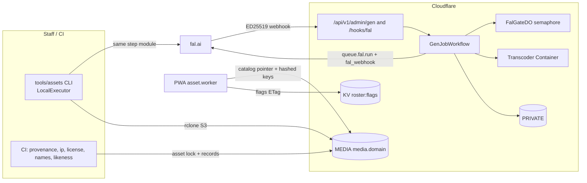
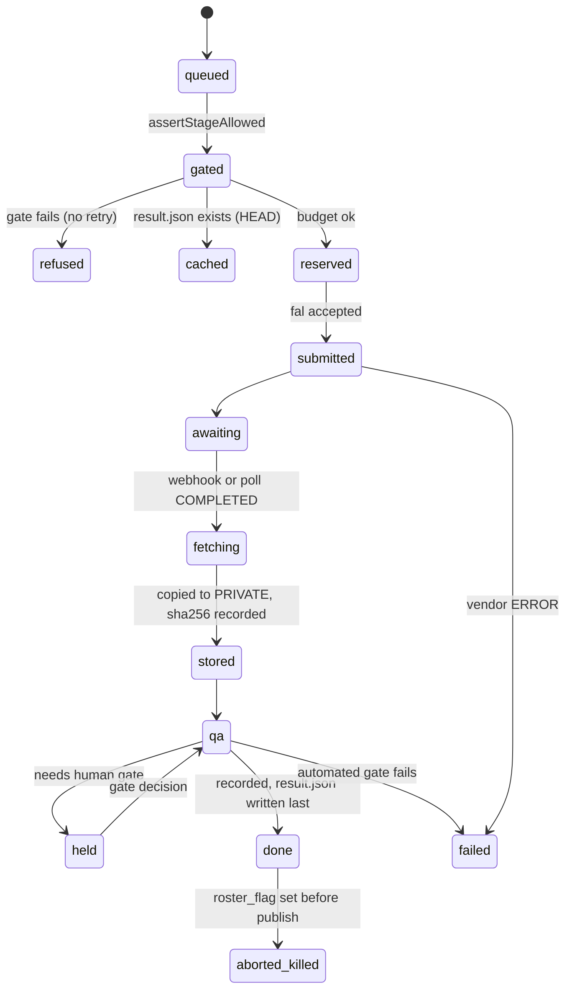

# Domain 05 — Asset Pipeline (S05), Part A: contract C07, design, runtime

> Wave 1 · v0.1 · 2026-10-18 · reads `prompt-pack/06-SHARED-CONTEXT.md` v1.1 (frozen; C07 1.1.0, additions in Part B §14) and `spec/03-decisions-and-facts.md` v1. Part B (`spec/domains/05-assets-pipeline.md`) holds stage tables, kits, audio policy, CI gate specs, costs and the roster runbook; this file holds everything another domain must code against. Citations `[research/<file>.md]` or F-NNN (research/INDEX.md §2). Numbers marked **(S05)** are design values, not vendor facts.

## 0. Checklist (seed expanded)

Disposition: **D** designed (section), **M##** deferred to a milestone, **X** out of scope (reason).

| # | Item | Disp. | Basis |
|---|---|---|---|
| 1 | C07 `AssetManifest`, `AssetCatalog`, variants, versioned `C07@1.0.0` as TypeScript | D §4.2 | 06 §4 |
| 2 | Addressing: logical `AssetRef`, content-hashed immutable R2 keys, catalog pointer shipped in Worker assets | D §4.1, §4.4 | [gap-ci-cd-release-assets.md §2.2] |
| 3 | Provenance record: SHA-256, origin, SPDX licence, generator{vendor, endpoint, request_id, prompt hash, terms snapshot}, likeness; TS + JSON Schema | D §4.3 | [legal-ip-likeness.md §2.3] |
| 4 | Endpoint registry `config/genai-endpoints.json` (D-18): ids, prices, pins, bans, video providers | D §4.5 | F-044, F-045 |
| 5 | Nightly liveness check of every registry id (public fal registry, no key) | D Pt B §9; M00b | [genai-pipeline-fal.md §0] |
| 6 | ADR-GENAI-01 gate: `assertCallable`, previs vs production, licence status outside the cache key | D §2, §5 | F-041, A-08 |
| 7 | `GenJobWorkflow` stages for every job kind; ports so one step module runs in Workers, CLI and tests | D §3, §5 | D-19 |
| 8 | fal mechanics: queue submit, headers, ED25519 webhook verify, poll fallback, concurrency gate | D §5 | F-047 |
| 9 | Retry classes and non-retryable refusals | D §5.2 | [genai-pipeline-fal.md §4.1] |
| 10 | Budget ledger, $100 one-off fal cap (DL-OWN-01, replaces G3's $1,000) with 50/80/100 % alarms, cache hits never blocked | D §5.3 | G3, D-28, F-048 |
| 11 | Character pipeline: tier check → style bible → sheet → crops → mesh → rig → retarget → optimize → publish, with endpoints | D Pt B §1 | D-18, R-NPC-02 |
| 12 | Automated QA gates and explicit human gates | D Pt B §2 | [genai-pipeline-fal.md §3.1] |
| 13 | Likeness gate at every stage; no face refs for non-consented; prompt linter; consent revalidation | D §5.4 | D-29, R-NPC-04 |
| 14 | Rig family `bay_rig_v1`, canonical mannequin, bone map; Meshy bone names verified in spike | D Pt B §4; M00c | UNVERIFIED |
| 15 | Offline retarget bake (`SkeletonUtils.retargetClip`) for authored fighter moves | D Pt B §4; M10a1 | [genai-pipeline-fal.md §3.3] |
| 16 | Optimization: gltf-transform meshopt + KTX2, pinned tools, identity encoding, size caps | D Pt B §3 | F-017, F-019, D-17 |
| 17 | Variants keyed by C13 tier ids, built from hi/mid/lo fidelity builds; per-asset budgets; no upward fallback | D §4.1, Pt B §3 | C13, D-09 |
| 18 | Lip-sync assets: mouth atlas, `RigMeta`, Rhubarb cue JSON | D Pt B §5 | D-23 |
| 19 | Voice generation: designed voices for non-consented, clone gate, bark cache key | D Pt B §5 | D-23, F-046 |
| 20 | Cutscene processing steps: private `orig.mp4`, container transcode, captions, QA, manifest written last, C2PA kept | D Pt B §6 | D-19, F-043 |
| 21 | Vehicles, props, environment kits: generated vs CC0 vs authored decision table | D Pt B §7 | A-05, constraint 15 |
| 22 | Music and SFX policy | D Pt B §8 | Q-11 |
| 23 | R2 buckets, layout, CORS, cache rules, prefix purge | D §4.4 | F-019, F-023 |
| 24 | CI gates `provenance:check`, `ip:*`, `license:scan`, `names:lint`, `likeness:gate`, `check:c2pa`, `ip:history` | D Pt B §9; M00b | INDEX §4.4 |
| 25 | Asset lock file as the release gate; mock, previs and placeholder outputs cannot ship | D §4.3, Pt B §9 | ADR-GENAI-01 |
| 26 | Kill-switch purge workflow (live ≤ 60 s, public purge ≤ 24 h), stand-ins, drill | D §5.5, Pt B §10; M10b | D-29 |
| 27 | Cost per asset and v1 programme against the $100 cap (DL-OWN-01) | D Pt B §11 | F-044…F-046 |
| 28 | Roster batch runbook, idempotent re-run | D Pt B §12; M10a | R-NPC-02 |
| 29 | Platform differences desktop / mobile / Quest 3 / Vision Pro | D §6 | C13 |
| 30 | Mock provider with recorded fixtures | D §3; M05b | A-09 |
| 31 | Vendor terms snapshots and weekly terms-watch | D Pt B §9; M00b, M14b | [gap-video…md §6] |
| 32 | Player-triggered generation (NPC builder) | not built in v1 (DL-OWN-01); owner-approved staff queue only; 18+ and P2+ if ever opened | D-30, F-042 |
| 33 | Self-hosting H3 weights, `recast`, face-swap, non-consented voice clone | X banned in registry | [legal-ip-likeness.md] |
| 34 | EU/UK AI-label compliance | X v1 is US-only (A-10) | [legal-ip-likeness.md §8] |

## 1. Scope and R-IDs

- **Assigned:** R-NPC-02 (character pipeline), R-IP-01 (provenance manifest and CI check), R-ENG-03 (nothing generates without a cache check; quotas and budget alarms), R-CUT-01 (storage and generation jobs: stages inside `GenJobWorkflow`; S03 owns request, cache key and playback).
- **Enforced here for others:** R-NPC-04 and R-IP-02 (tier gates at every stage, kill-switch purge), R-CUT-03 (generation never blocks play).
- **Deferred:** the player-triggered half of R-NPC-03 (generation step) is not built in v1 (DL-OWN-01; custom 3D only through an owner-approved staff queue counted against the cap); the NPC-builder text path is S04's.
- **Owns:** C07. **Honors:** C13 (tier ids, `VARIANT_FALLBACK`, budgets). **Consumes (final in 06 v1.1):** C09 (S03), C10 (S04), C12 (S09). Assumptions are in `contract_change_proposals` at the end of Part B.
- **Consumers of C07:** S02 (world packs, props, map-data provenance), S03 (cutscene assets, keyframes), S04 (character, voice, mouth atlas), S06 (vehicles), S07 (fighter models, clips), S11 (loader, cache, tier selection), S12 (mod assets reuse `ProvenanceRecord`).

## 2. Design



**Decisions** (numbered, testable):

1. **One step module, three executors.** All stage logic lives in `services/pipeline/src/steps/*` behind ports (§3). `WorkflowExecutor` (Workers) runs cutscenes and later on-demand jobs; `LocalExecutor` (Node) runs roster batches with the staff key; `MockExecutor` replays recorded fixtures (M05b). Reason: the roster is a one-off internal batch, on-demand generation is deferred, and tests need no network [research/genai-pipeline-fal.md §4.2 note c].
2. **Internal-only generation in v1** (D-19, ADR-GENAI-01): no public route can reach fal. Admin routes require role `admin`; the staff `FAL_KEY` is a Worker secret and a CI secret, never in a client bundle. fal ToS forbids exposing its APIs to End Users (F-042).
3. **Output is copied to R2 before anything else; vendor URLs are never stored as canonical.** Requests send `X-Fal-Object-Lifecycle-Preference` of 86,400 s [research/genai-pipeline-fal.md §2.3].
4. **Tier comes from the compiled soul, never from the request.** `GenJob` has no `tier` field; `RosterPort.get(npcId)` supplies it at every stage.
5. **Work vs release.** Candidates and vendor raw outputs live in `PRIVATE` under `work/`. Only an approved, optimized, recorded asset is copied to `MEDIA` and listed in `assets/assets.lock.json`. The lock plus its PR review is the last human gate; CI fails any ship-set file not covered by the lock and a provenance record.
6. **Provider choice is config.** `licence.status` lives in the registry and the provenance record, not in cache keys, so a revoked provider delists assets without regenerating others [research/gap-video-model-licence-clearance.md §7].
7. **Pinned `updatedAt`.** Job keys include the endpoint's registry `updated_at` as pinned in config (A-03). Upstream drift only raises an issue; re-pinning is a reviewed PR (`pnpm genai:repin`), so a vendor edit cannot silently invalidate every cutscene key (see C09 proposal).
8. **Heavy media work stays off Workers.** gltf-transform and KTX2 encoding run in `tools/assets` (Node, KTX-Software 4.4.2); ffmpeg runs in the Transcoder Container for cutscenes. Workers hold 128 MB isolates [research/gap-trust-safety-tooling.md §4.1].
9. **No face detector or face-similarity model anywhere in the pipeline** (R-IP-04 spirit; [research/gap-trust-safety-tooling.md] rec 9). This supersedes the "fictionalized dissimilarity check" in [research/genai-pipeline-fal.md §6.1]; replaced by a human review checklist (Part B §2).

**Alternatives rejected.** Workflows for the whole character run with `waitForEvent` human gates (maximum timeout UNVERIFIED; a CLI state machine is simpler); Cloudflare Stream or Media Transformations for transcode [research/gap-cutscene-delivery-playback.md §2.3]; Draco (meshopt also compresses animation) [research/stack-rendering-platform.md §1.6]; KV as manifest pointer (eventual consistency; pointer ships with the Worker) [research/gap-ci-cd-release-assets.md §2.2]; per-request `tier` (spoofable).

## 3. Components

| Module (path) | Responsibility | Public surface |
|---|---|---|
| `packages/shared/src/assets/c07.ts` | C07 types, `resolveVariant`, `objectKey`, `assetRefOf` | §4.2 |
| `packages/shared/src/assets/provenance.ts` + `schemas/provenance-1.0.schema.json` | record types, validator | `validateRecord(r)` |
| `packages/shared/src/genai/` | pure (C02 lint scope): registry parser (takes parsed JSON, no fs), `jobKey` (uses `@dv/shared` `canonicalize`), prompt linter, price math | `loadRegistry`, `jobKey`, `lintPrompt` |
| `services/pipeline/src/steps/` | stage functions (tier-check, submit, await, fetch, probe, qa, record) | `Step<I,O>` over `GenPorts` |
| `services/pipeline/src/workflow.ts` | `GenJobWorkflow`, `KillPurgeWorkflow` | Workflow classes |
| `services/pipeline/src/fal.ts` | queue client, header set, `verifyFalWebhook`, `handleFalWebhook` | S09 mounts at `/api/v1/hooks/fal` |
| `services/pipeline/src/gate.ts` | `LikenessGate`, `BudgetGate`, `ProviderGate` | `assertStageAllowed(job, stage)` |
| `services/pipeline/src/do/FalGateDO.ts` | semaphore sized to the fal account limit (starts at 2) | `acquire/release` |
| `services/pipeline/src/mock/` | `MockFalPort` with fixtures under `services/pipeline/fixtures/` | record/replay |
| `services/pipeline/transcoder/` | Docker image, `ladder.sh` recipe `cut@1` (also used by `assets:transcode` for batch prewarm) | HTTP `/ladder` |
| `tools/assets/` | `assets:gen`, `assets:optimize`, `assets:verify`, `assets:publish`, `assets:lock`, `credits` | CLI |
| `tools/ci/` | `provenance-check`, `ip-scan`, `likeness-gate`, `names-lint`, `check-c2pa` | exit codes |
| `config/` | `genai-endpoints.json`, `ip-denylist.json`, `asset-budgets.json`; `docs/legal/{vendor-terms,licenses}/` snapshots; `content/prompts/genai/<name>@<n>.md` templates (linted in CI) | JSON, MD |

Ports (all injected): `FalPort` (submit/status/result/cancel), `BlobPort` (get/put/head/presign over MEDIA and PRIVATE), `DbPort` (`gen_run`, `gen_job`, `asset_index`, `bark_index`; reads `cutscenes`), `RosterPort` (tier, soulVersion, killed scopes, consent), `BudgetPort`, `VisionPort` (Haiku 5.5 image semantics), `NamePort` (NameRegistry lint, real side server-only), `ClockPort`.

## 4. Data

### 4.1 Addressing and tier variants

- Logical address `AssetRef = "<kind>/<id>"`. Character-family ids equal the NPC slug (anim sets: `<slug>.<name>`).
- Physical keys are content-hashed: `<root>/<variant>.<sha256[0:12]>.<ext>`, `Cache-Control: public, max-age=31536000, immutable`, identity encoding (F-019). Roots: `characters/<slug>/<part>/` for `character→model`, `anim`, `portrait`, `mouth_atlas`; there is no per-character `rig` asset: the only `rig` asset is the family mannequin `rig/bay_rig_v1` at `assets/rig/bay_rig_v1/`, and per-character rigging output is the skinned `character` model (DL-067); `cutscenes/<key>/` (C09 layout, no hash suffix because `<key>` is the hash); `audio/barks/<sha256>.opus`; `assets/<kind>/<id>/` for everything else.
- Variant keys are C13 tier ids (06 sketch; S11's `QualityTierId`), plus `default` for tier-independent assets. The pipeline builds three fidelity classes (`hi`, `mid`, `lo`) and the catalog builder stores them under `desktop`, `mobile` and `mobile-low`; `desktop-ultra`, `xr-quest` and `xr-visionpro` get their own key only when a distinct build exists. Resolution is `default` if present, else the first id in C13's `VARIANT_FALLBACK[tier]` that exists, which never steps upward (a 2,048 MB iPhone WebContent kill is the failure case, F-009): `desktop-ultra→desktop`, `xr-visionpro→desktop`, `xr-quest→mobile`, `mobile→mobile-low`. Budgets use the build-side map `TIER_FIDELITY` (§4.2).

### 4.2 C07 TypeScript (`packages/shared/src/assets/c07.ts`)

```ts
export const C07_VERSION = '1.1.0' as const;            // bump with 06; additive = minor; 1.1 additions: 05-assets-pipeline.md §14

export type AssetKind =
  | 'character' | 'character_sheet' | 'rig' | 'anim' | 'portrait' | 'mouth_atlas'
  | 'vehicle' | 'prop' | 'building' | 'terrain' | 'texture' | 'ui' | 'font'
  | 'audio_music' | 'audio_sfx' | 'audio_bark' | 'voice' | 'cutscene'
  | 'map_data' | 'world_pack' | 'data';
export type AssetId = string;                            // /^[a-z0-9][a-z0-9._-]{1,62}$/
export type AssetRef = `${AssetKind}/${AssetId}`;
import type { QualityTierId } from '../platform/c13';   // C13 v1.1.0 (S11): desktop-ultra | desktop | mobile | mobile-low | xr-quest | xr-visionpro
export type VariantId = QualityTierId | 'default';

export type Origin = 'generated' | 'authored' | 'licensed' | 'open_data' | 'derived';
export type LikenessTier = 'consented' | 'parody' | 'fictionalized' | 'original';
export type VoiceMode = 'none' | 'synthetic' | 'designed' | 'consented_clone' | 'licensed';

export interface VariantStats { tris?: number; verts?: number; bones?: number; materials?: number; primitives?: number;
  texMaxPx?: number; texGpuBytes?: number; durationS?: number; lufs?: number; truePeakDb?: number; fps?: number }

export interface AssetVariant {
  key: string;                         // object key in MEDIA; URL = `${MEDIA_ORIGIN}/${key}` (origin from config, never stored)
  sha256: string;                      // lowercase hex of stored bytes; equals ProvenanceRecord.sha256
  bytes: number;                       // ≤ 25 MiB (D-17); world_pack ≤ 4 MiB
  contentType: string;                 // model/gltf-binary | image/ktx2 | audio/ogg … (table §4.4)
  encoding: 'identity';
  codec?: { mesh?: 'meshopt' | 'none'; tex?: 'ktx2-uastc' | 'ktx2-etc1s' | 'webp' | 'png'; audio?: 'opus' | 'aac' };
  stats?: VariantStats;
}

export interface ProvenanceSummary {   // copy of the ROOT record's headline fields (full record: §4.3)
  root: string;                        // sha256 of the root ProvenanceRecord
  origin: Origin; license: string; attribution?: string;
  aiGenerated: boolean; vendor?: string; endpoint?: string; requestId?: string; promptSha256?: string;
}

export interface LikenessSummary {
  tier: LikenessTier;
  subjectId: string | null;            // opaque 'subj_…'; real-side strings never leave the server (NameRegistry)
  soulVersion?: number;
  faceReferenceUsed: boolean;          // tier !== 'consented' ⇒ false
  voiceMode: VoiceMode;                // tier !== 'consented' ⇒ none | synthetic | designed
  consentRecordId?: string;            // required when tier === 'consented'
  photoreal: boolean;                  // tier !== 'consented' ⇒ false (style preset toon-pbr only)
  standIn?: AssetRef;                  // required when tier !== 'original'; must resolve to an 'original' asset
  disclaimer: 'courtesy' | 'parody' | 'fictional' | 'none';
}

export type KindExtras =
  | { t: 'character'; npcId: string; rigFamily: 'bay_rig_v1'; heightM: number; bones: { jaw: boolean; fingers: boolean };
      animSets: AssetRef[]; portrait?: AssetRef; mouthAtlas?: AssetRef; mouthAnchor?: [number, number, number] }
  | { t: 'vehicle'; class: 'traffic' | 'race' | 'police' | 'hero'; fictionalMake: string; wheelRadiusM: number;
      nodes: { body: string; wheels: [string, string, string, string]; steer?: string[]; lights?: string[]; collider?: string } }
  | { t: 'audio'; durationS: number; lufs: number; truePeakDb: number; sampleRate: 48000; loop?: { startS: number; endS: number }; cues?: AssetRef }
  | { t: 'voice'; vendor: string; voiceId: string; endpointKey: string; mode: VoiceMode; designPromptSha256?: string };

export interface AssetManifest {       // one asset; 06 sketch {id, kind, variants, provenance, deps}
  schema: 'asset/1';
  id: AssetId; kind: AssetKind;
  rev: number;                         // +1 whenever any variant byte changes
  variants: Partial<Record<VariantId, AssetVariant>>;
  deps: AssetRef[];                    // loaded together; acyclic (CI)
  provenance: ProvenanceSummary;
  likeness?: LikenessSummary;          // REQUIRED for character, character_sheet, rig, anim, portrait, mouth_atlas, voice, audio_bark, cutscene
  status: 'active' | 'quarantined' | 'killed';   // catalogs omit non-active
  visibility: 'public' | 'private';    // private entries never appear in the public catalog
  tags: string[];                      // 'char:<npcId>' on every character-derived asset (purge index)
  extras?: KindExtras;
}

export interface AssetCatalog {        // immutable, content-addressed: manifests/assets-<sha256>.json
  schema: 'asset-catalog/1'; c07: typeof C07_VERSION; buildId: string; gitSha: string; createdAt: number /* epoch ms */;
  entries: Record<AssetRef, AssetManifest>;
}
export interface CatalogPointer {      // built into the Worker's static assets: /asset-catalog.json
  schema: 'asset-catalog-pointer/1'; sha256: string; key: string; bytes: number;
}

export declare function assetRefOf(kind: AssetKind, id: AssetId): AssetRef;
export declare function objectKey(kind: AssetKind, id: AssetId, variant: VariantId, sha256: string, ext: string): string;
export declare function resolveVariant(m: AssetManifest, tier: QualityTierId): AssetVariant;  // default, else C13 VARIANT_FALLBACK[tier]; throws NO_VARIANT
```

Build-side helper (not part of C07), `packages/shared/src/assets/fidelity.ts`:

```ts
export type Fidelity = 'hi' | 'mid' | 'lo';
export const TIER_FIDELITY: Readonly<Record<QualityTierId, Fidelity>> =
  { 'desktop-ultra': 'hi', desktop: 'hi', 'xr-visionpro': 'hi', mobile: 'mid', 'xr-quest': 'mid', 'mobile-low': 'lo' };
export const FIDELITY_VARIANT: Readonly<Record<Fidelity, QualityTierId>> = { hi: 'desktop', mid: 'mobile', lo: 'mobile-low' };
```

Validation rules enforced by `check:assets`: `rev` monotonic against the previous catalog; every `deps` ref exists, is active and acyclic; every variant `sha256` has a provenance record; for every one of the six C13 tiers the fallback chain resolves to a variant (S11's rule), and tiered kinds (`character`, `vehicle`, `prop`, `texture`, `building`) carry `desktop`, `mobile` and `mobile-low` or one justified `default`; `likeness` invariants in the comments above; `killed` or `quarantined` entries absent from the public catalog.

### 4.3 Provenance record (`provenance/1.0`, JSON on disk, snake_case; runtime types camelCase)

Records are public-safe: no real names, aliases or consent details (only opaque ids); `names:lint` runs on them. One record per stored file, at `assets/provenance/<sha256[0:2]>/<sha256>.json`; the batch CLI creates them and opens the PR. Private files (sheets, `orig.mp4`, candidates) keep their records in the `PRIVATE` mirror and the `asset_index`; a private record is also committed when a shipped file reaches it through `derived_from` or `input_refs`, so an auditor can walk from a shipped GLB back to its sheet.

```ts
export interface ProvenanceRecord {
  schema: 'provenance/1.0';
  sha256: string; paths: string[];                       // repo or catalog paths that resolve to these bytes
  kind: AssetKind; origin: Origin;
  license: string;                                       // SPDX or LicenseRef-*; allowlist in config/license-allowlist.json
  attribution?: string; authors: string[];               // 'profile:…' | 'studio:…'
  source?: { url: string | null; dataset_id: string | null; retrieved: string };      // licensed / open_data
  generator?: {                                          // REQUIRED when origin is 'generated'
    vendor: 'fal' | 'elevenlabs' | 'minimax' | 'openai' | 'workers_ai' | 'anthropic' | 'local';
    endpoint: string; endpoint_registry_key: string; endpoint_updated_at: string | null; model_version?: string;
    request_id: string; seed?: number; job_key: string; params_sha256: string;
    prompt_template: string; prompt_sha256: string; negative_prompt_sha256?: string; expanded_prompt_sha256?: string;
    input_refs: string[];                                // 'sha256:<hex>' of every input file, never URLs
    plan?: string;                                       // vendor plan tier when terms depend on it (music)
    terms_snapshot: { path: string; sha256: string; checked_at: string };
    licence_gate?: { gate: 'ADR-GENAI-01'; status: 'cleared' | 'pending' | 'blocked'; evidence?: string };
    cost_usd_micros?: number; generated_at: string;
    executor: 'workflow' | 'cli' | 'mock'; env: 'production' | 'previs' | 'test';
  };
  derived_from: string[];                                // parent sha256s (retopo, LODs, KTX2, transcodes)
  tool?: { name: string; version: string; args_sha256: string };                       // for origin 'derived'
  likeness?: { subject_id: string | null; tier: LikenessTier; face_reference_used: boolean; voice_mode: VoiceMode;
               consent_record_id?: string; consent_scopes_used?: string[]; photoreal: boolean };
  review: { gate: string; by: string; at: string; decision: 'approve' | 'reject'; note?: string }[];
  ip_checks: { signatures: 'pass' | 'n/a'; strings: 'pass' | 'n/a'; similarity: 'pass' | 'n/a'; vision?: 'pass' | 'review' };
  ai_generated: boolean; c2pa?: 'valid' | 'valid-untrusted' | 'absent' | 'invalid' | 'resigned';
  status: 'active' | 'quarantined' | 'killed'; created_at: string; // all ProvenanceRecord timestamps: ISO-8601 UTC 'Z' (06 §4.3 exception, DL-059)
}
```

JSON Schema (`schemas/provenance-1.0.schema.json`, draft 2020-12; conditionals shown, field lists elided to the interface above):

```json
{"$schema":"https://json-schema.org/draft/2020-12/schema","$id":"provenance-1.0","type":"object","additionalProperties":false,
 "required":["schema","sha256","paths","kind","origin","license","authors","derived_from","review","ip_checks","ai_generated","status","created_at"],
 "properties":{"schema":{"const":"provenance/1.0"},"sha256":{"pattern":"^[0-9a-f]{64}$"},"status":{"enum":["active","quarantined","killed"]}},
 "allOf":[
  {"if":{"properties":{"origin":{"const":"generated"}}},"then":{"required":["generator"],"properties":{"ai_generated":{"const":true}}}},
  {"if":{"properties":{"origin":{"const":"licensed"}}},"then":{"required":["source"]}},
  {"if":{"properties":{"origin":{"const":"open_data"}}},"then":{"required":["source","attribution"]}},
  {"if":{"properties":{"origin":{"const":"derived"}}},"then":{"required":["tool"],"properties":{"derived_from":{"minItems":1}}}},
  {"if":{"properties":{"kind":{"enum":["character","character_sheet","rig","anim","portrait","mouth_atlas","voice","audio_bark","cutscene"]}}},"then":{"required":["likeness"]}},
  {"if":{"required":["likeness"],"properties":{"likeness":{"properties":{"tier":{"enum":["parody","fictionalized","original"]}}}}},
   "then":{"properties":{"likeness":{"properties":{"face_reference_used":{"const":false},"photoreal":{"const":false},"voice_mode":{"enum":["none","synthetic","designed"]}}}}}},
  {"if":{"required":["likeness"],"properties":{"likeness":{"properties":{"tier":{"const":"consented"}}}}},"then":{"properties":{"likeness":{"required":["consent_record_id"]}}}}]}
```

**Lock file.** `assets/assets.lock.json` lists every R2-hosted asset except released world areas, which use `assets/world/<area>.lock.json` with the same entry shape and are walked by `provenance:check` as part of the ship set (DL-670, DL-667): `{schema:'asset-lock/1', entries:{[ref]:{rev, variants:{[id]:sha256}, root, approved_by, approved_at}}}`. `provenance:check` walks the ship set (repo static files, `dist/` assets, lock variants, S02 world packs), joins each SHA-256 to a record and fails on any miss, schema error, non-allowlisted licence, `status≠active`, `env≠production` (or `previs/` or `mock` key reference), missing attribution in `credits.json`, or `derived_from` cycles/unrooted chains.

### 4.4 R2 layout, content types, caching

| Bucket / binding | Access | Contents |
|---|---|---|
| `MEDIA` (bucket `tha-bay-media-<env>`) → `media.<domain>` | public, CORS GET/HEAD for app origin, Cache Rule eligible with edge TTL "respect origin", `r2.dev` off | release blobs (§4.1), `cutscenes/<key>/…` renditions + `manifest.json` (written last = ready), `manifests/assets-<sha>.json` |
| `PRIVATE` (bucket `tha-bay-private-<env>`, S09's) | Worker binding + S3 presign only | `work/<kind>/<id>/<stage>/<jobKey>/{in.json,out.*,result.json}` (`result.json` last), `cutscenes-orig/<key>/{orig.mp4,probe.json,whisper.en.vtt}`, approved sheets `sheets/<slug>/<sha>.png`, `quarantine/<ticket>/…`, `previs/…`, `provenance/<sha>.json` mirror |

| Class | Content-Type | Notes |
|---|---|---|
| `.glb` | `model/gltf-binary` | meshopt + KTX2 inside; never gzip (Cloudflare decompresses and breaks Range) |
| `.ktx2` | `image/ktx2` | |
| `.opus` / `.m4a` / `.mp4` | `audio/ogg; codecs=opus` / `audio/mp4` / `video/mp4` | cutscene video is video-only CMAF; audio separate |
| `.json` | `application/json` | catalogs, atlases, cue files |

Upload uses rclone (S3 endpoint, one invocation per content class, `--immutable`, `--ignore-existing`); verify by HEAD; order: blobs → HEAD → immutable catalog → pointer PR [research/gap-ci-cd-release-assets.md §2.1–2.2]. R2 allows one write per second to the same key; keys are unique per hash. Kill purges use **prefix purge** on `media.<domain>` because tag purge of R2 objects is UNVERIFIED.

### 4.5 Registry (`config/genai-endpoints.json`)

```ts
export interface EndpointEntry {
  id: string;                                   // exact vendor id, e.g. 'meshy/v7.1/multi-image-to-3d'
  vendor: 'fal' | 'workers_ai' | 'elevenlabs' | 'anthropic' | 'local';
  role: 'style_bible' | 'sheet' | 'sheet_lean' | 'keyframe' | 'portrait' | 'mesh' | 'mesh_alt' | 'rig'
      | 'tts_draft' | 'tts_final' | 'tts_hero' | 'voice_design' | 'voice_clone' | 'sfx' | 'vision_qa';
  status: 'active' | 'pending' | 'blocked';     // blocked ⇒ never callable; previs may call 'pending' only
  price: { usd: number; per: 'image' | 'gen' | 'second' | 'clip' | '1k_chars' | 'voice'; note?: string; checkedAt: string };
  pinnedUpdatedAt: string | null;               // registry updated_at at last review; enters job keys
  licenseType: 'commercial';                    // liveness fails on any other value
  tiers: LikenessTier[];                        // tiers allowed to call it
  acceptsFaceRefs: boolean;                     // true only on consented paths
  termsSnapshot: string;                        // docs/legal/vendor-terms/<vendor>-<date>.md
}
export interface GenAiRegistry {
  schema: 'genai-endpoints/1'; checkedAt: string;
  endpoints: Record<string, EndpointEntry>;
  videoProviders: Record<string, VideoProviderEntry>;   // shape and assertCallable: research/gap-video-model-licence-clearance.md §8
  banned: { id: string; match: 'exact' | 'prefix'; reason: string }[];
  defaults: { videoProvider: string; videoFallbackOrder: string[] };
}
```

Initial contents (checked 2026-10-18; ids from D-18 and [research/genai-pipeline-fal.md]): `sheet` = `openai/gpt-image-2.5/sunburst/edit` ($0.05529 at 2560×1440 high, F-044); `sheet_lean` = `google/nano-banana-2.1/edit` ($0.063 at 2K); `keyframe` = Sunburst edit at 1920×1080 ($0.0396); `mesh` = `meshy/v7.1/multi-image-to-3d` ($1.20 textured, F-045); `mesh_alt` = `fal-ai/hunyuan-3d/v3.1/pro/image-to-3d`; `rig` = `fal-ai/meshy/rigging/multi-animation` ($0.20 + $0.12 per clip); `tts_draft`/`tts_final` = `fal-ai/minimax/speech-2.8-turbo` / `-hd` ($0.06 / $0.10 per 1k chars, F-046); `voice_design` = `fal-ai/minimax/voice-design` ($3); `voice_clone` = `fal-ai/minimax/voice-clone` ($1.50, tiers `['consented']`); `tts_hero` = `elevenlabs/tts/eleven-v4` ($0.08 per 1k chars, `pending` until S04 confirms hero voices, Q-12); `vision_qa` = `claude-haiku-5-5` ($0.10 / $0.50 per MTok, F-034). Video providers per ADR-GENAI-01: default `h3.partner` (`pending`), `h3.maxTurbo` and `h3.max` (`blocked`), `videoFallbackOrder` = `ltx25.fast` (`pending`), then `gemini.omniFlash11` (`pending`, 18+ only). **Selection (A-08):** the first of `[default, ...videoFallbackOrder]` whose `status` is `cleared` and whose `under18Audience` fits the product; if none, production refuses (`ENDPOINT_NOT_CLEARED`), the game plays the in-engine fallback (R-CUT-03), and only `previs` jobs may call `pending` providers. **Banned** (exact/prefix): `minimax/h3-max/recast`, any `*face-swap*`, `bytedance/seedance-2.5/image-to-video`, `fal-ai/veo3*` (deprecated), any `*/voice-clone` outside the `voice_clone` role.

### 4.6 Job, gate and key types (`packages/shared/src/genai/types.ts`)

```ts
export type GenKind = 'style_bible' | 'sheet' | 'portrait' | 'mouth_atlas' | 'mesh' | 'rig' | 'voice_design' | 'tts'
  | 'keyframe' | 'cutscene_shot' | 'texture' | 'sfx';       // local-only steps (crops, retarget, optimize) are tools/assets commands
export interface InputFile { role: string; sha256: string;
  origin: 'first_party_generated' | 'first_party_authored' | 'consented_photo' | 'user_upload'; realHumanVisible: boolean }
export interface GenJob {
  schema: 'genjob/1'; jobKey: string; kind: GenKind; endpointKey: string;
  env: 'production' | 'previs' | 'test';
  subject: { assetRef: AssetRef; npcId?: string; soulVersion?: number };   // NO tier field (decision 4)
  params: Record<string, unknown>;       // vendor parameters; file inputs referenced by InputFile.sha256, presigned at submit
  inputs: InputFile[]; promptTemplate: `${string}@${number}`; promptSha256: string;
  budgetUsdMicros: number; runId?: string; requestedBy: string;   // integer USD micros, the unit of S09's ledger
}
export interface JobKeyInput { kind: GenKind; endpointId: string; pinnedUpdatedAt: string | null; params: Record<string, unknown>;
  inputSha256: string[]; promptTemplate: string; promptSha256: string; soulVersion?: number; tier?: LikenessTier; recipe: string }
export declare function jobKey(i: JobKeyInput): string;   // hex sha256 of RFC 8785 canonical JSON; inputs sorted; seed mandatory in params
export type GateCode = 'TIER_UNKNOWN' | 'KILLED' | 'FACE_REF_FORBIDDEN' | 'CLONE_FORBIDDEN' | 'NAME_IN_PROMPT'
  | 'PHOTOREAL_FORBIDDEN' | 'CONSENT_EXPIRED' | 'ENDPOINT_BANNED' | 'ENDPOINT_NOT_CLEARED' | 'KILL_SWITCH' | 'BUDGET' | 'MINOR_SUSPECTED' | 'POLICY_REFUSED';
export type GateVerdict = { ok: true } | { ok: false; code: GateCode; detail: string };
export declare function assertStageAllowed(job: GenJob, stage: string, ports: GenPorts): Promise<GateVerdict>;
```

### 4.7 Config and flags

`GENAI_ENV` (`production|previs|test`; `FAL_MODE=mock` from S09's vars forces `MockExecutor` and `test`), `MEDIA_ORIGIN`, feature flag `GEN_PUBLIC=false` (compile-time constant; the player-triggered path does not exist in v1). Caps and thresholds are not env vars: they live in `config/guardrails.yaml` under `genai:`: `falConcurrency` (default 2), money caps in integer USD micros `runCapUsdMicros` (default per-run `budgetUsdMicros`), `programCapUsdMicros` (100,000,000 = $100, G3 as amended by DL-OWN-01; DL-171) and `alarms` (0.5, 0.8, 1.0) (06 §5, DL-068). Secrets: `FAL_KEY`, `ANTHROPIC_API_KEY` (vision QA), `R2_ACCESS_KEY_ID`, `R2_SECRET_ACCESS_KEY` [research/stack-cloudflare-backend.md §7].

## 5. Runtime behavior



### 5.1 Stage order inside `GenJobWorkflow` (every kind)

1. `gate` (tier, kill state, consent term, endpoint status and bans, prompt lint, input provenance). 2. `cache-check`: `HEAD result.json`. 3. `budget-reserve`. 4. `acquire` the `FalGateDO` slot. 5. `submit` with `?fal_webhook=`, `X-Fal-Object-Lifecycle-Preference`, `X-Fal-Request-Start-Timeout`. 6. `waitForEvent('fal-done', 20 min)`. 7. `poll+result` (status then response URL; step results carry URLs only, < 1 MiB, F-024). 8. `copy` to `PRIVATE`, hash. 9. kind-specific processing (cutscene: probe + transcode + captions in the container). 10. `qa` automated gates. 11. `re-gate` (kill state and consent again). 12. `record` (provenance, `gen_job`, spend reconcile, `result.json` last). Instance id `<kind>-<jobKey[0:12]>-<attempt>`; single-flight for cutscenes via `CutsceneJobDO` (D-19), for other kinds via the unique `gen_job.job_key`.

### 5.2 Failures and retries

| Failure | Detect | Action |
|---|---|---|
| 429 `concurrent_requests_limit` (`X-Fal-needs-retry`) | submit response | `FalGateDO` backoff; step retry 5× from 15 s exponential [research/genai-pipeline-fal.md §4.2] |
| Webhook lost (retries stop ≈ 6 min for ≥ 10 KB results, F-047) | `waitForEvent` timeout | poll status; 12 tries from 30 s exponential |
| Vendor `ERROR` after fal's own ≤ 10 runner retries | status `error_type` | one resubmit with the same seed; then `failed`, human note |
| Content-policy refusal | error type | `refused`; never auto-rewrite prompts; human edits template |
| Meshy rig 422 (pose estimation) | HTTP 422 | non-retryable; fall to the other mesh candidate, else human gate |
| Webhook signature or clock skew > 300 s | verify | 401, no event |
| Budget or program cap hit | `BudgetPort` | `refused: BUDGET`; cache hits still served |
| Container transcode fails 3× | step error | Media Transformations degraded rendition `p720` (progressive 720p MP4) + poster, manifest `degraded:true` (S03 plays `p720` only; C09 fixed line) |
| Vendor terms hash drift | weekly terms-watch | provider flips `cleared→pending`; production calls stop |

### 5.3 Budget

`BudgetPort` reserves and settles through S09's `BudgetGovernorDO` (vendor `fal`) and lands in `genai_ledger` (migration 0002; kind `asset` added, `job_id` = `jobKey`). Estimate = registry price × units; fal exposes no spend cap and locks the account below a balance threshold (F-048), so our ledger is the cap: per-run `budgetUsdMicros`, a one-off program cap of $100 (G3 as amended by DL-OWN-01, DL-171; `config/guardrails.yaml` `genai.programCapUsdMicros` is the source; the `budget_program` row in migration 0002 is a mirror written at deploy and checked by the nightly drift check) with alerts at 50/80/100 %, hard stop at 100 % until the owner raises it. Weekly reconcile against the fal dashboard (manual; per-request billing retrieval UNVERIFIED).

### 5.4 Likeness gate (D-29, constraint 7)

`assertStageAllowed` runs at entry of every stage and again before `record`. Rules, each a unit test:

1. Unknown tier or `soul.minor === true` → `TIER_UNKNOWN`. Killed scope covering the stage → `KILLED`.
2. Tier ≠ `consented`: any `InputFile` with `origin ∈ {consented_photo, user_upload}` or `realHumanVisible` → `FACE_REF_FORBIDDEN`. Only `first_party_*` files pass. Appearance comes from the soul's text `visual_brief`; photographs of the real person never reach any generator. For user uploads a Haiku text description replaces the photo (L6, [research/gap-trust-safety-tooling.md §3.3]).
3. `voice_clone` role requires tier `consented`, a `consent_record` with scope `voice_clone` unexpired at job time and at `record`; everything else uses `voice_design` or a preset (`CLONE_FORBIDDEN`).
4. Every prompt, `texture_prompt`, `style_prompt` and music prompt passes `lintPrompt`: NameRegistry names and aliases (server side), `config/ip-denylist.json`, franchise and artist names, "in the style of" (`NAME_IN_PROMPT`).
5. Non-consented cutscene or sheet presets are `toon-pbr` only (`PHOTOREAL_FORBIDDEN`).
6. Consented jobs record `consent_scopes_used`; a `term_end` in the past → `CONSENT_EXPIRED`.
7. KV kill switches `ks:genai:all`, `ks:fal`, `ks:fal:<endpointId>`, `ks:cutscene_gen` and the governor level `gov:level` (S09, 30 s cache) stop new submits with `KILL_SWITCH` or `BUDGET`; a cache hit is still served (D-28).
8. Rendered sheets and portraits go through the Haiku image-semantics schema; `apparent_minor ≠ none`, nudity, `logos_or_jerseys` or readable names in `text_in_image` fail the automated gate [research/gap-trust-safety-tooling.md §2.3].

### 5.5 Kill-switch purge (summary; steps in Part B §10)

Trigger: `roster_flag` write (S09 admin route). Live removal ≤ 60 s is the runtime's job (route 30 from Postgres with a 10 s Worker cache and KV `roster:flags` as fallback, 30 s client poll (DL-557), `EncounterDO` broadcast, client `asset.worker` calls `WorldPackStore.evictByTag('char:<id>')` (S11 Part C §5)); the catalog is not rebuilt for it. S05's `KillPurgeWorkflow` then marks records `killed`, copies matching objects to `quarantine/<ticket>/`, deletes them from `MEDIA`, prefix-purges `media.<domain>/characters/<slug>/` and each affected `cutscenes/<key>/`, and writes the next catalog without them; target ≤ 24 h, verified by a probe that expects 404 and `CF-Cache-Status ≠ HIT`. Targets come from `asset_index` tags and S09's `cutscenes.char_ids`. Every real-derived character has a `standIn`, so missions and saves never block (R-CUT-03 fallback covers cutscenes).

## 6. Platform notes

| Aspect | Desktop | iPhone-class PWA | Quest 3 / 3S | Vision Pro |
|---|---|---|---|---|
| Variant served (C13 `VARIANT_FALLBACK`) | `desktop` (`desktop-ultra` falls to it): hi | `mobile`: mid; iPhone 15 `mobile-low`: lo | `xr-quest` → `mobile`: mid | `xr-visionpro` → `desktop`: hi |
| Texture target (one KTX2 file transcodes at load) | BC7 (ASTC on 0.04 % of Windows GPUs) | ASTC | ASTC/ETC2 | ASTC [research/stack-rendering-platform.md §1.6] |
| Texture memory ceiling (C13) | ≤ 1.0 GB | ≤ 350 MB (lo ≤ 250 MB) | ≤ 400 MB | ≤ 800 MB |
| Render objects (D-09) | ≤ 600 | ≤ 150 (lo ≤ 100) | ≤ 150 | ≤ 200 per pass |
| Character render objects | ≤ 3 materials | ≤ 2 (lo 1) | ≤ 2 | ≤ 3 |
| Cutscene rendition (S03 selects) | `v768`; `v1080` when present and screen ≥ 1440 px | `v768`; `v540` on data saver or < 4 Mbps | `v768` on a media layer | `v768` via `VideoFrameTexture` [research/gap-cutscene-delivery-playback.md §7.3] |
| Loader | `asset.worker` + OPFS, decoders self-hosted, `fetch` in CORS mode under COEP (D-16) | same; 60 Hz cap | same; Quest WebGL2 backend | same; WebGPU XR |

Pipeline consequence: characters are authored once at `hi` and decimated; XR close inspection uses `mid` LOD0 at arm's length (S11 chooses LOD bias). Hair, hoodies and chains that break skinning get the human gate in Part B §2, not a tier-specific hack.

## 7. Verified facts used

| Ref | Fact | Source |
|---|---|---|
| F-017 | gltf-transform 4.5.1, meshopt default; KTX-Software ≥ 4.4.0 (pin 4.4.2) | [research/stack-rendering-platform.md §5.6] |
| F-019 | `_headers` not applied to Worker responses; Cloudflare ignores Range when decompressing | [research/stack-cloudflare-backend.md §1.2] |
| F-023/F-024 | R2 prices, egress free, same-key write 1/s; Workflows step result ≤ 1 MiB, 500 k steps | [research/stack-cloudflare-backend.md §1.4–1.5] |
| F-041 | H3 licence excludes USA/EU/UK/KR; covers derivatives and hosted services; "MiniMax H3" credit | [research/gap-video-model-licence-clearance.md §2] |
| F-042 | fal ToS: End Users 18+ (§2); no direct API exposure (§4(b)) | [research/gap-video-model-licence-clearance.md §4] |
| F-043 | H3 output MP4 H.264 1344×768 @ 24 fps + AAC with fal C2PA; transcode strips it | [research/gap-cutscene-delivery-playback.md §1] |
| F-044/F-045/F-046 | Sunburst edit ≤ 16 refs, $0.05529 at 2560×1440 high; Meshy 7.1 t-pose $1.20, rig $0.20 + $0.12/clip; speech-2.8 $0.06/$0.10 per 1k | [research/genai-pipeline-fal.md §B–E] |
| F-047/F-048 | fal webhooks ED25519, retries end ≈ 6 min for ≥ 10 KB, concurrency 2; no spend cap | [research/genai-pipeline-fal.md §4.1] |
| F-050 | LTX-2.x licence: no territory exclusion; paid at ≥ $10 M revenue | [research/gap-video-model-licence-clearance.md §5] |
| — | 63/63 fal endpoints `license_type: commercial` (does not encode territory) | [research/genai-pipeline-fal.md Verified facts] |
| — | Real-person policies: no provider has a parody exception | [research/legal-ip-likeness.md §3.4] |

**UNVERIFIED (carried to `99`; none is used in an acceptance criterion):** U1 Meshy bone names, finger/jaw/face data and animation-clip licence; U2 whether Meshy honours the order of `image_urls`; U3 fal CDN `Content-Length` and result retrievability with `X-Fal-Store-IO: 0`; U4 whether fal API outputs for every chosen endpoint carry C2PA; U5 Workers streaming SHA-256 (`DigestStream`) and Workers Workflow `waitForEvent` maximum timeout; U6 wrangler `containers`/`workflows` config keys (check against wrangler 4.151.1 in M00); U7 GPT-image cost of extra input images ($0.01 assumed); U8 Sunburst and Nano Banana refusal behaviour on real-person edits; U9 Rhubarb licence (believed MIT); U10 CC0 catalogue terms (Part B §7); U11 ElevenLabs SFX endpoint terms and price; U12 R2 tag-based cache purge; U13 basis_universal XUASTC compatibility with three's transcoder; U14 iOS decode of Ogg Opus through `decodeAudioData` (fallback AAC); U15 pinned C2PA signing tool and version.

## 8. Milestone mapping

| Milestone | S05 slice | Stubbed first | Sessions |
|---|---|---|---|
| **M00b** (new, split of M00) `ip-provenance-gates` | schema, `provenance:check`, `ip:signatures/extensions/strings`, `license:scan`, `names:lint` (display side), `likeness:gate` unit rules, `config/*.json`, vendor-terms snapshots, bad-fixture tests | `ip:similarity` (separate runner, S13), real-side names (secret) | 1 |
| **M00c** (new) `genai-spike` | ≤ $10 spend (DL-OWN-01): one Standard character, one keyframe, three video clips from `pending` providers (no `blocked` H3 Max/Turbo, DL-286); probe bone names, C2PA, codecs, refusal behaviour; results to `research/`; resolves U1–U4, U8 | none | 1 |
| **M01d** (new) `assets-publish` | catalog builder, `assets:verify/publish/lock`, `credits`, `resolveVariant`, rclone upload with HEAD verify | no generated assets yet; fixtures only | 1 |
| **M05b** | `GenJobWorkflow`, ports, `MockExecutor`, webhook verify, `FalGateDO`, ledger, cutscene steps with container stub | live fal calls blocked until ADR-GENAI-01 `cleared` | 1–2 (shared with S03) |
| **M05c** | Act 1 cutscene prewarm via the registry's cleared provider; `check:c2pa` | n/a | 0.5 |
| **M08a2** | fighter clip packs (mannequin); retarget tool in M10a1 | hand-keyed moves from art | 1 |
| **M10a** | roster automation (`assets:gen`), QA gates, two validated characters | voices via presets | 2 |
| **M10b** | gates hardening, batch prewarm idempotence, kill drill | none | 1 |
| **M11a** | asset budgets as perf tests | none | 0.5 |
| **M13a/c** | mod validator reuses `ProvenanceRecord`; no player-triggered generation in v1 (DL-OWN-01) | text-only builder, creator-kit bodies | 1 |
| **M14b** | `ip:history` before public, terms-watch green, counsel sign-off | none | 0.5 |

R-ID map: R-NPC-02 → M05b (mock), M08a, M10a–b. R-IP-01 → M00b, M01d, M14b. R-ENG-03 → M00c, M05b, M10b (ledger, cache check, idempotent prewarm). R-CUT-01 → M05b, M05c. R-NPC-04 and R-IP-02 (enforcement) → M00b (gate rules), M10b (kill drill).

## 9. Tests

- Unit (`pnpm check:unit -- packages/shared services/pipeline`): `jobKey` stability and seed requirement; `resolveVariant` never upward; each rule in §5.4 (FACE_REF_FORBIDDEN on a `user_upload` input for `parody`; CLONE_FORBIDDEN; NAME_IN_PROMPT; CONSENT_EXPIRED; KILLED between stages); schema conditionals with 12 positive/negative fixtures; `verifyFalWebhook` with a recorded signature and with +301 s skew; budget cap refusal with cache hit still served.
- Integration (Miniflare, `MockFalPort`): `pnpm check:pipeline` runs a character through sheet→rig with fixtures; second run makes zero `FalPort` calls; webhook lost → poll path completes.
- CI gates: `pnpm provenance:check` fails on fixture `bad/no-record.glb`, `bad/env-test.json`, `bad/gpl.txt`; passes `good/`. `pnpm ip:signatures` fails on RPF7/GXT2 magic fixtures.
- E2E (M10b): `pnpm check:e2e -- --grep @kill-drill` kills `npc_test` and asserts absence from spawn tables, roster, cutscene index within two refreshes and 404 on its prefix within 24 h simulated clock.
- Nightly: `pnpm genai:liveness` (public registry; fails on `status≠active`, missing id, `license_type≠commercial`); monthly `pnpm genai:price` (keyed).

## 10. Open questions

Q-S05-01 Written H3 clearance (fal, MiniMax) status — blocks `cleared` for H3 providers; default assumed `pending`, LTX-2.5 fast as production fallback (Q-03). Q-S05-02 Who holds the production `FAL_KEY` and its scopes (art lead machine vs CI secret vs Worker secret). Q-S05-03 (closed by DL-OWN-01, DL-171) 8 fighters are produced; the 12-fighter target is post-v1. Q-S05-04 Human art-lead time per character and per vehicle (measure in M00c/M03). Q-S05-05 Counsel reading of "internal business use" for roster generation (fal ToS §4(a)).
