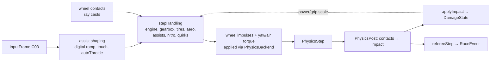
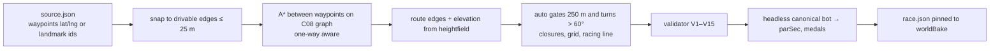
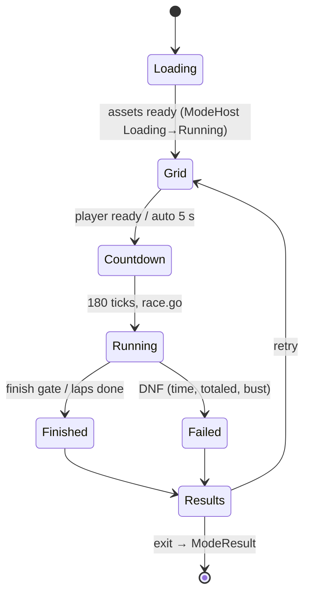
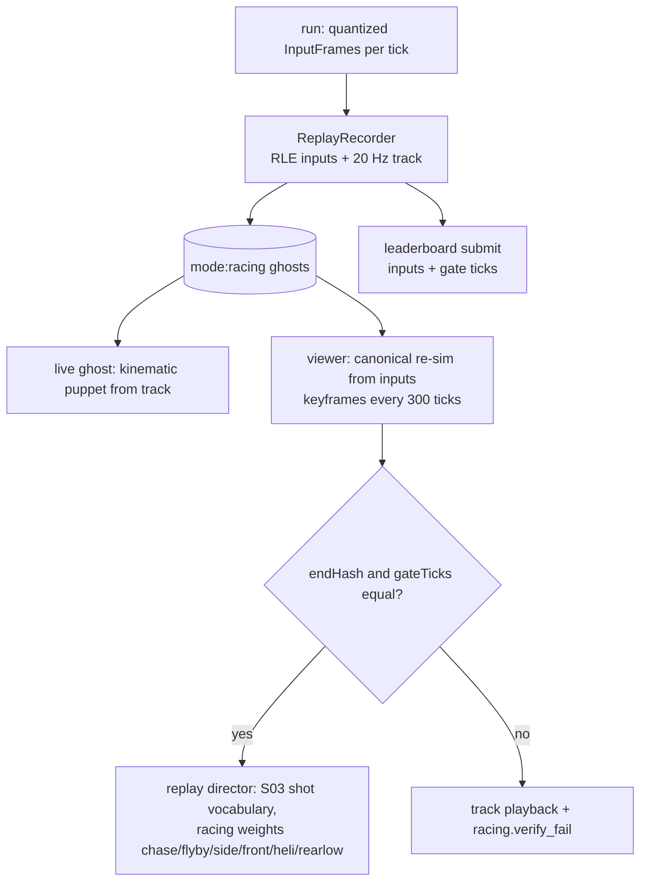

# 06 — Racing (S06)

> Wave 3 domain spec, 2026-10-18, author S06 (`claude-sonnet-5-5`). Reads `06-SHARED-CONTEXT.md` v1.0 (frozen), `spec/.waves234-notes.md`, `spec/03` v1, `spec/11-decision-log.md`, `spec/02-architecture.md` v0 and the Wave 1 specs of S01, S05, S09, S11. This spec has three parts:
> - **this file**: scope, checklist, design, components, runtime, platforms, facts, milestones, tests, open questions;
> - `spec/domains/06-racing-data.md`: §4 Data — all TypeScript, schemas, configs, save slice, wire shapes;
> - `spec/domains/06-racing-content.md`: garage, handling presets in port-contract form, events, ladder, audio and art needs.
>
> Numbers are design starting values owned by this project unless a citation follows. Where a contract belongs to a concurrent owner (C08 S02, C09 S03, C14 S12) the 06 v1.0 sketch is used exactly and each use is an assumption `A-S06-n` (§10).

## 1. Scope and R-IDs

**Owns.** The racing game mode `@dv/mode-racing` (`packages/modes/racing`), the vehicle handling model and damage rules (`packages/shared/src/vehicle/`, pure, so S01's vehicle wrapper, S02's traffic brains and S12's mod validator import it without importing a mode), the race referee and replay/ghost codecs (`packages/shared/src/racing/`, pure, so `RoomDO` can reuse the gate logic), the race authoring tool (`tools/map/src/race/`, `pnpm map:races`), vehicle and event content, components 1024–1279, the `mode:racing` save slice, `AnimStateId` block 128–159 (by ADR), `config/racing.json`, `config/pursuit.race.json`, and the per-class rows of `config/net.speedcaps.json`.

**R-IDs.** Covered: **R-MODE-02** (all of it). Supports: R-MODE-05 (racing unlock and persistence), R-IP-01 (fictional makes), R-MAP-01 (every route is baked SF), R-ENG-04 (remapping, assists, colorblind HUD), R-ENG-02 and R-PLAT-05 (per-tier caps and budgets), R-PLAT-02 (XR driving rules, implemented M11b2), R-ROLL-02 (multiplayer notes, implemented M12c), R-MOD-01 (vehicle mods clamp to class envelopes, M13a).

**Contracts honored (read-only):** C01 (components 1024–1279, `StableKey veh:<id>`), C02 (stages, determinism rules, profiles), C03 (`SimButton`/`Axis`, `vehicle` and `photo` contexts), C04 (`VehicleView`, `CameraDirective`), C05 (`mode:racing` slot, `CoreSlice.garage`), C06 (`GameModeDescriptor`, `ModeContext`, `PursuitApi`, `UnlockApi`), C07 (`vehicle` kind, tiers, budgets), C08 (road graph, tags), C11 (`ACT` JoinActivity, `EV Activity`), C12 (route 21), C13 (tiers and budgets), C16 (names). **Contracts owned:** none; changes proposed in §10.

### 1.1 Checklist (34 items; each is designed, deferred to a named milestone, or out of scope)

| # | Item | Status | Where | Milestone |
|---|---|---|---|---|
| 1 | Arcade vehicle model tiers M1 hero / M2 distant / M3 ambient | designed | §2.2 | M03a, M07a |
| 2 | Ray-cast suspension plus custom tire curve on Rapier; Jolt swap criteria (D-12) [research/stack-rendering-platform.md §5.1] | designed | §2.3, D-S06-02 | M03a |
| 3 | Classes D/C/B/A/S/R, envelopes, measured PI | designed | content C.2 | M03a, M07a |
| 4 | Supercar preset (A) | designed | content C.3.1 | M07a |
| 5 | Robotaxi preset with quirks and jailbreak [research/gamedesign-decomposition.md §2.7] | designed | content C.3.3 | M07b |
| 6 | Rocket roadster preset with thruster hop | designed | content C.3.2 | M07a (hop M07b) |
| 7 | Police and traffic handling presets | designed | content C.1 | M03a, M03c |
| 8 | Steering, drift, stability assists; digital/touch/tilt input shaping | designed | §2.3 | M03a, M07a |
| 9 | Hill crests, jump zones, landing damping (Filbert, Russian Hill) [research/gamedesign-decomposition.md §3.3] | designed | §2.3 | M03a |
| 10 | Racing profile of the PursuitDirector: heat table, unit speed rules, catch-up | designed | §2.6 | M07b |
| 11 | Roadblocks and spike strips in races, authored plus predicted, with counterplay | designed | §2.6 | M07b |
| 12 | Evade, survive, bust, bounty | designed | §2.6 | M07a (evade), M07b |
| 13 | Ten race kinds with rules | designed | content C.5 | M07a (3), M07b (rest) |
| 14 | Authoring on real streets: `RaceSource` → `RaceDef`, validator V1–V15, par bot, bake pinning [research/gamedesign-decomposition.md §3.6] | designed | §2.7, data 4.2 | M07a |
| 15 | Checkpoints and gates: geometry, ordering, timers, laps, wrong-way, reset | designed | §2.8 | M07a |
| 16 | AI drivers: speed profile, pure pursuit, overtaking, recovery | designed | §2.9 | M07a |
| 17 | Rubber-banding and catch-up rules | designed | §2.9 | M07a |
| 18 | Damage: mechanical, visual, spike, landing, repair | designed | §2.10 | M07a, M07b |
| 19 | Nitrous: refill sources, limits, perfect start | designed | §2.10 | M07a |
| 20 | Replay recording, exact re-simulation, `canonical` profile use | designed | §2.11 | M07a |
| 21 | Ghosts (transform track) and leaderboard validation | designed | §2.11 | M07a, M12c |
| 22 | Replay director, scrub, photo mode | designed | §2.11 | M07b |
| 23 | Visual target per tier within budgets (Forza-grade on `desktop-ultra`) | designed | §2.12 | M07b, M11a |
| 24 | Controls per platform and accessibility | designed | §6 | M03a, M07a, M11b2 |
| 25 | XR driving rules (cockpit, comfort, diorama chase) | designed | §6 | M11b2 |
| 26 | Unlocks and progression: Rep, classes, ladder, garage, upgrades, purse | designed | §2.13, data 4.4 | M07a, M07b |
| 27 | Save slice and garage migration | designed | data 4.4 | M07a |
| 28 | Story hooks (Premise A missions A3, A7, A8) | designed, assumption | §2.13 | M07a, M07b |
| 29 | Multiplayer notes: activity lobby, referee, speed caps, async ghosts, no car-car collision | designed | §2.14 | M12c |
| 30 | Vehicle mods clamp to class envelopes | designed | data 4.1 | M13a |
| 31 | Telemetry names | designed | data 4.5 | M07a |
| 32 | Audio sets and art needs | designed | content C.7, C.8 | M07a, M07b |
| 33 | Per-tier caps and perf scenarios | designed | §5, §6.2, data 4.6 | M07a, M11a |
| 34 | Firearms, car-vs-ped gore, real-brand vehicles, in-game track editor for players | out of scope (D-30; constraint 15; editor is a QA overlay only, player-facing authoring waits for data-tier mods in M13a) | – | – |

## 2. Design

### 2.1 Decisions

| ID | Decision | Rationale |
|---|---|---|
| D-S06-01 | **Vehicle brands are fictional.** Real operator and maker marks (the robotaxi operator Waymo; Tesla and its Roadster) never ship. The robotaxi operator is Halcyon Mobility (research name), the EV roadster is the Solenne Skip, supercars are Aurelian. Rockstar's fictional makes (Bravado, Declasse, Grotti, Karin, Pegassi, Vapid) are never used. Silhouettes and badges are altered. Real-side strings live only in `config/names.json` (server side); names in the content file are placeholders until `names:lint` and a knock-out search (DN-S06-02). | D-29, constraint 15 [research/legal-ip-likeness.md §6] |
| D-S06-02 | **Arcade model on Rapier** (ray-cast suspension, custom tire curve, class-tuned assists). Swap to Jolt `WheeledVehicleController` only if the M03a/M07a feel review fails the oracle lines in content C.3 or tick cost exceeds §5 after two tuning passes; the `PhysicsBackend` seam stays. | D-12 [research/stack-rendering-platform.md §5.1] |
| D-S06-03 | **Handling code is pure and uses `detmath` only**, lives in `packages/shared`, and runs identically in `local` and `canonical` profiles. Time trials, leaderboards, exact replays and CI bots use `canonical`. | C02 rules; D-13 |
| D-S06-04 | **Racing keeps its own wallet** (`RacingSlice.purseCents`, Rep); the garage is shared (`CoreSlice.garage`); story rewards flow through `ModeResult.rewards` only when the race is embedded. | currency firewall, C05 capabilities (standalone modes write `core, settings, mode:<id>`) |
| D-S06-05 | **Ghost display is a transform track; exactness is proven by input re-simulation.** Live ghosts are kinematic puppets (no physics bodies), so they cannot perturb determinism. | avoids unverified cross-island solver behaviour (U-RAC-3) |
| D-S06-06 | **Multiplayer races ghost through each other** (no car-car collision in v1); statics still collide. | `validated` authority, no authoritative physics (A-04, DL-052) |
| D-S06-07 | **Pursuits are vehicular only**; busts end events, never touch the story wallet outside an embedded story race. | D-30 |
| D-S06-08 | **Class envelopes are enforced** by CI for first-party profiles and by S12's validator for vehicle mods. | R-MOD-01 |
| D-S06-09 | **Sim results are tier-independent in `canonical`**; tiers change only rendering, effects and `local`-profile density. | ranked fairness |

Rejected: simulation-grade drivetrain (the brief asks for a Forza-grade *look*, budgets forbid the solver); soft-body damage (render-object cost); live input-ghosts in the shared world (U-RAC-3); per-tier AI counts in ranked events.

### 2.2 Vehicle model tiers

| Tier | Who | Model | Rate |
|---|---|---|---|
| **M1 hero** | player car; rivals and police within 70 m (demote beyond 100 m); every vehicle in a replay | Rapier dynamic body, four ray casts per step, full `stepHandling` | 60 Hz, 120 Hz when any M1 vehicle exceeds 100 km/h (2 substeps, C02) |
| **M2 distant** | rivals and police beyond 100 m | route-following point mass: speed from the same torque curve and the AI speed profile, lateral offset from the racing line; no body, no rays | 30 Hz (AI stage) |
| **M3 ambient** | traffic and peds | S02 brains, kinematic | 30 Hz |

Promotion and demotion carry position, velocity, yaw and gear and depend only on sim state, so both profiles agree. M1 vehicle count is capped by `config/racing.json` `models.m1MaxActive` per tier; excess vehicles stay M2 even when near (their render is culled by `cullM`).

### 2.3 Handling model

Tick placement: `PhysicsPre` (read wheel contacts, `stepHandling`, apply impulses), `PhysicsStep`, `PhysicsPost` (impact events → damage, drift/nitro bookkeeping), `Rules` (referee, infractions, heat).

**Engine and gearbox.** Wheel force = T(rpm)·gear·final·η / r, rpm from wheel speed, linear torque table, automatic gearbox with torque cut during `shiftTimeSec`. Engine damage scales torque by `powerScale = 1 − 0.4·(1 − engine)` (60 % at worst).

**Tires.** Per wheel, normalised slip x = vLat / (max(|vLong|, 2)·tanPeak) with tanPeak precomputed at load, so no `atan2` in the loop. Lateral force = μ_lat·N·g(x)·axleGrip, with the piecewise g in content C.3.0. Drive force is clamped by μ_long·N·(1 − 0.6·(Fy/Fy_max)²) (friction-circle approximation without a square root). Load sensitivity reduces μ as N rises. A punctured tire multiplies that wheel's grip by 0.4. Wet surface multiplies μ by 0.8, loose by 0.65 (surface flag per contact).

**Assists** (profile settings `AssistSettings`): steer assist adds yaw-rate error correction; stability control limits slip angle growth at speed; drift assist counter-steers while slip angle exceeds 8° with throttle held and lerps rear μ toward `handbrakeRearGrip` on handbrake; brake assist is ABS-like; `autoThrottle` holds the lesser of a cruise target and the speed limit for one-handed touch and XR hands. Keyboard steering is digital: the sim ramps steer to ±127 over 0.18 s and back over 0.10 s (C03 delivers integers; ramp is sim state, so replays match).

**Air and hills.** Suspension is spring-damper per wheel with ride frequency and damping *ratio* (content C.3.0). Airborne cars get pitch trim toward the velocity vector and roll trim toward the ground normal; the first contact after > 0.25 s of air applies `landingDamp` and a landing `Impact` (kind `landing`, damaging above `landingVy` 6 m/s). Chunks tag `jumpZones` (C08); the referee records airtime, and `downhill` rewards it. Reset: a held `Interact` (1.0 s, vehicle context) or auto after 3 s stuck/flipped teleports to the last gate heading with +5 s in timed events.

### 2.4 Presets and reuse by the story

Supercar `hp.aurelian-sorrel`, roadster `hp.solenne-skip` and robotaxi `hp.halcyon-cormorant` are specified row by row in content C.3; classes, envelopes and the other twelve cars are in C.1 and C.2. Handling data are JSON under `content/vehicles/handling/<slug>.json` (schema `packages/shared/schemas/racing/handling.schema.json`); `rev` is stored in replays. S01's vehicle wrapper (M03a) calls `stepHandling` for every drivable vehicle, so story driving and racing feel identical; Nitro, Drift and VehicleQuirk components attach only in racing sessions or on R-class cars.

### 2.5 Merged into §2.4

### 2.6 Pursuits in races

The racing mode drives S01's `PursuitDirector` through `PursuitApi.setProfile({kind:'race', startHeat, maxHeat, success})` from `RaceDef.police`. Heat levels, points, unit counts, search radii and cooldowns are S01's table [spec 01 part 2, PursuitDirector]; S06 supplies `config/pursuit.race.json` (data 4.6) with the racing differences:

| Heat | Units (max) | Tactics | Roadblock gap | Unit speed (× player's current top) | Search / cooldown |
|---|---|---|---|---|---|
| 1 | 2 cruisers | follow, siren | – | 0.92 | 150 m / 10 s |
| 2 | 4 cruisers | PIT, box-in, rolling block | – | 0.97 | 250 m / 20 s |
| 3 | 5 + 2 SUVs | 2-car roadblock on the predicted route | 5.5 m | 1.00 | 400 m / 35 s |
| 4 | 6 + 2 SUVs + heli | spike strips at choke points, heli spotlight, SUV ram | 4.5 m | 1.03 | 600 m / 50 s |
| 5 | 8 + tactical | heavy roadblocks, bridge/portal seal, spikes both ends of steep blocks | 3.2 m | 1.06 | 900 m / 75 s |

Rules (evade/survive/bust, predicted roadblocks and authored blocks, spike telegraphing and caps, counterplay, out-of-view catch-up, bounty, witnesses; heat 6 never used) are in `06-racing-content.md` §C.11. The invariant: no unit exceeds 1.06× the player's top speed, so evasion is skill, not speed.

### 2.7 Authoring on real streets

`pnpm map:races validate|compile|par [-- <raceId>]` (a `map:*` script, DL-036). Output `content/races/<id>/race.json` is committed. On a new `worldBake`, the tool re-snaps from `waypoints`; CI fails if the new route length differs by more than 5 % or the bot time leaves ±15 % of `parSec`. Validator rules V1–V15 (continuity, length by kind, grade, loop closure, gate spacing, closures, grid, bounds, landmarks, par, size, pursuit consistency, class legality) are listed in `06-racing-data.md` §4.2.1; the same validator runs in `dv mod check` for data-tier race mods (≤ 64 gates, ≤ 7 opponents, ≤ 120 edges).

### 2.8 Race director, checkpoints, gates

Gates are segments perpendicular to the route tangent at route metre `s`, default width 14 m (min 10 m), placed automatically every 250 m and at turns over 60°. `crossedGate` is a segment test in XZ between the front-axle position of consecutive ticks, accepting |Δy| ≤ 6 m and requiring positive motion along the tangent, so wrong-way passes do not count. Gates must be taken in order; shortcuts through alleys are legal unless a closure prop blocks them, because progress is the last gate plus a windowed route projection (±120 m, O(1) per tick). Place order is (lap, gate, −distance to next gate, tick of last gate). Wrong way beyond 30 m shows a warning and respawns at the last gate after 6 s. Jump start (> 0.5 m before GO) costs 3 s; a throttle press within 0.25 s of GO gives a perfect start (+10 % nitro). `checkpoint` kinds carry `timeBonusSec` per gate and carry leftover time (tollbooth rule); `speedtrap` sums integer kph at speed-cam gates.

### 2.9 AI drivers, rubber-banding, catch-up

AI drivers follow a precomputed racing-line speed profile with pure-pursuit steering, seeded mistakes, overtaking and invisible recovery (algorithm and parameters in `06-racing-content.md` §C.12; thinks at 30 Hz).

**Rubber-band** (AI only; off in time trials, ghosts, speedtraps, drift and multiplayer): rival multiplier m = 1 + 0.08·rb·clamp(gap/150, −1, 1) on target speed and power (cap +8 %), where gap = player progress − rival progress in metres and rb = event strength × difficulty (easy 1.0, normal 0.6, hard 0.25). Frozen in the last 15 % of the route. AI therefore never exceeds the class curve by more than 8 %. **Player catch-up** (easy/normal, single player only): more than 200 m behind for 15 s grants ×1.25 nitro refill. Rival `skill` per rank is in content C.6.

### 2.10 Damage and nitrous

**Damage** (`DamageState`: body, engine, four tires, 0..1). On a `PhysicsPost` contact: d = k·max(0, vNormal − 3)²·difficulty / durability, k = 0.0016 (15 m/s ≈ 0.23, 30 m/s ≈ 1.17 on a class-A car, normal). Body takes d; front impacts add 0.5·d to engine; spike strips set tires to 0; landings count above 6 m/s vertical. Totaled (body ≤ 0): engine cut, smoke, DNF in races, bust trigger in pursuits. A repair kit restores 30 % once per event; full repair after the event costs 8 % of base price × (1 − health). Visual damage uses no extra render objects: a TSL vertex dent driven by the baked `_dent` attribute and a per-vehicle damage uniform, a scratch/dirt overlay, and three smoke/fire VFX tiers (health 50 %, 25 %, 10 %). On `mobile-low` and Quest only the tint and smoke remain.

**Nitrous.** Earned: drift 6/s, near miss (< 1.5 m at > 80 km/h) +6, draft (within 1.2 s and 1.5 m behind a car at > 100 km/h) 8/s, airtime 10/s, perfect start +10; the roadster's regen braking adds 4/s above 60 km/h. Capacity 100 (upgrades to ×1.45); fires above 15; drains 25/s (4 s full); adds `boostKw`; ceiling 110 % of class top speed. FOV kick +6°, off in XR and under reduced motion.

### 2.11 Replay, ghosts, photo mode

A replay is `(seed, RaceDef, vehicle, handlingRev, upgrades, assists, difficulty, hour, weather)` plus per-tick inputs. Under the `canonical` profile (Rapier deterministic build, `mobile-low` ambient density, fixed event rivals) re-simulation reproduces the finish tick and `endHash` exactly in Node, Chromium and WebKit; this is the M07a acceptance proof. Under the `local` profile only the track replay is valid. Standalone events run `canonical` once CCP-1 is accepted; until then the menu runs `local`, ghosts use tracks, and exact replay is a CI-and-headless capability. Scrub: the viewer snapshots Rapier state every 300 ticks while playing and re-simulates at most 300 ticks to seek (snapshot round-trip exactness is U-RAC-4; fallback re-simulates from the start).

**Photo mode** (single player only): pausing sets `FrameSignal.paused`; the main thread drives `CameraRig.apply` with a cinematic fixed shot each frame, clamped to 30 m from the car. C03 `photo` context: free move/look, FOV 18–90°, depth of field, exposure ±2 EV, 8 LUT filters, hide HUD, shutter (`ClientAction.PhotoShutter`) saving a PNG via canvas `toBlob`. iPhone save path (download vs share sheet) is UNVERIFIED (U-RAC-5): the fallback shows the image full-screen for press-and-hold saving. In rooms the mode becomes a detached camera without pause. XR: photo mode is off.

### 2.12 Visual target ("Forza-grade" on `desktop-ultra`) within budgets

"Forza-grade" is defined as eight checkable properties VR-1 … VR-8 (clear-coat paint, probe/SSR reflections, wheel and camera motion blur, TRAA/bloom/GTAO, 3-cascade shadows, emissive lights, hi cars with interiors, dent/scratch damage) reviewed by the owner on a canned screenshot set and gated by feature flags; the list, the per-tier table (fidelity, reflections, post, effect caps) and render-object accounting are in `06-racing-content.md` §C.10. Post nodes exist in r186 [research/stack-rendering-platform.md §1.4]; `motionblur`, `ssr`, `dof`, `lut` are not in C13 `PostNode` (CCP-5), and their r186 cost is UNVERIFIED (U-RAC-6). Mobile budget: about 55 of 150 render objects for a race. Cameras: `chase-near` [0, 1.3, 4.2], `chase-mid` [0, 1.6, 5.5], `chase-far` [0, 2.2, 8.5], hood and cockpit on `anchor_hood`/`anchor_driver`; look-behind on hold; auto-recentre 1.5 s (C04).

### 2.13 Unlocks and progression

First `racing` encounter (C09 hook) emits `unlock.racing`; `core.firstEncounters` records it; the tile leaves `comingSoon` (A-06). Standalone Racing offers free events whose district unlock or class gate is met. **Rep** (levels 1–20, thresholds in `config/racing.json`) unlocks classes at levels 3/7/11/15; **Tha Bay 10** (content C.6) gates cars and districts; purse by class and place (1.0, 0.6, 0.35, 0.2, 0.1 of the class purse), medals at par × 1.25/1.12/1.04, first-time medal bonus ×1.0/1.25/1.5/2.0. Upgrades and livery are bought with the racing purse. Premise A hooks: A3 → `sf.pursuit.bayview-escape` (M07a; later chained after the sideshow ring), A7 → `sf.hillclimb.filbert-hyde`, A8 → `sf.robotaxirush.soma-haight`; embedded runs use the `local` profile, track ghosts, no leaderboard.

### 2.14 Multiplayer notes (R-ROLL-02; implemented M12c)

Lobby by `ACT JoinActivity`; `EV Activity {modeId:'racing', state, data: RaceActivityData ≤ 768 B}`; 2–8 racers in a 16-player room; the `RoomDO` loads the compact `RaceDef` and runs `refereeStep` on the claimed poses (20 Hz, gates ≥ 10 m wide so a 5 m/sample segment test cannot skip one), so finishing order is server-decided under `validated` authority. Speed caps per class (data 4.6) feed the existing 25 % tolerance. No AI opponents, no police, no rubber-band, no car-car collision; remote cars are interpolated kinematic bodies (45–300 ms delay, C11). Rewards are committed through `progress.commit` (`kind:'race'`), separate from the single-player purse. Async ghosts and leaderboards (route 21) come first: submissions carry inputs plus gate ticks; v1 server validation is plausibility only (monotonic ticks, finish time ≥ route length ÷ boosted class top speed, board/version match), rows are `verified = false`, and exact re-simulation on a verifier job is post-M12c (DN-S06-03). Pursuit events have local records only. Mods are refused in rooms (C11 close 4007).

## 3. Components

| Module (path) | Responsibility | Public interface | Depends on |
|---|---|---|---|
| `packages/shared/src/vehicle/handling.ts`, `damage.ts`, `quirks.ts`, `instance.ts`, `envelope.ts` | pure handling step, damage, quirk helpers, class envelopes, `VehicleInstance` | `stepHandling`, `applyImpact`, `CLASS_ENVELOPE` | detmath |
| `packages/shared/src/racing/` (`race-def.ts`, `referee.ts`, `replay.ts`, `schemas/`) | race types, gate logic, route projection, replay codec | `refereeStep`, `encodeReplay` | detmath, hash |
| `packages/modes/racing/src/sim/` | `GameModeSim`: director, AI drivers, nitro/drift systems, rubber-band, pursuit binder, recorder, ghosts, results | `racingMode: GameModeSim` | C06, shared |
| `packages/modes/racing/src/ui/` | `GameModeUI`: HUD view-model publisher, results, garage and replay view-models (S10 renders), photo controller | `GameModeUI` | S10 `UiSurface`, C04 |
| `packages/modes/racing/src/client/` | engine sound mixer inputs, skid decals, nitro/thruster VFX, damage shader nodes, wheel-blur material | – | three, C07 |
| `tools/map/src/race/` | `pnpm map:races validate|compile|par`; QA overlay under `VITE_DV_QA` | CLI | C08 bake, headless sim |
| `content/vehicles/`, `content/races/`, `assets/prefabs/vehicle.*.json` | data | – | – |
| `tests/racing/` | line files, bots, golden replays | – | headless host |

Dependencies: modes use the engine only through `ModeContext`; `packages/shared` imports nothing; `RoomDO` imports only `@dv/shared`/`@dv/net`.

## 4. Data

Full TypeScript, JSON Schemas and configs: **`spec/domains/06-racing-data.md`** (§4.1 vehicle, §4.2 races, §4.3 replay/ghost/leaderboard, §4.4 save slice and unlocks, §4.5 components, anim block, events, telemetry, §4.6 configs, §4.7 wire and view-model). Persisted: IndexedDB `dv-saves` slot `mode:racing` (`RacingSlice`, schema 1, ≤ 1.5 MiB) and `CoreSlice.garage`. Feature flags: `racing.exactReplay` (needs CCP-1), `racing.photo`, `racing.mpRaces` (rooms, M12c), `racing.ssr`, `racing.motionBlur`.

## 5. Runtime behavior

**State machines:** race director (§2.8), ModeHost lifecycle (C06), pursuit phases (S01), replay viewer (`idle → loading → playing → seeking → done`). **Tick order:** Control (assist shaping, ability), Script (director, referee, AI think at 30 Hz), AI (pursuit, M2 vehicles), PhysicsPre/Step/Post (handling, damage), Rules (heat, infractions, rewards), Publish (HUD vm, audio emitters: engine rpm/load per M1 car, nearest 4 only, snapshot `anim` ids).

| Failure | Detection | Fallback |
|---|---|---|
| `worldBake` mismatch for a race | `RaceDef.worldBake` ≠ loaded | re-snap from waypoints at load; if length differs > 5 % the event is hidden with "Event unavailable" |
| Colliders not ready at the grid | working set incomplete | director stays in `Loading`; no countdown |
| Replay data mismatch (`buildId`, `handlingRev`, `worldBake`) | header compare | track playback only, `racing.verify_fail` |
| Vehicle flipped or stuck | `upY` < 0.3 or speed < 1 m/s for 3 s | auto reset to last gate, +5 s penalty in timed events |
| Hidden page / iOS suspend | `visibilitychange` | sim pauses (C02); race timer is tick-based; no autosave mid-race (C05 rule 4) |
| Save too large | `RACING_SLICE_MAX_BYTES` | evict oldest ghosts first, then tracks of events not played in 60 days |
| Frame budget overrun | S11 governor | drop `skid`, `sparks`, SSR, motion blur in that order; never change sim |

**Performance.** Design targets measured in M07a: racing systems p99 ≤ 1.2 ms on the desktop reference and ≤ 2.4 ms on `mobile` with 8 M1 vehicles; sim tick p99 stays within S01's 4 ms / 8 ms [spec 01 §5]; replay memory ≤ 0.5 MB per recording. Perf scenarios proposed to S11 (CCP-11): `race-sprint` (canned route, 5 rivals) and `race-pursuit-heat4`. 

## 6. Platform notes

### 6.1 Controls

Per-platform defaults for every driving action (KBM, gamepad, iPhone touch, Quest controllers, hands) are the table in `06-racing-content.md` §C.9. Rules: no Ctrl/Cmd/Alt chords (amends gamedesign §6); only `xr-standard` indices 0, 1 and 3 on Quest (face buttons UNVERIFIED, U-RAC-8, C03 rule 6); every binding remappable except `client.Pause`; iPhone driving layout is landscape-first with S10's rotate overlay and visual/audio feedback only [F-011]; tilt steering is opt-in (U-RAC-7).

### 6.2 Platform differences

| Aspect | Desktop | iPhone `mobile` / `mobile-low` | Quest 3/3S | Vision Pro |
|---|---|---|---|---|
| Frame / sim | 60 fps / 60 Hz | 60 or 30 fps / 60 Hz | 72–90 Hz / 60 Hz | 90 Hz / 60 Hz |
| Rivals · police cars | 7 · 10 | 5 · 6 / 3 · 4 | 3 · 3 | 5 · 6 |
| Cameras | all views | all views | cockpit rest frame only; `diorama` chase optional for pursuits | same |
| Photo, replay director | yes | yes | no | no |
| Event kinds | all | all | all except `drift`, `sideshow` (`RaceDef.xr: none`) | same |
| Input | KBM / pad | touch / pad | controllers (hands: wheel, auto-throttle) | hands required; gaze-only racing disabled (DN-S06-04) |

XR driving (M11b2) follows `11-platform-xr.md` §5.3: seated cockpit with the vehicle as rest frame, horizon locked when `cockpitHorizonLock`, vignette scaled by yaw rate and lateral acceleration (`vignetteBoostPerYawRate`), no shake, no FOV kick, no nitro blur [research/stack-rendering-platform.md §4.4]. Quest 3 guidance (< 200 draw calls, < 1.5 M triangles) leaves our 150 objects / 0.75 M budget headroom [F-013, spec 11 §4.5].

## 7. Verified facts used

| Fact | Source |
|---|---|
| Rapier 0.21.0 is Apache-2.0; base build locally deterministic, `-deterministic` cross-platform; `DynamicRayCastVehicleController`, `takeSnapshot` exist (F-014) | [research/stack-rendering-platform.md §5.1] registry.npmjs.org/@dimforge/rapier3d-simd-compat |
| Rapier JS docs list `createVehicleController(chassis)`, `addWheel(…)`, `setWheelEngineForce`, `setWheelSteering`, suspension setters, `updateVehicle(dt)`; wheel contact point, suspension length, friction slip and brake are not documented there (checked 2026-10-18, medium) | https://rapier.rs/docs/user_guides/javascript/character_controller |
| Jolt 1.1.0 (MIT) has `WheeledVehicleController`, `MotorcycleController`; `CROSS_PLATFORM_DETERMINISTIC` is a custom build option; manual `Jolt.destroy` | [research/stack-rendering-platform.md §5.1] registry.npmjs.org/jolt-physics |
| JS `Math` transcendentals are implementation-dependent across engines | [research/gamedesign-decomposition.md §0] MDN |
| Robotaxis hold at dark signals as four-way stops and stalled in the 20 Dec 2025 SF blackout | [research/gamedesign-decomposition.md Verified facts] abc7news.com |
| A production EV roadster was unveiled 15 Oct 2026 with cold-gas thrusters letting it hop and flip (inspiration only; our car is fictional, D-S06-01) | [research/gamedesign-decomposition.md Verified facts] thenextweb.com |
| NFS Most Wanted (2005) heat structure, tollbooth leftover-time rule, speedtrap summed speeds, 15-racer Blacklist (secondary sources, medium) | [research/gamedesign-decomposition.md Verified facts] en.wikipedia.org |
| Filbert (Leavenworth–Hyde) and 22nd St (Church–Vicksburg) are 31.5 % grade | [research/gamedesign-decomposition.md Verified facts] Wikipedia list of steepest roads |
| California and SF street-takeover/sideshow laws exist; depiction is a content-flag question (Q-GD-06) | [research/gamedesign-decomposition.md Verified facts] kmph.com |
| W3C standard gamepad mapping; `xr-standard` mapping; Vision Pro `transient-pointer` input; iOS Safari Gamepad API since 10.3 | [research/gamedesign-decomposition.md Verified facts] w3.org, webkit.org, caniuse.com |
| iPhone lacks element fullscreen, orientation lock, Vibration API, gamepad rumble, Pointer Lock (F-011) | [research/stack-rendering-platform.md §2, §3.4–3.5] BCD 8.1.6 |
| Meta driving comfort: seated cockpit, stable horizon, vignette by yaw rate, no shake, optional diorama chase | [research/stack-rendering-platform.md §4.4] developers.meta.com |
| r186 TSL display nodes: `SSRNode`, `MotionBlur`, `DepthOfFieldNode`, `Lut3DNode`, `SMAANode`, `TRAANode`, `BloomNode`, `GTAONode`; `LightProbeGrid` has a WebGPURenderer version | [research/stack-rendering-platform.md §1.4–1.5] unpkg.com/three@0.186.1 |
| Fictional makes and operators only; Rockstar makes in `ip:strings`; robotaxi operator "Halcyon Mobility" | [research/legal-ip-likeness.md §6]; `05-assets-pipeline.md` §7 |
| Net: validated authority, speed cap default 95 m/s with 25 % tolerance, `ACT` join, `EV Activity` ≤ 768 B | `09-backend-contracts.md` §1.5, §1.7 |

**UNVERIFIED (none appears in an acceptance criterion; registered for `spec/99`):**

| ID | Item | Default while unverified | Verified in |
|---|---|---|---|
| U-RAC-1 | Rapier's vehicle controller exposes per-wheel contact point/normal/suspension length and accepts external impulses | build the model on `castRay` + `applyImpulse` (own ray-cast vehicle on a dynamic body); `drive()` only for steering angles | M03a spike |
| U-RAC-2 | tick cost of `deterministic-compat` vs `simd-compat` with 8 M1 vehicles (U-ENG-2) | M1 cap per tier; canonical keeps `mobile-low` caps | M03a, M07a |
| U-RAC-3 | independent bodies in one Rapier world do not change each other's results | ghosts are kinematic tracks, never bodies | M07a |
| U-RAC-4 | `takeSnapshot`/`restoreSnapshot` round-trip is bit-exact | scrub re-simulates from the start | M07b |
| U-RAC-5 | PNG save on iPhone (download vs share sheet) | full-screen image, press and hold | M07b device check |
| U-RAC-6 | cost of `SSRNode`, `MotionBlur`, `LightProbeGrid` on r186 at `desktop-ultra` | flags off, governor may drop | M11a |
| U-RAC-7 | iPhone device-motion permission flow in a Home Screen app (tilt steering) | tilt hidden unless a permission request succeeds | M07a device check |
| U-RAC-8 | Quest face-button indices (U-ENG-5) | standard indices only | M11b2 |

## 8. Milestone mapping

| Milestone | S06 share | Delivered | Stubbed first / later | Sessions (S06 share) |
|---|---|---|---|---|
| **M03a** vehicles-interaction-prefabs (with S01) | handling model v1 | `packages/shared/src/vehicle/` (`stepHandling`, `damage`, envelopes), schemas, presets for the 6 story vehicles + police cruiser + ambient robotaxi, oracle lines (0–100, braking, skidpad, Filbert, crest jump), U-RAC-1 spike decides wheel-force path | nitro, quirks, assists beyond steer assist, replay all stubbed | 0.5 |
| **M07a** racing core (R-MODE-02, R-MODE-05, R-IP-01) — 2 sessions | session 1: mode package, descriptor and unlock registration, referee/gates, director, player car (6 cars, one per class), nitro, damage, HUD vm, `race-def` schemas, `map:races compile` for 1 race, bot; session 2: AI drivers, rubber-band, validator V1–V15 and par, 3 VS races + `sf.pursuit.bayview-escape`, replay codec, ghost tracks, exact re-sim proof, `RacingSlice`, story hook A3, `config/pursuit.race.json` v1, telemetry | roadster hop, robotaxi quirks, visuals beyond mid, photo, ladder as stubs | 2 |
| **M07b** racing content (R-MODE-02) — 2 sessions | session 1: remaining 7 kinds, 16 more events, hop and robotaxi quirks, roadblocks/spikes in races, ladder, progression, remaining cars; session 2: upgrades/garage view-models, replay director and scrub, photo mode, `desktop-ultra` visual pass, audio wiring, econ-sim racing section | MP and XR | 2 |
| M11a | perf scenarios `race-sprint`, `race-pursuit-heat4`; flags for SSR/motion blur calibrated | – | 0.2 |
| M11b2 | XR driving rules, hands wheel, vignette, diorama chase | – | 0.3 |
| M12c | `RoomDO` referee, `RaceActivityData`, route 21 plausibility validator, speed caps | exact verifier post-M12c | 0.5 |
| M13a | vehicle-mod envelope validator hook | – | 0.2 |
| M14b | names:lint / knock-out result applied (DN-S06-02) | – | 0.1 |

Every row serves R-MODE-02; M07a is the VS-Racing gate [research/gamedesign-decomposition.md §3.14].

## 9. Tests

1. `shared/vehicle.powerCurve` (declared `powerKw` within 3 % of max T·ω for every profile) — `pnpm --filter @dv/shared test`
2. `shared/vehicle.envelope` (every first-party profile inside `CLASS_ENVELOPE`; full-upgrade PI inside band) — same command.
3. `engine/lines.*` (accel, brake, skidpad, filbert, crest, `hop.roadblock`, `hop.apex`: content C.3 oracles per preset) — `pnpm --filter @dv/engine test:lines`
4. `racing/quirk.stall` (20 seeded runs, hold in [4, 9] s), `racing/quirk.govern`, `racing/quirk.autoYield` — `pnpm --filter @dv/mode-racing test`
5. `racing/damage.formula` (15 and 30 m/s impacts, spike, landing, difficulty) — same command.
6. `racing/referee.gates` (order, wrong-way, tolerance, skipped-gate, lap count, tollbooth carry, speedtrap sum) — same command.
7. `racing/ai.profile` (backward/forward pass on a fixture, no speed above grip), `racing/ai.rubberband` (±8 % cap, frozen last 15 %, off in time trials) — same command.
8. `racing/pursuit.profile` (`config/pursuit.race.json` loads, unit speed fractions, roadblock gap by heat, spike counts) — same command.
9. `racing/determinism.canonical` (a full 3-car race, 10,000+ ticks, two runs equal; Node equals Chromium and WebKit) — `pnpm check:unit -- racing/determinism`, `pnpm check:e2e -- --project=chromium-webgl2 --grep @racing-det`, `pnpm check:e2e -- --project=webkit-webgl2 --grep @racing-det`
10. `racing/replay.exact` (re-simulation reproduces `finishTick`, `gateTicks`, `endHash`) and `racing/replay.codec` (round trip, size caps) — `pnpm --filter @dv/mode-racing test`
11. `racing/ghost.track` (track within 5 cm of the recorded path at samples) — same command.
12. `map:races validate` rejects broken fixtures for each of V1–V15; the committed races pass — `pnpm map:races validate`
13. `map:races par` (bot finishes the 3 VS races within ±15 % of `parSec`, `canonical`) — `pnpm map:races par -- --check`
14. `racing/bot.pursuit` (bot completes `sf.pursuit.bayview-escape` by evade; separate fixture busts) — `pnpm --filter @dv/mode-racing test`
15. `racing/save.slice` (schema, golden files, byte cap eviction, garage schema) — `pnpm --filter @dv/engine test:save`
16. `e2e/racing-vs` (menu → race → results → ghost on retry, desktop) — `pnpm check:e2e -- --project=chromium-webgpu --grep @racing-vs`
17. `e2e/racing-touch` (iPhone viewport: pedals, wheel, nitro, reset) — `pnpm check:e2e -- --project=webkit-webgl2 --grep @racing-touch`
18. `perf/race-sprint` (render objects ≤ tier budget with 5 rivals, p95 frame within S11 thresholds) — `pnpm check:perf -- --scenario race-sprint`
19. `racing/names.lint` (no real brand or Rockstar make in shipped strings; `ip:strings`, `names:lint`) — `pnpm check:assets`
20. Manual device checklists: iPhone 15 landscape race at 30 fps; photo save path; tilt opt-in; Quest 3 cockpit comfort (M11b2) — `pnpm perf:checklist`

## 10. Open questions, assumptions, proposals

**Open questions (defaults applied):** Q-S06-01 Premise B/C hook ids (S03; default reuse of catalog events). Q-S06-02 Sideshow event acceptable (Q-GD-06; default yes, police response built in, `xr: none`). Q-S06-03 Trademark knock-out of makes, models and rival handles before M14b (counsel; default placeholders). Q-S06-04 Whether leaderboards need exact re-simulation at launch (default no, DN-S06-03).

**Assumptions about concurrent owners (use the 06 v1.0 sketch exactly):**
- **A-S06-1 (C08, S02):** `RoadGraph` offers edge ids stable per `worldBake`, edge attributes (width, lanes, grade, speed, one-way, layer), point-to-edge projection, A* with one-way rules, ENU gate placement, and chunk tags `jumpZones`, `pursuitBreakers`, `chokePoints`, `hidingSpots`; `config/world.bounds.json`.
- **A-S06-2 (C08):** event traffic `off|light|normal` maps to 0 / 0.35 / 1.0 of the cell `densityCap`.
- **A-S06-3 (S01):** the vehicle wrapper calls `stepHandling` and applies `WheelForce` impulses (CCP-3).
- **A-S06-4 (C09, S03):** a hook calls `ModeContext.startChild('racing', { defId: <RaceId>, params })` and receives `ModeResult`; hook ids are S03's.
- **A-S06-5 (S02):** ambient robotaxi brains import `quirks.ts`; A-S06-8: signal state (dark signals in a blackout) is readable from S02 components 256–511.
- **A-S06-6 (S10):** consumes `RaceHudVm` and garage/results/replay view-models, draws heat meter and nitro with the colorblind-safe palettes; no 5-star HUD (R-NAME-5).
- **A-S06-7 (S01):** a standalone mode has no `EconomyApi` backing, so racing keeps `purseCents` itself.

**Contract change proposals (details in the return block):** CCP-1 C06 `standaloneProfile`; CCP-2 C06 `PursuitProfile.configRef` and `setRouteHint`; CCP-3 engine vehicle readout and wheel-force application; CCP-4 C07 vehicle node additions; CCP-5 C13 `PostNode` additions; CCP-6 C12 route 21 types; CCP-7 C16 names; CCP-8 `net.speedcaps.json` rows; CCP-9 C03 `xr:both:wheel`; CCP-10 C04 `diorama` origin; CCP-11 S11 perf scenarios; CCP-12 ADR for `AnimStateId` 128–159.

**Decisions needed (owner or Architect):** DN-S06-01 CCP-1 acceptance (canonical standalone racing); DN-S06-02 trademark knock-out for placeholder names; DN-S06-03 leaderboard verification level; DN-S06-04 Vision Pro gaze-only racing disabled; DN-S06-05 sideshow rating and XR exclusion; DN-S06-06 separate racing wallet.
