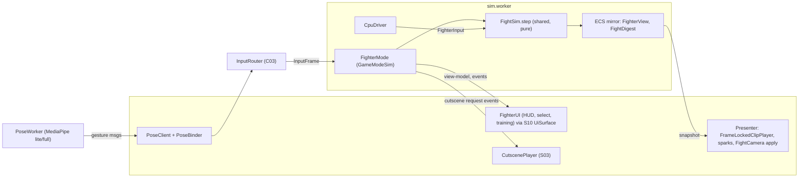

# 07 — Fighter (S07): Culture Wars, hub

> S07, Wave 3, 2026-10-18. Shared context `prompt-pack/06-SHARED-CONTEXT.md` **v1.0 (frozen)**; binding inputs `spec/.waves234-notes.md`, `spec/03-decisions-and-facts.md` v1 (D-12, D-24, D-29, D-30, R-IP-04), `spec/02-architecture.md` §7, `spec/11-decision-log.md`. Split into four files to stay under the 6,000-word cap:
>
> | File | Holds |
> |---|---|
> | `spec/domains/07-fighter.md` (this file) | §1 scope and checklist, §2 design, §3 components, §4 data index, §5 runtime summary, §6 platform, §7 facts, §8 milestones, §9 tests, §10 open questions, assumptions and proposals |
> | `spec/domains/07-fighter-core.md` | `FC1–FC12`: conventions, TypeScript data (frame data, buffer, input, ECS mirror, slice, replay), tick order, states, input and motion parser, hit resolution, meters, rounds and finishers, projectiles, CPU AI, tuning tools, rollback notes |
> | `spec/domains/07-fighter-content.md` | `FX1–FX11`: roster ↔ tiers, kits, reference kit, likeness and kill-switch enforcement, stages, cutscene hooks and prewarm counts, animation and assets, progression and story hooks, HUD and accessibility, XR rules |
> | `spec/domains/07-fighter-pose.md` | `FP1–FP11`: pose pipeline, gesture classifier, calibration, latency budget, fallbacks, privacy enforcement, tests |

## 1. Scope and R-IDs

**Owns:** the Culture Wars mode (`@dv/mode-fighter` at `packages/modes/fighter`), the pure fight core (`packages/shared/src/fight`), fighter content (`content/fighter/**`), the pose-control pipeline. **Contracts owned: none.** **Contracts honored:** C01 (component ids 1280–1535), C03 (fighter input context, `PoseActionEvent`), C06 (`GameModeDescriptor`, `GameModeSim`, `CombatApi`), C09 (cutscene refs and keys, `PreparedClip` consumer), C10 (soul tier, `standIn`, trash-talk intents), C13 (tiers, budgets, `XrComfortSettings`); touched: C02 (determinism, tick), C04 (camera directive, anim ids), C05 (`mode:fighter` slice, `privacy`), C07 (assets, provenance), C16 (telemetry names).

| R-ID | Statement (06 §2) | Where |
|---|---|---|
| **R-MODE-03** | Culture Wars 1v1 fighter: rounds, meters, specials, supers, finishers, frame data; roster; SF stages; optional MediaPipe pose control with calibration and fallback; cutscene hooks | FC1–FC12, FX1–FX11, FP1–FP11 |
| **R-IP-04** | Camera/pose data stays on device; no frames uploaded or persisted; no face landmarker; 18+ terms | FP1, FP4, FP7, FP8 |
| R-CUT-01, R-CUT-02, R-CUT-03 | cutscene generation target, hooks per fight intro / special / finisher / ending, in-engine fallback | FX6 |
| R-NPC-04, R-IP-02, R-IP-01 | tiers, kill-switch, original content and names | FX1, FX4, FX2 |
| R-MODE-05 | unlock on first encounter, standalone tile, persisted unlocks | FX8 |
| R-NPC-05 | trash talk through the proxy with offline fallback | FC10.5 |
| R-ENG-02, R-PLAT-05 | per-tier budgets as checks | FX5, FC11, FP5, §9 |
| R-ENG-04 | remap, subtitles, colorblind HUD, reduced motion, XR comfort | FX9, FX10 |
| R-PLAT-02 | XR port of the mode | FX10, M11b2 |
| R-PLAT-03 | WASM pose inference, WebGL2/CPU delegates | FP2, FP5 |

### Checklist (every item is designed, deferred to a named milestone, or out of scope)

| # | Item | Status | Where |
|---|---|---|---|
| 1 | 2.5D plane, integer units, 60 Hz, frame-counting convention, derived advantage | designed, M08a1 | FC1 |
| 2 | Frame data schema (`MoveDef`, `HitDef`), fighter and kit schema, JSON Schema validation | designed, M08a1 | FC2 |
| 3 | Capsule hit/hurt boxes, pushbox, throw box, hit resolution order, trades | designed, M08a1 | FC6 |
| 4 | 32-frame input ring, motion parser, charge, leniency, buffers | designed, M08a1 | FC5 |
| 5 | State machine, cancel rules, wakeup, throws, air | designed, M08a1 | FC4 |
| 6 | Combo scaling, juggle, hitstun decay, 40-hit safety cap, counters | designed, M08a1 | FC6 |
| 7 | Meters: Health, Hype (3 stocks), Composure and Rattled, Check, Clear the Air | designed, M08a1 | FC7 |
| 8 | Specials, EX, supers, Showstopper | designed, M08a1 core, M08b1 kits | FC5, FC7, FX2 |
| 9 | Shutdown finisher without gore | designed, M08b2 | FC8, FX2, FX4 |
| 10 | Rounds, timer, KO slow motion, sudden round, phases | designed, M08a1 | FC3, FC8 |
| 11 | Classic and Simple schemes on kbm, pad, touch | designed, M08a2 | FC5.4, FX9 |
| 12 | Projectiles, traps, drones, summons | designed, M08a1 pool, M08b1 behaviours | FC9 |
| 13 | Determinism: `FightDigest`, replays, golden hashes | designed, M08a1 | FC2, FC11 |
| 14 | Roster archetypes ↔ characters ↔ tiers, stand-ins | designed, data loads at Q-19 | FX1 |
| 15 | Eight kits and the reference kit | designed, M08a (2 kits), M08b1 (8) | FX2, FX3 |
| 16 | Six SF stages plus four backlog; stage budgets | designed, M08a2 (1), M08b2 (6); backlog M10+ | FX5 |
| 17 | CPU opponent, levels, macro executor, trash talk | designed, M08a2 (basic), M08b1 (full) | FC10 |
| 18 | Pose pipeline: PoseWorker, frame pump, self-hosted assets | designed, M08c1 | FP2, FP8 |
| 19 | Gesture classifier and filters | designed, M08c1 | FP3 |
| 20 | Calibration flow and device-local storage | designed, M08c2 | FP4 |
| 21 | Latency budget per device class and capability decision | designed, M08c2 (device gate) | FP5 |
| 22 | Pose fallbacks, hybrid mode, failure table | designed, M08c2; hybrid awaits C03 change | FP6 |
| 23 | Privacy and consent enforcement, tests | designed, M08c2 | FP7, FP9 |
| 24 | Cutscene hooks, A-03 keys, prewarm counts, fallbacks | designed, M08b2 | FX6 |
| 25 | Likeness tiers, fame-domain lint, depiction rules, kill-switch | designed, M08b1 gates, M08b2 runtime | FX4 |
| 26 | Tuning tools: training mode, editor, lint, balance runner, diff, QA bridge | designed, M08a2 training, M08b1 balance | FC11 |
| 27 | Animation: AnimStateId block, retarget, frame-locked player | designed, M08a2 | FX7 |
| 28 | Audio and VFX needs | designed; assets M10a | FX7 |
| 29 | Progression, unlocks, save slice, story bouts, open-world melee core | designed, M08a2 (A5), M08b2 (A11) | FX8 |
| 30 | HUD, menus, accessibility | designed (S10 builds screens) | FX9 |
| 31 | XR rules | designed; implemented in M11b2 | FX10 |
| 32 | Rollback netcode | **notes only**; build after M12b by ADR (§8) | FC12 |
| 33 | Ranked play, online fights, `USER_NPC` fighters, 4 backlog stages, firearms/gore | **out of v1**: online needs M12b+ and a C11 addition; user NPCs need moderation (M06b, M13c); firearms and gore are excluded by D-30 | FC12, FX1 |

## 2. Design

**Approach.** The mode is a *deterministic integer simulation with its own state buffer*, driven by the shared 60 Hz loop, presented by a thin render layer. The authoritative state is one `Int32Array` (~4 KB). Everything else is a projection: an ECS mirror for rendering and the engine hash, a presenter that frame-locks animation to frame data, and a HUD view-model. This makes replay, headless balance runs, training-mode record/playback and later rollback the same operation: `step(buffer, in0, in1)`.

**Decisions (S07-D#) and rejected alternatives.**

| Decision | Reason | Rejected |
|---|---|---|
| Fighter on `detmath`-style integer frame data, no Rapier (D-12) | cross-browser identical hashes without `deterministic-compat`; mode embeds under a `local` parent | Rapier bodies for fighters: float order and substep tuning break frame accuracy |
| 2.5D plane, side camera | readable on phones, planar pose mapping, cheap boxes [research/gamedesign-decomposition.md §4.2] | free 3D movement |
| Buffer is truth, ECS is a mirror; `FightDigest` hashed component | snapshot is one typed-array copy; C02 `stateHash` covers the match with no new engine hook | state in 65,536-length component stores |
| `onHit`/`onBlock` derived from authored stun values | cannot drift from the frame meter | authoring both |
| Kits bound to slots, characters bound to slots by data | kill-switch, consent upgrade and stand-ins change no frame data | frame data per person |
| Pose classification inside the worker; landmarks never leave it except for an open preview | main thread stays free, smaller privacy surface | classification on main |
| Mirror-space movement for pose | the player watches a mirrored self-view; no facing feedback loop | opponent-relative axes |
| Pose calibration in device-local storage, not the C05 slice (S07-D3) | cloud sync must not carry body-proportion data (R-IP-04) | `FighterSlice.pose.thresholds` as in the research draft |
| Cinematic hold is a fixed 300-frame sim phase (FC3) | sim never depends on video length or decoding; skip is an input | pausing on playback events |
| Clips only for roster-vs-roster bouts; per-segment fallback (FX6.4) | the player's character has no generated clips; the match never waits | requiring all-or-nothing clip sets |
| No LLM in the fight loop (FC10) | determinism, cost, rails | LLM-driven decisions |
| Own rollback loop later, not GGPO | GGPO builds on Windows only [research/gamedesign-decomposition.md §4.8] | GGPO |
| MediaPipe only; no YOLO | AGPL-3.0 or Enterprise licence [F-058] | YOLO-pose via ORT |
| Fame-domain exclusion applied to kits | a parody subject may not be shown doing what made them famous [research/legal-ip-likeness.md §3.2, L1] | basketball arcs, football tackles, mic performance |

**Diagram: runtime topology.**



## 3. Components

| Module | Path | Responsibility | Depends on |
|---|---|---|---|
| Fight core | `packages/shared/src/fight/{types,buffer,input,step,states,hit,meters,rounds,projectiles,hash}.ts` | pure `FightSim` (FC2); also used by the engine's `CombatApi` for open-world melee | `@dv/shared` only |
| Mode sim | `packages/modes/fighter/src/sim/{mode,match,mirror,camera,cpu/,slice,bouts}.ts` | `GameModeSim<FighterSlice>`, phase machine, CPU driver, ECS mirror, camera directive, slice | C06 `ModeContext`, core |
| Mode UI | `packages/modes/fighter/src/ui/{index,hud,select,training,presenter}.ts` | `GameModeUI` mount, menus, training overlays, `FrameLockedClipPlayer` | S10 `UiSurface`, `ViewModelSource` |
| Cutscene hooks | `packages/modes/fighter/src/sim/cutscenes.ts` | refs, segment lists, `Cinematic` phase requests | C09, `@dv/shared` json/hash |
| Pose | `packages/modes/fighter/src/pose/**` | FP2 | MediaPipe (worker only), C03 |
| Content | `content/fighter/{roster.json,kits/,stages/,bouts/,arcade.json,cutscenes.json,ai/}`, `config/{fighter.tuning.json,fighter.pose.json,fame-domains.json}`, `config/input/*fighter*` | data, validated by JSON Schema | — |
| Tools | `tools/fighter/editor`, `packages/modes/fighter/scripts/*`, `tools/ci/pose-fixtures` | FC11, FP9 | core |

```ts
// packages/modes/fighter/src/index.ts
export const fighterDescriptor: GameModeDescriptor = {
  id: 'fighter', version: 1, titleKey: 'mode.fighter.title', tile: { art: 'ui/mode-fighter', order: 3 },
  status: 'available',                 // 'comingSoon' stub registered at M04a (A-06) until M08a2 flips it
  unlock: 'unlock.fighter', standalone: true, embeddable: true,
  requires: { simProfile: 'any', world: 'stage', physics: false, xr: 'seated',
              inputContexts: ['fighter', 'menu', 'cutscene'], network: 'optional' },
  saveSlot: 'mode:fighter', sliceSchema: 1,
  sim: () => import('./sim/mode'), ui: () => import('./ui/index'),
};
export interface FighterEnterParams { bout?: string; lineup?: [FighterLoadout, FighterLoadout]; stage?: StageId; kind: 'arcade' | 'versus' | 'training' | 'story' | 'gallery' }
```

`FighterMode.enter` validates `FrameDataPack.hash`, loads the roster (flags applied, FX4.7), requests assets through `ctx.assets`, and holds `Loading` until `ready()`. `tick` maps `ctx.input.frame(0|1)` to `FighterInput`, asks the CPU driver for a slot with no human device, calls `FightSim.step`, mirrors, publishes the camera, and forwards events. `exit` returns a `ModeResult` (FX8.4) and writes the slice through `ctx.save.request('modeExit')`.

## 4. Data

Types owned by S07 (none are numbered contracts): `FrameDataPack`, `FighterDef`, `MoveDef`, `HitDef`, `ProjectileDef`, `FightRules`, `FighterLoadout`, `FighterInput`, `FB` bit set, `FightBuffer` layout (`FF`, `FM`), `FighterSlice`, `BoutDef`, `StageDef`, `RosterEntry`, `PoseGestureMsg`, `PoseCalibration` (full TypeScript: FC2, FX1, FX5, FX8, FP2, FP4). Component ids 1280–1283 used, 1284–1535 reserved. Persisted: C05 slot `mode:fighter` (≤ 2 MiB, expected < 8 KiB); device-local `pose-calibration` (FP4). Config files: FC2 constants table, `config/fighter.pose.json` (FP3 thresholds, FP5 budgets), `config/fame-domains.json`, `config/input/defaults.<device>.fighter-{classic,simple}.json`, `config/input/labels.fighter.json`. Feature flags: none beyond `VITE_DV_QA` tools and the C12 roster flags; pose is a player setting, not a flag.

## 5. Runtime behavior (summary; detail in the parts)

- **Tick participation.** `GameModeSim.tick` runs in `SimStage.Script`; fighter code needs no other stage. AI decisions on even ticks (C02 30 Hz); everything else every tick. Hash every tick during a match (`01-engine.md` §2.13: "every tick in fighter matches").
- **Embedding.** Story starts the mode as a child (stack depth 2). `simProfile: 'any'` avoids `SimHost.restart`. The mode never owns physics, renderer, camera rig or save store (C06 rule 7).
- **Failure modes and fallbacks.**

| Failure | Behaviour |
|---|---|
| Stage, fighter or clip asset not ready | gray-box capsule model for a missing fighter in dev builds only; in release the select screen locks the fighter and the stage falls back to the neutral diorama |
| Cutscene absent, pending, failed, blocked, killed, or Low Power Mode | in-engine segment per FX6.4, never a wait beyond 1.5–2.5 s |
| Kill-switch during a match | finish the match, then remap to the stand-in at select (FX4.7) |
| `FrameDataPack` hash or `FIGHT_DATA_VERSION` mismatch | replay refuses to load (`REPLAY_MISMATCH`); never silently re-simulates |
| Slice newer than build or corrupt | C05 rules apply; defaults are used and the mode stays playable |
| Pose failure | FP6 table; control returns to touch, pad or keys |
| Frame budget overrun | governor lowers render scale; sim is unaffected (FC1); pose steps its camera rate down (FP5) |

- **Performance notes.** The sim is allocation-free per tick (FC11). Stage budgets are 60 % of the tier's render objects and triangles (FX5). Pose adds a worker and a camera stream; `mobile-low` defaults to the CPU delegate (FP5). Input on 30 fps render tiers is sampled per tick from latched edges (C03 rule 2) and windows are widened ×1.5 (FC5.3.6).

## 6. Platform notes (C13 tiers)

| | Desktop (`desktop-ultra`, `desktop`) | iPhone / iPad PWA (`mobile`, `mobile-low`) | Meta Quest 3 (`xr-quest`) | Apple Vision Pro (`xr-visionpro`) |
|---|---|---|---|---|
| Default scheme | Classic or Simple; kbm and pad | Simple on touch (stick + L, H, Special, Assist, Hype, Dash); Classic hidden | Simple on controllers; hands optional | hands only; transient pointer for menus |
| Render / sim | 60 fps render (ultra up to 120); sim 60 Hz | 60 (`mobile`) or 30 (`mobile-low`) render; sim 60 Hz; leniency ×1.5 at 30 | 72/90 render, tabletop diorama | 90 render, tabletop diorama |
| Stage budget | 360–540 objects | 90 / 60 objects | 90 per pass | 120 per pass |
| Intro clips | `v768` | `v540`, memory budget 64 MB (C13) | S11 `XrMediaHost` panel | `VideoFrameTexture` panel |
| Pose | yes, `full` model by default | yes, `lite`, phone on a stand | no | no |
| Cinematic breaks | optional | optional (Low Power Mode → in-engine) | panel | panel |

## 7. Verified facts used

All rows checked 2026-10-18 (ledger ids from `research/INDEX.md` §2 where they exist).

| Fact | Source | Used in |
|---|---|---|
| MediaPipe tasks-vision 1.1.1: delegates CPU/GPU (GPU = WebGL2), no threaded build, Apache-2.0; WASM 13,519,922 B (3,954,071 B gzip); models lite 5,777,746 B, full 9,398,198 B; 33 landmarks; `numPoses` default 1; `detectForVideo` | F-057; `https://registry.npmjs.org/@mediapipe/tasks-vision`; `https://developers.google.com/edge/mediapipe/solutions/vision/pose_landmarker` [research/auth-ugc-input-maps.md §4.1] | FP2, FP8 |
| BlazePose GHUM 3D model card: Apache-2.0; out of scope: several people, beyond about 4 m, head not visible | `https://storage.googleapis.com/mediapipe-assets/Model%20Card%20BlazePose%20GHUM%203D.pdf` [research/auth-ugc-input-maps.md] | FP4 |
| `requestVideoFrameCallback` in Safari iOS 15.4+; `MediaStreamTrackProcessor` worker-only in Safari 18; WebGL in `OffscreenCanvas` from Safari 17.0 | `https://caniuse.com/wf-request-video-frame-callback`; `https://caniuse.com/mdn-api_offscreencanvas_getcontext_webgl_context` [research/auth-ugc-input-maps.md] | FP2 |
| `getUserMedia` supported in iOS Home Screen apps since iOS 13; standalone-mode camera regressions reported (low confidence) | `https://firt.dev/notes/pwa-ios/`; `https://bugs.webkit.org/show_bug.cgi?id=275527` [research/auth-ugc-input-maps.md] | FP6 |
| YOLO models: AGPL-3.0 or Enterprise; SaaS needs Enterprise | F-058; `https://ultralytics.com/license` | FP1 |
| 1€ filter procedure | `https://gery.casiez.net/1euro/` [research/auth-ugc-input-maps.md] | FP3 |
| Pose camera on device only, no face landmarker, aggregate telemetry, consent explainer, `parental_consent` flag | [research/legal-ip-likeness.md §8 P1–P4] | FP1, FP7 |
| SF6 control types Classic / Modern; Modern specials do 20 % less damage; Drive Gauge six segments with Burnout | `https://game.capcom.com/manual/SF6/en/ps5/page/2/3`; `https://esports.gg/guides/street-fighter-6/do-modern-controls-do-less-damage-in-sf6`; `https://esports.gg/news/street-fighter/street-fighter-6-drive-system-explained-how-does-it-work` [research/gamedesign-decomposition.md verified facts] | FC5.4, FC7 |
| GGPO is MIT-licensed, builds on Windows only | `https://github.com/pond3r/ggpo` [research/gamedesign-decomposition.md] | FC12 |
| JavaScript `Math` results are implementation-dependent across engines | `https://developer.mozilla.org/en-US/docs/Web/JavaScript/Reference/Global_Objects/Math` [research/gamedesign-decomposition.md] | FC1.4 |
| H3 Max reference-to-video: ≤ 9 images, 4,096 reference tokens free, $0.08/s at 768P; fighter clip set N=8 (116 clips) about $70, N=12 (222) about $133 at list price with retakes | F-040; `https://fal.ai/models/minimax/h3-max/reference-to-video/llms.txt` [research/genai-pipeline-fal.md] | FX6.3 |
| Gapless composed intros via (Managed)MediaSource; ManagedMediaSource on iOS 17.1+; pool of 3 unlocked `<video>` elements; Low Power Mode needs a gesture for any video; 64 MB media budget; Wake Lock works in Home Screen apps since iOS 18.4 | F-063; [research/gap-cutscene-delivery-playback.md §3, §7.4, §7.5] | FX6.4, FP10 |
| Tier rules: living people `parody` with altered name, no catchphrases or marks, not shown in their fame domain, never in marketing; deceased and company founders `fictionalized`; kill-switch ≤ 60 s with stand-ins; no sound-alike or voice clones | [research/legal-ip-likeness.md §3.2, §3.3, L1, L3, L4]; D-29 | FX1, FX4 |
| Meshy library clips, retarget with `SkeletonUtils.retargetClip` offline | F-045; [research/genai-pipeline-fal.md]; [spec/domains/05-assets-pipeline.md §4] | FX7 |

**UNVERIFIED (none appears in an acceptance criterion; defaults and verifying milestones):**

| ID | Item | Default | Verified in |
|---|---|---|---|
| U-FGT-1 | PoseLandmarker latency and FPS on iPhone Safari (CPU and GPU delegates) and on desktop browsers | measured at calibration; `assisted` or `unavailable` below budget | M08c2 device run |
| U-FGT-2 | `@mediapipe/tasks-vision` 1.1.1 inside a classic IIFE worker under Vite 8; module-worker use | classic worker | M08c1 spike |
| U-FGT-3 | exact Google object path of the `.task` models (only sizes and the bucket are recorded) | vendoring script pins size and SHA-256 | M08c1 |
| U-FGT-4 | MediaPipe left/right label convention under a mirrored stream | classifier uses stance and mirrored x, never labels | M08c1 fixtures |
| U-FGT-5 | iOS standalone-PWA camera reliability on iOS 26/27 | detect freeze, suggest Safari | M08c2 (Q-13 devices) |
| U-FGT-6 | `requestVideoFrameCallback` `captureTime` accuracy on iOS | assumed 60 ms constant | M08c2 |
| U-FGT-7 | art-lead effort for about 160 clip authoring tasks | shared base set + 12–16 per fighter | M08a2, M10a |
| U-FGT-8 | Durable Object relay latency for 60 Hz fight input | none in v1 | M12c |
| U-FGT-9 | Quest A/B/X/Y indices (U-ENG-5); WebXR camera access on Quest (Q-GD-08) | chords; no XR pose | M11b2 |
| U-FGT-10 | H3 family US licence for the clips (ADR-GENAI-01, Q-03) | in-engine intros; fallback provider | owner |
| U-FGT-11 | whether stored normalised body proportions are biometric data | optional, local, deletable | counsel (Q-S07-2) |

## 8. Milestone mapping

Milestone ids come from `spec/00-plan.md`; the register shows M08a–c at 2, 2, 1 sessions. S07 proposes digit splits (C15) and one extra pose session because of the device gate. Stubbed first, landing later:

| Id (proposed) | Slug | Sessions | Lands | Stubbed until later |
|---|---|---|---|---|
| M08a1 | `fight-core-sim-data` | 1 | `packages/shared/src/fight/**` (FC2–FC9), schemas, reference kit (FX3), buffer, hash, replay, motion parser, `fighter:lint`, `fighter:replay`, golden vectors | gray-box art, HUD, CPU (a scripted dummy only) |
| M08a2 | `fight-mode-training-vs` | 1 | `FighterMode`, ECS mirror, camera, gray-box fighters (reference kit + `RAP_NEW_WAVE`), `FrameLockedClipPlayer`, HUD via S10, Classic and Simple on kbm, pad and touch, Training mode, one stage (`powell_turntable`), CPU levels Easy and Hard, slice, unlock, story hook `bout.a5`, `CombatApi` over the shared core, retarget-tool consumption (S05) **= VS-Fighter** | cutscene hooks, other 7 kits, pose |
| M08b1 | `fight-roster-kits-ai` | 1 | eight kits, full CPU, roster loader, tier and fame-domain gates, `fighter:balance` (35–65 % gate), name hygiene | stages 2–6, clips |
| M08b2 | `fight-stages-cutscenes-arcade` | 1 | five more stages, hooks and refs, `cutscenes.json`, composed intros with per-segment fallback, Cinematic phase, Arcade ladder, `bout.a11`, kill-switch remap, Move Gallery, accessibility pass | real clips (provider gated), generated models (M10a) |
| M08c1 | `pose-pipeline-classifier` | 1 | `pose/**` pipeline, vendoring script, binder, gesture FSM, filters, synthetic fixture generator, classifier harness | calibration UI, capability gate |
| M08c2 | `pose-calibration-gate` | 1 | calibration flow, device-local store, capability decision, consent gate, headers, privacy tests, device runs | hybrid mode (needs C03 change) |

**R-ID mapping.** R-MODE-03: core in M08a1, mode and training in M08a2, kits and CPU in M08b1, stages, hooks and arcade in M08b2, pose in M08c1 and M08c2, XR in M11b2. R-IP-04: the worker static check and fixture rule in M08c1; network, storage, header, consent and device assertions in M08c2. R-CUT-02 and R-CUT-03: M08b2. R-NPC-04 and R-IP-02: gates in M08b1, kill-switch runtime in M08b2, drill in M10b. R-MODE-05: M08a2 (unlock), M08b2 (roster unlocks). R-ENG-02: `fight-stage` scenarios from M08a2, device budgets in M11a. R-ENG-04: M08a2 and M08b2. R-PLAT-02: M11b2.

Other milestones S07 depends on or feeds: M01a (detmath vectors, lint), M04a (`comingSoon` stub), M04c and M05b (CutscenePlayer, cutscene-index), M05c (`CombatApi` stub, stub brawl), M10a (models, clips, voices), M10b (kill drill, prewarm), M11a (budgets, `fight-stage` scenarios), M11b2 (FX10), M12b/M12c (rollback, FC12). Session sizing: each row is under 40 files and about 2–4 agentic hours; M08a1 is mostly shared-package code and tests.

**Proposed acceptance criteria (for the Wave 5 milestone files; each has a proof and none depends on an unverified fact):**

*M08a1.* AC-1 Given the golden replay `golden/vs-001.dvfight` When replayed in Node Then every checkpoint hash matches — `pnpm --filter @dv/mode-fighter fighter:replay -- golden/vs-001.dvfight`. AC-2 Given the motion-parser fixtures (236, 214, 623, `[4]6`, 66, edge leniency) When run Then all pass — `pnpm check:unit -- packages/shared/src/fight`. AC-3 Given the reference kit When `fighter:lint` runs Then derived `advHit/advBlock` equal FX3. AC-4 Given a 99-second CPU-vs-scripted match When counting allocations Then zero per tick.
*M08a2.* AC-1 Given the replay When run in Chromium and WebKit Then identical hashes — `pnpm check:e2e -- --project=webkit-webgl2 --grep @fighter-hash` and `--project=chromium-webgl2`. AC-2 Given Training mode When 5L is performed Then the frame meter shows 4/2/8 and +4/+1. AC-3 Given touch emulation When a best-of-3 is played with the Simple scheme Then the match completes — `--grep @fighter-touch`. AC-4 Given story mission A5 When it reaches the fighter hook Then `unlock.fighter` is emitted once and the result returns to the mission. AC-5 `step` p99 ≤ 0.10 ms in Node — `pnpm --filter @dv/mode-fighter fighter:bench`.
*M08b1.* AC-1 Given 28 pairs × 1,000 bouts When `fighter:balance` runs Then every pair is 35–65 %. AC-2 Given a kit with a forbidden fame-domain tag When CI runs Then `check:fighter` fails. AC-3 Given a roster entry whose tier differs from its soul When CI runs Then `likeness:gate` fails.
*M08b2.* AC-1 Given provider status `pending` When every hook fires Then each resolves a ref and plays its fallback with subtitles — `--grep @fighter-cutscene`. AC-2 `cutscene-index --count fighter` prints 116 for N=8, S=6. AC-3 Given a kill for one fighter When the flags refresh Then the fighter is absent from select and loadouts remap — `--grep @fighter-kill`. AC-4 Given an Arcade ending When it completes Then the next fighter unlocks.
*M08c1.* AC-1 Given the fixture set When classified Then overall ≥ 90 % and each gesture recall ≥ 85 % and ≤ 1 false positive per minute on idle clips — `pnpm --filter @dv/mode-fighter fighter:pose-fixtures`. AC-2 Given the worker bundle When scanned Then no network API other than the allow-listed same-origin GET.
*M08c2.* AC-1 Given a pose session When Playwright records requests Then none has a body over 4 KB or an image MIME — `--grep @pose`. AC-2 Given `cameraFeatures` false When opening the mode Then pose is hidden. AC-3 Given the synthetic bench table When the capability function runs Then the three levels result. AC-4 Given an iPhone and a desktop webcam When the 60-second device checklist runs Then a report with p50/p95, delegate, FPS and capability level is uploaded; `unavailable` is a valid outcome — manual: `pnpm perf:checklist -- fight-pose`.

## 9. Tests

| Layer | Test | Command |
|---|---|---|
| Unit | core: `hash-vectors`, `motion-parser`, `frame-data-derive`, `hit-resolution` (trades, throw tech, strike vs throw), `combo-scaling`, `rounds`, `meters`, `projectiles`, `no-alloc`, `replay-roundtrip`; pose: filter, FSM, capability, leniency | `pnpm check:unit -- packages/shared/src/fight packages/modes/fighter` |
| Content | `fighter:lint` (schema, derived advantage, fame-domain, loops), roster completeness, tier gate | `pnpm check:fighter` |
| Balance | win-rate matrix, match length, KO ratio | `pnpm --filter @dv/mode-fighter fighter:balance -- --bouts 100` (PR), `--bouts 1000` (M08b1 gate) |
| Determinism | golden replays in Node, Chromium, WebKit | `pnpm check:e2e -- --project=chromium-webgl2 --grep @fighter-hash`, `--project=webkit-webgl2` |
| E2E | VS match with touch Simple; training overlay; story hook; cutscene fallback per hook; kill remap; pose privacy | `pnpm check:e2e -- --project=chromium-webgl2 --grep @fighter` |
| Perf | `fight-stage` scenario per tier; pose variant | `pnpm check:perf -- --scenario fight-stage` |
| Device | iPhone, Quest, Vision Pro, desktop webcam checklists | `pnpm perf:checklist -- fight-stage`, `-- fight-pose`; XR in M11b2 |
| IP | prompt templates, names, licence, privacy fixtures | `pnpm names:lint`, `pnpm likeness:gate`, `pnpm ip:strings`, `pnpm license:scan`, `check:privacy-fixtures` |

## 10. Open questions, assumptions, proposals

**Open questions (S07):** Q-S07-1 to Q-S07-4 in FP11; Q-S07-5 `USER_NPC` fighters: when, after M13c (recommend a post-v1 slot). Roster content waits on Q-19; Q-14 sets 8 versus 12 fighters if a fallback video provider becomes default.

**Assumptions on concurrent owners (use 06 v1.0 sketches exactly; listed for the Architect):**
- S01: `ControlsSettings.fighterScheme` selects between two binding files per device (`…fighter-classic.json`, `…fighter-simple.json`); fighter-context labels come from a labels file (S10); `InputRouter` can supply `frame(1)` from a second gamepad for local Versus (keyboard second player is out of v1).
- S01/S02: `world: 'stage'` means no C08 chunk streaming; the stage is a C07 `prop` bundle loaded through `ModeContext.assets`.
- S03: `CutscenePlayer.playSequence(items: {ref: CutsceneRef | null; fallback: DirectorScript}[])` with per-item fallback; the release `cutscene-index` includes the fight refs of `content/fighter/cutscenes.json`; story applies `ModeResult.data.streetCred`; ModeHost increments `core.stats.fightsWon` on a fighter win.
- S04: compiled souls expose `tier`, `fame_domain`, `standIn`, `rails`; `turn.intent` accepts `fight.pre` and `fight.post`.
- S05: `assets:retarget` output `anim/<slug>.moves`; `cutscene-index` accepts `content/fighter/cutscenes.json`; no new `AssetKind` is needed (stages are `prop`).
- S10: `UiSurface` panels, settings page entries for the fighter scheme, pose setup and "Delete camera data", the neutral age screen output used by FP1.5.
- S11: `_headers` camera policy and CSP (FP7.1); `dv-platform` store `pose-calibration` (FP4); `PerfScenario` ids `fight-stage` (exists) and `fight-stage-pose`.

**Contract change proposals** are in the return block: C03 (additive 1.1: `setPoseHybrid`, fighter-context alias table), C11 (`ActKind.FightInput`), C16 (`fight.end`, `pose.session`), C13 (headers, store, scenario), C09 (`playSequence`), plus the `AnimStateId` block assignment (S06 128–159, S07 160–207, S08 208–255) for an ADR.

**Decisions needed (recommendations in the return block):** S07-D1 animation authoring budget; S07-D2 the two open roster slots for the 12-fighter target; S07-D4 whether to relax C03 rule 8 for hybrid pose; S07-D5 default `cinematics` setting (`first`); S07-D6 AnimStateId blocks.

**Risks:** fighting feel with generated base animation (mitigation: hand-keyed key poses, training tools); pose latency on iPhone (device gate, `assisted`/`unavailable` levels); animation authoring volume; fame-domain rules make kits feel generic (mitigation: strong silhouettes and mechanics, original fantasy per kit); generated clips may not ship in v1 under the licence gate, so in-engine intros must be good; iOS standalone camera behaviour; 30 fps render tiers quantise input (windows widened ×1.5).
