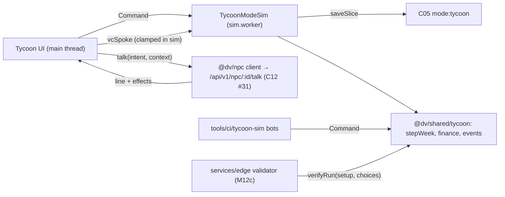

# 08 — Business Tycoon (S08): scope, simulation loop, company model, UI, saves, milestones

> S08, Wave 3, 2026-10-18, against `prompt-pack/06-SHARED-CONTEXT.md` v1.1 (frozen) and `spec/.waves234-notes.md`. Three files: **this one** (A), `08-tycoon-finance.md` (B: cap table, SAFE and priced-round math with test vectors, waterfall, term-sheet envelope, VC negotiation and C10 integration) and `08-tycoon-events.md` (C: shared event engine, catalog, balance tool). Section numbers follow `prompt-pack/03-SPEC-TEMPLATE.md` §B; parts B and C carry the detail for §§2–5 of their topics. Numbers marked *design* are our starting values, tuned at M09a2 against the bands of part C §8.

## 1. Scope and R-IDs

**Owns:** the Business Tycoon mode (`GameModeId 'tycoon'`): a deterministic weekly founder-versus-VC simulation (idea, MVP, rounds, hiring, scale, exit or failure), its UI, its save slice, its balance tooling. **Owns no contract.** **Honors:** C05 (slot `mode:tycoon`), C06 (`GameModeDescriptor`, `GameModeSim`, `ModeContext`), C10 (VC dialogue, 1.0.0). Also uses C02 determinism rules, C03 `tycoon` input context, C07 `AssetRef`, C13 tiers, C16 telemetry registry.

| R-ID | Statement (short) | Where |
|---|---|---|
| **R-MODE-04** | founder-vs-VC sim, cap-table math, AI-NPC investors, random-event engine (business, political, natural, cultural) with probability and impact model, win/lose | whole spec; B for math and investors, C for events |
| R-MODE-05 | modes unlock on first encounter and stand alone | §3.1, §5.11, M09b2 |
| R-NPC-04 | likeness tiers for VC and founder NPCs | B §10 |
| R-NPC-05 | proxy dialogue, rate limits, offline fallback | B §11 |
| R-PLAT-02, R-ENG-02, R-ENG-03, R-ENG-04 | XR port, budgets, dialogue cost control, accessibility | §6, §9, B §11.5 |
| R-IP-01 | original content; fictional companies | B §10, C §6 |

Binding decisions applied: **D-29** (VC and founder NPCs `fictionalized` or `parody`; founders of real companies `fictionalized`), **D-30** and 06 §3 (no real-money, token or premium-currency mechanics; money is game cents, no cash-out, no purchases), A-04-style determinism (seeded sim, replay from `(seed, choices)`), D-21 (NPC models), D-22 (no memory for under-18 profiles is S04's rule).

### 1.1 Checklist (35 items; every item designed, deferred to a milestone, or out of scope)
D = designed here (section). Dm = deferred to the named milestone. X = out of scope.

| # | Item | Disposition |
|---|---|---|
| 1 | Mode registered as C06 descriptor with unlock `unlock.tycoon` and slot `mode:tycoon` | D §3.1 |
| 2 | Weekly tick, speeds, pause rules, mapping to the 60 Hz sim | D §5.1 |
| 3 | Determinism: counter RNG, `detmath`, replay, content version | D §4.6, C §3 |
| 4 | Company state and weekly step order | D §4.2, §5.2 |
| 5 | Sector and thesis cards, archetypes, run setup | D §4.3, §5.8 |
| 6 | Product: MVP, launch, quality, tech debt | D §5.3–5.4 |
| 7 | Market: CAC saturation, growth, churn, price lever, hype, climate | D §5.3, §5.7 |
| 8 | Valuation reference | D §5.4 |
| 9 | Hiring: candidates, offers, options, vesting, attrition, morale | D B §13.1 |
| 10 | Founder focus, burnout, crunch | D B §13.2 |
| 11 | Cap table model and invariants | D B §3 |
| 12 | Post-money SAFE conversion with vectors | D B §4, §7 |
| 13 | Priced round with option-pool shuffle with vectors | D B §5, §7 |
| 14 | Liquidation waterfall and exit slider with vectors | D B §6, §7 |
| 15 | Deterministic term-sheet envelope | D B §8 |
| 16 | Negotiation state machine and levers | D B §9 |
| 17 | AI-NPC VC dialogue via C10; clamp; fallback; cost | D B §11 |
| 18 | VC roster (12 fictional) and likeness rules | D B §10 |
| 19 | Event engine, hazard model, effects, chains | D C §2–5 |
| 20 | Event taxonomy and catalog with probabilities and impacts | D C §6 |
| 21 | Reuse of the engine by story businesses | D C §7; wiring Dm S03 milestone (DN-S08-03) |
| 22 | Board meetings, control, ousting | D B §13.3 |
| 23 | Win and lose conditions, score, insolvency and bridge note | D §5.10–5.11 |
| 24 | UI screens, accessibility, input | D §5.12 |
| 25 | Platform and tier differences (desktop, mobile PWA, Quest 3, Vision Pro) | D §6 |
| 26 | Save slice, snapshots, resume, migration | D §4.6 |
| 27 | Story integration: Act 2 mini-run, unlock, capped dividends | D §5.11; Dm M09b2 |
| 28 | Balance harness and Monte-Carlo CI | D C §8; Dm M09a2 |
| 29 | Test vectors and test plan | D §9, B §7 |
| 30 | Telemetry (no free text) | D §5.13 |
| 31 | No real-money mechanics, disclaimers, rails | D §5.14 |
| 32 | Daily seeded challenge and leaderboard (server re-simulation) | Dm M12c (`verifyRun` in M09a1) |
| 33 | Shared-market rooms (players compete for one TAM) | X v1: asynchronous only (gamedesign §5.12); reconsider after M12c |
| 34 | Pro-rata rights, other note variants, ESOP exercise detail, secondaries | X: beyond a game ruleset |
| 35 | "What-if" fan chart of random futures | X v1: branch replay only (M09b1) |

## 2. Design

**Approach.** A pure, deterministic company simulation (no engine, no DOM) steps one in-game week at a time. Players act through `Command`s; every outside influence, including the LLM's voice, becomes a recorded input before it touches state. The 60 Hz engine only paces weeks. Follows gamedesign P-3, P-9 and §5 [research/gamedesign-decomposition.md].



**Why the core is in `@dv/shared`.** The harness, the mode and the M12c server validator must run byte-identical code, and `services/*` may import only `@dv/shared` and `@dv/net`. So `packages/shared/src/tycoon/**` and `packages/shared/src/events/**` hold the pure core and `packages/modes/tycoon` holds the thin C06 adapter, UI and dialogue glue. This differs from the one-line description of `@dv/mode-tycoon` in `spec/02-architecture.md` §2 and is proposed as an amendment (DN-S08-02).

**Rejected alternatives.** LLM-decided terms (breaks determinism, economy and cost); real-time continuous simulation (no pause for decisions, mobile-hostile); an ECS representation of the company (state is a small record); stateful RNG streams for events (adding content shifts every roll; C §3).

## 3. Components

### 3.1 Mode registration (C06)

```ts
// packages/modes/tycoon/src/descriptor.ts
export const tycoonDescriptor: GameModeDescriptor = {
  id: 'tycoon', version: 1, titleKey: 'mode.tycoon.title',
  tile: { art: 'ui/mode-tycoon', order: 4 },
  status: 'available',                      // 'comingSoon' stub until M09a2 (A-06)
  unlock: 'unlock.tycoon', standalone: true, embeddable: true,
  requires: { simProfile: 'any', world: 'none', physics: false, xr: 'seated',
              inputContexts: ['tycoon', 'menu'], network: 'none' },
  saveSlot: 'mode:tycoon', sliceSchema: 1,
  sim: () => import('./sim/TycoonModeSim'), ui: () => import('./ui/TycoonUI'),
};
export const tycoonUnlock: UnlockDef = { id: 'unlock.tycoon', titleKey: 'unlock.tycoon', source: 'base', grants: { menuTile: 'tycoon' } };
```
M09b2 bumps `version` to 2 and `world` to `'stage'` when the 3D pitch room lands (the 2D portrait path remains the fallback on `mobile-low`). ECS component ids 1536–1791 are reserved; v1 uses at most the pitch-room NPC prefab entity (`StableKey npc:<vcSlug>`) and no per-company entities. AnimStateId: S08 claims block **224–231** (reserved, unused in v1 because the mode is asynchronous; ADR when rooms arrive).

### 3.2 Modules

| Path | Responsibility |
|---|---|
| `packages/shared/src/tycoon/{types,content,setup,step,company,product,market,hiring,board,win,score,commands,replay,hash}.ts` | pure sim: state types, content loader and validator, `setupFromSeed`, `stepWeek`, command validation, `replay`, `verifyRun`, `hashCompany` (FNV-1a-64, two u32 lanes) |
| `packages/shared/src/tycoon/finance/**` | part B |
| `packages/shared/src/events/**`, `packages/shared/src/tycoon/events/**` | part C |
| `packages/modes/tycoon/src/sim/TycoonModeSim.ts` | C06 adapter: `enter/tick/exit/saveSlice/onEvent`, week pacing, command queue, snapshots |
| `packages/modes/tycoon/src/dialogue/TycoonPitchController.ts` | builds C10 `context.tycoon` (≤ 3 sim `deals`, DL-087), calls `@dv/npc`, maps `effects`, posts `vcSpoke` |
| `packages/modes/tycoon/src/ui/**` | views (§5.12); XR panels via S10 `UiSurface` |
| `content/tycoon/{sectors,theses,archetypes,questions,vc-lines}.json`, `content/tycoon/events/*.json` | authored data |
| `config/tycoon.balance.json`, `config/tycoon.bands.json` | constants and CI bands |
| `tools/ci/tycoon-sim/**`, `tests/tycoon/**` | harness, bots, fixtures, baseline |

### 3.3 Public interfaces

```ts
// packages/shared/src/tycoon/index.ts (pure; no IO)
export function setupFromSeed(seed: number, opts?: Partial<RunSetup>): RunSetup;
export function newRun(setup: RunSetup, content: TycoonContent): CompanyState;
export function applyCommand(s: CompanyState, c: Command, content: TycoonContent): CommandResult;   // validates; mutates s only if ok
export function stepWeek(s: CompanyState, content: TycoonContent): StepResult;                       // mutates s; one in-game week
export function replay(setup: RunSetup, choices: ChoiceRecord[], content: TycoonContent, untilWeek?: number): { state: CompanyState; result: RunResult | null; hash: string };
export function verifyRun(setup: RunSetup, choices: ChoiceRecord[], claimed: RunResult, content: TycoonContent): 'ok' | 'mismatch' | 'contentVersion';
export function hashCompany(s: CompanyState): string;                                              // 16 hex chars
export function policyView(s: CompanyState): PolicyView;                                           // read model for UI and bots
export interface StepResult { week: number; events: EventInstance[]; awaiting: AwaitingKind | null; ended: RunResult | null }
export type AwaitingKind = 'event' | 'meeting' | 'board' | 'bridge' | 'exitOffer';
```

## 4. Data

### 4.1 Units and conventions
Money `Cents` (integer); users and shares are integers or doubles rounded where stated; time in weeks (`week` starts at 0); percentages stored as 0–100 numbers except finance (basis points). Month = 13/3 weeks. `LocKey` is a string. The mode takes its seed from `ModeEnterArgs.seed` and uses no `ctx.rng` stream (C §3). Cross-domain asset references are C07 `AssetRef`. All sim numbers cross determinism boundaries only through `+ − × ÷`, `Math.floor/round/min/max/abs/imul`, `detmath.exp`. No `Math.pow/sqrt`, no `**`, no `Date`.

### 4.2 Company state

```ts
// packages/shared/src/tycoon/types.ts
export type SectorId = 'b2b-saas' | 'consumer-app' | 'ai-tooling' | `mod:${string}`;
export type ThesisId = string;                                  // trend-deck card
export type RoleId = 'eng' | 'design' | 'growth' | 'sales' | 'ops';
export type Phase = 'idea' | 'mvp' | 'launched' | 'ended';
export interface Employee {
  id: string; role: RoleId | 'founder'; skill: number /* 1..10 */; salaryYr: Cents; optionShares: number;
  hiredWeek: number; morale: number /* 0..100 */; name: LocKey | string /* generated from content/tycoon/archetypes */;
}
export interface Candidate { id: string; role: RoleId; skill: number; askYr: Cents; expiresWeek: number }
export interface PendingOffer { candidateId: string; salaryYr: Cents; optionBp: number; resolveWeek: number }
export interface Board { seats: ('founder' | 'independent' | `vc:${string}`)[]; founderControl: boolean; missedTargets: number; nextMeetingWeek: number | null; lastTargetArrGrowth: number }
export interface CompanyState {
  v: 1; setup: RunSetup; week: number; phase: Phase;
  cash: Cents; users: number; payingUsers: number; mrr: Cents; arpuMonth: Cents; churnMonthly: number /* 0..1 */; cac: Cents;
  marketing: Cents /* per week */; priceLevel: 'low' | 'standard' | 'premium';
  mvpProgress: number; featurePoints: number; productQuality: number /* 0..100 */; techDebt: number /* 0..100 */;
  hype: number; reputation: number; climate: number /* -1..1 */; morale: number /* team mean */; founderMorale: number;
  allocation: { features: number; refactor: number; infra: number } /* % sum 100 */; focus: 'product' | 'growth' | 'rest'; crunch: boolean;
  office: 'garage' | 'cowork' | 'loft' | 'tower';
  team: Employee[]; market: Candidate[]; offers: PendingOffer[];
  capTable: CapTable; meetings: MeetingState[]; termSheets: TermSheetEnvelope[]; raise: RaiseProcess | null;
  board: Board; events: EventState; flags: Record<string, number | boolean>;
  mrrHistory: Cents[] /* last 14 weeks, ring */; profitableStreak: number; negativeCashWeeks: number;
  dividendEarnedCents: Cents; result: RunResult | null;
}
export interface RaiseProcess { id: string; kind: RoundKind; targetCents: Cents; startedWeek: number; meetingsHeld: number; vcPool: string[] }
```
`MeetingState`, `TermSheetEnvelope`, `CapTable`, `RoundKind` are defined in part B. Employee count is capped at 60 in v1 (save size, UI).

### 4.3 Setup, sectors, archetypes

```ts
export interface RunSetup { seed: number; sector: SectorId; thesis: ThesisId; founder: 'engineer' | 'hustler' | 'designer'; coFounder: boolean;
  startWeekOfYear: number /* 0..51 */; hardcore: boolean; preset: 'standard' | 'mini8w' | 'daily'; contentVersion: string; balanceVersion: string }
export interface SectorDef { id: SectorId; nameKey: LocKey; tam: number; cac0Cents: Cents; arpuMonthCents: Cents; payRate: number; churn0: number; k: number /* word of mouth per week */;
  infraPerUserWeekCents: Cents; mvpPoints: number; featureHalf: number /* F0 */; multiple: number /* ARR multiple */; hypeSensitivity: number; tags: string[] }
```
Starting sector rows (design; tuned at M09a2): `b2b-saas` TAM 300,000, CAC0 $1,400, ARPU $170 per month, payRate 0.70, churn 2.8 % per month, k 0.045, MVP 200 points, F0 500, multiple 8×; `consumer-app` TAM 20 M, CAC0 $3, ARPU $6, payRate 0.06, churn 9 %, k 0.12, MVP 160, multiple 10×; `ai-tooling` TAM 2 M, CAC0 $120, ARPU $25, payRate 0.25, churn 5 %, k 0.06, MVP 240, multiple 12×, `hypeSensitivity` high. M09a1 ships `b2b-saas` only. Thesis cards (trend deck, 8 at M09a2) apply a `balance` delta for the run (e.g. "enterprise rush": CAC ×0.9, churn ×0.95, `cul.ai_hype_peak` ×1.5). Founder archetypes: engineer (dev power 7, hustle 3), designer (dev 5, quality bonus +5), hustler (dev 3, CAC ×0.9, fundraising mood +5). Start: cash $90,000 founder savings, founder salary $40,000 per year, 9,000,000 common (B §3).

### 4.4 Commands and choices

```ts
export type Command =
  | { t: 'setAllocation'; features: number; refactor: number; infra: number }
  | { t: 'setMarketing'; perWeek: Cents } | { t: 'setPrice'; level: CompanyState['priceLevel'] }
  | { t: 'setFocus'; focus: 'product' | 'growth' | 'rest' } | { t: 'setCrunch'; on: boolean } | { t: 'setOffice'; tier: CompanyState['office'] }
  | { t: 'hireOffer'; candidateId: string; salaryYr: Cents; optionBp: number } | { t: 'fire'; employeeId: string }
  | { t: 'startRaise'; kind: RoundKind; targetCents: Cents }
  | { t: 'scheduleMeeting'; vcId: string } | { t: 'answerQuestion'; meetingId: string; questionId: string; optionId: string }
  | { t: 'askMore'; meetingId: string; field: 'preMoney' | 'amount' | 'pool' | 'board' } | { t: 'counter'; meetingId: string; terms: Terms }
  | { t: 'bringCompetitor'; meetingId: string; termSheetId: string } | { t: 'accept'; meetingId: string } | { t: 'walk'; meetingId: string } | { t: 'sleepOnIt'; meetingId: string }
  | { t: 'vcSpoke'; meetingId: string; turnIx: number; emotion: string; proposal?: Terms; lineKey?: string }   // recorded dialogue outcome (B §11)
  | { t: 'resolveEvent'; iid: number; choiceId: string }
  | { t: 'boardVote'; motion: 'approveBudget' | 'ignore' } | { t: 'exploreSale' } | { t: 'goPublic' } | { t: 'acceptExit'; iid: number } | { t: 'bridge'; accept: boolean }
  | { t: 'endRun'; reason: 'quit' };
export interface ChoiceRecord { week: number; seq: number; cmd: Command }      // applied before stepWeek of `week`, in `seq` order
```
Rules: a command is valid only in the phases it names (validator returns a typed `CommandError`); `allocation` sums to 100; `marketing ≤ 2 × max(cash/8, MRR/4.33)`; `hireOffer` needs pool shares ≥ `optionBp` of FD; `startRaise` needs no raise in progress and `week ≥ lastRaiseEnd + 4`.

### 4.5 Results

```ts
export type EndKind = 'acquisition' | 'unicorn' | 'ipo' | 'ramen' | 'insolvent' | 'ousted' | 'burnout' | 'quit' | 'miniWin' | 'miniLose';
export interface RunResult { kind: EndKind; win: boolean; week: number; founderPayoutCents: Cents; exitValueCents: Cents; score: number;
  tier: 'acq' | 'unicorn' | 'ipo' | 'ramen' | null; arrCents: Cents; headcountAtEnd: number; legacyTags: number; stateHash: string }
```

### 4.6 Save slice, replay and versioning (C05 `mode:tycoon`, schema 1)

```ts
export interface TycoonSlice {
  schema: 1; contentVersion: string; balanceVersion: string;
  active: { setup: RunSetup; choices: ChoiceRecord[]; snapshot: { week: number; state: CompanyState; hash: string } | null } | null;
  runs: { setup: RunSetup; result: RunResult; savedAt: number }[];            // last 20, no choices
  bestScores: Record<'acq' | 'unicorn' | 'ipo' | 'ramen', number>;
  unlockedSectors: SectorId[]; hardcore: boolean; dividendEarnedCents: Cents;  // cumulative, monotonic
}
```
1. Size: choices ≈ 24 KB, snapshot ≈ 40 KB, history ≈ 6 KB: under 100 KB, far below the 2 MiB record cap (C05).
2. **Load.** If `contentVersion` and `balanceVersion` equal the build's, replay `(setup, choices)` from week 0 and compare the hash with the snapshot; on match continue (the snapshot saves time only). On mismatch (a patch changed content or balance, or a replay bug) load the snapshot, mark the run `unverifiable` (not eligible for leaderboards), and continue; never discard a player's run.
3. **Save moments** (via `ctx.save.request`): `modeExit`, every 13 weeks (`interval`), at each round close, at each board meeting, on run end; never mid-meeting (a meeting autosaves its recorded commands at its start and end only). Hidden-page saves follow C05 rule 4.
4. Migrations: `migrate[tycoon][1]` pure functions with golden files `packages/engine/src/sim/save/__golden__/tycoon/v1.json` (C05 rule 5). A newer schema loads read-only (`NEWER_SCHEMA`).
5. `verifyRun` for M12c recomputes the hash and `RunResult`; it needs no snapshot.
6. Standalone sessions write only `core`, `settings`, `mode:tycoon` (C05 rule 3), so they cannot touch the story wallet (§5.11).

### 4.7 Config
`config/tycoon.balance.json` (schema `tycoon.balance.v1`): `sim.*` (ticks per week 1200/600/300, board interval 13), `company.*` (§5.3 weights), `hiring.*`, `finance.*` (B §8), `events.*` (C §3), `hardcore.*` (events ×1.5, VC cheque ×0.8). `balanceVersion` = first 12 hex of SHA-256 of its canonical JSON (build-time). Feature flags: `tycoon.dialogue` (default on; off = offline negotiation), `tycoon.daily` (off until M12c), `tycoon.xrDesk` (on after M11b2).

## 5. Runtime behavior

### 5.1 Tick and pacing (R-MODE-04)
1. One sim step is one in-game week. At speed 1×, a week lasts 1,200 sim ticks (20 s at 60 Hz); 2× = 600, 4× = 300 (design, gamedesign §5.2). A 150-week run is 50 minutes at 1×.
2. `TycoonModeSim.tick(ctx)` runs in `SimStage.Script`: if the clock is paused or the run is awaiting input it returns; otherwise it increments `weekTicks` and, at the threshold, drains the command queue (each command validated by `applyCommand`, recorded as `ChoiceRecord{week, seq}`) and calls `stepWeek`. Speed changes alter only the threshold, never outcomes.
3. **Auto-pause** (clock holds until the player acts): an event choice in the inbox (unless the player turned off `pauseOnTycoonEvents`, then the default choice is taken at the deadline), an open meeting, a board meeting, a bridge offer, an exit offer, run end. A hidden page runs no frames and therefore no ticks (C02 rule 3).
4. Non-time-critical commands (allocation, hiring, meetings) are accepted while paused or running and take effect at the next week boundary, except those marked immediate in the UI (allocation and marketing apply immediately and are stamped with the current week and `seq`).
5. Cost: a `stepWeek` is a few hundred operations plus about 30 hazard evaluations; design budget 0.5 ms on `mobile-low` (recorded on device in M09b1, not an acceptance criterion).

### 5.2 Weekly step order (`stepWeek`)
1. Resolve due items: offers (hiring), term-sheet expiry, round closings (cash and cap table), vesting, pending chain events, expired effects.
2. Roll events (C §3); open choice events; apply `onFire` effects.
3. Compute `devPower`, product, users, revenue, costs, cash (§5.3–5.4).
4. Hiring market refresh; morale and attrition (B §13.1).
5. Valuation, climate mean-reversion (§5.4, §5.7).
6. Board (every 13 weeks after the first priced round, B §13.3).
7. Win and lose checks (§5.10); `week += 1`; set `awaiting`.

### 5.3 Company model (equations; constants in `tycoon.balance.json`)
- **Dev power.** `devPower = (founderDev·focusFactor + Σ eng 1.2·skill + Σ design 0.6·skill) · moraleF · crunchF · devPowerMul`, where `focusFactor` is 1 for `product`, 0 for `growth`, 0 for `rest`, 0.2 during a raise; `moraleF = 0.6 + 0.4·min(1, morale/70)`; `crunchF = 1.2` (morale −1.5 per week, founder −2). Ops headcount below `headcount/8` multiplies `devPower` by 0.9 per missing ops (management load).
- **Product.** Phase `idea → mvp` on the first allocation; `mvpProgress += devPower` until `sector.mvpPoints`, then `launched` (hype +20, users 50). After launch `featurePoints += devPower·alloc.features%`; `qualityTarget = 100·F/(F + F0) − 0.1·max(0, techDebt − 50) + designBonus`; `quality += 0.15·(qualityTarget − quality)`.
- **Tech debt.** `techDebt += 0.6·(devPower·alloc.features%)/10 − 1.0·(devPower·alloc.refactor%)/10`, clamped 0–100. Infra allocation reduces infra cost per user by up to 40 % and halves the `biz.outage` modifier above 60 debt.
- **Acquisition and growth.** `cac = cac0·cacMul·(1 − min(0.35, 0.03·Σgrowth skill))·(1 + users/(0.2·TAM))`; `acquired = marketing/cac`; `organic = users·k·(quality/100)·(0.5 + hype/200)·(1 − users/TAM)`; `churned = users·churnMonthly·churnMul/(13/3)`, with `churnMonthly = churn0 − min(0.3·churn0, 0.02·Σops skill) + 0.5·(price − 1)`; `users ← clamp(users + acquired + organic − churned, 0, TAM)`.
- **Revenue.** `payRate = sector.payRate·payRateMul·(0.5 + quality/200)·(1 + 0.02·Σsales skill)·(1 − 0.6·(price − 1))` where `price` is 0.8, 1.0 or 1.25 for low, standard, premium; `payingUsers = users·min(1, payRate)`; `mrr = payingUsers·arpuMonth·price·arpuMul`; `revenueWeek = mrr/(13/3)`.
- **Costs and cash.** `burn = Σ salary/52 + founderSalary/52 + infra(users)·burnMul + marketing + office − revenueWeek`; `cash ← cash − burn` (integer cents, `Math.round` once per week). Office per week: garage $0, cowork $800, loft $3,000, tower $9,000 (design); unlock by headcount (3, 9, 25).
- **Hype and reputation.** `hype ← hype + 0.04·(25 − hype)` per week plus event and round effects (round close +8); reputation drifts ±1 by profitability and incident events.
- **Prototype check (not an acceptance result).** A throwaway sketch with a simple bot gave median run lengths of 107–171 weeks across ARPU $140–$200; results are knife-edge in ARPU, k and CAC, which is why the harness exists (RISK-S08-1).

### 5.4 Valuation reference
`arr = 12·mrr`; `g13 = mrr/mrr₋₁₃ − 1` (0 when the old value is under $1,000); `growthMod = 1 + 0.5·clamp(g13, −0.5, 2.0)`; `hypeMod = 0.8 + hype/250`; `valuationRef = max(arr·sector.multiple·growthMod·hypeMod·(1 + 0.35·climate)·multipleMul, preRevenueFloor)`; `preRevenueFloor = $250,000·(1 + headcount)·(0.5 + hype/100)·(launched ? 1.5 : 1)`. It feeds the envelope (B §8) and the live "if you sold today" display.

### 5.5–5.6 Hiring and founder (see part B §13)
Candidates, offers, options, vesting, morale, attrition, founder focus and burnout are in part B §13 (they draw on the option pool). Commands: §4.4; order: §5.2 steps 1 and 4.

### 5.7 Funding climate
`climate ∈ [−1, 1]`, starts at 0 ± a seed-drawn offset ≤ 0.3; each week `climate ← 0.98·climate` plus event effects. It scales `valuationRef` (×(1 + 0.35 climate)), the envelope bands (B §8.2), wages (×(1 + 0.1 climate)) and the hazard modifiers of market events. The IPO window is the flag `ipoWindow` (C §6).

### 5.8 Run setup
New run: choose sector (locked sectors by `unlockedSectors`), thesis (3 dealt from the trend deck by `setupFromSeed`), founder archetype, co-founder yes/no, hardcore (after first ramen win). `setupFromSeed(seed)` fills any unchosen field deterministically so the harness and the daily challenge need no UI. Preset `mini8w`: fixed `b2b-saas`, cash $60,000, MVP at 80 %, objective "close a SAFE of at least $250,000 with a fictional fund within 8 weeks"; ends `miniWin` on close, `miniLose` otherwise; no score, no history entry.

### 5.9 Board and control (see part B §13)
Seats, `founderControl`, quarterly targets and the ousting vote live in part B §13. They run in §5.2 step 6.

### 5.10 Win, lose, insolvency
**Win (the run ends with a score, any one):** `acquisition` (accepted `biz.acquisition_offer` or `exploreSale` result with exit value ≥ $50,000,000), `unicorn` (a priced round closes at post-money ≥ $1,000,000,000), `ipo` (`goPublic` while `arr ≥ $100,000,000` and flag `ipoWindow`), `ramen` (profitable with `arr ≥ $1,000,000` for 26 consecutive weeks; low score; unlocks hardcore). The ramen ARR floor is our addition to gamedesign §5.7 because a profitable founder-only company would otherwise end almost every run (DN-S08-05). **Lose:** `insolvent` (cash < 0 and no bridge accepted within 4 weeks of the first negative week; a `fin.bridge_offer` fires immediately, B §9), `ousted` (B §13.3), `burnout` (B §13.2), `quit`.
**Insolvency.** Negative cash opens the bridge choice; `accept` adds a note (8 weeks of burn) and resets the counter once per run; decline or a second shortfall ends the run.

### 5.11 Score, rewards and story integration
`score = floor(founderPayoutCents/100,000) + 25·retainedEmployees + 50·legacyTags` (tags from choices marked `legacy`, max 10). `founderPayout` comes from the waterfall at the exit value (B §6); `unicorn`/`ipo` use the valuation at that moment as the exit value. Best scores per tier are kept in the slice.
- **Unlock (R-MODE-05).** Story `m.a2.01` (hook `tycoon.a2.curbshare`) embeds `startChild('tycoon', {defId:'mini8w'})`, no params, with `unlockOnFirstEncounter: unlock.tycoon` (C06 rule 5); `mini8w` is the only story preset (DL-157). The story's `stub` objective (scripted dialogue choice) is used until M09b2 and whenever the mode is unavailable. The mini-run returns `win`/`lose` and no rewards of its own.
- **Dividends (capped).** A winning standalone full run (the embedded mini-run keeps no slice) adds `dividendEarnedCents += min(1,000,000, floor(founderPayoutCents·0.0002))` to the slice (cap $10,000 per run). Standalone sessions cannot write the story slice (C05 rule 3), so crediting the wallet is the story's job: on story entry S03 credits `min(unclaimed, cap)` through `EconomyApi.credit(..., idemKey 'tycoon.div:<n>')`, where unclaimed is `modes.tycoon.dividendEarnedCents − StorySlice.flags['tycoon.divClaimedCents']`, and the C06 rule "≤ $10,000 per in-game week" is enforced by summing `ledgerSince` entries tagged `tycoon.dividend` over the last 1,209,600 ticks (DN-S08-04). No premium currency, no purchase path (D-30).

### 5.12 UI (S10 shell; R-ENG-04)
Views over `ViewModelSource`: **Dashboard** (runway gauge, MRR/users/burn charts, speed buttons), **Cap table** (pie, table, exit-value slider with live waterfall, term-sheet diff), **Hiring board** (candidates, salary and option sliders, team morale), **Roadmap and marketing** (allocation, marketing, price, office), **Event inbox** (a fictional workplace chat with choice cards), **Pitch room** (VC portrait or 3D scene, mood meter, term-sheet card, question options, optional free text, subtitles), **Board meeting**, **Run summary** (score, timeline, branch replay from a chosen week).
- Every chart has a table view (`<table>`); lists use roving tabindex; `aria-live="polite"` for the inbox; non-colour cues (patterns, icons) with C05 `hudPalette` presets; reduced motion removes count-up and chart animation; text scale follows settings; focus order follows reading order; keyboard (arrows, Enter, Esc, number keys 1–3 for answer options), gamepad focus navigation (`UiUp/Down/Left/Right/Accept/Back`, C03), touch targets ≥ 44 px.
- The sim never formats text. Cap-table and pitch views show the strip "Game ruleset, not financial or legal advice" (§5.14).

### 5.13 Telemetry (C16 closed registry; proposals in the return block)
Existing: `mode.enter`, `mode.exit`, `npc.turn.client`. Proposed (numeric/enum props only, no free text, no profile id): `tycoon.run_end {kind, weeks, win, tierScore}`, `tycoon.round {kind, clamped, dilutionBp}`, `tycoon.negotiation {turns, fallback, clamped}`. Nothing is sent from the harness.

### 5.14 Safety and legal
No real-money mechanics, no wagering, no cash-out, no real securities; terms and valuations are game rules (06 §3, D-30). The pitch room carries the AI label and the simulation disclaimer; VC souls carry the global rails (no investment advice). All companies, products, regulators and officials in events are invented; VC and founder NPCs follow B §10. Free text from the player is optional and classified by S04; the sim never depends on it.

### 5.15 Failure modes

| Failure | Behaviour |
|---|---|
| Dialogue fails, times out (4 s) or is quota-limited | deterministic midpoint offer, templated line (B §11.4); never blocks |
| VC killed (`RosterFlags`) | stand-in speaks; envelope unchanged |
| Content or balance version differs on load | snapshot path, run flagged `unverifiable` |
| Replay hash mismatch with matching versions | snapshot path, telemetry `err.sim{cause:'error'}` via the engine's handler, test failure in CI |
| Save `QUOTA`/`TOO_LARGE` | keep playing, retry at the next save moment, banner in UI |
| `CAPTABLE_INVARIANT` | the offending round is aborted and the cash returned; run continues; telemetry `err.sim` |

## 6. Platform notes (C13 tiers; R-PLAT-02)

| | Desktop (`desktop-ultra`, `desktop`) | iPhone-class PWA (`mobile`, `mobile-low`) | Meta Quest 3 (`xr-quest`) | Apple Vision Pro (`xr-visionpro`) |
|---|---|---|---|---|
| Layout | multi-column dashboard, live charts, 3D pitch room (M09b2) | single column with bottom tab bar, charts as sparklines with tap-to-expand, 2D VC portrait | desk scene; world-locked panels (dashboard, cap table, inbox, pitch) at `uiDistanceM` | same layout, textured planes |
| Input | mouse/keyboard, gamepad | touch (44 px targets), safe-area insets, no hover reliance | trigger point/select; hands optional; wrist panel for pause | gaze + pinch; no hover state exists, every control works without hover |
| Camera | fixed cinematic camera in the pitch room | none (2D) | no camera effects; rest frame is the desk (`origin` desk, seated) | same |
| Panels | DOM | DOM | Canvas 2D through S10 `UiSurface`, min text 1.5° | `CanvasTexture` planes (composition layers are experimental on WebGPU XR) |

XR is `immersive-vr` only in v1; the desk scene follows `11-platform-xr.md` §5.3 (Tycoon row) and §5.5 [research/stack-rendering-platform.md §4.4]; the mode adds no locomotion. It needs no network except live dialogue. Budgets (design): charts redraw at most once per second; `mobile-low` animates one chart and has no 3D; XR panels redraw on data change only, at most 2 texture updates per frame; content JSON ≤ 300 KB, run state ≤ 40 KB.

## 7. Verified facts used

| Fact | Source | Date | Confidence | Used in |
|---|---|---|---|---|
| Post-money SAFE ownership = investment ÷ valuation cap ($500 k at $6.7 M ≈ 7.5 %); YC standardized on post-money in 2018 | https://www.ycombinator.com/safe/ ; [research/gamedesign-decomposition.md] | 2026-10-18 | high | B §4, TV-1 |
| *(new, fetched by S08 2026-10-18)* The post-money cap is "post" the options and pool existing before the equity financing, **not** the new or increased pool adopted in it; YC forms: cap without discount, discount without cap, uncapped MFN; pro-rata is a separate side letter | https://www.ycombinator.com/safe/ | 2026-10-18 | high | B §4–5 |
| USGS FS 2016-3020: 72 % chance of at least one M6.7+ quake in the SF Bay region 2014–2043 | https://www.usgs.gov/publications/earthquake-outlook-san-francisco-bay-region-2014-2043 | 2026-10-18 | high | C §6 |
| SF blackout 20 Dec 2025 (~130,000 customers); robotaxis stalled | https://abc7news.com/post/videos-show-waymo-cars-stuck-san-francisco-intersections-during-massive-power-outage-company-suspends-service/18304634/ | 2026-10-18 | high | C §6 |
| Carta Q1 2025 median Series A dilution 17.9 % (from 20.9 %) | https://carta.com/data/state-of-private-markets-q1-2025/ | 2026-10-18 | medium (page 403; excerpt) | B §8 design target only |
| JS `Math` transcendentals are implementation-dependent; `detmath` required | MDN `Math`; 01-engine-contracts C02 | 2026-10-18 | high | §4.1, C §3 |
| Model prices (F-034), `NPC_TURN_SCHEMA`, tycoon soul block, routing | [research/INDEX.md §6], [research/ai-npc-runtime.md §1.5, §2.2, §2.4] | 2026-10-18 | high | B §11 |

**UNVERIFIED (also listed for `spec/99-open-questions.md`; none appears in an acceptance statement):**
- U-TYC-1 Carta figure above (excerpt only); default: design target 18–20 %, band 15–24 %; verified by: owner, any time.
- U-TYC-2 The YC SAFE user-guide two-cap example (the "≈ 15 %" figure) was seen only via search summary; TV-2 is self-derived arithmetic from the verified ownership rule, so no test depends on it.
- U-TYC-3 Haiku 5.5 TTFT ≤ 800 ms through AI Gateway with structured output; default: 4 s fallback plus a visible offline offer; verified in M06a.
- U-TYC-4 The YC post-money definition of "Company Capitalization" beyond the verified pool sentence (e.g. treatment of unissued options); default: our §4 convention; counsel not needed because this is a game ruleset.
- U-TYC-5 Whether exposing player-typed pitch text to the model needs the S04 under-18 policy per profile; default: free text off for profiles without an age bracket of 18+, buttons only.

## 8. Milestone mapping (register ids in `spec/00-plan.md`; digit = session split)

| Milestone | Sessions | Depends on | Scope in | Stubbed first / later |
|---|---|---|---|---|
| **M09a1** `tycoon-core-finance` | 1 | M01a (detmath, rng), M04a (modes, saves) | `@dv/shared/tycoon` types, `setupFromSeed`, `stepWeek`, company/product/market/hiring/board/win/score, replay and `verifyRun`, finance (cap table, SAFE, priced round, waterfall, envelope math, vectors), `TycoonModeSim` adapter with a QA text panel, slice + schema + golden file | events = empty list; negotiation = automatic envelope midpoint (`startRaise` + `accept`); one sector; descriptor `status: comingSoon` |
| **M09a2** `tycoon-events-balance` | 1 | M09a1 | shared event engine, 30 events, trend deck of 8, bots (median, aggressive, frugal, random), `tools/ci/tycoon-sim`, bands, baseline, self-test fixtures, CI jobs, `status: available` behind `?unlockAll=1` in non-production builds | **VS-Tycoon = end of M09a2** (gamedesign §5.15): one sector tuned, 30 events, SAFE + seed + Series A, hiring, win/lose, harness green, deterministic replay |
| **M09b1** `tycoon-ui` | 1 | M09a2, M04b (menus, `UiSurface` from S10) | dashboard, cap table, hiring, roadmap, inbox, board, summary, branch replay, 2 more sectors, 30 more events, accessibility, mobile layout, XR panels (desk), perf record | pitch room still a flat card with the deterministic offer |
| **M09b2** `tycoon-vc-story` | 1 | M09b1, M06a (dialogue proxy), M05a (mission IR hook) | 12 VC souls consumption (content from S04), `TycoonPitchController`, clamp, fallback, questions bank, pitch room (3D with 2D fallback), mini-run preset, `unlock.tycoon`, story hook `tycoon.a2.curbshare` → preset `mini8w`, dividend counter, telemetry names, hardcore flag | live dialogue flag default on only after M06a measures TTFT |
| **M12e** `mode-leaderboards` (with S06) | 0.5 (S08 share) | M12c | `tycoon.daily.<yyyymmdd>` board (C12 board grammar, DL-092) and the route 21 validator registered for prefix `tycoon.` calling `verifyRun` | core API exists from M09a1 |
| **M05e1** (S03, DL-133) | — | M09a2 | `EventHost<BusinessState>` wiring of story businesses | fixture proves engine at M09a2 |

**Acceptance statements (become AC in the Wave 5 milestone files; each has an oracle):**
- T-01 (M09a1) Given TV-1…TV-11 and WF-1…WF-7 When `pnpm check:unit -- packages/shared/src/tycoon/finance` Then all expected values match exactly.
- T-02 (M09a1) Given a seed and a recorded choice list When `replay` runs twice and in Chromium and WebKit via the M01a job Then `hashCompany` and `RunResult` are identical.
- T-03 (M09a1) Given a lint fixture using `Math.pow`, `Math.random` or `Date` under `packages/shared/src/tycoon` When `pnpm lint` Then it fails.
- T-04 (M09a2) Given 2,000 runs per policy When `pnpm check:balance` Then bands B1–B12 (part C §8) pass and the four self-test fixtures fail with a non-zero exit.
- T-05 (M09a2) Given 200 random runs When replayed from `(setup, choices)` Then every result and hash equals the live one.
- T-06 (M09b1) Given a slice saved at week 40 When the tab is killed and reloaded Then the run resumes at week 40 with an identical hash and no lost command.
- T-07 (M09b1) Given each view When `pnpm check:e2e -- --project=chromium-webgl2 --grep @tycoon-a11y` runs Then zero critical a11y violations and every chart has a table view.
- T-08 (M09b2) Given a fixture VC response whose `offer_deal` arg is not in `offers.dealIds`, and a forged `vcSpoke` proposal outside the envelope When the pitch controller and the sim apply them Then the first maps to `pass` and the second is clamped field by field with `clamped` recorded (`dialogue.parse.spec.ts`, `dialogue.clamp.spec.ts`).
- T-09 (M09b2) Given `quota_exhausted`, a 4 s timeout and a kill-switched VC When a meeting runs Then the offline midpoint offer appears and the round can close.
- T-10 (M09b2) Given the story Act 2 hook with the `autoFounder` bot and a fixed seed When the mission autoplayer runs Then the mini-run ends `miniWin` within 8 weeks and `unlock.tycoon` is emitted exactly once.
- T-11 (M09b2) Given the `webkit-webgl2` and `xr-quest3` (IWER) projects When the dashboard, cap table and pitch card open Then they render, take input, and no control needs hover.

## 9. Tests (names; all under `check:unit` unless marked)

`tycoon.step.spec.ts` (golden week-by-week trace of one seeded run), `tycoon.company.spec.ts` (each equation in §5.3 at boundary values, clamps), `tycoon.hiring.spec.ts` (acceptance probability, pool exhaustion, vesting, forfeits, attrition), `tycoon.board.spec.ts` (control, ousting votes), `tycoon.win.spec.ts` (each end kind), `tycoon.commands.spec.ts` (validator, illegal phases, `allocation` sum), `tycoon.replay.spec.ts` (T-02, T-05, version fallback), `tycoon.save.spec.ts` (slice schema, golden file, migration, size under 100 KB for a 300-week run), `tycoon.mode.spec.ts` (C06 conformance: enter/tick/exit/saveSlice, pause rules, speed independence of outcomes), `tycoon.dividend.spec.ts` (cap and monotonic counter), `tycoon.nolint.spec.ts` (T-03). Part B and C list their suites. E2E (`pnpm check:e2e`): `@tycoon-smoke` (new run to week 20 on `chromium-webgl2`), `@tycoon-a11y`, `@tycoon-save` (kill and resume), `@tycoon-xr` on `xr-quest3`. Manual device checklists (S11 process): Vision Pro gaze-pinch through the pitch card; iPhone safe areas.

## 10. Open questions and decisions needed
- **DN-S08-01** NPC model routing for VC turns: `research/ai-npc-runtime.md` §2.2 says Sonnet with adaptive thinking; D-21 and gamedesign §5.5 say Haiku default and Sonnet for hero VCs. Recommendation: D-21 (the deterministic engine decides, the model voices).
- **DN-S08-02** Pure core in `@dv/shared` (needed for the M12c validator). Recommendation: accept and amend `spec/02-architecture.md` §2.
- **DN-S08-03** Which milestone wires story businesses to the event engine? Recommendation: the Act 2 businesses milestone in S03's plan (not in the register yet).
- **DN-S08-04** Dividend claim path across slots (C05 rule 3) via `StorySlice.flags['tycoon.divClaimedCents']` and S03 crediting. Recommendation: accept; no contract change.
- **DN-S08-05** Ramen win ARR floor $1 M (our change to gamedesign §5.7). Recommendation: accept; it is tunable in `tycoon.balance.json`.
- **DN-S08-06** Leaderboard route 21 validator ownership (route table says S06): propose a per-board validator registry so S08 supplies `tycoon:*`. Recommendation: accept at M12c.
- **Q-S08-01** Hardware and mobility sectors for the authored political events: default shipped disabled until a sector exists.
- Open owner items that apply unchanged: Q-GD-09 (dividends feed the story: yes, capped), Q-12, G3.
