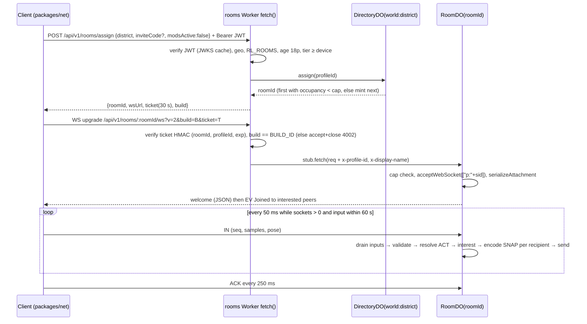

# 09 — Backend, Data & Multiplayer · Part 2: owned contracts (C11, C12, C16)

> S09, Wave 1, 2026-10-18. Part of `spec/domains/09-backend.md` (§4 Data, contract half). Honors 06-SHARED-CONTEXT v1.1 (frozen) and spec/03 v1. Versions: **C11 1.0.0** (wire `PROTOCOL_VERSION` 2, the relay-protocol lineage), **C12 1.1.0**, **C16 1.1.0** (1.1 additions: `09-backend-contracts-1.1.md`). Semver rule for all three: patch = docs only; minor = additive (new optional field, new enum member a consumer may ignore, new route); major = anything else, and needs an ADR plus a one-release overlap (a deploy can run two Worker versions at once [research/gap-ci-cd-release-assets.md]).

Files the Builder creates (types only, no logic here):

| Contract | File | Runtime validation |
|---|---|---|
| C11 | `packages/net/src/protocol/v2.ts`, `packages/net/src/protocol/codec.ts` (encode/decode, pure TS) | decoder bounds-checks every field; fuzz test |
| C12 | `packages/shared/src/api/v1.ts`, `packages/shared/src/api/budget.ts`, `packages/shared/src/data-port.ts`, `packages/shared/src/identity.ts` (re-exported by `@dv/identity`; DL-055) | `packages/shared/schemas/api/*.schema.json` (Ajv; generated from the TS by `tools/ci/gen-api-schemas.ts`, generator library pinned by S13) on every request body |
| C16 | `packages/shared/src/telemetry.ts`, `packages/shared/schemas/telemetry/*.schema.json` | ingest Worker validates per event name |

---

## 1. C11 — `NetMessage`, room protocol v2, authority (1.0.0)

Consumers: S01 (`netIn`/`netOut` phases of C02, prediction), S02 (ENU coordinates, chunk keys), S06/S07/S08 (mode events in rooms), S10 (room UI, invites), S13 (load test).

### 1.1 Rules
1. Transport is one WebSocket per player per room to the rooms Worker (`wss://rt.<domain>`). There is no unreliable channel to a Durable Object [research/stack-cloudflare-backend.md §1.7, Unverified]. Voice is out of v1 (§1.9).
2. Client→server game frames are **binary** (`ArrayBuffer`, little-endian). The only client text frame is the literal `ping`, answered by the DO auto-response without waking it [research/stack-cloudflare-backend.md §1.3]. Any other text frame is a strike.
3. Server→client: binary `SNAP` and `EV`; JSON text only for `welcome`, `handoff`, `notice` and `kick`.
4. The server assigns every identity a peer sees: `sid` (16-hex room session id) and `slot` (u16). Profile ids, wallet addresses and emails never appear on the wire. A client-supplied id is ignored (Grand-V rule [research/repos-grand-v.md (b)]).
5. Non-monotonic `seq` (mod 2^16, window 32,768) is dropped silently.
6. The server never queues stale state: snapshots are built per tick from the latest coalesced state per slot.
7. Authority: `validated` in M12b (client simulates its own avatar and vehicle, claims a pose, the server checks it). `authoritative` is reserved; it is enabled only by an ADR after the M12c load test (spec/03 A-04).
8. Mods are disabled in rooms (spec/03 D-26). A client with any mod active is refused (close 4007).

### 1.2 Constants
```ts
// packages/net/src/protocol/v2.ts
export const PROTOCOL_VERSION = 2 as const;
export const C11_VERSION = '1.0.0' as const;   // contract version; PROTOCOL_VERSION is the wire number

export const NET = {
  SERVER_HZ: 20, TICK_MS: 50, CLIENT_SIM_HZ: 60,           // A-04, C02
  CAP_DEFAULT: 16, CAP_MAX: 32,                            // D-06; CAP_MAX behind flag rooms.capMax
  MAX_CLIENT_FRAME_B: 2048, MAX_SERVER_FRAME_B: 16384,
  BUCKET_BURST: 40, BUCKET_PER_S: 30,                      // per socket token bucket
  STRIKES_TO_CLOSE: 5,                                     // malformed/oversize frames per 10 s
  ACK_INTERVAL_MS: 250, ACK_DEGRADE_TICKS: 10, ACK_KICK_TICKS: 40,
  AFK_STOP_MS: 60_000, CHECKPOINT_TICKS: 100, EMPTY_GC_MS: 600_000,
  CLIENT_PING_MS: 20_000, LIVENESS_TIMEOUT_MS: 30_000,
  RESUME_TTL_MS: 60_000, RESUME_REFRESH_MS: 30_000,
  EVENT_REPLAY_MS: 15_000, EVENT_REPLAY_MAX: 256,
  TICKET_TTL_MS: 30_000,
  CELL_M: 64, INTEREST_FOOT_M: 150, INTEREST_VEHICLE_M: 300, INTEREST_HYSTERESIS_M: 70,
  BAND_NEAR_M: 50,        // ≤50 m every tick; 50 m–radius every 2nd tick; beyond radius (hysteresis zone) every 4th
  INTERP_MIN_MS: 45, INTERP_MAX_MS: 300, INTERP_INITIAL_MS: 80, INTERP_DECAY: 0.02,
  EXTRAP_MAX_MS: 250, CLOCK_WINDOW: 90, SNAP_BUFFER: 20,
  RECONNECT_MIN_MS: 250, RECONNECT_MAX_MS: 4000,
  CHAT_MAX_CHARS: 280, MOBILE_SEND_HZ: 10,
} as const;
```
Sources: tick, cap, interest, checkpoint, ack lag, bucket and close codes from [research/stack-cloudflare-backend.md §4.2–4.7]; clock and interpolation numbers from muguet [research/repos-webport.md §3.7], re-implemented, never copied (GPL).

### 1.3 Frame types and close codes
```ts
export enum Frame {            // first byte of every binary frame
  IN = 1,      // c→s input + claimed pose, 20 Hz (10 Hz on mobile with 2 samples)
  SNAP = 2,    // s→c per-recipient snapshot
  EV = 3,      // s→c reliable event, evSeq-numbered
  ACK = 4,     // c→s last snapshot tick + last evSeq, every 250 ms
  BYE = 5,     // c→s clean leave (frees slot now, no ghost)
  ACT = 6,     // c→s action request (vehicle enter/exit, interact, pickup, mission join)
  CHAT = 7,    // c→s text chat (opt-in setting; off by default)
  // 8..15 reserved: VSIG (voice signaling) 8, DELTA_SNAP 9 (M12c+ optimisation)
}

export enum Close {
  Normal = 1000, GoingAway = 1001, Policy = 1008, TooSlow = 1013,
  Auth = 4001, BuildMismatch = 4002, RoomFull = 4003, Kicked = 4004,
  ResumeExpired = 4005, RegionBlocked = 4006, ModsActive = 4007, Draining = 4008,
}
```
Reason strings: 1008 `"rate"` | `"strikes"` | `"liveness"`; 1013 `"too_slow"`; 4004 carries a policy code. The client reacts as follows: 1000/4004/4006/4007 → no reconnect; 4001 → refresh token then one retry; 4002 → PWA update flow; 4003 → re-assign; 4005 → fresh join; 1001/1006/1013/4008 → reconnect with resume (jittered 250 ms → 4 s).

### 1.4 Binary layouts
All little-endian. Offsets in bytes. `yaw` and `pitch` are `u16`/`i16` turns × 65,536 (yaw in [0, 2π)); positions are ENU metres from the C08 origin (City Hall; +X east, +Y up, −Z north) as `f32`; velocities `i16` cm/s (±327 m/s).

```ts
/** IN (c→s). Header 16 B + n × 12 B samples + optional 16 B pose. ≤ 2048 B. */
export interface InHeader {
  type: Frame.IN;          // u8  @0
  flags: number;           // u8  @1  bit0 HAS_POSE, bit1 IN_VEHICLE, bit2 PAUSED (menu/AFK hint)
  seq: number;             // u16 @2  per-socket, wraps
  clientTimeMs: number;    // u32 @4  performance.now() truncated, for RTT/clock
  inputTick: number;       // u32 @8  client's estimate of server tick of sample[0]
  sampleCount: number;     // u8  @12 1..2 (desktop/XR 1 @20 Hz; mobile 2 @10 Hz)
  _pad: [0, 0, 0];         //     @13..15
}
export interface InSample {          // 12 B, one per 50 ms server tick
  moveX: number; moveY: number;      // i8 ×2  −127..127
  yaw: number;                       // u16
  pitch: number;                     // i16
  buttons: number;                   // u16  C03 SimButton bits 0–15 (S01 owns the table; bits ≥ 16 are never sent)
  throttle: number; steer: number;   // i8 ×2
  brake: number;                     // u8   0..127 (= C03 InputFrame.brake, so prediction replays match)
  _pad: 0;                           // u8
}
export interface InPose {            // 16 B, present when flags.HAS_POSE (always in `validated` rooms)
  x: number; y: number; z: number;   // f32 ×3
  yaw: number;                       // u16
  vehicleSlot: number;               // u16  0xFFFF = on foot
}

/** SNAP (s→c). Header 16 B + count × 28 B. ≤ 16 KiB (≤ 584 entities; v1 interest caps far lower). */
export interface SnapHeader {
  type: Frame.SNAP;        // u8  @0
  flags: number;           // u8  @1  bit0 DEGRADED (recipient on every-other-tick), bit1 CORRECTION (own pose rejected → snap to entry)
  count: number;           // u16 @2
  tick: number;            // u32 @4  server tick
  serverTimeMs: number;    // u32 @8  Date.now() mod 2^32
  ackSeq: number;          // u16 @12 last IN.seq applied for this recipient
  _pad: number;            // u16 @14
}
export enum EntityKind { Player = 0, Vehicle = 1, Npc = 2, Pickup = 3 }
export enum EntityFlag { InVehicle = 1, Downed = 2, Action = 4, Ragdoll = 8, Entering = 16, Interior = 32, Afk = 64, Braking = 128 }
export interface SnapEntity {        // 28 B
  slot: number;                      // u16  player slot, or vehicle/npc/pickup slot (namespace = kind)
  kind: EntityKind;                  // u8
  flags: number;                     // u8   EntityFlag bitset
  x: number; y: number; z: number;   // f32 ×3
  yaw: number;                       // u16
  vx: number; vy: number; vz: number;// i16 ×3 cm/s
  anim: number;                      // u8   AnimStateId (S01 registry, 01-engine-contracts.md)
  seat: number;                      // u8   0xFF none
  vehicleSlot: number;               // u16  0xFFFF none
}

/** EV (s→c). Header 8 B + UTF-8 JSON payload (≤ 1024 B). */
export interface EvHeader { type: Frame.EV; kind: EvKind /*u8*/; evSeq: number /*u16*/; len: number /*u16*/; _pad: number /*u16*/ }

/** ACK (c→s). 8 B. */
export interface AckFrame { type: Frame.ACK; _pad: 0; lastEvSeq: number /*u16*/; lastSnapTick: number /*u32*/ }

/** BYE (c→s). 2 B: type, reason u8 (0 quit, 1 handoff, 2 background). */
/** ACT (c→s). 12 B. */
export interface ActFrame { type: Frame.ACT; kind: ActKind /*u8*/; actSeq: number /*u16*/; target: number /*u32 entity slot or mission instance id*/; arg: number /*u32*/ }
export enum ActKind { EnterVehicle = 1, ExitVehicle = 2, Interact = 3, Pickup = 4, JoinActivity = 5, LeaveActivity = 6 }
/** CHAT (c→s). 4 B header (type, _pad, u16 len) + UTF-8 ≤ 280 chars. Server moderates before fan-out. */
```

### 1.5 Reliable events (`EV` payloads)
```ts
export enum EvKind {
  Joined = 1, Left = 2, Appearance = 3, VehicleSpawn = 4, VehicleOwner = 5, ActResult = 6,
  Hit = 7, Feed = 8, Activity = 9, Chat = 10, World = 11, Resume = 12, TeleportGrant = 13,
  Notice = 14, NpcBusy = 15, Correction = 16,
}
export interface EvPayloads {
  [EvKind.Joined]: { slot: number; sid: string; name: string; look: string /* base64 AppearanceV1 ≤ 512 B: S10's versioned binary encoding of C05 CoreSlice.avatar (PlayerAvatar); fixed obligation on S10, 06 §4.3 */ };
  [EvKind.Left]: { slot: number; reason: 'quit' | 'timeout' | 'kicked' | 'handoff' };
  [EvKind.Appearance]: { slot: number; look: string };
  [EvKind.VehicleSpawn]: { vehicleSlot: number; prefabId: string /* C06 PrefabDef id, kind 'vehicle' */; seed: number; x: number; y: number; z: number; yaw: number };
  [EvKind.VehicleOwner]: { vehicleSlot: number; ownerSlot: number | null };
  [EvKind.ActResult]: { actSeq: number; ok: boolean; reason?: 'occupied' | 'too_far' | 'cooldown' | 'invalid' };
  [EvKind.Hit]: { from: number; to: number; kind: 'melee' | 'vehicle' | 'fall'; amount: number };   // no firearms (D-30)
  [EvKind.Feed]: { key: string; params: Record<string, string | number> };                     // i18n key, never free text
  [EvKind.Activity]: { instanceId: number; modeId: string; state: 'open' | 'countdown' | 'running' | 'finished'; data: unknown /* mode-owned, ≤ 768 B */ };
  [EvKind.Chat]: { slot: number; msgId: number; text: string };
  [EvKind.World]: { clockT: number /* C06 WorldClockState.t, integer game half-seconds since day 0 */; weather: WeatherPreset /* S01 engine-world.ts */; trafficSeed: number };
  [EvKind.Resume]: { token: string; exp: number };
  [EvKind.TeleportGrant]: { x: number; y: number; z: number; yaw: number; reason: 'spawn' | 'fast_travel' | 'activity' };
  [EvKind.Notice]: { kind: 'drain' | 'maintenance' | 'cap_change'; at: number };
  [EvKind.NpcBusy]: { npcId: string; bySlot: number | null };
  [EvKind.Correction]: { x: number; y: number; z: number; yaw: number; vehicleSlot: number | null; reason: 'speed' | 'bounds' | 'teleport' | 'vehicle' };
}
```
`joined`/`left` go only to sockets whose interest set contains the slot, plus everyone on join for the roster list. The server keeps each player's last 256 events for 15 s to replay on resume.

### 1.6 JSON control frames (s→c text)
```ts
export interface WelcomeV2 {
  t: 'welcome'; protocol: 2; roomId: string; sid: string; slot: number;
  hz: 20; tick: number; serverTimeMs: number; cap: number;
  authority: 'validated' | 'authoritative';
  cellSize: 64; interest: { foot: 150; vehicle: 300; hysteresis: 70 };
  peers: { slot: number; sid: string; name: string; look: string }[];
  world: EvPayloads[EvKind.World];
  resume: { token: string; exp: number };
  lastEvSeq: number;
  resumed: boolean;              // true when a resume token restored this slot
}
export interface HandoffV2 { t: 'handoff'; roomId: string; ticket: string; reason: 'district' | 'rebalance' }  // reserved for district shards (post-M12c)
export interface NoticeV2  { t: 'notice'; kind: 'drain' | 'maintenance'; at: number }
export interface KickV2    { t: 'kick'; code: string /* policy code */ }
```

### 1.7 Join, resume and tick (normative sequence)

Normative rules:
1. **Ticket** = `rt1.<b64url({rid, pid, exp})>.<b64url(HMAC-SHA256(ROOM_TICKET_HMAC))>`; the WS URL never carries the access JWT.
2. **Resume token** = `rs1.<b64url({rid, pid, sid, slot, exp})>.<mac>` (key `ROOM_RESUME_HMAC`), issued in `welcome`, refreshed by `EV Resume` every 30 s, TTL 60 s. A socket that drops without `BYE` leaves a **ghost** holding its slot for 60 s (counts toward cap). A resume within 15 s replays missed events after `lastEvSeq`; a resume after 15 s gets a full `welcome` with `resumed: true`. Resume works across a DO restart because the checkpoint stores the slot table.
3. **Validation (`validated` authority)**: reject a claimed pose that is non-finite, outside the SF world bounds (`config/world.bounds.json`, S02), or implies speed above `SPEED_CAPS[class]` (`config/net.speedcaps.json`; defaults foot 12 m/s, vehicle 95 m/s, owner S06 tunes) over the time since the last accepted pose with 25 % tolerance. A rejection keeps the last accepted pose, sets `SnapHeader.flags.CORRECTION` and sends `EV Correction`; 10 rejections in 10 s → kick `"cheat_speed"`. Teleports happen only through `EV TeleportGrant`.
4. **Server-owned interactions**: vehicle entry, pickups and activity joins are decided by the DO in tick order (first `ACT` wins) and answered with `EV ActResult`.
5. **Ambient traffic**: the DO owns the seed (`EV World.trafficSeed`, re-seeded per cell from `tick`); clients simulate ambient traffic locally from the seed; only vehicles a player touched become server entities (`EV VehicleSpawn`/`VehicleOwner`) [research/stack-cloudflare-backend.md §4.2].
6. **Interest**: uniform 64 m spatial hash; radius 150 m on foot, 300 m in a vehicle, +70 m exit hysteresis; bands 20/10/5 Hz; always include own vehicle occupants and the same activity instance.
7. **Slow receivers**: lag = `tick − lastSnapTick`; > 10 → every other tick (`DEGRADED`); > 40 (2 s) → close 1013.
8. **AFK**: no `IN` from any socket for 60 s → checkpoint, `clearInterval`, DO may hibernate after 10 s idle; next `IN` wakes it and restarts the tick [research/stack-cloudflare-backend.md §4.3]. Never `setAlarm` per tick.
9. **Checkpoint** (DO SQLite, every 100 ticks and on empty): one row `{tick, slots[], activities[], vehicles[], world}`; player progression is never written from the tick (C12 `progress.commit`).
10. **Deploy**: the rooms Worker deploy restarts every room [research/stack-cloudflare-backend.md §1.3]. Before a planned deploy, CI calls `POST /api/v1/_ops/rooms/drain` (admin) which sends `notice{drain, at:+30 s}` to every live room through the directory; clients show a banner and resume after the restart.

### 1.8 Client clock and interpolation (`packages/net/src/clock.ts`)
- Per snapshot: `gap = localNow − serverTimeMs` over the last 90 snapshots; `offset = min(gap)`; `jitter = p90(gap − offset)`.
- Target delay = `clamp(jitter + TICK_MS + 12, 45, 300)` ms; adopt immediately when larger, decay 2 % per snapshot toward it when smaller; start at 80 ms.
- Render time = `serverNow − delay`; linear interpolation of position/velocity, shortest-arc yaw; no interpolation across vehicle enter/exit or kind change (snap); extrapolate with velocity ≤ 250 ms past the newest snapshot.
- Local player: predicted from own inputs; on `CORRECTION` snap to the server pose and replay inputs after `ackSeq` (C02 `netIn` phase).

### 1.9 Out of C11 v2 (named milestone or reason)
| Item | Disposition |
|---|---|
| Voice chat (Realtime SFU signaling, frame 8) | out of v1: moderation of live voice is unplanned and legal P5 forbids recording [research/legal-ip-likeness.md §8]; revisit post-M14b |
| Delta-compressed snapshots (frame 9) | M12c only if downstream > 10 KB/s per player in the load test |
| District shards and `handoff` | post-M12c; v1 = one SF instance per room |
| `authoritative` physics | ADR after M12c load/cheat data (A-04) |

---

## 2. C12 — API surface, identity, DataPort (1.0.0; 1.1 in `09-backend-contracts-1.1.md`)

Consumers: S10 (all UI calls), S12 (UGC, publish, device-code), S04 (dialogue, builder, memory), S03/S05 (cutscenes, jobs), S06 (leaderboards), S13 (tests). Route semantics owned by other domains are marked; S09 owns transport, auth, limits, errors and storage.

### 2.1 Hosts and conventions
| Host | Worker | Headers | Serves |
|---|---|---|---|
| `<domain>` (app origin) | `tha-bay-web` (`services/edge`) | COOP `same-origin`, COEP `require-corp`, CORP `same-origin` on assets (`_headers`) **and** on every Worker response | SPA, `/api/v1/*` |
| `<domain>/account/*` (`/link` stays isolated, DL-189) | same | **no** COOP/COEP: `_headers` rules `! Cross-Origin-Opener-Policy` / `! Cross-Origin-Embedder-Policy` for these paths (the `!` removal syntax is verified [research/stack-cloudflare-backend.md §1.2]) and the Worker omits them | account pages (full-page provider redirects) |
| `id.<domain>` | `tha-bay-web` (custom domain, host-routed) | CORS `*` on discovery/JWKS | OIDC issuer |
| `rt.<domain>` | `tha-bay-rooms` (`services/rooms`) | CORS allow app origin, credentials none | `/api/v1/rooms/*`, `/api/v1/presence/*`, WS |
| `media.<domain>` | R2 custom domain | bucket CORS GET/HEAD from app origin | world packs, cutscenes, audio |
| `ugc.<domain>` | R2 custom domain on `ugc-public` | same; cache rule on | published UGC images |

Conventions: JSON bodies (`application/json`), SSE for dialogue; request header `X-Client-Build: <BUILD_ID>`; response header `X-Request-Id` (UUIDv7); `Idempotency-Key` (UUIDv7) required on every non-idempotent write marked ⓘ, stored 24 h. IDs are UUIDv7 minted in the Worker [research/stack-cloudflare-backend.md §8]. Times are epoch ms in JSON. Pagination: `?cursor=<opaque>&limit≤50` → `{items, next?}`.

### 2.2 Errors
```ts
// packages/shared/src/api/v1.ts
export const C12_VERSION = '1.1.0' as const;
export type ApiErrorCode =
  | 'bad_request' | 'unauthorized' | 'forbidden' | 'not_found' | 'conflict' | 'gone'
  | 'payload_too_large' | 'unsupported_media_type' | 'rate_limited' | 'quota_exhausted'
  | 'budget_offline' | 'region_blocked' | 'age_blocked' | 'tier_required' | 'build_mismatch'
  | 'feature_disabled' | 'kill_switched' | 'moderation_blocked' | 'upstream_unavailable' | 'internal';
export interface ApiError {
  error: { code: ApiErrorCode; message: string; requestId: string; retryAfterMs?: number;
           details?: Record<string, unknown> };
}
export const HTTP_FOR: Record<ApiErrorCode, number> = {
  bad_request: 400, unauthorized: 401, forbidden: 403, not_found: 404, conflict: 409, gone: 410,
  payload_too_large: 413, unsupported_media_type: 415, rate_limited: 429, quota_exhausted: 429,
  budget_offline: 503, region_blocked: 451, age_blocked: 403, tier_required: 403, build_mismatch: 409,
  feature_disabled: 404, kill_switched: 410, moderation_blocked: 422, upstream_unavailable: 503, internal: 500,
};
```
Client rule: every genAI-backed call treats `quota_exhausted`, `budget_offline`, `kill_switched`, `upstream_unavailable` and network failure as "use the offline fallback" (R-CUT-03, R-NPC-05); none is shown as an error dialog.

### 2.3 Identity (types in `packages/shared/src/identity.ts`, implementations in `packages/identity`)
The types below are pure and live in `@dv/shared` so `DataPort`, `Ctx` and `services/edge` (issuer, `AccessClaims`) use them without importing `@dv/identity`; `@dv/identity` re-exports them and holds only the client implementations (DL-055).
```ts
// packages/shared/src/identity.ts
export type ProviderId = 'device' | 'openai' | 'thirdweb' | 'supabase-oauth';
export type Tier = 'local' | 'device' | 'linked';         // P0 | P1 | P2/P3 (D-04)
export type AgeBracket = 'u13' | '13_15' | '16_17' | '18p';
export interface IdentityState {
  profileId: string;                   // UUIDv7 minted on device at first launch; never a provider subject; not the C05 save ProfileId (one identity holds ≤ 64 save profiles)
  tier: Tier;
  ageBracket: AgeBracket | null;       // from the neutral age screen (S10); only '18p' may use online features (D-30)
  providers: { id: ProviderId; display?: string; linkedAt: number }[];
  deviceKeyThumbprint: string;         // RFC 7638 SHA-256 thumbprint of the device public JWK
}
export interface IdentityService {
  current(): IdentityState;
  /** P0: HMAC play token; P1+: ES256 access JWT. null if offline or under-18. */
  authHeader(): Promise<{ Authorization: string } | null>;
  register(turnstileToken: string): Promise<IdentityState>;            // P0 → P1 (M12a)
  link(p: Exclude<ProviderId, 'device'>): Promise<IdentityState>;      // full-page redirect via /account/* (M13c, M14a)
  unlink(p: ProviderId): Promise<IdentityState>;                       // refused if it would orphan the profile
  signInOnNewDevice(p: 'thirdweb' | 'openai'): Promise<IdentityState>; // may open a merge request
  forget(): Promise<void>;                                             // DELETE /api/v1/me, then wipe local
  onChange(cb: (s: IdentityState) => void): () => void;
}
```
Implementations: `LocalIdentity` (M04b: identity profile id + non-extractable ECDSA P-256 device key in IndexedDB `dv-identity`, store `identity`, key `current`; DL-075), `DeviceIdentity` (M12a), provider adapters `openai.ts` (M13c, flag `AUTH_OPENAI_WEB=false`), `thirdweb.ts` (M14a, lazy-loaded on `/account/*`) [research/auth-ugc-input-maps.md §1.4, §2.4].

**Token formats**
```ts
/** P0 play token (rate-limit and quota identity only; M06a). Header: `Authorization: PlayToken <tok>`. */
export interface PlayTokenClaims { v: 1; pid: string; dkt: string; age: '18p'; iat: number; exp: number /* iat + 24 h */; kid: string }
// tok = "pt1." + b64url(JSON claims) + "." + b64url(HMAC-SHA256(PLAY_TOKEN_HMAC[kid], first two parts))

/** P1+ access JWT, ES256, header {alg:'ES256', kid, typ:'JWT'}, TTL 1 h. Header: `Authorization: Bearer <jwt>`. */
export interface AccessClaims {
  iss: string;                 // 'https://id.<domain>'
  sub: string;                 // profile_id
  aud: 'tha-bay';
  role: 'authenticated';       // required by Supabase Third-Party Auth [research/auth-ugc-input-maps.md §1.2]
  tier: 'device' | 'linked';
  prv: ProviderId[];
  ab: AgeBracket;
  scp?: StaffScope[];          // staff only
  iat: number; exp: number; jti: string;
}
export type StaffScope = 'mod:review' | 'mod:trust_lead' | 'admin' | 'ops';
/** CLI token from RFC 8628 device flow (M13c): same JWT shape, aud 'tha-bay-cli', scp ['mods:publish'], TTL 1 h, refresh 30 d. */
```
Rules: never put email, wallet address or provider subject in any token; refresh secrets are opaque 32-byte random strings stored as SHA-256 with a family id, rotated on every use, family revoked on reuse; two signing keys (`ID_SIGNING_JWK_CURRENT`, `ID_SIGNING_JWK_NEXT`) are always in the JWKS; rotation promotes NEXT after ≥ 30 min overlap (Supabase picks up rotations within 30 min [research/auth-ugc-input-maps.md Verified facts]).

**Play-token issuance proof (P0)**: the client signs `"pt-req|" + pid + "|" + ts` with its device key (ECDSA P-256 SHA-256) and sends `{pid, jwk, ts, sig}`. The Worker checks `|now − ts| ≤ 120 s` and the signature. On the first server write for a `pid` the thumbprint is bound to it (trust on first use, `device_keys` row); later requests for that pid with another key get 403. This makes server-side P0 data (quota counters, NPC memory) claimable only by the device holding the key.

### 2.4 Route table
Phase = minimum identity: `pub` (no auth), `P0` (play token or JWT), `P1` (JWT tier ≥ device), `P2` (JWT tier linked), `staff:<scope>`. RL = rate-limit class (Part 4 §3). ⓘ = `Idempotency-Key` required. Geo = US-only gate applies (A-10); `/legal/*` and `/.well-known/*` are exempt so takedown requesters anywhere can file.

| # | Method & path | Phase | RL | Owner of semantics | Milestone |
|---|---|---|---|---|---|
| 1 | `GET /api/v1/health` | pub | — | S09 | M00 |
| 2 | `GET /api/v1/boot` → `BootConfig` | pub (geo-evaluated, never blocked) | api | S09 | M00 |
| 3 | `POST /api/v1/t` (`TelemetryBatch`) → 204 | pub | tele | S09 (C16) | M00 |
| 4 | `POST /api/v1/reports/browser` (Reporting API crash bodies, desktop Chrome) | pub | tele | S09 | M11a |
| 5 | `POST /api/v1/id/play-token` | pub (device proof) | auth | S09 | M06a |
| 6 | `GET id.<domain>/.well-known/openid-configuration`, `GET id.<domain>/.well-known/jwks.json` | pub | — | S09 | M12a |
| 7 | `POST /api/v1/id/register` (`RegisterReq`) | P0 | auth | S09 | M12a |
| 8 | `POST /api/v1/id/token` (`grant: refresh | device_assertion`) | pub | auth | S09 | M12a |
| 9 | `POST /api/v1/id/logout` | P1 | auth | S09 | M12a |
| 10 | `POST /api/v1/id/device-code`, `POST /api/v1/id/device-token`, `POST /api/v1/id/device-code/approve` | pub / pub / P1 | auth | S09 (RFC 8628) | M13c |
| 11 | `GET /api/v1/id/openai/start`, `GET /api/v1/id/openai/callback` | P1 | auth | S09 (flag `AUTH_OPENAI_WEB`) | M13c |
| 12 | `POST /api/v1/id/siwe/nonce`, `POST /api/v1/id/siwe/verify` | P1 | auth | S09 | M14a |
| 13 | `POST /api/v1/id/merge` ⓘ, `GET /api/v1/id/merge/:id` | P1 | auth | S09 | M14a |
| 14 | `GET /api/v1/me`, `GET /api/v1/me/export`, `DELETE /api/v1/me` | P0 | api | S09 | M06a |
| 15 | `POST /api/v1/me/age` (bracket only) | P0 | auth | S09/S10 | M12a |
| 16 | `GET /api/v1/saves/sync?since=` → `SaveSyncRes` | P1 | api | S09 (C05 payload S01) | M12a |
| 17 | `PUT /api/v1/saves/:saveProfileId/:slot` (`:slot` = C05 `SlotId`, percent-encoded; `If-Match: <version>`) ⓘ | P1 | api | S09 | M12a |
| 18 | `DELETE /api/v1/saves/:saveProfileId/:slot` (tombstone) | P1 | api | S09 | M12a |
| 19 | `POST /api/v1/saves/blob-url` → presigned PUT (> 256 KiB) | P1 | ugc | S09 | M12a |
| 20 | `POST /api/v1/progress/commit` ⓘ (rooms Worker or edge, service-auth) | internal | — | S09 | M12c |
| 21 | `GET /api/v1/leaderboards/:board`, `POST /api/v1/leaderboards/:board/submit` ⓘ | pub / P1 | api | S06 (validator) | M12c |
| 22 | `GET rt:/api/v1/rooms/:roomId` → `{players, capacity, build}` (no slot reserved) | P1 | rooms | S09 | M12b |
| 23 | `POST rt:/api/v1/rooms/assign` → `AssignRes` | P1 | rooms | S09 | M12b |
| 24 | `GET rt:/api/v1/rooms/:roomId/ws` (WebSocket, C11) | ticket | rooms | S09 | M12b |
| 25 | `POST rt:/api/v1/rooms/invites` → `{code, exp}` (6-char base32, 10 min) | P1 | rooms | S09 | M12c |
| 26 | `GET rt:/api/v1/presence/ws` (hibernatable menu socket: online status, invite delivery) | ticket | rooms | S09 | M12c |
| 27 | `GET /api/v1/cutscenes/:key` → `CutsceneStatus` | pub | api | S09 (C09 key S03) | M05b |
| 28 | `POST /api/v1/admin/cutscenes/prewarm` `{keys[]}` | staff:ops | — | S09/S05 | M05b |
| 29 | `POST /api/v1/hooks/fal?wf=<instance>` (ED25519-verified) | vendor | — | S09 | M05b |
| 30 | `GET /api/v1/roster` → `RosterFlags` (ETag) | pub | api | S09 (kill-switch) | M06a |
| 31 | `POST /api/v1/npc/:npcId/talk` (SSE) | P0 | talk | S04 (C10) | M06a |
| 32 | `POST /api/v1/npc/:npcId/intent` | P0 | talk | S04 | M06a |
| 33 | `/api/v1/npc-builder/*` (drafts, images, validate, soul, preview SSE, assets, submit) | P0 (submit P2) | ugc | S04 | M06b |
| 34 | `POST /api/v1/ugc/uploads` → presigned PUT; `POST /api/v1/ugc/uploads/:id/commit` | P1 | ugc | S09 | M06b |
| 35 | `GET /api/v1/mods?q&kind&cursor`, `GET /api/v1/mods/:id`, `GET /api/v1/mods/:id/versions/:ver` | pub | api | S12 (C14) | M13a |
| 36 | `POST /api/v1/mods/:id/versions` ⓘ (CLI device token, `mods:publish`) | P2 | ugc | S12 | M13c |
| 37 | `GET /api/v1/experiences?chunk=<z/x/y>|bbox=`, `GET /api/v1/experiences/:id`, `POST /api/v1/experiences` ⓘ | pub / pub / P2 | api / ugc | S12 (C17) | M13a |
| 38 | `GET /api/v1/forum/threads?board&cursor&sort`, `POST /api/v1/forum/threads` ⓘ | pub / P1(+age rule) | api / forum | S09 (UI S10) | M13b |
| 39 | `GET /api/v1/forum/threads/:id/posts?since&cursor`, `POST /api/v1/forum/threads/:id/posts` ⓘ | pub / P1(+age rule) | api / forum | S09 | M13b |
| 40 | `PUT /api/v1/forum/votes` `{targetKind, targetId, value: -1|0|1}` | P1 | forum | S09 | M13b |
| 41 | `POST /api/v1/reports` (`ReportReq`) | P0 | report | S09 | M06b |
| 42 | `POST /api/v1/legal/dmca`, `POST /api/v1/legal/counter-notice`, `POST /api/v1/legal/ncii` | pub, worldwide | legal | S09 | M13d |
| 43 | `GET /api/v1/admin/cases?queue&status`, `POST /api/v1/admin/cases/:id/decision` ⓘ | staff:mod:review | — | S09 | M06b (NPC queue), M13d (all) |
| 44 | `POST /api/v1/admin/cases/:id/ncmec`, `GET /api/v1/admin/evidence/:id` | staff:mod:trust_lead | — | S09 | M13d |
| 45 | `POST /api/v1/admin/hash-banks/:bank`, `GET /api/v1/admin/takedowns` | staff:mod:trust_lead | — | S09 | M13d |
| 46 | `POST /api/v1/admin/roster/:npcId/kill` `{scope[], reason, ticketId}` | staff:admin | — | S09 (R-NPC-04); starts S05 `KillPurgeWorkflow` | M06a |
| 47 | `PUT /api/v1/admin/flags/:flag` (`ks:*`, `rooms.*`) | staff:admin | — | S09 | M06a |
| 48 | `POST /api/v1/_ops/rooms/drain` | staff:ops | — | S09 | M12c |
| 49 | `/api/v1/_test/*` (run-scheduled, drain-queue, spend) | staging/preview only; build check proves absent in prod | — | S09 | M05b |
| 50 | `PUT /api/v1/saves/:saveProfileId` `SaveProfileUpsert` (create or rename; C05 `ProfileMeta.name`, `createdAt`) ⓘ; must precede route 17 for a new save profile (FK) | P1 | api | S09 (C05 payload S01) | M12a |
| 51 | `DELETE /api/v1/saves/:saveProfileId` (tombstone the save profile and all its slots; C05 `Tombstone{slot:'*'}`) | P1 | api | S09 | M12a |

### 2.5 Request and response types (selected; the remainder follow the same file)
```ts
export interface BootConfig {
  build: string; minClientBuild: string;
  region: 'ok' | 'blocked';                     // blocked → online features hidden; offline single-player still runs from cache
  hosts: { api: string; rt: string; id: string; media: string; ugc: string };
  assetCatalog: string;                          // key of the current C07 AssetCatalog (manifests/assets-<sha256>.json); the C07 CatalogPointer ships as /asset-catalog.json in the Worker's static assets [research/gap-ci-cd-release-assets.md §2.2]
  flags: Record<FeatureFlag, boolean>;
  gov: 0 | 1 | 2 | 3;                            // BudgetGovernor level (D-28)
}
export type FeatureFlag = 'mp.enabled' | 'npc.dialogue' | 'npc.voice' | 'npc.builder' | 'cutscene.generated'
  | 'forum.enabled' | 'ugc.publish' | 'auth.openaiWeb' | 'auth.thirdweb' | 'telemetry.verbose';

export interface PlayTokenReq { pid: string; jwk: JsonWebKey; ts: number; sig: string; age: '18p' }
export interface PlayTokenRes { token: string; exp: number }
export interface RegisterReq { turnstileToken: string; displayName?: string; age: '18p' }   // auth via PlayToken header
export interface TokenRes { accessToken: string; exp: number; refreshToken: string; refreshExp: number; state: IdentityStateDTO }
export type TokenReq = { grant: 'refresh'; refreshToken: string } | { grant: 'device_assertion'; pid: string; ts: number; sig: string /* over "tok-req|pid|ts" */ };
export interface IdentityStateDTO { profileId: string; tier: 'local' | 'device' | 'linked'; providers: { id: string; linkedAt: number }[] }

/** RFC 8628 (M13c). */
export interface DeviceCodeRes { device_code: string; user_code: string /* 8 chars XXXX-XXXX */; verification_uri: string /* https://<domain>/link */; expires_in: 600; interval: 5 }
export interface DeviceTokenReq { device_code: string; grant_type: 'urn:ietf:params:oauth:grant-type:device_code' }
// errors per RFC 8628: authorization_pending | slow_down | access_denied | expired_token

/** Cloud saves (M12a). Sync unit = one C05 SaveRecord (S01) per (saveProfileId, SlotId); S09 treats `data` as opaque JSON ≤ 256 KiB inline. */
export interface CloudSaveRecord {
  saveProfileId: string;            // C05 ProfileId: 32-hex, ≤ 64 per identity profile [research/repos-grand-v.md (d)]
  slot: SlotId;                     // C05 SlotId verbatim: core | settings | sandbox | story:auto|1|2|3 | mode:<id> | mod:<id>
  kind: SliceKind; schema: number;  // copied from the SaveRecord; a schema newer than the build is refused (NEWER_SCHEMA)
  version: number;                  // server-assigned monotonic per (profile, saveProfile, slot)
  updatedAt: number;                // SaveRecord.savedAt (client ms) round-tripped
  sha256: string; bytes: number;    // computed by the Worker over the uploaded bytes; C05's fnv1a64 `checksum` stays inside the record
  data?: unknown;                   // the C05 SaveRecord when bytes ≤ 262,144
  blobUrl?: string;                 // presigned GET (15 min) when stored in R2 (records ≤ 2 MiB, C05 SAVE_LIMITS)
  deletedAt?: number;               // tombstone
}
export interface SaveProfileUpsert { name: string /* 1–80, NFC, unique per identity */; createdAt: number /* C05 ProfileMeta.createdAt, ms */ }   // route 50 (DL-063)
export interface SaveSyncRes { profiles: { id: string; name: string; createdAt: number; updatedAt: number; deletedAt?: number }[]; records: CloudSaveRecord[]; cursor: string }
// PUT conflict: 409 {error:{code:'conflict', details:{server: CloudSaveRecord}}}; the client stores the server copy in the dv-saves `conflicts` store and the player picks (C05 rule 10).

export interface AssignReq { district: 'sf'; inviteCode?: string; modsActive: boolean }
export interface AssignRes { roomId: string; wsUrl: string; ticket: string; ticketExp: number; build: string }

export interface CutsceneStatus {
  key: string; state: 'ready' | 'pending' | 'absent' | 'failed' | 'blocked';
  manifestUrl?: string;             // media.<domain>/cutscenes/<key>/manifest.json when ready (C09, S03/S05 shape)
  reason?: 'not_in_catalog' | 'kill_switched' | 'budget' | 'region';
}
export interface RosterFlags { etag: string; killed: Record<string /*npcId*/, { scope: KillScope[]; standIn: string }> ; updatedAt: number }
export type KillScope = 'all' | 'spawn' | 'fighter' | 'cutscene' | 'voice' | 'marketing' | 'ugc';

export type ReportCategory = 'child_safety' | 'intimate_image' | 'real_person_likeness' | 'copyright'
  | 'harassment_hate' | 'violence_threat' | 'self_harm' | 'spam_scam' | 'other';
export interface ReportReq { target: { kind: ModSubject; id: string }; category: ReportCategory; note?: string /* ≤ 1000 */ }
export type ModSubject = 'npc_draft' | 'npc_asset' | 'mod_version' | 'experience' | 'forum_post' | 'forum_attachment' | 'chat_turn' | 'profile';
// category 'copyright' → 409 {details:{redirect:'/legal/dmca'}}: a §512 notice needs its own elements [research/gap-trust-safety-tooling.md §6.7]

export interface UploadReq { purpose: 'npc_image' | 'npc_backstory' | 'mod_archive' | 'experience_thumb' | 'forum_attachment' | 'save_blob';
  contentType: 'image/png' | 'image/jpeg' | 'image/webp' | 'text/markdown' | 'text/plain' | 'application/zip' | 'application/octet-stream'; bytes: number }
export interface UploadRes { uploadId: string; putUrl: string; expiresAt: number; headers: { 'Content-Type': string } }
```
Dialogue transport (`/npc/:npcId/talk`, body and event payloads owned by S04/C10): `text/event-stream`, events `meta`, `line.delta`, `line.done`, `effects`, `fallback`, `done`; first `line.delta` must arrive within 4 s or the Worker sends `fallback{reason:'timeout'}` and closes [research/ai-npc-runtime.md §2.7].

### 2.6 DataPort (server side, `packages/shared/src/data-port.ts`; `Tier`, `ProviderId`, `StaffScope` from `packages/shared/src/identity.ts`)
One implementation `services/edge/src/data/supabase/*` (rooms Worker imports the same package) plus `InMemoryDataPort` for tests. No supabase-js anywhere in `apps/web` (D-02; the client auth module needs none because our issuer replaces Supabase Auth).
```ts
export interface Ctx { profileId: string | null; tier: Tier; jwt?: string; requestId: string; staff?: StaffScope[] }
export interface DataPort {
  profiles: { ensureLocal(pid: string, dkt: string): Promise<'created' | 'exists' | 'key_mismatch'>;
              upgrade(ctx: Ctx, displayName?: string): Promise<void>; get(ctx: Ctx): Promise<ProfileRow | null>;
              exportAll(ctx: Ctx): Promise<ReadableStream<Uint8Array>>; forget(ctx: Ctx): Promise<void> };
  identity: { putRefresh(pid: string, family: string, hash: Uint8Array, exp: number): Promise<void>;
              rotateRefresh(hash: Uint8Array): Promise<{ pid: string; family: string } | 'reused' | null>;
              link(ctx: Ctx, provider: ProviderId, subject: string): Promise<'linked' | { mergeRequestId: string }>;
              deviceCode: DeviceCodeStore };
  saves: { sync(ctx: Ctx, since?: string): Promise<SaveSyncRes>;
           putProfile(ctx: Ctx, saveProfileId: string, p: SaveProfileUpsert): Promise<void>;   // route 50
           deleteProfile(ctx: Ctx, saveProfileId: string): Promise<void>;                     // route 51
           put(ctx: Ctx, rec: CloudSaveRecord, ifMatch: number | null): Promise<CloudSaveRecord | { conflict: CloudSaveRecord }>;
           tombstone(ctx: Ctx, id: SaveKey, ifMatch: number): Promise<void> };
  progress: { commit(pid: string, key: string, delta: ProgressDelta): Promise<'applied' | 'duplicate'> };
  leaderboards: { top(board: string, n: number): Promise<ScoreRow[]>; submit(ctx: Ctx, s: ScoreSubmit): Promise<'accepted' | 'rejected'> };
  npcMemory: { relationship(pid: string, npcId: string): Promise<RelationshipRow | null>;
               topK(pid: string, npcId: string, q: Float32Array, gameTime: number /* C06 clock half-seconds */, k?: number): Promise<MemoryHit[]>;
               write(pid: string, npcId: string, m: MemoryWrite[]): Promise<void>;
               applySummary(pid: string, npcId: string, s: SummaryPatch): Promise<void> };
  cutscenes: { record(row: CutsceneRow): Promise<void>; inCatalog(key: string): Promise<boolean> };
  ugc: UgcStore; forum: ForumStore; moderation: ModerationStore; ledger: LedgerStore; roster: RosterStore;
}
```
Row types are generated from the database (`packages/shared/src/db.gen.ts`, Part 3 §7) and re-exported; the store interfaces (`UgcStore`, `ForumStore`, `ModerationStore`, `LedgerStore`, `RosterStore`, `DeviceCodeStore`) are declared in the same file with one method per route in §2.4.

---

## 3. C16 — `TelemetryEvent` (1.0.0; 1.1 in `09-backend-contracts-1.1.md`)

Consumers: every package that emits events (S01, S02, S03, S04, S06–S08, S10, S11, S12); S13 dashboards and release gates. Design from [research/gap-observability-cost-guardrails.md Rec 1].

```ts
// packages/shared/src/telemetry.ts
export const C16_VERSION = '1.1.0' as const;
export interface TelemetryEvent {
  name: TelemetryName;                               // registry below; unknown names are dropped at ingest
  ts: number;                                        // client epoch ms
  sessionId: string;                                 // crypto.randomUUID() per app launch; NEVER the profileId
  props: Record<string, string | number | boolean>;  // ≤ 16 keys; strings ≤ 128 chars; per-name JSON Schema
}
export interface TelemetryBatch {
  v: 1; build: string; seq0: number;                 // seq of events[0] within the session (dedupe)
  env: TelemetryEnvelope; events: TelemetryEvent[];  // ≤ 50 events, body ≤ 64 KiB
}
export interface TelemetryEnvelope {
  tier: QualityTierId;                                          // C13: desktop-ultra | desktop | mobile | mobile-low | xr-quest | xr-visionpro
  deviceClass: DeviceClass;                                     // C13: desktop | iphone | ipad | android | quest | avp | unknown
  osMajor: number; displayMode: 'standalone' | 'tab' | 'xr'; backend: 'webgpu' | 'webgl2';
}
export type TelemetryName =
  | 'app.start' | 'app.ready' | 'app.abnormal_exit' | 'app.cold_resume' | 'app.hidden'
  | 'perf.minute'
  | 'err.js' | 'err.promise' | 'err.gpu' | 'err.asset'
  | 'net.ws' | 'net.api'
  | 'mode.enter' | 'mode.exit' | 'mission.start' | 'mission.fail' | 'mission.complete'
  | 'cutscene.play' | 'npc.turn.client'
  | 'xr.session' | 'settings.tier_override' | 'tier.decision' | 'storage.persist' | 'pose.calibrate' | 'err.sim'
  // server-only (written by Workers/DOs, never accepted from clients):
  | 'genai.cost' | 'quota.block' | 'genjob.state' | 'room.tick' | 'room.hours' | 'budget.level' | 'recon.drift'
  | 'auth.event' | 'mod.case';
```
Required props per name (excerpt; the full JSON Schemas live in `packages/shared/schemas/telemetry/`):

| Name | Props (all required unless `?`) | Sampling |
|---|---|---|
| `app.start` | `nav`, `coi`, `store: 'opfs'|'memory'`, `backend`, `tier` (S11) | 100 % |
| `tier.decision` | `tier`, `source` (C13 `TierDecisionSource`), `benchP90Ms?` (S11) | 100 % |
| `storage.persist` | `granted` (S11) | 100 % |
| `err.sim` | `cause: 'error'|'stall'`, `tick` (S01 `sim.worker` crash) | 100 % |
| `app.ready` | `bootMs`, `phaseShellMs`, `phaseWorldMs`, `nav: 'navigate'|'reload'|'back_forward'` | 100 % |
| `app.abnormal_exit` | `prevSid`, `lastBeatAgoMs`, `scene`, `mode`, `chunkKey`, `memEstMB`, `gpuEstMB`, `cause: 'jetsam'|'gpu_lost'|'hang'|'unknown'` (server classifies) | 100 % |
| `perf.minute` | `fpsP50`, `fpsP5`, `frameP95Ms`, `drawCalls`, `tris`, `texMBEst`, `gpuMBEst`, `memEstMB` | mobile/XR 100 %, desktop 25 % |
| `err.js` | `fp` (message+top-frame hash), `msg` (scrubbed ≤ 128), `top` (file:line:col) | 100 %, ≤ 5 per fp per session |
| `net.ws` | `evt: 'open'|'close'|'resume'|'correction'`, `code?`, `rttMs?` | 100 % |
| `cutscene.play` | `key8` (first 8 hex), `cached`, `fallback`, `reason?` | 100 % |
| `npc.turn.client` | `ttftMs`, `fallback`, `reason?` | 100 % |
| `pose.calibrate` | `ok`, `ms`, `delegate: 'cpu'|'gpu'` (aggregate only; no landmarks, R-IP-04) | 100 % |
| `genai.cost` (server) | `vendor`, `model`, `usdMicros`, `cacheHit`, `tier` | 100 % |
| `room.tick` (server, every 10 s per room) | `p50Ms`, `p99Ms`, `players`, `overloads` | 100 % |

Privacy rules (testable, `tools/ci/check-telemetry.ts`): the ingest Worker never reads or stores `CF-Connecting-IP`, `User-Agent`, `Cookie`; server adds only `country` (from `request.cf.country`); no profileId, playerId, wallet, email, free text (chat, NPC prompts, backstories), or coordinates finer than a C08 chunk key; `scrub()` strips query strings, emails, bearer tokens and hex/base64 runs ≥ 24 chars and truncates to 512 chars. Settings → Data & privacy (S10) has "Diagnostics" and "Gameplay analytics" toggles (default on); when off, events are dropped client-side. Retention: AE 3 months (platform); nightly rollup to `telemetry_daily` (no sessionId) 25 months [research/gap-observability-cost-guardrails.md Rec 1.5].

Storage mapping (Analytics Engine `writeDataPoint`): `index1 = name`; `blob1..` = envelope strings + string props in schema order; `double1..` = numeric props; ≤ 20 blobs/doubles, ≤ 250 points per invocation [research/gap-observability-cost-guardrails.md §1.4]. Queries always weight by `_sample_interval`.
