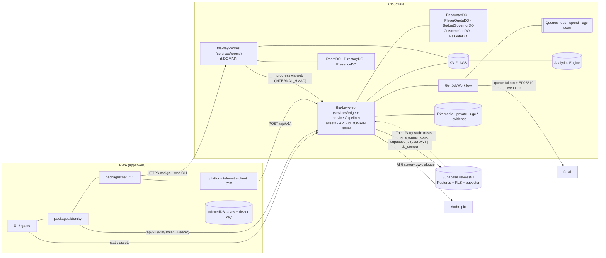

# 09 — Backend, Data & Multiplayer (S09)

> Wave 1 domain spec, 2026-10-18, Claude Opus 5.5 (S09). Reads 06-SHARED-CONTEXT v1.1 (frozen; drafted against v0.95, reconciled per spec/11-decision-log.md) and spec/03 v1.1 (D-01…D-30, A-01…A-10, G1–G3). Four files, read in order:
> 1. **this file** — scope, design, components, runtime, platforms, facts, milestones, tests, open questions;
> 2. `09-backend-contracts.md` — C11 (1.0.0, wire protocol 2), C12 (1.1.0), C16 (1.1.0) TypeScript (1.1 additions in `09-backend-contracts-1.1.md`);
> 3. `09-backend-db.md` — Postgres schema, RLS, R2/KV/DO storage, retention, migrations;
> 4. `09-backend-ops.md` — Workers config, environments, CI/CD, abuse controls, observability, cost guardrails, secrets.

## 1. Scope and R-IDs

S09 owns the Cloudflare edge (Workers, Durable Objects, R2, KV, Queues, Workflows, Analytics Engine), the Supabase database, identity (auth phases P0–P3 and the OIDC issuer), the multiplayer room protocol, the moderation/legal backend, telemetry, quotas and budget controls, CI/CD and deploy. Gameplay rules inside rooms, dialogue prompts, pipeline stages, UI and mod runtime belong to other domains and are only hosted here.

| R-ID | How S09 serves it | Sections |
|---|---|---|
| R-PLAT-01 | Workers + static assets (SPA), Workers Paid from M00, COOP/COEP/CORP, R2 media domains | §2.1, Part 4 §1 |
| R-ROLL-01 | single-player needs no account or server state; every online feature is optional and degrades to offline | §2.3, §8 |
| R-ROLL-02 | `RoomDO` + `DirectoryDO` + `PresenceDO`, protocol v2, persistence on Supabase | §3.1, C11 |
| R-AUTH-01 | P0 local profile + HMAC play token; P1 device registration at M12a | §2.4, C12 §2.3 |
| R-AUTH-02 | `IdentityService` interface; Thirdweb is one adapter added at M14a | C12 §2.3, §8 |
| R-IP-03 | upload → scan → review pipeline, report endpoint, DMCA/NCII/CSAM intake and case records, evidence buckets, SLA pager | §3.4, Part 3 §3.4 |
| R-ENG-03 | `PlayerQuotaDO`, `BudgetGovernorDO`, AI Gateway rules, vendor caps, cache-first jobs, alarms | Part 4 §5 |

Supporting (owned elsewhere, infrastructure here): R-CUT-01/03 (`CutsceneJobDO`, `GenJobWorkflow`), R-NPC-04/R-IP-02 (kill-switch storage and propagation), R-NPC-05 (dialogue proxy transport, `EncounterDO`, quotas), R-AUTH-03 (device-code login), R-MOD-03/R-MOD-04 (forum and experience storage), R-IP-04 (telemetry carries no camera or pose data), R-UI-02 (privacy toggles honoured at ingest).

Contracts: **owns** C11, C12, C16 (Part 2). **Honors** C05 (the sync unit is one `SaveRecord` per C05 `SlotId`; its `data` is opaque JSON to the server), C09 (cutscene cache key and `cutscenes/<key>/manifest.json` readiness), C10 (dialogue request/response bodies, with the history change proposed in the return block), C14 (mod manifest validated at publish; mods disabled in rooms). Also reads C01/C02 (sim tick), C08 (ENU frame, chunk keys, world bounds), C13 (tier names in telemetry), C17 (experience anchors).

### 1.1 Checklist (expanded from the brief; every item has a disposition)
| # | Item | Disposition |
|---|---|---|
| 1 | Workers + static assets, SPA mode, `run_worker_first: ["/api/*"]`, navigation requests skip the Worker [research/stack-cloudflare-backend.md §1.1] | designed, M00 |
| 2 | COOP/COEP/CORP in `_headers` and in code on every Worker response (`_headers` does not apply to Worker responses, F-019); `/account/*` non-isolated | designed, M00 |
| 3 | Two Workers: `tha-bay-web` and `tha-bay-rooms` (A-01) | designed, M00 / M12b |
| 4 | R2 buckets, `media.`/`ugc.` custom domains, identity-encoded binaries, presign on S3 endpoint only (F-023) | designed, M05b / M06b |
| 5 | US-only geo-gate (A-10), legal intake exempt | designed, M00 |
| 6 | P0 local profile, device key, HMAC play token with device-key proof | designed, M04b / M06a |
| 7 | P1 device registration, Worker OIDC issuer ES256, refresh rotation (D-03) | designed, M12a |
| 8 | Supabase Third-Party Auth Custom OIDC registered by script (F-031) | designed, M12a |
| 9 | P2: RFC 8628 device-code publish login; website "Continue with ChatGPT" behind `AUTH_OPENAI_WEB=false` (D-05) | designed, M13c |
| 10 | P3: Thirdweb SIWE link (EOA only, no `guest`), merge requests (D-04) | designed, M14a |
| 11 | `IdentityService` isolation so Thirdweb is one adapter (R-AUTH-02) | designed, M04b |
| 12 | DataPort rule: no supabase-js in the client; all data via `/api/v1` (D-02) | designed, M05d |
| 13 | Complete schema, RLS, pgTAP tests, generated types | designed, M05d→M14a |
| 14 | Saves: local IndexedDB with Grand-V rules first; cloud sync with optimistic versions and tombstones later [research/repos-grand-v.md (d)] | local: S01 `SaveService` M04a (DL-006); cloud M12a |
| 15 | RoomDO: Hibernation API, 50 ms `setInterval` tick only while active, AFK stop, 5 s checkpoints, alarm GC (D-06) | designed, M12b |
| 16 | Protocol v2: binary frames, close codes, tickets, resume tokens | designed, M12b / M12c |
| 17 | Interest management: 64 m grid, 150/300 m, hysteresis, priority bands | designed, M12b |
| 18 | DirectoryDO assignment with `locationHint: "wnam"` for pre-created rooms; invites; PresenceDO | designed, M12b / M12c |
| 19 | Authority: `validated` client movement; server physics only by ADR (A-04) | validated M12b; authoritative deferred (post-M12c ADR) |
| 20 | Load-test gate before raising CAP 16 → 32 | designed, M12c |
| 21 | Deploy restarts every DO: drain notice, resume, build-mismatch update flow | designed, M12c |
| 22 | `CutsceneJobDO` single-flight + `GenJobWorkflow` (cache → budget → submit → webhook → poll → stages → record) with mock provider (D-19) | designed, M05b |
| 23 | Dialogue proxy transport: SSE, 4 s first-token timeout, `EncounterDO` server-held history (D-21) | designed, M06a |
| 24 | NPC memory in pgvector, exact per-pair scan, 30 d / 180 d retention, export/forget day one (D-22) | designed, M06a |
| 25 | Roster kill-switch: Postgres → KV + 30 s cache + `EncounterDO` broadcast, ≤ 60 s live (D-29) | designed, M06a |
| 26 | Quotas and budgets: `PlayerQuotaDO`, `BudgetGovernorDO` 70/85/100 %, AI Gateway rules, vendor caps, reconciliation (D-28, G3) | layer 3 M06a; layers 1–2 and drift check M14b |
| 27 | Moderation pipeline: staging bucket, scan queue, hash-first ordering, queues P0–P3, console API | NPC queue M06b; all queues M13d |
| 28 | DMCA, counter-notice, TAKE IT DOWN (48 h), NCMEC reporting and 1-year preservation, repeat-infringer strikes | designed, M13d |
| 29 | Forum backend (threads, posts, votes, search, polling) | designed, M13b |
| 30 | Telemetry C16, Analytics Engine, privacy rules, heartbeat crash beacons | designed, M00 (ingest) |
| 31 | Observability sampling after the 2026-12-01 pricing change; alert list; dashboards | designed, M00 / M14b |
| 32 | CI/CD: Workers Previews per PR, `versions upload` → smoke → rollout, DO lifecycle changes via `wrangler deploy` only (F-061) | designed, M00 |
| 33 | Secrets only in Wrangler secrets; per-Worker lists; rotation | designed, per milestone |
| 34 | Voice chat (Realtime SFU) | out of v1: live-voice moderation is unplanned and recording is barred [research/legal-ip-likeness.md §8 P5] |
| 35 | Hyperdrive, D1, Supabase Realtime, Containers for game servers | not used in v1: supabase-js HTTPS suffices; Hyperdrive reach UNVERIFIED; Realtime would put supabase-js in the client |

## 2. Design

### 2.1 Topology


### 2.2 Key decisions (with rationale)
1. **Rooms on their own host `rt.<domain>`.** The rooms Worker verifies tickets and forwards to its own DOs; the web Worker never binds rooms DOs. This avoids cross-script DO bindings (Preview support not researched) and service bindings (Previews call production [research/gap-ci-cd-release-assets.md §1.5]). Cost: one CORS-mode HTTPS call and a cross-origin WebSocket from an isolated page (COEP impact UNVERIFIED, tested in M12b AC-1; fallback in §10 Q-BE-02).
2. **Identity spine = our issuer at `id.<domain>`** (D-03). One ES256 JWT is verified locally by the rooms Worker, by the web Worker and by Supabase RLS. Supabase anonymous sign-in (30/h/IP default, F-030) is not used.
3. **P0 data is claimable only by its device.** The play token is minted after a device-key signature and the key is bound to the profile on first server write (C12 §2.3). P1 upgrades the same `profiles` row, so nothing migrates.
4. **Single-player never needs the backend** (R-ROLL-01). Saves are local first (M04b); dialogue, cutscene status and telemetry are optional calls with offline fallbacks; `/boot` failing means "offline mode", not an error.
5. **Multiplayer has its own server-side economy** (`progress_wallet`), so editing a local single-player save cannot inflate online state.
6. **Generation is internal-only in v1** (D-19, G3): `CutsceneJobDO.ensure()` may start a Workflow only for keys in `cutscene_catalog` (built from our own scripts) or from staff/CI prewarm; a player request for any other key returns `absent` and plays the in-engine fallback.
7. **No Supabase Realtime and no supabase-js in the client.** Forum threads poll every 15 s; low-rate pushes ride the presence socket (M12c). This keeps the Convex switch at 5–7 sessions [research/stack-cloudflare-backend.md §8].

### 2.3 Alternatives rejected
- Supabase Broadcast or Convex for movement: ≈ $1.44 / ≥ $0.144 per player-hour vs ≈ $0.0009 on a DO, and a 2,500 msg/s project cap [research/stack-cloudflare-backend.md §5].
- `setAlarm` per tick: ≈ 13× the duration cost and blocks hibernation (same §4.4).
- `partyserver`: work-in-progress; the room DO is ≈ 400 lines we own and test (same §1.3).
- Pages: Workers is Cloudflare's recommendation for new projects (same §1.1).
- Sentry by default: 30 KB gz and default PII collection; self-hosted sink ≈ 0.9 KB gz [research/gap-observability-cost-guardrails.md §2.3].
- D1 or DO SQLite as system of record: no RLS or pgvector; kept for edge-local state only.
- Moderator console on ROOST Coop now: needs Postgres, Redis, ClickHouse, Scylla; build a minimal console with Coop-shaped tables [research/gap-trust-safety-tooling.md §5].

### 2.4 Auth phases (D-04)
| Phase | Milestones | Client state | Server state | Token | Unlocks |
|---|---|---|---|---|---|
| P0 local | M00–M11 | profile id + device key (IndexedDB), local saves | `profiles(tier='local')` stub only on first online call | play token (24 h) | dialogue, cutscene status, telemetry, export/forget |
| P1 device | M12a | same | profile registered (Turnstile, 18+ attestation) | access JWT 1 h + refresh 30 d | cloud saves, rooms, leaderboards, forum (account ≥ 72 h, Q-BE-04), reports, uploads |
| P2 linked | M13c | + OpenAI link (if granted) or CLI device-code | `identities('openai', sub)` | same JWT, `tier='linked'` | publishing NPCs/experiences/mods, NPC builder jobs, premium voice (D-30) |
| P3 linked | M14a | + Thirdweb EOA | `identities('thirdweb', address)` | same | cross-device sign-in and recovery |

## 3. Components

### 3.1 Rooms (`services/rooms`)
```ts
// services/rooms/src/index.ts — fetch(): CORS, geo, RL_ROOMS, JWT/ticket verify, build check, then DO
export class RoomDO extends DurableObject<RoomsEnv> {
  check(): Promise<{ players: number; capacity: number; build: string | null; worldVersion: string }>;   // RPC, reserves nothing
  fetch(req: Request): Promise<Response>;        // upgrade only; headers x-profile-id, x-display-name, x-look, x-resume?
  webSocketMessage(ws: WebSocket, msg: ArrayBuffer | string): Promise<void>;
  webSocketClose(ws: WebSocket, code: number, reason: string, wasClean: boolean): Promise<void>;
  webSocketError(ws: WebSocket, err: unknown): Promise<void>;
  alarm(): Promise<void>;                        // empty-room GC, schedule rows, 60 s safety checkpoint
  drain(at: number): Promise<void>;              // broadcast notice{drain}
  kick(sid: string, code: string): Promise<void>;
}
export class DirectoryDO extends DurableObject<RoomsEnv> {
  assign(a: { profileId: string; inviteCode?: string }): Promise<{ roomId: string }>;
  report(roomId: string, occupancy: number): Promise<void>;        // rooms call on join/leave only
  createInvite(roomId: string): Promise<{ code: string; exp: number }>;
  broadcastDrain(at: number): Promise<number>;                     // returns rooms notified
}
export class PresenceDO extends DurableObject<RoomsEnv> {         // shard = hash(profileId) % 64
  fetch(req: Request): Promise<Response>;                          // hibernatable menu socket
  setStatus(profileId: string, s: { online: boolean; roomId?: string }): Promise<void>;
  deliverInvite(profileId: string, invite: { code: string; from: string }): Promise<boolean>;
}
```
Shared simulation code for validation lives in `packages/net/src/validate.ts` (pure, used by the DO and by client tests). Socket attachment (≤ 16 KiB, survives hibernation): `{ sid, slot, profileId, name, joinedAt, lastSeq, strikes }`.

### 3.2 Edge services (`services/edge`)
| Module | Responsibility | Public interface |
|---|---|---|
| `src/router.ts` | route table C12 §2.4, Ajv validation, error envelope, isolation headers, geo-gate | `handle(req, env, ctx): Promise<Response>` |
| `src/id/issuer.ts` | discovery, JWKS (CURRENT + NEXT), sign/verify | `sign(c: AccessClaims): Promise<string>`, `verify(t: string, aud: string): Promise<AccessClaims>`, `jwks(): JsonWebKeySet` |
| `src/id/playtoken.ts` | P0 token mint/verify, device-proof check, TOFU bind | `mint(req: PlayTokenReq): Promise<PlayTokenRes>`, `verify(tok: string): PlayTokenClaims` |
| `src/id/devicecode.ts`, `src/id/siwe.ts`, `src/id/openai.ts` | RFC 8628; SIWE via `viem/siwe` (`parseSiweMessage`, `verifySiweMessage`); OIDC code + PKCE (flagged) [research/auth-ugc-input-maps.md §2.4, §3.3] | per routes 10–13 |
| `src/data/supabase/*` | the only DataPort implementation | `createDataPort(env, ctx): DataPort` |
| `src/budget/QuotaDO.ts`, `GovernorDO.ts` | Part 4 §5.3 | `PlayerQuota`, `BudgetGovernor` |
| `src/npc/EncounterDO.ts` | server-held transcript, one turn at a time, cadence/turn caps, close after 60 s idle | below |
| `src/flags/roster.ts` | `roster_flag` → KV, 30 s in-memory cache, `RosterFlags` ETag | `isKilled(npcId, scope): Promise<boolean>` |
| `src/ugc/*` | presign, commit, scan-queue consumer orchestration (stages from S12/S04) | routes 33–34, 41 |
| `src/legal/*`, `src/admin/*` | intake, cases, decisions, evidence reads, hash banks | routes 42–47 |
| `src/telemetry/ingest.ts` | C16 validation, scrub, AE write | route 3 |
| `src/ops/*` | crons: SLA pager (5 min), recon (5 min), retention (daily), expiries (hourly); alert sink | — |

```ts
// services/edge/src/npc/EncounterDO.ts (transport and storage only; prompt and schema are S04's)
export interface EncounterDO {
  begin(t: { profileId: string; npcId: string; soulVersion: number; turn: unknown /* C10 player turn */ }):
    Promise<{ ok: true; turnIndex: number; history: unknown[] } | { ok: false; reason: 'busy' | 'turn_cap' | 'cadence' | 'killed' }>;
  complete(turnIndex: number, assistant: unknown, usage: { inTok: number; outTok: number; cacheRead: number; cacheWrite: number }): Promise<void>;
  abort(turnIndex: number, reason: 'timeout' | 'refusal' | 'upstream' | 'client_gone'): Promise<void>;
  kill(npcId: string): Promise<void>;          // kill-switch: refuse new turns immediately
  alarm(): Promise<void>;                      // 60 s after last turn: transcript → R2 private, row in encounter_transcripts, enqueue 'summarize'
}
```

### 3.3 Generation infrastructure (`services/pipeline`, compiled into the web Worker)
```ts
// GenJob, FalPort (LiveFalPort | MockFalPort; FAL_MODE=mock selects MockExecutor), Step<I,O> and GenPorts are S05's C07 types
// (spec/domains/05-assets.md §3, §4.6; packages/shared/src/genai/types.ts, services/pipeline). S09 hosts and binds them.
export interface CutsceneJob {                     // CutsceneJobDO RPC, instance = cut:<cacheKey>
  ensure(job: GenJob, opts: { allowGenerate: boolean }): Promise<CutsceneStatus>;
  complete(r: { manifestKey: string; costUsdMicros: number }): Promise<void>;
  fail(err: string): Promise<void>;
}
export interface FalGate { acquire(jobId: string, ttlMs: number): Promise<boolean>; release(jobId: string): Promise<void> } // class FalGateDO in services/pipeline/src/do/ (S05), bound by tha-bay-web
```
`GenJobWorkflow` (class in `services/pipeline/src/workflow.ts`, S05) runs the stage order of `spec/domains/05-assets.md` §5.1 (gate → cache-check → budget-reserve → acquire → submit → wait → poll → copy → process → qa → re-gate → record), with S05's retry classes (§5.2). S09 supplies what the steps call: `BudgetGovernor.reserve/settle` (settle from the fal billing event by `request_id`), `FalGate.acquire/release` (release always runs; ≤ 20 min of 30 s retries), the webhook route `/api/v1/hooks/fal?wf=<instanceId>` (verifies the ED25519 signature, calls `instance.sendEvent`, answers 2xx within 15 s), and `step.waitForEvent('fal-done', 20 min)` with the poll fallback, needed because webhook retries can stop ≈ 6 min after completion for results ≥ 10 KB [research/genai-pipeline-fal.md §2]. `MockFalPort` returns an in-house fixture clip and posts a webhook signed with a test key served at `/api/v1/_test/fal-jwks` (non-prod only).

### 3.4 Moderation and legal (backend half of R-IP-03)
- Upload path: `POST /ugc/uploads` → presigned PUT to `ugc-staging/incoming/<uploadId>` (15 min, fixed Content-Type) → `POST …/commit` (HEAD size check) → `UGC_SCAN` queue → stages in order **hash first** (SHA-256, PDQ, PhotoDNA when approved), then classifiers, then human review → publish copies to `ugc-public/img/<sha256>.<ext>` [research/gap-trust-safety-tooling.md §6.3].
- Case queues and SLA clocks exactly as [research/gap-trust-safety-tooling.md §6.5]; `sla_due_at` and `statutory_due_at` are stored at insert; the 5-minute cron pages breaches.
- Report rules: `child_safety` and `intimate_image` open P0 immediately; 3 distinct reporters (or 1 `mod:trust_lead`) move an item to `unpublished_pending_review`; `copyright` redirects to the DMCA form.
- NCII intake disables access on intake for any facially valid request, sweeps copies by SHA-256 + PDQ within 24 h and notifies the requester within 48 h (TAKE IT DOWN, F-066).
- CSAM: quarantine ≤ 60 s, never forwarded to another vendor, evidence to `legal-evidence/ncmec/<reportId>/` with 1-year preservation; reports via the CyberTipline web form until API credentials exist (Q-BE-07).
- DMCA: designated agent (renewal every 3 years, reminder 90 days before), counter-notice restore in 10–14 business days, three strikes in 12 months removes publishing rights [research/legal-ip-likeness.md §5.1].

### 3.5 Client-side pieces S09 specifies
- `packages/identity` (C12 §2.3): `LocalIdentity` (M04b), `DeviceIdentity` (M12a), adapters later.
- Saves: S01's `SaveService` (C05, `packages/engine/src/sim/save/`, IndexedDB `dv-saves`, M04a) is the only local save store; it already applies the Grand-V rules [research/repos-grand-v.md (d)]. S09 supplies the `CloudSync` port in `packages/net/src/cloud-sync.ts`: `NullCloudSync` (M04b) and `HttpCloudSync` (M12a, routes 16–19, 50, 51), which reads `SaveService.changesSince` and syncs one `SaveRecord` per C05 `SlotId`.
- `packages/net`: codec, clock/interpolation, `RoomClient` (`connect(assign)`, `send(input)`, `onSnapshot`, `onEvent`, reconnect + resume).
- Telemetry client: S11's `packages/engine/src/platform/telemetry/` (≈ 1 KB gz: queue, scrub, heartbeat `localStorage['dv.hb']`, `sendBeacon` flush on `visibilitychange→hidden` and `pagehide`) implements C16; it lives in a package so engine, UI and shell emit through one instance [research/gap-observability-cost-guardrails.md §2.2].

## 4. Data
All owned types are in Part 2 (`09-backend-contracts.md`); all persisted data, flags and retention are in Part 3 (`09-backend-db.md`). Feature flags (`FeatureFlag` in C12 §2.5) are read from KV `flags:features` at `/boot`; kill switches `ks:*` and `gov:level` in Part 3 §5. Configuration files S09 introduces: `config/guardrails.yaml` (every cap, ceiling, alert threshold and key policy), `config/net.speedcaps.json`, `config/geo.json` (`GEO_ALLOW`), `config/rate-limits.json` (Part 4 §3.1).

## 5. Runtime behavior

### 5.1 State machines
**Room** (`RoomDO`): `absent → active` (first accepted socket; tick starts) `→ afk` (no `IN` for 60 s; tick stopped; hibernates after 10 s) `→ active` (next `IN`) `→ emptying` (last socket closed or ghost expired; final checkpoint; alarm +10 min) `→ gc` (`deleteAll()`, directory forgets) or back to `active` on a join.

**Cutscene key** (`CutsceneJobDO`): `absent → pending` (allowed `ensure()`: key in catalog or staff/CI, `ks:cutscene_gen` off, governor < L3) `→ ready` (manifest written last) | `failed` (after 3 Workflow attempts; re-armed by alarm after 1 h, max 3 re-arms, then staff only). `ready` is terminal. A cutscene kill scope makes the route answer `blocked` while the object is quarantined.

**Encounter** (`EncounterDO`): `idle → streaming` (one turn) `→ idle`; any `begin` during `streaming` returns `busy`; `turn_cap` at 12 turns default (hard 20, S04 sets); `closed` after 60 s idle or `end_conversation`.

**Identity**: `local → device` (register) `→ linked` (first provider link); `linked` never returns to `device` unless every provider is unlinked and a device key remains.

### 5.2 Tick order and budgets
Server tick (50 ms): drain inputs → validate poses → resolve `ACT` in arrival order → interest sets → encode one `SNAP` per recipient → `send` → every 100 ticks checkpoint, every 200 ticks `room.tick` to AE. Budget: ≤ 10 ms p99 at 16 players (A07). Downstream ≈ 464 B per snapshot with 16 entities (16 B header + 16 × 28 B) ≈ 9.2 KB/s per player at 20 Hz [research/stack-cloudflare-backend.md §4.5]. Client: decode in the C02 `netIn` phase ≤ 0.5 ms per snapshot at the mobile tier; encode `IN` in `netOut` ≤ 0.1 ms. API CPU target ≤ 10 ms p99 per request excluding I/O.

### 5.3 Failure modes and fallbacks
| Failure | Behavior |
|---|---|
| `/boot` unreachable or `region: blocked` | offline single-player from the PWA cache; online menus show "unavailable" |
| Supabase down | save sync retries with backoff (local stays authoritative); dialogue runs without memory; rooms keep running; `progress.commit` retried from the `JOBS` queue with the same idempotency key |
| Anthropic slow/down/capped | 4 s first-token timeout → `fallback`; tier-cap 429 never retried; ink lines (S04) |
| fal down or webhook lost | Workflow polls; job may fail; players always get the in-engine cutscene (R-CUT-03) |
| Governor L3 or `ks:genai:all` | genAI off; cached cutscenes/TTS/barks still served |
| Rooms deploy | `notice{drain}` 30 s ahead; reconnect with resume token; state from last checkpoint; build change → 4002 → PWA update |
| DO `overloaded` | rooms Worker does not retry into the same room; asks the directory for another |
| Slow mobile receiver | every-other-tick, then 1013 at 2 s lag |
| KV lag (≥ 60 s) | immediate stops go through DOs (`forceLevel`, `EncounterDO.kill`) |
| Signing-key rotation | JWKS always carries CURRENT and NEXT; verifiers cache JWKS 10 min and refetch on unknown `kid` |

## 6. Platform notes
| Platform | Differences |
|---|---|
| Desktop (Chrome/Edge/Safari/Firefox) | `IN` at 20 Hz, 1 sample; Reporting API crash reports on desktop Chrome only (route 4) |
| iPhone PWA (mobile tier) | `IN` at 10 Hz with 2 samples (halves DO inbound); iOS suspends hidden pages, so a backgrounded socket drops: the slot stays a ghost for 60 s and the client resumes on return; no crash events, so the heartbeat beacon is the crash signal (F-064); provider sign-in uses full-page redirects on `/account/*` (behavior inside a Home Screen app UNVERIFIED, M12a/M14a device check) |
| Meta Quest 3/3S | same rates as desktop; network decode in `sim.worker` to protect the 72 Hz frame budget (C13); WebXR session unaffected by the socket |
| Apple Vision Pro | as Quest; Safari visionOS 26.2+ |
| All | `BootConfig.hosts` gives every endpoint; nothing hard-codes `<domain>`; telemetry envelope tags `deviceClass`, `tier`, `displayMode`, `backend` |

## 7. Verified facts used
| F / source | Fact | Used for |
|---|---|---|
| F-018 | Workers Paid $5; static asset requests free; no egress; 25 MiB/file | hosting, cost |
| F-019 | `_headers` not applied to Worker responses; Cloudflare ignores Range when it must decompress | headers in code; identity encoding |
| F-020 | 32,768 hibernatable sockets; attachment ≤ 16 KiB; ~500–1,000 req/s; deploys restart DOs | room cap, attachments, drain |
| F-021 | DO $0.15/M requests, $12.50/M GB-s at 128 MB; WS in 20:1, out free; `setAlarm` = row write | tick design, cost |
| F-022 | hibernation after 10 s only without timers; location fixed at first `get()` | AFK stop, `wnam` hint |
| F-023 | R2 pricing; presign only on the S3 endpoint | uploads |
| F-024 | Workflows 500k steps included; step result ≤ 1 MiB | GenJobWorkflow |
| F-027 | logs/traces GB-billed from 2026-12-01 (50 GB then $0.25/GB) | sampling |
| F-028 | AI Gateway spend limits eventually consistent; DLP/Guardrails buffer SSE | layer 2 config |
| F-029, F-030 | Supabase Pro pricing/limits; `us-west-1`; anon 30/h/IP | DB, issuer choice |
| F-031 | Supabase Custom OIDC third-party provider needs `kid`, `role` | issuer claims |
| F-032 | legacy anon/service_role keys end with 2026 | `sb_secret_` only |
| F-033 | Convex has no US West; `customJwt` ES256 | alternative documented |
| F-042 | fal: End Users 18+; no direct API exposure | Worker-only generation, 18+ |
| F-047, F-048 | fal webhooks ED25519, retries end ≈ 6 min for ≥ 10 KB; no fal spend cap | poll fallback, governor reserve |
| F-059 | thirdweb Growth $99/mo; wallets > 1,000 at $0.015 | M14a gate, cost |
| F-061 | Workers Previews per PR; Version URLs use production resources | CI |
| F-065 | Cloudflare CSAM tool scans cached content only | `ugc.<domain>` cache rule |
| F-066 | TAKE IT DOWN: 48 h removal | NCII clock |
| [research/stack-cloudflare-backend.md §1.5, §1.10] | Queues 5,000 msg/s; KV 1 write/s per key; Rate Limiting binding per-location, eventually consistent | queues, flags, limits |
| [research/gap-ci-cd-release-assets.md §1.4] | DO lifecycle changes cannot go through `versions upload`; rollback cannot cross them | `check:do-migrations` |
| [research/gap-ci-cd-release-assets.md §3] | Management API `POST /v1/projects/{ref}/config/auth/third-party-auth`; CLI lacks Custom OIDC | `auth:tpa` |
| [research/gap-observability-cost-guardrails.md §3] | Anthropic workspace limit → 400; tier cap → 429 `enforced_spend_limit_reached` without `retry-after` | error mapping |
| [research/gap-trust-safety-tooling.md §1.3] | 2258A: report "as soon as reasonably possible", preserve 1 year | CSAM path |
| [research/legal-ip-likeness.md §5.1] | DMCA agent $6, expires after 3 years; restore 10–14 business days | DMCA path |
| [research/repos-grand-v.md (b), (d)] | relay vocabulary, token bucket, coalescing, 1013/1008; save-profile rules | C11, C05 cloud sync |
| [research/repos-webport.md §3.7] | muguet clock offset/jitter/delay 45–300 ms, extrapolate ≤ 250 ms | C11 §1.8 |

**UNVERIFIED (listed for spec/99; none appears in an acceptance criterion):** U1 cross-origin WebSocket from a COEP `require-corp` page to `rt.<domain>` (M12b spike; fallback Q-BE-02); U2 Turnstile server verification API and widget under COEP (M12a spike before the AC); U3 `wrangler@4.151.1` keys for workflows, AE, `analytics`, `ratelimits`, `observability`, `previews` (M00); U4 DO `send` backpressure and whether WS messages count toward the ~1,000 req/s limit (M12c load test); U5 DO memory limit; U6 duplicate Workflow id behavior (single-flight relies on the DO); U7 Hyperdrive reach to Supabase (not used); U9 Cloudflare CSAM tool coverage of R2 custom domains (support ticket in M13d); U10 Cache-Tag purge on R2 (prefix purge used); U11 NCMEC API credential process (web form until then); U12 PhotoDNA approval timing; U13 whether `limits.cpu_ms` applies to Workflow steps and queue consumers of the same Worker; U14 whether every hibernated WS message emits an invocation log (rooms sampled at 0.001 regardless); U15 Custom Alerts billing and rule limits; U16 redirect sign-in inside an iOS Home Screen app; U17 AI Gateway pricing catalog coverage of `claude-haiku-5-5`/`claude-sonnet-5-5`; U18 Anthropic minimum workspace limit; U19 fal auto-recharge and locked-account status code; U20 `wrangler deployments status --json` field names; U21 whether DO restarts are scoped to the deploying script (A-01's premise; the split costs nothing if false).

## 8. Milestone mapping
Backend share of each milestone; sessions are Sonnet 5.5 sessions for the S09 part. "Stub first" names what exists before the real thing.

| Milestone | S09 scope in | Stubbed first / later | Sessions |
|---|---|---|---|
| **M00** bootstrap | `tha-bay-web` with assets, `_headers`, isolation headers in code, `/health`, `/boot`, `/t` → AE, geo-gate; ci/preview/deploy workflows; `deploy:bootstrap`; version-affinity rule; `check:workers`, `check:prod-routes`, `check:secrets`, `check:do-migrations` | `/boot` flags from vars, no KV yet | 1 (of M00's 2) |
| **M04b** menus + identity | `LocalIdentity`, `NullCloudSync` (local saves are S01's `SaveService`, M04a) | cloud sync deferred to M12a | 0.5 |
| **M05b** cutscene infra | `CutsceneJobDO`, `FalGateDO`, minimal `BudgetGovernorDO` (reserve/settle/level), S05's `GenJobWorkflow` and `MockFalPort` bound into the web Worker, webhook route, `/cutscenes/:key`, prewarm route (`OPS_TOKEN` until staff JWTs in M12a), `media`/`private` buckets, `_test` routes | `cutscene_catalog` read from a static JSON until M05d | 1 |
| **M05d** data spine (new) | Supabase staging/prod projects, migrations 0001–0002, DataPort + `InMemoryDataPort`, `check:db`, `check:db:types`, `db:push` in deploy, cutscene index + ledger export | — | 1 |
| **M06a** dialogue proxy (with S04) | play token + TOFU, `PlayerQuotaDO`, `EncounterDO`, SSE transport + 4 s timeout, memory store (0003), roster flags + kill route + `ks:*`, `/me` export/forget, retention crons | AI Gateway layer-2 rules and vendor caps arrive in M14b | 1 |
| **M06b** builder moderation (with S04/S10) | uploads presign/commit, `UGC_SCAN` queue, 0004, case API for `P2_REVIEW`, report route | hash banks/legal later (M13d) | 1 |
| **M12a** P1 identity + cloud saves | issuer + JWKS, register (Turnstile), token/refresh rotation, `auth:tpa`, staff scopes, 0005, `HttpCloudSync`, blob URLs, age route | — | 1 |
| **M12b** rooms core | rooms Worker, `RoomDO`, `DirectoryDO`, tickets, codec + clock in `packages/net`, interest, `validated` authority, close codes | presence/invites/resume in M12c | 2 |
| **M12c** rooms hardening (new) | resume + ghosts, drain, `PresenceDO`, invites, `ACT` interactions, 0006 progress + leaderboards, opt-in moderated chat, load test gate | delta snapshots only if needed | 2 |
| **M13b** forum backend | 0007 forum, forum routes, votes, search, auto-unlist on reports | — | 1 |
| **M13c** (S12 owns) | device-code endpoints, mod-version publish route, `AUTH_OPENAI_WEB` flagged flow | — | 0.5 |
| **M13d** legal + trust & safety (new) | DMCA/counter-notice/NCII intake, 0008, SLA pager, NCMEC case records + evidence reads, own hash banks + copy sweep | PhotoDNA/HMA when approved | 1 |
| **M14a** Thirdweb link | 0009, SIWE nonce/verify, merge requests | gated on Growth plan | 1 |
| **M14b** launch hardening | `config/guardrails.yaml`, layers 1–2, recon cron, alert wiring, synthetic spend tests T1–T9, gradual rollout default, backup restore drill | — | 2 |

R-ID → milestones: R-PLAT-01 M00 · R-ROLL-01 M00, M04b, M05b (no account on any single-player path) · R-ROLL-02 M12b, M12c · R-AUTH-01 M04b, M06a, M12a · R-AUTH-02 M04b, M14a · R-IP-03 M06b, M13b, M13d · R-ENG-03 M05b, M06a, M14b.

Acceptance criteria (backend; S13 folds them into the milestone files):
- **M00** AC-1 Given the staging deployment When `pnpm check:headers -- <url>` runs Then COOP `same-origin`, COEP `require-corp` and CORP are present on `/` and on `/api/v1/health` — proof: `pnpm check:headers -- $STAGING_URL`. AC-2 Given `cf.country = 'FR'` in a Workers test When `/api/v1/boot` and `/api/v1/legal/dmca` are called Then `/boot` returns `region:'blocked'` and the legal route is not 451 — proof: `pnpm check:workers -- geo-gate`. AC-3 Given the prod build When `pnpm check:prod-routes` runs Then no `/_test/` handler exists — proof: that command.
- **M05b** AC-1 Given a catalog key already `ready` When 10 concurrent `GET /cutscenes/:key` and one prewarm arrive Then the mock provider records 0 submits — proof: `pnpm check:workers -- cutscene-singleflight`. AC-2 Given an absent catalog key When 10 concurrent `ensure()` calls arrive Then exactly 1 Workflow instance and 1 submit occur — same proof. AC-3 Given the webhook is dropped When the Workflow times out waiting Then polling completes the job and the manifest is written last — proof: `pnpm check:workers -- genjob-poll-fallback`. AC-4 Given governor L3 When a cached and an uncached key are requested Then the cached one returns `ready` and the uncached one `absent` with 0 submits — proof: `pnpm check:workers -- budget-cache-first`.
- **M06a** AC-1 Given the production client bundle When scanned Then no `sk-ant-`, fal key or `sb_secret_` pattern exists — proof: `pnpm check:secrets -- apps/web/dist`. AC-2 Given a P0 profile When it sends turn 151 in one UTC day Then the API returns `quota_exhausted` — proof: `pnpm check:workers -- quota-turns`. AC-3 Given a request body containing `history[]` When posted to `/npc/:id/talk` Then the history sent upstream equals the `EncounterDO` transcript only — proof: `pnpm check:workers -- encounter-server-history`. AC-4 Given `POST /admin/roster/npc_test/kill` When the next `begin()` for an open encounter runs Then it returns `killed` within 1 s and `/roster` lists the NPC within 60 s — proof: `pnpm check:workers -- killswitch`. AC-5 Given a profile with memories When `DELETE /me` completes Then no row keyed by that profile remains after the forget job — proof: `pnpm check:db && pnpm check:workers -- forget`.
- **M12a** AC-1 Given a registered profile When it refreshes twice with the same refresh token Then the second call fails and the family is revoked — proof: `pnpm check:workers -- refresh-reuse`. AC-2 Given staging with TPA registered When a test client holding our JWT selects another profile's `save_records` through supabase-js Then 0 rows return, and its own rows return — proof: `pnpm test:staging -- rls-thirdparty`. AC-3 Given two devices with the same profile When both PUT the same slot with the same `If-Match` Then one gets 200 and the other 409 with the server record — proof: `pnpm check:workers -- save-conflict`.
- **M12b** AC-1 Given two Playwright clients in a cross-origin-isolated page on staging, connected through `BootConfig.hosts.rt` (holds under either Q-BE-02 choice), When both join one room and one moves Then `crossOriginIsolated` is true and the other renders the move within 150 ms of the server tick time — proof: `pnpm check:e2e -- --grep @mp`. AC-2 Given a client that sends a forged slot or a non-monotonic `seq` When frames arrive Then peers never see the forged id and stale frames are dropped — proof: `pnpm check:workers -- rooms-forged-id`. AC-3 Given a claimed speed above the cap When 10 such frames arrive in 10 s Then corrections are sent and the socket closes 4004 `cheat_speed` — proof: `pnpm check:workers -- rooms-speed`. AC-4 Given a client build ≠ the room build When it upgrades Then it receives close 4002 without reaching the DO — proof: `pnpm check:workers -- rooms-build`.
- **M12c** AC-1 Given a live room When the rooms Worker restarts (test harness reset) Then clients resume with the same slot within 5 s — proof: `pnpm check:workers -- rooms-resume`. AC-2 Given 16 bots at 20 Hz from 2 locations for 30 min When the load test runs Then tick p99 ≤ 10 ms and zero overload errors — proof: `pnpm load:rooms -- --bots 16 --minutes 30` (gate for `rooms.capMax`).
- **M13b/M13d** AC-1 Given an experience with 3 reports from distinct profiles When the third lands Then it is unlisted and a `P2_REVIEW` case exists — proof: `pnpm check:workers -- report-threshold`. AC-2 Given an NCII intake When filed Then the target is disabled immediately, `statutory_due_at = received_at + 48 h`, and the pager fires at 24/36/40 h in a clock-mocked test — proof: `pnpm check:workers -- ncii-clock`. AC-3 Given a `legal-evidence` read When requested Then an `audit_log` row exists before the first byte streams — proof: `pnpm check:workers -- evidence-audit`.
- **M14a** AC-1 Given a P1 profile When it links an EOA via SIWE with a reused nonce Then verification fails; with a fresh nonce it links without data loss — proof: `pnpm check:workers -- siwe-link`.
- **M14b** AC-1 T1–T3 and T7–T9 from [research/gap-observability-cost-guardrails.md Rec 3] pass on every release candidate — proof: `pnpm test:ops -- --suite guardrails`.

## 9. Tests
| Layer | Name / path | Command |
|---|---|---|
| Unit (pure) | `packages/net/test/codec.test.ts` (round-trip every frame), `codec.fuzz.test.ts` (10,000 random buffers never throw, never allocate > 16 KiB), `clock.test.ts` (delay clamps 45–300, decay 2 %), `validate.test.ts` (bounds, speed caps) | `pnpm check:unit -- packages/net` |
| Workers runtime | `services/rooms/test/*.test.ts`: `rooms-forged-id`, `rooms-seq`, `rooms-cap-atomic`, `rooms-build`, `rooms-speed`, `rooms-afk-hibernate`, `rooms-ack-lag`, `rooms-resume`, `rooms-interest` | `pnpm check:workers -- rooms` |
| Workers runtime | `services/edge/test/*.test.ts`: `headers`, `geo-gate`, `play-token`, `issuer-rotation`, `refresh-reuse`, `quota-turns`, `governor-levels`, `cutscene-singleflight`, `genjob-poll-fallback`, `budget-cache-first`, `fal-webhook-verify`, `encounter-server-history`, `killswitch`, `forget`, `save-conflict`, `report-threshold`, `ncii-clock`, `evidence-audit`, `siwe-link`, `telemetry-privacy` (seeded PII fixtures never reach AE) | `pnpm check:workers -- edge` |
| DB | pgTAP files in Part 3 §8 | `pnpm check:db` |
| Contract drift | API JSON Schemas vs TS; `db.gen.ts` diff | `pnpm check:api && pnpm check:db:types` |
| E2E | `tests/e2e/mp-two-clients.spec.ts` (`@mp`), `tests/e2e/offline-boot.spec.ts` (`/boot` down → single-player starts) | `pnpm check:e2e -- --grep "@mp|@offline"` |
| Staging | `tests/staging/rls-thirdparty.test.ts` | `pnpm test:staging` |
| Load | `tests/load/rooms.ts` WebSocket bots at 20 Hz (tool k6 or Artillery per [research/stack-cloudflare-backend.md §4.7]; S13 picks) | `pnpm load:rooms` |
| Ops | `tools/ops/suites/guardrails/` T1…T9 | `pnpm test:ops -- --suite guardrails` |

## 10. Open questions (S09 proposals; the Architect assigns final Q-NN)
- **Q-BE-01** Issuer host: `id.<domain>` (custom domain on the web Worker) vs a path issuer on the app origin. Default `id.<domain>`.
- **Q-BE-02** If M12b AC-1 shows COEP blocks the cross-origin socket: route `<domain>/rt/*` to the rooms Worker with a zone route and drop CORS. Default: keep `rt.<domain>`.
- **Q-BE-03** Supabase from M05d (Pro for prod at first public launch, for backups and no pausing) vs Cloudflare-only until M12a. Default M05d.
- **Q-BE-04** Forum posting for `device` tier: account age ≥ 72 h plus 18+ attestation (publishing stays `linked`). Default yes; otherwise the forum is empty until M13c.
- **Q-BE-05** Turnstile at P1 registration (verification API UNVERIFIED). Default: Turnstile, verified at M12a start; fallback per-net registration caps only.
- **Q-BE-06** Cloud-save conflict policy: keep both (default) vs last-writer-wins.
- **Q-BE-07** Owner actions before M06b/M13d: NCMEC ESP registration, PhotoDNA application, Tech Coalition Pathways, DMCA agent designation, Cloudflare CSAM-tool support ticket.
- **Q-BE-08** Domains and zone plan (`<domain>`, `id.`, `rt.`, `media.`, `ugc.`); repo visibility and GitHub plan for prod approvals (research Q-CI-01/02).
