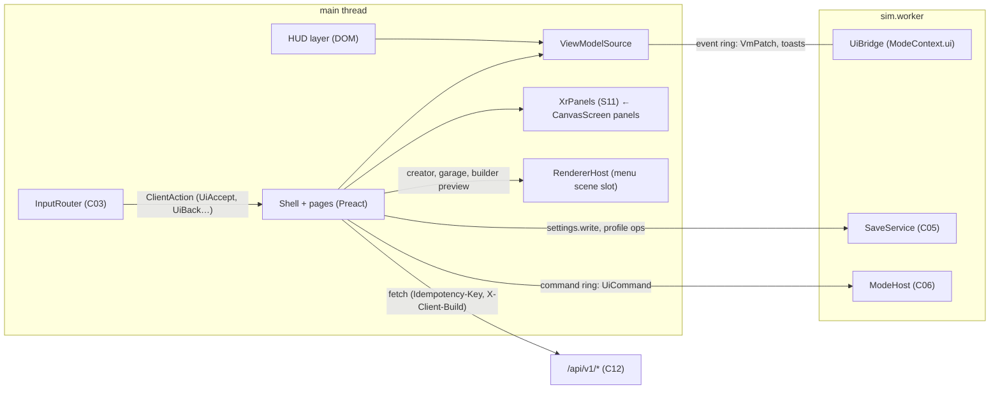
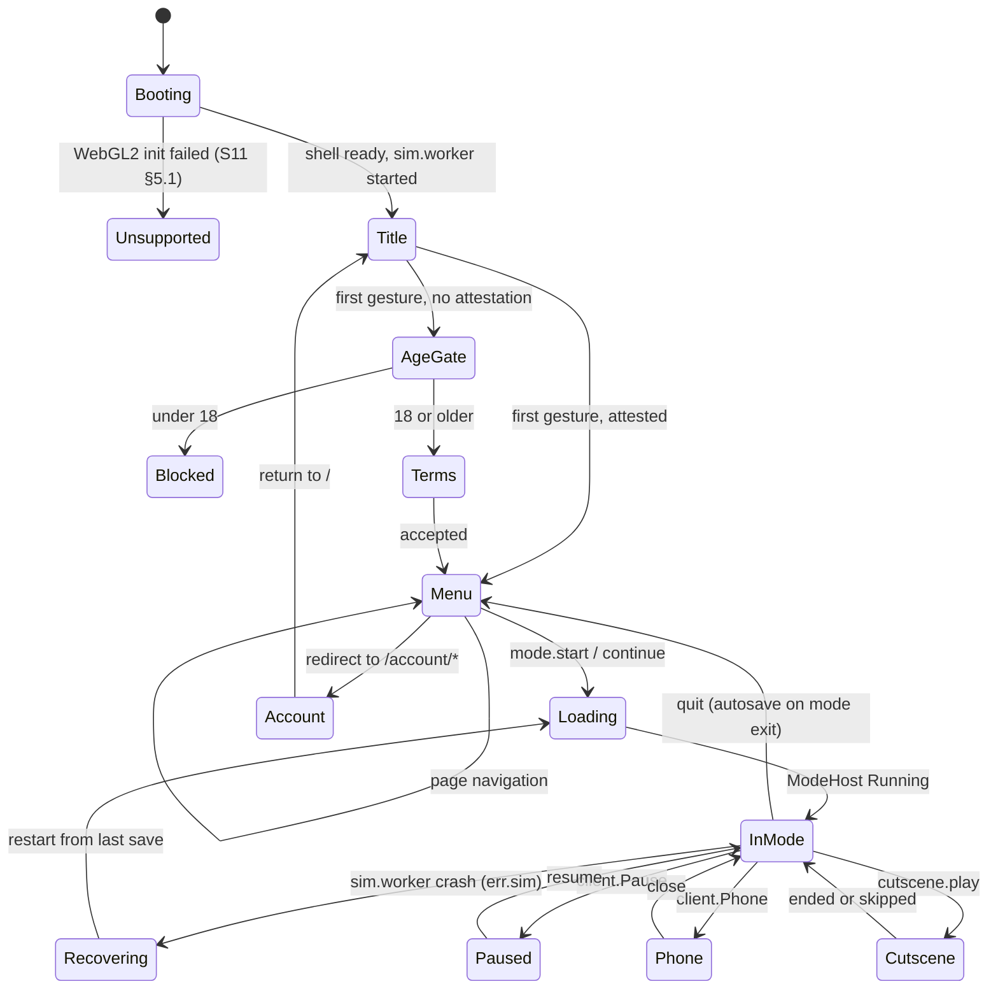
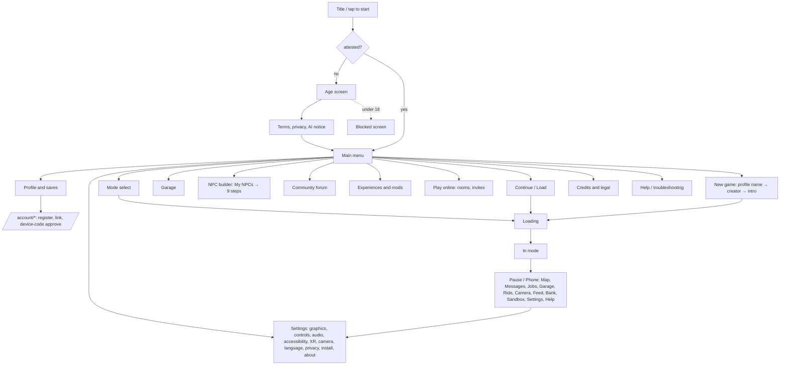

# S10 — UI/UX Shell, part A: scope, checklist, technology, shell architecture, navigation map

> Wave 4 · v0.1 · 2026-10-18 · author S10. Binding inputs: `prompt-pack/06-SHARED-CONTEXT.md` **v1.1 (frozen)**, `spec/.waves234-notes.md`, `spec/03-decisions-and-facts.md` v1.1, `spec/02-architecture.md` v0.5, `spec/11-decision-log.md`, the Wave 1 specs. Parts: **A** (this file) §1–3, 5–10 for the shell; **B** `10-ui-pages.md` (every menu page, creator, settings, saves, garage, NPC builder, forum, legal; §2.8–2.9, §4); **C** `10-ui-hud-xr.md` (HUD, phone/pause, onboarding, touch, XR panels, accessibility, localization; §2.10–2.14). Template §B headings are kept across the three files; each states which sections it carries.

## 1. Scope and R-IDs

S10 owns the player-facing shell in `packages/ui` (menus, HUD framework, settings, creator, onboarding, XR panel kit) and the page routes in `apps/web`. It owns **no numbered contract**. It honors C03, C05, C06, C12, C13 (1.1.0 in 06 v1.1) and consumes C14 and C17 (1.0.0). It does not touch the sim: it reads view models and writes commands (§3.3).

| R-ID | Statement (short) | Where designed |
|---|---|---|
| R-UI-01 | Character creation UI and logic | B §2.8 |
| R-UI-02 | Settings page, all categories | B §2.9 |
| R-UI-03 | Main menu and every implied page | A §2.5, B |
| R-ENG-04 | Accessibility baseline | C §2.13 (+ settings B §2.9) |
| R-MODE-05 | Menu unlock UI, lock states | B §2.6 |
| R-PLAT-01 | PWA install prompts, update UI | C §2.11 |
| R-PLAT-02 | XR UI: world-locked panels, comfort settings | C §2.12 |
| R-PLAT-04 | fp/tp switch UI, camera settings | B §2.9, C §2.10 |
| R-NPC-03 | NPC builder UI | B §2.10 |
| R-MOD-03, R-MOD-04 | Forum UI, experience markers and browser | B §2.11–2.12 |
| R-IP-03 | Report button on every UGC surface | B §2.11, C §2.10 |
| R-IP-04 | Camera consent and indicator; age screen | B §2.4, C §2.11 |
| R-IP-01 | Display name only from `config/brand.ts` | A §2.7 |
| R-AUTH-01…03 | Identity chips, link flows via `/account/*` | B §2.7 |
| R-MAP-03 | Full map and minimap hosting | C §2.10 |
| R-CUT-01, R-CUT-03 | AI label, subtitles, skip on cutscenes | C §2.10 |
| R-ROLL-02 | Online entry, invites, presence UI | B §2.13 |

**Contracts.** Honored: C03 (`InputRouter`, `ControlsSettings`, `ClientAction`), C05 (`SaveService`, `ProfileSettings`, `CoreSlice.avatar`), C06 (`GameModeDescriptor`, `GameModeUI`, `UnlockRegistry`), C12 (`/api/v1/*`, `IdentityService`, `BootConfig`), C13 (`QualityService`, `PlatformSettings`, `XrComfortSettings`, `XrPanel`). Sketch consumers: C14, C17. Obligation carried from 06 §4.3: S10 defines `PlayerAvatar` and the binary `AppearanceV1` (B §4.1).

### 1.1 Expanded checklist (32 items; each designed, deferred to a named milestone, or out of scope)

| # | Item | R-ID | Status | Where / milestone |
|---|---|---|---|---|
| U-01 | UI technology: DOM overlay on flat tiers, Canvas 2D `UiSurface` in XR, one `ScreenDef` vocabulary for XR-capable pages | R-PLAT-02 | designed | §2.1, §2.3; M04b1, M11b1 |
| U-02 | Shell state machine, page registry, gates, routing, back-button policy | R-UI-03 | designed | §2.4–2.5; M04b1 |
| U-03 | Boot, title, first-gesture unlock, loading and error screens | R-UI-03 | designed | B §2.3; M00 stub, M04b1 |
| U-04 | Neutral age screen, blocked screen, terms, privacy choices, AI disclosure | R-IP-04, D-30 | designed | B §2.4; M04b1 |
| U-05 | Main menu, continue/new game, last-save status line | R-UI-03 | designed | B §2.5; M04b1 |
| U-06 | Mode select with lock states, `comingSoon`, unlock toast | R-MODE-05 | designed | B §2.6; M04b1 |
| U-07 | Character creator: data model, presets, preview, `AppearanceV1` | R-UI-01 | designed | B §2.8, §4.1; M04b2 |
| U-08 | Settings: graphics (device `PlatformSettings`) | R-UI-02 | designed | B §2.9; M04b1 |
| U-09 | Settings: controls remap, glyphs, touch layout editor | R-UI-02, R-ENG-04 | designed | B §2.9, C §2.9; M04b1 (kbm/pad), M04b2 (touch) |
| U-10 | Settings: audio and subtitles | R-UI-02, R-ENG-04 | designed | B §2.9; M04b1 |
| U-11 | Settings: accessibility | R-ENG-04 | designed | B §2.9, C §2.13; M04b1 |
| U-12 | Settings: XR comfort | R-UI-02, R-PLAT-02 | designed | B §2.9, C §2.12; M04b1 (flat), M11b1 (in-headset) |
| U-13 | Settings: camera, language | R-UI-02, R-PLAT-04 | designed | B §2.9; M04b1 |
| U-14 | Settings: data and privacy (export, forget, consent, camera) | R-UI-02, R-IP-04 | designed | B §2.9; M04b1, M12a (cloud forget) |
| U-15 | Settings: install and storage | R-PLAT-01 | designed | B §2.9, C §2.11; M04b1 |
| U-16 | Profiles, save slots, import/export/undo, conflict choice | R-UI-03 | designed | B §2.7; M04b1, M12a |
| U-17 | Garage page | R-UI-03 | designed (frame M04b2; mod shop M07b) | B §2.10 |
| U-18 | NPC builder UI (nine screens, My NPCs) | R-NPC-03 | designed; M06b | B §2.10 |
| U-19 | Forum UI | R-MOD-03 | designed; M13b | B §2.11 |
| U-20 | Experiences and mods browser, map markers, sandbox notice | R-MOD-04 | designed; M13a | B §2.12 |
| U-21 | Credits, legal, attributions, disclaimers, AI disclosure | R-IP-01, R-IP-03 | designed; M00 stub, M04b1, M13d | B §2.14 |
| U-22 | Troubleshooting guide page | R-UI-03 | designed; M04b2 | B §2.14 |
| U-23 | HUD per mode (story, racing, fighter, tycoon, sandbox) | R-UI-03 | designed; story M04b2, modes M07a/M08a/M09a | C §2.10 |
| U-24 | Phone and pause menu | R-UI-03 | designed; M04b2 | C §2.10 |
| U-25 | Onboarding: tips, iOS coach mark, rotate overlay, camera explainer | R-PLAT-01 | designed; M04b2 | C §2.11 |
| U-26 | Touch layouts and editor | R-ENG-04 | designed; M04b2 | C §2.9 |
| U-27 | XR world-locked panels (`UiSurface`) | R-PLAT-02 | designed; skeleton M04b2, device M11b1, per-mode M11b2 | C §2.12 |
| U-28 | Input navigation across kbm, gamepad, touch, XR; glyphs | R-UI-03 | designed; M04b1 | A §2.6 |
| U-29 | Accessibility baseline as numbered testable rules | R-ENG-04 | designed | C §2.13 |
| U-30 | Localization readiness, tokens, display name from config | R-IP-01 | designed; M04b1 | A §2.7, C §2.14 |
| U-31 | Account pages (`/account/*`, `/link`): register, link, device-code approve | R-AUTH-01…03 | designed; M12a, M13c, M14a | B §2.7 |
| U-32 | Sandbox menu (translated Grand-V checklist) | R-MODE-01 | designed as phone app; M04b2 frame, features per owner milestones | C §2.10 |
| — | Live 3D world behind the main menu | — | out of scope: static poster keeps iPhone memory free before play (§2.7) | — |
| — | Per-knob graphics overrides (shadows, draw distance, post FX) | R-UI-02 | out of scope for v1: C13 tier is the unit; revisit after M11a (`DN-S10-06`) | — |
| — | Photo mode UI (hide HUD, filters) | — | deferred to M07b with S06 | C §2.10 |

## 2. Design

### 2.1 UI technology decision

| Option | Text, IME, a11y | Localization | XR | Cost on iPhone | Verdict |
|---|---|---|---|---|---|
| DOM overlay only | native: roles, focus, IME, screen readers | native | **impossible**: DOM does not composite into `immersive-vr`; DN-S11-03 | no GPU cost; layout cost only | rejected alone |
| In-canvas (three.js meshes / Canvas 2D) everywhere | none; custom a11y tree; own text input | own shaping and fonts | works | texture uploads, second layout engine | rejected for flat tiers |
| **Hybrid (chosen)** | DOM on desktop and iPhone; Canvas 2D panels in XR | one string table, two renderers | Quest quad/cylinder layers, Vision Pro scene planes [11-platform-xr.md §5.5] | DOM costs no GPU memory; no second WebGL context | accepted |

Reasons for the hybrid.
1. Accessibility and text entry are the hard parts of menus (R-ENG-04): only the DOM gives screen-reader semantics, native text fields with IME, browser zoom and `prefers-reduced-motion` [research/stack-rendering-platform.md §5.3: DOM UI may use any small framework kept outside `packages/engine`].
2. The engine already needs a DOM layer for flat cutscene video and the rotate overlay [11-platform-pwa.md §6, §7].
3. XR cannot show DOM, so S11 decided Canvas 2D panels through S10's `UiSurface` (DN-S11-03) [11-platform-xr.md §5.5].
4. To avoid writing every screen twice, all **XR-capable** pages are authored once as a typed `ScreenDef` (widget vocabulary, §3.2) rendered by two renderers: `DomScreen` (Preact) and `CanvasScreen` (Canvas 2D). Text-heavy pages (creator, NPC builder, forum, legal, troubleshooting, account) are plain Preact and flat-only; in XR they show an "Exit VR to continue" panel (DN-S10-04).
5. Framework: **Preact 11.0.1** (MIT, registry check 2026-10-18) for DOM components, with a ~100-line typed store for view models. No React Three Fiber (D-11). Version is pinned at M04b1 and re-checked then; bundle impact is measured, not assumed (`check:bundle`).
6. The sim stays unaware of the UI: the main thread's `ViewModelSource` receives patches from the event ring; commands go back on the command ring [01-engine.md §2.1; 01-engine-contracts.md §C02].

### 2.2 Package layout (`packages/ui`, `@dv/ui`; routes in `apps/web`)

```
packages/ui/src/
  shell/        ShellState machine, PageRegistry, gates, router, banners (offline, update, other-tab, no-save)
  kit/          Preact components + ScreenDef widgets, focus navigation, toasts, dialogs, glyphs, tokens.css
  screen/       ScreenDef types, DomScreen renderer, CanvasScreen renderer (UiSurface), XR panel adapter
  vm/           ViewModelSource, UiBridge client, UiCommand sender, selectors
  hud/          HUD layout grid and shared widgets (story/sandbox HUD); mode HUDs live in packages/modes/<id>/src/ui
  pages/        title, age, terms, main, modes, load, saves, profile, settings/*, creator/*, garage, npc-builder/*, community/*, experiences, mods, credits, legal, help, online, account/*
  phone/        Phone and pause apps (PhoneAppDef registry)
  i18n/         t(), LocKey, plural/number helpers, missing-key report
  a11y/         announce(), reduced-motion, palettes, text scale
  creator/      PlayerAvatar schema, catalog loader, AppearanceV1 codec, CreatorStage (three.js group)
config/ui/      tokens.json, palettes.json, nav.json (menu order and gates)
content/ui/     i18n/<lang>.json, creator/catalog.json, creator/defaults.json, help/troubleshooting.json, hints.json
```
`@dv/ui` imports `@dv/shared` and `@dv/engine` public service types only. Sim code never imports it. Modes import `@dv/ui/kit` for their own `GameModeUI` views.

### 2.3 Runtime topology


Rules: (1) all writes to C05 go through `SaveService` in `sim.worker` via commands; the main thread opens `dv-saves` read-only for the home-screen status line [01-engine-save-modes.md §C05]. (2) The shell never calls the sim synchronously. (3) Every `/api/v1` error is mapped by one `apiErrorToUi()`; `quota_exhausted`, `budget_offline`, `kill_switched`, `upstream_unavailable` and network failure never open an error dialog (they select the offline path) [06 §4.2 C12 row; 02-architecture.md §5.1].

### 2.4 Shell state machine


`Blocked` is terminal for the device profile (B §2.4). `Recovering` shows "Recovering…" and restarts the worker from the last save [01-engine.md §5].

### 2.5 Navigation map



Page registry (`PageDef`, §3.1). **Flat** = DOM page; **XR** = `screen` (rendered as panel), `exit` (shows "Exit VR to continue"), `none`. Gate legend: F = `BootConfig.flags` (false → hidden), T = minimum identity tier, O = needs network (offline → disabled with badge), U = unlock.

| Page id | Route | Gate | XR | Input context | Milestone |
|---|---|---|---|---|---|
| `boot`, `unsupported` | — | — | none | — | M00 |
| `title` | `/` | — | none (gesture page) | menu | M00 stub, M04b1 |
| `age`, `blocked`, `terms` | `/` (state) | — | none | menu | M04b1 |
| `main` | `/` | attested | screen | menu / xrMenu | M04b1 |
| `load` (continue, slots) | `/menu/load` | any story slot | screen | menu | M04b1 |
| `new` → `creator` | `/menu/new`, `/menu/creator` | — | exit | menu | M04b2 |
| `modes` | `/menu/modes` | U per tile | screen | menu | M04b1 |
| `garage` | `/menu/garage` | core.garage | screen (list) | menu | M04b2, M07b |
| `npcs`, `npcs/:id/:step` | `/menu/npcs…` | F `npc.builder`, O, 18+ attested | exit | menu | M06b |
| `community` (boards, thread) | `/menu/community…` | F `forum.enabled`, O; post T≥`device` | exit | menu | M13b |
| `experiences`, `mods` | `/menu/experiences`, `/menu/mods` | F `ugc.publish` or mods, O | exit | menu | M13a |
| `online` | `/menu/online` | F `mp.enabled`, T≥`device` | screen | menu | M12b |
| `profile`, `saves` | `/menu/profile`, `/menu/saves` | — | screen (saves) | menu | M04b1, M12a |
| `settings/:cat` | `/menu/settings/<cat>` | — | screen | menu | M04b1, M11b1 |
| `credits`, `legal/:doc` | `/menu/credits`, `/legal/<doc>` | none (legal public, worldwide) | exit | menu | M00 stub, M13d |
| `help` | `/menu/help` | — | exit | menu | M04b2 |
| `account/*`, `link` | `/account/*`, `/link` | O | none | — | M12a, M13c, M14a |
| `pause`, `phone` | overlay | in mode | screen | phone / xrMenu | M04b2 |
| `loading`, `error` | overlay | — | screen | menu | M04b1 |

**Gate results.** `open`, `hidden` (flag false, or `BootConfig.region = 'blocked'` for online pages), `disabled(reasonKey, cta?)` (offline, tier too low, unlock missing). A tier-too-low gate shows the action with a call to action, never a dead end: `device` tier needs `/account/register` (Turnstile), `linked` needs `/account/link`.

**Routing rules.** (1) The History API reflects top-level menu pages only; deep links pass through Title, AgeGate and Terms first, then jump to the target. (2) `/legal/*` and `/account/*` are real documents (legal is isolated like the app but needs no gates so takedown requesters anywhere can file) [09-backend-contracts.md §2.4 route 42, geo exemption]. (3) In a mode, `popstate` opens Pause instead of leaving the app; Back never exits mid-play. (4) Before a full-page redirect to `/account/*`, the shell requests `save.request{reason:'manual'}`, waits ≤ 2 s for `onStatus`, then navigates; the return URL is `/`. Redirects, never popups, because COOP `same-origin` severs `window.opener` [research/auth-ugc-input-maps.md §1.4 rule 5].

### 2.6 Input navigation (every page works on keyboard/mouse, gamepad, touch and XR)

1. **Focus model.** Pages declare `FocusGroup`s (roving tabindex). Direction comes from C03 `ClientAction` `UiUp/Down/Left/Right`, `UiAccept`, `UiBack`, `UiTabPrev/Next` delivered by `InputRouter.onClientAction`; mouse and touch use pointer events directly; the DOM is also tab-navigable. The menu input context (`menu`; `xrMenu` in XR) is pushed on every page and popped on leave.
2. **Spatial navigation.** Within a group the next focus target is the nearest element in the pressed direction by bounding-box overlap, then distance; ties resolve in DOM order. Lists virtualize but keep the focused row mounted. `UiBack` pops the page stack or closes the topmost modal; `client.Pause` always works and opens or closes Pause (C03 rule 9).
3. **Text fields.** The kbm binder is suspended while a DOM text field has focus (C03 rule 4). On gamepad-only play, `UiAccept` on a text field opens `OnScreenKeyboard` (grid keyboard, A/B/Y/X = type/back/space/shift). On iPhone the OS keyboard is used.
4. **Glyphs.** Prompts render the glyph of `InputRouter.active` (kbm key caps, pad face buttons by W3C standard index, touch icons, XR labels); XR face-button labels stay generic ("A/B") until indices are captured (UNVERIFIED, U-ENG-5).
5. **Pointer targets.** Minimum 44 × 44 CSS px on touch and XR (design value), never below the WCAG 2.2 SC 2.5.8 floor of 24 × 24 CSS px (AA) [w3.org/WAI/WCAG22/Understanding/target-size-minimum.html, 2026-10-18]. Vision Pro has no hover state before a pinch, so no control depends on hover [11-platform-xr.md §5.4.5].
6. **Latency.** Input to visible response in a menu ≤ 100 ms at p95 on `mobile` (design value †).
7. **Blur and visibility.** All held states release on `blur` and `visibilitychange` (C03 rule 4).

### 2.7 Tokens, layout, brand, localization hooks

- **Display name.** Every user-visible occurrence is `BRAND.displayName` from `config/brand.ts` (R-NAME-1). The i18n catalogs contain the placeholder `{brand}`, never the literal; `names:lint` fails otherwise [research/legal-ip-likeness.md R-NAME-1, R-NAME-2]. Title, PWA name, `<title>` and credits come from the same value (S11 generates the manifest).
- **Tokens.** `config/ui/tokens.json` is the single source for colors, type scale, spacing, radii, motion durations, z-layers. A build step emits `tokens.css` (custom properties on `:root`, `[data-theme]`, `[data-palette]`, `[data-contrast]`, `[data-reduced-motion]`) and the manifest `theme_color` / `background_color` for S11 [11-platform-pwa.md §3].
- **Layout.** Container breakpoints: compact < 600 CSS px, medium 600–1,024, expanded > 1,024. Menus work in portrait and landscape; gameplay on phones needs landscape (rotate overlay, C §2.11). All fixed UI respects `env(safe-area-inset-*)` and `viewport-fit=cover` [11-platform-pwa.md §3, §6]. Logical CSS properties are used throughout so a right-to-left language needs no layout rewrite.
- **Fonts and icons.** Authored, OFL-1.1 fonts, self-hosted woff2 subsets, one display and one text family; icons are an inline SVG sprite. Fonts are same-origin, so COEP `require-corp` is satisfied [05-assets-pipeline.md §(UI, icons, fonts): authored; fonts OFL-1.1].
- **Menu backdrop.** A looping static poster (`ui/menu-backdrop`, AssetRef) with CSS parallax, disabled under reduced motion. No world is streamed before play, which keeps iPhone memory and the cold download budget intact [11-platform.md §4.5].
- **UI budgets** (starting values †, calibrated M04b2 and M11a): HUD ≤ 1.5 ms main-thread per frame desktop, ≤ 2.0 ms iPhone; ≤ 300 DOM nodes in the HUD; high-rate values (speed, timers) update `textContent` through refs, not a virtual-DOM diff; shell entry chunk ≤ 120 KiB gzip with pages lazy-loaded; no UI file exceeds the 6 MiB precache cap [11-platform-pwa.md §4].

## 3. Components and interfaces

### 3.1 Shell

```ts
// packages/ui/src/shell/types.ts
export type LocKey = string & { readonly __brand: 'LocKey' };       // e.g. 'menu.main.continue'
export type PageId =
  | 'boot' | 'unsupported' | 'title' | 'age' | 'blocked' | 'terms' | 'main' | 'load' | 'new' | 'creator'
  | 'modes' | 'garage' | 'npcs' | 'community' | 'experiences' | 'mods' | 'online' | 'profile' | 'saves'
  | 'settings' | 'credits' | 'legal' | 'help' | 'account' | 'pause' | 'phone' | 'loading' | 'error';
export type GateResult =
  | { state: 'open' } | { state: 'hidden' }
  | { state: 'disabled'; reason: LocKey; cta?: { label: LocKey; to: PageId | { href: string } } };
export interface PageDef {
  id: PageId; route: string | null; titleKey: LocKey;
  kind: 'menu' | 'overlay' | 'modal' | 'document';
  gate(ctx: GateCtx): GateResult;
  xr: 'screen' | 'exit' | 'none';
  inputContext: InputContextId;                                   // C03
  load: () => Promise<{ default: PageComponent | (() => ScreenDef) }>;
  milestone: string;
}
export interface GateCtx { flags: BootConfig['flags']; region: BootConfig['region']; identity: IdentityState; online: boolean;
  unlocks: ReadonlySet<UnlockEventId>; attested: boolean; profile: ProfileMeta | null; headset: 'quest' | 'visionpro' | null }
// ShellState = the states of §2.4; ModalSpec, ConfirmSpec and PageComponent are kit-local types.
export interface ShellApi {
  readonly state: ShellState; navigate(id: PageId, params?: Record<string, string>): void; back(): void;
  modal<T>(spec: ModalSpec<T>): Promise<T | null>; confirm(spec: ConfirmSpec): Promise<boolean>;
  toast(t: ToastSpec): void; announce(text: string, politeness?: 'polite' | 'assertive'): void;
  setSafePoint(kind: 'menu' | 'mission-end' | 'safehouse' | 'loading'): void;  // forwards to PwaUpdateController.markSafePoint
}
export type ToastSpec = { id: string; kind: 'info' | 'success' | 'warning' | 'unlock' | 'error'; text: LocKey; params?: Record<string, string | number>;
  action?: { label: LocKey; cmd: UiCommand | { nav: PageId } }; ttlMs: number; icon: string };
```
Toast rules: queue depth 3, newest replaces the oldest `info`; `unlock` and `error` toasts persist until dismissed or 8 s; every toast has an icon and text (never color only); each is announced through an `aria-live="polite"` region when `UiPrefs.announce` is true.

### 3.2 `ScreenDef` (XR-capable pages and phone apps)

```ts
// packages/ui/src/screen/types.ts
export type UiAction = { cmd: UiCommand } | { nav: PageId; params?: Record<string, string> } | { call: string; args?: JsonValue[] } | { back: true };
export type Widget =
  | { k: 'heading'; text: LocKey; level: 1 | 2 | 3 }
  | { k: 'text'; text: LocKey; params?: Record<string, JsonValue>; tone?: 'normal' | 'muted' | 'warning' }
  | { k: 'button'; id: string; label: LocKey; icon?: string; style: 'primary' | 'secondary' | 'danger'; onPress: UiAction; disabled?: LocKey }
  | { k: 'toggle'; id: string; label: LocKey; bind: SettingRef; hint?: LocKey }
  | { k: 'slider'; id: string; label: LocKey; bind: SettingRef; min: number; max: number; step: number; unit?: string }
  | { k: 'choice'; id: string; label: LocKey; bind: SettingRef; options: { value: JsonValue; label: LocKey }[] }  // segmented or list, never a native <select> in XR
  | { k: 'list'; id: string; rows: ListRow[] | { vm: VmKey }; onPress: UiAction; empty: LocKey }
  | { k: 'tabs'; id: string; tabs: { id: string; label: LocKey; children: Widget[] }[] }
  | { k: 'progress'; value: number | { vm: VmKey }; label?: LocKey }
  | { k: 'image'; asset: AssetRef; alt: LocKey }
  | { k: 'table'; columns: LocKey[]; rows: { vm: VmKey } }                // tabular twin of every chart
  | { k: 'spacer'; size: 1 | 2 | 3 };
export interface ScreenDef { id: string; title: LocKey; children: Widget[]; backTo?: PageId; xrSizeM?: { w: number; h: number } }
export type SettingRef = { scope: 'profile'; path: string } | { scope: 'device'; path: string } | { scope: 'ui'; path: string };
```
`scope` drives a badge on every setting row: "This profile" (syncs when cloud saves exist) or "This device". `DomScreen` renders semantic HTML (`<button>`, `role=switch`, `<input type=range>`); `CanvasScreen` draws the same tree with the same focus order and exposes `pick(u, v, pressed)` for rays. A unit test renders every registered `ScreenDef` through both renderers and compares the flattened focusable list (`ui-screen-parity`).

### 3.3 View models and commands (C06 1.1: accepted by the Architect 2026-10-18, DL-098; normative shapes for `UiBridge`, `ViewModelSource`, `UiCommand`)

```ts
// packages/shared/src/contracts/ui-bridge.ts   (C06 1.1; S01 owns the file, S10 designed the shapes)
export type VmKey = `hud.${string}` | `phone.${string}` | `sys.${string}` | `mode.${GameModeId}.${string}`;
export interface VmPatch { k: VmKey; rev: number; v: JsonValue | null }          // whole-value replace; null deletes
export interface ViewModelSource {
  get<T extends JsonValue>(k: VmKey): T | undefined;
  subscribe(k: VmKey | `${string}*`, cb: (v: JsonValue | undefined, k: VmKey) => void): () => void;
  readonly rev: number;
}
export type ToastKind = 'info' | 'success' | 'warning' | 'unlock' | 'error';     // = ToastSpec['kind'] (§3.1); declared here because @dv/shared cannot import packages/ui (DL-196)
export interface UiBridge {                                                       // sim side = ModeContext.ui
  patch(k: VmKey, v: JsonValue | null): void;                                     // coalesced, ≤ 64 patches and ≤ 4 KiB per tick
  toast(t: { id: string; kind: ToastKind; text: string /* LocKey */; params?: Record<string, string | number> }): void;
  openApp(app: string): void; closeOverlay(): void;
}
export type UiCommand =
  | { t: 'mode.start'; id: GameModeId; slot?: SlotId } | { t: 'mode.quit' } | { t: 'pause'; on: boolean }
  | { t: 'save.request'; reason: SaveReason } | { t: 'save.settings'; data: JsonObject } | { t: 'save.avatar'; avatar: JsonObject }
  | { t: 'save.profile'; op: 'create' | 'rename' | 'delete' | 'select'; id?: string; name?: string }
  | { t: 'garage.call'; vehicleKey: string } | { t: 'garage.favorite'; vehicleKey: string }
  | { t: 'sandbox.set'; path: string; v: boolean | number } | { t: 'sandbox.teleport'; name: string }
  | { t: 'phone.waypoint'; x: number; z: number } | { t: 'cutscene.skip' }
  | { t: 'cutscene.state'; playId: string /* String(cut.request n), 03-story-cutscenes §D7 */; item?: number; state: 'video' | 'fallback' | 'done'; trigger?: FallbackTrigger; outcome?: CutsceneOutcome }   // C09 player → sim (S03, DL-081)
  | { t: 'mode.cmd'; mode: GameModeId; name: string; args?: JsonObject };         // mode-owned commands (≤ 512 B)
```
**HUD keys** (owner of the value in brackets): `hud.player` (health, status) [S01]; `hud.wallet` (cashCents, streetCred, techClout) [S01 EconomyApi]; `hud.heat` is not a patch: it rides the snapshot side block with the interaction prompt (C02) [01-engine-contracts.md snapshot layout]; `hud.mission` (title, objective LocKey, timer, assist) [S03]; `hud.area` (neighborhood; `AreaBanner` key `nhood.<slug>`) [S02]; `hud.map` (player pose, blips, route polyline for minimap and XR wrist) [S02]; `hud.clock` (WorldClockState, weather) [S01]; `hud.vehicle` (speedMps, gear, nitro, damage) [S06]; `hud.subtitle` (speaker, text, startMs, endMs) [S03/S04]; `hud.net` (rtt, peers) [S09]; `mode.<id>.*` [mode owner]. Mode owners document their keys in their own specs and mount views through `GameModeUI.mount({ root, vm, send })` (C06).

### 3.4 Platform-facing adapters

```ts
// packages/ui/src/screen/xr.ts  (implements S11 XrPanel, 11-platform-xr.md §4.4)
export interface UiSurface {
  panel(screen: ScreenDef, opts: { anchor: XrPanel['anchor']; pixelsPerMetre?: 1024; sizeM?: { w: number; h: number } }): XrPanel;
  dispose(id: string): void;
}
// packages/ui/src/menu-scene.ts  (requires S11 RendererHost.setMenuScene, proposal)
export interface MenuScene { set(scene: THREE.Group, camera: THREE.PerspectiveCamera): void; clear(): void; readonly active: boolean }
```
`MenuScene` renders the creator stage, garage preview and NPC preview on the **same** canvas while `ModeHost` is `Idle`, so no second WebGL context exists on iPhone (same argument as the in-engine minimap [research/auth-ugc-input-maps.md §0 item 10]).

## 5. Runtime behavior (shell)

1. **Boot.** `apps/web` entry runs S11 `createPlatform`, spawns workers, mounts `BootScreen` (wordmark + progress from `app.ready` phases). If WebGL2 init fails, `unsupported` shows the diagnostics string and a link to Help [11-platform.md §5.1 step 5]. No telemetry is emitted before the age gate passes and consent is recorded; the heartbeat is local only [11-platform-pwa.md §9].
2. **First gesture.** `FirstGestureUnlock` is attached to the Title page's first `pointerup`, `touchend` or `keydown` (audio context, `audioSession`, 3-video pool) [11-platform-pwa.md §7]. A deep link or auto-resume never skips Title, because the gesture must exist before audio or video can start.
3. **Unlock flow (R-MODE-05).** Sim `UnlockRegistry.onUnlocked` → `UiBridge.toast({ kind: 'unlock' })` + `VmPatch sys.unlocks` → main menu tile state recomputed. The tile shows a NEW badge until first opened (`UiPrefs.seenTiles`, device-scoped).
4. **Safe points.** Shell calls `markSafePoint('menu')` on every menu page and `'loading'` on the loading screen; the sim calls it for `'mission-end'` and `'safehouse'`; the shell calls `markUnsafe()` when a mission, pursuit or cutscene starts. "Update ready" is a persistent toast with a `Restart` action only at safe points [11-platform-pwa.md §4].
5. **Banners** (top, persistent, dismissible only where noted): offline chip; "Open in another tab" (`BroadcastChannel('dv-instance')`, read-only second tab) [11-platform-pwa.md §5 rule 7; C05 rule 9]; "Progress cannot be saved" when IndexedDB is unavailable (in-memory session) [01-engine.md §5]; non-blocking notice when `crossOriginIsolated` is false [11-platform-pwa.md §2.5]; cloud-conflict banner (M12a).
6. **Failures.** `sim.worker` crash → `Recovering`; save `NEWER_SCHEMA` → read-only profile with an "Update the game" action; `CHECKSUM` → status line shows the fallback generation; Rapier wasm load failure after 3 retries → error screen with diagnostics and a Help link [01-engine.md §5]. The error screen offers "Copy diagnostics" (build id, tier decision, backend, `coi`, store kind, last 20 ring events; scrubbed as in C16).
7. **Offline.** Offline is a state, not an error: online pages show `disabled` with an Offline badge; single-player continues from cache [02-architecture.md §5.1].

## 6. Platform notes

| | Desktop | iPhone PWA (`mobile`, `mobile-low`) | Quest 3 / 3S (`xr-quest`) | Vision Pro (`xr-visionpro`) |
|---|---|---|---|---|
| UI renderer | DOM | DOM | flat menus before entry; Canvas 2D quad/cylinder layers in session | flat before entry; Canvas 2D scene planes in session |
| Menu input | kbm, gamepad | touch, gamepad | controller ray + trigger; hands pinch-ray | gaze + pinch (no hover) |
| Text entry | keyboard | OS keyboard | flat only (exit VR) | flat only (exit VR) |
| Install | `beforeinstallprompt` button | coach mark "Share → Add to Home Screen" [F-011, F-004] | Chromium prompt on flat page | none |
| Fullscreen | Fullscreen API toggle | hidden (no element fullscreen) | immersive | immersive |
| Haptics on press | gamepad where supported | none; visual and audio feedback | controller pulse via `HapticsPort` | none |
| Safe areas | none | `env(safe-area-inset-*)` | n/a | n/a |
| Orientation | n/a | landscape overlay in play; menus portrait OK | n/a | n/a |

## 7. Verified facts used

| Fact | Source |
|---|---|
| iOS 26 opens every Home Screen site as a web app; no `beforeinstallprompt` on Safari; iPhone lacks fullscreen, orientation lock, Pointer Lock, vibrate (F-004, F-011) | [research/stack-rendering-platform.md §3.1, §3.4]; webkit.org/blog/17333 |
| DOM UI may use any small framework outside `packages/engine`; engine exposes an event and command API | [research/stack-rendering-platform.md §5.3] |
| XR panels: quad/cylinder layers on WebGL path, scene planes on WebGPU XR; DOM cannot render in XR | [11-platform-xr.md §5.5; 11-decision-log.md DN-S11-03] |
| Provider flows use full-page redirect because COOP severs `window.opener`; account pages are non-isolated | [research/auth-ugc-input-maps.md §1.4 rule 5] |
| Preact `11.0.1`, MIT, published with provenance | registry.npmjs.org/preact/latest, 2026-10-18 |
| WCAG 2.2 SC 2.5.8: targets ≥ 24 × 24 CSS px (AA) | w3.org/WAI/WCAG22/Understanding/target-size-minimum.html, 2026-10-18 |
| Neutral age screen: free entry of month/day/year; do not prompt retry with another age; block under-13 | [research/legal-ip-likeness.md §5.3, §P4] |
| `config/brand.ts` is the only home of the display name; i18n id-keyed string table with missing-translation report | [research/legal-ip-likeness.md R-NAME-1; research/repos-grand-v.md §6 rec 12] |

## 8. Milestone mapping

| Milestone | S10 deliverable | Stubbed first / later | Sessions (S10 share) |
|---|---|---|---|
| **M00** | `packages/ui` scaffold, `tokens.json` → `tokens.css`, `BootScreen`, `unsupported`, Title stub with the `{brand}` placeholder, `credits` and `legal/*` static stubs, update-ready toast stub bound to `PwaUpdateController`, `check:i18n` skeleton | no age gate, no menus | 0.3 |
| **M01b–M03c** | none (debug HUD is S01/S11's `PerfHud`) | — | 0 |
| **M04a** (S01) | S10 consumes unlock registry and `SaveService`; contract review only | menus follow in M04b | 0 |
| **M04b1** `shell-ui-kit-menus-settings` | shell, kit, focus navigation, i18n, age gate, terms, main menu, load/continue, mode select (stubs `comingSoon`), profiles and saves, settings (graphics, controls kbm/pad, audio, accessibility, camera, language, privacy, install, about), banners, toasts, `LocalIdentity` UI chips | no creator, no touch editor, no HUD | 1 |
| **M04b2** `creator-phone-hud-kit` | creator and `AppearanceV1`, new game flow, phone/pause with apps, HUD layout and story HUD, touch layouts and editor, rotate overlay, tips, coach mark, help page, garage frame, `UiSurface` skeleton with a test panel, `GameModeUI` host | XR device tuning, mode HUDs | 1 |
| **M04c** | `CutsceneOverlay` (skip, subtitles, AI chip) around S03/S11 video host | final polish M05b | 0.2 |
| **M05c** | story HUD content binding, mission objective, area banner | — | 0.2 |
| **M06a** | dialogue bubble, choices, safety card, AI badge | — | 0.3 |
| **M06b** | NPC builder UI | uses S04 API | 1 |
| **M07a / M08a / M09a** | mode owners build HUD/mode UI on the kit; S10 reviews the a11y gate | — | 0.1 each |
| **M11b1** | in-headset panels: `UiSurface` on Quest layers and Vision Pro planes, enter/exit VR button, wrist panel, comfort settings in XR | | 0.5 |
| **M11b2** | per-mode XR panels with S06–S08 | | 0.3 |
| **M12a** | age bracket POST, register page, cloud-save status, conflict choice, forget | | 0.5 |
| **M12b/c** | online page, invites, presence, chat panel (default off) | | 0.3 |
| **M13a / M13b / M13c / M13d** | experiences and mods pages; forum; `/link` device-code approval; legal forms | | 0.5 / 1 / 0.3 / 0.3 |
| **M14a / M14b** | Thirdweb link page; a11y audit, i18n report gate, troubleshooting finalization | | 0.2 / 0.5 |

**R-ID to milestone:** R-UI-01 M04b2 · R-UI-02 M04b1 (+M11b1/M11b2 for XR) · R-UI-03 M04b1–M04b2, then pages per row above · R-ENG-04 M04b1–M04b2, audit M14b · R-MODE-05 M04b1 (stubs), live as modes ship (M07a, M08a, M09a).

Each milestone is sized for one Sonnet 5.5 session (about 2–4 hours, under ~40 files). M04b was one row in the register; it splits into **M04b1** and **M04b2** (letter = scope, digit = session split, 06 §5).

## 9. Tests

All commands use the 06 §5 vocabulary.
1. `ui-shell.spec.ts` (unit) — gate evaluation table: flag false → hidden; offline → disabled with reason; region blocked hides online pages; tier too low returns a CTA. `pnpm check:unit -- packages/ui`
2. `ui-screen-parity.spec.ts` (unit) — every registered `ScreenDef` renders through `DomScreen` and `CanvasScreen` with identical focus order. `pnpm check:unit -- packages/ui`
3. `ui-i18n.spec.ts` — every `t()` key in code exists in `en`; no catalog contains the display-name literal; `check:i18n` prints the missing-translation report. `pnpm check:unit -- packages/ui`
4. `menus.e2e @ui-menus` — title gesture → age → terms → main → settings → back, by keyboard only, by gamepad (simulated standard mapping), by touch. `pnpm check:e2e -- --project=chromium-webgl2 --grep @ui-menus`; `pnpm check:e2e -- --project=webkit-webgl2 --grep @ui-touch`
5. `a11y.e2e @ui-a11y` — automated scan of every flat page with axe-core through `@axe-core/playwright` (4.14.0, MPL-2.0, registry check 2026-10-18; the scan's pinned version is re-checked at M04b1): zero critical or serious findings. `pnpm check:e2e -- --project=chromium-webgl2 --grep @ui-a11y`
6. `xr-gesture.spec.ts` (S11) extended — the Enter VR button calls `XrSessionController.enter()` synchronously in the click handler. `pnpm check:e2e:xr`
7. `ui-perf.spec.ts` — HUD frame cost and node count under the §2.7 budgets on the `check:perf` scenario `graybox-walk`. `pnpm check:perf -- --scenario graybox-walk`
8. Page-level tests are listed in parts B and C.

## 10. Open questions, decisions and UNVERIFIED

**Decisions needed (in the return block):** DN-S10-01 under-18 handling; DN-S10-02 telemetry consent default; DN-S10-03 New Game creates a new save profile; DN-S10-04 XR text entry flat-only; DN-S10-05 menu scene slot in C13; DN-S10-06 per-knob graphics.

**Telemetry:** `ui.page {page, ms}`, `ui.onboard {step, outcome}` and `pwa.install {evt}` are in the C16 1.1 registry (DL-103); no free text, no profile id.

**UNVERIFIED (none appears in an acceptance criterion):**
1. Turnstile widget behavior under COEP on `/account/register` (U-BE-2).
2. Full-page redirect sign-in inside an iOS Home Screen app (U-BE-16); device-code flow is first.
3. Shape of OS age signals (California AB 1043, effective 2027-01-01) in browsers; an `AgeSignalProvider` stub returns `null` until M14b [research/legal-ip-likeness.md §P4].
4. A system keyboard inside an immersive session on Quest and Vision Pro (why text entry is flat-only).
5. XR face-button indices for remap UI (U-ENG-5).
6. `navigator.standalone` for Home Screen detection (U-PLT-15).
7. Preact 11.0.1 bundle size and iOS Safari runtime cost on this build (version and licence verified only).
8. Forum list `sort` values and a `q` search parameter (S09 route 38 states `sort` only).
9. Save-file download (`<a download>`) behavior in an iOS standalone app for `.dvsave` export.
10. Minimum comfortable text angle in headsets; 1.5° is an S11 starting value.
11. All UI budgets marked † (§2.7).
