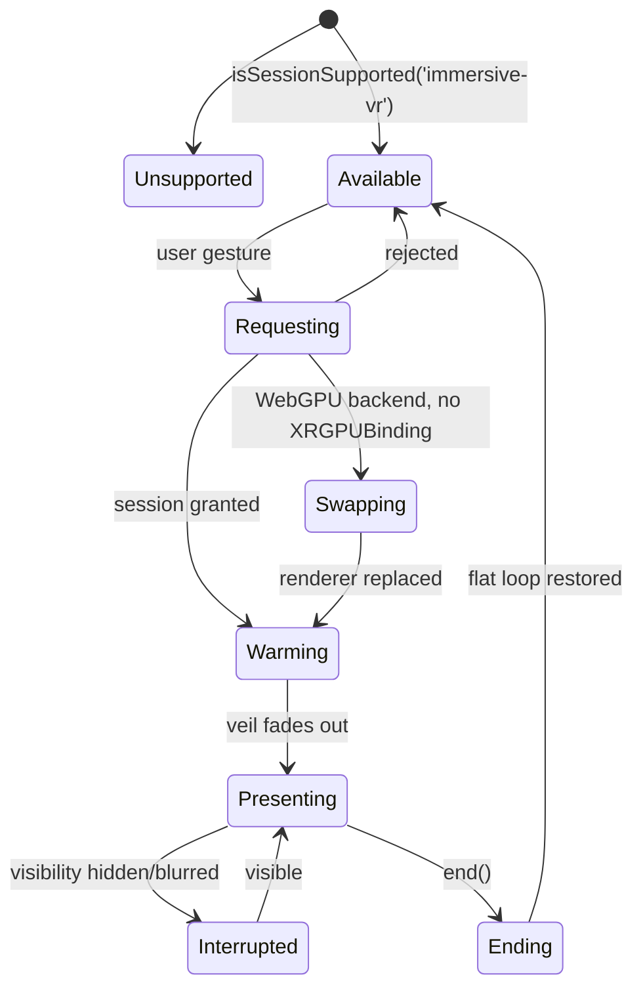

# S11 — Platform, part B: WebXR on Quest 3/3S and Vision Pro

> Wave 1 · v0.1 · 2026-10-18 · continues `11-platform.md` (C13 types, budgets, `RendererHost`, governor are defined there). Covers R-PLAT-02 and the XR half of R-PLAT-05, plus the platform side of D-20 for XR. Checklist items P-22 to P-27.

## 1. Scope

XR runs `immersive-vr` only. Quest 3/3S uses `WebGPURenderer` on its WebGL2 backend with multiview; Vision Pro (visionOS 26.2+) uses native WebGPU XR with the WebGL2 fallback. Every session starts from a user gesture. XR input is routed by `XRInputSource` identity into C03. Comfort defaults protect new users. Per-mode adaptations are rules here; S06, S07 and S08 implement them in M11b2. Out of scope: passthrough AR, PC VR acceptance, multi-user XR avatars (M12).

## 2. Design

- **Why two paths.** Native WebGPU XR ships only on Vision Pro and is flag-gated on Quest Browser, and r186 renders it without multiview; WebGL2 + multiview + layers is the broadly usable Quest path. The classic `WebGLRenderer` is not used. [F-002, F-005; research/stack-rendering-platform.md §4.1]
- **Window-only XR.** `navigator.xr` and `XRFrame` exist only on the main thread (F-006), so the main thread samples all poses once per XR frame and publishes them to `sim.worker` in a seqlocked SAB block (§4.3). This keeps C01 intact: no per-joint entities.
- **No render worker.** XR entry would force rendering back to the main thread. [D-08]
- **Own locomotion, no IWSDK core.** `@iwsdk/core` pins a three fork; `@iwsdk/locomotor` with WebGPURenderer is `UNVERIFIED`. We implement a small teleport/snap/smooth/vignette module and use IWSDK slide values as defaults. [research/stack-rendering-platform.md §4.4]



## 3. Components

| Module (`packages/engine/src/platform/xr/`) | Responsibility |
|---|---|
| `XrSessionController` | availability, gesture-bound entry, features, swap and re-warm, veil, frame-rate control, interruptions, exit |
| `XrRig` | dolly root + XR camera, physics capsule sync, head-in-geometry fade, seated offset (C04 `mode:'xr'`) |
| `XrInputRouter`, `HandFeatures` | per-frame sampling, identity-keyed source map, C03 binders, gesture features |
| `XrPoseBlock` | SAB block written by main, read by `sim.worker` |
| `XrLocomotion`, `XrComfort` | teleport, snap and smooth turn, quantised velocity, vignette, cockpit horizon lock |
| `XrPanels` | quad/cylinder layers (Quest) or scene panels (Vision Pro), wrist panel, ray picking |
| `XrMediaHost` | cutscene hosts: Quest media layer, Vision Pro `VideoFrameTexture`, texture fallback |
| `HapticsPort` | controller pulses; no-op where unsupported |

```ts
export type XrState = 'unsupported' | 'available' | 'requesting' | 'swapping' | 'warming'
                    | 'presenting' | 'interrupted' | 'ending';
export interface XrSessionController {
  readonly state: XrState;
  readonly headset: 'quest' | 'visionpro' | null;
  /** MUST be called synchronously from a user-activation event handler. Rejects with
   *  XrGestureRequired (without touching navigator.xr) when called outside activation. */
  enter(): Promise<void>;
  exit(): Promise<void>;
  setRefreshHz(hz: number): Promise<boolean>;           // Quest only
  onState(fn: (s: XrState, prev: XrState) => void): () => void;
  readonly session: XRSession | null;
}
```

## 4. Data

### 4.1 Per-headset configuration (values of `XrTierConfig`)

| Field | xr-quest | xr-visionpro |
|---|---|---|
| optionalFeatures | local-floor, bounded-floor, layers, hand-tracking | local-floor, bounded-floor, hand-tracking, webgpu |
| nativeWebGpuXr / multiview | never / true | preferred / false (not supported in r186) |
| framebufferScale (next-entry floor) | 1.0 (0.85) | 1.0 (0.8) |
| foveationDefault | 1.0, user knob 0 to 1 (artefact workaround) | 1.0, honoured only if the API responds |
| refresh | min 72, max 90, cutscene 72, controllable | 90, not controllable from WebXR |
| mediaLayer / renderedLayers | true / true | false / false (scene panels) |
| Render path | `forceWebGL`, `DirectRenderPipeline`, blob shadows | WebGPU, `DirectRenderPipeline`, 1 cascade |

Sources: [research/stack-rendering-platform.md §4.1, §4.2, §4.5; research/gap-cutscene-delivery-playback.md §5]. Framebuffer scale can only be set before a session. Quest starts at 72 Hz and requests 90 when p90 < 9 ms and `supportedFrameRates` includes 90. Vision Pro rate control is `UNVERIFIED` and not assumed.

### 4.2 Comfort settings (embedded in `PlatformSettings.xr`)

```ts
export interface XrComfortSettings {
  v: 1;
  locomotion: 'teleport' | 'smooth';          // default 'teleport'
  turn: 'snap' | 'smooth';                    // default 'snap'
  snapAngleDeg: 30 | 45;                      // default 30 (matches C04 XRRigParams)
  smoothSpeedMps: number;                     // 1..6, default 4
  quantizeVelocity: boolean;                  // stop / walk / run steps, default true
  vignette: 'off' | 'low' | 'medium' | 'high';// default 'medium'; applies only while moving
  comfortAssist: number;                      // 0..1, default 0.5 (scales vignette and acceleration)
  seated: boolean;                            // eye-height offset, default false
  dominantHand: 'left' | 'right';             // default 'right'
  cockpitHorizonLock: boolean;                // default true
  chaseView: 'cockpit' | 'diorama';           // pursuits, default 'cockpit'
  arenaScale: 'tabletop' | 'life-size';       // fighter, default 'tabletop'
  handsEnabled: boolean;                      // request hand-tracking, default true
  uiDistanceM: number;                        // 0.8..2.0, default 1.2
  reduceMotion: boolean;                      // from global reduced-motion; vignette >= low, no head bob
}
```
Defaults follow Meta guidance (teleport and snap turn for new users, vignette only while moving, quantised velocity; IWSDK slide defaults: comfort assist 0.4 to 0.6, max speed 4 to 6 m/s). The 30° snap step, 1.2 m UI distance and fade timings are S11 starting values. [research/stack-rendering-platform.md §4.4; research/gamedesign-decomposition.md §6]

### 4.3 `XrPoseBlock` (one `SharedArrayBuffer`, `Float32Array` view plus `Int32Array` header)

| Offset | Content |
|---|---|
| Int32[0] | seqlock counter (odd while writing); reader retries on odd or changed value |
| Int32[1..3] | frameId, flags (bit0 presenting, bit1 handsActive), predicted display time ms |
| Float32 head | pos3, quat4, ipd |
| 4 source slots (controller L, R, transient 0, 1) | present, grip pose 7, aim pose 7, buttons[8], axes[4] (27 floats) |
| 2 hands | present, 25 joints × (pos3, quat4, radius) (201 floats) |

About 520 floats (2.1 KB). Without isolation the same struct is sent by `postMessage` once per frame. Slot index is a storage position only; identity is `lifetimeId`.

### 4.4 Input and panel interfaces

```ts
export type XrSourceKind = 'controller' | 'hand' | 'transient-pointer';
export interface XrSourceState {
  readonly source: XRInputSource;             // map key; never an array index
  kind: XrSourceKind; handedness: 'left' | 'right' | 'none';
  lifetimeId: number; profiles: readonly string[];
}
export interface XrInputRouter {
  attach(session: XRSession, space: XRReferenceSpace): void;
  detach(): void;
  /** Once per XR frame, inside the frame callback, before the main-thread input phase.
   *  S01's three XR Binders read this per-frame cache in poll(). */
  sample(frame: XRFrame, out: XrPoseBlock): void;
  sources(): ReadonlyMap<XRInputSource, XrSourceState>;
}
export interface XrPanel {
  id: string; sizeM: { w: number; h: number }; pixels: { w: number; h: number };
  anchor: 'world' | 'wrist' | 'lazy-follow';          // head-locked is forbidden
  draw(ctx: CanvasRenderingContext2D, tSec: number): void;
  onRay(hit: { u: number; v: number } | null, pressed: boolean, hand: 'left' | 'right'): void;
}
export interface XrMediaHost {
  readonly kind: 'xr-media-layer' | 'xr-texture' | 'webcodecs-texture';
  prepare(clip: PreparedClip): Promise<void>;
  start(): Promise<void>; stop(): void;
  setSubtitle(text: string | null): void;
}
```
`PreparedClip` comes from C09 (06 v0.95 sketch). `Binder`, `DeviceKind`, `ControlId` and `RawInputState` come from S01's C03 (`01-engine-contracts.md`).

## 5. Runtime behavior

### 5.1 Entry (P-23, P-24)

Before any gesture, once `isSessionSupported('immersive-vr')` is true ("XR armed"): first-gesture unlock has run (audio context, video pool); the cinema scene and XR pipeline seed are prepared; framebuffer scale and foveation are set on `renderer.xr` (scale cannot change after the session starts). The "Enter VR" control only appears when armed.

On the click handler, in this order and with nothing awaited before the first call:
1. `navigator.xr.requestSession('immersive-vr', { optionalFeatures })`. Quest omits `'webgpu'`; Vision Pro includes it. The hand-tracking permission prompt on Vision Pro appears here; a denial leaves gaze-and-pinch only. [webkit.org/blog/15865]
2. `await renderer.xr.setSession(session)`. On Vision Pro, if `XRGPUBinding` is missing, the installed `setupWebGLXRFallback` builds a `forceWebGL` renderer, copies the XR settings and loop, and calls `onFallback(next, prev)`; `RendererHost` then calls every registered `GpuResourceOwner.onRendererReplaced`, swaps the canvas, and the controller moves to `warming`. [S11-F3]
3. Behind a black veil (in-scene sphere on Vision Pro, rendered quad layer on Quest): `setTier(xr tier, 'xr-session')`, `compileAsync` of the XR seed, first 30 frames, then a 300 ms fade-in.
4. Quest: `session.updateTargetFrameRate(72)` if supported; governor promotes to 90.
Failures: `requestSession` rejection returns to `available` with a toast and `xr.session{evt:'error'}`; a failed `setSession` after fallback ends the session. Entry never starts from timers, benchmark callbacks or deep links.

### 5.2 Frame loop and pause rules

`renderer.setAnimationLoop` drives XR on the main thread. Each XR frame runs `XrInputRouter.sample` first (pose block written), then the usual main-thread phases and the C02 `FrameSignal` hand-off to `sim.worker`, which reads poses through `SimServices.xrPoses`. The FramePacer is bypassed. Distant animation runs at `distantAnimHz` (30) per Meta guidance. On `visibilitychange` of the session to `hidden` or `visible-blurred` (event semantics `UNVERIFIED`), the sim pauses, audio ducks, and the state becomes `interrupted` until visible again. Exit restores the rAF loop, returns to the flat tier at the next safe point and keeps the replaced renderer (no swap back).

### 5.3 Locomotion and comfort (P-25)

| Context | Rule |
|---|---|
| On foot, default | Teleport: arc from the dominant hand (or pinch-ray on hands), destination valid when the ground ray hits a surface within S01's `maxSlopeDeg` and a capsule fits; range 10 m; blink fade ≤ 200 ms; optional `teleportNodes` from the chunk for stairs and steep SF hills. Turning: snap by `snapAngleDeg` on thumbstick flick. |
| On foot, smooth (opt-in) | Stick locomotion at `smoothSpeedMps` (cap 6), velocity quantised to stop/walk/run, acceleration scaled by `comfortAssist`. |
| Vignette | `strength = clamp(0.6·|v|/vmax + 0.4·|ω|/ωmax, 0, 1) × comfortAssist × tierScale`; fade-in 150 ms, fade-out 300 ms after stopping; only while moving. Constants are starting values. |
| Head in geometry | Fade to black and duck audio; never push the player. |
| Driving | Seated cockpit; the vehicle is the rest frame; horizon locked when `cockpitHorizonLock`; vignette proportional to yaw rate; no camera shake or FOV effects; pursuits may use the `diorama` chase view. |
| Culture Wars | Fixed arena, `tabletop` or `life-size`; no artificial locomotion. Vision Pro is hands-only, no gaze-only play. |
| Tycoon | Desk scene with world-locked panels; point with trigger or pinch. |
| Menus | Panels at `uiDistanceM`, world-locked or lazy-follow with dead zone; wrist panel on the non-dominant wrist for Phone and Pause. Head-locked UI is forbidden. |

Camera effects that move the player's view (shake, bob, forced FOV, scripted camera) are disabled in XR; the C04 `xr` mode must expose only the dolly. [research/stack-rendering-platform.md §4.4]

### 5.4 Input routing (P-26)

1. A `Map<XRInputSource, XrSourceState>` is rebuilt from `inputsourceschange`; `select`, `squeeze` and their start/end events are resolved with `event.inputSource`. Indices `inputSources[0|1]` are never used.
2. Classification: `source.hand` → hand; `targetRayMode === 'tracked-pointer'` with a gamepad → controller; `'transient-pointer'` → transient pointer.
3. **Controllers** use the `xr-standard` mapping (buttons[0] trigger, [1] squeeze, [2] touchpad, [3] thumbstick press, axes[2..3] thumbstick). Face buttons are looked up from `config/xr-input-profiles.json` by `source.profiles`; Quest indices are `UNVERIFIED`, so entries start `null` and the M01c/M11b device pass records them. Unknown face buttons fall back to chords on trigger and squeeze. Haptics via `gamepad.hapticActuators`.
4. **Hands**: 25 joints per hand via the frame API into the pose block; `HandFeatures` computes pinch strength, grab, palm-up, wrist velocity. Initial thresholds in `config/xr-gestures.json` (pinch engage < 0.02 m, release > 0.035 m with hysteresis; punch by wrist speed); the rest are tuned on devices in M11b2.
5. **Vision Pro transient pointer**: the input array is empty until a pinch, so no hover state exists; UI targets must work without hover. Held objects attach to `gripSpace`, rays use `targetRaySpace`. With hand-tracking granted, hand sources come first and transient sources follow; routing by identity handles both.
6. S01's `DeviceKind`s `xr-controller`, `xr-hand`, `xr-transient` are thin `Binder`s over the router cache; control ids follow S01's scheme (`xr:left:b0`, `xr:right:a1`, `xr:left:gesture:punch`, `xrt:pinch`). Last-used device is active; controllers win while held. Action mapping follows [research/gamedesign-decomposition.md §6].

### 5.5 XR UI (P-27)

Quest (WebGL path): `renderer.xr.createQuadLayer` / `createCylinderLayer` with a `rendercall` that blits the panel canvas gives crisp text; the cutscene subtitle layer uses the same call. Vision Pro: textured planes in the scene (`CanvasTexture`), because composition layers on WebGPU XR are experimental. Panels draw with Canvas 2D through a shared `UiSurface` from S10 (DN-S11-03). Minimum text size starts at 1.5° of visual angle and is tuned on device. [research/stack-rendering-platform.md §4.4; S11-F4]

### 5.6 Cutscenes in XR (P-22, D-20)

All XR cutscene presentation pauses the city: render only the cinema scene (dimmed sky, screen, subtitle plane, floor); no passthrough; skippable by controller button or pinch; screen world-locked, about 2.4 m wide at 3 m (≈ 44° horizontal), centred at seated eye height; 300 ms fades. [research/gap-cutscene-delivery-playback.md §5]
- **Quest:** `new XRMediaBinding(session).createQuadLayer(video, { space: localFloor, transform, width: 2.4, height: 2.4·h/w })`, appended after the projection layer in `session.renderState.layers` so it composites in front; controllers and hands hidden; refresh 72 Hz (3 × 24), previous rate restored at the end. Video elements are created and unlocked before `requestSession` (elements created during a session have been reported to freeze). Fallback when `layers` is not granted: `VideoTexture` with `needsUpdate` also set when `currentTime` advanced since the last XR frame.
- **Vision Pro:** `VideoDecoder` → `VideoFrameTexture` on a world-locked plane (mp4box vendored, S01/S03), every `VideoFrame` closed after upload; fallback `VideoTexture` from a pre-unlocked element. Rate control unavailable.
- Both: failures F1 to F10 and A/V sync rules belong to S03's `CutscenePlayer` (see gap report §7.3, §7.6); this module supplies only the hosts and the mode switch.

## 6. Platform notes

| | Quest 3 / 3S | Vision Pro |
|---|---|---|
| Browser, OS | Quest Browser (152.1 current on 2026-10-18) | Safari, visionOS 26.2+ (Q-10) |
| Pixels, memory | 2064×2208 per eye (3S 1832×1920), 8 GB | 23 M pixels, 16 GB |
| Backend | WebGL2, multiview, foveation | native WebGPU, MSAA, 2 passes |
| Primary input | controllers; hands optional | gaze + pinch; hands with permission |
| Rate | 72, up to 90 | 90 to 100, not controllable (`UNVERIFIED`) |
| UI | rendered quad/cylinder layers | scene panels |
| Cutscene | media layer | WebCodecs texture |
| Haptics | controller actuators | none |

## 7. Verified facts used

F-002, F-003, F-005, F-006, F-013, F-062 (see part A §7). Additional rows (checked 2026-10-18):

| Fact | Source |
|---|---|
| Vision Pro default input is `transient-pointer`; array empty until pinch; attach held objects to `gripSpace`; hand-tracking inputs come first, transient after | webkit.org/blog/15162 · [research/stack-rendering-platform.md §4.3] |
| Safari 18.0: `immersive-vr` on visionOS 2, `transient-pointer`, hand tracking with permission prompt | webkit.org/blog/15865 |
| Quest Browser (BCD): XRHand 15.1, XRProjectionLayer 16.1, OVR_multiview2 17.0, `updateTargetFrameRate` 31.2, `fixedFoveation` 8.0; XR media layers from 16.1, Chromium only | BCD 8.1.6 · gap-cutscene §5.1 |
| Meta: teleport and snap turn default, vignette while moving, quantised velocity; IWSDK comfort assist 0.4 to 0.6, 4 to 6 m/s | developers.meta.com/horizon/design/locomotion-best-practices · .../iwsdk-concept-locomotion-slide |
| Meta: update animations at 30 Hz while rendering 90; shadow passes count against budget; KTX2 recommended | developers.meta.com/horizon/documentation/web/webxr-perf-bp |
| WebXR `xr-standard` gamepad mapping and 25-joint hand input | w3.org/TR/webxr-gamepads-module-1, /webxr-hand-input-1 · gamedesign §6 |
| S11-F4: r186 `XRManager` has `setFoveation`, `setFramebufferScaleFactor`, `createQuadLayer(width, height, translation, quaternion, pixelwidth, pixelheight, rendercall, attributes)`, `createCylinderLayer(...)`; WebGPU XR disables multiview with a warning | unpkg.com/three@0.186.1/src/renderers/common/XRManager.js |

## 9. Tests

All run through `pnpm check:e2e:xr` (project `xr-quest3`, IWER 2.6.0 installed before the renderer with `installRuntime({ forceInstall: true })`) unless stated. [F-062]
1. `xr-session.spec.ts @xr` — tier `xr-quest`: `enterForTest()` (QA builds only) → `renderer.xr.isPresenting`, ≥ 10 XR frames, backend `webgl2`, `onRendererReplaced` not called.
2. `xr-swap.spec.ts @xr` — `?tier=xr-visionpro&gpu=1` on `chromium-webgpu`: the WebGPU renderer is replaced once, owners are re-registered, ≥ 10 frames after the swap.
3. `xr-gesture.spec.ts` (unit, production build) — `enter()` outside user activation rejects with `XrGestureRequired` and never calls `navigator.xr.requestSession`.
4. `xr-input-routing.spec.ts` — recorded `ActionPlayer` input for trigger, thumbstick and pinch yields the C03 actions; reversing `inputSources` order yields identical actions.
5. `xr-comfort.spec.ts` — defaults are teleport + snap 30°; vignette > 0 while smooth-moving and 0 within 0.5 s of stopping; `reduceMotion` forces vignette ≥ low.
6. `xr-pose-block.spec.ts` — seqlock never yields a torn read under a concurrent writer (worker).
7. `check:perf` — the Quest cube/city scene CPU-side counts ≤ `xr-quest` budget; Vision Pro counts checked flat per pass against the per-pass budget.
8. Device (manual, scripted checklists `tools/ci/checklists/M11b-quest.json`, `M11b-visionpro.json`): enters and exits cleanly; `isPresenting`; refresh 72/90 (Quest); p50 and p95 inside §4.5 acceptance; comfort defaults on first entry; cutscene host plays one 15 s clip with subtitles; Quest face-button indices captured; Vision Pro hand-tracking prompt accepted and denied paths.

## 10. Open questions

Q-10 device floor applies. See part A §10 for UNVERIFIED items (Vision Pro rates and framebuffer, `immersive-ar`, PS VR2, Quest indices and flags, session visibility events). Decision DN-S11-03 (XR UI technique) and DN-S11-06 (PC VR level) are listed there.
