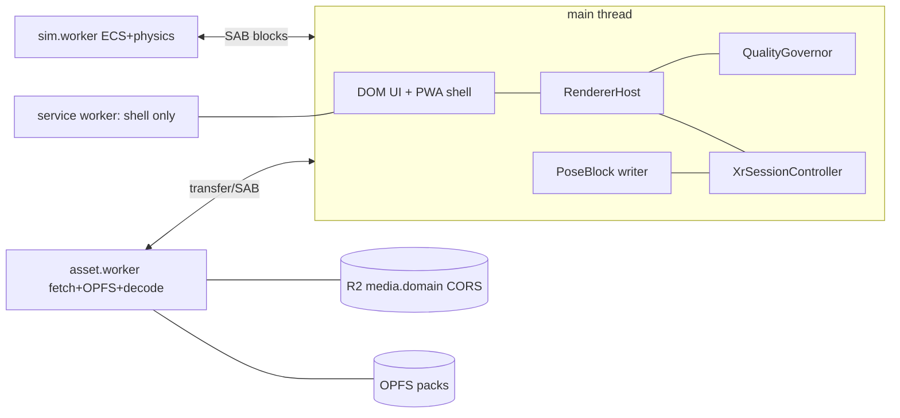

# S11 — Platform, Performance, XR & PWA (part A: core, C13)

> Wave 1 · v0.1 · 2026-10-18 · author: s11-platform · shared context 06 v1.1 (frozen) · decisions spec/03 v1 · C13 **1.1.0** (1.1 additions: `11-platform-pwa.md` §11)
> Parts: A `11-platform.md` (this file: scope, checklist, C13, budgets, renderer, detection, governor, milestones) · B `11-platform-xr.md` (XR session, comfort, input, XR cutscene hosts) · C `11-platform-pwa.md` (headers, manifest, service worker, OPFS cache, iOS quirks, telemetry client, WASM policy) · D `11-platform-perf.md` (perf harness, Playwright projects, device matrix, checklists).
> Section numbers follow 03-SPEC-TEMPLATE §B; parts B, C and D reuse §3–§9 for their own topics and carry their own fact rows. All unverified items are collected in §10 of this file.

## 1. Scope and R-IDs

**Covered R-IDs.**

| R-ID | How this domain serves it | Where |
|---|---|---|
| R-PLAT-01 | Workers-served installable PWA; iPhone first; shell-only precache; OPFS world cache; header set | Part C |
| R-PLAT-02 | Full XR port: session lifecycle, renderer swap, locomotion and comfort, controller/hand/transient input, XR UI, per-mode XR rules | Part B |
| R-PLAT-03 | One `WebGPURenderer`, TSL-only, WebGL2 guaranteed, WebGPU enabled per tier by policy, WASM policy, tier auto-detect | §4–§5, Part C |
| R-PLAT-05 | Frame targets per tier (60 iPhone `mobile`, 30 `mobile-low`, 72/90 Quest 3) as budgets, governor and device tests | §4.5, §5.5, §9 |
| R-ENG-02 | Budgets as numbers in `config/tier-budgets.json`, checked by `check:perf` (CPU-side) and `perf:verify` (device JSON) | §4.5, §9 |

Secondary (supplied, owned elsewhere): R-ENG-04 (XR comfort options, reduced-motion hook), R-UI-02 (`PlatformSettings` schema, §4.6).

**Contracts.** Owns **C13** (final TypeScript in §4; consumers S01, S02, S05, plus S10 settings, S09 telemetry). Honors **C01** (platform code holds no `EntityId`; XR poses travel in a singleton typed-array block, Part B §4) and **C07** (variants resolved through `VARIANT_FALLBACK`; pack hashes verified on write). Consumes C02, C03, C04, C05, C16 (frozen in 06 v1.0) and the C08 sketch (06 v1.0 §4.4); assumptions are in §10.

**Out of scope for v1:** native apps (constraint 1); render worker (XR is Window-only) [D-08]; React Three Fiber [D-11]; `immersive-ar` passthrough (visionOS support `UNVERIFIED`; post-M11b); PC VR and Quest Link as accepted targets (best effort on the `xr-quest` profile); Android XR, Pico; iPhone 120 Hz; Web Push.

### Expanded checklist (34 items; each is designed, deferred to a milestone, or out of scope)

| # | Item | Status | R-ID |
|---|---|---|---|
| P-01 | Renderer init, `xr.enabled` before `init()`, WebGL2 fallback, `?gl=1` | Designed §5.1 · M01c | R-PLAT-03 |
| P-02 | Backend policy per tier; mobile WebGPU gated by device spike | Designed §4.3 · gate M01c | R-PLAT-03 |
| P-03 | TSL-only materials; GLSL lint rule | Designed §2 · lint M00 | R-PLAT-03 |
| P-04 | Post-processing and shadow policy per tier | Designed §4.4 | R-PLAT-03 |
| P-05 | Render-object budgeting (`BundleGroup` per chunk, instancing) | Designed §4.4 · consumer M02b | R-ENG-02 |
| P-06 | C13 TypeScript v1.0.0 | Designed §4 | R-ENG-02 |
| P-07 | Numeric budgets per tier in `config/tier-budgets.json` | Designed §4.5 | R-ENG-02 R-PLAT-05 |
| P-08 | Device detection (pure function, device fixtures) | Designed §5.2 · M01c | R-PLAT-03 |
| P-09 | Tier selection: benchmark, ladder, persistence, overrides | Designed §5.3 · M01c | R-PLAT-05 |
| P-10 | Runtime governor | Designed §5.5 · M11a | R-PLAT-05 |
| P-11 | `MemoryBudget` self-accounting, 85 %/95 % actions | Designed §5.6 · M11a | R-ENG-02 |
| P-12 | Frame pacing: 30/60 render with 60 Hz sim; iOS 60 Hz plan; XR rates | Designed §5.4 | R-PLAT-05 |
| P-13 | Warm-up and reveal gate | Designed §5.7 · M02b | R-PLAT-05 |
| P-14 | `onDeviceLost` and uncaptured-error recovery | Designed §5.8 · M01c | R-PLAT-01 |
| P-15 | Thread topology, SAB bridge and fallback | Designed §2, §5.9 | R-PLAT-03 |
| P-16 | COOP/COEP/CORP, `/account/*`, CORS media | Part C §2 · M00 | R-PLAT-01 |
| P-17 | WASM policy | Part C §8 | R-PLAT-03 |
| P-18 | PWA manifest and install UX | Part C §3 · M00, M04a | R-PLAT-01 |
| P-19 | Service worker, safe-point updates | Part C §4 · M00 | R-PLAT-01 |
| P-20 | OPFS world-pack store, fetch layer, storage UI | Part C §5 · M01e | R-PLAT-01 |
| P-21 | iOS quirks and lifecycle | Part C §6 · M01c, M11a | R-PLAT-01 |
| P-22 | Cutscene playback, platform side (D-20) | Part C §7 · Part B §5.6 · M04c cutscene spike | R-CUT-03 support |
| P-23 | XR session lifecycle, gesture rule, renderer swap and re-warm | Part B §5.1 · M11b1 | R-PLAT-02 |
| P-24 | XR render config per headset | Part B §4.1 | R-PLAT-02 R-PLAT-05 |
| P-25 | XR locomotion and comfort, per-mode rules | Part B §5.3 · M11b | R-PLAT-02 |
| P-26 | XR input routing to C03 | Part B §5.4 · M11b1 | R-PLAT-02 |
| P-27 | XR UI surfaces | Part B §5.5 · M11b1 | R-PLAT-02 |
| P-28 | Crash and telemetry client | Part C §9 · M01c | R-ENG-02 |
| P-29 | Perf harness | Part D · M01c, M11a | R-ENG-02 |
| P-30 | Playwright projects and QA flags (IWER) | Part D · M00 | R-ENG-02 R-PLAT-02 |
| P-31 | Device matrix and checklists | Part D | R-PLAT-05 |
| P-32 | Boot budgets | Designed §4.5 · M11a | R-PLAT-05 |
| P-33 | `PlatformSettings` schema | Designed §4.6 · UI M04a | R-UI-02 |
| P-34 | Out of scope list (above) | Out of scope | — |

## 2. Design

**Renderer.** One `WebGPURenderer` from `three@0.186.1` on every tier, one TSL material set, no GLSL anywhere in `packages/engine` (lint rule `no-glsl-in-engine`: rejects `ShaderMaterial`, `RawShaderMaterial`, `onBeforeCompile`, template strings containing `gl_Position`). The backend is chosen per tier by `BackendPolicy` (§4.3). WebGL2 is the guaranteed path: it is the automatic fallback of the same renderer and is forced on Quest. [D-07; research/stack-rendering-platform.md §1.2, §4.1]

**Cost model.** The binding cost is CPU time per render object (three.js #30560, open), so budgets are in render objects; `BundleGroup` gives no gain on the WebGL backend, so budgets assume none. [F-007; research/stack-rendering-platform.md §1.5]

**Threads.** Render, XR and DOM stay on the main thread. `sim.worker` owns ECS and physics, `asset.worker` owns fetch, OPFS and decode. Steady-state IPC is SharedArrayBuffer blocks under cross-origin isolation, with a degraded postMessage transport if isolation is missing (decision DN-S11-02). [D-08, F-006]

**Tiers.** Six flat ids (C13). Flat tiers form a step-down ladder; XR tiers are entered by session and use a flat tier outside it. Dynamic quality inside a tier is the governor's job.

**Rejected.** Classic `WebGLRenderer` for XR (no TSL) · render worker in v1 (XR needs Window) · `postprocessing`/`n8ao` (WebGL-only; F-008) · IWSDK core (pins a three fork) · UA-only tiering (Safari hides model and memory; the benchmark decides).



## 3. Components

All paths follow spec/03 A-01. `packages/shared/src/platform/` holds C13 types and constants (importable by `tools/*`); `packages/engine/src/platform/` holds runtime modules; `apps/web` holds PWA shell code.

| Module | Path | Responsibility |
|---|---|---|
| C13 types, `VARIANT_FALLBACK`, loader for `config/tier-budgets.json` | `packages/shared/src/platform/` | contract |
| `classifyDevice`, `DeviceProbe` | `engine/src/platform/device-probe.ts` | signals to `DeviceProfile` |
| `TierSelector`, `Benchmark`, `BenchmarkScene` | `engine/src/platform/tier-select.ts` | provisional tier, 3 s benchmark, persistence |
| `RendererHost` | `engine/src/platform/renderer-host.ts` | create, init, fallback, recover, XR swap |
| `QualityGovernor`, `FramePacer` | `engine/src/platform/governor.ts` | dynamic quality, frame skipping |
| `MemoryBudget` | `engine/src/platform/memory-budget.ts` | accounting and pressure events |
| `PerfProbe`, `PerfHud`, `PerfScenarioRunner`, `RenderBudgetMeter` | `engine/src/platform/perf/` | metrics, `?perf=1`, bridge export |
| `FirstGestureUnlock`, `LifecycleController` | `engine/src/platform/lifecycle.ts` | AudioContext, video pool, visibility, save-on-hide |
| `XrSessionController`, `XrInputRouter`, `XrLocomotion`, `XrPanels` | `engine/src/platform/xr/` | Part B |
| `Telemetry`, `Heartbeat` | `engine/src/platform/telemetry/` | Part C §9 |
| `WorldPackStore`, asset fetch layer | `engine/src/assets/store/` | Part C §5 |
| PWA config, `sw.ts`, update controller | `apps/web/` | Part C |

Facade handed to S01 at boot:

```ts
export interface Platform {
  quality: QualityService;
  host: RendererHost;
  governor: QualityGovernor;
  memory: MemoryBudget;
  perf: PerfProbe;
  xr: XrSessionController;
  lifecycle: LifecycleController;
  unlock: FirstGestureUnlock;
  telemetry: Telemetry;
  packs: WorldPackStore;
}
export function createPlatform(opts: { canvas: HTMLCanvasElement; qa: QaFlags }): Promise<Platform>;
```

## 4. Data — contract C13 v1.1.0

### 4.1 Identifiers, ladders, variant resolution

```ts
// packages/shared/src/platform/c13.ts
export const C13_VERSION = '1.1.0' as const;            // semver; 1.1 additions: 11-platform-pwa.md §11

export type QualityTierId =
  | 'desktop-ultra' | 'desktop' | 'mobile' | 'mobile-low' | 'xr-quest' | 'xr-visionpro';
export type TierFamily = 'desktop' | 'mobile' | 'xr';
export type RenderBackend = 'webgpu' | 'webgl2';
export type DeviceClass = 'desktop' | 'iphone' | 'ipad' | 'android' | 'quest' | 'avp' | 'unknown'; // = C16 envelope
export type DisplayMode = 'tab' | 'standalone' | 'xr';

/** Flat step-down ladder, best first. XR tiers are never on it. */
export const FLAT_LADDER = ['desktop-ultra', 'desktop', 'mobile', 'mobile-low'] as const;

/** C07 variant resolution: first id present in AssetManifest.variants wins. check:assets fails
 *  if any chain resolves to nothing for any of the six tiers. */
export const VARIANT_FALLBACK: Readonly<Record<QualityTierId, readonly QualityTierId[]>> = {
  'desktop-ultra': ['desktop-ultra', 'desktop', 'mobile', 'mobile-low'],
  'desktop':       ['desktop', 'mobile', 'mobile-low'],
  'mobile':        ['mobile', 'mobile-low'],
  'mobile-low':    ['mobile-low'],
  'xr-quest':      ['xr-quest', 'mobile', 'mobile-low'],
  'xr-visionpro':  ['xr-visionpro', 'desktop', 'mobile', 'mobile-low'],
};
/** Tier used outside an XR session on an XR-capable device (menus, lobby). */
export const FLAT_TIER_OF: Readonly<Partial<Record<QualityTierId, QualityTierId>>> =
  { 'xr-quest': 'mobile-low', 'xr-visionpro': 'mobile' };
```
KTX2 is transcoded at load (ASTC, ETC2 or BC7), so a variant is a resolution class, not a GPU format. [research/stack-rendering-platform.md §1.6]

### 4.2 Budgets, features, dynamic range, tier

```ts
export interface FrameTargets {
  targetFps: number;            // sustained goal; frameBudgetMs = 1000 / targetFps
  maxFps: number;               // pacer cap
  minFps: number;               // governor floor before tier step-down
  frameBudgetMs: number;
  promoteWhenP90MsBelow?: number; // XR: raise refresh/targetFps when p90 under this
}
export interface RenderLimits {  // per view-pass; XR totals = value x viewPasses
  maxRenderObjects: number;     // visible render items incl. shadow-casting passes (RenderBudgetMeter)
  maxGpuDrawCmds: number;       // renderer.info.render.drawCalls
  maxTriangles: number;         // renderer.info.render.triangles
  maxPixelsMP: number | null;   // internal resolution cap, flat tiers
  dprCap: number | null;
  viewPasses: 1 | 2;            // 2 = XR without multiview (Vision Pro)
}
export interface MemoryLimits {   // accounted bytes (MemoryBudget), not process RSS
  maxTextureMB: number;
  maxGpuResourceMB: number;       // renderer.info.memory.total
  maxAccountedHeapMB: number;     // typed arrays + wasm memories + caches
  maxWebContentMB: number | null; // iOS: ceiling we stay under; kill observed at 2,048
  maxMediaMB: number;
  softPct: 85; hardPct: 95;
}
export type FarFieldMode =
  | { kind: 'impostor-ring'; km: 80 }
  | { kind: 'skyline-cards'; km: 10 | 20 };
export interface WorldLimits {
  streamingRadiusM: number;
  alwaysVisibleRadiusM: number | null;
  buildingDrawDistanceM: number;
  altitudeBoostM: number;
  farField: FarFieldMode;
  maxChunkUploadsPerFrame: 1;
  maxChunkUploadBytes: number | null;     // per frame
  maxRenderObjectsPerChunk: 6;
}
export interface CrowdLimits { maxTrafficInstances: number; maxPedInstances: number }
export interface SimLimits { simHz: 60; aiHz: 30 /* fixed on every tier by C02 AI_DIVISOR (cross-tier ambient determinism) */; physicsRadiusM: number; distantAnimHz: 30 | 60 }
export interface BootLimits { warmBootToPlayableS: number; coldBootDownloadMB: number }
export interface TierBudget {
  frame: FrameTargets; render: RenderLimits; memory: MemoryLimits;
  world: WorldLimits; crowd: CrowdLimits; sim: SimLimits; boot: BootLimits;
}

export type ShadowMode = 'csm3' | 'csm1' | 'blob';
export type PostNode = 'gtao-half' | 'bloom' | 'smaa' | 'traa' | 'fxaa' | 'fsr1' | 'tonemap';
export interface TierFeatures {
  shadows: { mode: ShadowMode; mapSize: 0 | 1024 | 2048 | 4096; distanceM: number };
  post: readonly PostNode[];             // always on at the tier
  optionalPost: readonly PostNode[];     // governor may enable when headroom exists
  pipeline: 'render-pipeline' | 'direct';// 'direct' = DirectRenderPipeline (XR)
  lighting: 'clustered' | 'probe-grid';  // probe-grid + emissive lamps, no per-lamp lights
  sky: 'keyframe-dome' | 'keyframe-dome+atmosphere';
  hdrOutput: boolean;                    // HalfFloat vs UnsignedByte outputBufferType
  msaaSamples: 0 | 4;
}

export interface BackendPolicy {
  preferred: RenderBackend;
  forceWebGl: boolean;                   // WebGPURenderer({ forceWebGL: true })
  requireRealAdapter: boolean;           // reject adapter.info.isFallbackAdapter
  gate: 'stable' | 'device-spike-gated'; // gated: config/platform-flags.json decides
}

export interface DynamicQuality {        // governor state; every field has a floor and a ceiling
  renderScale: number;                   // 0.5..1.0 of the tier pixel budget
  shadowDistanceScale: number;
  buildingDistanceScale: number;
  lodBias: number;                       // 0 = nominal, + = coarser
  crowdDensity: number;                  // 0..1 of CrowdLimits
  postLevel: 0 | 1 | 2 | 3;              // 3 = all of features.post + optionalPost
  atmosphereLevel: 0 | 1 | 2;
  textureMipBias: number;                // 0..2
  foveation: number | null;              // XR only, 0..1
  targetFps: number;
}
export interface DynamicRange { floor: DynamicQuality; ceil: DynamicQuality }

export interface XrTierConfig {          // Part B §4
  headset: 'quest' | 'visionpro';
  sessionMode: 'immersive-vr';
  optionalFeatures: readonly ('local-floor' | 'bounded-floor' | 'layers' | 'hand-tracking' | 'webgpu')[];
  nativeWebGpuXr: 'never' | 'preferred';
  multiview: boolean;
  framebufferScale: number;              // fixed per session
  framebufferScaleNextEntryFloor: number;
  foveationDefault: number;
  refresh: { minHz: number; maxHz: number | null; cutsceneHz: number | null; controllable: boolean };
  mediaLayer: boolean;                   // XRMediaBinding path
  renderedLayers: boolean;               // quad/cylinder layers for UI
}

export interface QualityTier {
  id: QualityTierId; family: TierFamily;
  budget: TierBudget; features: TierFeatures; backend: BackendPolicy;
  dynamic: DynamicRange; xr: XrTierConfig | null;
}
```

Consumer-facing service (everything S01, S02 and S05 call):

```ts
export interface QualityService {
  readonly tier: QualityTier;
  readonly dynamic: Readonly<DynamicQuality>;
  readonly backend: RenderBackend;               // what actually initialised
  readonly profile: DeviceProfile;
  budgetOf(id?: QualityTierId): TierBudget;
  assetVariant(available: readonly QualityTierId[]): QualityTierId; // VARIANT_FALLBACK
  /** Only honoured at a safe point (loading boundary, menu, XR veil). Returns when applied. */
  setTier(id: QualityTierId, reason: TierDecisionSource): Promise<void>;
  onTierChange(fn: (next: QualityTier, prev: QualityTier) => void): () => void;
  onDynamicChange(fn: (q: Readonly<DynamicQuality>) => void): () => void;
  onMemoryPressure(fn: (level: 'soft' | 'hard') => void): () => void;
}
```

### 4.3 Backend policy (WebGPU only where research confirms stability)

| Tier | preferred | forceWebGl | gate | Evidence and rule |
|---|---|---|---|---|
| desktop-ultra | webgpu | false | stable | Chrome 113+ and Safari 26 ship WebGPU; needs a real adapter, else the tier demotes to `desktop` [research/stack-rendering-platform.md §2] |
| desktop | webgpu | false | stable | automatic WebGL2 fallback in the same renderer [F-002] |
| mobile, mobile-low | webgl2 until M01c passes, then webgpu | false | **device-spike-gated** | Safari 26 ships WebGPU on iOS [F-004], but Home Screen parity and GPU-process limits are `UNVERIFIED` [F-009, F-012]. `config/platform-flags.json` key `webgpu.mobile` flips to `true` only after the M01c iPhone run passes (30 min, no jetsam, p90 inside budget); re-validated in M11a. |
| xr-quest | webgl2 | **true** | stable | native WebGPU XR is flag-gated on Quest Browser [F-005]; WebGL2 backend gives multiview and layers |
| xr-visionpro | webgpu | false | stable | native WebGPU XR ships in Safari 26.2; fallback via `setupWebGLXRFallback` [F-003, F-005] |

Overrides: `?gl=1` and the Settings toggle "Compatibility mode" force WebGL2 on any tier; `?gpu=1` (QA builds) forces WebGPU for device spikes. Backend, adapter summary and tier go to telemetry at every boot.

### 4.4 Feature policy per tier (post, shadows, lighting)

| | desktop-ultra | desktop | mobile | mobile-low | xr-quest | xr-visionpro |
|---|---|---|---|---|---|---|
| Shadows | csm3, 4096², 2,000 m | csm3, 2048², 1,650 m | csm1, 1024², 150 m | blob | blob | csm1, 2048², 200 m |
| Post (always) | gtao-half, bloom, traa, tonemap | gtao-half, bloom, smaa, tonemap | fxaa, tonemap | tonemap | tonemap in material | tonemap in material |
| Optional post | fsr1 | traa | bloom | none | none | none |
| Pipeline | render-pipeline | render-pipeline | render-pipeline | render-pipeline | direct | direct |
| Lighting | clustered | clustered | probe-grid | probe-grid | probe-grid | probe-grid |
| Sky | dome + atmosphere adapter | dome | dome | dome | dome | dome |
| HDR output | yes | yes | no | no | no | no |
| MSAA | 4 | 0 | 0 | 0 | 4 (tune M11b) | 4 |

Sources: [research/stack-rendering-platform.md §1.4, §1.5, §1.8, Performance budgets]; `ClusteredLighting` is desktop-only there. takram atmosphere only at `desktop-ultra` behind a removable adapter (r186 compatibility `UNVERIFIED`). Ultra shadow size and the MSAA values are S11 choices to calibrate (M11a, M11b). Chunk rule for S02: one `BundleGroup` per streamed chunk, `static = true` on baked meshes, `InstancedMesh`/`BatchedMesh` for repeated props, ≤ 6 render objects per chunk, ≤ 1 chunk upload per frame [D-09, D-15].

### 4.5 Budget table (normative; mirrored in `config/tier-budgets.json`)

Flat tiers count one view. XR values are **per view-pass**; Vision Pro has `viewPasses: 2` (r186 native WebGPU XR has no multiview), Quest uses multiview (1 pass). Rows marked † are S11 extrapolations, not research numbers; calibrate in M11a on reference hardware. All budgets are engineering targets, not vendor limits.

| Budget | desktop-ultra | desktop | mobile | mobile-low | xr-quest | xr-visionpro |
|---|---|---|---|---|---|---|
| targetFps / maxFps / minFps | 60 / 120 / 45 | 60 / 60 / 30 | 60 / 60 / 30 | 30 / 30 / 24 | 72 / 90 / 72 | 90 / 90 / 90 |
| frameBudgetMs | 16.7 | 16.7 | 16.7 | 33.3 | 13.9 | 11.1 |
| Internal resolution (MP, DPR cap) | ≤ 3.7†, 2.0† | ≤ 2.56, 1.5 | ≤ 1.2, 1.25 | ≤ 0.8, 1.25 | scale 1.0 | scale 1.0 |
| Render objects | 900† | 600 | 150 | 100 | 150 | 200 per pass |
| GPU draw cmds | 3,500† | 2,500 | 500 | 300 | 180 | 300 per pass |
| Triangles | 6 M† | 4 M | 1.0 M | 0.6 M | 0.75 M | 1.5 M per pass |
| Texture MB | 1,500† | 1,000 | 350 | 250 | 400 | 800 |
| GPU resources MB | 3,000† | 2,000 | 600 | 400 | 700 | 1,500 |
| Accounted JS+wasm MB | 2,000† | 1,500 | 600 | 450 | 700 | 1,000 |
| WebContent ceiling MB | — | — | 1,200 | 900 | — | — |
| Media MB | 256† | 128† | 64 | 64 | 64† | 96† |
| Streaming radius m (always-visible) | 2,400† (3,200†) | 1,800 (2,800) | 600 | 400 | 400 | 800 |
| Building draw distance m (+ altitude boost) | 8,200 (+2,800) | 8,200 (+2,800) | 2,500 | 1,500 | 1,500 + fog | 3,000 |
| Far field | impostor ring 80 km | impostor ring 80 km | skyline cards 20 km | skyline cards 10 km | skyline cards 10 km | skyline cards 20 km |
| Chunk upload bytes/frame | — | — | — | 2 MB | 2 MB | — |
| Traffic / peds | 800† / 600† | 540 / 400 | 200 / 150 | 120 / 80 | 120 / 80 | 300 / 200 |
| AI Hz (C02, all tiers) / physics radius m | 30 / 400 | 30 / 400 | 30 / 200 | 30 / 150 | 30 / 150† | 30 / 300† |
| Warm boot to playable s | 8 | 8 | 12 | 15 | 12 | 10 |
| Cold download, first district MB | 60 | 60 | 40 | 30 | 40 | 60 |

Sources: [research/stack-rendering-platform.md Performance budgets], D-09, D-15, F-009, F-013; Quest 3 targets are 72 Hz minimum, < 200 draw calls and < 1.5 M triangles, xr-quest keeps headroom for hands and UI (180, DL-345). Quest refresh: start at 72, request 90 when p90 < 9 ms and `supportedFrameRates` includes 90.

**Frame acceptance** (device passes, over a 120 s canned route after 10 s warm-up): median frame time ≤ `frameBudgetMs` × 1.05; p95 ≤ `frameBudgetMs` × 1.5; frames over 50 ms ≤ 1 per 60 s (flat tiers); in XR, frames over 2 × budget ≤ 1 per 60 s. These thresholds are S11 targets.

### 4.6 Device profile, tier decision, settings

```ts
export interface DeviceSignals {            // raw, serialisable; unit-test fixtures captured on devices (M01c)
  userAgent: string; platform: string; uaData?: { brands: string[]; mobile: boolean; platform: string };
  maxTouchPoints: number; hardwareConcurrency: number; deviceMemoryGB: number | null;
  screen: { w: number; h: number; dpr: number };
  displayModeStandalone: boolean; crossOriginIsolated: boolean;
  hasNavigatorGpu: boolean; hasNavigatorXr: boolean; hasXrGpuBinding: boolean;
  immersiveVrSupported: boolean | null;     // null = not yet asked
  adapter: AdapterSummary | null;           // after requestAdapter
  gpuFeatures: readonly string[];           // after init
  opfs: boolean; storageQuotaMB: number | null; storageUsageMB: number | null;
}
export interface AdapterSummary {
  vendor: string; architecture: string; device: string; description: string;
  isFallbackAdapter: boolean; maxTextureDimension2D: number; maxBufferSize: number;
}
export interface DeviceProfile {
  class: DeviceClass; browser: 'chrome' | 'safari' | 'quest-browser' | 'firefox' | 'other';
  displayMode: DisplayMode; touch: boolean; lowMemoryHint: boolean;
  xrCapable: boolean; xrHeadset: 'quest' | 'visionpro' | null;
  textureFamily: 'astc' | 'bc' | 'etc2' | 'none';
  uaHash: string; adapterHash: string; signals: DeviceSignals;
}
export function classifyDevice(s: DeviceSignals): DeviceProfile;       // pure; no globals

export type TierDecisionSource =
  | 'auto-provisional' | 'auto-benchmark' | 'user-override' | 'url-override'
  | 'abnormal-exit-demotion' | 'governor-demotion' | 'xr-session' | 'memory-pressure';
export interface BenchmarkResult {
  scene: 'synthetic' | 'boot-chunk'; settingsTier: QualityTierId;
  frames: number; durationMs: number; medianMs: number; p90Ms: number; passed: boolean;
}
export interface TierDecision {
  v: 1; tier: QualityTierId; source: TierDecisionSource; decidedAt: number; // epoch ms (06 §4.3)
  build: string; uaHash: string; adapterHash: string; c13: typeof C13_VERSION;
  benchmark?: BenchmarkResult;
}
```
JSON Schema (runtime-validated when read from IndexedDB `dv-platform/tier-decision`; mismatch means ignore and re-run the benchmark):

```json
{ "$id": "tier-decision.v1", "type": "object",
  "required": ["v","tier","source","decidedAt","build","uaHash","adapterHash","c13"],
  "properties": { "v": {"const": 1},
    "tier": {"enum": ["desktop-ultra","desktop","mobile","mobile-low","xr-quest","xr-visionpro"]},
    "decidedAt": {"type":"integer","minimum":0}, "c13": {"type":"string","pattern":"^1\\."} } }
```

`PlatformSettings` (device-scoped: IndexedDB `dv-platform/settings` next to `TierDecision`; never in C05, because cloud sync would carry a desktop tier override to an iPhone; UI S10):

```ts
export interface PlatformSettings {
  v: 1;
  tierOverride: QualityTierId | 'auto';
  compatibilityMode: boolean;                 // force WebGL2
  fpsCap: 'auto' | 30 | 60;
  renderScale: 'auto' | 0.5 | 0.65 | 0.8 | 1.0;
  foveation: 'auto' | 0 | 0.25 | 0.5 | 0.75 | 1;
  dataSaver: boolean;                         // video rendition, prefetch limits
  telemetryConsent: { diagnostics: boolean; analytics: boolean }; // C16 consent; read at boot, before any save profile loads
}
// XR comfort is a player preference and lives in C05: ProfileSettings.xr = XrComfortSettings & { heightCalibM } (Part B §4.2).
```

## 5. Runtime behavior

### 5.1 Boot sequence and renderer init (P-01)

1. `apps/web` entry: parse QA flags (dev, test and preview builds only), start `Heartbeat` (reads the previous session record, Part C §9), register the service worker in production, read `TierDecision` from IndexedDB.
2. `DeviceProbe` gathers `DeviceSignals`; `classifyDevice` returns the profile. If `crossOriginIsolated` is false, record `app.start{coi:false}` and select the postMessage transport (DN-S11-02).
3. `TierSelector` picks the provisional tier (§5.3). If `profile.xrCapable`, set `renderer.xr.enabled = true` **before** init (adapter requested with `xrCompatible`) and build the renderer with the **XR tier's** `BackendPolicy` (Quest: `forceWebGL`; Vision Pro: WebGPU), because WebGPU can fall back to WebGL2 at session start but not the reverse. [research/stack-rendering-platform.md §1.2]
4. `RendererHost.init(tier)`: build `new THREE.WebGPURenderer({ canvas, antialias: false, forceWebGL, outputBufferType, multiview: tier.xr?.multiview, powerPreference: 'high-performance', trackTimestamp: qa.gpuTimers })`, then `await renderer.init()`. Request only the GPU limits the engine needs (`GPU_LIMITS_NEEDED`, default none) so fallback adapters pass. Set `PCFShadowMap`, `NeutralToneMapping`; call `KTX2Loader.detectSupport(renderer)` after init; set `renderer.onDeviceLost` and `renderer.info.autoReset = false` (host calls `info.reset()` per frame); read `renderer.backend.isWebGPUBackend` for the real backend. **Depth (answers C04 rule 3):** pass `reversedDepthBuffer: true` on every tier and publish `RendererHost.depthPolicy` from `renderer.reversedDepthBuffer` after init; the WebGL backend honours it only with `EXT_clip_control` and otherwise falls back to standard depth. Logarithmic depth is not used (S11 choice: it adds per-fragment depth writes). With `'standard'`, the camera rig raises near to `max(near, far / 20000)` (starting value).
5. If init throws with the WebGPU backend, retry once with `forceWebGL: true` and record `err.gpu{kind:'init'}`. If WebGL2 init also fails, show a static "this browser cannot run the game" page with the diagnostics string; WebGL2 is the floor.
6. Benchmark if needed (§5.3), persist `TierDecision`, fetch the manifest, open `WorldPackStore`, prefetch the boot set (Part C §5), `compileAsync` the pipeline seed (§5.7), start the loop and the governor, emit `app.ready{bootMs}`.

### 5.2 Device detection (P-08)

`classifyDevice` is a pure function so fixtures can prove it. Rules, evaluated in order:
1. `OculusBrowser` in the UA and `immersiveVrSupported` → class `quest`, headset `quest`, XR-capable.
2. WebKit engine with `hasNavigatorXr`, `immersiveVrSupported`, `hasXrGpuBinding` and no touch → class `avp`, headset `visionpro`. The visionOS UA string is `UNVERIFIED`; the rule keys on capabilities, and M01c captures real UA and `userAgentData` fixtures under `tools/ci/fixtures/ua/` for Quest and Vision Pro.
3. `maxTouchPoints > 1` with a WebKit engine → `iphone` or `ipad` (screen size separates them); other touch devices → `android`.
4. Otherwise `desktop`.
`lowMemoryHint` is true when Chromium `deviceMemoryGB ≤ 4` or `hardwareConcurrency ≤ 4`; Safari never reports memory, so iOS relies on the benchmark. `textureFamily` comes from `texture-compression-astc/etc2/bc` features after init. `adapter.info` is recorded when exposed; its content on Safari is `UNVERIFIED`. [F-011; research/repos-webport.md P11]

### 5.3 Tier selection, benchmark, overrides, switching (P-09)

- **Provisional tier:** `xr-quest` or `xr-visionpro` devices boot flat at `FLAT_TIER_OF[...]`, then switch with source `xr-session`. iPhone, iPad and other touch devices: `mobile`, or `mobile-low` when `lowMemoryHint`. Desktop: `desktop`.
- **Benchmark (3 s, loading screen):** render the benchmark scene at the provisional tier's settings along a canned camera path and record median and p90 frame time. Until M02b the scene is `BenchmarkScene`, a synthetic chunk sized to 80 % of the tier's render-object and triangle budget; afterwards it is the Civic Center boot chunk. If p90 > `frameBudgetMs` × 1.1, step down one rung of `FLAT_LADDER` and repeat, at most twice. iPhone 15 therefore lands on `mobile-low` through measurement (Q-10), not a model lookup.
- **Promotion to `desktop-ultra`:** only on WebGPU with a non-fallback adapter and benchmark p90 ≤ 0.5 × 16.7 ms at `desktop` settings (DN-S11-05), or by manual override.
- **Persistence:** `TierDecision` in IndexedDB; re-run when `build`, `uaHash` or `adapterHash` changes, on Settings › "Re-run benchmark", or after `abnormal-exit-demotion`.
- **Overrides:** Settings (`tierOverride`, persisted); QA builds accept `?tier=` and `?gl=1`; `?gpu=1`, `?perf=1`, `?governor=off`, `?limits=name:value` (weak-device emulation via `requiredLimits`), `?xr-emulate=quest3`; the same `QaFlags` parser also carries the engine flags (`?debug`, `?seed`, `?profile`, `?mission`, `?stage`, `?unlockAll`) listed in `11-platform-perf.md` §4. Production builds ignore URL flags.
- **Switching:** `QualityService.setTier` applies only at a safe point (loading boundary, menu, XR veil). A tier change swaps the asset variant chain, streaming radius and pools, then re-warms pipelines. The governor demotes a tier only after every knob has sat at its floor for 20 s and the next safe point arrives.

### 5.4 Frame pacing (P-12)

The sim stays a fixed 60 Hz step with interpolation (C02). `FramePacer` renders a `requestAnimationFrame` callback when `elapsed ≥ 1000/targetFps − 1 ms`, so a 30 fps tier on 60 Hz renders every second callback and the sim runs two ticks per rendered frame. iPhone Safari is planned as a 60 Hz maximum (secondary sources only; ProMotion above 60 is `UNVERIFIED`). In XR the pacer is bypassed and the headset clock rules (Part B §4.1).

### 5.5 Quality governor (P-10)

Signals: EMA of frame ms (α = 0.06) and p90 over 120 frames; in XR, `XRFrame` deltas.
- Downgrade when p90 > budget × 1.15 for 2 s. Upgrade when p90 < budget × 0.70 for 10 s. At most one change per 5 s and one upgrade per 30 s.
- Knob order (cheapest visual loss first): `renderScale` (steps of 10 % to the floor) → `shadowDistanceScale` → `buildingDistanceScale` → `lodBias` → `crowdDensity` → `postLevel` (gtao, bloom, AA mode) → `atmosphereLevel` → `textureMipBias` → `foveation` (XR) → `targetFps` (Quest 90→72; mobile 60→30).
- XR cannot change framebuffer scale mid-session: the governor uses everything except `renderScale`, and a sustained miss lowers `framebufferScale` for the next entry (Quest 1.0 → 0.85).
- Floors and ceilings live in `QualityTier.dynamic`. [research/stack-rendering-platform.md §6.4]

### 5.6 Memory budget (P-11)

`MemoryBudget` sums `renderer.info.memory` (textures, geometries, total), every wasm `memory.buffer.byteLength`, `asset.worker` caches, SAB blocks and the media estimate. Safari exposes neither `deviceMemory` nor `measureUserAgentSpecificMemory`; unaccounted JS objects consume the rest of the 2,048 MB WebContent allowance, hence the 600 MB `mobile` accounted cap. At 85 % of any cap: evict LRU chunks and textures, raise `textureMipBias`, emit `onMemoryPressure('soft')`. At 95 %: drop the streaming radius one step and emit `'hard'`. `memEstMB` feeds the heartbeat. [F-009; research/stack-rendering-platform.md §3.3]

### 5.7 Warm-up and reveal gate (P-13)

Each mode ships a pipeline seed (material variant + geometry layout keys) captured by a headless CI run, plus a per-device list persisted in IndexedDB. During loading, `renderer.compileAsync(scene, camera)` compiles the spawn area and the seed; the world is revealed after 30 consecutive frames with no new pipeline compiled. WebGPU keeps one command encoder per frame: one `RenderPipeline.render()` per frame, no extra offscreen `render()` calls (WebKit bug 303203 mitigation). [F-012; research/repos-webport.md P9]

### 5.8 Device loss and errors (P-14)

`renderer.onDeviceLost(info)` (r186 callback, `{api, message, reason}`; `reason: 'destroyed'` is ignored by the backend) triggers `RendererHost.recover()`: dispose, re-create with the same tier, re-upload via `GpuResourceOwner.onRendererReplaced`, once per session; a second loss shows a "reload" prompt. Uncaptured GPU errors are counted, deduplicated by message shape and sent as `err.gpu{kind:'uncaptured'}` (≤ 5 per fingerprint per session). iOS Safari supports `GPUDevice.lost` from 26.0. [F-064, S11-F2]

```ts
export interface GpuResourceOwner { onRendererReplaced(next: THREE.WebGPURenderer, prev: THREE.WebGPURenderer | null): Promise<void> }
export interface RendererHost {
  readonly renderer: THREE.WebGPURenderer; readonly backend: RenderBackend;
  init(tier: QualityTier): Promise<{ backend: RenderBackend; features: readonly string[] }>;
  register(owner: GpuResourceOwner): () => void;   // re-created on swap or recovery
  recover(): Promise<void>;
  readonly depthPolicy: 'reversed' | 'standard';
  installXrFallback(): void;     // Part B: swap to a WebGL2-backend renderer at XR entry
}
```

### 5.9 Threads (P-15)

`sim.worker` and `asset.worker` start before the first frame; steady state uses fixed-layout SharedArrayBuffer blocks (input, poses, transforms, requests) with `Atomics`, views rebuilt after every `await`. Without isolation the same messages use transferable copies. v1 never renders in workers. [F-006; research/repos-webport.md P2]

## 6. Platform notes

| | Desktop | iPhone PWA | Quest 3 / 3S | Vision Pro |
|---|---|---|---|---|
| Tier(s) | ultra, desktop (mobile when weak) | mobile, mobile-low | xr-quest | xr-visionpro |
| Backend | WebGPU, WebGL2 fallback | WebGL2 until M01c gate, then WebGPU | WebGL2 + multiview | native WebGPU XR, no multiview |
| Target | 60 (ultra up to 120) | 60 / 30 (iPhone 15) | 72, 90 when p90 < 9 ms | 90 |
| Input (C03 devices) | kbm, gamepad | touch, gamepad | xr-controller, xr-hand | xr-transient, xr-hand |
| Fullscreen, lock | Fullscreen API, pointer lock | standalone only; no lock; rotate overlay | immersive session | immersive session |
| Haptics | gamepad where supported | none | controller actuators | none |

Sources: [research/stack-rendering-platform.md §2, §3, §4]; F-011.

## 7. Verified facts used (core)

Rows from `research/INDEX.md` §2 and `research/stack-rendering-platform.md`, checked 2026-10-18.

| F | Fact | Source |
|---|---|---|
| F-001 F-002 F-003 | `three@0.186.1`; WebGPURenderer falls back to WebGL2; r186 native WebGPU XR has no multiview; `setupWebGLXRFallback` swaps renderer when `XRGPUBinding` is absent | registry.npmjs.org/three · unpkg.com/three@0.186.1 `XRManager.js`, `WebGLXRFallback.js` |
| F-004 F-005 | Safari 26 ships WebGPU on iOS, macOS, visionOS; Safari 26.2 visionOS WebXR supports WebGPU; Quest Browser 146+ experimental only | webkit.org/blog/17333, /17640 · developers.meta.com browser-release-notes |
| F-006 F-007 F-008 | `navigator.xr` not on `WorkerNavigator`; three #30560 open; `postprocessing`/`n8ao` not WebGPU-ready | BCD 8.1.6 · github.com/mrdoob/three.js/issues/30560 · registry.npmjs.org/postprocessing |
| F-009 F-012 | iPhone 17 Pro WebContent killed at ActiveHard 2048 MB; WebKit 303203 GPU-process leak | developer.apple.com/forums/thread/823061 · bugs.webkit.org/show_bug.cgi?id=303203 |
| F-010 F-011 | quota ≤ 60 % disk and `persist()` heuristic; iPhone lacks fullscreen, orientation lock, vibrate, Pointer Lock, `beforeinstallprompt`, COEP `credentialless` | webkit.org/blog/14403 · BCD 8.1.6 |
| F-013 F-062 F-064 | Quest 3 72 Hz min, < 200 draw calls, < 1.5 M triangles; IWER 2.6.0 runs three XR; `GPUDevice.lost` from iOS 26 | developers.meta.com device-optimization-comparison · gap-ci-cd §4 · caniuse mdn-api_gpudevice_lost |
| S11-F1 | r186 `renderer.info`: `render.drawCalls`, `render.frameCalls`, `render.triangles`, `memory.texturesSize`, `memory.geometries`, `memory.total`; `autoReset` with manual `reset()` | unpkg.com/three@0.186.1/src/renderers/common/Info.js |
| S11-F2 | `Renderer.onDeviceLost` gets `{api, message, reason, originalEvent}`; WebGPU backend skips `reason: 'destroyed'`; options `forceWebGL`, `multiview`, `outputBufferType` | unpkg.com/three@0.186.1 `Renderer.js`, `WebGPUBackend.js`, `WebGPURenderer.js` |
| S11-F5 | `WebGPURenderer` option `reversedDepthBuffer`; the WebGL backend enables it only with `EXT_clip_control`, otherwise warns and uses default depth | unpkg.com/three@0.186.1/src/renderers/webgl-fallback/WebGLBackend.js |
| S11-F3 | `setupWebGLXRFallback(renderer, createFallbackRenderer(prev), onFallback(next, prev))` copies `xr.enabled`, reference space, framebuffer scale, animation loop, then `setSession` | unpkg.com/three@0.186.1/examples/jsm/webxr/WebGLXRFallback.js |

S11-F rows (F1 to F5) were verified by this subagent on 2026-10-18 and need ledger numbers from the Architect.

## 8. Milestone mapping

R-ID to milestones: R-PLAT-01 → M00, M01e, M04a, M11a · R-PLAT-02 → M00 (IWER smoke), M01b/c (spike), M11b · R-PLAT-03 → M00, M01b/c, M11a · R-PLAT-05 → M01b/c, M11a, M11b · R-ENG-02 → M00, M01b/c, M11a.

| Milestone | Platform work | Stubbed first | Lands later |
|---|---|---|---|
| **M00** PWA shell, headers (≈ 0.5 session) | Part C §2–§4: `_headers`, manifest from `config/brand.ts`, `injectManifest` SW with update stub, `check:headers`, `check:coi` incl. SW reload; C13 types + `config/tier-budgets.json` validation; `gpu-probe.json`; Playwright projects incl. `xr-quest3` (≥ 10 XR frames); QA flag parser; lint `no-glsl-in-engine` | telemetry sink, fixed `desktop` tier, minimal RendererHost | M01c onward |
| **M01c** device spike + RendererHost (split from M01b; 1 session) | `classifyDevice` + UA fixtures, `RendererHost`, `BenchmarkScene`, `TierSelector`, `PerfProbe` + HUD + bridge, `Heartbeat`, QA memory-bomb page, iPhone/Quest/Vision Pro spike checklists, `webgpu.mobile` decision | governor observe-only, MemoryBudget counters | M11a |
| **M01e** asset-worker + OPFS store (1 session; after M01d assets-publish, before M02b) | `asset.worker`, `WorldPackStore`, `fetchRetry`, lanes, hash check, eviction, `persist()`, Settings storage API | UI | M04a, M11a |
| **M02b** streaming (S02) | consumes `RenderBudgetMeter`, chunk rules, `ChunkUploadGate`; adds boot-chunk benchmark and pipeline seed capture | seed capture manual | M11a |
| **M04a** settings | `PlatformSettings` UI bindings (S10), coach mark, Settings › Storage | — | — |
| **M04c** cutscene-playback spike (before M05b) | `FirstGestureUnlock`, video pool, wake lock, media budget, flat DOM host; gap-cutscene §7.7 device matrix | XR hosts | M11b4 |
| **M11a** iPhone hardening (2 sessions) | two-way governor, `MemoryBudget` enforcement, `FramePacer`, budgets as tests (`check:perf` fail mode nightly, `perf:verify` on device JSON), offline relaunch, SW safe-point updates, 30-min soak, abnormal-exit demotion, iOS quirk pass, ultra calibration | — | — |
| **M11b** WebXR port (2 sessions) | b1: Part B §3–§5.5 (session, swap, locomotion, comfort, input, panels, IWER e2e); b2 (M11b2, M11b4): racing and fighter rules; tycoon, XR cutscene hosts, checklists, perf pass | — | post-v1 AR |

## 9. Tests

Projects, flags, device matrix and checklists are in `11-platform-perf.md` §9; Parts B and C list their own tests. Core proofs: `pnpm check:unit` (classification fixtures, tier ladder, `VARIANT_FALLBACK` completeness, budget-file schema); `pnpm check:e2e` projects `chromium-webgpu`, `chromium-webgl2`, `webkit-webgl2`; `pnpm check:e2e:xr`; `pnpm check:perf`; `pnpm perf:verify -- <perf.json> --tier <id>`.

## 10. Open questions, unverified, decisions

**Decisions for the Architect** (full text in the return block): DN-S11-01 mobile WebGPU gate (§4.3) · DN-S11-02 postMessage transport when isolation is missing (recommend minimal yes) · DN-S11-03 XR UI technique (Canvas2D panels via S10's `UiSurface`) · DN-S11-04 split M01b into M01b and M01c, add M01e · DN-S11-05 `desktop-ultra` promotion rule (§5.3) · DN-S11-06 PC VR level (best effort, unaccepted).

**Alignment with Wave 1 peers:** resolved in 06 v1.0 (`spec/11-decision-log.md`): S01 uses `QualityTierId`, `immersive-vr` only, `SimServices.xrPoses` and a `FrameSignal` on every frame; `PlatformSettings` is device-scoped; C05 `settings.xr` holds `XrComfortSettings`; AI runs at 30 Hz on every tier; C08 chunks keep the per-chunk object budget.

**UNVERIFIED** (never inside an acceptance criterion; where a device run records one, the AC is the recording): iOS Home Screen vs Safari-tab WebGPU parity · GPU-process jetsam limit and whether 2,048 MB applies to every iPhone · ProMotion rAF above 60 Hz · iOS background suspension timing · post-jetsam behaviour (reload or blank, navigation type, `localStorage` durability) · `GPUDevice.lost` before a GPU-process kill · `adapter.info` on Safari · Safari `timestamp-query` · takram atmosphere with r186 · visionOS UA string · Vision Pro framebuffer size, refresh, foveation, WebGPU-vs-WebGL XR cost · `immersive-ar` on visionOS and PS VR2 controllers as WebXR inputs · Quest flag names and non-XR WebGPU default · Quest A/B/X/Y indices · XR `visibilitychange` · `info.render.drawCalls` with `BundleGroup` on the WebGPU backend (so `RenderBudgetMeter` counts render objects; `info` is authoritative only on WebGL2 projects) · `navigator.standalone` · OPFS 7-day eviction and cross-tab sync-handle behaviour · Low Power Mode · iPhone RAM · desktop-ultra and † numbers (calibration).
