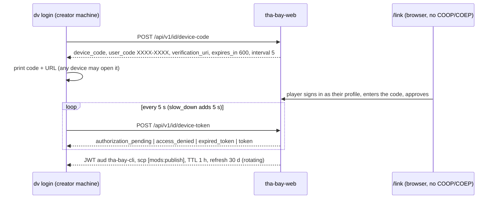
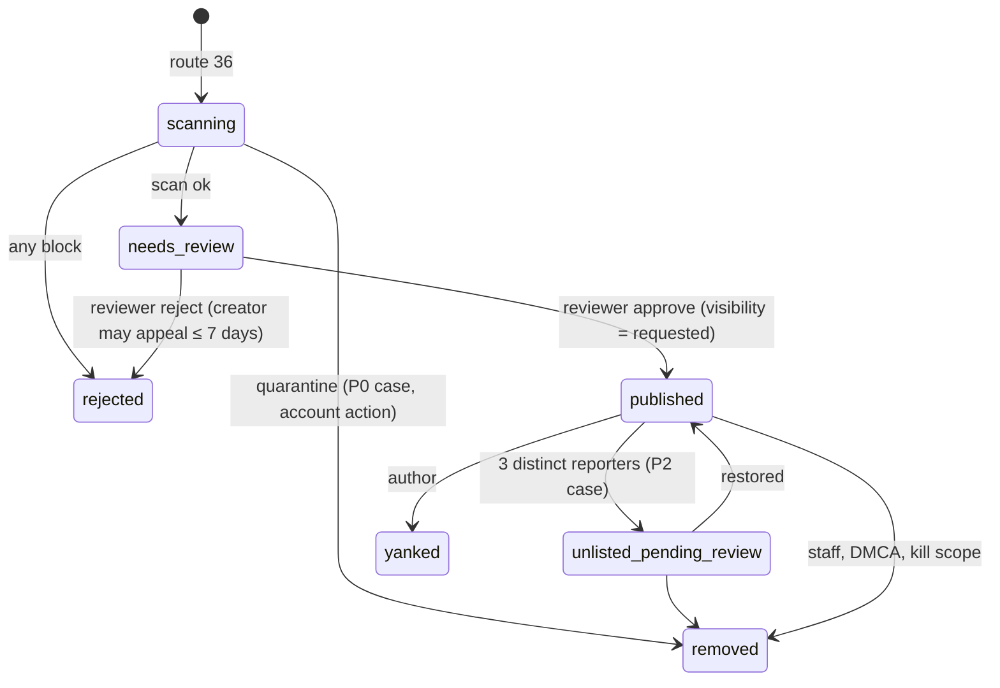

# 12 — Modding & UGC, Part C: agent workflow, ChatGPT and publish login, publish pipeline, experiences, forum, store, versioning

> S12, Wave 4, 2026-10-18. Part of `spec/domains/12-modding.md`. Types are in Part B (`B§n`). Backend tables and queues are S09's (`09-backend-db.md` §3.4, §3.7; `09-backend.md` §3.4); screens are S10's. Numbers marked **(S12)** are design values.

## C§1 Agent workflow (R-MOD-01)

The goal is that a coding agent that has never seen this game can scaffold, test, validate and package a mod from the repository alone. Patterns come from universal-modder (instruction topology, mirrored skills, one CLI, knowledge base, oracles) re-expressed for this game [research/repos-modding.md §2, §6]; no code is copied (constraint 3 of INDEX §4).

### 1.1 Workspace layout (`dv init`; the same tree is `packages/mod-sdk/templates/workspace/`; these are creator-workspace paths, not monorepo root directories)

```
AGENTS.md                      canonical, ≤ 19,456 bytes (DL-208)
CLAUDE.md                      "@AGENTS.md" + Claude-only notes, < 200 lines
GEMINI.md                      "@AGENTS.md"
skills/<name>/SKILL.md         canonical (Agent Skills format; each < 500 lines, depth in references/)
.claude/skills/  .agents/skills/   real copies, not symlinks (Windows clones break symlinks); check:skills enforces equality
.claude/settings.json          SessionStart (startup|resume|clear|compact|fork) appends the dv bin dir to $CLAUDE_ENV_FILE once
.mcp.json  .codex/config.toml  .cursor/mcp.json  .vscode/mcp.json  opencode.json  gemini-extension.json
                               register thabay-mcp; secrets by env-var name only, never literal
knowledge/{README.md,TEMPLATE.md,INDEX.md,index.json,mods/,techniques/}
docs/{MODDING.md,CONTRACT-modapi.md,STATUS.md,HANDOFF.md}
mod/{mod.json,src/,data/,assets/,provenance/,MODLOG.md,evidence.json}
```

`mod/mod.json` is the **source manifest**: a `ModManifest` without `assets[]`, `author.id` and defaulted `compat`. `dv mod pack` joins `mod/assets/**` with `mod/provenance/<sha256>.json` into `assets[]`, defaults `compat.api` to the caret range of the installed SDK, validates, and writes `manifest.json` into the archive. Deterministic packing: sorted entries, fixed DOS timestamp (1980-01-01), `STORE` for already-compressed formats and deflate for text, pinned `fflate`; the archive SHA-256 is the publish key (test `pack-deterministic`).

Inside the monorepo the same kit lives in `packages/mod-sdk/`; Codex concatenates `AGENTS.md` files root-first up to 32 KiB [F-060], so when a mod sits under the repo the root file plus the kit file must fit: root ≤ 16,384 bytes, kit ≤ 19,456 and root + kit ≤ 32,768 (`check:agents`; DL-208).

### 1.2 `AGENTS.md` byte budget (≤ 19,456, DL-208; the check fails above)

| § | Content | Bytes |
|---|---|---|
| 1 | Mission and hard rules: original content only; no assets, code or data from other games; no real people's names, faces or voices; no secrets in files; never publish without the human (`dv mod publish` needs a TTY); the three-failure circuit breaker; evidence vocabulary | 2,200 |
| 2 | Start-here loop: search KB → pick tier → scaffold → vertical slice → assets with provenance → `dv mod test` → `check` → `pack` → hand to human | 2,600 |
| 3 | Command table (`dv …`, `--json`, exit codes) | 3,000 |
| 4 | Tier chooser and permission table | 3,000 |
| 5 | `ModAPI` cheat-sheet (namespaces, limits, events) with a pointer to `docs/CONTRACT-modapi.md` | 4,500 |
| 6 | SF world facts: anchor frame, radius ≤ 250 m, where anchors may sit, `world.find_place` | 2,200 |
| 7 | Provenance and generation: `dv mod provenance add`, registry endpoints, banned list, no photos of real people | 2,500 |
| 8 | Publish and moderation expectations (review times, what gets rejected and why) | 2,000 |
| 9 | Oracles and evidence | 1,800 |
| 10 | Where to look: skills, KB, docs | 700 |

### 1.3 Skills (canonical in `skills/`, mirrored)

`mod-the-game` (the loop), `build-experience`, `place-on-map`, `write-mission-ir`, `mod-vehicles`, `mod-characters`, `add-npc-cameo`, `mod-assets` (generation routed through provenance), `validate-and-preview`, `publish-experience`, `field-note`. Descriptions are trigger lists ("Use when … 'put my race on Market Street'"). Builder-side skills (`run-milestone`, `perf-check`, …) belong to S13 and live in the same `skills/` tree, so one check covers both.

### 1.4 `dv` CLI (package `@dv/cli`, binary `dv`; one module per group, module docstring = `--help`, every command accepts `--json`)

| Command | Does |
|---|---|
| `dv init [dir]` | create the workspace above |
| `dv mod new <kind> [--tier]` | scaffold from `packages/mod-sdk/examples/mods/*` (shipped inside the SDK) with a `MODLOG.md` journal |
| `dv mod dev [--host url] [--mock]` | watch, rebuild, hot-reload (§1.5) |
| `dv mod test [--mock] [--prove-oracle]` | run scenarios (§1.7), write `evidence.json` |
| `dv mod check` | the shared validator (B§7 `ModCheckResult`) plus `ModBudgetReport`; non-zero on errors |
| `dv mod pack` | deterministic archive and its SHA-256 |
| `dv mod provenance add\|verify` | write and check C07 records from files and generation manifests |
| `dv mod publish [--dry-run]` | upload and register (C§2); needs a TTY and the human's confirmation |
| `dv login`, `dv logout` | RFC 8628 device-code login; token stored mode 0600 or in the OS keychain |
| `dv kb new\|check\|index\|search` | knowledge base |
| `dv doctor` | versions, ports, host reachable, skills mirror, `AGENTS.md` size |
| `dv mcp` | start `thabay-mcp` (stdio) |

Errors are JSON `{code, file?, line?, fix}` with the "what to do next" text in `fix`. Output is UTF-8 on every platform; kill by exact PID only [research/repos-modding.md §2.7].

### 1.5 Hot reload and dev hosts

| Host | How | Use |
|---|---|---|
| Mock | `dv mod test --mock`: Node harness with `MockModHost` (fake ModAPI, anchor-frame world, lockstep clock) | default for agents in cloud sandboxes and CI; no game needed |
| Local game | `dv mod dev` serves `ws://127.0.0.1:<port>/dev` and prints a random 128-bit token (also in `.dv/dev.json`, mode 0600); the game from `pnpm dev` (`VITE_DV_QA=1`, exposes `__dvBridge`) connects | scenario tests, hot reload |
| Hosted game | Settings → Developer → "Connect to a local mod server" (typed port and token; device-scoped, off by default; not a URL flag) | optional; Chrome 142+ shows a Local Network Access prompt, WebSocket gating unknown (U4) |

Protocol `DevMsg {v:1; t:'hello'|'bundle'|'reload'|'log'|'bye'}`: the server validates the `Origin` header against the game origin and the token; a `bundle` carries the packed mod in memory; the host loads it as `installedFrom:'dev'` (no journal, no registry row, unloaded on disconnect) under every sandbox rule. The dev server and `thabay-mcp --http` bind 127.0.0.1 only [MCP transport rules, research/repos-modding.md Verified facts].

### 1.6 `thabay-mcp` (D-26; stdio, built on `@modelcontextprotocol/sdk`)

| Tool | Input → output |
|---|---|
| `world.find_place` | text → ranked SF places with lat/lng, chunk key, anchor-rule hints (offline from the `tools/map` geocoder export, U10) |
| `world.describe` | lat/lng or chunk → streets, neighbourhood, landmarks, ground height, public-land verdict |
| `mod.schema` | kind → JSON Schema for manifest, scene, panel, IR |
| `mod.validate`, `mod.test`, `mod.pack` | same as the CLI; JSON findings with fixes |
| `mod.preview` | starts the dev host, returns URL and a screenshot path |
| `mod.publish` | returns `{needs_human:true, command}`; never uploads without a TTY confirmation |
| `provenance.add` | file + generation info → record |
| `kb.search`, `docs.api` | search notes and the API reference |

Forum and KB text returned by tools is wrapped `{untrusted:true, author, date, text}`; notes are never executed (`reviewers judge against the contract, not the author's justification`) [research/repos-modding.md §2.6]. An HTTP transport, if enabled, requires the token and rejects any `Origin` that is not loopback.

### 1.7 Oracles, evidence, journals

- Every acceptance check in a mod names its **oracle**: a schema check, a Playwright scenario through `__dvBridge` (`observe`, `act`, `step(n)`, `shot`), a state assertion after `step(n)`, or a screenshot the agent must open and describe.
- `dv mod test --prove-oracle` runs each scenario against a **no-op mod** and against a copy with the mod's first handler removed; an assertion that still passes is reported `vacuous` and fails the run.
- `evidence.json`: `{schema:'dv-evidence/1', modVersion, level, scenarios:[{name, sha256, passed, oracle, vacuous, tier}], notVerified:[…]}` with `level` one of `implemented | tested | seen-in-game | unverified`; the level and `notVerified` appear in the store listing. Scenario file hashes are recorded so a reviewer sees whether the verifier changed with the code.
- `MODLOG.md` is the journal that survives context compaction; `docs/STATUS.md` and `docs/HANDOFF.md` carry the next task and the last real test result. Three failures of the same check stop the agent: it writes what is known and changes approach.
- Knowledge base notes use front matter (`kind, title, tier, kinds, date, agents`) and the sections Setup (exact versions), Tier and why, How it works, Verification (including what was **not** verified), Gotchas (numbered, symptom → cause → fix). `dv kb check` fails on missing keys or sections, secrets, unfilled template text, code blocks > 150 lines and images > 1.5 MB, and warns on absolute user paths and notes > 120 KB; CI runs it with `--index`.

## C§2 ChatGPT, bring-your-own agent and publish login (R-MOD-02, R-AUTH-03)

ChatGPT linkage exists only to enable modding and publishing; nobody needs it to play (R-AUTH-03, constraint 2 of the master prompt).

| Flow | Who | How | Status |
|---|---|---|---|
| **A. Bring your own agent** (primary) | anyone with Codex, Claude Code, Gemini CLI, Cursor, Copilot or OpenCode | open the workspace; the agent reads `AGENTS.md`, skills and `thabay-mcp`; for ChatGPT subscribers the supported path is Codex with "Sign in with ChatGPT" | works with no OpenAI program; M13a6 documents it |
| **B. ChatGPT plan usage in a local Studio** | ChatGPT Plus/Pro users with no coding agent | `dv studio` (local web UI on 127.0.0.1) runs OpenAI's plan-usage flow itself and drives `codex app-server` with `thabay-mcp` | **ADR-gated stretch** in M13c3; needs an open-source local app (Q-S12-04), the OpenAI interest form for a commercial game, and our own implementation: the DevKit is Noncommercial and is never vendored [F-060] |
| **C. "Continue with ChatGPT" on the site** | publishers | S09 route 11 behind `AUTH_OPENAI_WEB=false`; confidential client with PKCE, `jose` JWKS check of `iss/aud/exp/nonce`, ID token discarded after linking | limited trial; apply at M13 start, ship without it [F-060] |
| **D. ChatGPT/Codex plugin** | later | remote MCP with OAuth 2.1 | X: post-launch, needs directory review |
| **E. In-game creator** | players with no agent | data-tier "place mode" (M13b3) and the same publish step in the browser | no AI assistant in v1; a server-side Claude assistant under the G3 quotas is a later flag |

**Flow A steps for a ChatGPT subscriber.** (1) Install Codex (CLI, IDE or desktop). (2) Choose "Sign in with ChatGPT" inside Codex. (3) `dv init my-mod`, open the folder in Codex. (4) Codex loads `AGENTS.md` (the 32 KiB cap is why the kit file stops at 19,456 bytes), discovers `.agents/skills`, and starts `thabay-mcp` from `.codex/config.toml`. (5) The agent runs the loop; the human runs `dv login` and `dv mod publish`.

**Flow B protocol (only after the ADR)** [research/auth-ugc-input-maps.md §3.3]: persist `ext_agent_host_id` as `urn:uuid:<v4>` in the user config; open the system browser at the authorize URL with `client_id=dynamic_agent_client`, PKCE S256, a `http://127.0.0.1:<port>/auth/callback` redirect, scopes `openid profile email offline_access resource.invoke chatgpt.tokens.use.direct` and `resource=https://api.openai.com/v1`; persist the issued `client_id`; store credentials mode 0600 or in the keychain; run the agent loop through `codex app-server` with the token in its environment; show "Using ChatGPT plan" and "Manage usage"; treat `invalid_grant` on refresh and `subscription_sharing_usage_limit_exceeded` as "sign in again". Hosted tools (image generation, file search, Code Interpreter, hosted MCP) are unavailable in this mode.

**Device-code publish login** (C12 route 10, S09 builds it at M13c1; RFC 8628).



**Who may publish.** Routes 36 and 37 `POST` need identity tier `linked` (P2), age bracket `18p`, and no `publish_ban` in `enforcement_action`. The `/link` page approves a code only for a profile that is already `linked`; otherwise it walks the player through linking a provider first: `openai` when `auth.openaiWeb` is on; otherwise P2 waits for Thirdweb at M14a, since `supabase-oauth` (GitHub) is spike-only in v1 (DN-S12-01, DL-145, DL-240, DL-342). Forum posting needs only P1 plus the Q-BE-04 age rule. The CLI token and a browser P2 JWT are both accepted on route 36 (C12 1.1), so flow E needs no second login.

**Rate limits (S12, with S09 `rate-limits.json`).** 5 versions per profile per day, 20 mods per profile, 10 public placements per profile, 3 device codes per profile per hour.

## C§3 Publish pipeline and moderation (constraints 17–18, R-IP-03)

Publishing is `dv mod publish`: (1) local `dv mod check` must pass; (2) `dv mod pack`; (3) human confirmation on a TTY, which records `PublishAttestation`; (4) `POST /ugc/uploads {purpose:'mod_archive'}` → presigned PUT to `ugc-staging/incoming/<uploadId>` → `POST …/commit` (route 34); (5) `POST /mods/:id/versions` (route 36, idempotent). For `mod_archive` the scan is enqueued by route 36 (C12 1.1 route 36 rule), so the version row and the scan share a `moderation_item`. The `UGC_SCAN` consumer runs the stages below with the **same shared functions** the CLI ran (principle 4).

### 3.1 Stages

Order is load-bearing: hash-match every image before any third-party model sees it, classify second [research/gap-trust-safety-tooling.md §2.2]. **L** = shared function, also run by `dv mod check`; **S** = server only.

| # | Stage | Where | Rule | Codes |
|---|---|---|---|---|
| 1 | Envelope | L | `fflate` streaming; ≤ 128 MiB, ≤ 2,000 entries, ≤ 512 MiB expanded, ratio ≤ 100:1; reject absolute paths, `..`, symlinks, duplicates after NFC and case-fold, nested archives | `envelope.*` |
| 2 | Type allowlist | L | magic bytes, not extensions: JSON, GLB, KTX2, PNG/WebP/JPEG (thumbnails and textures), Ogg/Opus/WAV, `.js`, `.html`, `.md`, `.txt`. Rockstar and console formats (`.rpf .ytd .ydr .ydd .yft .ymap .ytyp .ybn .gxt2 .oiv .xex .iso`, RPF7/RSC7/DXBC signatures) fail with the fixed message "Game files from other titles can't be uploaded" | `type.*`, `ip.signature` |
| 3 | Schema | L | manifest, `dv-exp/1`, `dv-scene/1`, panel, vehicle, outfit, mission IR; unknown fields fail | `schema.invalid` |
| 4 | Hash banks | S | SHA-256 and PDQ of every image against our banks, then PhotoDNA and HMA banks when approved (S09 M13d); a match quarantines the whole archive, calls no other vendor, opens P0 | quarantine |
| 5 | Permissions | L | unknown value, below-minimum tier, missing or extra versus data ops and the script's namespace scan | `perm.*` |
| 6 | Secrets | L | `secretlint` recommend preset plus fal, `sk-ant-`, `sk-proj-`/`svcacct`/admin, `ghp_`/`github_pat_`, `AKIA`, PEM, `.env`; shows file and line | `secret.found` |
| 7 | IP scan | L (+S strings) | `ip:extensions`, `ip:strings` (public denylist locally; the server adds the real-side `NameRegistry` strings, which never leave the server), `license:scan` of `provenance.thirdParty[]` against the allowlist (no GPL/AGPL/LGPL) | `ip.*`, `prov.licence` |
| 8 | Provenance | L | each `assets[].provenance` validates against `provenance-1.0`; SHA-256 matches; licence on the allowlist; `generator.endpoint` not in `config/genai-endpoints.json` `banned` (fail) or not in `mod-endpoints.json` (review); likeness invariants; no `voice` assets | `prov.*`, `likeness.tier` |
| 9 | Caps and budget | L | ops, entities, manifest size; tris, texture bytes and render objects from parsing glTF/KTX2 headers → `ModBudgetReport` | `cap.*` |
| 10 | Script lint | L | ES2023 parse; deny `eval`, `Function`, dynamic `import()`, `with`; size ≤ 256 KiB; minified or high-entropy code routes to review. This stage only routes; the sandbox is the control | `script.*` |
| 11 | 3D and texture validity | L (v1); S post-v1 (DL-240) | Khronos `gltf-validator`, `ktx validate`; budgets from C13 (U9) | `asset.*` |
| 12 | Text | S | OpenAI omni text, Haiku text classifier (Llama Guard fallback), `names:lint`, EAS address regex over names, summaries, `strings`, sign text and README; thresholds in [research/gap-trust-safety-tooling.md §2.4]; `sexual/minors` opens a P0 text case | `policy.*` |
| 13 | Images | S | Haiku vision schema on thumbnails and any texture that decodes as a photograph: `real_human_visible ∧ is_photograph` blocks; `apparent_minor` with nudity quarantines; `logos_or_jerseys`, `hate_symbol` review | `policy.*` |
| 14 | Map anchor | S | for placements only (C§4) | `anchor.*` |
| 15 | Malware hygiene | S Container, post-v1 (DL-240) | ClamAV with signatures baked into the image daily; a hygiene check, not the boundary | `policy.malware` |
| 16 | Human review | S | every publish in v1: experiences P2 (≤ 72 h), other mods P3 (≤ 5 days); the reviewer sees the manifest, the budget report, stage signals, the placement ring on the map, and the evidence level | decision |

The server returns each stage as a `moderation_signal` row (`source` = stage id, `verdict` ∈ allow, review, block, quarantine, error). Creators see `ModFinding`s for L stages (code, file, line, fix). For hash, classifier and quarantine outcomes they see only "This was removed for policy review" plus a generic policy code, never scores, bank names or whether CSAM was suspected.

### 3.2 States



`mod_versions.state` uses `ModVersionState` (B§7); `experiences.moderation_state` uses `ExperienceModeration` (B§6) with the extra `needs_update` (C§4). `visibility` is `private` until `published`, then the requested value; nothing but `published ∧ public` appears on the map or in the public catalogue. Reports of category `child_safety` and `intimate_image` open P0 at once; `copyright` makes route 41 answer 409 with a redirect to the DMCA form (route 42).

### 3.3 Provenance, likeness, remix

- `dv mod provenance add <file>` computes the SHA-256 and writes a C07 `ProvenanceRecord` into `mod/provenance/`. For a generated file it reads vendor, endpoint, request id and seed from the generation manifest line, hashes the prompt text, attaches the SDK-bundled vendor-terms snapshot digest, and sets `executor:'cli'`, `env:'production'`, `ai_generated:true`. Own work and CC0/CC-BY assets declare `origin` and SPDX `license` [research/repos-modding.md §5.7].
- **Likeness.** The manifest declares `noRealPeople`; character-family assets carry tier `original` only; thumbnails and textures that are photographs of real people are blocked (stage 13); a face or voice of a real person is impossible in a mod, because `consented` needs a `consent_record` that only the roster pipeline holds. A mod may *place* a roster or approved NPC with `npc.cameo`: the NPC speaks only through the official proxy, the mod cannot add dialogue, killed NPCs are refused, and an experience referencing an NPC that is later killed is unlisted (`KillScope` includes `ugc`). Cameos of `parody`-tier NPCs are off by default (Q-S12-07, S04 flag `ugcCameo`).
- **Remix.** Allowed only when the parent has `remixAllowed` or an allowlisted licence (`CC0-1.0`, `CC-BY-4.0`, `CC-BY-SA-4.0`, `MIT`, `Apache-2.0`); `remixOf` pins the parent's archive SHA-256; share-alike licences propagate; the credit chain is rendered on the listing (`remix.licence`).
- **Generated content** carries the "AI-assisted" badge from `provenance.aiAssisted` and the record's `ai_generated`.

### 3.4 Takedown, revocation, strikes

DMCA notices and counter-notices, NCII intake (48 h), evidence preservation and the pager are S09's (M13d). S12 adds the client side: route 53 `GET /api/v1/mods/revoked?since=` (C12 1.1) feeds `ModRevocations` (§5.5 of the main file), polled at launch and every 6 h, so an online player's installed copy stops loading within 24 h of a takedown. Repeat infringers (three strikes in 12 months) lose publishing through `enforcement_action`. Appeals are decided by a different reviewer within 7 days. Terms essentials for S10's legal pages (counsel drafts): creators keep ownership and grant us a licence to host, transform for LODs and thumbnails, and promote inside the service; other players get play-and-view only unless `remixAllowed`; mods run only in our sandbox and may not circumvent it; personal mods stay private; the SDK licence covers SDK code, not the game; virtual items have no cash value; no real-money trading [research/legal-ip-likeness.md §5.3].

## C§4 Experiences on the map (R-MOD-04)

**Placement model.** The anchor is not in the archive. A **placement** (route 37 `POST`, or inline in route 36's `placement`) pins one published version at `{lat, lng}` with a radius ≤ the authored one and `entryRules`. A version may have ≤ 3 placements; a profile ≤ 10 public placements, ≥ 100 m apart; a chunk shows ≤ 40 public placements ranked by Wilson score (S12 values; the cap keeps the map readable). The server computes `chunkKey` from `lat/lng` (C08 grid, S02) and stores both; clients never send it. One P2 case covers a version and its first placement; later placements get their own P2 case.

**Anchor rules (stage 14), from [research/auth-ugc-input-maps.md §3.4]:** (1) inside `config/world.bounds.json` and the SF land polygon (`anchor.outside_sf`); (2) within 15 m of public right-of-way (street centrelines, DataSF `3psu-pn9h`, buffered by class width) or inside a Recreation and Parks property (`gtr9-ntp6`) (`anchor.not_public_land`); (3) neither the anchor nor `entryRules.start` lies inside a residential parcel (`acdm-wktn`), and at least half of the radius disc is non-residential land, else `anchor_residential` — operationalizing the research rule "no pin on a single residential parcel"; the parcel land-use attribute needed for this is UNVERIFIED (U12), and until `tools/map` exports it the rule runs on parcel polygons plus a human check of the 25 m ring on the reviewer's map; (4) street-address strings in any text, matched against EAS (`ramy-di5m`), are flagged and block when used as a crime or harassment target (`anchor.address_string`). Data arrives as a compact `anchor-mask.v1.bin` built by `tools/map` (assumption on S02) and loaded by the Worker.

**Markers.** `ExperienceIndex` requests route 37 for the chunk keys in view (≤ 9 per call, ETag, cached 5 minutes per chunk) and publishes pins to S02/S10's Canvas 2D map and minimap (filter chips: kind, tier supported, rating). In the world, `marker.experience` prefabs spawn for placements inside the C08 streaming radius (≤ 8 live), each an `Interactable{kind: Experience}` with prompt key `prompt.exp.enter`; the prompt opens a card (title, author, rating, content warnings, supported tiers, AI-assisted badge, Report) and **Enter**. Not installed → transactional install with the step log first (§5.1). In XR the card is a world-locked `XrPanel`.

**Entry from Story** is the mode switch of §2.4: disabled with a reason during a mission or pursuit; on confirm the game saves, switches, and on exit returns to the saved position. The experience never reads or writes Story. On exit a thumbs up/down (route 40, `target_kind:'experience'`) is offered to P1 profiles.

**World version.** The server stamps `worldVersion` (the C05 `worldBake` string) and `modSha256` on each placement (additive C17 fields). On a rebake, `RebakeRevalidationWorkflow` (edge) re-runs stage 14 and compares `worldVersion` against the manifest's `compat.world`; a failure sets `needs_update` and removes the pin from the map while the experience stays installable for a sandbox preview. The creator sees the state in My creations and republishes. Overlay cache key: `sha256(worldVersion | modSha256)`.

## C§5 Forum (R-MOD-03)

**Data model.** S09's migration 0007 holds the tables (`forum_boards`, `forum_threads`, `forum_posts`, `forum_votes`; `09-backend-db.md` §3.7). S12 adds, as proposals: `forum_threads.mod_id uuid null references mods(id)`, `min_tier` value `'staff'`, and seed rows:

| Board id | Title | Who posts | Linked object | Rules |
|---|---|---|---|---|
| `announcements` | Announcements | staff | — | locked to replies from `device` tier up |
| `experiences` | Worlds and Experiences | `device` tier (Q-BE-04) | `experience_id` required | showcase thread auto-created at approval by the pipeline (system post in the creator's name) |
| `mods` | Mods and Tools | `device` tier | `mod_id` | discussion thread auto-created at approval |
| `field-notes` | Field Notes | `device` tier | optional | body validated by `validateFieldNote` |
| `help` | Modding Help | `device` tier | — | — |
| `general` | General | `device` tier | — | — |

Rules: title 3–120 characters; body 1–10,000 of plain text rendered as text nodes in v1 (no Markdown, raw HTML, auto-links or embeds; `10-ui-pages.md` §2.11, DL-240); ≤ 4 image attachments (uploads purpose `forum_attachment`, S09 limits and the full image pipeline); one post per 30 s and 20 per day for accounts under 7 days; the first 3 image posts of a new account are held (P3); text is pre-moderated (`names:lint` + EAS regex synchronously, then omni with the Llama Guard fallback; DL-471): a post is `state:'pending'` until `allow` makes it `visible`, `review` verdicts hold it (`state:'held'`, P2), `block` removes it, and it stays `pending` while no classifier can run (fail closed); one vote per profile per target, no self-vote; 3 distinct reporters unlist a thread or post. `hot = (score + 1) / (hoursSinceLastPost + 2)^1.4`; `top` = score; `new` = created. Search is the title `tsv` index; body search is deferred. Clients poll `posts?since=` every 15 s while a thread is open (no Realtime, S09 rule 7).

`validateFieldNote(body)` in `packages/shared/src/mod/forum.ts` (client form and the board's route 38 handler) requires `## Setup` (exact game and ModAPI versions), `## Tier and why`, `## Verification` with a line starting `Not verified:`, and `## Gotchas` as a numbered list of `symptom → cause → fix`. An accepted note is exported to `knowledge/mods/` by a PR from `dv kb import-note <threadId>` (manual in v1).

**UX** (screens by S10). Main menu → **Community** with three tabs in v1: **Explore** (map and list of placements near the player or any chunk, filters), **Mods** (store, C§6), **Forum**; post-v1 (DL-240) a fourth, **My creations** (my mods, versions with state chips and reviewer notes, placements with `needs_update`, drafts, appeals). Forum: board list → thread list (sort hot/new/top, title search) → thread (posts, vote buttons, linked card for experiences and mods, poll indicator) → composer (field-note template pre-filled on `field-notes`, live Markdown preview, attachment tray, rules link). States to design: empty board; "waiting for review" for the author's held post; removed post shown as "Removed by moderators"; locked thread; rate-limit message with the retry time from `retryAfterMs`; gate messages that say what to do ("Register this device", "Link an account to publish", "Posting opens 72 hours after registration"). Every post, thread, card and profile has the report button with the nine categories (C12 `ReportCategory`). Keyboard focus order, landmarks and reduced-motion apply (R-ENG-04). A closed-forum fallback (`forum.enabled` false) hides the tab without affecting the store.

## C§6 Store (R-MOD-01, R-MOD-04)

- **Explore.** Search box (route 35 `q`), category chips by `kind`, sort (new, top, most installed), filter by "works on this device" (`tiersOk`), infinite scroll with a sentinel. Cards show name, author, rating (mods: their thread score), evidence level, AI-assisted badge, content warnings, size, and tier chips. Thumbnails come from `ugc.<host>` (a cache-enabled custom domain, so the Cloudflare CSAM tool can see them [F-065]). Unsupported kinds on a device show an explicit "unsupported here" state rather than disappearing.
- **Detail.** Description, changelog, versions with states, credits chain and remix parent, permissions in plain words ("places props", "stores a small save"), report button, discussion thread link.
- **Install.** One button runs `ModInstaller.install`; each step logs one line, and a toast shows the last three with a link to the full log [research/repos-grand-v.md rec 9]. Failure shows the `fix` text.
- **Installed.** Rows with: Enabled (applies in Sandbox; the row states "Mods never run in Story"), Update available, Roll back, Remove (checkbox "also delete my saved data"), load order, last fault. Packages without a store entry show "Installed outside the store". An experience mod has Play instead of Enabled.
- **Local import** (`.dvmod`) and **Developer** appear under Settings, behind their toggles. **Offline:** cached lists with an "offline" banner; installed mods still run.
- **Accessibility and language.** All player-visible mod text goes through the `strings` table (`ctx.str`), so translations are data and a stale one falls back to English [research/repos-grand-v.md rec 12]. The host panel frame provides the focus trap, Escape to close, a visible mod name and author, and reduced-motion; mods may not autoplay audio and must declare `flashing` or `loud` in `contentWarnings`.
- Counters: `installs30d` is rolled up nightly from `mod.install` telemetry (post-v1, DL-420; in v1 it reads 0 and `sort=installed` falls back to the `new` order); ranking never uses client-reported counts directly.

## C§7 Versioning and compatibility

1. **Mod versions** are semver; a published `(id, version)` is immutable (a different archive under the same version is `409`). Installed update checks run at store open and once a day.
2. **`compat.api`** is a range over `MODAPI_VERSION`; the loader refuses a mod whose range excludes the engine's version ("Needs update") and shows it with the update button if a newer version exists. `compat.world` and `compat.game` are checked the same way; `compat.world` also gates map pins (C§4).
3. **ModAPI evolution.** Minor = additive (new namespace member, event, optional field). Major = breaking, announced one release ahead by `dv mod check` warnings, with the previous major served by a host adapter for one full release; `docs/CONTRACT-modapi.md` lists every removal. The manifest `schema` (`dv-mod/1`) changes only with a new value (`dv-mod/2`); the loader accepts N and N−1.
4. **Contracts.** C14/C17 follow 06 §4.1: additive change = minor bump, breaking = major + ADR + one-release overlap. `worldVersion` and `modSha256` are part of C17 1.0.0 (DL-090).
5. **Saves.** `storage.schema` plus `migrate` handles KV layout changes; a failed migration keeps the old record and disables the mod for the session; uninstall keeps `mod:<id>` unless the player deletes it.
6. **Yank and removal.** The author may yank a version (hidden from new installs, existing installs keep working and see a notice); staff removal, DMCA and security revocations stop loading everywhere within 24 h (§5.5 of the main file). Rollback is local and instant (`previous`).
7. **Engine updates.** `PwaUpdateController` applies engine updates at safe points; mods are re-validated at the next launch (cheap: manifest and `compat` only; blobs are already hashed).

## C§8 Acceptance seeds

Wave 5 writes the C15 files from these seeds. None holds an UNVERIFIED item; a device run is a recording, not an assertion. Commands are `pnpm` scripts; `check:*` names follow 06 §5.

- **M13a1** Two `dv mod pack` runs give one SHA-256 (`check:unit -- packages/shared/src/mod pack-deterministic`). A 40-manifest corpus (valid, unknown permission, missing provenance, `.rpf` entry, secret, over cap) gives identical verdicts in the Node CLI and the Worker harness (`check-parity`).
- **M13a2** An install killed at each of six steps leaves the old or the new version and no unreferenced blob (`install-atomic`); install then uninstall restores the snapshot byte for byte (`uninstall-byte-equal`); a revoked version is refused (`revoked`).
- **M13a3** A sandbox session with a mod sends `modsActive: true` and a staging room closes it 4007, false after `unloadAll('room')` (`check:workers -- mods-4007`); the fixture experience spawns only inside its radius and exit restores the prior mode (`check:e2e -- --project=chromium-webgl2 --grep @mods-exp`); a 1.1 MiB KV write is rejected without touching other slots (`mod-save-caps`).
- **M13a4** Scripts touching `fetch`, `Date`, `Math.random`, `performance`, `SharedArrayBuffer` or a non-granted namespace fail with codes (`mod-sandbox-*`); `while(true){}`, a 1 GiB array and deep recursion end within 3 deadlines or at the limit with sim p99 inside the desktop budget (`check:perf -- --scenario mod-hostile`); per-tick cost on iPhone 15 and Quest 3 is recorded (`perf:checklist -- mod-script`).
- **M13a5** A UI mod reading `parent.document`, `localStorage`, `indexedDB` or fetching a URL is blocked (`check:e2e -- --grep @mods-ui-isolation`); the COEP matrix result is recorded (`mods-ui` checklist).
- **M13a6** `check:skills` fails on one differing mirrored byte; `check:agents` fails above 19,456 bytes (or 32,768 with the root file; DL-208); `dv mod test --prove-oracle` flags no vacuous assertion on the example mod (`check:mods`).
- **M13b2** An experience thread links `experience_id` and votes update `rating` (`check:workers -- exp-rating`).
- **M13c2** A hash-bank match quarantines the item, stops further vendor stages and opens a P0 case (`mod-scan-quarantine`); an anchor inside a fixture polygon marked residential is rejected `anchor_residential` (`anchor-rules`); with `ugc.publish` false a published version stays private-to-owner (`publish-flag`).
- **M13c3** A device code approved by a `linked` profile yields a `mods:publish` token and `dv mod publish --dry-run` passes on staging (`test:staging -- mod-publish`).
