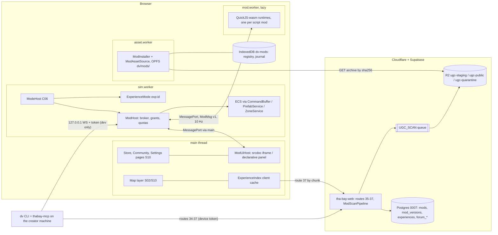
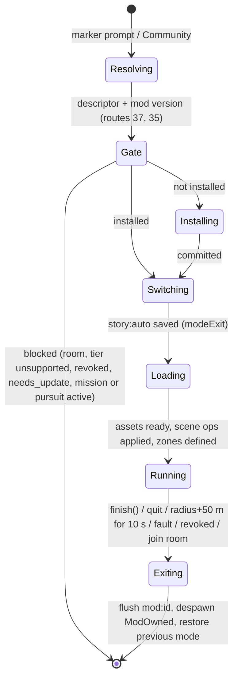

# 12 — Modding & UGC (S12)

> Wave 4 domain spec, 2026-10-18, Claude Sonnet 5.5 (S12). Reads `prompt-pack/06-SHARED-CONTEXT.md` v1.0 (frozen), `spec/.waves234-notes.md`, `spec/03-decisions-and-facts.md` v1 (D-05, D-26, D-30), `spec/11-decision-log.md` (DL-047, DL-048), `spec/02-architecture.md` §4.6, and the Wave 1 specs for C05/C06 (S01), C07 (S05), C12 (S09), C13 (S11). Three files, read in order:
> 1. **this file** — checklist, scope, design, components, runtime, platforms, facts, milestones, tests, open questions;
> 2. `12-modding-contracts.md` — **C14** (`ModManifest`, `ModAPI`, sandbox protocols) and **C17** (`ExperienceDescriptor`) as TypeScript and JSON Schema, install records, limits;
> 3. `12-modding-publish.md` — agent workflow (`AGENTS.md`, skills, knowledge base, `dv` CLI, `thabay-mcp`), ChatGPT and device-code flows, publish pipeline and moderation, experiences on the map, forum, store, versioning.
>
> Citations are `[research/<file>.md]` or F-NNN (`research/INDEX.md` §2). Numbers marked **(S12)** are design values to calibrate in the named milestone, not vendor facts. Section numbers of the other parts are written `B§n` and `C§n`.

## 0. Checklist (seed expanded)

Disposition: **D** designed (section), **M##** deferred to a milestone, **X** out of scope (reason).

| # | Item | Disp. | Basis |
|---|---|---|---|
| 1 | Typed, semver-versioned `ModAPI`, a capability-filtered subset of C06 `ModeContext` | D B§3 | C06 rule 7 |
| 2 | `ModManifest` (C14) TypeScript and JSON Schema; closed `permissions[]`; publish fails closed | D B§1–2 | DL-048 |
| 3 | Three tiers (data, script, ui): contents, caps, runtime | D §2.3 | D-26 |
| 4 | Data tier: JSON scene ≤ 512 ops, vehicle, outfit, C09 IR; no code | D B§4; M13a3 | [gamedesign-decomposition.md §7.7] |
| 5 | Script tier: QuickJS-wasm in `mod.worker`, deadline, memory limit, command/snapshot API, deterministic `rng`/`time` | D §5.2; M13a4 | [repos-modding.md §5.2] |
| 6 | UI tier: opaque-origin iframe, srcdoc first, declarative-panel fallback (R-S11-05) | D §2.5; M13a5 | F-S12-01/02 |
| 7 | No mods in rooms: `modsActive()`, `AssignReq.modsActive`, close 4007, suspend-on-join | D §2.4; M13a3 | C11 |
| 8 | Mod saves only in `mod:<id>` slots; KV caps; `exp:` session capability | D B§5; M13a3 | C05 rule 3 |
| 9 | Component ids 2048–4095 as host shims; mod entities session-local | D B§5; M13a3 | C01 |
| 10 | Per-tier mod budgets and install-time "supported here" check | D §5.4; M13a1, M13a3 | F-013 |
| 11 | Agent dev loop: `dv` CLI, mock host, QA host, hot reload on 127.0.0.1 with token | D C§1; M13a6 | [repos-modding.md §5.5] |
| 12 | Modder `AGENTS.md` ≤ 24 KiB; `CLAUDE.md`/`GEMINI.md` import it; size check | D C§1; M13a6 | F-060 |
| 13 | Skills authored once, mirrored as real copies, `check:skills`; SessionStart PATH hook; MCP configs | D C§1; M13a6 | [repos-modding.md rec 2–3] |
| 14 | Knowledge base, `dv kb`, field-note template | D C§1; M13a6 | [repos-modding.md §2.6] |
| 15 | Oracle discipline, `--prove-oracle`, evidence levels | D C§1; M13a6 | [repos-modding.md rec 6–7] |
| 16 | `thabay-mcp` tools and security | D C§1; M13a6 | [auth-ugc-input-maps.md §3.3] |
| 17 | ChatGPT flow A: bring-your-own agent (Codex signed in with ChatGPT) | D C§2; M13a6 | D-05 |
| 18 | Flows B (local Studio plan usage), C (site SIWC flag), D (plugin) | B M13c3 behind ADR; C S09 flag; D X post-launch | [auth-ugc-input-maps.md §3.1] |
| 19 | RFC 8628 device-code publish login; how a profile becomes `linked` | D C§2; M13c1, M13c3 | C12 route 10 |
| 20 | Publish pipeline, one validator for CLI and Queue: envelope, allowlist, schema, secrets, IP scan, provenance, likeness, caps, script lint | D C§3; M13a1, M13c2 | constraint 17 |
| 21 | Moderation: hash first, classifiers, human queues P2/P3, CSAM path, creator verdicts | D C§3; M13c2, M13d | [gap-trust-safety-tooling.md §6] |
| 22 | Per-asset C07 `ProvenanceRecord`, endpoint-registry checks, AI label | D B§1, C§3; M13a1 | DL-048 |
| 23 | Likeness declarations, attestation, real-person gate, roster cameo rules | D C§3; M13c2 | D-29 |
| 24 | Remix lineage and licence allowlist | D C§3; M13c2 | [repos-modding.md §5.7] |
| 25 | C17 descriptor, placement model, anchor rules, radius ≤ 250 m, density caps | D B§6, C§4; M13c2 | DL-047 |
| 26 | Map markers, `exp:<id>` entry and exit, mode switch from Story | D §2.4, C§4; M13a3 | R-MOD-04 |
| 27 | World-version pinning and `needs_update` after a rebake | D C§4; M13c2 | [repos-modding.md §5.7] |
| 28 | Forum data model on migration 0007: boards, field notes, ratings, states, rate limits | D C§5; M13b1, M13b2 | `09-backend-db.md` §3.7 |
| 29 | Forum UX and report button | D C§5; M13b1 | R-MOD-03 |
| 30 | Store UX: search, install, enable, disable, remove, update, rollback | D C§6; M13a2 | [repos-grand-v.md rec 9] |
| 31 | Transactional install, journal, byte-equal uninstall | D §5.1; M13a2 | [repos-grand-v.md rec 7] |
| 32 | Versioning and compatibility, yank, revocation ≤ 24 h | D C§7; M13a1, M13c2 | constraint 18 |
| 33 | Server-side mod code; mods inside rooms | X v1: non-goal (06 §3); post-M14 vetting | [repos-modding.md §5.2] |

## 1. Scope and R-IDs

S12 owns the player-made content layer: what a mod is, how it is authored with a coding agent, how it is installed, sandboxed, published, moderated, placed on the SF map, discussed and updated. S09 owns the storage, queues, tokens and moderation backend it runs on; S10 builds the screens; S01 hosts the runtime hooks.

| R-ID | How S12 serves it | Sections |
|---|---|---|
| R-MOD-01 | Agent-friendly SDK: typed `ModAPI`, `AGENTS.md`, mirrored skills, knowledge base, `dv` CLI, mock host, hot reload | B§3, C§1 |
| R-MOD-02 | Players with a ChatGPT plan use Codex signed in with ChatGPT (flow A); everyone else uses any agent or the in-game data-tier creator; device-code publish login is the fallback to website SIWC | C§2; M13a6, M13b3, M13c3 |
| R-MOD-03 | Forum data model, boards, field notes, votes, moderation states and UX (backend S09, screens S10); moderation and DMCA flow hooks | C§3, C§5; M13b |
| R-MOD-04 | Experiences as C17 placements, markers on the map, `exp:<id>` mode inside the sandbox runtime | B§6, C§4; M13a3 |
| R-AUTH-03 | ChatGPT linkage exists only for modding and publishing; never required to play; bring-your-own-agent plus device-code fallback | C§2 |
| R-IP-03 (UGC rules) | UGC terms essentials, scanners, moderation queues, DMCA agent path, report button on every mod and experience surface | C§3, C§5, C§6 |

**Enforced here** (INDEX §4): constraint 17 (IP scan, moderation, CSAM check, likeness attestation before visibility, report button) and 18 (≤ 24 h takedown, NCII 48 h, CSAM preservation; backend S09). **Owns:** C14, C17. **Honors:** C06 (mods get a filtered `ModeContext`; `exp:` ids), C07 (`AssetRef`, `ProvenanceRecord`), C12 (routes 10, 34–37, 41–45, `ApiError`). **Uses:** C05 (`mod:<id>` slots), C01 (ranges), C03/C04 (interactions, cinematics), C11 (close 4007), C13 (tiers, budgets), C16 (telemetry names proposed). **Consumers of C14/C17:** S05 (provenance validators), S09 (publish, DB), S10 (store, forum, map UI), S02 (marker layer, anchors), S01 (runtime hooks).

## 2. Design

### 2.1 Principles (each is a test or a lint)

1. **Capabilities, not globals.** A mod sees only the `ModContext` namespaces its manifest `permissions[]` grant (B§3). It has no network, DOM, clock, `Math.random`, other-mod access or storage outside its own `mod:<id>` slot.
2. **Lowest tier that works.** Data first (no code), script when behaviour is needed, UI only for panels. Higher tiers get stricter review and tighter budgets.
3. **Mods never run in Story or in a room.** The loader refuses outside `sandbox` and `exp:*` sessions, and `modsActive()` is false in every room session (§2.4).
4. **One validator, two places.** `dv mod check` (Node) and the publish Queue consumer (Worker) run the same pure functions from `@dv/shared` (`packages/shared/src/mod/check/`), which call S05's provenance and IP gate cores as the fixed C14 line requires (`tools/ci` wraps them; the cores must be Worker-safe, an assumption on S05); a fixture corpus asserts identical verdicts. Server-only stages (classifiers, hash banks, real-name lint, anchor geodata) are additive.
5. **Content-addressed.** The archive SHA-256 is the publish key (`ugc/published/<sha256>.zip`); installed files are blobs named by their SHA-256; the same hash joins the C07 `ProvenanceRecord`.
6. **Private until approved.** Nothing a creator makes is visible to another player before automated checks pass and a human approves (INDEX §4 rule 17).
7. **Anchor-relative space.** Mod coordinates are metres in the experience frame (origin at the anchor on the ground, +X east, +Y up, −Z north, as 06 §4.3). The host converts to world ENU, so a rebake moves content with the terrain and the radius check is a distance test.
8. **Fail closed, fail soft.** Unknown fields, permissions or kinds reject at validation; a runtime fault disables that mod for the session, despawns its entities and leaves every save untouched.
9. **Agents are users.** Every CLI and MCP error is JSON `{code, file?, line?, fix}`.
10. **Text is data.** Forum posts, notes and READMEs reach an agent only as quoted, attributed data; no instruction in them is executed [research/repos-modding.md §2.6, risk 6].

### 2.2 Topology



`mod.worker` is the one worker S12 adds to the D-08 topology; it is created lazily when the first script mod loads and terminated when none remain. It never renders and has no DOM.

### 2.3 Tiers

| Tier | Contents | Runs in | Isolation | Hard caps | Milestone |
|---|---|---|---|---|---|
| `data` | `manifest.json`, JSON content (scene, vehicle, outfit, C09 mission IR, strings), assets (glTF/KTX2, PNG/WebP thumbnails, Ogg/Opus) | parsed by `ModHost` in `sim.worker`; behaviour only through host systems (scene ops, C09 interpreter) | no code at all; JSON Schema, size and op caps, prefab allowlist | scene ≤ 512 ops; assets ≤ 256 files; archive ≤ 128 MiB | M13a1, M13a3 |
| `script` | data tier plus one bundled ES module `entry` | QuickJS-wasm runtime inside `mod.worker`, one runtime per mod | no `fetch`, DOM, `Date`, `Math.random`, `performance`, `SharedArrayBuffer`, `Atomics`, `WebAssembly`; interrupt handler per call, memory limit, stack limit; host functions only | `entry` ≤ 256 KiB (S12; T&S script lint cap [research/gap-trust-safety-tooling.md §4.2], tighter than the 1 MiB in repos-modding) | M13a4 |
| `ui` | script tier (optional) plus one self-contained `ui.html` and optional `xrPanel` JSON | opaque-origin sandboxed iframe on flat tiers; host-rendered declarative panel in XR and as the fallback | `sandbox="allow-scripts"` without `allow-same-origin`, no `allow` features, CSP `default-src 'none'`, MessagePort only (§2.5) | `ui.html` ≤ 512 KiB; panel ≤ 40 % of viewport; messages ≤ 4 KiB, 30/s | M13a5 |

Kinds (C14): `experience` (placed on the map, runs as `exp:<id>`), `vehicle` (registers `PrefabDef` vehicles and handling data), `character` (outfits and ped skins on `bay_rig_v1`; no voices, no real people), `rules` (sandbox rule changes). A `mission` kind does not exist: mission packs are experiences carrying C09 IR. The `tier` is the highest capability the package uses.

### 2.4 Where mods run

| Session | Mods load? | What loads | Writable slots |
|---|---|---|---|
| `story` and anything embedded in it | **never** | — | story, core, settings (unchanged) |
| `sandbox` | yes | enabled `rules`, `vehicle`, `character` mods; an `experience` mod only as a preview | `settings`, `sandbox`, `mod:<id>` |
| `exp:<experienceId>` (top-level, from a map marker or Community) | yes | that experience's mod and its declared dependencies only; user-enabled rules mods are suspended so the experience is reproducible | `mod:<id>` of the experience's mod |
| standalone `racing`, `fighter`, `tycoon` | no in v1 | vehicle packs for racing need an S06 hook (`GameModeDescriptor.modSurface`, proposal) | `mode:<id>` unchanged |
| any room session (`net !== null`) | **never** | `ModHost.modsActive()` returns false; the loader refuses | — |

Rules: (1) `ModHost.modsActive(): boolean` is true iff a mod is loaded in the current session; the client sends it as `AssignReq.modsActive` and the server closes 4007 on true (C11, route 23). (2) Joining a room while mods are enabled shows "Mods are off online" and, on confirm, **suspends** them for the session (unload, no uninstall) before `assign`. (3) Entering `exp:<id>` from Story is a mode switch at a safe point: `ModeHost` writes `story:auto` with reason `modeExit`, starts `exp:<id>`, and on exit restores the story position; the marker prompt is disabled with a reason string during a mission or a pursuit (C06 rule 3; assumption on S01). (4) The sandbox session capability already allows `mod:*`; `exp:*` needs the same grant for its own mod (proposal on C05 rule 3).

### 2.5 UI-mod iframe under COEP `require-corp` (R-S11-05)

The game page is cross-origin isolated (D-01). Facts: a child navigation whose response is not COEP-compatible is blocked when the parent is isolated (HTML Standard §7.1.4.2, F-S12-01); an `about:srcdoc` document takes a clone of its parent's policy container, so it inherits COEP and CSP with no network response to check (HTML Standard, "determining navigation params policy container", F-S12-02); an iframe `sandbox` without `allow-same-origin` yields an opaque origin; the CSP `sandbox` directive works only as a response header; `credentialless` iframes do not exist in Safari [research/repos-modding.md Verified facts]. Decision, as a ladder behind one `ModUiHost` interface:

- **L0 srcdoc (primary).** The host builds one `srcdoc` document: our CSP `<meta>` first (`default-src 'none'; script-src 'unsafe-inline'; style-src 'unsafe-inline'; img-src data:; connect-src 'none'; frame-src 'none'`), a 40-line bootstrap that receives a `MessagePort`, then the mod's `ui.html` body. `sandbox="allow-scripts"`, empty `allow` attribute (so the frame is not cross-origin isolated and has no SharedArrayBuffer; the `crossOriginIsolated` result inside the frame is asserted false in test, `UNVERIFIED` as browser behaviour until M13a5), `referrerpolicy="no-referrer"`. Images and fonts are `data:` URIs packed by `dv mod pack`, so no CORP/CORS question arises.
- **L1 network origin (fallback if L0 fails the M13a5 matrix).** `BootConfig.hosts.modsUi` (additive C12 proposal), response headers `Cross-Origin-Embedder-Policy: require-corp`, `Cross-Origin-Resource-Policy: cross-origin`, `Content-Security-Policy: sandbox allow-scripts; default-src 'none'; …`. Same-site, so it may share a renderer process; a cross-site registrable domain would isolate fully (decision DN-S12-02).
- **L2 declarative panel (always available; mandatory in XR).** `dv-panel/1` JSON (text, button, list, progress, image) rendered by the host: S10 DOM on flat tiers, S10 `UiSurface` on XR (DN-S11-03). A `ui` mod without `xrPanel` shows its panel as "not available in VR" while its script keeps running.

The `ui` tier ships behind `mods.ui` (default off) until the M13a5 matrix (Chromium, iOS Safari 26 standalone, Quest Browser, visionOS Safari) records a pass for L0 or L1. If both fail, the tier ships as L2 only.

### 2.6 Alternatives rejected

- **SES/Compartments or ShadowRealm for scripts:** ShadowRealm is unshipped; SES cannot pre-empt a loop without killing its worker [research/repos-modding.md §5.2].
- **Same-origin iframe or `allow-same-origin` for UI:** removes the sandbox.
- **Mods in `sim.worker` directly:** a hostile loop would stall the sim; a separate worker plus interrupt handler bounds it.
- **Synchronous QuickJS↔sim calls (asyncify):** couples tick time to mod time; commands plus snapshots are deterministic enough and cheaper.
- **Server-side mod code now:** Cloudflare Dynamic Workers are beta and need a vetting milestone [research/repos-modding.md Verified facts].
- **Scraping a third-party mod site (Grand-V's pattern):** brittle and terms-sensitive; the catalogue is first-party [research/repos-grand-v.md rec 10].
- **A `mission` kind:** missions are data inside experiences.
- **Mods in rooms:** waits for a vetting milestone after M14 (allowlisted creators, server-side command validation, per-room budgets).

## 3. Components

| Module (path) | Responsibility |
|---|---|
| `packages/shared/src/contracts/{c14-mod,c14-modapi,c17-experience}.ts` | C14 and C17 types (B§1, B§3, B§6) |
| `packages/shared/src/mod/{limits,archive,check/*}.ts`, `packages/shared/schemas/mod/*.schema.json` | pure validators shared by CLI, browser and Workers: unzip (`fflate`), envelope, allowlist, schema (Ajv compiled at build), secrets, IP signatures, provenance, caps, budget report, script lint |
| `packages/mod-sdk` (`@dv/mod-sdk`) | publishable SDK: `defineMod`, `ModContext<P>`, QuickJS-environment `.d.ts`, `MockModHost`, workspace templates, `docs/CONTRACT-modapi.md` |
| `packages/engine/src/client/mods/{installer,registry,store-client,revocations,ui-host,panel-renderer,experience-index}.ts` | install transaction and journal, enable/update/rollback, route 35 client, revocation poll, UI host, marker feed |
| `packages/engine/src/workers/{mod.worker,asset-mod-source}.ts` | QuickJS runtimes; OPFS `dv/mods/` and the `AssetSource` for `<kind>/mod.<sha12>` refs |
| `packages/engine/src/sim/mods/{host,broker,scene,components,experience-mode,script-bridge}.ts` | grants, command broker, quotas, scene-op executor, ECS shims 2048–2050, `ExperienceMode` |
| `services/edge/src/mods/*`, `services/edge/src/ugc/mod-scan/*` | routes 35–37, `ModScanPipeline` stages, anchor validator, revocation list, rebake Workflow |
| `tools/cli` (`dv`), `tools/cli/src/mcp/` (`thabay-mcp`), `tools/ci` | CLI verbs, MCP server, `check:mods`, `check:skills`, `check:agents` |

```ts
export interface ModInstaller {                    // main-thread facade; work runs in asset.worker
  install(src: InstallSource, onStep?: (s: InstallStepEvent) => void): Promise<InstallResult>; // local import = {kind:'local'}
  setEnabled(id: ModId, on: boolean): Promise<void>;
  uninstall(id: ModId, o: { deleteData: boolean }): Promise<void>;
  rollback(id: ModId): Promise<void>;              // swap active and previous
  recover(): Promise<JournalEntry[]>;              // boot: finish or abort open transactions
}
export interface ModHost {                         // sim.worker; the only caller of ModeContext on behalf of mods
  modsActive(): boolean;
  load(session: ModSessionInfo, mods: ReadonlyArray<LoadedMod>): Promise<void>;
  unloadAll(reason: 'room' | 'exit' | 'fault' | 'revoked'): void;
  onFault(cb: (f: ModFault) => void): () => void;
}
```

## 4. Data

Owned types are in Part B: manifest and permissions (B§1–2), `ModAPI` (B§3), scene and data-tier schemas (B§4), protocols, `InstalledMod`, `JournalEntry` (B§5), C17 (B§6), route DTOs and `config/mod-limits.json` (B§7).

| Persisted data | Where | Notes |
|---|---|---|
| Registry and journal | IndexedDB `dv-mods` (`installed`, `journal`, `meta`) | device-local |
| Blobs | OPFS `dv/mods/blobs/<sha256>`, staging `dv/mods/staging/<txId>/` | single writer `asset.worker` [research/repos-webport.md P14] |
| Mod save data | C05 `mod:<id>`, ≤ 1 MiB used of the 2 MiB record cap | synced by routes 16–19 |
| Archives | R2 `ugc-staging` → `ugc-public/ugc/published/<sha256>.zip` | `09-backend-db.md` §5 |
| Catalogue | Postgres 0007 (`mods`, `mod_versions`, `experiences`, `forum_*`, `device_codes`) | additive changes proposed |
| Limits | `config/mod-limits.json`, `config/mod-endpoints.json` (generated from `config/genai-endpoints.json` at SDK build) | validators and loader |
| Flags | `mods.enabled`, `mods.script`, `mods.ui` (proposed additions to `FeatureFlag`); existing `ugc.publish`, `forum.enabled`, `auth.openaiWeb` | `/boot` |
| Telemetry | proposed C16 names `mod.install`, `mod.uninstall`, `mod.fault`, `mod.session`, `exp.enter`, `exp.exit`; props are enums and buckets, `mod` = first 8 hex of SHA-256(modId), no free text | S09 registry |
| Developer toggle | device-scoped `PlatformSettings` section `dev.mod {enabled, port}`; never a URL flag (06 §5) | off by default |

## 5. Runtime behavior

### 5.1 Install transaction (Grand-V's back-up-once and byte-equal test, made atomic)

Grand-V's installer backs up originals once, patches idempotently, and is not atomic [research/repos-grand-v.md (i)]. Browser storage lets us do better: files are write-once blobs named by hash, and activation is one IndexedDB transaction, the same write-verify-pointer idea as C05.

| # | Step | Durable effect | If the tab dies here |
|---|---|---|---|
| 1 | journal row `begun` (`txId` UUIDv7, op, modId, version) | journal | recovery: delete `staging/<txId>/`, mark `aborted` |
| 2 | fetch archive to `staging/<txId>/archive`; SHA-256 must equal the catalogue `archive_sha256` (route 35) | staging file | same |
| 3 | unzip in memory-bounded chunks; run the client validator subset (envelope, allowlist, schema, closed permissions, `compat.api` satisfied by `MODAPI_VERSION`, caps, `ModBudgetReport` vs `config/mod-limits.json` for this device's tier); hash each entry against `manifest.assets[].sha256` | none | same |
| 4 | write blobs `blobs/<sha256>` (skip if present); journal `staged` with the blob list | blobs, journal | recovery re-hashes the listed blobs; all good → roll forward to step 5, else abort and GC |
| 5 | one `readwrite` transaction over `installed` and `journal`: `installed[modId] = {active: version, previous: old active, …}`, journal `committed` | pointer | atomic: old or new, never mixed |
| 6 | GC: delete staging and blobs referenced by no `installed` row (reference scan) | — | idempotent, re-run at boot |

**Uninstall** is the same shape: journal `begun` with a copy of the `installed` row; one transaction deletes the row (and, if the player ticked "also delete my data", tombstones the `mod:<id>` C05 slot); GC. **Byte-equality test:** a snapshot of `{every OPFS path under dv/mods/ with its SHA-256, every installed row}` taken before an install and after the uninstall of the same mod is identical (terminal journal rows are excluded and trimmed to the last 50). **Update** installs the new version beside the old one; `previous` keeps one older version until the new one finishes a session without a fault (`lastRunOk`), so `rollback` is a pointer swap. **Local import** (`source:'local'`) runs the same steps from a `Blob`; it needs the device toggle "Allow local mods", marks `installedFrom: 'local'`, and still blocks banned formats with the fixed message "Game files from other titles can't be uploaded" [research/legal-ip-likeness.md §2.5].

### 5.2 Script runtime

`mod.worker` hosts one `quickjs-emscripten` WASM module and one **runtime** per script mod (`memoryLimitBytes`, `setMaxStackSize`, `setInterruptHandler` with a per-call deadline; these APIs are verified in [research/repos-modding.md Verified facts]). The `ctx` object inside the VM is built from host functions only for granted namespaces; `Math.random`, `Date`, `performance` and `WebAssembly` are absent and `console` is a `ctx.log` shim. A `globals` test enumerates the context and fails on any name outside the allowlist (`mod-sandbox-globals`).

- **Cadence.** `ModHost` posts `tick` to each runtime at the mod's declared `rules.onTick` rate, ≤ 10 Hz (every 6th sim tick), carrying a `ModSnapshot` (player, clock, heat, ≤ 64 nearest mod-owned entities, all anchor-relative). Events are batched into the next `tick`. Reads are served from the snapshot; there are no synchronous calls out of the VM.
- **Commands.** The VM returns a command list per tick (≤ 64 commands, ≤ 8 KiB). `ModHost.broker` validates each against the manifest grants, the radius, the prefab allowlist and per-second quotas (spawns ≤ 8/s, audio cues ≤ 4/s, UI messages ≤ 30/s), then applies accepted commands in `SimStage.Commands` of the next sim tick in arrival order. Rejected commands are counted and dropped with a coded log line.
- **Determinism.** `ctx.rng` is xoshiro128** seeded from `hash(session seed, modId)` and `ctx.time` is sim time, so the same mod, snapshots and seed produce the same commands. Sessions with mods run the `local` sim profile, never `canonical`, and are not replayable or rankable. In `dv mod test` the host runs **lockstep** (the sim waits for each script reply) so scenarios are repeatable; in play it is asynchronous with one script-tick of latency.
- **Fault policy.** Three consecutive deadline hits, one memory-limit hit, or 20 protocol violations in a session disable that mod for the session: its entities despawn, its `mod:<id>` KV is flushed once, a toast names the mod, `mod.fault` is emitted. Two uncaught handler exceptions inside 10 s do the same. If `mod.worker` itself dies, it restarts once and reloads the enabled script mods; a second death disables the script tier for the session. The story save is never touched because Story never loads mods.

### 5.3 Experience session



`ExperienceMode` is a `GameModeSim` with id `exp:<experienceId>`, `standalone: false`, `requires: {world:'city', physics:true, xr:'seated', network:'none'}`. On `enter` it computes the anchor's world ENU position and ground height from C08, spawns the scene around it through `PrefabService`/`ZoneService`, and teleports the player to `entryRules.start` unless the player is already inside the radius. The experience's own rules are its script and C09 missions; `ctx.rules.finish(outcome)` ends the session with a C06 `ModeResult` and **no rewards**: mods cannot credit the economy, unlock content or touch `core` (the sandbox boundary, gamedesign P-8). C09 IR from a mod is validated with the `mod` operation profile (assumption on S03: no `economy`, `unlock`, `storyFlag` or `loadMode` ops).

### 5.4 Budgets per tier (S12; calibrate in M13a3/M13a4 on device, recorded not asserted)

| Tier | Script deadline per tick | Runtime memory | Active script mods | Mod entities | Mod render objects | Mod texture MB | Mod triangles |
|---|---|---|---|---|---|---|---|
| desktop-ultra | 4 ms | 32 MiB | 4 | 96 | 24 | 160 | 300 k |
| desktop | 4 ms | 32 MiB | 4 | 64 | 16 | 128 | 200 k |
| mobile | 2 ms | 16 MiB | 3 | 48 | 12 | 64 | 100 k |
| mobile-low | 1 ms | 8 MiB | 2 | 32 | 8 | 32 | 50 k |
| xr-quest | 1 ms | 8 MiB | 2 | 32 | 8 | 48 | 60 k |
| xr-visionpro | 2 ms | 16 MiB | 3 | 48 | 12 | 96 | 150 k |

Mod props are instanced per asset, so "render objects" counts distinct assets plus one batch for markers, and the sum must fit under the C13 `maxRenderObjects` of the tier [F-007, F-013]. `dv mod check` computes a `ModBudgetReport` and lists `tiersOk`; the server recomputes it. A mod exceeding a tier is installable but shows "Not supported on this device" and cannot be entered there. Without per-tier asset variants (mods ship `default` only), creators target the lowest tier they want to support.

### 5.5 Failure modes

| Failure | Behaviour |
|---|---|
| Archive hash mismatch, bad schema, unknown permission | install aborts; journal `aborted`; message with the coded reason |
| Storage quota exceeded during install | abort and GC; message names the free space needed; S11 storage API offers eviction |
| Catalogue offline | installed mods keep working; store tab shows cached results with "offline" |
| Mod revoked (DMCA, policy, security) | `revocations` poll (at launch and every 6 h while online) marks the install `revoked`; the loader refuses it; an open session ends within one poll; ≤ 24 h to take effect for online players (constraint 18) |
| `compat.api` no longer satisfied after an engine update | mod shows "Needs update"; not loaded; update offered |
| `compat.world` / `worldVersion` mismatch | experience hidden from markers (`needs_update`); installed copy opens only in sandbox preview |
| Script fault, memory, deadline | §5.2 |
| UI panel message flood or CSP violation report | panel closes; mod continues; `mod.fault{reason:'ui'}` |
| Player joins a room | mods suspended first (§2.4) |
| Moderation `removed` while installed | same as revoked; save data kept unless the player deletes it |

## 6. Platform notes

| | Desktop | iPhone-class PWA | Meta Quest 3/3S | Apple Vision Pro |
|---|---|---|---|---|
| Tiers | data, script, ui (L0/L1/L2) | data, script (1–2 ms), ui L0 after spike else L2 | data, script; UI as L2 panel | as Quest, larger budgets |
| Authoring | `dv mod dev` to a local game or QA host | install and play only | none | none |
| Entry | marker prompt in map and world, or Community | same; touch targets ≥ 44 pt, safe areas | marker prompt as world-locked `XrPanel`; grab or pinch | same |
| Storage and memory | OPFS blobs; quota per S11 | OPFS under the ≤ 60 % quota [F-010]; WebContent kill near 2,048 MB [F-009], so runtimes and textures are in `MemoryBudget` | draw budget < 200 [F-013] | per S11 |
| Local mods | behind toggle | behind toggle (file picker) | hidden | hidden |

Input: mods never read raw input; they receive interaction events (C06 `InteractionApi`), so keyboard, pad, touch and XR grab or pinch behave alike. XR: no DOM iframe in `immersive-vr`; `ui` mods use `xrPanel` through S10 `UiSurface` or are hidden; `camera.playCinematic` is refused in XR unless the shot has no camera translation (S12 rule, pending S11 comfort review in `11-platform-xr.md` §5.3).

## 7. Verified facts used

| Fact | Source | Used in |
|---|---|---|
| F-S12-01 HTML Standard §7.1.4.2: a child navigation response not COEP-compatible is blocked when the parent is cross-origin-isolated | html.spec.whatwg.org/multipage/browsers.html (embedder policy checks), 2026-10-18, high | §2.5 |
| F-S12-02 For `about:srcdoc` the navigation policy container is a clone of the parent's | same page, "determining navigation params policy container", 2026-10-18, high | §2.5 |
| `postMessage` to an opaque-origin context needs `"*"` (MDN example: `data:` URLs) | developer.mozilla.org/en-US/docs/Web/API/Window/postMessage, 2026-10-18, medium | §2.5 |
| Sandbox without `allow-same-origin` gives an opaque origin; CSP `sandbox` is header-only; `credentialless` not in Safari | [research/repos-modding.md Verified facts] | §2.5 |
| `quickjs-emscripten` 0.32.0: interrupt handler, `memoryLimitBytes`, stack limit; unaudited | same | §5.2 |
| Codex AGENTS.md cap 32 KiB, skills in `.agents/skills`; Claude Code reads AGENTS.md only without CLAUDE.md | F-060; [research/claude-code-deployment.md §3] | C§1 |
| SIWC website is a limited trial; plan usage is for open-source local apps; DevKit is Noncommercial | F-060; [research/auth-ugc-input-maps.md §3.1] | C§2 |
| MCP Streamable HTTP servers MUST validate `Origin`; Chrome 142+ Local Network Access prompt | [research/repos-modding.md Verified facts] | C§1 |
| Mod store: archive ≤ 128 MiB, ≤ 64 packages / 512 MiB; no scraping; transactional install | [research/repos-grand-v.md (c), (i)] | §5.1, C§6 |
| Archive scan steps and libraries; CSAM tool serve-time only; omni-moderation blind to minors in images | F-065; [research/gap-trust-safety-tooling.md §0, §4.2] | C§3 |
| TAKE IT DOWN 48 h; DMCA agent 3-year renewal; repeat-infringer policy | F-066; [research/legal-ip-likeness.md §5.1] | C§3 |
| Anchor datasets: Streets `3psu-pn9h`, Rec & Park `gtr9-ntp6`, Parcels `acdm-wktn`, EAS `ramy-di5m` | [research/auth-ugc-input-maps.md §3.4]; F-054 | C§4 |
| Quest 3 < 200 draw calls; iPhone kill at 2,048 MB; quota ≤ 60 %; issue #30560 | F-013, F-009, F-010, F-007 | §5.4, §6 |

**UNVERIFIED** (none inside an AC; a device run is recorded, not asserted): U1 QuickJS per-tick cost on iPhone and Quest. U2 L0 srcdoc under COEP on iOS Safari 26, Quest Browser, visionOS Safari, incl. no cross-origin isolation or `SharedArrayBuffer` in the frame. U3 renderer-process separation of sandboxed same-site frames (Spectre). U4 Chrome LNA gating WebSockets to 127.0.0.1. U5 `@dv` npm scope. U6 plan usage for a local Studio that also calls our API. U7 Ajv codegen in Workers (avoided). U8 incremental SHA-256 next to `sha256Hex`. U9 `gltf-validator`/`ktx validate` in a Worker. U10 offline SF geocoder export from `tools/map`. U11 CSAM-tool coverage of R2 custom domains. U12 a residential land-use attribute in the Parcels dataset (the anchor rule falls back to polygons plus human review).

## 8. Milestone mapping

Ids follow `spec/00-plan.md`; digit suffixes are the session splits proposed here for Wave 5. Stubbed first: a fixture `ModHost` loading a hard-coded data-tier experience (M13a3) before any store; local-only scan stages before server stages (M13c2); forum linking before ratings.

| ID | Slug | S12 content | Sessions |
|---|---|---|---|
| M13a1 | mod-sdk-manifest-validators | C14/C17 types, schemas, shared validators, archive, deterministic `dv mod pack`, `dv mod check`, `ModBudgetReport` | 1 |
| M13a2 | mod-installer-store-client | registry, journal, OPFS blobs, install/uninstall/update/rollback, local import, route 35 handlers and client, revocation poll (S09 0.5) | 1 |
| M13a3 | mod-runtime-data-experience | `ModHost`, broker, scene ops, ECS shims, `ExperienceMode`, `modsActive()`, room refusal, mod saves, markers, route 37 GET | 1 |
| M13a4 | mod-script-sandbox | `mod.worker`, QuickJS, budgets, faults, security suite, device spike (U1); `mods.script` off until recorded | 1 |
| M13a5 | mod-ui-tier | `ModUiHost` L0/L1/L2, `dv-panel/1`, XR panel path, COEP matrix (U2); `mods.ui` off until recorded | 1 |
| M13a6 | mod-agent-kit | `AGENTS.md`, skills + `check:skills`, KB + `dv kb`, `dv mod dev` hot reload, mock host, `thabay-mcp`, examples | 1 |
| M13b1 | forum-backend-ui (register M13b: S09/S10) | S12 supplies board list, field-note validator, report targets | 1 (S09/S10) |
| M13b2 | forum-ugc-links | experience and mod threads, ratings → `rating`, store↔forum links | 0.5 |
| M13b3 | creator-place-mode | in-game data-tier creator (prop placer, ≤ 512 ops), local pack, publish handoff (S10 UI) | 1 |
| M13c1 | device-code-login (register M13c: S09) | S12 consumes the `mods:publish` token | 0.5 (S09) |
| M13c2 | publish-pipeline-server | server stages, routes 36 and 37 POST, state machine, anchor validator, rebake Workflow, revocation route | 1 |
| M13c3 | publish-cli-link | `dv login`, `dv mod publish`, attestation, `/link` rules, `openai` adapter (flag), flow B only after an ADR | 1 |

**R-IDs by milestone:** R-MOD-01 M13a1–a6; R-MOD-02 M13a6, M13b3, M13c3; R-MOD-03 M13b1–b2, M13c2 (+M13d); R-MOD-04 M13a3, M13c2; R-AUTH-03 M13c1, M13c3; R-IP-03 M13c2, M13b1 (+M13d). **Depends on:** M01d/e (assets, OPFS store), M02c (maps), M04a (saves, modes), M04b (identity), M12b (rooms, for 4007), M06b (UGC queue). Each slice is ≲ 35 files. `ugc.publish` stays false in production until M13d acceptance passes (DMCA, NCII clock, evidence audit); publishing works on staging and private-to-owner earlier.

**Acceptance seeds** per milestone (Given/When/Then material for Wave 5, no UNVERIFIED item inside) are in `12-modding-publish.md` C§8.

## 9. Tests

| Layer | Names | Command |
|---|---|---|
| Unit, shared | `pack-deterministic`, `check-parity`, `manifest-schema`, `permission-tier-matrix`, `scene-ops-caps`, `anchor-frame` | `pnpm check:unit -- packages/shared/src/mod` |
| Unit, client | `install-atomic`, `uninstall-byte-equal`, `revoked`, `compat-range`, `update-rollback`, `local-import-banned-formats` | `pnpm check:unit -- packages/engine/src/client/mods` |
| Sandbox | `mod-sandbox-globals`, `-deadline`, `-memory`, `-stack`, `mod-perm-denied`, `mod-cmd-flood`, `mod-fault-policy` | `pnpm check:unit -- packages/engine/src/workers` |
| Workers | `mods-4007`, `mod-scan-quarantine`, `anchor-rules`, `publish-flag`, `exp-rating`, `revocation-list` | `pnpm check:workers -- mods` |
| E2E | `@mods-exp`, `@mods-ui-isolation`, `@mods-offline` (installed mod runs with `/boot` down) | `pnpm check:e2e -- --grep "@mods"` |
| Perf | `mod-hostile`, `mod-scene-budget` | `pnpm check:perf -- --scenario mod-hostile` |
| CI | `check:skills`, `check:agents`, `check:mods` (examples build, `--help` smoke of every `dv` group, KB check) | `pnpm check:skills && pnpm check:agents && pnpm check:mods` |
| Device | `mod-script`, `mods-ui` checklists (U1, U2) | `pnpm perf:checklist -- mod-script` |

## 10. Open questions

UNVERIFIED items U1–U12 are listed in §7. The ADR R-MOD-02 asks for is the decision in C§2 (flow A primary, device-code publish, flows B–D gated). Defaults are in the return block (`decisions_needed`); the Architect assigns Q numbers. **Q-S12-01** publisher identity before M14a when `AUTH_OPENAI_WEB` is off (default Supabase GitHub OAuth, C§2). **Q-S12-02** cross-site domain for UI mods (default none; L0 first). **Q-S12-03** script tier on `mobile-low` (default allowed only if the M13a4 spike passes). **Q-S12-04** npm publication of `@dv/mod-sdk` and `@dv/cli` (default yes, MIT; ties to Q-15, Q-MOD-03). **Q-S12-05** flow B (default defer behind an ADR). **Q-S12-06** experiences on mobile and XR (default per-tier `tiersOk`). **Q-S12-07** cameo of parody-tier NPCs (default off). **Q-S12-08** skateboard or scooter mods (Q-MOD-06): out of v1.
