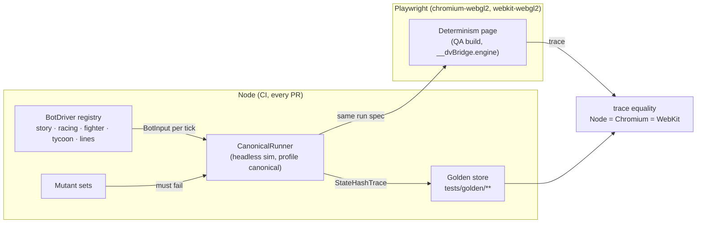

# S13 — QA, Verification and Spec Integration (part A: strategy, harnesses, C15)

> Wave 5 · v1.0 · 2026-10-18 · author S13 (`claude-opus-5-5`). Binding inputs: `prompt-pack/06-SHARED-CONTEXT.md` v1.1, `spec/.wave5-notes.md`, `spec/03-decisions-and-facts.md` v1.1, `spec/11-decision-log.md` (DL-001…DL-170, DL-OWN-01/02), `spec/00-plan.md`, all domain specs 01–12. Parts: this file (§0–§10); `13-qa-critics.md` (critic lens prompts, finding format, Definition-of-Done audit, consolidation procedures); `13-qa-trace.md` (traceability method and matrix). Companion outputs: `spec/08-test-and-ci.md` (pyramid, devices, perf-as-tests, CI, deploy, secrets, oracles) and `spec/07-milestones/_PLAN.md` with `_PLAN-1.md`…`_PLAN-3.md` (the final ordered milestone plan).

## 0. Checklist (seed expanded)

| # | Item | Status | Source |
|---|---|---|---|
| 1 | Traceability method: R-ID → spec § → milestone → named test → status, regenerated from milestone files | designed §2.6, `13-qa-trace.md` | 03-SPEC-TEMPLATE §G |
| 2 | Every R-ID has ≥ 1 milestone and ≥ 1 test with a proof (CI test fails on an empty row) | designed §3.8 · M00d | 03 §H.2 |
| 3 | Milestone plan consolidation from the register and both return files, shares merged | designed `_PLAN.md` | DL-155 |
| 4 | Session sizing (≈ 2–4 h, ≲ 40 files) and the DL-037 split rule; the nine required splits | designed §2.2, `_PLAN.md` | wave5 note 5 |
| 5 | Gaps: `RaceDef.intro` + `cut.race.intro.<raceId>` (M07b2), `tools/ci/econ-sim` (M04d), avatar and wardrobe schemas in `packages/shared/schemas/ui/` (M04b2) | designed `_PLAN` rows | wave5 note 11 |
| 6 | C15 1.1: AC proof grammar, oracle naming, evidence vocabulary, backward compatible with READY files | designed §4 | brief |
| 7 | C15 lint over `spec/07-milestones/*.md` | designed §3.8 · M00d | §4 |
| 8 | Test pyramid with owners and gates | designed §2.1, 08 §2 | R-ENG-01/02 |
| 9 | Headless canonical runner shared by every bot and replay check | designed §3.1 · M04d | C02 1.1 |
| 10 | State-hash checkpoints and cross-browser hash suites | designed §3.3 · M01a1/M01a2 (exists), generalised M04d | C02, F-062 |
| 11 | Autoplayer bots behind one driver interface: missions, races, fights, tycoon | designed §3.2 · M04d + mode milestones | C03 1.1 `BotInput` |
| 12 | Golden files: layout, update procedure, review rule | designed §3.4 · M04d | [research/repos-modding.md] |
| 13 | Scripted input lines as regression oracles | designed §3.5 · M03a1, M04d | [research/repos-modding.md] P-UM-09 |
| 14 | Oracle discipline: every AC names its oracle; mutant sets; verifier lock | designed §2.3, §3.6 · M04d | [research/repos-modding.md] §6.6 rec 5 |
| 15 | Perf-as-tests per C13 tier: scenario table, warn/fail modes, device formula | designed 08 §4 · M01c, M11a1 | C13 §4.5 |
| 16 | Device matrix and scripted manual checklists | designed 08 §3 | `11-platform-perf.md` §6 |
| 17 | UNVERIFIED items appear only as device-run recordings, never as asserted outcomes | designed §4.3 rule L4 | wave5 note 6 |
| 18 | CI workflows with names, triggers, exact `pnpm` commands | designed 08 §5 | [research/gap-ci-cd-release-assets.md] R3 |
| 19 | One script registry, only 06 §5 names plus milestone-declared names | designed 08 §6 | wave5 note 13 |
| 20 | Preview and production deploy, DO migrations, rollback floor | designed 08 §7 | `09-backend-ops.md` §2 |
| 21 | R2 uploads via rclone, pointer in Worker assets | designed 08 §7 | [research/gap-ci-cd-release-assets.md] §2 |
| 22 | Secrets by env var name, per environment; two name conflicts resolved | designed 08 §8 | CLAUDE.md, `09-backend-ops.md` §6 |
| 23 | Oracles per domain | designed 08 §9 | all §9s |
| 24 | Three critic lens prompts (executability, factual, scope) and the finding format | designed `13-qa-critics.md` §1 | brief |
| 25 | Definition-of-Done audit procedure (H1–H10) with commands | designed `13-qa-critics.md` §2 | 03 §H |
| 26 | Cost model consolidation (DL-OWN-01 cap as per-milestone spend gates) | designed `13-qa-critics.md` §3.1; file `spec/10-cost-model.md` by the integration author | DL-OWN-01 |
| 27 | Risk register consolidation | designed `13-qa-critics.md` §3.2; file `spec/09-risk-register.md` by the integration author | 03 §A |
| 28 | Open questions and UNVERIFIED merge | designed `13-qa-critics.md` §3.3 | `spec/99` |
| 29 | `CLAUDE.md` / `AGENTS.md` sizes and command lines | designed `13-qa-critics.md` §3.4 · `check:agents` early in M00d | F-060 |
| 30 | Kickoff customization (order, stop rules, evidence words) | designed `13-qa-critics.md` §3.5 | 03 §A |
| 31 | Launch gate audit (release candidate) | designed §8 · M14b3 | 03 §H |
| 32 | `load:rooms` tool choice | designed §3.10 · M12c2 | `09-backend.md` §9 |
| 33 | `ip:similarity` clean-room runner | designed §3.11 · M14b3; tool UNVERIFIED | `05-assets-pipeline.md` §9 |
| 34 | Synthetic spend tests T1–T9 placement | designed §8 · M14b1, M14b2 | [research/gap-observability-cost-guardrails.md] Rec 3 |

## 1. Scope and R-IDs

S13 owns how correctness is proven and how the plan is sequenced. It writes no production code; every harness below is specified for a named milestone.

| R-ID | How S13 serves it | Where |
|---|---|---|
| R-ENG-01 | every check is one deterministic `pnpm` command; no GUI-only step; C15 lint, `check:agents` and the trace test keep the agent-facing files honest | §3.8, 08 §5–§6 |
| R-ENG-02 | every C13 budget row is a test: CPU-side counts in CI, frame time and memory on devices through `perf:verify` | 08 §4 |
| all R-IDs | traceability matrix, regenerated from milestone files, with an empty-row failure | `13-qa-trace.md` |

**Contracts.** Owned: C15 (1.0 → **1.1** proposed, §4). Honoured and exercised: C02 (canonical profile, `stateHash`), C03 1.1 (`DeviceKind 'bot'`, `BotInput`), C05 (golden save files), C11 (load bots), C12 (`/_test/*` routes, route 21 validators), C13 1.1 (`PerfScenario`, `PerfReport`, `QaFlags`, budgets), C16 (release gate on `app.abnormal_exit`). Shapes are used as frozen.

## 2. Design

### 2.1 Test pyramid

| Level | What it proves | Runner | Gate | Share of test count (target) |
|---|---|---|---|---|
| L1 Unit and golden | pure functions, schemas, vectors, codecs, lints | Vitest `check:unit`, package `test:*` folded into it | every PR | ≈ 70 % |
| L2 Deterministic sim | canonical-profile runs, state-hash traces, replays, bot runs | `CanonicalRunner` in Node (`check:missions`, `check:balance`, `check:fighter`, `test:determinism`) | every PR (short seeds); nightly (long) | ≈ 12 % |
| L3 Integration | Workers runtime, DOs, DB, pipeline with mocks | `check:workers`, `check:db`, `check:pipeline` | PR (path-filtered for DB) | ≈ 8 % |
| L4 End to end | browser state through `window.__dvBridge`, four Playwright projects | `check:e2e` | PR (`chromium-webgl2` required) | ≈ 7 % |
| L5 Perf (CPU-side) | counts, memory, cold bytes per tier | `check:perf` | warn on PR, fail nightly | ≈ 1 % |
| L6 Deployed | headers, isolation, smoke against Preview and staging | `check:headers`, `check:coi`, `check:smoke`, `test:staging` | preview and deploy | ≈ 1 % |
| L7 Device | fps, memory ceiling, thermals, real input, install | `perf:checklist` + `perf:verify` | release gate per milestone | checklists |
| L8 Ops | guardrails, kill drill, load | `test:ops`, `load:rooms` | release candidate, nightly staging | suites |

Rules: assert on state (backend, counts, hashes, objectives), never on pixels except 128–256 px goldens with tolerance; SwiftShader frame times are never asserted [research/gap-ci-cd-release-assets.md §4.1]; a check that needs a secret prints `SKIP … <VAR> not set` and exits 0 locally, and is required in CI only in the environment that holds the secret.

### 2.2 Milestone sizing and splits

One Builder session = Sonnet 5.5, ≈ 2–4 h agentic work, ≲ 40 hand-written files (generated files excluded, as M00 states). A milestone above that splits by DL-037: the letter is the scope, a digit is a session split, and both digits keep the scope's slug (as M01a1/M01a2 do). Applied here: M04a → M04a1/M04a2; M10a → M10a1/M10a2; M11a → M11a1/M11a2; M11b2 keeps its id and gains **M11b4** (next free digit, M11b3 exists); M12b → M12b1/M12b2; M12c → M12c1/M12c2; M14b → M14b1/M14b2/M14b3. M15a–g stay multi-session post-v1 scopes (a later wave splits them). Two QA milestones are added: **M00d** `qa-spec-gates` (0.5) and **M04d** `qa-harness-bots-goldens` (1). Result: 108 v1 milestones (≈ 100 sessions) and 7 expansion scopes (≈ 12 sessions).

### 2.3 Oracle discipline

1. Every acceptance criterion names its oracle, explicitly or by the command's script (§4.2 table) [research/repos-modding.md §6.6 rec 5].
2. A bench or replay oracle ships with a mutant set: one-defect variants that must fail (`tools/ci/mutants/<suite>/`). A suite whose mutants pass is vacuous and fails CI.
3. Verifier lock: `tools/ci/verifiers.lock.json` stores the SHA-256 of each verifier script and golden directory. A PR that changes a verifier (or a golden) and the code it verifies in the same commit range fails unless the PR carries the label `golden-update` with a one-line reason in the PR body.
4. Evidence vocabulary in reports and PR bodies: `implemented`, `tested`, `seen-on-device`, `unverified` (C15 `Evidence`). "Done" requires `tested`; a device AC requires `seen-on-device` with an uploaded `perf.json` or `notes.json`.
5. Fresh-context verification: critic passes run in new subagents, not as self-review, because fresh-context verifiers tend to outperform self-critique [research/claude-5-5-prompting-guidance.md "Long-running agent recommendations"].

### 2.4 Harness architecture



The same `RunSpec` (scenario, seed, ticks, bot, checkpoints) drives Node and the browser page; equality of `StateHashTrace` across the three runtimes is the determinism oracle for every mode.

### 2.5 Release flow

PR → `ci.yml` (L1–L5) → `preview.yml` (Workers Preview of the staging Worker, L6) → merge to `main` → `deploy.yml` to staging (`versions upload` → 0 % smoke → 100 %) → tag `v*` by an allowlisted actor → production with the same steps (gradual 10/50/100 from M12a1) [research/gap-ci-cd-release-assets.md §1.4, R3]. A milestone is done when its ACs pass and the app stays deployable (C15). A release candidate additionally passes the device checklists listed for the milestones it contains (08 §3).

### 2.6 Traceability method

Source of truth is the milestone files: `## Requirements` lists R-IDs, each AC's proof names tests or tags. `tools/ci/trace.ts` (run by the unit test `tools/ci/test/traceability.test.ts`, so `pnpm check:unit -- tools/ci` executes it) parses `spec/07-milestones/*.md` and `_PLAN*.md`, joins R-IDs from 06 §2, and writes `tests/reports/trace.json` plus `tests/reports/trace.md`. It fails when an R-ID has no milestone, no test name, or only proofs whose oracle is `device-check` while an automatable oracle exists in the domain §9. The Architect's matrix in `spec/01-product.md` is the generated `trace.md`; the hand-seeded starting matrix is `13-qa-trace.md` §2.

**Alternatives rejected.** One shared bot per mode written by S13 (rejected: mode owners own their policies; S13 owns the interface). Pixel goldens as the main e2e oracle (rejected: SwiftShader differs from GPUs). k6 or Artillery for room load (rejected §3.10). A second Playwright project for Safari on macOS runners (rejected: Metal availability UNVERIFIED; nightly informational probe instead).

## 3. Components

### 3.1 `CanonicalRunner` (`packages/engine/src/qa/runner.ts`, QA builds and Node only; M04d)

```ts
import type { SimProfile } from '@dv/shared/contracts/c02-loop';
export interface RunSpec {
  suite: string;                       // 'missions' | 'racing' | 'fighter' | 'tycoon' | 'world' | 'econ' | 'engine'
  scenario: string;                    // e.g. 'm.a1.03', 'sf.sprint.embarcadero', 'vs-001', 'walk-drop'
  seed: number;                        // u32
  profile: Extract<SimProfile, 'canonical'>;
  maxTicks: number;                    // hard stop; expectedSec × 60 × 1.5 for missions
  checkpointEvery: number;             // ticks; 600 unless the suite says otherwise
  bot: { driver: string; params?: Record<string, unknown> };   // BotDriver id
  flags?: Partial<{ hooks: 'stub' | 'bot'; talk: 'scripted'; beats: 'instant' }>; // C13 1.1 QaFlags subset
}
export interface StateHashTrace { v: 1; spec: RunSpec; build: string; checkpoints: { tick: number; hash: string /* fnv1a64 hex */ }[]; end: { tick: number; hash: string; outcome: string } }
export interface CanonicalRunner { run(spec: RunSpec): Promise<StateHashTrace> }
```
It boots the headless host from M01a1 (no `window`, `document`, `navigator.xr`), loads the scenario through the mode's own loader, steps with the bot's `BotInput`, and records `stateHash` (C02, FNV-1a-64) at checkpoints. Identical inputs must give identical traces in Node, Chromium and WebKit.

### 3.2 `BotDriver` registry (`packages/engine/src/qa/bots.ts`; implementations by mode owners)

```ts
import type { BotInput } from '@dv/shared/contracts/c03-input';   // C03 1.1, DeviceKind 'bot'
export interface BotDriver {
  id: string;                          // 'story.autoplayer' (M05a2) · 'racing.line' (M07a1) · 'fighter.cpu' / 'fighter.script' (M08a1–a2) · 'tycoon.<policy>' (M09a2) · 'lines' (M04d)
  init(ctx: BotContext, params?: Record<string, unknown>): void;
  step(tick: number): BotInput;        // pure given ctx observations; seeded RNG stream 'bot'
  done(): { done: boolean; outcome?: string };
}
export interface BotContext { observe(): Readonly<Record<string, unknown>>; rng(stream: 'bot'): () => number }
```
Bots read only the observation surface the bridge already exposes (`__dvBridge` in browsers, the headless host in Node) and act only through `BotInput`, so a bot run exercises the real input path.

### 3.3 State-hash suites (cross-browser)

Existing tags stay as written (`@determinism`, `@racing-det`, `@fighter-hash`, `@world-hash`); M04d adds a suite registry `tests/e2e/det/suites.ts` that lists each tag with its `RunSpec`s and Node golden. Nightly runs all of them in `chromium-webgl2` and `webkit-webgl2` with `--grep "@determinism|@racing-det|@fighter-hash|@world-hash|@tycoon-det"`.

### 3.4 Golden store

Layout `tests/golden/<suite>/<name>.json` (canonical JSON, `canonicalize` from `@dv/shared`); package-local goldens (`detmath.v1.json`, `determinism.*.json`) stay where their milestones put them and are listed in `verifiers.lock.json`. Update procedure: `DV_UPDATE_GOLDEN=1 pnpm check:unit -- <path>` rewrites only the goldens of that path; the PR needs the `golden-update` label and a reason; CI never runs with `DV_UPDATE_GOLDEN` set (the runner fails if it is).

### 3.5 Scripted input lines

`*.line.json` = `{ v: 1, scenario, seed, frames: [{ tick, input: BotInput }] }`, recorded by the M03a1 recorder, replayed by driver `lines`. A line asserts end pose and hash (for example `walk-drive.line.json`, `filbert`). Lines are oracles for controller, vehicle and camera behaviour; tuning changes must update the line golden through the procedure above.

### 3.6 Mutants and verifier lock (`tools/ci/mutants/`, `tools/ci/verifiers.lock.json`)

Each determinism, replay and balance suite registers ≥ 2 mutants (for example: an RNG stream swapped, one tick skipped, a frame-data value off by one, a band widened). `tools/ci/test/mutants.test.ts` applies each through a module override and asserts the suite fails.

### 3.7 Device checklists

S11 owns the tools (`perf:checklist`, `perf:verify`, `PerfReport` schema). S13 owns the inventory (08 §3.3): one JSON file per milestone and device, `tools/ci/checklists/<M##>-<device>.json`; results (`perf.json`, `notes.json`) are committed under `docs/device-runs/<M##>/<device>/` (M01c keeps its own `docs/device-spike/M01c/<device>/`) and judged by `perf:verify`.

### 3.8 Spec gates (M00d)

- `tools/ci/test/milestone-format.test.ts`: C15 lint (§4.3) over every file in `spec/07-milestones/` except `README.md` and `_PLAN*.md`.
- `tools/ci/test/traceability.test.ts`: §2.6.
- `check:agents`: `CLAUDE.md` and `AGENTS.md` each < 200 lines (03 §A); root `AGENTS.md` ≤ 16,384 bytes until M13a6, then root + kit ≤ 32,768 bytes because Codex concatenates `AGENTS.md` files up to 32 KiB [F-060; `12-modding-publish.md` C§1]. Root is 13,255 bytes today, so the 8,192 proposal of S12 would fail (decision in §10).
- `check:skills` stays `pending: lands in M13a6` (mirrors `skills/` to `.claude/skills` and `.agents/skills`).

### 3.9 Economy harness `tools/ci/econ-sim` (closes wave5 gap 11; owner S01, built in M04d)

Monte-Carlo over the C06 `EconomyApi` ledger: income tables (mission rewards, race payouts, tycoon dividend counter capped at $10,000 per game week, DL-134) and sinks (shops, upgrades, property) per content section, run with the story autoplayer's reward events or fixtures. Bands live in `config/econ-bands.json` (cents). Invocation `pnpm check:balance -- --suite econ`; `check:balance` without `--suite` runs every suite (econ from M04d, tycoon from M09a2). Sections arrive with their content: Act 1 (M05c1), racing (M07b2), Acts 2–3 (M05e1, M05f1; band $70k–$110k added rewards, `03-story-narrative.md` B6).

### 3.10 Room load bots (`tests/load/rooms.ts`, M12c2)

A Node script using `@dv/net` (the real C11 codec) opens N WebSockets through route 23/24 tickets and sends `IN` at 20 Hz. Chosen over k6/Artillery because the bots must speak the binary C11 frames with the project's own codec. Client: Node 22 global `WebSocket` (UNVERIFIED for the pinned Node 22 minor; fallback the `ws` package). Two locations = one GitHub-hosted runner plus one operator machine (runner region is not selectable; UNVERIFIED that two runners land in different PoPs).

### 3.11 `ip:similarity` (M14b3)

Runs only in a separate clean-room repository and runner owned by the operator ("Zone R"), which checks out this repository read-only next to the example repositories and reports file and line of ≥ 50-token clones; the Builder never sees the example code (CLAUDE.md rule). Tool choice is UNVERIFIED (licence check at M14b3).

## 4. Data — C15 1.1 (proposed minor bump; additive, accepts every READY file)

### 4.1 TypeScript (`packages/shared/src/contracts/c15-milestone.ts`, pure; consumers `tools/ci/milestone-lint.ts`, `tools/ci/trace.ts`, milestone authors, critics)

```ts
export const C15_VERSION = '1.1.0';
export const MILESTONE_ID_RE = /^M\d{2}(?:[a-z]\d?)?$/;               // DL-037: letter = scope, digit = session split
export const MILESTONE_HEADINGS = ['Goal', 'Requirements', 'Depends on', 'Scope in', 'Scope out', 'Deliverables',
  'Interfaces', 'Acceptance criteria', 'Test plan', 'Demo script', 'Effort', 'Risks & fallbacks', 'Notes for the Builder'] as const;
export type MilestoneStatus = 'PENDING' | 'READY' | 'frozen';          // recorded in spec/07-milestones/README.md
export type OracleKind =
  | 'unit' | 'golden' | 'state-hash' | 'replay' | 'bot-run' | 'e2e' | 'workers' | 'db' | 'static-gate'
  | 'perf-cpu' | 'staging' | 'ops' | 'load' | 'device-perf' | 'device-check';
export type Evidence = 'implemented' | 'tested' | 'seen-on-device' | 'unverified';
export interface CommandProof {
  kind: 'command';
  commands: string[];               // each starts with `pnpm ` after optional `env -u VAR …` or `VAR=value` prefixes
  oracle: OracleKind;               // explicit `[oracle: x]` suffix, else inferred (§4.2)
  needs?: string[];                 // secret env var names or `staging`; absent = runs offline in a clean checkout
}
export interface ManualProof {
  kind: 'manual';
  device: string;                   // 'desktop browser' | 'operator workstation' | 'iPhone 15…' | 'Quest 3…' | 'Vision Pro…' | 'desktop <class>'
  steps: string;
  checklist?: string;               // tools/ci/checklists/<M##>-<device>.json
  followUp?: string[];              // commands run on the uploaded output, e.g. `pnpm perf:verify -- perf.json --tier mobile-low`
  records?: string[];               // UNVERIFIED ids this run records (never asserted)
}
export interface AcceptanceCriterion { id: `AC-${number}`; given: string; when: string; then: string; proof: CommandProof | ManualProof }
export interface MilestoneDoc {
  id: string; slug: string;
  requirements: { rid: string; clause: string }[];
  dependsOn: string[]; contracts: { id: `C${number}`; version: string }[];
  acs: AcceptanceCriterion[];
  effort: { sessions: number; files: number; risk: 'low' | 'medium' | 'high' };
}
```

### 4.2 Proof grammar and oracle naming

```
ac          = "- AC-" INT " Given " TEXT " When " TEXT " Then " TEXT " — proof: " proof [" [oracle: " KIND "]"]
proof       = cmd { ( " and " | "; " | ", then " ) cmd } | "manual: " DEVICE ", " STEPS
cmd         = "`" [ENVPREFIX] ( "pnpm " SCRIPT [ " -- " ARGS ] | "pnpm --filter " PKG " " SCRIPT [ " -- " ARGS ] ) { " && " … } "`"
```
Inference (first matching script wins): `check:unit`, `--filter … test[:x]` → `unit` (→ `golden` when the path or name says golden or vectors); `test:determinism`, `--grep @determinism|@*-det|@*-hash` → `state-hash`; `fighter:replay`, `racing … replay` → `replay`; `check:missions`, `check:balance`, `check:fighter`, `map:races par`, `tycoon:sim` → `bot-run`; `check:e2e`, `check:e2e:xr`, `check:smoke` → `e2e`; `check:workers`, `check:pipeline` → `workers`; `check:db`, `check:db:types` → `db`; `check:perf` → `perf-cpu`; `test:staging` → `staging`; `test:ops` → `ops`; `load:rooms` → `load`; `perf:verify` → `device-perf`; every other `check:*`, `provenance:check`, `ip:*`, `license:scan`, `names:lint`, `likeness:gate`, `map:verify`, `npc:lint` → `static-gate`; `manual:` → `device-check`. Test names follow `<package-or-suite>/<area>.<case>` (as the domain §9s already do); e2e tags `@<domain>[-<aspect>]`; device checklist ids `<M##>-<device>`.

### 4.3 Lint rules (`milestone-format.test.ts`)

- **L1** Headings are exactly `MILESTONE_HEADINGS`, in order, as `##` lines; title line `# <id> — <slug>`.
- **L2** Each AC has Given, When, Then and `— proof:`; ids run AC-1…AC-n without gaps.
- **L3** A proof contains ≥ 1 backticked command that parses as `cmd`, or starts with `manual:`. A manual proof needs a device label and steps.
- **L4** No AC line contains the token `UNVERIFIED`; a `U-…` id may appear only after "records" or "decides" (a recording, wave5 note 6).
- **L5** Every `pnpm <script>` is in the registry (08 §6) or declared in this milestone's Deliverables.
- **L6** Requirements cite only 06 §2 R-IDs; Depends on cites only ids in `_PLAN.md`; Interfaces cite contract versions equal to 06 §4.2 (or a proposal marked "proposed").
- **L7** Effort states sessions ≤ 1 and files ≤ 40 (warning above 35).
- **L8** A milestone whose Deliverables touch a deployed surface has one AC proving `pnpm deploy:preview` or `pnpm check:smoke` (the app stays deployable).

READY files M00…M01f pass L1–L8 as written (their manual proofs use `manual: desktop browser, …` and `manual: operator workstation, …`).

## 5. Runtime behavior (CI)

- **Pending stubs.** A `check:*` whose milestone has not landed prints `pending: lands in <milestone>` and exits 0 (CLAUDE.md). The trace test treats a pending check as "no test yet".
- **Flake policy.** Playwright `retries: 1` in CI only; a test that passes on retry is reported as flaky in the job summary; a test flaky on 3 of the last 10 `main` runs is quarantined with tag `@quarantine` by a PR that names an owner milestone; quarantined tests run nightly and never gate. Deterministic suites (L1–L2) never retry.
- **Timeouts.** Every job sets `timeout-minutes`; bot runs stop at `maxTicks` and fail with the last checkpoint.
- **Perf modes.** `pnpm check:perf` warns by default (PR annotations only); `pnpm check:perf -- --fail` fails (nightly), as M01c defines; M11a1 makes the nightly fail mode a required check.
- **Secrets absent.** SKIP line, exit 0; the job summary lists every SKIP so "Blocked on" is visible.
- **Budgets per tier.** CI emulates tiers with `?tier=` on the three flat projects and `xr-quest3`; device truth comes only from `perf:verify` (08 §4).

## 6. Platform notes

| Platform | Automated in CI | Manual (scripted checklist) |
|---|---|---|
| Desktop Chromium | `chromium-webgpu` (SwiftShader), `chromium-webgl2` | real-GPU Chrome on Desktop A/B/C (M01c, M11a) |
| Desktop Safari | `webkit-webgl2` on Linux as engine proxy (no `navigator.gpu`) | Safari 26/27 macOS (M01c, M11a) |
| iPhone PWA | WebKit with 844 × 390 touch viewport (`@touch`, `@ui-touch`, `@racing-touch`, `@fighter-touch`) | Home Screen app on iPhone 15 (`mobile-low`) and 16/17 (`mobile`): fps, memory bomb, `persist()`, soak, audio unlock, pose camera |
| Quest 3/3S | `xr-quest3` (IWER, WebGL XR path only) | Quest Browser: refresh 72/90, face buttons, comfort, cutscene host |
| Vision Pro | `?tier=xr-visionpro` counts on flat projects; `xr-swap` on `chromium-webgpu` | visionOS 26.2+: gaze-pinch, per-pass budgets, native WebGPU XR |

XR CI covers only three's WebGL XR fallback; native WebGPU XR stays a device check [research/gap-ci-cd-release-assets.md §4.2].

## 7. Verified facts used

| Fact | Source |
|---|---|
| Workers Previews per PR; Version URLs use production resources; no queue consumers, crons or own Workflows in a Preview | F-061 [research/gap-ci-cd-release-assets.md §1.5] |
| SwiftShader WebGPU headless works with the four flags; Playwright WebKit on Linux lacks `navigator.gpu` and `navigator.xr`; IWER 2.6.0 runs three XR when installed first | F-062 [research/gap-ci-cd-release-assets.md §4.1–§4.2] |
| `versions upload` → `versions deploy` with percentages, override header smoke, `rollback`; DO lifecycle changes need `wrangler deploy` | [research/gap-ci-cd-release-assets.md §1.4] |
| rclone S3 path for bulk R2 uploads; REST limit 1,200 req / 5 min | [research/gap-ci-cd-release-assets.md §2.1] |
| Pins: wrangler 4.151.1, vite 8.3.4, TS 6.0.3, Playwright 1.64.1 | F-016, M00 |
| Quest 3 budgets: 72 Hz minimum, < 200 draw calls, < 1.5 M triangles | F-013 |
| fal has no spend cap; balance threshold locks the account | F-048 |
| Codex concatenates `AGENTS.md` up to 32 KiB | F-060 |
| Stop / SubagentStop hooks can keep an agent working; PreToolUse on Write/Edit can reject structure | [research/claude-code-deployment.md §5] |
| Fresh-context verifier subagents tend to outperform self-critique | [research/claude-5-5-prompting-guidance.md] |

**UNVERIFIED (S13):** U-QA-1 SwiftShader recipe on a GitHub runner (= U-PLT-19; M00 records it). U-QA-2 `wrangler deployments status --json` field names (M00a reads `--help`; fallback: previous id from the last upload ND-JSON). U-QA-3 Node 22 global `WebSocket` without a flag (M12c2; fallback `ws`). U-QA-4 two distinct PoPs for load bots (M12c2 records PoPs from `cf-ray`). U-QA-5 `ip:similarity` tool and licence (M14b3). U-QA-6 required reviewers and environment secrets on the repository's GitHub plan (Q-15; fallback tag-only prod by an allowlisted actor). U-QA-7 Metal on standard macOS runners (nightly informational probe). U-QA-8 `_headers` applied on Preview URLs (M00 AC-14 checks it).

## 8. Milestone mapping

| Milestone | S13 share | Stubbed first / later | Sessions |
|---|---|---|---|
| **M00** (READY) | CI skeleton: `ci.yml` jobs `static`, `unit`, `build`, `e2e` matrix (only `chromium-webgl2` required), `preview.yml`; canonical scripts with pending stubs | `deploy.yml` (M00a); `ip` job and `nightly.yml` (M00b) | share of 1 |
| **M00d** `qa-spec-gates` | C15 1.1 types, milestone lint, traceability test and report, `check:agents` (size rules), extends `nightly.yml` (created by M00b) with the full e2e matrix, the det suites and `check:perf -- --fail`, `golden-update` label rule, `tests/reports/` layout | trace marks pending checks | 0.5 |
| **M04d** `qa-harness-bots-goldens` | `CanonicalRunner`, `BotDriver` registry with driver `lines`, golden store and update guard, det suite registry, mutant harness, verifier lock, `tools/ci/econ-sim` + `check:balance -- --suite econ`, `config/econ-bands.json` | mode drivers by their owners (M05a2, M07a1, M08a1, M09a2) | 1 |
| M05a2, M07a1, M08a1, M09a2 | review: each mode registers its driver, ≥ 2 mutants and a det tag | — | 0 |
| **M12c2** | `tests/load/rooms.ts` design (§3.10) | — | share |
| **M14b1 / M14b2** | T1–T9 suite design (owner S13 per the research), placement: T1–T3, T7–T9 in `test:ops -- --suite guardrails` per release candidate; T4–T6 nightly on staging, 3 consecutive nights | — | shares |
| **M14b3** `launch-hardening-guardrails` (session 3) | launch gate audit: DoD H1–H10, trace report with zero empty rows, release device pass on the full matrix, `ip:history`, `ip:similarity` (Zone R), names knock-out applied (DN-S06-02), counsel and sensitivity sign-offs recorded (Q-18, Q-21, Q-23), flag flips checklist (`ugc.publish`, `mods.*`) | Thirdweb (M14a) re-runs the gate subset | 1 |

## 9. Tests (of the QA layer itself)

1. `tools/ci/milestone-format` — every READY file passes; fixtures with a missing heading, an AC without proof, `UNVERIFIED` in an AC and an unknown script each fail — `pnpm check:unit -- tools/ci`.
2. `tools/ci/traceability` — a fixture milestone set with one uncovered R-ID fails; the repo set writes `tests/reports/trace.json` — same command.
3. `engine/qa.runner` — the same `RunSpec` twice gives equal traces; `DV_UPDATE_GOLDEN` set under `CI=true` throws — `pnpm check:unit -- packages/engine/src/qa`.
4. `engine/qa.det-suites` — Node golden equals Chromium and WebKit for driver `lines` — `pnpm check:e2e -- --project=webkit-webgl2 --grep @determinism`.
5. `tools/ci/mutants` — every registered mutant makes its suite fail — `pnpm check:unit -- tools/ci`.
6. `tools/ci/verifiers-lock` — a fixture diff changing a verifier and its subject without the label fails — same command.
7. `econ.self-test` — band fixtures that are deliberately out of band exit non-zero — `pnpm check:balance -- --suite econ`.
8. `check:agents` — a 201-line `CLAUDE.md` fixture fails; the repo passes — `pnpm check:agents`.

## 10. Open questions and decisions needed

- **DN-S13-01** Root `AGENTS.md` limit: S12 proposed ≤ 8,192 bytes; root is 13,255. Recommendation: ≤ 16,384 now, and at M13a6 root + kit ≤ 32,768 (kit ≤ 19,456) instead of trimming the root.
- **DN-S13-02** Cutscene allocation inside DL-OWN-01's $40: recommendation Act 1 prewarm ≤ $16 (M05c3), fighter intros and finishers ≤ $24 (M10b); everything else in-engine.
- **DN-S13-03** Secret names: CLAUDE.md `OPENAI_MODERATION_API_KEY` vs `09-backend-ops.md` `OPENAI_MODERATION_KEY`; CLAUDE.md `CLOUDFLARE_API_TOKEN` vs ops `CF_API_TOKEN_DEPLOY`. Recommendation: keep the CLAUDE.md names (`CLOUDFLARE_API_TOKEN` is the deploy token), add `CF_API_TOKEN_CACHE` for purge only, and fix `09-backend-ops.md` §6.
- Ordering note (resolved by `spec/07-milestones/README.md`): M01f runs before M01b2; `_PLAN.md` keeps the fast-track list order and marks it.
- Owner questions that gate QA: Q-13 (devices), Q-15 (GitHub plan, domains), Q-18/Q-21/Q-23 (launch sign-offs).
